## Document Control
### Reviewer lens
<!-- review: Excavation I1 -->

- Phase: Excavation
- Status: Draft — technical lens of the end-of-Excavation milestone review, iteration 1
- Milestone Target: end of Excavation (AR) — not yet achieved
- Review type: Milestone review (AR), technical lens — formal inspection of the recovered artifacts against the evidence they cite
- Reviewed: Vision, Use-Case Model, Supplementary Specification, Software Architecture Document, Deployment Model, Design Model, System Inventory, Risk List, Iteration Plan — all Excavation, Draft
- Prior findings of this lens: 2 open at the previous milestone review (`Risk List#F2`, `Iteration Plan#F5`), both closed here on corrected content
- Findings recorded this iteration: 10 — 0 Critical, 3 Major, 7 Minor
- SCM evidence: no pull request in any state; no IARI build on `main`

### Management Reviewer lens
<!-- review: Survey I2 -->

<!-- review: Survey I2 -->

- Phase: Survey
- Status: Draft — governance lens of the end-of-Survey milestone review, iteration 2
- Milestone Target: end of Survey (SBC) — exit criteria met on this lens; sanction GRANTED by the stakeholder, 2026-11-19
- Review type: Milestone review (SBC), governance lens
- Reviewed: Development Case, System Inventory, Risk List, Iteration Plan — all Survey, Draft, corrected in iteration 2
- Prior findings of this lens: 3 Major open at the previous milestone review, 3 closed here
- Findings recorded this iteration: none from this lens
- Stakeholder sanction: GRANTED — the perimeter confirmed as drawn; advancing past SBC sanctioned
- Stakeholder order: the two Minor findings corrected in the next phase, not left unresolved
- Cross-artifact consequence carried from iteration 1: closed — `AN-008` and `R008` name the same two disclosure homes
- SCM evidence: no pull request in any state; no IARI build on `main`

### Review Coordinator lens
<!-- review: Survey I2 -->

<!-- review: Survey I2 -->

- Phase: Survey
- Status: Draft — consolidated coordination block of the end-of-Survey milestone review, iteration 2
- Milestone Target: end of Survey (SBC) — 0 open Critical, 0 open Major on both executing lenses, perimeter confirmed, Stakeholder sanction GRANTED; the phase advances and the Iteration Assessment follows this verdict
- Review type: Milestone review (SBC), consolidation of the executing lenses
- Lenses executed: Reviewer (technical), Management Reviewer (management)
- Lens not executed: Business Reviewer — INACTIVE, did not evaluate this review
- Verdict: Go — requiresIteration false; the 2 open Minor findings carried to the next phase under the stakeholder's order of 2026-11-19

## Review Scope and Criteria
### Reviewer lens
<!-- review: Excavation I1 -->

The AR question is whether the recovered artifacts rest on the code they cite. Excavation is the second and last phase of the sprint zero, and it produces no code, no build and no test — so this lens asks a narrower question than a Construction review would: for each element an artifact declares, does the file it names say what the element claims, and does the trace chain hold what the artifacts assert about it.

| Artifact | Author | Checklist applied |
|---|---|---|
| Vision | System Analyst | Every claim anchored or marked not established; recoveries cite `EP-NNN` rather than a declared requirement; no business objective invented; exclusions held |
| Use-Case Model | System Analyst | Every `UC-NNN` cites its `Source: EP-NNN`; cross-cutting mechanisms held out of the model; one actor's goal is one use case; business rules cite their enforcement point; trace rows against the matrix |
| Supplementary Specification | System Analyst | Every mechanism an `<<include>>` rather than a use case; every threshold a figure some file states; every unmet or unstated requirement recorded as such, not invented |
| Software Architecture Document | Software Architect | Every `COMP-NNN` cites the files it is read from; every component on a use-case path realizes it; only declared technology and versions; trace rows against the matrix |
| Deployment Model | Software Architect | Trigger genuinely holds; every node and connector anchored; no environment declared that no file names |
| Design Model | Designer, Database Designer | Every `ACL-NNN`/`CLS-NNN`/`TBL-NNN` anchored; every table, key, index and cascade read from a migration body; co-owned sections intact; trace rows against the matrix |
| System Inventory | Software Archaeologist | Anchor verification — every high-consequence row opened against its file; coverage reconciles with its own rows; no area of the tree left neither described nor declared unread; anomalies current with the artifact set |
| Risk List | Project Manager | Magnitude the band of P × I on the declared scale; every anomaly scored; every acceptance in the stakeholder's words; every action owned by a role at work where it lands |
| Iteration Plan | Project Manager | One committed total; no forecast before a measured actual; no duration on a gate; the roster accounted for; no figure contradicting the artifact it summarises |

#### What was opened, not merely taken on trust

Seven anchors were opened through the SCM and read against the claim the artifact makes over them. Each was chosen because a statement downstream depends on it:

| Anchor opened | The claim it carries | Verdict |
|---|---|---|
| `Todo.Web/Client/Components/TodoList.razor` | The checkbox carries no `@bind` and no `@onchange`, so completion has no screen path (`AN-008`, `R008`, `UC-006` A4) | **Confirmed** — `<input type="checkbox" value="" aria-label="..." />`, no binding, no handler |
| `Todo.Web/Server/Authentication/TokenNames.cs` | `accessToken` is the only token name the BFF holds, so no refresh token is stored (`BR-006`, `AN-015`) | **Confirmed** — one static field, `AccessToken = "accessToken"` |
| `Todo.Api/Users/UsersApi.cs` | The `/users` group carries no authorization and no limiter; `WithParameterValidation` names `ExternalUserInfo` only, never `UserInfo` (`BR-031`, `BR-032`, `AN-011`, `AN-018`) | **Confirmed** — no `RequireAuthorization` on the group, the service-to-service `TODO` in place, one `WithParameterValidation(typeof(ExternalUserInfo))` |
| `TodoApp.AppHost/Extensions.cs` | The schema gate creates `.db` and only then registers the migration, so a failed first start leaves later starts applying no schema (`AN-021`) | **Confirmed** — `Directory.CreateDirectory` inside the `if`, `AddEfMigration` registered only in that branch |
| `Todo.Api/Todos/TodoApi.cs` | Ownership is a predicate inside the statement; the admin disjunct is dead (ADR-003, `BR-017`, `BR-022`, `AN-010`) | **Confirmed** — `owner.IsAdmin` at lines 33, 59, 69; `ExecuteUpdateAsync` / `ExecuteDeleteAsync` with the owner predicate in the same statement |
| `Directory.Packages.props` | The single home of every package version, no project file carrying one (`CON-A08`, ADR-012) | **Confirmed as to the pin; the count is disputed** — 30 `PackageVersion` rows, not the 27 two artifacts report |
| `Todo.Web/Client/TodoClient.cs` | Six methods, none of them an update call (`AN-008`, COMP-005) | **Confirmed as to the absence; the count is disputed** — six public methods, not the five the SAD's COMP-005 row states |

#### What was checked as notation, not as illustration

Every artifact of this phase carries at least one UML or PlantUML diagram, and each was read as notation. The three use-case-view sequence diagrams name real lifelines (`COMP-001` … `COMP-012`), real message names (`GetTodosAsync`, `CreateUserAsync`, `StoreTokens`) and carry numbered branches for the failure paths: an informal sketch drawn as arrows would have failed here and none did. The Design Model's state machine for `CLS-001` carries guards on every transition and records in a note that one transition no delivered screen can drive. The class diagrams carry multiplicities and stereotypes. The two risk diagrams state the scale arithmetic rather than describing it. No diagram in this set is decoration.

#### Trace verification against the matrix

The RTM at this milestone carries **269 links at 54 % coverage**, and four groups are marked SUSPECT, each of which must clear or be decided before the phase closes:

| Suspect link | Target role | What it means |
|---|---|---|
| `UC-001`, `UC-002`, `UC-004`, `UC-005`, `UC-007` → `COMP-006` `Realizes` | System Analyst | Five realization edges into the Use-Case Model that the use-case artifact itself never confirms |
| `AN-003` → `R003` `Refines` | Software Archaeologist | One end of the link changed when the Development Case was corrected; the anomaly did not follow |
| `CLS-011` → `TBL-007` `Specifies` | Designer | A table whose only writer sits on an excluded entry point |
| `TBL-007` → `20221123071234_Initial.cs` `Generates` | Implementer | A role that does not work in the sprint zero, so waiting cannot clear it |

The remaining rows of the matrix were checked against the artifacts' own trace tables and agree: the eight use cases each carry their `EP-NNN` origins, the eighteen components carry their `Realizes` and `DependsOn` edges, the eight tables carry their `Specifies` edges, and the twenty-five risks each carry their `Refines` edge from an anomaly or stand on their own as `R021` does.

#### SCM evidence

`scm_list_pull_requests` in any state returns nothing: Excavation runs no implementation stage, so there is no scaffolding to approve, no code to request changes on, and nothing to defer out of phase. `scm_get_build_status("main")` reports no IARI pipeline, correct for a phase whose plan records that it "writes no code, deploys nothing and runs no test". No pull request, build status, execution result, test count or duration is cited in this block, because none exists to cite.

#### Entry criteria applied

| Entry criterion | Held? |
|---|---|
| Every artifact of the phase present and in a reviewable state | Yes — nine Excavation artifacts, each Draft and issued for this review |
| Prior finding ledger readable with resolution state | Yes — `read_artifact_findings` on all twelve project artifacts |
| A checklist prepared per artifact type before reading | Yes — the nine above, fixed before the first artifact was opened |
| Upstream artifacts available: Development Case, System Inventory, Risk List, Iteration Plan | Yes — the Development Case's optional-trigger table was read before the Deployment Model was judged |
| The stakeholder's decisions of 2026-11-19 available as scope authority | Yes — three exclusions and four acceptances, each carried in the artifacts |

### Management Reviewer lens
<!-- review: Survey I2 -->

<!-- review: Survey I2 -->

Review type: milestone review (SBC), governance lens. Subject: whether the seven Major defects of the previous milestone review were corrected, whether the artifact set now carries the evidence each SBC exit criterion rests on, and whether the perimeter as drawn is confirmed.

In scope: Development Case, System Inventory, Risk List, Iteration Plan — all Survey, Draft, corrected in Survey iteration 2.

Two tests are applied to each criterion, and a criterion is met only when it survives the stricter of them. The technical test asks whether a magnitude is the band of probability × impact on the IARI scale, whether a trigger decision holds against the project's real facts, and whether an anchor says what the row claims. The governance test, which is mine, asks whether every action the artifact set commits to can be executed by the role and in the phase it names, whether the phases that receive the tailoring can work under it, and whether any figure or forecast appears that the project has not measured.

```plantuml
@startwbs
title SBC exit criteria - what the governance lens tests, and the evidence it reads
skinparam shadowing false

* SBC milestone - governance lens
** C1 Perimeter confirmed
*** Test: did the stakeholder confirm the perimeter as drawn
*** Read: Perimeter, three exclusions, the sanction answer
** C2 Priorities ordered
*** Test: does each of the eight areas carry its reason
*** Read: Priorities; the declined Excavation split
** C3 Unread areas declared
*** Test: is every unread file named with its reason
*** Read: Coverage per-area rows
** C4 Anomalies scored, High ones accepted
*** Test: is every AN scored, and every acceptance in the stakeholder's words
*** Read: Risk Register; Risk Mitigation; the acceptance table
** C5 Tailoring issued and usable
*** Test: can the phases that work under it use it before they start
*** Read: Development Case; fine-plan item 1; the three Undocumented families
** C6 Roadmap and fine plan
*** Test: one committed total; no invented figure; no sized human gate
*** Read: coarse roadmap; fine plan; Measure and forecast
** Findings reconciled
*** Test: is every Major of the previous review closed on evidence
*** Read: read_artifact_findings, all four artifacts
@endwbs
```

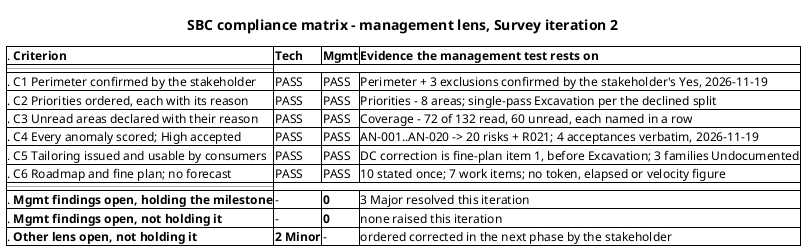

Entry criteria were verified before the review began: all four artifacts present and corrected, the Review Record's prior findings readable with their resolution state, and the process tailoring available for testing. No artifact was found mid-correction after the review opened.

SCM evidence: no pull request in any state and no IARI pipeline on `main`. Survey writes no code and builds nothing, so no build status, no pull request and no execution result is cited in this block — none exists to cite.

### Review Coordinator lens
<!-- review: Survey I2 -->

<!-- review: Survey I2 -->

The SBC milestone review ran over the four artifacts Survey produced: Development Case, System Inventory, Risk List, Iteration Plan — all Survey, Draft, corrected in iteration 2. This milestone reviewed nothing else: no build, no pull request, no code exists to review in Survey.

#### Lens participation — authoritative

| Lens | Status | What it recorded | Carried into the verdict |
|---|---|---|---|
| Reviewer (technical) | EXECUTED | 2 findings this iteration, both Minor; 9 findings of the previous milestone review closed on corrected content; Approved on Development Case and System Inventory, Approved with Changes on Risk List and Iteration Plan | Yes |
| Business Reviewer (business) | **INACTIVE — did not evaluate this review** | No finding, no verdict | No — no verdict is inferred from its silence |
| Management Reviewer (management) | EXECUTED | No finding raised this iteration; its 3 Major findings of the previous milestone review closed on evidence in the artifacts; sanction asked and GRANTED by the stakeholder 2026-11-19 | Yes |

Two lenses of three evaluated this milestone. The Business Reviewer's absence is recorded as INACTIVE and nothing else: it is not an approval, not a refusal, and no finding is attributed to it. Its first due milestone in this project's process is LCO, where the business lens joins the sanctioned sequence. No SBC exit criterion is a business-value question — criteria 1 to 6 are perimeter, priorities, unread coverage, risk scoring, tailoring and roadmap — so its absence leaves no criterion unevaluated.

#### Entry criteria applied to this milestone review

| Entry criterion | Held? |
|---|---|
| All four artifacts in their target state — corrections applied, not drafted mid-review | Yes — each is Draft at iteration 2 with the corrections its owner made in place |
| Reviewers assigned with expertise matched to the artifact domain | Yes — per-artifact-type technical checklists, plus the management lens on governance and evidence |
| Evaluation criteria and the prior finding ledger available to every lens before reading | Yes — four checklists recorded in each lens's scope block; `read_artifact_findings` carried all 14 findings with their resolution state |
| Artifacts available to every lens in full | Yes — the four artifacts are the whole of the Survey artifact set |
| The stakeholder's order of 2026-11-19 in force before the review opened | Yes — "All major findings must be corrected" was the subject of the pass |

#### The six SBC exit criteria, and which lens substantiated each

Counted from the two executing lens blocks. A criterion is met only when it survives both tests; that is the rule this consolidation applied at the previous milestone review and applies unchanged here.

| Criterion | Evidence | Technical lens | Management lens | Status |
|---|---|---|---|---|
| C1 — Perimeter confirmed by the stakeholder | System Inventory — Perimeter: 7 projects of TodoApp.sln plus the CI workflow, 26 entry points, 3 exclusions each anchored | Pass | Pass — confirmed on the stakeholder's Yes of 2026-11-19 | **Met** |
| C2 — Priorities ordered for the remaining recovery | System Inventory — Priorities: eight areas, each with its reason and anchor | Pass | Pass | **Met** |
| C3 — Unread areas declared with their reason | Coverage: 72 of 132 files read, 60 unread, each named in a row | Pass — aggregate reconciles with its own rows | Pass | **Met** |
| C4 — Every anomaly a scored risk; High and Significant ones accepted in the stakeholder's words | 20 anomalies → 20 risks plus R021; four acceptances verbatim, 2026-11-19 | Pass | Pass — every action executable by the role and phase it names; R021 bounds the gate | **Met** |
| C5 — Tailoring issued and usable by the phases that consume it | Development Case; fine-plan item 1 sequencing the correction before Excavation; three convention families Undocumented with no fallback asserted | Pass | Pass | **Met** |
| C6 — Roadmap and fine plan; no invented forecast, no sized human gate | `2 + 1 + 1 + 1 + 2 + 2 + 1 = 10` stated once; every gantt bar a zero span; no token, elapsed or velocity figure | Pass | Pass | **Met** |

Six of six met. The three that failed at the previous milestone review — C1, C4, C5 — are met here on the same tests, because the findings that failed them are closed on the corrected content, not waived.

#### Review calendar — every event, to the workflow activity that triggers it

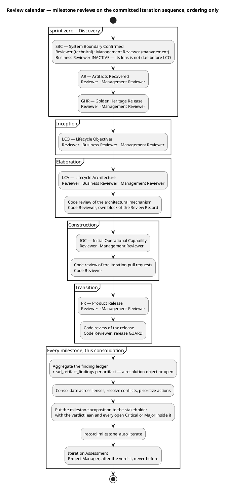

Seven milestone reviews sit on the roadmap, one per milestone, each triggered by its workflow activity and none scheduled on a calendar date. Each milestone's ledger is aggregated from `read_artifact_findings` rather than from the previous Review Record's prose, because a finding is open unless it carries a resolution object. The Iteration Assessment follows the verdict and never precedes it.

#### Consolidated finding ledger

Fourteen findings are on record across the two executing lenses. Twelve carry a resolution object and are closed; two do not and are open. The ledger below is read from `read_artifact_findings` on the four artifacts, not from either lens's narrative.

| # | Artifact | Key | Lens | Severity | Owner | State | What the corrected content says |
|---|---|---|---|---|---|---|---|
| 1 | Development Case | F1 | Reviewer | Major | Process Engineer | Closed | Templates rows re-pointed at five files that exist, each attributed by path and owner; coding standards, UI patterns and test conventions recorded Undocumented with no fallback asserted |
| 2 | Development Case | F2 | Reviewer | Minor | Process Engineer | Closed | The stale "no Risk List exists yet" clause removed; the PoC verdict rests on the phase requirement alone, second clause judged at Elaboration |
| 3 | System Inventory | F2 | Reviewer | Major | Software Archaeologist | Closed | Perimeter `/users` row agrees with AN-015 — registration and login are called, `/users/refresh` is called by nothing, no use case recovered from `EP-003` |
| 4 | System Inventory | F1 | Reviewer | Minor | Software Archaeologist | Closed | Aggregate stated as the sum of the Read column — 72 of 132 files, 60 unread, every unread file named in a row with its reason |
| 5 | Risk List | F1 | Reviewer | Major | Project Manager | Closed | Six Excavation actions re-owned to the System Analyst; R014's control part moved to Inception; closing paragraph states the role-phase mapping once |
| 6 | Risk List | F1 | Management Reviewer | Major | Project Manager | Closed | R021 scored Significant (12), strategy accept, mitigation, owning role, trigger indicator and the 14-day contingency |
| 7 | Risk List | F2 | Management Reviewer | Major | Project Manager | Closed | R008's Construction mitigation re-homed to the User Documentation that stage produces; AN-008 names the same two disclosure homes |
| 8 | Iteration Plan | F1 | Reviewer | Major | Project Manager | Closed | `2 + 1 + 1 + 1 + 2 + 2 + 1 = 10`, stated once in the roadmap; the conditional "8 or 9" phrasing deleted |
| 9 | Iteration Plan | F1 | Management Reviewer | Major | Project Manager | Closed | Development Case correction is fine-plan item 1, Process Engineer, sequenced before Excavation |
| 10 | Iteration Plan | F2 | Reviewer | Minor | Project Manager | Closed | Verdict column replaced by "Evidence this plan supplies" and "What the review judges" |
| 11 | Iteration Plan | F3 | Reviewer | Minor | Project Manager | Closed | Profile reads "six agent roles plus the stakeholder gate"; all twenty absent roles carry a stated reason |
| 12 | Iteration Plan | F4 | Reviewer | Minor | Project Manager | Closed | Day lengths removed from both gantts; every bar `lasts 0 day`, both titles ordering only |
| 13 | Risk List | F2 | Reviewer | Minor | Project Manager | **Open** | The trailing "R021 — offered for acceptance" block states the risk stays open until the answer is recorded, while the acceptance table and the Register row record the answer "Yes" of 2026-11-19 |
| 14 | Iteration Plan | F5 | Reviewer | Minor | Project Manager | **Open** | The opening block of Plan and Milestones duplicates its Measure and forecast subsection verbatim, including the forward reference "the ten iterations above" before the roadmap that states the ten |

**Totals: Critical 0 · Major 0 open · Minor 2 open.** Severity is the evaluating lens's, unchanged by this consolidation; no lens downgraded or upgraded another's grading, and there is no severity conflict to arbitrate.

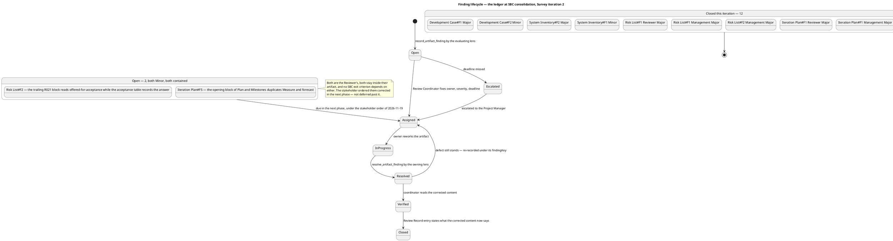

#### Conflicts across the executing lenses, and how each resolves

| # | The disagreement | Resolution |
|---|---|---|
| 1 | **Same key, two defects.** `Risk List#F1` and `Iteration Plan#F1` each carried two findings under one key in the previous milestone review. | Both were kept open and both were the Project Manager's; the ledger above distinguishes them by the Lens column, which is the only way these keys are unique. All four are now closed. |
| 2 | **Overlapping defect or two defects?** `Development Case#F1` defined the tailoring correction; `Iteration Plan#F1` Management scheduled it. | Two defects, two owners, closed in a fixed order: the Development Case first because it specifies, the plan second because it schedules. Both closed in that order this iteration. |
| 3 | **The same criterion passed by one lens and failed by the other.** At the previous milestone review C4 and C5 passed the technical lens and failed the management lens. | Not a contradiction then and not one now — two different tests on one criterion. The technical lens audits magnitude, anchors and trigger decisions; the management lens audits executability by the role and in the phase named. **The stricter test governs**, and both now return Pass on both criteria. |
| 4 | **Artifact disposition vs milestone verdict.** The technical lens records Approved on two artifacts and Approved with Changes on two; the management lens records Approved. | Both stand at their own levels. The technical lens's "with Changes" on Risk List and Iteration Plan is correct: their substance survives while one Minor claim inside each does not. The milestone verdict is mine and it is Go, because a Minor finding holds neither its artifact's consumption nor an exit criterion. |
| 5 | **No severity was disputed.** Neither lens downgraded or upgraded the other's grading, in either iteration. | Accepted as recorded. Both lenses agreed on what stops consumption and what stays inside an artifact, and the split is exactly right: every finding that stopped consumption was graded Major. |
| 6 | **A lens's order against a lens's verdict.** The stakeholder ordered the two Minor findings corrected in the next phase while sanctioning advancement past SBC. | No conflict — the order sets a deadline, it does not withhold the sanction. Both are applied: the milestone advances, and the two findings carry a deadline in the next phase, recorded in Resolutions and Actions. |

One cross-artifact consequence from the previous milestone review is closed on both sides and needs no further action: `R008` and `AN-008` name the same two disclosure homes — the System Analyst's note beside the recovered update use case in Excavation, and the User Documentation the Technical Writer produces in Construction — with `AN-008` stating expressly that the Release Notes are not its home.

#### Why Go rather than Conditional

A Conditional would advance the phase while the conditions were discharged later, and the previous milestone review rejected exactly that form for exactly the right reason: opening Excavation on a Perimeter row its own anomaly contradicted, and on avoidance actions owned by roles not at work, would have put recovered use cases on content another role acts on wrongly. That defect class is now empty. The two findings that remain are `contained-defect`: the duplicated passage carries no claim a downstream role consumes, and the trailing `R021` block contradicts its own section's acceptance table rather than any statement another artifact rests on. The acceptance of `R021` itself is recorded verbatim in the acceptance table and in the Register row, so the wording that contradicts it blocks nothing. Correcting both is ordered by the stakeholder and due in the next phase; treating them as a phase-gate condition would hold a milestone on two wordings, which is not what the finding levels mean.

## Findings
### Reviewer lens
<!-- review: Excavation I1 -->

Ten findings against nine artifacts: 0 Critical, 3 Major, 7 Minor. The three Majors are one defect class — a suspect trace link still open at phase close — and each is recorded against the artifact whose trace table fails to carry it.

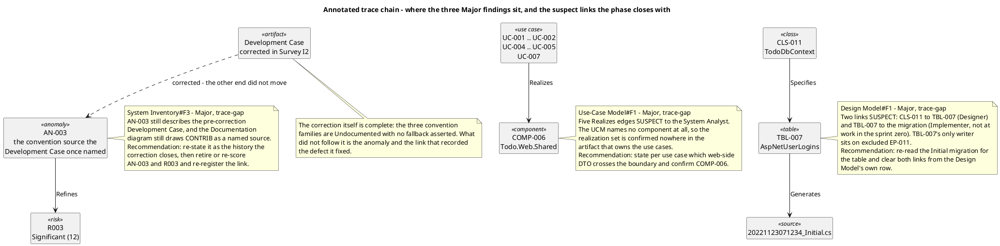

#### Use-Case Model

| Checklist item | Result |
|---|---|
| Every `UC-NNN` cites the `EP-NNN` it is recovered from | Pass — eight use cases, twelve entry points, each `Source:` line naming them |
| No use case recovered from an excluded entry point | Pass — `EP-004`…`EP-011`, `EP-020`, `EP-021` claimed by none |
| No cross-cutting mechanism modelled as a use case | Pass — authentication, token issue, forwarding, limiting, validation and telemetry are Supplementary Specification entries |
| No per-actor split of one declared process | Pass — one todo owner, seven goals; the developer actor carries one screen |
| Every business rule cites its enforcement point and anchor | Pass — 38 rules, each with the file and line range |
| Use cases with no delivered trigger state so | Pass — `UC-006` A4 records the absent screen path and cites `AN-008` |
| Trace rows agree with the matrix | **Fail** — `Use-Case Model#F1` |

**Use-Case Model#F1 (Major, `trace-gap`).** Five `Realizes` links into this artifact are marked SUSPECT against the System Analyst at the phase close: `COMP-006` (`Todo.Web.Shared`) to UC-001, UC-002, UC-004, UC-005 and UC-007. The Use-Case Model names no component anywhere, so the edge exists only in the Software Architecture Document's rows; this artifact has never stated whether it accepts that realization set. The SAD fixes the set deliberately — `COMP-006` absent from UC-003 because sign-out sends no DTO, and from UC-006 because the forwarder carries that body as bytes — and ADR-011 fixes what `COMP-006` is: one of two independent declarations of the wire shape, since `Todo.Api` references `TodoApp.ServiceDefaults` alone. A suspect link left open at phase close leaves the realization of five use cases unconfirmed by the artifact that owns them. **Remediation:** add to this artifact's Traceability the confirmation of the five `Realizes` edges it shares with the SAD — for each, state which web-side DTO crosses the boundary and confirm that `COMP-006` realizes it, or record that it does not. No re-reading of code is required; the decision the model already made implicitly is what the suspect trace asks to be written down.

#### Supplementary Specification

| Checklist item | Result |
|---|---|
| Every mechanism an `<<include>>`, never a use case | Pass — eleven `SS-NNN`, each naming the use cases that include it |
| Every threshold a figure some file states | Pass — the rate-limit budget and queue depth cite `RateLimitExtensions.cs` and the Development settings |
| What the delivery does not establish recorded as such | Pass — `PE-002`…`PE-006`, `RE-005`…`RE-007`, `SU-007` and `ST-008` each read "not established by the delivery" rather than inventing a target |
| Exclusions carried with their entry points and their mechanism's surviving home | Pass — `EX-001`, `EX-002`, `EX-003`, each anchored and each naming where the mechanism still lives |
| Interface identifiers belong to a declared family | **Fail** — `Supplementary Specification#F1` |

**Supplementary Specification#F1 (Minor, `contained-defect`).** The `## Interfaces` table declares `IF-001` … `IF-010`, an identifier family this process does not define — interfaces are `INT-NNN`, and the Software Architecture Document assigns `INT-001` … `INT-012` to the same boundaries. The Deployment Model repeats the same `IF-` numbering, so three artifacts describe one set of boundaries under two schemes with no mapping stated. `IF-009` is the clearest instance: it is the excluded provider connector here and in the Deployment Model, and it appears in no `INT-` form in the architecture at all. **Remediation:** re-key the table to the SAD's `INT-NNN` identifiers, or state the mapping once above the table, in the same pass as the Deployment Model's connector table so the two carry one scheme.

#### Software Architecture Document

| Checklist item | Result |
|---|---|
| Every `COMP-NNN` cites the files it is read from | Pass — eighteen components, each with a path and line range |
| Every component on a use-case path realizes it; absence stated where it is deliberate | Pass — the five components on no scenario path are named and justified; `COMP-006`'s absence from UC-003 and UC-006 is argued |
| Only technology and versions the manifests declare | Pass — every entry read from `Directory.Packages.props`, `global.json` or a project's `Sdk` attribute; the version policy reconciled explicitly |
| Mechanisms distinguished from components and from use cases | Pass — eleven `SS-NNN` with the pinned package carrying each |
| Architectural decisions record the alternative not taken and the cost | Pass — twelve ADRs, each with its consequence in force |
| Figures within this document agree with each other | **Fail** — `Software Architecture Document#F2` |
| Counts stated over code agree with the code | **Fail** — `Software Architecture Document#F1` |

**Software Architecture Document#F1 (Minor, `contained-defect`).** The `COMP-005` row of `## Logical View` describes `TodoClient` as carrying "five methods" and then enumerates six operations in the same cell: register, login, logout, `todos` GET, `todos` POST and `todos/{id}` DELETE. `Todo.Web/Client/TodoClient.cs:7-71` declares six public methods. The load-bearing claim beside the count is true — no update method exists, which is what `AN-008` rests on — but the sentence contradicts its own enumeration, and the Use-Case Model's UC-006 A4 repeats the wrong number when it cites the same class. **Remediation:** change "five methods" to "six methods" in the `COMP-005` row, leaving the enumeration as it stands, and make the same correction in UC-006 A4. No other figure in either artifact depends on the count.

**Software Architecture Document#F2 (Minor, `contained-defect`).** `## Size and Performance` reports "27 declared rows in one file", while `## Implementation View → Packaging` reports "30 package rows" for the same file. `Directory.Packages.props` declares 30 `PackageVersion` rows: six in the first item group, nineteen in the second, five OpenTelemetry rows in the third. A reader checking each pin against the recorded version policy gets two denominators from one document, and the System Inventory's `Technology and Size` table carries the same wrong figure. **Remediation:** state 30 once, in `## Size and Performance`, and let `## Packaging` reference that figure instead of repeating a number; correct the System Inventory's row to the same value, since it counts the same file.

#### Deployment Model

| Checklist item | Result |
|---|---|
| The optional trigger genuinely holds against the project's facts | Pass — three addressable nodes, service discovery, a forwarder and per-project settings; the Development Case's FIRED verdict matches the code |
| Every node and connector anchored | Pass — seven nodes, nine connectors, each with a path |
| No environment declared that no file names | Pass — `CON-A06`; the model states the three shapes the delivery distinguishes and records two as declared-but-unestablished |
| `AN-021` and `AN-022` have a home here, and it states them correctly | Pass — both confirmed against `Extensions.cs` and against the relative `Data Source` path |
| Connector identifiers reference the architecture's boundaries | **Fail** — `Deployment Model#F1` |

**Deployment Model#F1 (Minor, `contained-defect`).** The connector table declares `IF-001` … `IF-008` and `IF-010`, while the Software Architecture Document names the same boundaries `INT-001` … `INT-012`. A role reading this model against the architecture cannot tell whether `IF-004` and `INT-009` are one boundary or two, and the model's own note that "the identifiers are shared across the two artifacts" confirms the numbering is a private scheme rather than a reference to the architecture's. **Remediation:** either re-key the connector rows to the SAD's `INT-NNN` identifiers, or state in one line above the table that `IF-NNN` is this model's local numbering for the boundaries the SAD names `INT-NNN`, with the mapping per row.

#### Design Model

| Checklist item | Result |
|---|---|
| Every class, member and visibility anchored | Pass — thirty-four classes, each with the file and line range; `CLS-002` shown with no member of its own rather than one invented |
| Every table, key, index and cascade read from a migration body | Pass — eight tables, three migrations, the model snapshot; no run-time database cited anywhere |
| Where the code is silent, the silence is recorded rather than filled | Pass — `FN-011`'s missing concurrency token, the four tiers of enforcement, `N1`…`N5` |
| Co-owned sections intact — the Database Designer's persistent-data sections | Pass — `## Persistent Data Classes` and its sub-blocks are the Database Designer's and were reviewed, not rewritten |
| Capsule work declared omitted with its trigger | Pass — `[OMITTED: Capsules, Protocols and Signals — DC-D3]` |
| Sections the document says it defers exist or are marked omitted | **Fail** — `Design Model#F2` |
| Trace rows agree with the matrix | **Fail** — `Design Model#F1` |

**Design Model#F1 (Major, `trace-gap`).** Two links on TBL-007 (`AspNetUserLogins`) are marked SUSPECT at the phase close: `CLS-011 → TBL-007` against the Designer, and `TBL-007 → 20221123071234_Initial.cs` against the Implementer. TBL-007 is the one table of the eight whose only writer sits on the excluded `EP-011` path — this artifact's own `Associations confirmed against the statements that issue them` table names `FindByLoginAsync` then `AddLoginAsync` as the statement that crosses it — so its four columns, its composite primary key and its cascading foreign key to TBL-002 have to be re-confirmed against the migration body rather than left as a doubt. The second link names a role that does not work in the sprint zero at all, so waiting cannot clear it: if this artifact does not discharge it by re-reading the migration, the phase closes with the link unconfirmed. **Remediation:** re-read `Todo.Api/Migrations/20221123071234_Initial.cs` for the `AspNetUserLogins` table and confirm or correct the four columns, the composite primary key and the cascading foreign key, then re-register both links. Since the Implementer is not at work in the sprint zero, the Design Model's own row must clear the second link by citing the migration line it rests on.

**Design Model#F2 (Minor, `contained-defect`).** `## Design Overview`'s section table lists four entries for content the document does not carry. `Use-Case Realizations` and `Interface Contracts` are marked "Not yet recovered", but the document has no section under either title, and neither is a stage Excavation runs: the Designer's Excavation stages are Domain Model and Packages and Classes, while both sections belong to its Elaboration stages. `Boundary Classes and Navigation Map` is recorded as "Owned by the User Interface Designer" with no `[OMITTED]` marker and no section, although the Iteration Plan records that role's first stage as Elaboration. A reader using the table as a contents page is sent to three sections that do not exist and to an owner not at work in this phase; only the Capsules row states its omission correctly. **Remediation:** mark the three absent entries the way the Capsules row already does — `[OMITTED: Use-Case Realizations — not a Design Model stage in Excavation; the Designer's Analysis Model and Design Model stages in Elaboration]`, the same for `Interface Contracts`, and `[OMITTED: Boundary Classes and Navigation Map — the User Interface Designer's first stage is Elaboration]`.

#### System Inventory

| Checklist item | Result |
|---|---|
| Every high-consequence row rests on a file that says what it claims | Pass — five of the seven anchors this review opened are this artifact's, all confirmed |
| Coverage reconciles with its own rows; every unread file carries a reason | Pass — 83 of 138 read, 55 unread, each named with its reason; the aggregate stated as the sum of the Read column |
| No top-level area of the tree neither described nor declared unread | Pass — eighteen rows, every area of the repository accounted for |
| Each exclusion traced to the stakeholder's answer; no use case from an excluded entry point | Pass — `EP-004`…`EP-011`, `EP-020`, `EP-021` |
| `EP-003` and `EP-013` kept in the perimeter with their anchors and no use case claimed | Pass — stated once in the Perimeter, referenced from the Components row |
| Anomalies current with the artifact set they judge | **Fail** — `System Inventory#F3` |
| Figures within this artifact agree with each other | **Fail** — `System Inventory#F4` |

**System Inventory#F3 (Major, `trace-gap`).** The `AN-003 → R003` link is marked SUSPECT against the Software Archaeologist at the phase close, and the reason is in this artifact's own text: AN-003 states that the Development Case "names `CONTRIBUTING.md` as the home of the coding standards, the UI patterns and the test conventions". That was true when Survey closed and is not true now — the Development Case was corrected in Survey iteration 2, its Templates rows re-pointed at five files that exist, the three convention families recorded as Undocumented with no fallback asserted. The `## Documentation` section still draws `DC ..> CONTRIB : names it the home of coding, UI and test conventions` with `CONTRIB <<missing>>`, and AN-003 keeps a `likely / moderate` reading for an exposure the correction has retired. One end of the link changed and the other did not, which is exactly what a suspect link records. **Remediation:** re-state AN-003 as the history the correction closes and remove `CONTRIB` from the Documentation diagram or mark it as a source that was named and has been withdrawn. Then either retire AN-003 with its reason and let the Project Manager re-score or retire R003, or keep it as a reading of the earlier state with its magnitude re-scored; re-register or retire the link.

**System Inventory#F4 (Minor, `contained-defect`).** `## Persistent Data` states that `IsAdmin` "was a column for thirty-one minutes of the migration history", while two other places in this artifact say otherwise: AN-010 records "9 h 38 min after `d562d73` created it", and the `## History` row for `Todo.Api/Migrations` records the same span. The migration identifiers settle it — `20221123071234` to `20221123165051` is 9 h 38 min — and the Design Model's schema-evolution table reports the same. The thirty-one-minute figure is wrong and is the only occurrence of it in the artifact set. **Remediation:** change "thirty-one minutes" to "9 h 38 min" in `## Persistent Data`, the figure the migration timestamps give and the figure the rest of the artifact set already uses.

#### Risk List

| Checklist item | Result |
|---|---|
| Magnitude is the band of P × I on the declared scale | Pass — `R021` at 3 × 4 = 12, Significant; all twenty-five scored |
| Every anomaly of the System Inventory is a scored risk | Pass — `AN-001`…`AN-024` → `R001`…`R025`, with `R021` the project's own exposure and stated as such |
| Every High and Significant acceptance in the stakeholder's own words with its date | Pass — four, each quoted verbatim |
| Every action owned by a role at work in the phase it lands in | Pass — the six Excavation actions the System Analyst's; R014's control part at Inception where the ledger opens |
| A mitigation lands in the stage that produces the artifact it names | Pass — R008 at the User Documentation the Construction stage produces |
| No acceptance presented as granted that was not | Pass — "The four are the whole of what the stakeholder granted" |

No defect from this lens. The register's acceptance section no longer contradicts itself on `R021`, which was the one open finding of this lens against it.

#### Iteration Plan

| Checklist item | Result |
|---|---|
| One committed total, stated once | Pass — `2 + 1 + 1 + 1 + 2 + 2 + 1 = 10`, in the roadmap only |
| No forecast, no velocity, no size before a measured actual | Pass — the Excavation band carries `[ASSUMPTION — requires validation]` and names Survey's measured actual as its whole basis |
| No human gate carries a duration | Pass — every bar `lasts 0 day`, both titles ordering only |
| Every role of the roster either scheduled or given a reason for absence | Pass — nine agents and the gate at work; twenty roles with stated reasons |
| No stage scheduled that the process does not run in the phase | Pass — the eighteen work items are the Excavation stages and the review |
| Figures summarising another artifact agree with it | **Fail** — `Iteration Plan#F6` |

**Iteration Plan#F6 (Minor, `contained-defect`).** The `Use Cases and Scenarios Addressed` table gives scenario counts the Use-Case Model contradicts on two rows. UC-003 is recorded as "2", while the Use-Case Model's survey lists three, the third being "session ending without a sign-out", which its own A2 flow carries. UC-004 is recorded as "4", while the Use-Case Model lists five, the fifth being "the prerendered empty list rendered before the real one", which its A4 flow carries. The Use-Case Model is the trace-chain artifact and the authority for the scenario set; this table summarises it and is two scenarios short, which is the count a Test Designer would next read. **Remediation:** bring the two rows up to 3 and 5, or drop the count column and let the table reference the Use-Case Model's survey rather than restate it — the second option also stops the two artifacts drifting apart at the next correction.

#### Vision

| Checklist item | Result |
|---|---|
| Every claim anchored or marked not established | Pass — the two "Not established by the delivery" blocks name the business objective, the user population, the performance and recovery targets and the production posture |
| Recovered capabilities cite `EP-NNN`, not a declared requirement | Pass — all eight features carry their entry points; the Vision cites no `FR-NNN` |
| Nothing invented to fill what the delivery cannot establish | Pass — no market, competitor, business case or success measure is stated; each is named as absent |
| The three exclusions held, no use case or class claiming through them | Pass — `EP-004`…`EP-011`, `EP-020`, `EP-021` claimed by none |
| `AN-008`'s disclosure homes agree with the Risk List | Pass — the User Documentation of Construction, expressly not the Release Notes |

No defect from this lens.

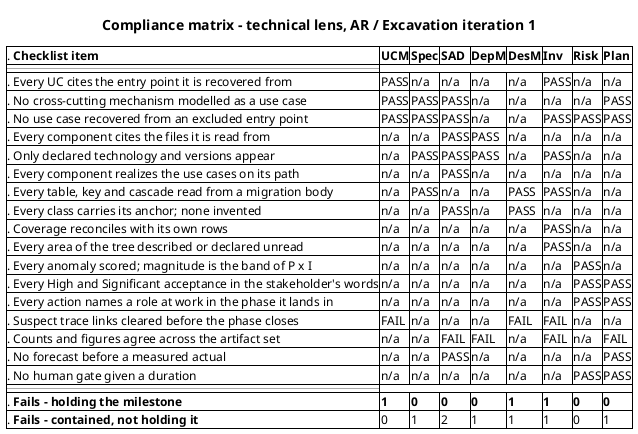

### Management Reviewer lens
<!-- review: Survey I2 -->

<!-- review: Survey I2 -->

This lens raises no defect against the artifact set in this iteration. The three Major findings it carried into the correction pass are corrected, and no artifact now holds content another role would act on wrongly.

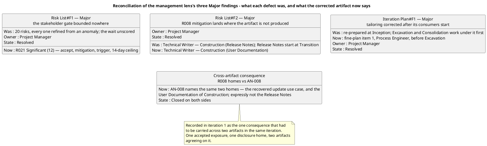

What each artifact now carries on the governance test:

| Artifact | The test this lens applies | Result |
|---|---|---|
| Development Case | No FORBIDDEN override; every optional verdict holds against the project's facts; the tailoring names only sources that exist | Pass — `CONTRIBUTING.md` is gone from the Templates rows, and coding standards, UI patterns and test conventions are recorded Undocumented with no fallback asserted |
| System Inventory | Each of the three exclusions sits where the stakeholder's answer put it; no use case claimed from an excluded entry point; every anomaly of the exposure it records has a scored risk | Pass — `AN-008` names the same two disclosure homes as `R008` |
| Risk List | Every action names a role at work in the phase it lands in; every High and Significant acceptance rests on the stakeholder's own words; the only external dependency is scored | Pass — `R021` is the gate, bounded at 14 days, accepted 2026-11-19 |
| Iteration Plan | One committed total stated once; the tailoring correction scheduled before its consumers; no figure the project has not measured; no human gate given a span | Pass — 10 stated once, fine-plan item 1 is the Development Case correction, every bar a zero span |

The two Minor findings the technical lens raises this iteration — `Risk List#F2` and `Iteration Plan#F5`, both `contained-defect` — stay inside their artifacts: no other role builds on the duplicated passage or on the trailing `R021` block, and no SBC criterion depends on either. They are recorded against their owner and neither holds this milestone.

### Review Coordinator lens
<!-- review: Survey I2 -->

<!-- review: Survey I2 -->

This consolidation mints no finding. Every finding in the ledger was recorded by the lens that evaluated the defect, and this block adds no defect of its own: coordination records what the lenses found, assigns it, and counts it.

#### What the two executing lenses found together

Fourteen findings across four artifacts, in two milestone reviews of Survey. Twelve closed, two open, no Critical in either. The previous milestone review ran on the artifacts as first issued; this one ran on the corrected content.

| Review event | Findings recorded | Critical | Major | Minor | Closed at the event's close |
|---|---|---|---|---|---|
| Survey I1 — SBC milestone review, first pass | 12 | 0 | 7 | 5 | 0 — the stakeholder refused the sanction with the order to correct all Major findings |
| Survey I2 — SBC milestone review, correction pass | 2 | 0 | 0 | 2 | 12 of the previous pass, both new ones open |
| **On record at this consolidation** | **14** | **0** | **0 open** | **2 open** | **12** |

The correction pass records fewer findings than the pass it corrected. That is the expected shape: a lens that finds as much in corrected content as in first-issued content is not correcting anything, and a lens that finds nothing is not reading. Two contained defects in two independently reworked artifacts is a correction pass that worked.

#### Defect density — counted from the ledger

| Artifact | Findings | Major | Minor | Crit. | Density (findings/artifact) |
|---|---|---|---|---|---|
| Development Case | 2 | 1 | 1 | 0 | 2.00 |
| System Inventory | 2 | 1 | 1 | 0 | 2.00 |
| Risk List | 4 | 3 | 1 | 0 | 4.00 |
| Iteration Plan | 6 | 2 | 4 | 0 | 6.00 |
| **Total** | **14** | **7** | **7** | **0** | **3.50 mean** |

Density per page is **not reported**: no lens measured the page count of the four artifacts, and a density computed on an unmeasured denominator would be invented. The figures above are counted entries from `read_artifact_findings`, not estimates.

The Iteration Plan carries the largest load and the only Minor cluster — 4 of its 6 findings are Minor, and both defects that remain open land there or in the Risk List's acceptance section. Both artifacts are the Project Manager's, and both were issued before the tailoring they must carry was stable. That is one signal observed twice, not a trend: two review events are not a series, and this report draws none.

#### Review effectiveness — current metrics only

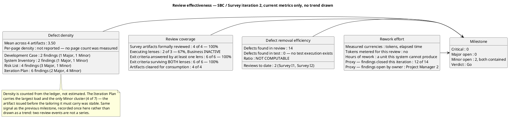

| Coverage measure | Value | Basis |
|---|---|---|
| Survey artifacts receiving formal review | 4 of 4 — **100%** | All four artifacts of the phase were in scope of both executing lenses |
| Executing lenses | 2 of 3 — **67%** | Business Reviewer INACTIVE; not due before LCO |
| Exit criteria evaluated by at least one lens | 6 of 6 — **100%** | Every criterion answered by a lens, none left to inference |
| Exit criteria substantiated by **both** executing lenses | 6 of 6 — **100%** | Up from 3 of 6 at the previous milestone review |
| Anchors opened rather than trusted, this pass | 3 opened, 3 confirmed | `UsersApi.cs`, `AuthClient.cs`, `TokenNames.cs` — each re-read against the claim the correction changed |
| Artifacts cleared for consumption | **4 of 4** | Up from 0 of 4 |

Two metrics are not computable at this milestone and neither is estimated here:

- **Defect removal efficiency** compares defects found in review against defects found in test. Survey produces no code and no test execution — the denominator is zero, not small. The first review-versus-test comparison becomes available when Construction test execution exists.
- **Rework effort** is measurable only in tokens and elapsed time. Neither was metered for this review, and hours of rework is a unit this system cannot produce. The proxy carried forward is the count of open findings by owner, and it is exact: Project Manager 2.

#### What the data says without a comparison

1. **The correction pass closed every finding that stopped consumption.** Seven of seven Majors closed, on corrected content each verified by reading the section that carried it. Nothing was closed on an owner's description alone, and nothing was closed as Deferred or Rejected.
2. **The two findings that remain are both `contained-defect`.** Neither names a claim another role builds on, and neither fails an SBC exit criterion. That is why the milestone does not need a third iteration.
3. **The artifact that failed most at the previous milestone review improved most.** The Iteration Plan carried 5 of 12 findings and 2 of 7 Majors then; it now carries 0 Major open and 2 Minor open, one of them new and created by the correction itself (duplicated block).

## Resolutions and Actions
### Reviewer lens
<!-- review: Excavation I1 -->

Two findings of this lens were open when Excavation opened, both ordered corrected by the stakeholder on 2026-11-19 — "Minor findings must be corrected in the next phase; they cannot be left unresolved". Both are closed here, each on corrected content read in the artifact and each with the `resolve_artifact_finding` call that moved its state.

#### Closed at the opening of this milestone

| Finding | Was | What the corrected content now says | Where it was checked |
|---|---|---|---|
| `Risk List#F2` (Minor, `contained-defect`) | A trailing "R021 — the stakeholder gate, offered for acceptance" block stated the risk "stays OPEN until their answer is recorded here verbatim", while the same section's acceptance table recorded the answer "Yes" of 2026-11-19 | The block is gone. The acceptance is stated once, in `### Acceptance granted by the stakeholder`, as a four-row table naming each proposition, the answer and the date, closing "The four are the whole of what the stakeholder granted." The "holds OPEN" wording and its three "until then" conditions appear nowhere in the artifact | `## Risk Mitigation and Contingency` — the acceptance table and its closing paragraph; `## Risk Register`, row R021 |
| `Iteration Plan#F5` (Minor, `contained-defect`) | The opening block of `## Plan and Milestones` duplicated its `### Measure and forecast` subsection verbatim, including the forward reference "the ten iterations above" before any iteration had been stated | The block is deleted. The section opens with a one-sentence statement of what it carries and proceeds to `### Coarse roadmap`, where the total 10 is stated. The no-forecast statement, the budget-position table and the two-clock table appear once, inside Measure and forecast | `## Plan and Milestones` — opening paragraph and `### Coarse roadmap` |

#### Open, recorded at this milestone

Three Major and seven Minor findings stand against nine artifacts. The three Majors are one defect class and all three are `trace-gap`: a suspect link the phase cannot close without the owning artifact acting.

| Priority | Finding | Severity | Criterion | Owner | What closes it |
|---|---|---|---|---|---|
| 1 | `Use-Case Model#F1` | Major | `trace-gap` | System Analyst | The five `Realizes` edges from `COMP-006` confirmed per use case, or recorded as not accepted, in this artifact's Traceability |
| 2 | `Design Model#F1` | Major | `trace-gap` | Designer | `TBL-007` re-read from the Initial migration; both suspect links re-registered from the Design Model's own row, the migration link citing the line it rests on |
| 3 | `System Inventory#F3` | Major | `trace-gap` | Software Archaeologist | `AN-003` re-stated as the history the correction closes; `CONTRIB` removed from the Documentation diagram; `AN-003`/`R003` retired or re-scored and the link re-registered |
| 4 | `Software Architecture Document#F2` | Minor | `contained-defect` | Software Architect | 30 stated once in `## Size and Performance`; `## Packaging` references it instead of repeating a number |
| 5 | `Software Architecture Document#F1` | Minor | `contained-defect` | Software Architect | `COMP-005` row reads "six methods", matching its own enumeration and `TodoClient.cs` |
| 6 | `System Inventory#F4` | Minor | `contained-defect` | Software Archaeologist | "thirty-one minutes" changed to "9 h 38 min" in `## Persistent Data` |
| 7 | `Design Model#F2` | Minor | `contained-defect` | Designer | The three absent rows of the `## Design Overview` table carry `[OMITTED: …]` markers with their phase reason, in the form the Capsules row already uses |
| 8 | `Supplementary Specification#F1` | Minor | `contained-defect` | System Analyst | The `## Interfaces` table re-keyed to `INT-NNN`, or the `IF-NNN` → `INT-NNN` mapping stated once above it |
| 9 | `Deployment Model#F1` | Minor | `contained-defect` | Software Architect | The connector table re-keyed to `INT-NNN`, or its local numbering declared with the mapping per row — in the same pass as #8 |
| 10 | `Iteration Plan#F6` | Minor | `contained-defect` | Project Manager | The UC-003 and UC-004 scenario counts brought to 3 and 5, or the count column dropped in favour of a reference to the Use-Case Model's survey |

The three Majors sit at priorities 1–3 because a suspect link at phase close is the one defect class this lens cannot leave: the trace tree is the artifact set's claim that every element is justified, and a link marked suspect is a claim the tree itself reports as unverified. The seven Minors are all `contained-defect` — each stays inside its artifact and none blocks consumption.

#### Two corrections that touch more than one artifact

`Software Architecture Document#F2` and `System Inventory#F4` each state a figure a second artifact restates: the package count appears in the SAD and the Inventory, and the wrong `IsAdmin` span appears once only while the correct one appears in the Inventory's AN-010 and its History row and in the Design Model's schema-evolution table. The owner named in the table above corrects its own artifact; where the same figure appears in another artifact the row names that owner too, so the correction lands everywhere the figure is stated or nowhere.

#### Closure protocol

Each finding is closed by two acts, in this order: the Reviewer — the lens that raised it, and the only lens that may close it — calls `resolve_artifact_finding` after reading the corrected content against the finding; then this Review Record gains an entry stating what the corrected content says. A defect that still stands after rework is re-recorded under its `findingKey` and stays open; it is not duplicated under a new key.

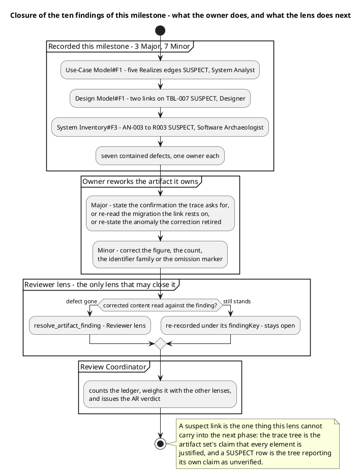

#### Load per owner

| Owner | Open findings | Major | Minor | At work in the phase the action lands in |
|---|---|---|---|---|
| System Analyst | 2 | 1 | 1 | Yes — its Consolidation stage produces the Use-Case Model and the Supplementary Specification |
| Designer | 2 | 1 | 1 | Yes — its Consolidation stage produces the Design Model |
| Software Archaeologist | 2 | 1 | 1 | Yes — Discovery is Critical in Consolidation |
| Software Architect | 3 | 0 | 3 | Yes — its Consolidation stage produces the SAD and the Deployment Model |
| Project Manager | 1 | 0 | 1 | Yes — its Consolidation stage produces the Iteration Plan |
| Process Engineer | 0 | — | — | — its two findings closed at Survey iteration 2 |

Every owner named above has a stage in Consolidation, which is the phase that runs next. No finding is assigned to a role that does not work in the phase named, and none to a role outside the active roster.

#### Escalation register

| Item | Status |
|---|---|
| Open Critical findings | None — 0. No stakeholder escalation is raised by this lens. |
| Findings requiring a stakeholder decision | None. Every finding recorded here is a correction its owner can make against the code; none needs scope added or dropped, and none reopens the three exclusions of 2026-11-19. |
| Overdue findings | None. The two carried in from Survey closed at the opening of this milestone, on the deadline the stakeholder's order set. |
| Suspect trace links open | Three groups, recorded as the three Major findings. None is deferred. |
| Non-compliance with procedure | None observed — the nine artifacts of the phase were issued, all were reviewed, and the Development Case's optional-trigger verdict for the Deployment Model was audited against the project's own facts and holds. |

#### What this milestone does not decide

The AR verdict is the Review Coordinator's, taken on this lens and the Management Reviewer's together, after the stakeholder answers the sanction question. This block records the technical state of the artifact set and the actions that follow from it; it declares no milestone met and no phase complete.

### Management Reviewer lens
<!-- review: Survey I2 -->

<!-- review: Survey I2 -->

The three Major findings this lens carried into the correction pass are closed, each by a `resolve_artifact_finding` call against the evidence in the corrected artifact. Nothing is closed on the strength of the owner's description alone.

| Finding | Severity | Criterion | Closed by | The evidence the closure rests on |
|---|---|---|---|---|
| `Risk List#F1` (management lens) | Major | `consumed-defect` | Resolved | `R021` is scored at Significant (12 — probability 3 × impact 4), strategy accept, with a mitigation (every question put in the round that raises it, with the recommended answer and the open findings inside it, and no milestone verdict before the answer), an owning role at work in every phase, a trigger indicator and the 14-day contingency. The plan's Measure and forecast row now names `R021` rather than describing the gate as already recorded. |
| `Risk List#F2` (management lens) | Major | `consumed-defect` | Resolved | `R008`'s mitigation reads "System Analyst — Excavation; Technical Writer — Construction (User Documentation)". User Documentation is the artifact the Construction Deployment stage produces. The section states the disclosure home once, at the two places the process produces it. |
| `Iteration Plan#F1` (management lens) | Major | `consumed-defect` | Resolved | Development Case correction is fine-plan item 1, owned by the Process Engineer and sequenced before Excavation. The Resources table records that role at work in Survey iteration 2 running the sprint-zero correction stage. The "no finding or Change Request demands a tailoring change yet" clause is gone. |

One cross-artifact consequence recorded in the previous review is closed on both sides: `R008` and `AN-008` now name the same two disclosure homes — the System Analyst's note beside the recovered update use case, and the User Documentation the Technical Writer produces in Construction — and `AN-008` states expressly that the Release Notes are not its home.

No finding is closed as Deferred and none as Rejected. The stakeholder's order of 2026-11-19 — "All major findings must be corrected" — was carried out rather than deferred.

```plantuml
@startgantt
title Management lens - the three closures and what each one releases, ordering only
skinparam shadowing false

[Risk List - R021 scored and accepted] lasts 0 day
[Risk List - R008 homed at User Documentation] lasts 0 day
[Iteration Plan - DC correction sequenced first] lasts 0 day
[AN-008 agrees with R008 - cross-artifact consequence] lasts 0 day
[All six SBC criteria pass both lenses] lasts 0 day
[Stakeholder sanction of SBC] lasts 0 day

[Risk List - R008 homed at User Documentation] starts at [Risk List - R021 scored and accepted]'s end
[Iteration Plan - DC correction sequenced first] starts at [Risk List - R008 homed at User Documentation]'s end
[AN-008 agrees with R008 - cross-artifact consequence] starts at [Iteration Plan - DC correction sequenced first]'s end
[All six SBC criteria pass both lenses] starts at [AN-008 agrees with R008 - cross-artifact consequence]'s end
[Stakeholder sanction of SBC] starts at [All six SBC criteria pass both lenses]'s end

[SBC] happens at [Stakeholder sanction of SBC]'s end

note bottom
  Every bar is a zero span - ordering only, no duration and no date.
  The three closures are independent of each other; the sequence shown
  is the order this lens verified them in. The sanction is a human wait,
  carried as R021 with its 14-day ceiling.
end note
@endgantt
```

The two Minor findings open against the artifact set are the technical lens's, and this lens does not duplicate them: `Risk List#F2` (the trailing `R021` block still reads "offered for acceptance" while the acceptance table records the answer) and `Iteration Plan#F5` (the opening block of Plan and Milestones duplicates its Measure and forecast subsection). Neither touches an SBC criterion and neither is consumed by another role.

### Review Coordinator lens
<!-- review: Survey I2 -->

<!-- review: Survey I2 -->

Every finding in the ledger carries an owner, a severity and a deadline fixed here. Deadline is stated as the phase in which the correction lands, not as a calendar date: no phase has closed, no spend has been measured, and a date derived from an estimate would read downstream as an observation.

#### Action items, prioritized

Twelve findings are closed and need no action. The two that remain open are the work order of this consolidation, and both are the Project Manager's.

| Priority | Finding | Lens | Severity | Owner | Deadline | Holds the milestone |
|---|---|---|---|---|---|---|
| 1 | Risk List#F2 | Reviewer | Minor | Project Manager | Excavation — the next phase, under the stakeholder's order of 2026-11-19 | No |
| 2 | Iteration Plan#F5 | Reviewer | Minor | Project Manager | Excavation — the next phase, under the stakeholder's order of 2026-11-19 | No |

What closes each, stated so the owner executes a correction and not a discussion:

| Finding | The corrective action | Where the correction lands |
|---|---|---|
| Risk List#F2 | Delete the trailing "R021 — the stakeholder gate, offered for acceptance" block, or restate it as the statement of the mitigation in force after the answer of 2026-11-19. The answer itself stays stated once, in the acceptance table where the other three grants sit. | Risk Mitigation and Contingency — the trailing block; the acceptance table is left as it stands |
| Iteration Plan#F5 | Delete the opening block of "Plan and Milestones" and let the section open with "### Coarse roadmap". The no-forecast paragraph, the `6 ± 3` explanation, the budget-position table and the two-clock table stay once, in "### Measure and forecast". | Plan and Milestones — opening block only; nothing else in the section moves |

Both deadlines are the next phase because the stakeholder set them, not because the process chose to defer. The order is: "Minor findings must be corrected in the next phase; they cannot be left unresolved." A Minor finding is normally the owner's turn after Critical and Major, in the phase it was raised; the stakeholder's order removes the option of its carrying past Excavation.

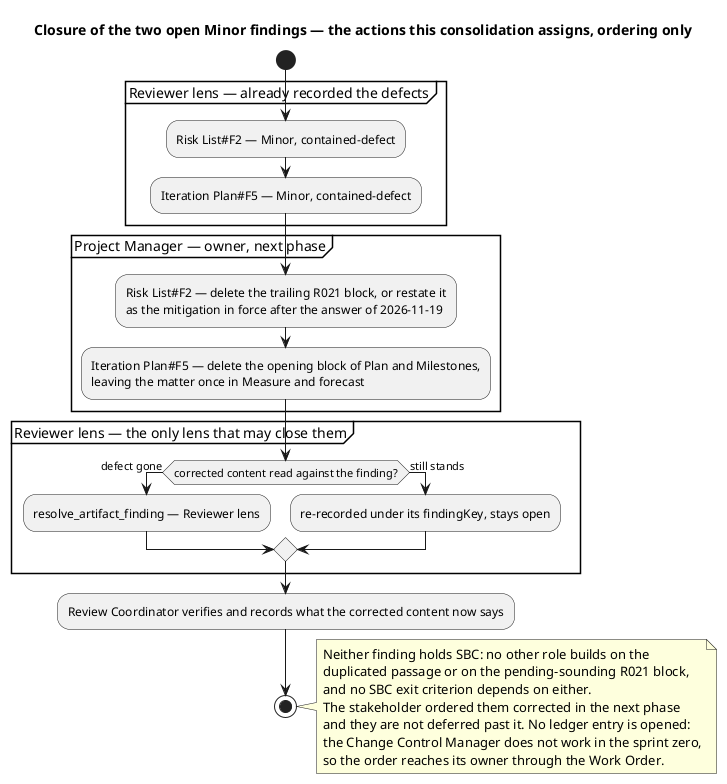

#### Closure protocol for the two open findings

Each is closed by two acts, in this order:

1. the Reviewer — the lens that raised it, and the only lens that may close it — calls `resolve_artifact_finding` after reading the corrected content against the finding;
2. this Review Record gains an entry stating what the corrected content says.

A defect that still stands after rework is re-recorded under its `findingKey` and stays open; it is not duplicated under a new key.

#### Load per owner

| Owner | Open findings | Major | Minor | At work in the phase the action lands in |
|---|---|---|---|---|
| Project Manager | 2 | 0 | 2 | Yes — its Excavation stage produces exactly the Risk List and the Iteration Plan |
| Process Engineer | 0 | 0 | 0 | — closed its 2 this iteration |
| Software Archaeologist | 0 | 0 | 0 | — closed its 2 this iteration |

No finding is assigned to a role that does not work in the phase named, and none to a role outside the active roster. That defect class — the one `Risk List#F1` recorded in the previous milestone review — is empty.

#### Escalation register

| Item | Status |
|---|---|
| Open Critical findings | None — 0. No stakeholder escalation is raised by this consolidation. |
| Overdue findings | None. Twelve closed on their deadline of Survey iteration 2; the two that remain carry the next phase as their deadline by the stakeholder's order. |
| Non-compliance with procedure | None observed — all four artifacts were issued, all were reviewed by the lenses due at SBC, and both executing lenses recorded a disposition. |
| Systemic process failure | None raised to the Change Control Management Board at this milestone. The pattern noted at the previous review — artifacts issued before their upstream settled — did not recur in the correction pass: no corrected artifact contradicts another, and the one cross-artifact consequence (`R008` / `AN-008`) is closed on both sides. |

#### Stakeholder orders carried out of this milestone

Recorded here so no owner treats them as optional. Both are the stakeholder's own answers of 2026-11-19, and neither is a finding this review minted.

| Order | Where it lands |
|---|---|
| "All major findings must be corrected." | Executed — seven of seven Majors closed this iteration, each on corrected content, each by the lens that raised it |
| "Minor findings must be corrected in the next phase; they cannot be left unresolved." | The two findings at priorities 1 and 2, due in Excavation. Neither may be carried past it |
| The perimeter confirmed as the System Inventory records it — 7 projects plus the CI workflow, 26 entry points, the three exclusions of 2026-11-19 | Unchanged by both corrections. `System Inventory#F2` corrected an internal contradiction in the Perimeter's own wording; it altered no boundary, added no entry point and reopened no exclusion |
| R021 accepted at Significant (12), with its mitigation and its 14-day ceiling | In force on each of the seven roadmap milestones; the Project Manager puts every stakeholder question with its recommended answer and the open findings inside it |

The stakeholder sanctioned advancing past SBC on 2026-11-19. That sanction confirms the perimeter and advances the phase; it does not retire the two Minor findings, and it does not convert them into Accepted. They are corrective obligations with a deadline.

## Disposition
### Reviewer lens
<!-- review: Excavation I1 -->

**Technical lens disposition: Approved with Changes.** All nine Excavation artifacts are consumable by the roles that open Consolidation and Inception; the milestone is not clear on this lens until the three `trace-gap` Majors are closed.

Nothing this lens found is wrong content that a downstream role would build on. The three Majors are one defect class — a suspect trace link open at phase close — and each asks its owner to write down a confirmation the artifact set already asserts, or to re-read the one migration it has not re-read. No artifact is rejected: every one states what its anchors say, and the seven anchors this review opened independently confirm the claims that carry the most weight.

| Artifact | Disposition from this lens | Why |
|---|---|---|
| Vision | **Approved** | Every claim anchored or named not established; no business objective invented in a delivery that states none; the three exclusions held |
| Use-Case Model | **Approved with Changes** | Eight use cases, each anchored to the entry points that perform them; mechanisms held out of the model; one Major open — the realization set it shares with the SAD is confirmed nowhere in it (`F1`) |
| Supplementary Specification | **Approved with Changes** | Every mechanism an `<<include>>`; every threshold a figure a file states; each unstated requirement recorded as unstated; one Minor open — its own `IF-` identifier family (`F1`) |
| Software Architecture Document | **Approved with Changes** | Eighteen components and twelve interfaces, each anchored; twelve ADRs each with its alternative and its cost; two Minors open, both a figure contradicting the document's own text (`F1`, `F2`) |
| Deployment Model | **Approved with Changes** | The optional trigger genuinely holds and the FIRED verdict was audited against it; three shapes distinguished and two recorded as declared-but-unestablished; one Minor open — connector identifiers that reference no architecture boundary (`F1`) |
| Design Model | **Approved with Changes** | Thirty-four classes and eight tables, each read from the file named; the Database Designer's persistent-data sections reviewed intact; one Major and one Minor open (`F1`, `F2`) |
| System Inventory | **Approved with Changes** | Coverage reconciles with its own rows, no area of the tree unaccounted for, five of this review's seven anchors confirmed against it; one Major and one Minor open (`F3`, `F4`) |
| Risk List | **Approved** | Twenty-five risks, every magnitude the band of P × I on the declared scale, four acceptances in the stakeholder's own words, every action owned by a role at work where it lands. The one finding this lens held against it from Survey is closed on corrected content |
| Iteration Plan | **Approved with Changes** | One committed total; no forecast before a measured actual; every gate a zero span; the roster fully accounted for; one Minor open — two scenario counts short of the Use-Case Model's survey (`F6`) |

```plantuml
@startuml
title Defect distribution - technical lens, AR / Excavation iteration 1
skinparam shadowing false
skinparam defaultTextAlignment left
skinparam classAttributeIconSize 0
hide empty members
hide circle

class "Vision" as V <<artifact>> {
  Critical : 0
  Major : 0
  Minor : 0
  Disposition : Approved
}
class "Use-Case Model" as UCM <<artifact>> {
  Critical : 0
  Major : 1 - F1 trace-gap, open
  Minor : 0
  Disposition : Approved with Changes
}
class "Supplementary Specification" as SS <<artifact>> {
  Critical : 0
  Major : 0
  Minor : 1 - F1 identifier family
  Disposition : Approved with Changes
}
class "Software Architecture Document" as SAD <<artifact>> {
  Critical : 0
  Major : 0
  Minor : 2 - F1 method count, F2 package count
  Disposition : Approved with Changes
}
class "Deployment Model" as DM <<artifact>> {
  Critical : 0
  Major : 0
  Minor : 1 - F1 connector numbering
  Disposition : Approved with Changes
}
class "Design Model" as DES <<artifact>> {
  Critical : 0
  Major : 1 - F1 trace-gap on TBL-007
  Minor : 1 - F2 absent section markers
  Disposition : Approved with Changes
}
class "System Inventory" as INV <<artifact>> {
  Critical : 0
  Major : 1 - F3 trace-gap on AN-003
  Minor : 1 - F4 IsAdmin span
  Disposition : Approved with Changes
}
class "Risk List" as RISK <<artifact>> {
  Critical : 0
  Major : 0
  Minor : 0 - F2 closed at this milestone
  Disposition : Approved
}
class "Iteration Plan" as PLAN <<artifact>> {
  Critical : 0
  Major : 0
  Minor : 1 - F6 scenario counts
  Disposition : Approved with Changes
}

class "AR milestone - technical lens" as AR <<milestone>> {
  Critical : 0
  Major : 3 open - all trace-gap
  Minor : 7 open - all contained
  Cleared for consumption : 9 of 9
  Holds the milestone : 3 Majors
}

V --> AR
UCM --> AR
SS --> AR
SAD --> AR
DM --> AR
DES --> AR
INV --> AR
RISK --> AR
PLAN --> AR

note bottom of AR
  Every artifact is consumable: no Major leaves a downstream
  role building on wrong content, because the three Majors are
  a missing confirmation of a link the artifact set already
  asserts, not wrong content. What they hold is the milestone:
  a trace tree with a SUSPECT row has not finished verifying
  itself, and no phase closes on an unverified claim.
  The verdict is the Review Coordinator's.
end note
@enduml
```

#### Why the three Majors hold the milestone and the seven Minors do not

A Major is a defect another role builds on, or a milestone exit criterion that fails. The three Majors fail two of the six AR exit criteria as the Iteration Plan states them: criterion 1, that every recovered use case "rests on an entry point inside the confirmed boundary" with the trace tree carrying the claim, and criterion 3, that "every table, key, index, cascade rule and association names the migration that declares it". A SUSPECT row is the trace tree reporting one of its own claims as unverified, so a phase closing with three of them closes on a claim it has not finished checking. That is the criterion failing, not a wording.

The seven Minors are `contained-defect` by the same test read backwards: no role builds on the wrong part of any of them, and no exit criterion depends on any. A wrong method count, a second package total, a wrong timespan, an absent omission marker, a private interface numbering — each is a reader's problem inside one artifact, fixed by its owner in its own turn without touching what another role consumes.

#### What this lens hands to Consolidation

The next phase completes what this one recovered. Three things travel with it from this block:

- **The three suspect links**, as priorities 1–3 of Resolutions and Actions, each with the owner who can close it and what closing it means. They are not deferrable: Consolidation is where the Use-Case Model, the Design Model and the System Inventory are completed, and each of the three artifacts has a stage there.
- **The seven contained corrections**, as priorities 4–10, each in the artifact that states the figure or the identifier. Two of them are one correction each in two artifacts — the package count and the interface numbering — and the owners named must land them together or not at all.
- **What the anchors confirmed**, so that Consolidation does not re-open what this review has settled: `AN-008`'s missing screen path, `AN-015`'s unredeemed refresh token, `BR-031`/`BR-032`'s unguarded `/users` group and unvalidated `UserInfo`, `AN-021`'s self-closing migration gate, and the ownership predicate inside every todo statement with its dead admin disjunct. All five confirmed against the files, none needing a second reading.

#### What this lens does not decide

The AR verdict belongs to the Review Coordinator, taken on this lens with the Management Reviewer's and after the stakeholder answers the sanction question carried as `R021`. This block records the technical state of the artifact set and nothing about the milestone's standing; it declares no phase complete.

### Management Reviewer lens
<!-- review: Survey I2 -->

<!-- review: Survey I2 -->

**Disposition of the governance lens: Approved.** The artifact set satisfies all six SBC exit criteria on the governance test, and the three Major findings this lens carried into the correction pass are closed on evidence in the artifacts. The SBC milestone verdict is the Review Coordinator's to issue after both lens blocks; this block records the lens's disposition, not the milestone's.

Stakeholder sanction: GRANTED

Stakeholder acceptance: "Yes" — to the sanction proposition put on 2026-11-19, which confirmed the perimeter as the System Inventory records it (the seven projects of TodoApp.sln plus the CI workflow, 26 entry points, and the three exclusions of 2026-11-19: external provider sign-in, the admin role, the self-service identity surface) and sanctioned advancing past the System Boundary Confirmed milestone.

Stakeholder order, verbatim: "Minor findings must be corrected in the next phase; they cannot be left unresolved." The two Minor findings open against the artifact set — `Risk List#F2` and `Iteration Plan#F5` — are corrected by their owner in the next phase and are not deferred past it. No ledger entry is opened for this order: the Change Control Manager does not work in the sprint zero, and the order reaches its owner through the Work Order.

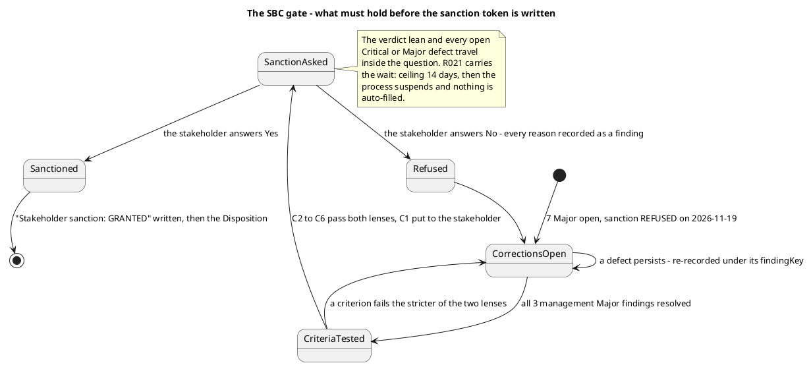

```plantuml
@startuml
title Project health at SBC - four axes, governance lens
skinparam shadowing false
skinparam classAttributeIconSize 0
hide empty members
hide circle

class "SCOPE" as S {
  State : GREEN
  Recovered perimeter : 7 projects + CI, 26 entry points, each anchored
  Recovered product : register, login, logout, todo read/create/delete
  Exclusions : 3, each by stakeholder decision, each anchored
  Confirmation : the stakeholder's Yes, 2026-11-19
}
class "SCHEDULE" as T {
  State : AMBER
  Measured elapsed : none - no phase has closed
  Budget : none declared, so no box exists and none was fitted
  Committed : 10 iterations, stated once
  Reached : Survey used 2 - the second is the correction pass the gate required
}
class "COST" as C {
  State : NOT MEASURABLE
  Tokens : not metered for this review
  Human queue time : the gate was answered; the actual is reported apart
  Forecast : none - a forecast needs a closed phase
}
class "QUALITY" as Q {
  State : GREEN
  Mgmt Major open : 0 in 3 carried in
  Tech Major open : 0 in 4 carried in
  Minor open : 2, both contained in their artifact, both ordered corrected
  Critical : 0
  Artifacts cleared for consumption : 4 of 4 on this lens
}

S -[hidden]right-> T
C -[hidden]right-> Q

note bottom of T
  Amber, not green: no phase has closed and elapsed time is
  not measurable yet. The second Survey iteration is not slippage —
  it is the gate holding and the correction pass that followed
  from the refusal of 2026-11-19.
end note
note bottom of Q
  Two Minor findings remain open and the stakeholder ordered
  them corrected in the next phase. Neither blocks consumption
  and neither fails an exit criterion.
end note
@enduml
```

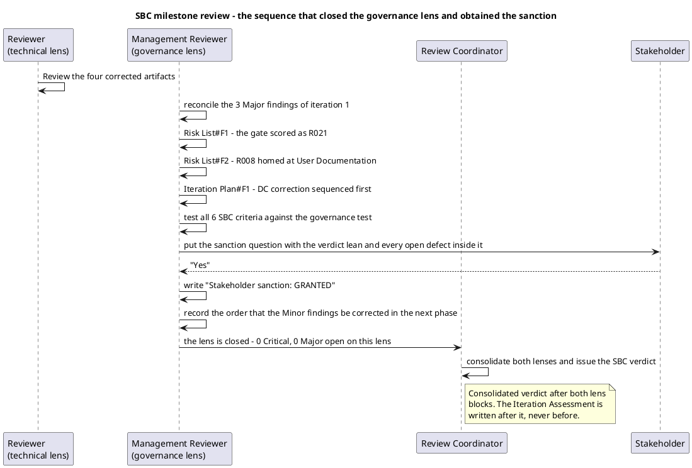

#### What this milestone settles, and what it hands on

| Handed on | To whom | In which phase |
|---|---|---|
| `Risk List#F2` — the trailing `R021` block still reads "offered for acceptance" while the acceptance table records the answer | Project Manager | The next phase, under the stakeholder's order above |
| `Iteration Plan#F5` — the opening block of Plan and Milestones duplicates its Measure and forecast subsection | Project Manager | The next phase, under the stakeholder's order above |
| Priorities 1–6 to be recovered in one pass, priority 7 read as its cross-check | Software Archaeologist, System Analyst, Software Architect, Designer, Database Designer | Excavation |
| `R021` carried forward as the gate on each of the seven roadmap milestones | Project Manager | Every phase |
| `R008`, `R009`, `R020` — accepted exposures, with their mitigation homes fixed | Their named owners | Excavation and Elaboration |

### Review Coordinator lens
<!-- review: Survey I2 -->

<!-- review: Survey I2 -->

**SBC milestone verdict: Go. The Survey phase is complete and advances to Excavation; the two open Minor findings travel to their owner in the next phase under the stakeholder's order.**

The verdict rests on five facts, each counted rather than judged: 0 open Critical findings; 0 open Major findings; six of six SBC exit criteria substantiated by both executing lenses; the perimeter confirmed by the stakeholder on 2026-11-19; and the stakeholder's sanction GRANTED. The refusal of 2026-11-19 named the Major findings as its reason, and that reason no longer stands.

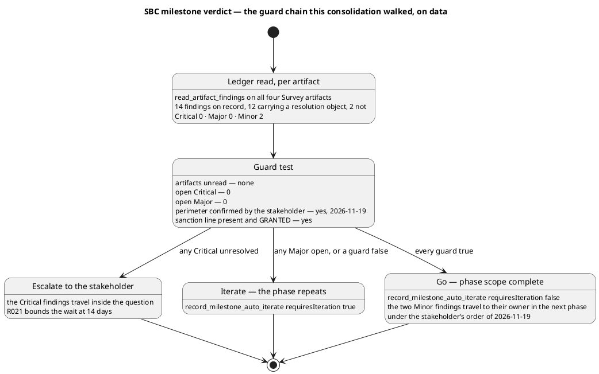

#### Per-artifact disposition

| Artifact | Reviewer lens | Management lens | Disposition from this review |
|---|---|---|---|
| Development Case | Approved — F1 Major and F2 Minor closed | Pass on all four governance tests | **Cleared** |
| System Inventory | Approved — F2 Major and F1 Minor closed; three anchors re-opened, all confirmed | Pass — the perimeter's three exclusions where the stakeholder put them | **Cleared** |
| Risk List | Approved with Changes — F1 Major closed, F2 Minor open | Approved — F1 and F2 Major closed | **Cleared** — the open Minor is `contained-defect` and holds nothing |
| Iteration Plan | Approved with Changes — F1 Major and F2–F4 Minor closed, F5 Minor open | Approved — F1 Major closed | **Cleared** — the open Minor is `contained-defect` and holds nothing |

No artifact is rejected and none is retained. "Approved with Changes" is an artifact-level disposition and correctly says each artifact's substance survives while one wording inside it does not; it does not withhold the artifact from consumption, and the roles that open Excavation consume all four.

#### Why Go rather than Conditional

A Conditional would advance the phase on conditions discharged later, and the previous milestone review rejected that form for the right reason: the defects then open would have put recovered use cases on a Perimeter row its own anomaly contradicted, and set Excavation to execute avoidance actions owned by roles not at work in the sprint zero. Neither condition survives — both are closed on corrected content.

What remains is two wordings, both `contained-defect`: a duplicated passage inside one section, and a trailing block that contradicts its own section's acceptance table. No role consumes either, no exit criterion depends on either, and the acceptance of `R021` itself is recorded verbatim in two places that agree. Holding a phase gate on two wordings is not what a Minor finding means; the stakeholder ordered them corrected in the next phase, which is the deadline this verdict carries forward.

#### Record status

This block records the SBC milestone review's coordination only: the participation of the lenses actually executed, the consolidated ledger read from `read_artifact_findings`, the conflicts across those lenses, the action priorities with owner and deadline, the effectiveness metrics for this milestone, and the verdict. The Business Reviewer is recorded INACTIVE — did not evaluate this review — and no verdict is inferred from its silence. The Iteration Assessment follows this verdict; it does not precede it, and this block declares no phase complete on its own authority beyond the milestone verdict stated here.
