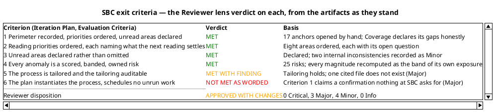
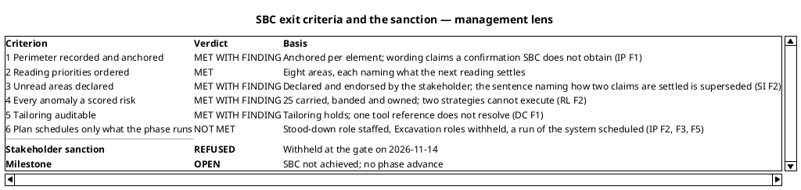
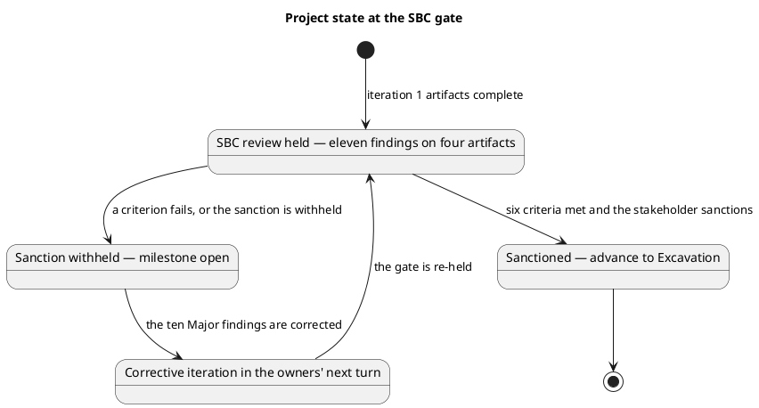
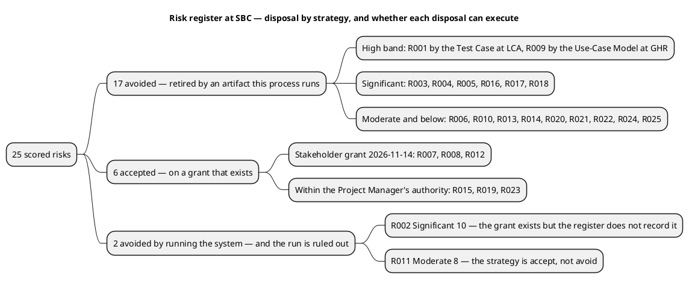
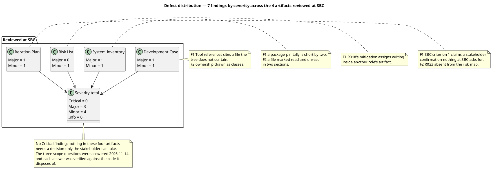

## Document Control
### Reviewer lens
<!-- review: Survey I1 -->

Phase: Survey
Status: Draft — technical lens of the SBC review recorded; 7 findings (3 Major, 4 Minor, 0 Critical) on 4 artifacts
Milestone Target: End-of-Survey (SBC) — not yet achieved

### Management Reviewer lens
<!-- review: Survey I1 -->

<!-- review: Survey I1 -->

Phase: Survey
Status: Draft — management lens of the SBC review recorded; 11 findings (10 Major, 1 Minor, 0 Critical) on 4 artifacts; stakeholder sanction REFUSED on 2026-11-14; milestone open
Milestone Target: End-of-Survey (SBC) — not achieved; sanction withheld at the gate

## Review Scope and Criteria
### Reviewer lens
<!-- review: Survey I1 -->

#### Review scope

Survey iteration 1, the technical lens of the end-of-Survey (SBC) milestone review. Four artifacts were in scope — the complete set produced in this iteration:

| Artifact | Owner | Discipline | Status reviewed |
|---|---|---|---|
| Development Case | Process Engineer | Environment | Draft |
| System Inventory | Software Archaeologist | Discovery | Draft |
| Risk List | Project Manager | Project Management | Draft |
| Iteration Plan | Project Manager | Project Management | Draft |

No artifact was missing from the required set: the Survey process produces exactly these four, and all four exist. This is iteration 1, so there were no prior findings from any lens to reconcile — `read_artifact_findings` returned an empty list for all four, and the closure ledger starts here.

#### Review point and lens

The review point is the **Lifecycle Milestone** (SBC), so the question is **exit criteria**: do these artifacts collectively satisfy the conditions for the sprint zero to close? It is not a feasibility review and not a completion review. The Iteration Assessment is correctly absent — the Project Manager writes it after the verdict — and its absence is not a finding.

This milestone's gates are the SBC exit criteria the Iteration Plan records, tested against what the artifacts actually evidence rather than against what they assert.

#### Criteria applied

| Criterion | Source | Applied to |
|---|---|---|
| DC Baseline Conformance — no roster, ownership, CORE or optional-universe redefinition | IARI baseline | Development Case |
| Optional Trigger Justification — every FIRED verdict audited against its own condition | IARI §5.2 | Development Case |
| Every cited tool reference resolves in the tree | Baseline conformance | Development Case |
| Anchor verification — every perimeter claim checked against the file it cites | Survey depth rule | System Inventory |
| Provenance completeness — every fact has a row | SBC criterion 1 | System Inventory |
| Coverage consistency — nothing declared both read and unread | SBC criterion 3 | System Inventory |
| Band arithmetic — every magnitude the band of its own exposure | Risk magnitude table | Risk List |
| Acceptance authority — no High or Significant risk accepted by someone without the authority | Risk magnitude table | Risk List |
| Exit-criteria integrity — every criterion gates the milestone it names | SBC criterion 6 | Iteration Plan |
| Risk-retirement completeness — every scored risk accounted for | SBC criterion 6 | Iteration Plan |
| Measurement discipline — no invented size, budget, forecast or date | IARI DC §8.1 | Iteration Plan |
| Scope adherence — no marker retired without the stakeholder's answer | Scope Guard | All four |

#### Anchor verification method

The Survey depth rule makes EVIDENCE the review focus: the System Inventory describes an existing system, so every fact rests on a file. Rather than accept the anchors as cited, **seventeen source files were opened directly** and read against the claim each was cited for — the `/todos` authorization rules, the Identity registration, the current-user handler and its claims transformation, the `/users` surface, the external-provider registration, both appsettings pairs on both hosts, the YARP forwarder, the package-pin file, the EF model snapshot, the client component, the AppHost migration step and the test project manifest.

This is why the review found what it found. Sixteen of the seventeen anchors say precisely what the inventory claims. One did not — the package-pin file declares 30 entries where the artifact records 28 — and that is finding F1 on the System Inventory.

#### Scope marker audit

Every marker in the four artifacts was checked against the Scope Guard's rule that only the stakeholder closes one:

| Marker or decision | Where | Verdict |
|---|---|---|
| The `admin` branch — recorded unreachable, role provisioning out of scope | System Inventory, Anomalies and Decisions | Correctly retired: the stakeholder answered on 2026-11-14, and the answer is quoted verbatim |
| External login — configured-at-runtime, no use case recovered | System Inventory, Anomalies and Decisions | Correctly retired: stakeholder answer quoted, with the stakeholder's own condition ("revisit if credentials are supplied") preserved |
| BFF trust boundary — known limitation, carried to the Risk List | System Inventory, Anomalies and Decisions | Correctly retired: stakeholder answer quoted, and R012 carries it |
| No `[DERIVED]` marker anywhere | All four | Correct — nothing here is derived from a declared `FR-NNN`; the sprint zero recovers from code |

No marker was retired by a CCB decision, an approval or the passage of an iteration. All three were retired by the stakeholder's own words, and each answer was then verified against the code it disposes of. This artifact set is clean on scope adherence — no undeclared-scope finding is recorded.

#### SBC exit criteria — the Reviewer lens verdict

### Management Reviewer lens
<!-- review: Survey I1 -->

<!-- review: Survey I1 -->

#### Review scope

Survey iteration 1, the management lens of the end-of-Survey (SBC) milestone review. The four artifacts produced in this iteration were in scope, plus the Review Record's own technical lens as an input:

| Artifact | Owner | Discipline | Lens question |
|---|---|---|---|
| Development Case | Process Engineer | Environment | Does the tailoring govern, and can it be audited? |
| System Inventory | Software Archaeologist | Discovery | Is the perimeter recorded well enough to be confirmed? |
| Risk List | Project Manager | Project Management | Is the register a control instrument or a catalogue? |
| Iteration Plan | Project Manager | Project Management | Does the plan instantiate the tailored process and schedule only what the phases run? |

This is iteration 1, so there was no prior finding of this lens to reconcile. `read_artifact_findings` returned seven entries, all emitted by the Reviewer lens — not mine to close, and each is independently recorded.

#### Review point and lens

The review point is the **Lifecycle Milestone** (SBC), so the question is **exit criteria**. The technical lens has already verified anchors and band arithmetic; a management lens that repeated it would add nothing. This lens asks the questions the technical lens does not reach:

| Criterion | Source | Applied to |
|---|---|---|
| Milestone criteria coverage — every exit criterion addressed, pass or fail | SBC criteria | Iteration Plan |
| Plan instantiates the tailored process — no role at work the tailoring stood down | IARI process table + Development Case | Iteration Plan |
| Plan staffs the work it assigns — every risk owner is a role at work in that milestone | Risk List owner column | Iteration Plan |
| Human gates cover the milestones whose exit condition is the stakeholder's acceptance | Project Acceptance / LCA criteria | Iteration Plan |
| Every control the plan relies on is bound in the register it points at | Risk List | Risk List |
| Strategies are executable against the project's real conditions | FMEA response strategies | Risk List |
| The perimeter record is acceptable to the stakeholder | SBC criterion 1 | System Inventory |
| The process authority is auditable | SBC criterion 5 | Development Case |
| Stakeholder sanction obtained, not assumed | Rule 5 — acceptance is obtained by asking | All four |

#### Method — what this lens did not re-do

The Reviewer opened seventeen anchors and found sixteen correct. That verification is accepted, not repeated: re-deriving it would consume the gate's budget without testing anything new. The two discrepancies the Reviewer found — the package-pin tally and the stale "(unread)" qualifier — are carried in this lens as F1 and the Reviewer's F2 respectively, and F1 is restated here because the pin count is a size fact of the perimeter and therefore a management fact, not only a technical one.

What this lens did instead was read the four artifacts **against each other**: the plan against the Development Case's tailoring, the plan's risk assignments against the register's owner column, the plan's stated controls against the register's contents, and every mitigation against the conditions the project actually operates under. Every finding below came from a cross-artifact contradiction or from a control that exists in one document and not the other.

#### SBC exit criteria — management lens verdict

Criterion 6 is **not met**, and it is the one that decides this gate. A plan that staffs a stood-down role, withholds the roles its own roadmap assigns work to, and schedules an activity the stakeholder has ruled out is not a plan this process can run. The remedy is a corrective iteration, not a negotiation.

#### Stakeholder sanction — asked, and withheld

The sanction was put to the stakeholder at this gate, with the verdict and every open Major defect inside the question.

**Stakeholder sanction: REFUSED.**

Stakeholder acceptance: "No" — the perimeter is not confirmed and SBC is not sanctioned.

The stakeholder added one correction, and it is consequential beyond this milestone:

> "Nothing is missing from the perimeter that I know of. One correction: the system will not be run during these phases — it is not installed anywhere and nobody runs it here. The two statements marked as read but not observed stay declared as such, with their risk. Do not plan to settle them by running the system."

Two things follow. First, the perimeter's **content** is not in dispute — the stakeholder states nothing is missing from it. What was withheld is the sanction, not the perimeter's accuracy. Second, the correction invalidates a retirement path the plan and the register both depend on, which is why it is recorded as findings against the Iteration Plan (F5), the Risk List (F2) and the System Inventory (F2) rather than as a note here.

## Findings
### Reviewer lens
<!-- review: Survey I1 -->

#### Development Case

Reviewed at SBC. Environment discipline, Survey. Verdict: Approved with changes — one Major, one Minor.

| Checklist item | Verdict |
|---|---|
| Baseline conformance: roster, CORE set, ownership unchanged | Pass |
| Every FIRED optional trigger holds its own condition | Pass |
| Every cited tool reference resolves in the tree | Fail — F1 |
| UML notation fits what it expresses | Fail — F2 |
| Classification deltas carry a basis | Pass |
| No forbidden override present | Pass |

##### All six optional verdicts audited against their conditions

Each verdict is an auditable claim, so each was checked against the project's real facts rather than accepted:

| Optional | Verdict | Audit result |
|---|---|---|
| Deployment Model | FIRED | Holds. Four processes — `Todo.Api`, `Todo.Web.Server`, `Todo.Web.Client`, `TodoApp.AppHost` — with YARP forwarding and service discovery between them. A genuine distributed topology, not a single node. |
| Data Model | NOT FIRED | Holds. `TodoDbContextModelSnapshot.cs` declares 8 tables — `Todos`, `AspNetUsers` and 6 Identity framework tables — so both the ">10 entities" and "data-centric" limbs fail; no production data and no migration in scope, so the third limb fails too. |
| Architectural Proof-of-Concept | NOT FIRED | Holds for the sprint zero. The condition requires Elaboration *and* a scored risk; the Risk List post-dates this artifact in the same iteration and Proof-of-Concept is excluded from sprint zero by the process. Correctly deferred, not dismissed. |
| User-Interface Prototype | NOT FIRED | Holds. A working Blazor UI exists in `Todo.Web` and no new UI is declared. |
| Test Plan | NOT FIRED | Holds. MIT sample code, no audit obligation, no contractual test reporting. |
| Glossary | NOT FIRED | Holds. The domain vocabulary is `Todo`, `IsComplete`, `Owner` — fixed by the recovered schema. |

##### Classification and disciplines

`business-process-led = false` is correctly derived — `Todo` carries `Title`, `IsComplete`, `OwnerId` and no policy. `real-time-system = false` follows from a request/response pipeline with no hosted service (`Todo.Api/Program.cs`, read in full: no `IHostedService`, no timer). Business Modeling declared INACTIVE on the correct trigger; Capsule Designer and Business Reviewer stood down consistently with it. All other disciplines at canonical matrix intensities, with no self-granted deviation.

##### F1 — Major — Tool references cites a file that does not exist

The row `| Coding standard and review conventions | CONTRIBUTING.md | Software Architect, with the Code Reviewer |` sends two roles to a document the repository does not contain. A read of `TodoApp/CONTRIBUTING.md` returns "was not found" and the tree carries no such entry.

The consequence is not cosmetic: this artifact is the process authority both the Software Architect and the Code Reviewer read, and it tells them their coding standard lives elsewhere. The System Inventory already records the absence and the Risk List carries it as R006 with the correction due at LCO — but the misdirection is in the artifact now, and LCO is two milestones away. Recommendation: replace the row with what actually governs — `Directory.Build.props` (nullable, implicit usings, `LangVersion preview`) and `Directory.Packages.props`, owner Software Architect — and author a written standard through a Change Request if one is wanted.

##### F2 — Minor — Ownership drawn with class elements and association arrows

`class "ProcessEngineer" as PE` … `PE --> DC : owns` models role-to-artifact ownership as an association between two classes. Ownership is not a class relationship, and the ownership table beneath the diagram states it correctly and unambiguously. Already carried as R025. The artifact is approved by default on this finding; it does not hold the milestone.

```plantuml
@startuml
title Development Case — compliance of the tailoring decisions, section by section
skinparam shadowing false
skinparam componentStyle rectangle

package "Checked and passing" {
  component "Tailoring Overview — classification basis stated" as P1
  component "Disciplines and Intensity — canonical, no self-granted delta" as P2
  component "Artifacts and Templates — UC enumeration rule correct" as P3
  component "Optional Artifact Triggers — 6 of 6 audited" as P4
  component "Roles and Ownership — stood-down roles consistent" as P5
  component "Version policy — net9.0 and SDK 9.0.100 verified" as P6
}

package "Findings" {
  component "Tool references — CONTRIBUTING.md absent (Major)" as F1 #Pink
  component "Roles and Ownership — class notation (Minor)" as F2 #Orange
}

note right of P3
  The use-case enumeration rule the DC fixes is the
  baseline's and is correct: one UC per endpoint surface,
  with auth, rate limiting, logging and telemetry excluded
  as mechanisms into the Supplementary Specification.
end note
note right of F1
  R006's remediation, brought forward from LCO.
  Two roles are currently pointed at a file the
  repository does not contain.
end note
note bottom of P6
  net9.0, 9.0.100 with rollForward latestFeature, and the
  EF Core 9.0.8 / YARP 2.3.0 / Scalar 2.6.8 pins were each
  checked against the files the policy cites, and resolve.
end note
@enduml
```

#### System Inventory

Reviewed at SBC. Discovery discipline, Survey — the sprint zero's one artifact, and the perimeter every later role builds on. Verdict: Approved with changes — one Major, one Minor.

This is the artifact with the most riding on it, so it received the deepest review of the four: **seventeen source files were opened by hand** to test whether the anchors say what the artifact claims.

##### What held under direct verification

| Claim | Anchor opened | Result |
|---|---|---|
| Owner-or-admin on `GET/PUT/DELETE /todos/{id}`; `FindAsync` before the ownership check | `Todo.Api/Todos/TodoApi.cs` | Confirmed exactly as recorded |
| `AddIdentityCore` with no `AddRoles`, no role store, no seeding | `Todo.Api/Program.cs` | Confirmed — the `admin` branch is genuinely unreachable |
| `CurrentUser.IsAdmin` reads `IsInRole("admin")` | `Todo.Api/Authorization/CurrentUser.cs` | Confirmed |
| The authorization gate asks nothing about lock-out | `Todo.Api/Authorization/CheckCurrentUserAuthHandler.cs` | Confirmed — succeeds on `User is not null` alone, TODO in place |
| The caller is re-resolved from the API's own store per request | `Todo.Api/Authorization/CurrentUserExtensions.cs` | Confirmed |
| No service-to-service authentication, recorded as a TODO | `Todo.Api/Users/UsersApi.cs` | Confirmed — first statement in `MapUsers` |
| Four external schemes, each gated on its own config section | `AuthenticationExtensions.cs` | Confirmed — `section.Exists()` guard on all four |
| Neither delivered BFF appsettings carries such a section | both `Todo.Web/Server` appsettings | Confirmed — logging keys only, 167 and 144 bytes |
| YARP forwarder rewrites the cookie token into a Bearer header | `Todo.Web/Server/TodoApi.cs` | Confirmed |
| No `RateLimiting` in `appsettings.json`; 50/50/50 in Development only | `Todo.Api` appsettings pair | Confirmed — R018's premise is true |
| 8 tables and `ProductVersion` 8.0.0 against 9.0.8 pins | `TodoDbContextModelSnapshot.cs` | Confirmed — and the Data Model NOT FIRED verdict rests on the count and holds |
| The completion toggle has no screen | `TodoList.razor` | Confirmed — unbound `<input type="checkbox">`, no handler, no update call in `TodoClient` |
| The database is created only by the AppHost, only when `.db` is absent | `TodoApp.AppHost/Extensions.cs` | Confirmed — `IsRunMode` guard inside `Directory.Exists` |
| One test project, referencing `Todo.Api` only | `Todo.Api.Tests/Todo.Api.Tests.csproj` | Confirmed — and it is precisely what makes R001 true |

##### The three stakeholder decisions hold against the code they dispose of

This was the review's central question, because these three answers bind every role that reads the artifact:

- **The `admin` branch.** `CurrentUser.IsAdmin` reads a role claim; `AddIdentityCore` registers no role store, no `AddRoles`, no seeding. Nothing in the delivered system produces the claim. Recorded as unreachable and role provisioning out of scope — correct and complete.
- **The dormant external providers.** All four schemes are behind `if (section.Exists())`, and neither delivered appsettings file supplies a section. Recorded as configured-at-runtime, no external-login use case this cycle — correct and complete.
- **The BFF trust boundary.** `UsersApi` records the gap as a TODO in the code itself, and the API accepts any valid bearer token. Recorded as a known limitation and carried to the Risk List as R012 with the stakeholder's grant — correct and complete.

Each decision names what it settles and what it does not. None is over-read into a scope claim the stakeholder did not make.

##### F1 — Major — the package-pin tally is short by two

The artifact states "28 pins" in two places; `Directory.Packages.props` declares **30** `PackageVersion` elements — 6 in the test group, 19 in the application group, 5 OpenTelemetry. Every individual pin the artifact names (EF Core 9.0.8, YARP 2.3.0, Scalar 2.6.8, the OpenTelemetry 1.12.0 set) is correct. Only the tally is wrong.

It is a Major rather than a Minor because the Software Architect reads this row when anchoring the SAD to the Development Case's version policy, and a pin set is a size fact of the SBC perimeter the stakeholder is being asked to confirm. Recommendation: correct both occurrences to "30 pins" and the matching Provenance row; no pin value changes.

##### F2 — Minor — `RateLimitExtensions.cs` is marked both read and unread

The Documentation section's "What has no document at all" table sends the reader to "`Todo.Api/Extensions/RateLimitExtensions.cs` (unread)", while Coverage enumerates the file among the 53 opened and describes its contents in detail. The "(unread)" parenthetical is stale. Recommendation: drop it; Coverage is the authority on what was read.

```plantuml
@startuml
title System Inventory — the seventeen anchors opened by hand, and what each verified
skinparam shadowing false
skinparam componentStyle rectangle

package "Authentication and the BFF boundary" {
  component "Todo.Api/Todos/TodoApi.cs" as A1 #PaleGreen
  component "Todo.Api/Program.cs" as A2 #PaleGreen
  component "Todo.Api/Authorization/CurrentUser.cs" as A3 #PaleGreen
  component "Todo.Api/Authorization/CheckCurrentUserAuthHandler.cs" as A4 #PaleGreen
  component "Todo.Api/Authorization/CurrentUserExtensions.cs" as A5 #PaleGreen
  component "Todo.Api/Users/UsersApi.cs" as A6 #PaleGreen
  component "Todo.Web/Server/Authentication/AuthenticationExtensions.cs" as A7 #PaleGreen
  component "Todo.Web/Server/TodoApi.cs" as A8 #PaleGreen
}

package "Configuration, data and evidence base" {
  component "Directory.Packages.props" as B1 #Pink
  component "Todo.Api appsettings pair" as B2 #PaleGreen
  component "Todo.Web.Server appsettings pair" as B3 #PaleGreen
  component "Todo.Api/Migrations/TodoDbContextModelSnapshot.cs" as B4 #PaleGreen
  component "Todo.Web/Client/Components/TodoList.razor" as B5 #PaleGreen
  component "TodoApp.AppHost/Extensions.cs" as B6 #PaleGreen
  component "Todo.Api.Tests/Todo.Api.Tests.csproj" as B7 #PaleGreen
}

note right of A1
  Owner-or-admin on GET/PUT/DELETE by id, exactly
  as recorded; FindAsync before the ownership
  check, confirmed.
end note
note right of A2
  AddIdentityCore with no AddRoles, no role store,
  no seeding, confirmed. UseHttpLogging then
  UseRateLimiter with no UseAuthentication between
  them, confirmed. MapOpenApi outside the Development
  branch, confirmed.
end note
note right of A3
  IsAdmin reads IsInRole("admin"), confirmed.
end note
note right of A4
  Succeeds on currentUser.User is not null alone,
  with the lock-out TODO in place, confirmed.
end note
note right of A5
  The IClaimsTransformation that resolves the caller
  from the store, confirmed — and it is why a valid
  token for a deleted user is rejected.
end note
note right of A6
  The service-to-service TODO is the first statement
  in MapUsers, confirmed.
end note
note right of A7
  Four schemes each gated on section.Exists(),
  confirmed. Neither delivered appsettings file
  carries such a section, confirmed.
end note
note right of A8
  YARP MapForwarder {*path} with the cookie-to-Bearer
  transform over "http://todoapi", confirmed.
end note
note top of B1
  <b>The one anchor that did not hold.</b> 30 PackageVersion
  elements, not 28. Every individual pin the artifact
  names is correct — the tally is short by two.
end note
note right of B2
  No RateLimiting section in appsettings.json;
  50/50/50 present only in appsettings.Development.json.
  Both confirmed — this is what makes R018's premise true.
end note
note right of B3
  Logging keys only, 167 and 144 bytes. No
  Authentication:Schemes section in either file —
  the dormancy claim holds.
end note
note left of B4
  ProductVersion 8.0.0 against 9.0.8 pins, 8 tables,
  confirmed. The Data Model NOT FIRED verdict rests
  on this count, and it holds.
end note
note left of B5
  Renders an unbound checkbox with no @bind and no
  handler; TodoClient exposes no update call. The
  completion-toggle gap is real.
end note
note bottom of B6
  Runs dotnet ef database update only when
  Directory.Exists is false, in run mode only,
  with the connection-string TODO. Confirmed.
end note
note bottom of B7
  References Todo.Api only — not Todo.Web.Server.
  Confirmed, and it is what makes R001 true.
end note
@enduml
```

##### Traceability

No `## Traceability` table is expected of this artifact and its absence is not a finding: the System Inventory declares no element family from the trace chain. Everything it records is recovered from the existing system and cites its anchor where it sits; the trace graph is empty, correctly, and every recovered element will hang from the anchors verified above when Excavation registers them.

#### Risk List

Reviewed at SBC. Project Management discipline, Survey. Verdict: Approved — one Minor, no Major.

##### What the audit checked

| Checklist item | Verdict |
|---|---|
| Every anomaly in the System Inventory became a scored risk | Pass — 25 risks, traced back to an anomaly or a declared coverage limit |
| Every magnitude is the band of that risk's own exposure | Pass — all 25 recomputed |
| No High or Significant risk rests on an acceptance nobody granted | Pass — see below |
| Every risk has an owner, a strategy, a mitigation and, where accepted, a contingency | Pass |
| A mitigation assigns work inside the owning role's artifact | **Fail — F1** |
| Traceability table present with one row per declared `RNNN` | Pass — 25 rows, `Traces From` empty as recovery elements require |
| No invented figure | Pass |

##### The band arithmetic holds across all 25

Every exposure was recomputed as the product of its own two scores and checked against the band table. None is misbanded. The distribution is 2 High, 7 Significant, 12 Moderate, 3 Minor, 1 Low, and the artifact's three summary tables agree with its register row for row.

##### No acceptance is self-granted

This is the check that matters at SBC, and it passes:

- **Both High-band risks are `avoid`** — R001 (16) retired by the Test Case at LCA, R009 (15) retired by the Use-Case Model at GHR. Neither depends on anyone's acceptance.
- **All seven Significant risks are `avoid`** — R003, R004, R005, R017, R002, R018, R016. Again none rests on acceptance.
- **The three accepted risks that are the stakeholder's** — R007 (Low), R008 (Minor), R012 (Moderate) — each quote the stakeholder's answer of 2026-11-14 verbatim, and each answer was verified against the code it disposes of in the System Inventory entry above. R012 is Moderate, where acceptance is the Project Manager's to take anyway; it was escalated and granted regardless, which is the conservative direction.
- **The three accepted risks within PM authority** — R015, R019, R023 — all sit at Minor or Moderate, where the acceptance is legitimately the Project Manager's.

No risk in the High or Significant band is left resting on an acceptance no one granted. The classification section's claim to that effect is true.

##### Scoring judgements reviewed and not contested

The Exit Criteria for this phase are explicit that risk scores are judgements and that disagreement with a score does not fail the milestone. Two scores are worth noting for the record without being findings:

- **R011 at Moderate (2×4).** The rate-limiter partition key being null yields one shared bucket — Impact 4 assumes a real operator scenario. Defensible; the artifact also correctly marks the behaviour as undetermined by reading.
- **R002 at Significant (5×2).** Probability 5 is honest — no process was run — and Impact 2 is defensible because the reading's own Coverage section marks which claims are read-only. The pairing is coherent.

Neither is a defect, and neither is recorded as one.

##### F1 — Minor — R018's mitigation writes into another role's artifact

The mitigation reads: "The Software Architect records both threshold sets and the 10-second replenishment in the Supplementary Specification's rate-limiting constraint."

The Supplementary Specification is the System Analyst's artifact — the Development Case states "Primary ownership is the baseline's and is unchanged" and declares the Database Designer as the only project-specific contributor to a co-owned artifact. As written, two roles would edit the same section, and the Software Architect is not a declared contributor there.

Recommendation: split the supply from the recording — "The Software Architect establishes both threshold sets and the 10-second replenishment by running the API, and supplies them to the System Analyst, who records them in the Supplementary Specification." R018's owner may stay the Software Architect; settling the partition key by observation is that role's work.

This is a Minor: no role builds on the wrong content, and no SBC exit criterion depends on it. It is worth fixing before Elaboration rather than at LCO, because the Supplementary Specification is first written at Consolidation.

```plantuml
@startuml
title Risk List — the 25 risks by magnitude band, the strategy each carries, and where the audit found a defect
skinparam shadowing false
skinparam componentStyle rectangle

package "High (15-25) — 2 risks" #Pink {
  component "R001 BFF covered by no test — 4x4=16 / avoid, retired at LCA" as H1
  component "R009 completion toggle has no screen — 5x3=15 / avoid, retired at GHR" as H2
}

package "Significant (9-12) — 7 risks" #Orange {
  component "R003 4x3=12   R004 4x3=12   R005 4x3=12" as S1
  component "R017 4x3=12   R002 5x2=10   R018 5x2=10" as S2
  component "R016 3x3=9" as S3
}

package "Moderate (5-8) — 12 risks" #LightBlue {
  component "R010 4x2=8   R011 2x4=8   R006 2x3=6   R013 2x3=6" as M1
  component "R014 3x2=6   R023 3x2=6   R012 1x5=5   R019 5x1=5" as M2
  component "R020 5x1=5   R022 5x1=5   R024 5x1=5   R025 5x1=5" as M3
}

package "Minor (3-4) — 3 risks" #LightGreen {
  component "R008 2x2=4   R015 2x2=4   R021 4x1=4" as N1
}

package "Low (1-2) — 1 risk" #PaleGreen {
  component "R007 1x2=2" as L1
}

note right of H1
  Both High-band risks are disposed of by avoid,
  and each names the artifact that does the
  retiring. Neither rests on an acceptance the
  Project Manager granted. Verified.
end note
note right of S3
  R016 is 3x3=9, Significant, strategy avoid — so
  no Significant risk depends on an unsought
  acceptance either. Verified across all seven.
end note
note right of M2
  R012 is the one risk whose acceptance is the
  stakeholder's at Moderate, granted 2026-11-14 and
  quoted in the mitigation section. Verified against
  the System Inventory's decision record.
end note
note right of M1
  <b>MINOR F1 sits here:</b> R018's mitigation has the
  Software Architect writing into the Supplementary
  Specification, which the System Analyst owns. The
  score and band are correct; the mitigation's owner
  is not.
end note
note bottom of N1
  Every magnitude in all 25 rows was recomputed as the
  product of its own two scores and checked against the
  band table. None is misbanded.
end note
@enduml
```

#### Iteration Plan

Reviewed at SBC. Project Management discipline, Survey. Verdict: Approved with changes — one Major, one Minor.

##### What the plan gets right

| Checklist item | Verdict |
|---|---|
| No role or artifact named that the Survey process does not run | Pass |
| Milestone order matches the process's phase sequence | Pass |
| No invented size, token budget, forecast or calendar date | Pass |
| Parallelism not claimed where the chain is sequentially dependent | Pass |
| Every exit criterion gates the milestone it names | **Fail — F1** |
| The risk-retirement map accounts for every scored risk | **Fail — F2** |
| Both clocks reported apart and never summed | Pass |

The plan's discipline on measurement is correct and worth recording: no work item carries a size, the gantt's bars are explicitly declared to be the renderer's unit step and not durations, no project start date is given because none has been measured, and human gates carry a 14-day ceiling with estimate none. The plan states plainly that it declares no token budget and cuts no declared scope to fit an estimate. That is the right behaviour and it is executed without hedging.

The critical-chain reasoning also holds: six sequential agent stretches plus one gate, each link consuming the one before it, is the correct reading of a chain whose links are data dependencies.

##### F1 — Major — criterion 1 claims a confirmation nothing at SBC asks for

Criterion 1 reads: "The perimeter of the existing system is **confirmed by the stakeholder**", evidenced by "the three scope facts put to the stakeholder and answered 2026-11-14".

Two things are wrong. First, the evidence does not support the claim: the three answers disposed of the `admin` role, the dormant external providers and the BFF-to-API boundary — three facts. They confirm nothing about the seven projects, the entry-point surface, the stores or the external systems, which is what "the perimeter" means. Second, the plan schedules the gate that does confirm the perimeter **two milestones after the SBC it is supposed to gate**: "G2 stakeholder confirms the perimeter happens at Consolidation 1's start".

The plan contradicts itself here. Its own roadmap row for SBC states the weaker and correct condition — "The perimeter of the existing system is **recorded and put to the stakeholder**" — so the milestone description and the exit criterion disagree about whether confirmation is required at SBC.

This is a Major because an SBC exit criterion cannot be satisfied as written, and the milestone's sanction would rest on an unevidenced claim. Recommendation: restate criterion 1 as "the perimeter is recorded with an anchor per element, the reading priorities are ordered, and the three facts whose disposition is the stakeholder's have been put to the stakeholder and answered (2026-11-14)", and cite G2 at Consolidation 1's start as where the perimeter is confirmed. **Do not move G2 into SBC** — Excavation deepens the perimeter, so confirming it before that reading would confirm an incomplete record.

##### F2 — Minor — R023 is missing from the risk-retirement map

The roadmap's per-milestone retirement rows account for 24 of the 25 scored risks: AR carries 11, GHR 4, LCO 2, LCA 3, IOC 2, PR 2. **R023** (`RazorLangVersion` 8.0 under `net9.0`, Moderate, strategy `accept`) appears in none of them, and the plan's note "No risk above the Moderate band is carried into Construction or Transition" says nothing about a Moderate risk that is carried accepted.

A reader tracing all 25 risks through the plan finds one that stops at the Risk List. Recommendation: add a line recording that R023 and the other accepted risks (R007, R008, R012, R015, R019) are carried on the acceptance recorded in the Risk List rather than disposed of by an artifact, so the plan accounts for all 25. No schedule change follows.

```plantuml
@startuml
title Iteration Plan — the six SBC exit criteria, each tested against what the artifacts actually evidence
skinparam shadowing false
skinparam componentStyle rectangle

package "Criteria that hold" #PaleGreen {
  component "2  Reading priorities ordered, each naming what the next reading must settle" as C2
  component "3  Unread areas declared, not omitted" as C3
  component "4  Every anomaly is a scored, banded, owned, disposed risk" as C4
  component "5  The process is tailored and the tailoring auditable" as C5
}

package "Criterion with a finding" #Orange {
  component "1  Perimeter confirmed by the stakeholder — MAJOR F1: nothing at SBC asks for it; G2 that does is at Consolidation 1's start" as C1
}

package "Criterion whose wording is correct" #LightBlue {
  component "6  The plan instantiates the process and schedules no work the phase does not run" as C6
}

note right of C1
  The roadmap's own SBC row states the correct, weaker
  condition — "recorded and put to the stakeholder" —
  while criterion 1 claims "confirmed". The two disagree,
  and the three scope answers cited as evidence disposed
  of three facts, not of the perimeter.
end note
note right of C2
  Verified: the eight priorities were read against the
  System Inventory and each names an open question for
  the next reading.
end note
note right of C3
  Verified, and this is the criterion the plan itself
  flags as the one that can fail. It holds — the
  declared-unread groups are real and the two statements
  marked read-not-observed are honest.
end note
note right of C4
  Verified against the Risk List: 25 risks, each scored,
  banded, owned and disposed.
end note
note bottom of C6
  No role or artifact the plan names is outside the Survey
  process. No size, no token budget, no forecast and no
  calendar date is invented anywhere in the artifact — and
  the gantt says so in its own note.
end note
@enduml
```

##### No pull requests to dispose

`scm_list_pull_requests` over all states returns none: no branch carries work, no scaffolding awaits approval, and nothing needs to be deferred out of phase. There is also no IARI build to report — the pipeline file does not exist in the repository yet, which says nothing about the repository's own `ci.yaml`. Nothing in this iteration is a code-review or integration question, so no review evidence is withheld on those grounds.

### Management Reviewer lens
<!-- review: Survey I1 -->

<!-- review: Survey I1 -->

#### Development Case

Reviewed at SBC. Environment discipline, Survey. **Disposition: Approved with changes** — one Major, no Minor from this lens.

| Checklist item | Verdict |
|---|---|
| Tailoring is a delta over the IARI baseline — no roster, CORE, ownership or optional-universe redefinition | Pass |
| Every FIRED optional trigger holds its own §5.2 condition | Pass — Deployment Model fires on a genuine four-process topology |
| Every NOT FIRED verdict holds against its condition | Pass — Data Model on 8 tables, Proof-of-Concept deferred to Elaboration, Test Plan on no audit obligation |
| Classification carries its basis | Pass — `business-process-led = false` and `real-time-system = false` both derived from the code |
| Stood-down roles are consistent through the artifact | Pass — Business Process Analyst, Business Reviewer, Capsule Designer |
| **Every tool reference resolves in the tree** | **Fail — F1** |
| Discipline intensities match the canonical matrix, no self-granted deviation | Pass |

##### F1 — Major — a tool reference does not resolve, so the tailoring is not auditable

The Tool references table reads:

> `| Coding standard and review conventions | CONTRIBUTING.md | Software Architect, with the Code Reviewer |`

`CONTRIBUTING.md` is not in the tree; a direct read returns "was not found". Two roles are told their standard lives in a document that does not exist, and this artifact is the process authority both of them read.

This is a **Major** because SBC exit criterion 5 asks whether the tailoring is auditable, and a process authority whose references do not resolve is not auditable: a reader cannot distinguish a broken link from a standard nobody ever wrote. The Reviewer raised the same defect from the technical lens; this lens restates it because the consequence is the exit criterion, not the notation.

The remediation is R006's, brought forward. Deferring it to LCO leaves the **Code Reviewer** — a lens of the very next milestone review — pointed at an absent file.

#### System Inventory

Reviewed at SBC. Discovery discipline, Survey — the sprint zero's one artifact and the perimeter every later role builds on. **Disposition: Approved with changes** — two Majors, no Minor from this lens.

The Reviewer opened seventeen anchors and found sixteen correct; that verification stands and is not repeated. This lens tested the artifact on three management questions: is the perimeter *recordable as confirmable*, is its size accurate, and does it commit later roles to work they can do.

| Checklist item | Verdict |
|---|---|
| Every perimeter element carries an anchor that says what is claimed | Pass — verified independently by the technical lens |
| Coverage declares its gaps rather than omitting them | Pass — the honest declaration the stakeholder endorsed |
| The three stakeholder decisions are recorded in the stakeholder's own words | Pass — each quoted verbatim, each verified against the code it disposes of |
| **Size facts are accurate** | **Fail — F1** |
| **No forward commitment rests on an activity the project will not perform** | **Fail — F2** |

##### F1 — Major — the package-pin tally is short by two

The artifact records "28 pins" in Technology and Size and "28 package pins" in Configuration read as documentation. `Directory.Packages.props` declares **30** `PackageVersion` elements. Every individual pin the artifact names resolves; only the count is wrong.

A Major, not a Minor, for a management reason: the Software Architect anchors the SAD's version policy to this row, and the pin set is a **size fact of the perimeter the stakeholder is asked to confirm at SBC**. A perimeter record whose size facts are wrong is not yet a record the stakeholder can confirm. The Reviewer recorded the same defect; it appears in both lenses because it fails a technical check and a management criterion.

##### F2 — Major — the artifact names how the two read-only claims are settled, and that path is closed

The Coverage section closes with:

> "Two statements in Anomalies rest on reading alone ... **Both are settled by running the system, which is Excavation's work.**"

The stakeholder stated on 2026-11-14 that the system will not be run during these phases and that the two statements stay declared as read but not observed, with their risk. The **declarations themselves are correct and stay** — they are the honest record the stakeholder endorsed. What is superseded is the forward sentence saying how they are settled.

This is a Major because two other artifacts build their retirement on that sentence: the Risk List's R002 and R011 mitigations, and the Iteration Plan's AR retirement row. A single wrong forward commitment in the perimeter artifact propagates into the plan and the register at once.

#### Risk List

Reviewed at SBC. Project Management discipline, Survey. **Disposition: Approved with changes** — two Majors, no Minor from this lens.

| Checklist item | Verdict |
|---|---|
| Every anomaly of the System Inventory is carried as a scored risk | Pass — 25 rows; 23 anomalies plus 2 declared coverage limits |
| Every magnitude is the band of its own exposure | Pass — all 25 recomputed independently by the technical lens |
| No High or Significant risk rests on an acceptance nobody granted | Pass for R001, R003, R004, R005, R009, R016, R017, R018 |
| Every risk has an owner, a strategy, a mitigation, and a contingency where accepted | Pass formally |
| **Every risk's strategy can actually execute** | **Fail — F2** |
| **The only non-agent delay in the project is bounded here, as the plan claims** | **Fail — F1** |
| Traceability table present, one row per declared `RNNN`, recovery elements with empty `Traces From` | Pass — 25 rows, correct form |

##### What the register gets right, and why it is not a cosmetic artifact

This is the check that matters most for a FMEA-based register at a milestone gate: is it a **control instrument** or a catalogue? On the evidence, it is an instrument:

Twenty-three of the twenty-five dispose of themselves correctly. Both High-band risks are avoided by artifacts the process already runs, so no High risk depends on anyone's grace. The three stakeholder grants are quoted verbatim and each was verified against the code it disposes of. The two defects below are the exceptions, and both concern the same condition: the assumption that the system can be run.

##### F1 — Major — the plan's only bound on the human gate is not in the register it points at

The Iteration Plan states: "A gate is bounded in the Risk List, never forecast in the plan: ceiling 14 days, after which the process suspends rather than filling the gap with an assumption." Its critical chain repeats the ceiling on G1.

**No risk of the 25 bounds a stakeholder gate.** No row names a human gate, a queue time or a ceiling. The three grants the register quotes are decisions already taken, not pending gates. The Project Manager's schedule discipline therefore rests on a register entry that does not exist, and if a gate exceeds its ceiling, nothing says what happens — the exact failure the ceiling was written to prevent. A control asserted in one document and absent from the other is not a control.

##### F2 — Major — two strategies cannot execute, and one acceptance is unrecorded

| Risk | Band | Strategy as written | Why it cannot execute |
|---|---|---|---|
| R002 | Significant (5×2=10) | `avoid` — "the two claims marked reading-only ... are settled by running the system" | The stakeholder ruled out running the system on 2026-11-14 |
| R011 | Moderate (2×4=8) | `avoid` — "The Software Architect settles the partition key by running the API in Elaboration and records the observed result in the SAD, rather than reading it" | Same |

Neither risk is avoided. The condition they describe is **permanent for this project**, so the correct strategy is `accept`. R002's acceptance sits in the **Significant** band, where the grant is the stakeholder's — and that grant was given in the stakeholder's own answer ("stay declared as such, with their risk") but the register does not record it. A Significant risk disposed of by `avoid` on an impossible action, with a grant that exists but is uncited, is the one combination a milestone review must not pass: it counts as retired a risk nothing retires.

The Document Control status line — "no acceptance above the Moderate band is outstanding" — does not survive the correction.

#### Iteration Plan

Reviewed at SBC. Project Management discipline, Survey. **Disposition: Rejected** — five Majors and one Minor from this lens.

This artifact carries the gate's decisive defects. Where the Reviewer tested it on exit-criteria integrity and measurement discipline — both of which it largely passes, and its refusal to invent a size, budget, forecast or date is correct and worth recording — this lens tested it on whether it can be executed as written.

| Checklist item | Verdict |
|---|---|
| No invented size, token budget, forecast or calendar date | Pass — exemplary; the gantt declares its bars are not durations |
| Both clocks reported apart and never summed | Pass |
| Milestone order matches the phase sequence | Pass |
| Parallelism not claimed where the chain is data-dependent | Pass |
| Every exit criterion gates the milestone it names | **Fail — F1** |
| **No role at work that the tailoring stood down** | **Fail — F2** |
| **Every role the plan assigns work to is at work in that milestone** | **Fail — F3** |
| **Every milestone whose exit condition is the stakeholder's acceptance has a gate at which it is obtained** | **Fail — F4** |
| **No milestone retires a risk by an activity the project will not perform** | **Fail — F5** |
| Per-criterion state reported accurately | **Fail — F6 (Minor)** |
| Risk-retirement map accounts for all 25 risks | Fail — the Reviewer's F2; carried there, not duplicated |

##### F1 — Major — criterion 1 claims a confirmation that nothing at SBC asks for

Criterion 1 reads "The perimeter of the existing system is **confirmed by the stakeholder**", evidenced by the three scope answers of 2026-11-14. Three answers about three facts are not a confirmation of seven projects, an entry-point surface, stores and external systems. The gate that does confirm the perimeter — G2 — is placed at **Consolidation 1's start**, two milestones after the SBC it is meant to gate, and the roadmap's own SBC row states the correct, weaker condition ("recorded and put to the stakeholder").

This defect resolved itself at the gate in the most direct way available: the criterion's claim was put to the stakeholder as part of the sanction question, and the stakeholder declined. **A criterion that can only be satisfied by a sanction the stakeholder withholds is a criterion written wrong**, not a stakeholder who is being difficult.

##### F2 — Major — a stood-down role is staffed at two milestone gates

The roadmap's LCO and LCA rows list "Reviewer, **Business Reviewer**, Management Reviewer, Review Coordinator". The Development Case declares Business Modeling inactive (`business-process-led = false`), stands the Business Reviewer down for the whole project, and states "the gate loses one lens, Reviewer and ManagementReviewer remain". The plan's own Resources section lists only three lenses.

The plan contradicts the tailoring that governs it **and itself**, in the same document. A Review Coordinator assembling the LCO and LCA gates from the roadmap would summon a role that does not work on this project.

##### F3 — Major — Excavation is assigned work with no one assigned to do it

Resources states: "**Consolidation adds** the System Analyst (Use-Case Model, Supplementary Specification, Vision; R005, R008, R009, R017)", and enumerates Excavation's roles as Software Architect, Designer, Database Designer.

But the process runs **Requirements at High** in Excavation (System Analyst — Use-Case Model · Business Rules in the Use-Case Flows · Vision) and **Discovery at High** (Software Archaeologist — System Inventory — Anomalies · History and Coverage). The roadmap's AR row carries **R005**, whose owner in the register is the SystemAnalyst, and **R002**, owned by the SoftwareArchaeologist. The retirement map reads "Reading completed — R005, opening HttpAuthenticationStateProvider.cs first".

An iteration whose risk owners are not on its resource profile has no one accountable for the risks it is carrying. The owner column of the register and the Resources section of the plan name different sets of roles, and only one of them can be right.

##### F4 — Major — two milestones whose exit condition is acceptance have no gate

The plan states "The only human in this system is the stakeholder; their gates are the three gold markers on the roadmap" — G1 (three scope facts), G2 (confirms the perimeter), G3 (accepts the LCO case).

```plantuml
@startuml
title The stakeholder gates the plan books against the ones the milestones require
skinparam componentStyle rectangle
skinparam shadowing false

package "Booked by the plan — three gold markers" {
  component "G1 — the three scope facts\nanswered 2026-11-14" as G1 #PaleGreen
  component "G2 — confirms the perimeter\nConsolidation 1 start" as G2 #PaleGreen
  component "G3 — accepts the LCO case\nInception 1 end" as G3 #PaleGreen
}

package "Required by the milestone, booked nowhere" {
  component "LCA — architecture baseline\nacceptability is the stakeholder's call" as LA #Pink
  component "PR — Project Acceptance\ncustomer takes ownership of the product" as PR #Pink
}

package "Milestones carrying no stakeholder gate" {
  component "SBC — sanction obtained at this review" as SBC #LightBlue
  component "AR and GHR — reading milestones" as AR #LightBlue
  component "Construction 1 and 2 — increment builds" as C #LightBlue
}

note right of PR
  The PR row gates "Production deployment, acceptance
  testing, release notes, and the closure of the Change
  Request ledger". Acceptance testing is not acceptance,
  and none of the four is the customer taking ownership.
end note
note right of LA
  The lenses sanction the baseline; whether it is
  acceptable to the stakeholder is not a question a
  lens can answer.
end note
note bottom of G1
  The plan states these three markers are the only
  human gates in the project.
end note
@enduml
```

Two gates are missing and each is a different failure. At **LCA** the exit condition includes whether the architecture baseline is acceptable to the stakeholder — a question no lens can answer on their behalf. At **PR** the Project Acceptance Review is the point at which the customer formally accepts ownership of the software; the plan's PR row gates four technical deliverables and **none of them is the customer taking ownership**. A milestone that exists to transfer ownership with no event at which ownership transfers exposes the organization to exactly the contractual risk the acceptance review exists to close.

This finding also corrects an assumption in the plan's own reasoning: SBC did obtain a stakeholder sanction — this very review asked for it. So the claim that the stakeholder's only appearances are three bookmarked markers was already inaccurate for the milestone it was written in.

##### F5 — Major — the AR milestone retires two risks by an activity the stakeholder ruled out

The retirement map reads "Observed rather than read — R002 by running the system, R011 by running the API", and the AR row reads "the claims the reading marked as reading-only are settled by running the system".

The stakeholder ruled this out on 2026-11-14: the system is not installed anywhere and nobody runs it here. AR therefore carries two risks whose named retirement **cannot occur**, and the plan leaves them counted as retired at a gate that will not produce the evidence. This is the most serious of the five: it means the AR milestone's exit case, as planned, cannot be evidenced — and that would have been discovered at AR rather than here, had the stakeholder not stated the constraint.

##### F6 — Minor — the exit-criteria status column reports uniform readiness

Every criterion reads "Met pending the gate", including criterion 5, which carries an open Major. A status column that reports uniform readiness next to a criterion under an open Major understates the gate's state. It stays inside the artifact — no role builds on the wrong content from it — and is fixed in the owner's next turn.

## Resolutions and Actions
### Reviewer lens
<!-- review: Survey I1 -->

#### Closure ledger

No prior finding exists from this lens: this is Survey iteration 1 and there is no earlier milestone. `read_artifact_findings` returned an empty list for all four artifacts, so nothing is resolved, deferred or rejected here.

| Finding | Owner | Severity | Holds the milestone | Closes when |
|---|---|---|---|---|
| Development Case F1 — `CONTRIBUTING.md` cited, absent | Process Engineer | Major | Yes | The Tool references row is replaced with the files that actually govern, or a standard is authored under a Change Request |
| System Inventory F1 — package-pin tally short by two | Software Archaeologist | Major | Yes | Both occurrences read 30, and the Provenance row is corrected |
| Iteration Plan F1 — SBC criterion 1 claims an unevidenced confirmation | Project Manager | Major | Yes | Criterion 1 is restated to what SBC gates, and G2 is cited as the confirmation point |
| Development Case F2 — ownership drawn as classes | Process Engineer | Minor | No | Redrawn when the artifact is next revised — tracked as R025 |
| System Inventory F2 — `RateLimitExtensions.cs` marked read and unread | Software Archaeologist | Minor | No | The "(unread)" qualifier is dropped |
| Risk List F1 — R018 mitigation writes into another role's artifact | Project Manager | Minor | No | The mitigation splits supplying the values from recording them |
| Iteration Plan F2 — R023 absent from the risk-retirement map | Project Manager | Minor | No | A carried-accepted line accounts for the remaining risk |

#### Actions, in the order they gate the milestone

The three Majors are the only things standing between this iteration and its sanction. Each is a correction inside one artifact, and each is small — none of them requires re-deriving content, and none needs a further iteration to close.

1. **Software Archaeologist** — correct "28 pins" to "30 pins" in Technology and Size and in Configuration read as documentation, and in the matching Provenance row. The pin values themselves are right and need no change. This is the correction with the widest reach: the Software Architect anchors the SAD to that pin set.
2. **Process Engineer** — replace the `CONTRIBUTING.md` row in Tool references with `Directory.Build.props` and `Directory.Packages.props` as the compiler-enforced conventions, owner Software Architect. This discharges R006 two milestones early, which is the right direction: the Code Reviewer is a lens of the very next milestone review and is currently pointed at a file that is not there.
3. **Project Manager** — restate Iteration Plan criterion 1 to record the perimeter as *recorded, anchored and put to the stakeholder*, with the three scope answers cited as disposing of three specific facts, and cite G2 at Consolidation 1's start as where the perimeter is confirmed. **G2 does not move** — Excavation deepens the perimeter, so confirming it before that reading would confirm an incomplete record.

The four Minors are recorded and fixable in each owner's next turn. None holds the milestone and each artifact is approved by default on its Minors.

#### What is not an action

Three classes of thing were considered and deliberately not raised as findings, recorded here so the omission is a decision rather than an oversight:

- **Risk scores.** R011's Impact 4 and R002's Probability 5 are judgements, and the Iteration Plan states explicitly that disagreement with a score does not fail the milestone. What must hold — that every magnitude is the band of its own exposure, and that no High or Significant risk rests on acceptance nobody granted — does hold. Reviewed and not contested.
- **The Iteration Assessment's absence.** It is written by the Project Manager after this verdict and does not gate the phase. Its absence is correct and is not a finding.
- **The empty trace graph.** `model_generate_rtm` and `get_trace_chain` both return no links. That is correct for a recovery phase: nothing recovered from the existing system has an upstream, so no link is registerable yet. The anchors verified above are what Excavation's recovered elements will hang from. No `trace-gap` finding arises, and the Risk List's 25 empty `Traces From` rows are the correct form for recovery elements, not a defect.

## Disposition
### Reviewer lens
<!-- review: Survey I1 -->

#### Disposition

**Approved with changes.** 0 Critical, 3 Major, 4 Minor, 0 Info across 4 artifacts.

#### Why no Critical

A Critical is a defect only the stakeholder can unblock — a scope decision, a contradiction in what they declared, or a risk only they may accept. Three such questions were raised during this iteration and the stakeholder answered all three on 2026-11-14. Each answer was then tested against the code it disposes of: `AddIdentityCore` really does register no role store, all four external schemes really are gated on a config section neither appsettings file supplies, and the service-to-service TODO really is the first statement in `MapUsers`.

The answers hold, they are recorded in the stakeholder's own words, and no new question surfaced. **Nothing in this artifact set requires the stakeholder to act before the milestone can be sanctioned.**

#### Why Major and not Minor on the three Majors

Each of the three fails an SBC exit criterion or misdirects a role that builds on it:

- The Development Case's absent-file row points the **Code Reviewer** — a lens of the very next milestone review — and the Software Architect at a document that does not exist.
- The System Inventory's pin tally is read by the **Software Architect** when anchoring the SAD to the version policy, and a pin set is a size fact of the perimeter the stakeholder is being asked to confirm.
- The Iteration Plan's criterion 1 asserts a confirmation the plan itself schedules two milestones later, so the milestone's sanction would rest on a claim its own roadmap contradicts.

#### Why the artifacts are nonetheless close to sound

This is the finding that should carry the most weight into the Management Reviewer's lens: **seventeen anchors were opened by hand, and sixteen say exactly what the artifact claims.** The perimeter the sprint zero hands forward is accurate. The three stakeholder decisions are correctly scoped — each names what it settles and what it leaves open, and none is over-read into a scope claim the stakeholder did not make. The risk scoring is internally coherent across all 25 rows, with no magnitude misbanded and no High or Significant risk resting on an acceptance nobody granted. The plan invents no size, no budget, no forecast and no date, and says so explicitly.

All seven findings are corrections *inside* an artifact. None requires re-deriving content, none requires a further iteration to close, and none touches the perimeter facts the stakeholder will be asked to confirm.

#### Handoff to the Management Reviewer

The technical lens finds nothing that invalidates the sprint zero's core product: a verified perimeter, a correctly scoped set of stakeholder decisions, a coherently scored risk register and a plan that schedules only what the process runs. What stands between the iteration and its sanction is three textual corrections and four small ones, all in the owners' next turn.

The business and management case is the next lens's question, not this one's.
