## Document Control
### Reviewer lens
<!-- review: Survey I2 -->

<!-- review: Survey I2 -->

- Phase: Survey
- Status: Technical lens complete for the re-taken SBC milestone review. Two findings recorded: 0 Critical, 0 Major, 2 Minor, 0 Info. Disposition — Approved with Changes (the Changes are the two Minors, which no role consumes and no exit criterion depends on).
- Milestone Target: end-of-Survey (SBC) — not achieved. Gate H2 was refused on 2026-11-23 and nothing in this lens closes it; the sanction is the stakeholder's to re-take.
- Iteration: 2, Cycle 1
- Owner: Reviewer

### Management Reviewer lens
<!-- review: Survey I2 -->

- Phase: Survey
- Status: Management lens complete for the re-taken SBC milestone review. Findings recorded by this lens over two iterations: 3 in iteration 1, all resolved this iteration; 2 new this iteration. Open from this lens: 0 Critical, 0 Major, 2 Minor. Disposition — Go. Stakeholder sanction GRANTED on 2026-11-23.
- Milestone Target: end-of-Survey (SBC) — the perimeter is confirmed and the sanction to advance past SBC is granted. The verdict on the milestone is the Review Coordinator's.
- Iteration: 2, Cycle 1
- Owner: Management Reviewer

### Review Coordinator lens
<!-- review: Survey I1 -->

<!-- review: Survey I1 -->

- Phase: Survey
- Status: SBC milestone consolidated. Lenses executed: Technical (Reviewer), Management (Management Reviewer). Business lens — INACTIVE — did not evaluate this review. Consolidated ledger: 10 findings, 0 Critical, 6 Major, 4 Minor, 0 Info, all open. Disposition — No-Go; the milestone is not sanctioned and the stakeholder refused the sanction on 2026-11-23.
- Milestone Target: end-of-Survey (SBC) — not achieved. Six Major findings require rework before any role consumes these artifacts and before Excavation begins.
- Iteration: 1, Cycle 1
- Owner: Review Coordinator

## Review Scope and Criteria
### Reviewer lens
<!-- review: Survey I2 -->

<!-- review: Survey I2 -->

**Review type.** Lifecycle milestone review, technical lens, re-taken at the SBC (end-of-Survey) review point after the iteration-2 rework. The question applied is exit criteria: whether the four artifacts collectively satisfy the conditions for transition into Excavation.

**Artifacts under review.** Development Case (Process Engineer), System Inventory (Software Archaeologist), Risk List (Project Manager), Iteration Plan (Project Manager). The Iteration Assessment is not reviewed here: the Project Manager authors it in the Assess touchpoint that runs after this review, so at review time it cannot yet describe the iteration being reviewed.

**Scope of this iteration's pass.** The lens re-ran on the four artifacts against the seven findings it recorded in iteration 1 and against the stakeholder's order of 2026-11-23 that the Major findings and the Development Case's duplicated diagrams and text be corrected. Nothing outside that rework was re-derived: the artifact content that iteration 1 cleared as accurate is not re-litigated, and no new requirement was raised against it.

**Checklist applied.** The same three checklists as iteration 1, so the two passes are comparable: Environment tailoring → DC Baseline Conformance and Optional Trigger Justification against the IARI baseline; Discovery → the EVIDENCE lens, every fact about an existing system resting on the file it cites; Project Management → the IARI risk scale, the two-currency rule and the phase's exit criteria.

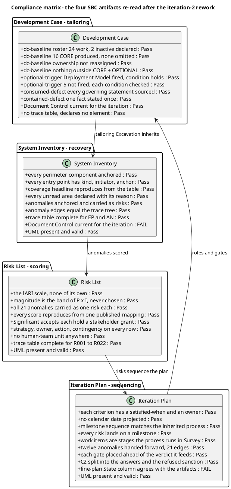

**Anchor verdict — the four statements this iteration's rework rests on, opened rather than trusted.**

| Claim under review | Anchor opened | Verdict |
|---|---|---|
| No enterprise version policy is recorded; version selection follows central pinning and a nuget.org-only source | `global.json`, `nuget.config`, `Directory.Packages.props` as cited | Confirmed — `global.json` pins SDK `9.0.100` with `rollForward: latestFeature`; `nuget.config` clears the sources, adds only `nuget.org` and maps `*` to it, so a package from another feed does not restore. The Development Case states this and asserts no policy |
| The Development Case's contribution contract is the published one and it holds over the delivery's README | `docs/CONTRIBUTING.md` §1–§5 | Confirmed — the label table, the branch and review rules, and the code and test conventions are stated there with each convention cited to the file that carries it; the README states no label, branch or review rule |
| The Coverage figure reproduces from the per-area table | System Inventory "Coverage": Files and Read columns | Confirmed — Read sums to 79 (23 + 7 + 8 + 0 + 14 + 1 + 6 + 2 + 1 + 7 + 1 + 2 + 1 + 1 + 4 + 1), Files to 133, and 133 − 79 = 54 |
| Every risk score reproduces from the System Inventory's likelihood and impact words | Risk List "How each score is derived" against the register's P and I columns for R001–R022, and the inventory's words for AN-001–AN-021 | Confirmed — all 21 anomaly-derived rows reproduce from the single published mapping (`possible` 3, `likely` 4; `low` 2, `moderate` 3, `high` 4) and no inventory word scores differently in different rows |

No anchor opened this iteration contradicted the artifact that cites it. Both findings below sit in metadata and in the plan's own status column, not in the reading's accuracy or in its arithmetic.

**SCM evidence.** No open pull request exists, so nothing is disposed in this review and no code review decision is owed. There is no IARI pipeline on `main` — `ci.yml` does not exist yet — so no build status exists to be red; establishing the build environment is the Integrator's Inception work item and no branch of this process exists. Neither condition is a finding, and no phase-discipline defect is available to detect in the absence of code.

### Management Reviewer lens
<!-- review: Survey I2 -->

This is the Lifecycle Milestone Review of the System Boundary Confirmed gate, held at the end of Survey iteration 2. The question it answers is exit criteria, not feasibility and not iteration completion: do the Survey artifacts collectively establish that the perimeter of the existing system is known, its anomalies are held as owned risks, and the phase may hand off to Excavation.

**Artifacts reviewed, all four read whole plus the findings of every lens on them.** Development Case (Environment), System Inventory (Discovery), Risk List and Iteration Plan (Project Management). The Iteration Assessment was read for its stated state and is not judged: the Project Manager writes it in the Assessment touchpoint that runs after this review, so it cannot describe the iteration being reviewed and its currency is never a gate condition.

**The criteria checked.** The SBC exit criteria as the Iteration Plan states them, each judged against the artifact it cites rather than against the plan's own row. Every one carries the artifact section its verdict rests on.

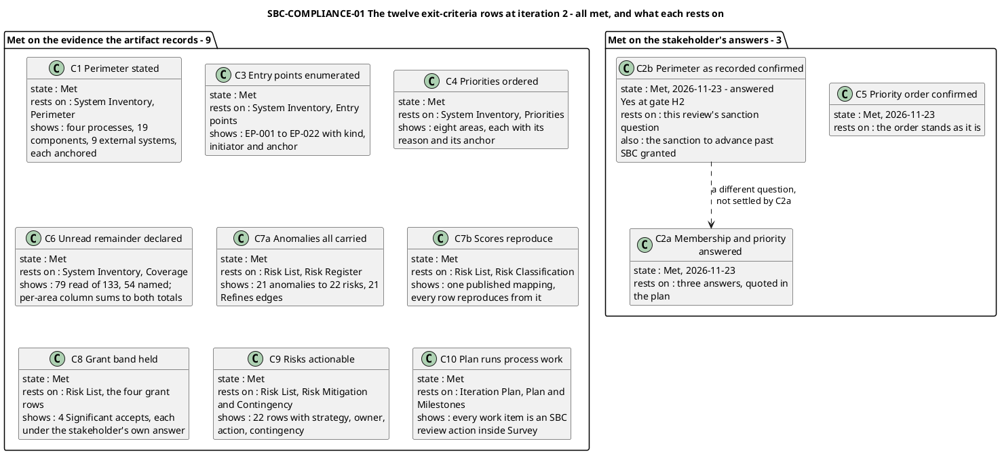

**The checklists applied beyond the criteria.** Each is this lens's own test on the artifacts it reviewed, and each result is stated where the test found something — in Findings, or here when it found nothing.

| Check | Applied to | Result |
|---|---|---|
| Development Case conformance with the IARI baseline: roster, CORE ownership, CORE omissions, artifact universe, role merges | Development Case | Passes. 24 of 26 roles work; the two inactive are declared with the triggers that justify each — `business-process-led = false` and `real-time-system = false`. All 16 CORE artifacts are carried, none changes owner, no artifact outside the CORE, OPTIONAL and System Inventory universe is listed, no role is merged or renamed. |
| Every FIRED optional trigger holds its §5.2 condition | Development Case | Passes. One trigger fires: the Deployment Model, on a genuinely distributed topology — a browser-hosted WebAssembly client, a server host, a separate API process, a SQLite store and a YARP forwarder hop between them, orchestrated by the app host, with an `appsettings` pair per process. The five NOT FIRED verdicts hold on their conditions: the vocabulary is plain English (Glossary), no untried mechanism needs empirical validation (Proof-of-Concept), 8 entity types sit below the >10 threshold with no production data to migrate (Data Model), no UX decision waits on the stakeholder (UI Prototype), and no regulator or contract consumes test reporting (Test Plan). |
| Plan sizing in units this system can produce | Iteration Plan | Passes. The plan is sized in the two currencies that exist — token spend and elapsed time with agent and human queue separated — and no per-item figure is filled where nothing is measured. The coarse roadmap's bars carry no absolute date and no projected span, and the one-day length is stated as the diagram's sequencing device. Item 8 is a human gate, quoted in days of queue time with a ceiling of 14 and no estimate, and the roadmap states the two clocks are never added. No token budget is asserted, because the project declares none. |
| Plan names only work the process runs in the phase | Iteration Plan | Passes, C10. Every iteration-2 work item is an SBC review action against a Survey artifact or the re-taken gate; no role is scheduled in Survey for work the IARI process assigns to a later phase. |
| Unsourced financial or quantitative claims | all four | None found. No cost, revenue, market or staffing figure appears in any of the four artifacts, and no staffing risk is carried — correctly, since the executing agents are not a development organization and the only human is the stakeholder. |
| Risk register is not cosmetic: magnitudes reproduce and the retirement obligation is honest | Risk List | Passes. All 21 anomaly-derived scores reproduce from one published mapping, and the register states plainly that SBC retires no risk — the phase makes the reading's risks owned and the actions that retire them are Excavation's and later. That is the correct state for this gate, not a static list: the register moved this iteration from unreproducible to reproducible, and the four acceptances above the Moderate band each hold the stakeholder's own answer. |

**What is not a finding, and why.** The absence of a Test Plan, a Data Model and a Glossary is the Development Case's NOT FIRED verdict on each, checked against its §5.2 condition above and found to hold. The absence of an Iteration Assessment describing this iteration is correct state, not a gap. The absence of a token budget, a velocity and a forecast is correct: the project declares no budget, no phase has closed, and no figure is filled in its place. No SCM condition holds or clears this gate — the repository carries no IARI pipeline, no branch of this process, no open pull request and no defect issue, so there is no build to be red and no unmerged work to count.

**Four-axis health at the gate.** Cost carries no reading at all, which is the honest state of a phase with no declared budget and no closed phase, not a fourth green.

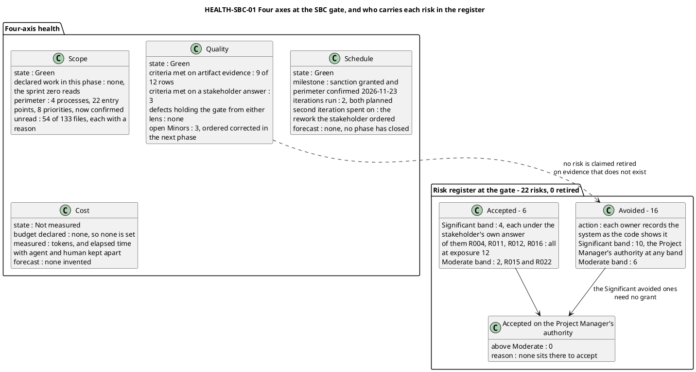

### Review Coordinator lens
<!-- review: Survey I1 -->

<!-- review: Survey I1 -->

**Review event.** Lifecycle milestone review, System Boundary Confirmed (SBC), the first of the sprint zero's three milestones. Consolidation of two executed lenses into one authoritative record.

**Lens participation — authoritative.**

| Lens | Role | Participation | Findings recorded |
|---|---|---|---|
| Technical | Reviewer | EXECUTED | 7 — 0 Critical, 4 Major, 3 Minor |
| Business | BusinessReviewer | **INACTIVE — did not evaluate this review** | none |
| Management | Management Reviewer | EXECUTED | 3 — 0 Critical, 2 Major, 1 Minor |

The Business Reviewer does not work in Survey: the IARI Development Process runs `Reviewer → Management Reviewer → Review Coordinator` at SBC, and the Business Reviewer enters from LCO. Its absence is correct process behaviour and carries no verdict. The milestone decision below rests on the two lenses that executed.

**Review type and authority.** This is not a PRA review and not an Iteration Acceptance Review carried in place of a milestone review. The management lens stated the iteration-acceptance question separately and answered it all six objectives delivered, while withholding the milestone. Those are different questions and this record keeps them apart — the milestone verdict is the one recorded below.

**Artifacts under review.** Development Case (Process Engineer, Environment), System Inventory (Software Archaeologist, Discovery), Risk List and Iteration Plan (Project Manager, Project Management). The Review Record is the reviewers' own output and is not itself under review.

**Review schedule — the review events this project runs, on their iteration boundaries.**

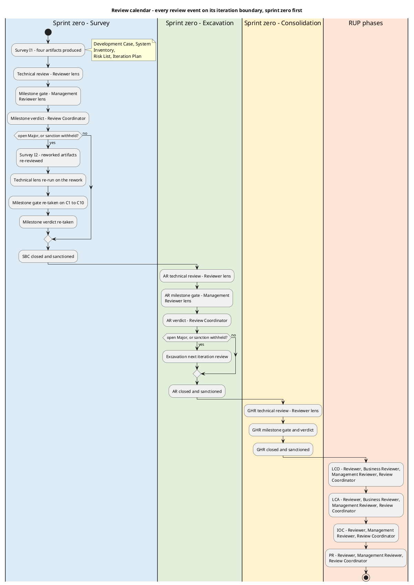

**Review process framework — the review types this project runs, with the criteria that gate each.**

| Review type | Triggering activity | Required participants | Entry criteria | Exit criteria | Primary output |
|---|---|---|---|---|---|
| Milestone review SBC (this event) | Survey work items complete | Reviewer, Management Reviewer, Review Coordinator | Four artifacts in target state; findings ledgers distributed before the review | Every Critical and Major carries owner and deadline; verdict recorded; sanction answers recorded | This Review Record |
| Milestone review AR | Excavation work items complete | Reviewer, Management Reviewer, Review Coordinator | Recovered Use-Case Model, SAD, Design Model, Deployment Model, Risk List, Iteration Plan in target state | As above, plus the recovered set anchored | Review Record, AR block |
| Milestone review GHR | Consolidation work items complete | Reviewer, Management Reviewer, Review Coordinator | Coverage counted and declared; recovered set complete | As above | Review Record, GHR block |
| Milestone review LCO | Inception work items complete | Reviewer, **Business Reviewer**, Management Reviewer, Review Coordinator | Vision, Use-Case Model, Supplementary Spec, SAD, Change Request ledger in target state | As above, plus business acceptability stated | Review Record, LCO block |
| Milestone review LCA | Elaboration work items complete | Reviewer, Business Reviewer, Management Reviewer, Review Coordinator | Architecture baseline and executable architecture built and tested | As above, plus architecture gate passed | Review Record, LCA block |
| Milestone review IOC | Construction work items complete | Reviewer, Management Reviewer, Review Coordinator | Iteration baseline integrated with green CI | As above, plus integrated baseline verified | Review Record, IOC block |
| Milestone review PR | Transition work items complete | Reviewer, Management Reviewer, Review Coordinator | Release build baselined and acceptance-tested | As above, plus every Change Request closed | Review Record, PR block |
| Iteration Plan Review | "Plan for Next Iteration" | Project Manager, Reviewer, Review Coordinator | Next iteration's plan drafted | Findings closed; plan accepted | Review Record entry |
| Iteration Evaluation Criteria Review | "Manage Iteration", before close | Reviewer, Project Manager, Review Coordinator | Exit criteria and evidence tabled | Each criterion passes or is reclassified | Review Record entry |
| Iteration Acceptance Review | "Manage Iteration", at close | Reviewer, Management Reviewer, Review Coordinator | Evaluation criteria review passed | Deliverables formally accepted | Review Record entry |
| Project Acceptance Review | Project close-out | Stakeholder, Management Reviewer, Review Coordinator | All milestones sanctioned | Stakeholder accepts the delivery | Review Record entry |

The SBC event in this table is the only one that has occurred. Every later row is scheduled, not completed.

**Entry criteria — checked at this event.**

| Entry condition | State |
|---|---|
| The four artifacts are in their target state, not draft placeholders | Met — all four carry full content |
| The reviewers are assigned with expertise matched to the artifact domain | Met — Environment, Discovery and Project Management artifacts, read by the technical and management lenses |
| The finding ledgers are available to the coordinator before consolidation | Met — 10 findings read from the ledger |
| The stakeholder's answers to the gate questions are on record | Met — answered 2026-11-23 |

**Exit criteria — checked at this event.**

| Exit condition | State |
|---|---|
| Every Critical and Major finding carries an owner and a remediation | Met — 6 Major, each with owner and remediation from its lens |
| The verdict is recorded and archived | Met — No-Go, below |
| The stakeholder's sanction is recorded verbatim | Met — REFUSED, 2026-11-23 |
| Zero open Critical/Major before the phase advances | **Not met** — 6 open Major |

**Method.** Both lenses opened the load-bearing anchors in the repository rather than trusting the claims: the perimeter files, the authorization surface, the `/auth` flows, the client components, the test host, the build and container manifests, `docs/CONTRIBUTING.md` and `.iari/README.md`. The technical lens found no defect against the reading's accuracy on any anchor it opened. Every finding sits in a count, a trace edge, a score, or an assertion no file supports — not in a misread file.

**SCM evidence.** No IARI pipeline file exists on `main`, no branch of this process exists, no pull request is open, and no defect issue is filed. No SCM condition holds or clears this gate; none is reported as passing.

## Findings
### Reviewer lens
<!-- review: Survey I2 -->

<!-- review: Survey I2 -->

#### Iteration 2 — closures of this lens's iteration-1 findings

All seven findings the technical lens recorded in iteration 1 are closed by `resolve_artifact_finding`, each against the corrected artifact section named below. None persists, so none is re-recorded under its `findingKey`.

| Artifact | Finding | Criterion | Severity | Outcome | What closed it |
|---|---|---|---|---|---|
| Development Case | F1 | `consumed-defect` | Major | Resolved | "Tool and configuration references" now states that no enterprise version policy is recorded and asserts none, then records only what `Directory.Packages.props`, `global.json` and `nuget.config` carry. The Software Architect is no longer sent to a policy that exists nowhere |
| Development Case | F2 | `contained-defect` | Minor | Resolved | "Roles and Ownership" carries one CLS-DC-01 diagram and one role-deltas block; the duplicated copies are gone, as the stakeholder ordered on 2026-11-23 |
| System Inventory | F1 | `trace-gap` | Major | Resolved | The AN-021 row reads `DependsOn EP-004, EP-005, EP-007`, matching the Anomalies diagram and the three registered edges |
| System Inventory | F2 | `contained-defect` | Minor | Resolved | Coverage now reads 133 files / 79 read / 54 unread and reproduces from its own per-area table; the docs row records 4 of 7 read and names the three unread files |
| Risk List | F1 | `consumed-defect` | Major | Resolved | One published mapping translates the inventory's words; all 21 anomaly-derived rows reproduce from it, including R004 and R011 at 4 × 3 = 12, and every Significant acceptance holds a stakeholder grant |
| Iteration Plan | F1 | `consumed-defect` | Major | Resolved | "Use Cases and Scenarios Addressed" names all twelve entry-point-bearing anomalies with their 21 edges and lists the nine that carry no entry point |
| Iteration Plan | F2 | `contained-defect` | Minor | Resolved | Gate H2 sits ahead of the SBC verdict in both the coarse roadmap and the fine-plan critical chain |

#### System Inventory

**Finding SI-1 (F3, Minor, `contained-defect`) — Document Control states iteration 1.**

| Field | Content |
|---|---|
| Location | Document Control, "Iteration: 1, Cycle 1" |
| Defect | The artifact carries the iteration-2 rework — the AN-021 row names all three entry points and Coverage is recomputed — while its metadata still declares iteration 1. Development Case, Risk List and Iteration Plan all read "Iteration: 2, Cycle 1", so the four artifacts cannot be read as one iteration's state |
| Consequence | Metadata only. No role builds on the iteration number and no exit criterion depends on it, so the defect stays inside the artifact |
| Remediation | Set the Document Control iteration field to 2, Cycle 1, matching the three other artifacts under review |

#### Iteration Plan

**Finding IP-1 (F3, Minor, `contained-defect`) — the fine plan's State column contradicts the artifacts.**

| Field | Content |
|---|---|
| Location | "This iteration's fine plan", the State column of rows 4, 5 and 6 |
| Defect | Rows 4 (Development Case rework) and 5 (System Inventory rework) read "With the owner" although both corrections are verifiably in place; row 6 — the technical lens re-run — reads "Not started" while it is the review being taken now |
| Consequence | Metadata only, but it is the column the management lens and the Review Coordinator read as the iteration's progress, so for one reader it misstates status. No artifact content and no exit criterion depends on it |
| Remediation | Mark rows 4 and 5 Complete with what closed each, and row 6 In progress until the lens returns — or delete the State column and leave progress to the Iteration Assessment, which is the artifact that records what the iteration did |

**What the lens confirms, and does not.** Re-reading the four artifacts against the seven findings and against the stakeholder's order, every Major is closed and each closure is backed by the corrected artifact section and, where a repository claim was involved, by the file it cites. The rework added no new Major: the two defects it left are status metadata, and both are the owner's to correct in the next turn without holding anything downstream.

This lens does not close the milestone. The SBC gate turns on gate H2 — the stakeholder's confirmation of the perimeter as the System Inventory records it — which was refused on 2026-11-23 and is re-taken after this review. The technical lens has no authority over that answer and records no verdict on it.

### Management Reviewer lens
<!-- review: Survey I2 -->

Two findings are open from this lens at the end of this review, both Minors. Each is recorded against the artifact that carries the defect, in the finding ledger, not here as prose alone.

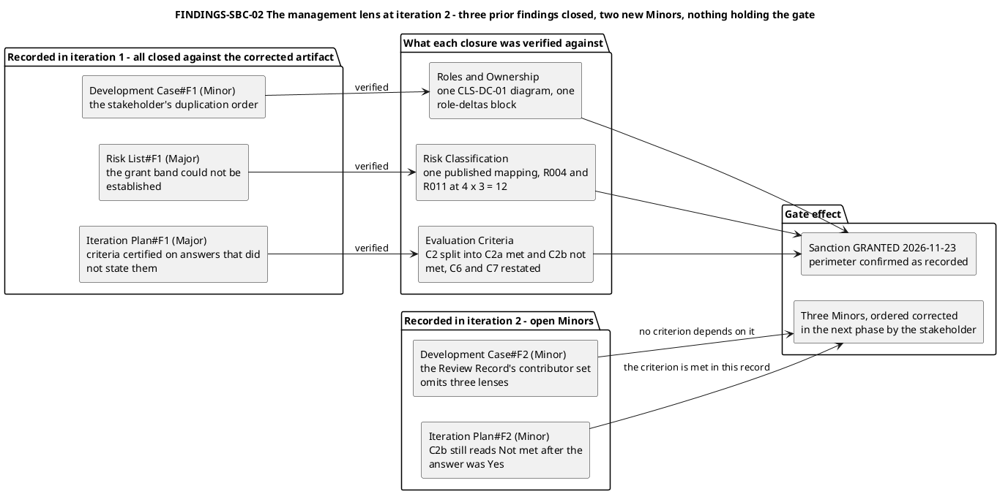

#### Development Case

`Development Case#F2` — Minor, contained defect. The contributor set the tailoring states for the Review Record omits three of the lenses that write into it: it names "Reviewer, CodeReviewer, plus the Configuration Manager's baseline record", while the artifact carries a Management Reviewer lens, a Business Reviewer lens and a Review Coordinator lens besides. The CLS-DC-01 class diagram repeats the omission, drawing no edge from any of those three roles to the Review Record. It stays inside the document: every lens writes its own block whatever the tailoring says, so no role built on wrong content, and no SBC criterion depends on it.

The defect the stakeholder ordered corrected — `Development Case#F1`, the duplicated role-delta list and the duplicated CLS-DC-01 diagram — is closed this iteration and is recorded under Resolutions and Actions, not restated here.

#### Risk List

No finding from this lens. The register is the artifact this iteration changed most and it now holds under the management lens's own tests: every score reproduces from the one mapping published in "Risk Classification", the band table agrees with the register row for row, every Significant-band acceptance carries the stakeholder's own answer verbatim, and the register states without embellishment that SBC retires no risk. `Risk List#F1` is closed under Resolutions and Actions.

#### Iteration Plan

`Iteration Plan#F2` — Minor, contained defect. The Evaluation Criteria table records C2b as "Not met" on the refusal of 2026-11-23, though the stakeholder has since answered gate H2, confirmed the perimeter as recorded and granted the sanction. The row's own clause — "H2 is re-taken after this iteration's review" — has been fulfilled, so the cell states a state the answer superseded. The defect is contained: C2b is verified met in this record on the stakeholder's answer, so no exit criterion fails and no role is blocked by the stale cell; only the plan's evidence column is behind.

`Iteration Plan#F1` is closed: C2 is split into the answered membership and priority questions and the confirmation the stakeholder did not then give, C6 cites the coverage figure the System Inventory reproduces from its own table, and C7 is split into carriage and reproducibility, each decided on the artifact it cites. The plan's evidence column is now the artifact the verdict can rest on.

#### System Inventory

No finding from this lens, in either iteration. The reading is the artifact this gate exists to establish and it is the strongest of the four: the perimeter is anchored component by component, the 22 entry points carry kind, initiator and anchor, the priorities are ordered with the stakeholder's answer recorded in their own words, the coverage figure reproduces from its own per-area table, and every anchor this lens followed read as the artifact cites it. The two questions the reading could not settle were put to the stakeholder and are recorded as decided, with the external-provider path kept as a recovered use case marked unreachable and the `admin` branch recorded as an exceptional entity — both in the reading's own text, not only in an answer that has since been lost.

**Not this lens's findings, and not this lens's to close.** The technical lens's two open Minors — `System Inventory#F3` and `Iteration Plan#F3`, both status metadata — belong to that lens and are closed by it. They are named here only so the Review Coordinator's consolidated count is complete.

### Review Coordinator lens
<!-- review: Survey I1 -->

<!-- review: Survey I1 -->

**Consolidated finding ledger.** Ten findings were recorded by two executed lenses; none carries a resolution object. Counts below are copied from `read_artifact_findings`, not from any sentence in this record: open Critical 0, open Major 6, open Minor 4, open Info 0.

| Artifact | Key | Lens | Severity | Criterion | Owner | What the owner must do |
|---|---|---|---|---|---|---|
| Development Case | F1 | Reviewer | Major | consumed-defect | Process Engineer | Name the file recording the version policy, or replace the claim with central pinning and nuget.org-only |
| Development Case | F2 | Reviewer | Minor | contained-defect | Process Engineer | Delete the duplicated role-delta list and the duplicated CLS-DC-01 diagram |
| Development Case | F1 | Management Reviewer | Minor | contained-defect | Process Engineer | The same duplication, under the stakeholder's order of 2026-11-23 |
| System Inventory | F1 | Reviewer | Major | trace-gap | Software Archaeologist | Add EP-007 to the AN-021 Traceability row |
| System Inventory | F2 | Reviewer | Minor | contained-defect | Software Archaeologist | Recompute Coverage from the per-area table; settle the `docs/` read count |
| Risk List | F1 | Reviewer | Major | consumed-defect | Project Manager | Score every risk once from the IARI scale and reconcile against the inventory, or declare the score the Project Manager's own reading |
| Risk List | F1 | Management Reviewer | Major | exit-criterion-unmet | Project Manager | Re-derive the grant band from the reconciled exposures and put every Significant or High risk to the stakeholder |
| Iteration Plan | F1 | Reviewer | Major | consumed-defect | Project Manager | Name all twelve entry-point-bearing anomalies, or point at the Anomalies table |
| Iteration Plan | F1 | Management Reviewer | Major | exit-criterion-unmet | Project Manager | Restate C2, C6 and C7 on the evidence each actually has |
| Iteration Plan | F2 | Reviewer | Minor | contained-defect | Project Manager | Move Gate H1 ahead of the Reviewer in the critical-chain diagram |

**Finding lifecycle and escalation path.**

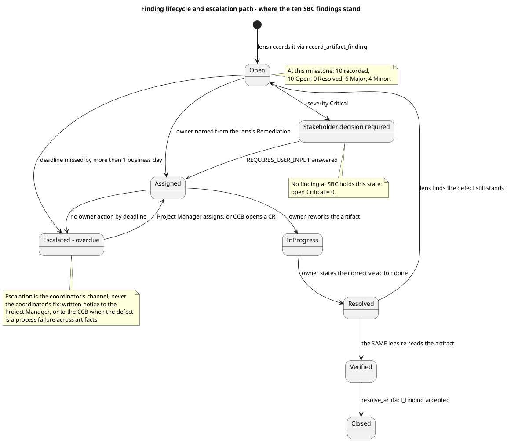

**Cross-lens reconciliation — no conflict, four chains.**

The two lenses raised no contradictory finding: neither found the other's defect to be absent, and no owner was given two incompatible instructions. Four relationships govern the order of rework:

```plantuml
@startuml
title Cross-lens reconciliation - ten findings on four artifacts, and which rework unblocks which

skinparam shadowing false
skinparam wrapWidth 260

package "Development Case" {
  class "Development Case#F1\nReviewer / Major / consumed-defect\nan enterprise version policy no file records" as DC1
  class "Development Case#F2\nReviewer / Minor / contained-defect\nduplicated role deltas and diagram" as DC2
  class "Development Case#F1\nManagement Reviewer / Minor / contained-defect\nthe same duplication, ordered by the stakeholder" as DC3
}

package "System Inventory" {
  class "System Inventory#F1\nReviewer / Major / trace-gap\nAN-021 row short of the tree by one edge" as SI1
  class "System Inventory#F2\nReviewer / Minor / contained-defect\nCoverage headline does not reproduce" as SI2
}

package "Risk List" {
  class "Risk List#F1\nReviewer / Major / consumed-defect\n13 scores contradict the inventory" as RL1
  class "Risk List#F1\nManagement Reviewer / Major / exit-criterion-unmet\nC8 cannot be certified on these scores" as RL2
}

package "Iteration Plan" {
  class "Iteration Plan#F1\nReviewer / Major / consumed-defect\ntwelve anomalies claimed, seven named" as IP1
  class "Iteration Plan#F1\nManagement Reviewer / Major / exit-criterion-unmet\nC2, C6, C7 certified on evidence that does not state them" as IP2
  class "Iteration Plan#F2\nReviewer / Minor / contained-defect\nGate H1 drawn after the verdict it feeds" as IP3
}

DC2 -right-> DC3 : same defect, two keys\none correction, each lens closes its own
RL1 --> RL2 : arithmetic first,\nthe grant band second
SI2 --> IP2 : the recomputed coverage figure\nis C6's evidence
RL1 --> IP2 : reconciled scores\nare C7's evidence
DC1 --> DC3 : one rework pass,\none owner
IP1 --> IP2 : the dropped five are\nconstraints the criteria certify
@enduml
```

1. **Development Case#F2 (Reviewer) and Development Case#F1 (Management Reviewer) are one defect under two keys.** Both describe the duplicated role-delta list and the duplicated CLS-DC-01 diagram. One rework pass by the Process Engineer closes the subject of both; each lens closes its own key with `resolve_artifact_finding`, and no finding is closed by the other lens's verification.
2. **Risk List#F1 (Reviewer) is upstream of Risk List#F1 (Management Reviewer).** Reconciling the scores is the precondition for re-deriving the grant band. The Project Manager performs both in one pass; the stakeholder question it raises cannot be asked before the arithmetic is settled.
3. **System Inventory#F2 (Reviewer) is upstream of Iteration Plan#F1 (Management Reviewer) on criterion C6.** C6 cites a coverage figure the System Inventory cannot reproduce. The figure settles first, then the criterion cites the settled figure.
4. **Risk List#F1 (Reviewer) is upstream of Iteration Plan#F1 (Management Reviewer) on criterion C7.** C7 passes as a counting test while the scores it counts do not reproduce; it splits only once the scores are reconciled.

**Priority order of the rework actions** — by consequence, not by artifact order:

| Priority | Finding | Why it ranks here |
|---|---|---|
| 1 | Risk List#F1 (Management Reviewer) with Risk List#F1 (Reviewer) | The defect reaches a grant the project has already taken; the stakeholder question it raises must be asked in this cycle |
| 2 | Iteration Plan#F1 (Management Reviewer) | It is the evidence column the milestone verdict reads, and it records a confirmation the stakeholder refused |
| 3 | Development Case#F1 (Reviewer) | It directs the Software Architect at a policy that exists nowhere, and Excavation is the next phase |
| 4 | Iteration Plan#F1 (Reviewer) | Five constraints on the areas ranked sixth and eighth are not handed to Excavation |
| 5 | System Inventory#F1 (Reviewer) | One trace edge; the artifact and the tree already hold the truth |
| 6 | Development Case#F1 (Management Reviewer), Development Case#F2 (Reviewer) | The stakeholder ordered this correction; it rises above the ordinary Minor queue and is not deferred behind them |
| 7 | System Inventory#F2, Iteration Plan#F2 (Reviewer) | Contained in one artifact each; no role builds on the wrong content |

**Not findings, and recorded as such.** The absence of a Test Plan, a Data Model and a Glossary is the Development Case's own NOT FIRED verdict on each, checked against its §5.2 condition by both lenses; it is not a delivery gap. The absence of an Iteration Assessment is correct at this point — the Project Manager authors it after this review. The absence of a token budget, a velocity and a forecast is correct: the project declares no budget, no phase has closed, and an empty forecast column is the honest state. No SCM condition holds this gate. The Business Reviewer's non-participation is the process's own schedule, not a gap in this review.

## Resolutions and Actions
### Reviewer lens
<!-- review: Survey I2 -->

<!-- review: Survey I2 -->

The actions that close this lens's findings, each with its owner and the artifact section the correction lands in. Closure was executed in the dedicated reconciliation step, before any new finding was recorded: `resolve_artifact_finding` first, this narrative second.

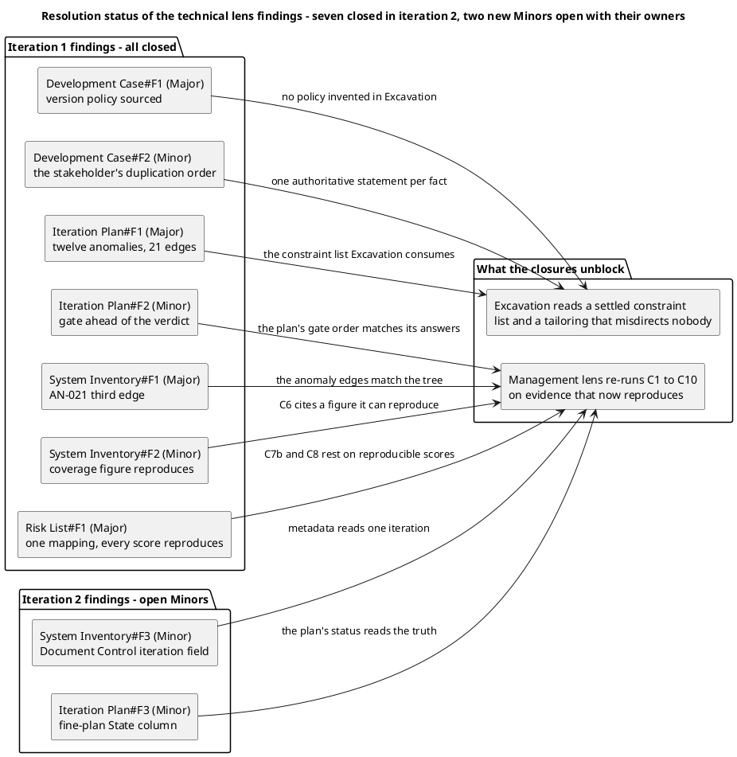

| Artifact | Finding | Severity | Owner | Status | Action that closes it |
|---|---|---|---|---|---|
| Development Case | F1 | Major | Process Engineer | Resolved | State central pinning and the nuget.org-only source, assert no enterprise policy — done at "Tool and configuration references" |
| Development Case | F2 | Minor | Process Engineer | Resolved | One role-deltas statement and one CLS-DC-01 diagram — done at "Roles and Ownership", as the stakeholder ordered |
| System Inventory | F1 | Major | Software Archaeologist | Resolved | Add EP-007 to the AN-021 row — done at "Traceability" |
| System Inventory | F2 | Minor | Software Archaeologist | Resolved | Recompute Coverage from the per-area table and decide the docs row — done at "Coverage" |
| Risk List | F1 | Major | Project Manager | Resolved | Publish one mapping and reconcile every score to it; put each Significant acceptance to the stakeholder — done at "Risk Classification" and the grant table |
| Iteration Plan | F1 | Major | Project Manager | Resolved | Name all twelve anomalies or drop the count — done at "Use Cases and Scenarios Addressed" |
| Iteration Plan | F2 | Minor | Project Manager | Resolved | Place gate H2 ahead of the verdict it feeds — done in the coarse roadmap and the critical chain |
| System Inventory | F3 | Minor | Software Archaeologist | Open | Set the Document Control iteration field to 2, Cycle 1 |
| Iteration Plan | F3 | Minor | Project Manager | Open | Correct the fine-plan State column for rows 4, 5 and 6, or remove the column |

The two open findings are Minors. Neither holds the milestone, neither blocks a downstream role, and both are corrected by their owner in its next turn; the artifacts they sit in are approved from this lens.

### Management Reviewer lens
<!-- review: Survey I2 -->

Closure was executed in the dedicated reconciliation step before any new finding was recorded: `resolve_artifact_finding` first, this narrative second. All three findings this lens recorded in iteration 1 are closed against the corrected artifact, and each closure names the section it was verified at.

| Artifact | Finding | Severity | Owner | Status | What closed it, and where it was verified |
|---|---|---|---|---|---|
| Development Case | F1 | Minor | Process Engineer | Resolved | "Roles and Ownership" carries one CLS-DC-01 diagram and one role-deltas block listing the two inactive roles; the duplicate of each is gone, as the stakeholder ordered on 2026-11-23. Verified against the section, and against "Tool and configuration references" for the version-policy claim the technical lens removed. |
| Risk List | F1 | Major | Project Manager | Resolved | "Risk Classification" publishes one word-to-score mapping and all 21 anomaly-derived rows reproduce from it; R004 and R011 read 4 × 3 = 12, Significant; the four Significant-band acceptances each carry the stakeholder's own answer and the other ten Significant-band risks avoid. The gate condition is now establishable and reproducible. |
| Iteration Plan | F1 | Major | Project Manager | Resolved | "Evaluation Criteria" splits C2 into C2a (met, the three answers quoted) and C2b (recorded not met against the 2026-11-23 refusal), cites the self-reproducing coverage figure for C6, and splits C7 into carriage and reproducibility, both met on the artifacts they cite. No answer is recorded as a confirmation it does not contain. |
| Development Case | F2 | Minor | Process Engineer | Open | The co-owned-artifact sentence and the CLS-DC-01 diagram must name Management Reviewer, Business Reviewer and Review Coordinator among the lenses that write into the Review Record. |
| Iteration Plan | F2 | Minor | Project Manager | Open | C2b is still "Not met" on the 2026-11-23 refusal; it is met on the answer gate H2 returned, so the state and its evidence cell are restated. |

**The stakeholder's order, carried forward.** Answering the sanction question on 2026-11-23 the stakeholder said: "Yes, let's move on to the next phase. Minor findings should also be addressed during the next phase—let's not leave them unattended." That order governs five open Minors across the four artifacts under review, and each has an owner who corrects it in the next phase rather than whenever it next happens to work: `Development Case#F2` and `Iteration Plan#F2` from this lens, and `System Inventory#F3` and `Iteration Plan#F3` from the technical lens — with `Iteration Plan` carrying two of the five, one from each lens, both the Project Manager's to correct.

**Outstanding actions, with their owners.** These are the Process Engineer's and the Project Manager's next-turn corrections. None holds an exit criterion, none blocks a downstream role, and the four artifacts are approved from this lens on them.

**No change request is opened for any of them.** The Change Control Manager does not work in the sprint zero — no ledger exists and no CR is opened before Inception — so the order reaches its owners through the Work Order and through these ledger entries, which is the route the sprint zero provides. Nothing in this iteration orders a change to declared scope.

**What reopens this gate.** Nothing this lens found. The three Majors this iteration inherited are closed and verified; no Major and no Critical remains open from either executed lens; the gate's own condition is answered Yes. The milestone verdict is the Review Coordinator's to record on this disposition and the sanction in it.

### Review Coordinator lens
<!-- review: Survey I1 -->

<!-- review: Survey I1 -->

**Actions ordered, with owner and the finding each closes.** Every action is the remediation the recording lens wrote; none is the coordinator's own instruction of what the defect should be.

| # | Action | Artifact | Owner | Closes | Deadline |
|---|---|---|---|---|---|
| 1 | Score each of the 21 risks once, deriving probability and impact from the IARI scale and its cited evidence — or delete the inventory's likelihood/impact as a scoring claim and declare the score the Project Manager's own reading. Then re-derive the grant band and put every risk landing at Significant or High to the stakeholder in this cycle (R004 and R011 are the two candidates) | Risk List | Project Manager | Risk List#F1 (Reviewer), Risk List#F1 (Management Reviewer) | Before the SBC gate is re-taken |
| 2 | Restate C2 as two criteria — the answered perimeter-membership and priority questions, and the confirmation of the recorded perimeter which is not met; cite the recomputed coverage figure for C6; split C7 into carriage and reproducibility | Iteration Plan | Project Manager | Iteration Plan#F1 (Management Reviewer) | Before the SBC gate is re-taken |
| 3 | Name the file recording the version policy, or replace the claim with central pinning in `Directory.Packages.props` and nuget.org as the only configured source | Development Case | Process Engineer | Development Case#F1 (Reviewer) | Before Excavation consumes the tailoring |
| 4 | Name all twelve entry-point-bearing anomalies, or drop the enumeration and point at the System Inventory's Anomalies table | Iteration Plan | Project Manager | Iteration Plan#F1 (Reviewer) | Before Excavation reads its constraint list |
| 5 | Add EP-007 to the AN-021 Traceability row | System Inventory | Software Archaeologist | System Inventory#F1 (Reviewer) | Next turn |
| 6 | Delete the duplicated role-delta list and the duplicated CLS-DC-01 diagram — the stakeholder's order of 2026-11-23, taken before the un-ordered Minors | Development Case | Process Engineer | Development Case#F1 (Management Reviewer), Development Case#F2 (Reviewer) | Next turn |
| 7 | Recompute the Coverage headline from the per-area table; settle whether the `docs/` rows count as read | System Inventory | Software Archaeologist | System Inventory#F2 (Reviewer) | Next turn |
| 8 | Move Gate H1 ahead of the Reviewer in the critical-chain diagram | Iteration Plan | Project Manager | Iteration Plan#F2 (Reviewer) | Next turn |

**Stakeholder order folded in.** The stakeholder's answer of 2026-11-23 carries two instructions. The first — "The development case contains duplicated diagrams and text; it needs to be corrected" — is action 6, executed before the un-ordered Minors because the order is theirs. The second — "the major findings must be corrected" — names no artifact and no new defect: all six Major findings above already require rework, and no duplicate finding is minted to say so. The ledger's Major rows are the record of that instruction. No change request is opened: the Change Control Manager does not work in the sprint zero, and the order has reached its owner through this record.

**What is not recorded as an action.** No action is raised for the perimeter not being confirmed: that is not a defect of the System Inventory but of the Iteration Plan that recorded a confirmation which did not happen, and action 2 carries it. No action is raised for the absence of a Test Plan, Data Model or Glossary, for an Iteration Assessment, or for a token budget — each is correct state, stated under Findings.

**Closure procedure.** Each action closes only when its recording lens re-reads the corrected artifact and calls `resolve_artifact_finding` on that key. A correction stated in this record does not close a finding; a lens's verification does. The two Development Case keys close separately. The coordinator escalates to the Project Manager any finding past its deadline by more than one business day, and to the Configuration and Change Management Board any defect that reappears across artifacts as a process failure.

**What reopens the gate.** All six Major findings reworked and closed by their recording lenses, both executed lenses re-run against the rework, the Development Case duplication deleted on the stakeholder's order, and any risk the reconciled scores place at Significant or High put to the stakeholder and granted or refused in their own words. Then the sanction question is asked again with the new count, and the SBC verdict is re-taken.

## Disposition
### Reviewer lens
<!-- review: Survey I2 -->

<!-- review: Survey I2 -->

**Disposition of the technical lens: Approved with Changes.**

Every Major the lens recorded in iteration 1 is closed against the corrected artifact, and each closure is backed by the artifact section plus, where a repository claim was involved, by the file that states it. What remains open from this lens is two Minors, both status metadata — the System Inventory's Document Control iteration field and the Iteration Plan's fine-plan State column. Neither is consumed by a downstream role and neither carries an exit criterion, so neither holds the milestone, and the four artifacts are approved from this lens by default on those two points.

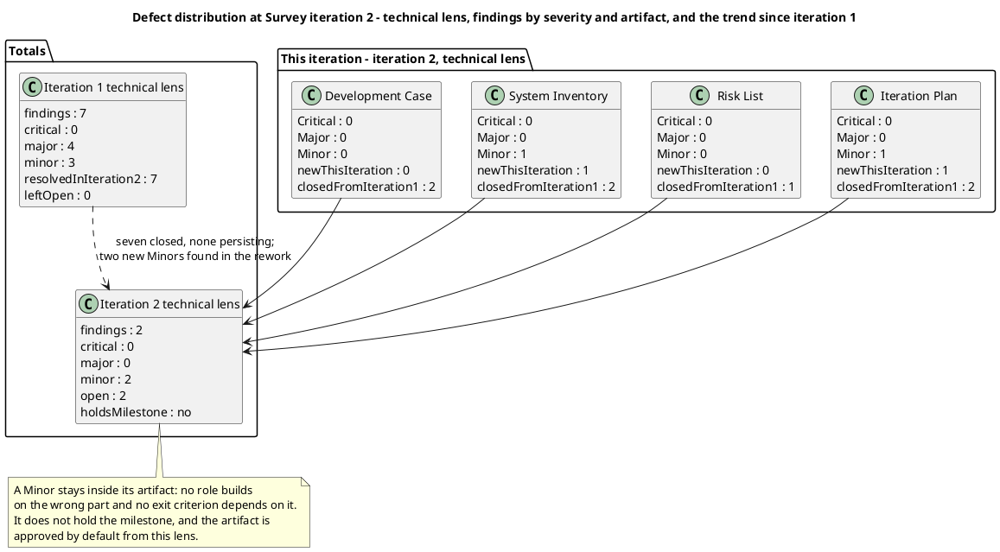

| Artifact | Critical | Major | Minor | Info | Disposition from this lens |
|---|---|---|---|---|---|
| Development Case | 0 | 0 | 0 | 0 | Approved |
| System Inventory | 0 | 0 | 1 | 0 | Approved with Changes — the Document Control iteration field |
| Risk List | 0 | 0 | 0 | 0 | Approved |
| Iteration Plan | 0 | 0 | 1 | 0 | Approved with Changes — the fine-plan State column |

**What this lens found, and what it did not.** The rework resolved every Major; no Major persists and no new one was introduced. The two defects it left behind are both the same class — a status field stating an earlier state than the content it sits beside — which is a consequence of reworking artifacts whose metadata was not touched, not a defect of the rework's substance. No anchor opened this iteration contradicted the artifact citing it: the version-policy claim now rests on `global.json` and `nuget.config` as written, the contribution contract on `docs/CONTRIBUTING.md`, the coverage figure on its own per-area table, and every risk score on one published mapping.

**SCM evidence.** No open pull request, so nothing is disposed and no code-review decision is owed. `ci.yml` does not exist on `main`, so no build exists to be red — establishing the pipeline is the Integrator's Inception work item, not a Survey defect.

**What this lens does not decide.** The SBC milestone is not this lens's verdict. It turns on gate H2 — the stakeholder's confirmation of the perimeter as the System Inventory records it and the sanction to advance — which was refused on 2026-11-23 and is re-taken after this review. The technical lens has no authority over that answer: the artifacts are now certifiable on their evidence, and whether the perimeter is confirmed is the stakeholder's to say.

### Management Reviewer lens
<!-- review: Survey I2 -->

**Disposition from the management lens: Go, on the four artifacts as corrected.**

That is a verdict on the artifacts, and it is the one they have earned. The three Majors this lens recorded in iteration 1 are closed and verified against the corrected sections, not against the owners' assurances: the grant band can now be derived from scores that reproduce, the exit criteria are certified only on evidence the artifact each cites actually records, and the duplication the stakeholder ordered deleted is gone. No Major and no Critical finding is open from either executed lens. Every one of the eleven SBC criteria that an artifact can establish is established — nine on the reading, the register and the plan, two more on the stakeholder's own answers of 2026-11-23, and the eleventh now on this review's answer.

**Stakeholder sanction: GRANTED** — 2026-11-23.

**Stakeholder acceptance:** "Yes" — asked whether they confirm the perimeter of the existing system as the System Inventory records it — four processes, 22 entry points, 21 anomalies each anchored, eight priority areas with nothing left out — and sanction advancing past the System Boundary Confirmed milestone into Excavation. With the instruction: "Yes, let's move on to the next phase. Minor findings should also be addressed during the next phase—let's not leave them unattended."

**C2b is closed on the stakeholder's answer.** The criterion this lens recorded as not met at 2026-11-23 is now met, on the same day and in the stakeholder's own words, and it is met by their answer and not by an inference of any reviewer's. The perimeter as the System Inventory records it stands confirmed.

**The open Minors carry into Excavation, by the stakeholder's order.** The three Minors open across the four artifacts are addressed in the next phase rather than left until someone notices them: `Development Case#F2` (the co-owned-artifact sentence omits the Management Reviewer, Business Reviewer and Review Coordinator lenses), `System Inventory#F3` (the Document Control iteration field reads 1) and `Iteration Plan#F3` (the fine-plan State column still shows rows 4 and 5 with the owner and row 6 not started). The order is the stakeholder's and none of the three is deferred to whenever its owner next happens to work: `Development Case#F2` is the Process Engineer's and the other two their own artifacts' owners', each in its next turn.

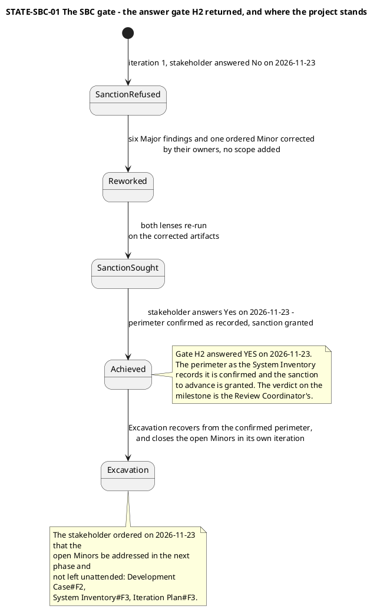

| Axis | State | Basis |
|---|---|---|
| Scope | Green | Nothing declared is worked in the sprint zero, correctly. The perimeter holds four processes, 22 entry points and eight ordered priorities, and the 54 unread files are each named with the reason it was not read and none carries a perimeter fact. |
| Schedule | Green | The gate's own condition is answered: the sanction is granted and the perimeter confirmed, both on 2026-11-23. The second iteration was spent on rework the stakeholder ordered and it closed every Major it named. No forecast is stated, because no phase has closed. |
| Cost | Not measured | No budget is declared, so none is set. Tokens and elapsed time are the two measured quantities and neither figure is filled where nothing has been measured. This axis carries no reading, and a green here would be an invention. |
| Quality | Green | Ten of eleven criteria met on artifact evidence and the stakeholder's own words; C2b met on this review's answer. No Critical and no Major open from either lens. Three Minors open, each ordered corrected in the next phase, none of them holding anything. |

**Why the verdict is Go rather than Conditional.** A Conditional Go would name conditions the project team must satisfy before the next gate, and no Major stands for one to be built on. The three Minors are ordered corrected in the next phase and are recorded as the owners' work there, not as a condition on this sanction: the stakeholder granted the sanction with them open and told the team to address them onward. The register is honest that SBC retires no risk — the reading makes the risks owned, and the actions that retire them are Excavation's and later.

**What Excavation inherits from this gate.** A perimeter the stakeholder has confirmed in this review; a constraint list of twelve entry-point-bearing anomalies with the 21 edges the System Inventory records, the nine anomalies with no entry point carried through the Risk List; a register whose every score reproduces and whose four acceptances above the Moderate band each hold the stakeholder's own answer; a plan that names no work the process does not run in Survey; and three Minors with an order to close them rather than leave them unattended.

### Review Coordinator lens
<!-- review: Survey I1 -->

<!-- review: Survey I1 -->

**Verdict: No-Go.** The System Boundary Confirmed milestone is **not achieved**. The stakeholder refused the sanction on 2026-11-23 and six Major findings stand open. The project does not advance into Excavation on this baseline.

**Basis, copied from the finding data — not from judgment.**

| Gate condition | Actual |
|---|---|
| Artifacts read from the ledger | 4 of 4, plus the Review Record — unread: none |
| Open Critical | 0 |
| Open Major | 6 |
| Open Minor | 4 |
| Perimeter confirmed by the stakeholder | No |
| Stakeholder sanction | REFUSED — 2026-11-23 |
| Milestone verdict | requiresIteration: true |

**The guard the verdict was taken on.**

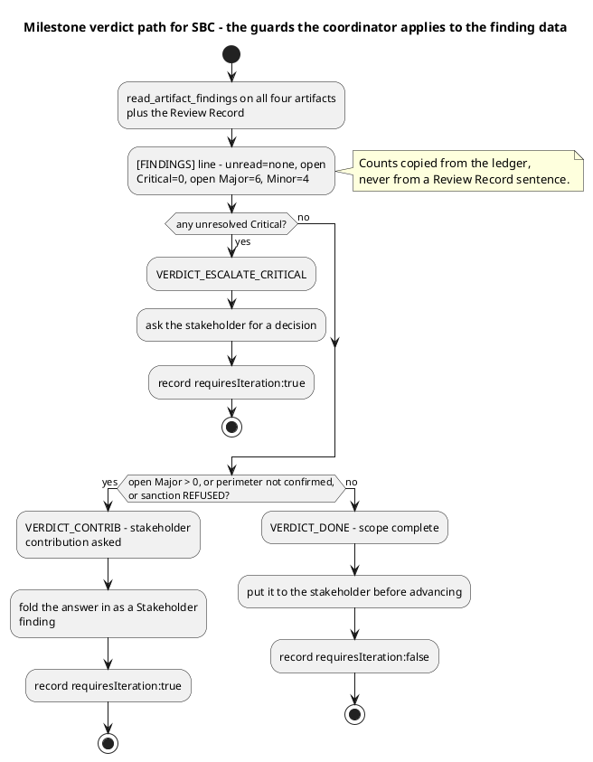

The path taken is the second branch: open Major 6, perimeter not confirmed, sanction REFUSED. The third branch — scope complete and advance — is not reachable on this data, because three of its guards fail at once.

Zero Critical findings means nothing at this gate needs a stakeholder decision in order to be *corrected*. It does not mean the gate passes: the decision the gate itself required — confirming the perimeter — was put to the stakeholder and answered No, and six Major findings require rework before any role consumes these artifacts.

**Review effectiveness — this event only.** This is the project's first review: no prior review event exists, so no trend is computed and none is claimed. The metrics below are this event's measured values.

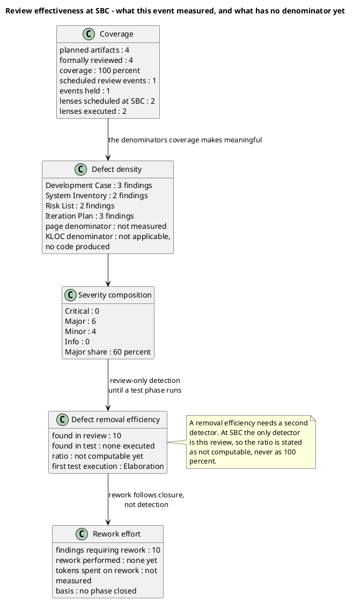

**Interpretation.**

- **Coverage is complete and that is the honest reading, not a flattering one.** Four artifacts were scheduled for this review and four were formally reviewed by both lenses the Survey schedule runs. Coverage carries no denominator for code: this phase produces no code.
- **Defect density is reported as counts per artifact, without a page or KLOC denominator.** Page counts are not measured for these artifacts and code volume is zero in Survey. Inventing a normalizer would produce a number no reader could reproduce — the same defect this review records against the Risk List's scores.
- **Six of ten findings are Major, and that concentration is the finding about the artifacts, not about the review.** Each Major sits where a downstream role would build on wrong content: a version policy no file records, a constraint list five short of its own count, thirteen scores that contradict the inventory they cite, and three exit criteria certified on answers that do not state them.
- **Defect removal efficiency is not computable at this event** and is not stated as 100 percent. The only defect detector that has run is this review. The ratio needs a second detector, and the first test execution is Elaboration.
- **Rework effort has no measurement because no rework has occurred.** No phase has closed, so no measured spend exists, and no figure is filled in its place.
- **Both lenses executed and neither was mismatched to its artifact domain.** The Business Reviewer's absence is the Survey schedule, and is recorded as INACTIVE rather than as an approval.

**Iteration acceptance, kept apart from the milestone verdict.** The management lens assessed all six of this iteration's objectives and found every one delivered: the tailoring exists, the system is read and its perimeter stated, the unread remainder declared, the anomalies carried as scored and owned risks, the priorities ordered with the stakeholder's answer recorded, and the plan for the sprint zero and the phases exists. The work of iteration 1 was done. What it produced is not certifiable. Those are different questions, and this record answers them differently on purpose.

**Sanction token for the record.** Stakeholder sanction: REFUSED — 2026-11-23.

**Stakeholder finding folded in.** "The development case contains duplicated diagrams and text; it needs to be corrected. Additionally, the major findings must be corrected." Verified against the finding ledger rather than deferred: the duplication is a recorded defect under two keys (Development Case#F2 Reviewer, Development Case#F1 Management Reviewer), both assigned to the Process Engineer, and the Major findings are six recorded defects, all open, all owned. No new defect is minted for the second instruction, because every Major it names is already in the ledger. This is also the contribution the coordinator's verdict path requires of the stakeholder before the phase iterates, and it was given inside this milestone review rather than asked for a second time.

**Not asked at this gate, and why.** The grant of R004 and R011 — the two risks whose reconciled scores may land in the stakeholder's band — is not put to the stakeholder now. Their current scores are exactly what this review has declared unreproducible, so the question cannot be stated on data the register does not yet hold. The Project Manager reconciles the scores first and puts the acceptance immediately after, as action 1 orders.
