## Document Control
### Reviewer lens
<!-- review: Consolidation I1 -->

- Phase: Consolidation
- Status: Draft — the GHR technical lens, taken before the milestone verdict; 0 Critical, 3 Major, 2 Minor open from this lens
- Milestone Target: end-of-Consolidation (GHR) — not yet achieved
- Iteration: 1, Cycle 1
- Review point: Lifecycle Milestone Review, exit-criteria lens
- Review type: formal inspection against checklist
- Reviewer: Reviewer
- Artifacts reviewed: 12 of 12
- Disposition: Approved with Changes

### Management Reviewer lens
<!-- review: Consolidation I1 -->

<!-- review: Consolidation I1 -->

- Review type: Lifecycle Milestone Review — end-of-Consolidation (GHR)
- Milestone target: end-of-Consolidation (GHR) — not achieved at this put
- Iteration: Consolidation iteration 1, cycle 1
- Lens: Management Reviewer
- Verdict: No-Go

### Review Coordinator lens
<!-- review: Consolidation I1 -->

<!-- review: Consolidation I1 -->

- Phase: Consolidation
- Status: Draft — produced for the end-of-Consolidation (GHR) milestone review
- Milestone Target: end-of-Consolidation (GHR) — not yet achieved
- Iteration: 1, Cycle 1
- Owner: Review Coordinator
- Review event: GHR — Greenfield Handoff Ready; gate H5 put 2026-11-23
- Lenses executed: Reviewer (technical), ManagementReviewer (management)
- Lens inactive: BusinessReviewer — did not evaluate this review
- Milestone verdict: phase scope incomplete — six Major findings carried into Consolidation iteration 2

## Review Scope and Criteria
### Reviewer lens
<!-- review: Consolidation I1 -->

The GHR asks one question: do the artifacts collectively satisfy the conditions for the set to be handed forward as the starting point of the declared change. This lens answers it on the technical artifacts — is every element anchored to the code it cites, does every trace the set declares hold in the graph, and does the set agree with itself. It does not ask whether the stakeholder accepts the set; that is gate H5's question and the Management Reviewer's to put.

#### Checklist applied

| # | Checklist item | Applied to | Where it is decided |
|---|---|---|---|
| C1 | Every artifact of the recovered set is present at this phase and iteration | All 12 | Every artifact's Document Control names Phase Consolidation, Iteration 1, Cycle 1 |
| C2 | Every declared element cites the anchor it was read from — a file and lines, or `Source: EP-NNN` for a recovered use case | Use-Case Model, SAD, Design Model, Supplementary Specification | Sampled at the code: the OpenAPI gating in `Todo.Api/Program.cs`, the eight tables against their migrations, the rate-limit override against `appsettings.Development.json` |
| C3 | Every trace edge the artifact's Traceability table declares is carried by the registered graph, unmarked | Use-Case Model, SAD, Design Model, System Inventory | RTM query, whole project, 317 links |
| C4 | No suspect trace is open at the phase close | Design Model | RTM: four edges return `SUSPECT` → Major, `Design Model#F2` |
| C5 | No cross-cutting technical mechanism is modelled as a use case; one declared process is one use case with several scenarios | Use-Case Model, Vision | Eleven use cases; `EP-020`/`EP-021`/`EP-022` and the `admin` branch are exclusions with stated reasons |
| C6 | The Development Case does not redefine the baseline: roster, CORE ownership, CORE omission, the CORE + OPTIONAL universe, use-case enumeration | Development Case | Deltas only; two roles inactive with the triggers that justify each; six optional verdicts re-evaluated; `docs/CONTRIBUTING.md` present |
| C7 | Every OPTIONAL artifact the Development Case declares fired has its §5.2 condition genuinely holding | Development Case, Deployment Model | Deployment Model: distributed topology, four processes, a proxy hop, per-project settings pairs — the condition holds |
| C8 | No artifact states a behaviour the code contradicts | Supplementary Specification, SAD, Deployment Model, Vision, Design Model | Sampled at `Todo.Api/Program.cs`; one defect found → Major, `Supplementary Specification#F4`; its two echoes → Minor at `Vision#F2`, `SAD#F2` |
| C9 | Every target value in the Supplementary Specification is a value the system has, not a value it is meant to have | Supplementary Specification | Both rate-limit budgets stated under `AN-024`; `R4` states the two hops apart under `AN-023` |
| C10 | The System Inventory's coverage is counted, every unread area carries its reason, and the headline reproduces from the per-area table | System Inventory | Arithmetic reproduces (84 + 55 = 139). The ratio it reports fails the bar → Major, `System Inventory#F4` |
| C11 | A value or a count with no anchor and no stakeholder answer behind it | All 12 | None found; the four accepted grants cite the stakeholder's answers, and no quantitative claim is unsourced |
| C12 | No work item in the plan belongs to a phase that does not run it | Iteration Plan | Every item sits in Environment, Requirements, Analysis & Design, Discovery, Project Management, the lenses, the gate or the verdict |
| C13 | Every artifact carries UML, and each diagram is formally well-formed | All 12 | Every artifact carries at least one validated diagram; stereotypes, multiplicities and object lifelines are used as the notation requires |
| C14 | The set agrees with itself — no two artifacts state one fact differently | Whole set | Two disagreements found → `Supplementary Specification#F4` against the SAD and the Deployment Model; `SAD#F2` against the Deployment Model |

#### Scope of this lens, stated so it is not mistaken for the whole review

This lens reads the artifacts. It does not read the plan's schedule against a calendar, the register's strategy choices against the Project Manager's authority, or the recovered set against what the stakeholder wants — those are the Management Reviewer's and the gate's. Where this lens records a Major, it is because another role builds on the defect or an exit criterion fails, not because a document reads badly.

#### SCM evidence

No pull request exists in the repository and none is open — the sprint zero writes artifacts, not code, and the Implementation Model is the delivery's own tree, unchanged since `307a1ea`. The repository carries no IARI pipeline (`ci.yml` does not exist), so there is no build status to report for `main` and this lens claims none. Neither absence is a finding: the sprint zero produces no code, and no role in this phase is charged with establishing a build.

### Management Reviewer lens
<!-- review: Consolidation I1 -->

<!-- review: Consolidation I1 -->

This lens decides the milestone: whether the recovered set is complete, whether what rests on it is counted, and whether the organization may hand it forward as the starting point of the declared change. The question is exit criteria, not completion and not feasibility — the iteration's artifacts are read as the evidence each criterion cites.

Ten artifacts read at source: Development Case, System Inventory, Risk List, Iteration Plan, Vision, Use-Case Model, Supplementary Specification, Software Architecture Document, Deployment Model, Design Model. Trace state was queried against the registered graph rather than taken from any artifact's word: `CLS-001`, `CLS-020` and the business-level RTM covering all 315 links.

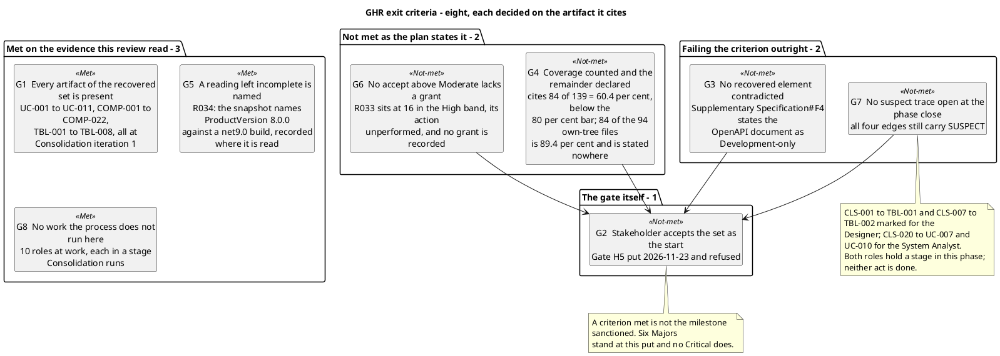

**What was checked beyond the eight criteria.** The Development Case against the IARI baseline: two roles inactive, each carrying the trigger that justifies it, no CORE artifact omitted or reassigned, no artifact outside the CORE + OPTIONAL universe named, and one optional trigger fired whose §5.2 condition genuinely holds against a four-process topology with a per-process settings pair. All six optional verdicts audited one by one rather than accepted as a table. The coverage arithmetic recomputed from the per-area table: its Files column sums to 139 and its Read column to 84, so the count reproduces and only the denominator is at issue. The register's grants read against the band each exposure falls in: four accepts at 4 × 3 = 12 each quote the stakeholder's own answer, and no risk above Moderate accepts on the Project Manager's authority.

**What was deliberately not judged.** `Iteration Assessment` is the Project Manager's Assess touchpoint and runs after this review; at review time it cannot describe the iteration under review, so its absence is not a defect and not a gate condition. `Change Request` is not opened in the sprint zero, where no Change Control Manager works. Neither is a finding.

### Review Coordinator lens
<!-- review: Excavation I4 -->

**Lens participation at this milestone — authoritative, not inferred from the artifact.** Excavation's milestone review runs Reviewer, then Management Reviewer, then Review Coordinator. The Business Reviewer's first scheduled stage is LCO, so at AR it is not a participant.

| Lens | Participation | What it evaluated | Bearing on the verdict |
|---|---|---|---|
| Reviewer (technical) | EXECUTED | Ten artifacts against nine checklist items; every closure re-verified at the registry, the file or the peer artifact | Counted in full — 0 Critical, 0 Major, 1 Minor |
| Management Reviewer | EXECUTED | The thirteen AR exit criteria A1 to A13 against the artifact each is decided on; the grant band; gate H4 | Counted in full — 0 Critical, 0 Major, 1 Minor |
| Business Reviewer | **INACTIVE — did not evaluate this review** | Nothing | No verdict attributed and none inferred |
| Review Coordinator | EXECUTED | The consolidated ledger, cross-lens reconciliation, action priority, the milestone verdict | Records the verdict in Disposition |

**Review events of this milestone, each triggered by a workflow activity.** No event sits on a calendar date; each follows the activity that produces the artifacts it judges.

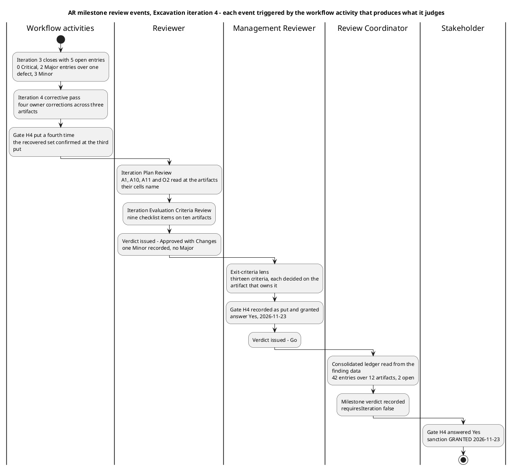

**Review scope.** Twelve artifacts were read for findings: Development Case, System Inventory, Risk List, Iteration Plan, Review Record, Iteration Assessment, Vision, Use-Case Model, Supplementary Specification, Software Architecture Document, Deployment Model, Design Model. Ten are the recovered set under judgement; the Iteration Assessment is read because its cells state the iteration's own outcome; the Review Record is read because this lens writes into it.

**Entry and exit criteria enforced at each event.**

| Event | Entry criterion | Exit criterion | Enforced |
|---|---|---|---|
| Iteration Plan Review | The plan carries this iteration's work items with owners, and each criterion is read on the artifact its evidence cell names | Every criterion decided on its own artifact's evidence | **Yes** — A1, A10, A11 and O2 read at the artifacts their cells name; `Iteration Plan#F4` and `#F9` closed |
| Iteration Evaluation Criteria Review | The recovered artifacts are in their target state and the anchors exist to be checked | Every finding verified at the section it names, and at the source where the finding turns on a recovered fact | **Yes** — six closures, each citing the graph, the file or the peer artifact at which it was verified |
| Lifecycle Milestone Review (AR) | Both executed lenses have returned and the stakeholder's gate answer is on the record | 0 Critical and 0 Major open, and the stakeholder's sanction GRANTED | **Yes** — 0 Critical, 0 Major, sanction GRANTED at put 4 on 2026-11-23 |
| Iteration Acceptance (folded into the same review) | The phase's three stated objectives are on the plan with an evidence cell each | Each objective met on the artifact that carries it | **Yes** — O1, O2 and O3 met on the Use-Case Model, the Software Architecture Document and the Deployment Model |

**Scope of this consolidation.** The four exclusions the stakeholder ruled on stand untouched and no finding at this gate approaches them: external-provider sign-in is recovered and marked unreachable in the delivered configuration; the cross-owner admin branch of `EP-011`, `EP-013` and `EP-014` is an exceptional entity and not a use case; `EP-020`, `EP-021` and `EP-022` carry no use case. The Data Model, the Glossary and the Test Plan are absent on the Development Case's NOT FIRED verdict on each trigger; both executed lenses checked each verdict against its §5.2 condition and neither carries a finding.

**No SCM surface is reviewed.** The repository reports no pull request in any state and no IARI pipeline file exists. Excavation produces no production code, so the absence of a diff and of a CI result is the phase's correct state, not a gap in this review's coverage.

## Findings
### Reviewer lens
<!-- review: Consolidation I1 -->

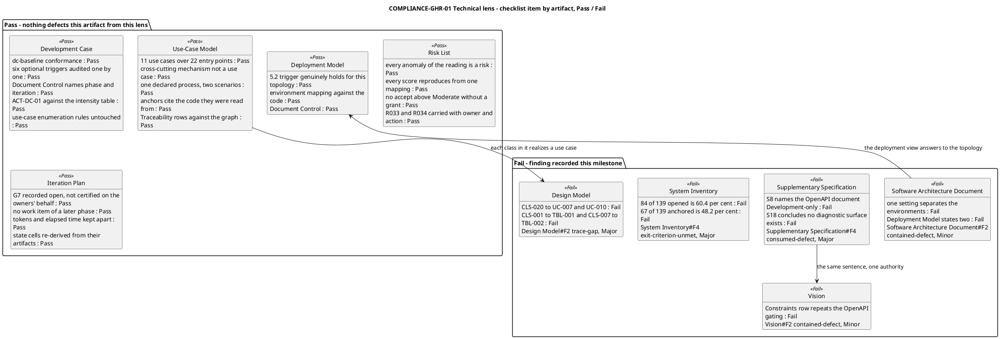

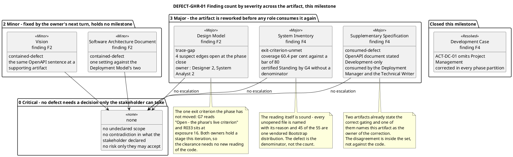

#### Development Case

Approved from this lens. `Development Case#F4` is closed and verified: ACT-DC-01 now names Project Management in every phase partition it draws, at the intensity the canonical matrix gives it, so the diagram and the intensity table agree.

The baseline is not redefined. Two roles are inactive and each carries the trigger that justifies it (`business-process-led = false`, `real-time-system = false`); no CORE artifact is omitted or reassigned; no artifact outside the CORE + OPTIONAL universe is listed; the use-case enumeration rules are stated as the baseline states them. The six optional verdicts were re-evaluated this iteration against the recovered set, and the one FIRED trigger — the Deployment Model — holds on this project's real facts: four processes, a browser bundle, a separate REST service, SQLite, a YARP proxy hop, and a settings pair per serving project. That is a distributed, multi-environment topology by any reading of §5.2. The five NOT FIRED verdicts each name the condition that does not hold, and each holds up: eight entity types is below the >10 threshold, no regulated vocabulary is in play, no phase before Elaboration runs a proof of concept, no formal delivery consumes test reporting, and no UX-critical decision waits on validation.

#### System Inventory

**Major — `System Inventory#F4`, criterion `exit-criterion-unmet`.** The coverage this phase exists to count is stated at 84 of 139 files — 60.4% — and 67 of 139 anchored — 48.2%. Neither reaches the 80% bar this milestone is reviewed against, and the Iteration Plan certifies `G4` as Standing on that figure. The reading behind the count is sound and candid: every unopened file is named, 45 of the 55 are one vendored Bootstrap 5 distribution, and six more carry no perimeter fact. The defect is the denominator — 45 of those 139 are a third-party bundle the contribution contract forbids editing, and the ratio over the 94 files that are the delivery's own tree (84 opened, 89.4%) appears nowhere. A milestone cannot certify a coverage criterion on a ratio that fails its bar, nor on a ratio whose denominator hides the fact that it would pass.

Traceability checked and clean: the AN rows against the registered graph agree — `AN-021` names `EP-004`, `EP-005`, `EP-007`, which is what the diagram and the graph both carry; every entry point resolves to a use case or to a stated exclusion.

#### Use-Case Model

Approved from this lens. Eleven use cases over 22 entry points, each anchored to the entry point whose code performs it; `EP-020`, `EP-021`, `EP-022` and the `admin` branch are exclusions with a stated reason, three of them the stakeholder's own rulings. No cross-cutting mechanism is modelled as a use case: the session, the bucket, the validation filter and the schema migration are mechanisms in the Supplementary Specification, not ellipses here. The five use cases with two routes in are one use case each with two scenarios, not one per actor — `ACT-001` and `ACT-003` are the same person on two authentication routes, and the artifact says so and says why. The Traceability table's eleven rows match the graph: every `EP-NNN → UC-NNN` edge it declares is carried, unmarked.

The two entry-point lists are reconciled and the rule is stated in the artifact: the Survey's Source column names the entry point whose code performs the use case, the actor-goal matrix names the entry point the actor acts through. That distinction is the correct reading of this code — the screen is `EP-003` and the operation it becomes is `EP-012` — and it is no longer two unlabelled lists that disagree.

#### Supplementary Specification

**Major — `Supplementary Specification#F4`, criterion `consumed-defect`.** S8 states that the OpenAPI document exists in Development only, and S18 concludes that "a non-Development run exposes no readiness probe and no diagnostic surface at all". Both are wrong against `Todo.Api/Program.cs`: `app.MapOpenApi()` is called at line 58, outside the `if (app.Environment.IsDevelopment())` block at 49-56. The document is served in every environment and is the one diagnostic surface an operating instance does publish.

This is a consumed defect, not a stale note. The Software Architecture Document's group-answer table names this artifact as the owner of the correction — "the specification's S8 and S18 state the document among the Development-only surfaces; the code maps it unconditionally and the code is recorded" — while its own mechanism M12 and the Deployment Model's Environment Mapping both state the opposite gating correctly. So the set a milestone certifies carries two answers to one question, and the requirements artifact carries the wrong one. The Deployment Manager and the Technical Writer read this artifact to write a runbook and a release note; both would document a diagnostic surface as absent that is in fact present.

Everything else in this artifact holds, and three parts of it are the best work in the set: both rate-limit budgets are stated under `AN-024` in M3, P1 and R8 rather than one figure; R4 states the BFF's two outbound hops apart under `AN-023`; and the twelve "behaviours the recovered use cases must not overstate" are the constraint the Use-Case Model's flows actually obey.

#### Software Architecture Document

**Minor — `SAD#F2`, criterion `contained-defect`.** The Deployment View closes "One setting separates Development from any other environment: the request budget", while the Deployment Model opens its Environment Mapping conclusion "Two settings separate the environments, not one". Both artifacts have the facts right and their facts agree; only the count is stated twice with two answers, using the same word for different things without saying so. Contained: the SAD is the architecture record, the Deployment Model is the artifact the fired trigger commissions for this question, and no role builds a decision on which of the two counts is right.

The rest of the architecture holds on the anchors. The component view is 22 components with every use case's path crossing named components, and its own Traceability table reports 77 `Realizes` edges read back from the graph, cross-checked from either direction. The four components carrying no edge state their anchors instead of a composed one, and each is defensibly outside every use-case path. M8's asymmetry between the two hops is stated at P6 and is the finding this phase most needed, because it is the one property no anomaly row records.

#### Design Model

**Major — `Design Model#F2`, criterion `trace-gap`.** Four trace edges this model's own Traceability table declares are still marked `SUSPECT` at the phase close: `CLS-020 → UC-007` and `CLS-020 → UC-010` against the System Analyst, `CLS-001 → TBL-001` and `CLS-007 → TBL-002` against the Designer. I queried the graph and all four return the marking. The artifact does not conceal this — it states it twice and correctly explains that neither the Database Designer nor the lens may clear an edge it does not own.

That is why this is a Major and not a Critical: nothing is at issue in the content, and the act is available. The Design Model already states the evidence for each edge, so the clearance needs no re-reading of the code — `CLS-001` is four properties in four columns of `Todos`, `CLS-007` adds no member while `AspNetUsers` stores the fifteen it inherits, and `CLS-012` names `typeof(TodoItem)` on the `/todos` group so both operations carry `CLS-020`'s filter. The consequence of leaving it is concrete: `G7` reads "Open — the phase's live criterion" in the plan, `R033` is carried at 4 × 4 = 16 in the High band, and a suspect left open at phase close is a Major against the artifact that holds it. Both owners — the Designer and the System Analyst — hold a stage in this iteration, so the phase can close on this act alone.

Everything else in the model is anchored to file and lines: 42 classes, 8 tables, the keys, the referential actions, the enforced-rule surface that separates what the schema binds from the five rules that rest on a handler, and a relationship inventory that states each association's kind and multiplicity. Its persistent-data sections are the most rigorously anchored content in the set.

#### Deployment Model

Approved from this lens. The §5.2 trigger genuinely holds and the artifact is the reason it does: a browser process, three .NET processes, two short-lived children and one container on one machine, with a proxy hop between two of them and an `appsettings` pair per serving project. Its Environment Mapping matches the code on the point that matters most and that four other artifacts got wrong in Excavation and have since corrected: the budget in force is 50 / 50 / queue 50, not the code's 100 series. It also states the three ungated surfaces — the logging stage, the root redirect and the OpenAPI document — correctly, which is what made `Supplementary Specification#F4` visible.

#### Risk List

Approved from this lens. Thirty-four risks; every one of the 29 anomalies is carried as a risk, and every probability and impact reproduces from the one published mapping. No risk in the Significant or High band is accepted on the Project Manager's authority: the four accepts at exposure 12 each quote the stakeholder's own answer, and `R033` at exposure 16 takes the avoid strategy, which is this role's authority at any band. `R030`, `R031` and `R032` have been restated to record a retirement that landed without claiming the exposure is removed, which is the distinction the register's own rule requires.

`R033` and `R034` are the phase's own exposures and each is correctly framed: `R033` is the exposure the graph establishes and `R034` is the one reading coverage hands forward incomplete, both with an owner, an action and a contingency.

#### Iteration Plan

Approved from this lens. Eight GHR criteria, each decided on the artifact it cites. The plan is candid about the two that are not met and does not certify either on an owner's behalf: `G7` is recorded "Open — the phase's live criterion", and `G2` records gate H5 as not put with no answer assumed. That is correct — a plan that recorded `G7` as Standing would be the defect this project has now recorded against itself twice, a criterion certified on evidence that does not state it.

Every work item belongs to a stage the process runs in Consolidation, and none schedules implementation, build, test-design or configuration-management work. The two currencies are kept apart and no per-iteration velocity or projected date is quoted. The state cells are re-derived from their artifacts in the turn the plan is written, which is the rule the previous phase's five findings of one class taught.

#### Iteration Assessment, Review Record, Change Request

`[OMITTED: Iteration Assessment — the Project Manager authors it after this review; at review time it cannot describe the iteration being reviewed, and its absence is not a defect]`

`Iteration Assessment` and `Change Request` are not judged by this lens this milestone: the first is written on the verdict and the second is not opened in the sprint zero, where no Change Control Manager works. Neither absence is a finding.

### Management Reviewer lens
<!-- review: Consolidation I1 -->

<!-- review: Consolidation I1 -->

**Stakeholder sanction: REFUSED** — gate H5 put 2026-11-23.
**Stakeholder acceptance:** "Nothing in the recovered set is wrong: the 11 use cases, the 4 exclusions, the 22 components and the eight tables stand as I confirmed them. I do not accept a handoff with Majors open: clear the six in this phase and put the gate again. One fact for the coverage count: the 45 Bootstrap files under Todo.Web/Client/wwwroot/bootstrap/ are a third-party distribution, not my system — count coverage over the delivery's own files. Nothing else to add."

Six Major defects and three Minor stand at this put, spread over four artifacts. No Critical.

```plantuml
@startuml
title DEFECT-GHR-02 Findings by severity and artifact at the GHR gate, this lens and the set it read
skinparam shadowing false
skinparam classAttributeIconSize 0
skinparam wrapWidth 235
hide circle
hide empty members

package "Major - 6, the artifact is reworked before any role consumes it again" {
  class "Iteration Plan\nF11  exit-criterion-unmet\nG4 carries no threshold, reads Standing at 60.4 per cent" as M1 <<Major>>
  class "Iteration Plan\nF12  consumed-defect\nG3 names one of the set's two contradictions" as M2 <<Major>>
  class "Iteration Plan\nF13  exit-criterion-unmet\nG6 reads R033 'Avoid' as a performed action" as M3 <<Major>>
  class "Design Model\nF2  trace-gap\nfour edges return SUSPECT at the close" as M4 <<Major>>
  class "Supplementary Specification\nF4  consumed-defect\nOpenAPI document stated Development-only" as M5 <<Major>>
  class "System Inventory\nF4  exit-criterion-unmet\nratio over a denominator that mixes in the bundle" as M6 <<Major>>
}

package "Minor - 3, fixed by the owner's next turn, holding no milestone" {
  class "Risk List\nF4  contained-defect\nR033 scored 4 while its sign fired on all four" as m1 <<Minor>>
  class "Vision\nF2  contained-defect\nthe OpenAPI sentence repeated" as m2 <<Minor>>
  class "Software Architecture Document\nF2  contained-defect\none setting against the Deployment Model's two" as m3 <<Minor>>
}

package "Critical - 0" {
  class "none\nno undeclared scope, no contradiction in what\nthe stakeholder declared, no risk only they may accept" as C <<none>>
}

package "This lens closed at this milestone - 1" {
  class "Iteration Plan\nF10  contained-defect\nthe cells recording H4 unput no longer exist" as X <<Resolved>>
}

M1 --> C
M2 --> C
M3 --> C
M4 --> C
M5 --> C
M6 --> C

note bottom of M1
  Three of the six sit in one artifact and in one place: the criteria
  table the GHR verdict is read on. That is not three unrelated slips,
  it is one pass that certified criteria on the strategy they name
  rather than on the act the strategy requires.
end note
note bottom of M6
  The reading is sound and every unopened file carries its reason.
  The stakeholder ruled the denominator on 2026-11-23: count the
  delivery's own files, not the vendored distribution.
end note

@enduml
```

#### Iteration Plan

**Major — `Iteration Plan#F11`, criterion `exit-criterion-unmet`.** `G4` is certified "Standing" on a coverage figure that fails the bar this milestone is reviewed against, and the criterion's own text states no bar to fail. Its test asks only that "every file is either opened or named with the reason it was not, and the headline figure reproduces from the per-area table"; its evidence cites "84 opened and 55 unread of 139". 84 of 139 is 60.4%, below the 80% a Consolidation coverage count is required to reach. The ratio that does meet the bar — 84 of the 94 files of the delivery's own tree, 89.4%, over the 45 vendored Bootstrap files excluded as one third-party distribution — appears in neither artifact. A criterion with no threshold in its text and a failing ratio in its evidence reads Standing, so the phase's coverage obligation is discharged by wording rather than by evidence. The stakeholder settled the denominator in the same answer that refused the sanction: count the delivery's own files.

**Major — `Iteration Plan#F12`, criterion `consumed-defect`.** `G3` — no recovered element is reopened or contradicted — names one cause where the set carries two, and the next iteration's corrective list is derived from this table. Its evidence cell reads "R033's four suspect edges are the one way this criterion could fail". The recovered set also contradicts itself on a code fact: the Supplementary Specification's S8 lists the OpenAPI document among the Development-only surfaces and S18 concludes that a non-Development run "exposes no readiness probe and no diagnostic surface at all", while the Software Architecture Document's M12 and the Deployment Model's Environment Mapping each state the document is mapped outside the Development block, as the code does at `Todo.Api/Program.cs:58`. A further iteration planned from this cell would clear the four trace edges, run G3 again, and fail it on a contradiction the cell never named.

**Major — `Iteration Plan#F13`, criterion `exit-criterion-unmet`.** `G6` is certified Standing by treating `R033`'s strategy label as a performed action while the register records the action unperformed and the warning sign firing. The cell closes "R033 sits at exposure 16 and avoids, which is this role's authority at any band." The Risk List records the same risk "Avoid — not performed; firing", with its warning sign reading "firing now, on all four", and its opening rule states that a risk whose action has not been performed is not retired: avoidance is a claim of retirement, not a status note. A High-band exposure at 4 × 4 = 16 therefore sits live at the gate with neither a performed avoidance nor a grant, cited as evidence that the criterion holds. Recording a strategy in place of the act that performs it is the class `R031` and `Iteration Plan#F7` cost this project three iterations to learn.

The remaining five criteria hold on their artifacts: `G1` on the six artifacts' presence at this phase with `UC-001` to `UC-011`, `COMP-001` to `COMP-022` and `TBL-001` to `TBL-008`; `G5` on `R034`'s recorded version difference; `G8` on a ten-role profile in which every item belongs to a stage Consolidation runs; `G7` correctly recorded open rather than certified on the owners' behalf; and `G2` correctly recorded as the gate alone, which I then put and which was refused. Every work item belongs to a stage the process runs in this phase, the two currencies are kept apart, no per-iteration velocity and no projected date is quoted, and the plan carries no declared work to cut.

#### Design Model

**Major — `Design Model#F2`, criterion `trace-gap`.** Four trace edges this model's own Traceability table declares still return marked `SUSPECT` against the registered graph at the phase close: `CLS-001 → TBL-001` and `CLS-007 → TBL-002` marked for the Designer, `CLS-020 → UC-007` and `CLS-020 → UC-010` marked for the System Analyst. I queried all four at source rather than reading the artifact's statement of them, and all four carry the marking.

This is a Major and not a Critical because nothing in the content is at issue and the act is available: the Design Model already states the evidence for each edge, so the clearance needs no re-reading of the code. Both owners — the Designer and the System Analyst — hold a stage in this phase and neither act has been performed. The Iteration Plan's own `G7` reads "Open — the phase's live criterion" on exactly these four edges, and `R033` is carried at exposure 16 as a firing risk, so the plan and the model agree about the state and neither discharges it. A suspect edge left open at the phase close is a Major against the artifact that carries it; it is recorded here and it holds the milestone.

#### Supplementary Specification

**Major — `Supplementary Specification#F4`, criterion `consumed-defect`.** S8 states the OpenAPI document exists in Development only, and S18 concludes that a non-Development run "exposes no readiness probe and no diagnostic surface at all". Both are wrong against `Todo.Api/Program.cs`: `MapOpenApi()` is called at line 58, outside the `if (app.Environment.IsDevelopment())` block at 49-56, so the document is served in every environment and is the one diagnostic surface an operating instance does publish.

This is a consumed defect and not a stale note. The Software Architecture Document's group-answer table names this artifact as the owner of the correction — "the specification's S8 and S18 state the document among the Development-only surfaces; the code maps it unconditionally and the code is recorded" — while that document's own mechanism M12 and the Deployment Model's Environment Mapping state the opposite gating correctly. The set the milestone certifies therefore carries two answers to one question, and the requirements artifact carries the wrong one. The Deployment Manager and the Technical Writer read this artifact to write a runbook and a release note, and both would document a diagnostic surface as absent that is in fact present.

Everything else in this artifact holds, and three parts of it are the strongest content in the set: both rate-limit budgets stated under `AN-024` in M3, P1 and R8 rather than one figure; R4 stating the BFF's two outbound hops apart under `AN-023`; and the twelve behaviours the recovered use cases must not overstate, which are the constraint the Use-Case Model's flows actually obey.

#### System Inventory

**Major — `System Inventory#F4`, criterion `exit-criterion-unmet`.** The coverage this phase exists to count is 84 of 139 files — 60.4% — with a second figure of 67 of 139 anchored, 48.2%. Neither reaches the 80% bar, and the Iteration Plan certifies `G4` Standing on exactly that figure. The reading behind the count is sound and candid: every unopened file is named, 45 of the 55 are one vendored Bootstrap 5 distribution the contribution contract forbids editing, and six more carry no perimeter fact. The defect is the denominator, and the stakeholder has now ruled it: the 45 Bootstrap files are a third-party distribution, not the system, and coverage is to be counted over the delivery's own files.

The ratio over the 94 files that are the delivery's own tree — 84 opened, 89.4%; 67 anchored, 71.3% — appears nowhere in either artifact. The counting itself is correct: its Files column sums to 139 and its Read column to 84, so no count and no per-area row needs to change. Only the figure the milestone reads needs the denominator the stakeholder gave it.

Traceability checked against the registered graph and clean: the twenty-two `EP` rows and the forty `AN` `DependsOn` edges agree with the tree, and `AN-021` names `EP-004`, `EP-005` and `EP-007` as diagram, table and graph all carry them.

#### Risk List

**Minor — `Risk List#F4`, criterion `contained-defect`.** `R033`'s probability contradicts the evidence its own row states. The score reads 4 — "High, 51% to 70%" — while the strategy cell reads "Avoid — not performed; firing", the warning sign reads "firing now, on all four", and the description reads "Scored 4 × 4 because the sign has already fired". An event the register states has already occurred on all four of its instances cannot be scored as a 51 to 70% likelihood. The band does not move — 5 × 4 = 20 is still High — so no grant requirement and no milestone state turns on it; the defect is that the register's published rule, that the same word gives the same number in every row, is applied to the inventory's anomalies and not to its own firing exposure. `R031` carries the same shape, its contingency recorded as taken and performed while the probability stays at 3.

The register otherwise holds and its discipline is the set's strongest governance artifact. Thirty-four risks; all 29 anomalies carried, each with a `Refines` edge the graph confirms; every probability and impact reproducing from the one published mapping; four accepts at exposure 12 each quoting the stakeholder's own answer; no risk above Moderate accepted on the Project Manager's authority. `R030` records a retirement that landed without claiming the exposure is removed, and `R034` records an action performed without claiming the incompatibility corrected — both the distinction this register's own rule requires and the distinction that makes it usable at a gate.

#### Vision

**Minor — `Vision#F2`, criterion `contained-defect`.** A Constraints row repeats the OpenAPI gating that `Supplementary Specification#F4` records as wrong. Contained: the Vision is not the artifact the correction is owed to, it carries the same sentence in a supporting role, and no role builds a decision on it. The same correction settles it.

#### Software Architecture Document

**Minor — `SAD#F2`, criterion `contained-defect`.** The Deployment View closes "One setting separates Development from any other environment: the request budget", while the Deployment Model opens its Environment Mapping conclusion "Two settings separate the environments, not one". Both artifacts have the facts right and their facts agree; only the count is stated twice with two answers, using the same word for different things without saying so. Contained: the SAD is the architecture record and the Deployment Model is the artifact the fired trigger commissions for this question, and no role builds a decision on which count is right.

The rest of the architecture holds on the anchors. Twenty-two components with every use case's path crossing named components; its Traceability table reports the `Realizes` edges read back from the graph and cross-checked from either direction; the components carrying no edge state their anchors instead of a composed one. M8's asymmetry between the BFF's two outbound hops is the finding this phase most needed, because it is the one property no anomaly row records.

#### Development Case

**Approved.** `Development Case#F4` is closed and verified: ACT-DC-01 names Project Management in every phase partition it draws, at the intensity the canonical matrix gives it, so the diagram and the intensity table agree. The baseline is not redefined: two roles inactive, each carrying the trigger that justifies it; no CORE artifact omitted or reassigned; no artifact outside the CORE + OPTIONAL universe named; the use-case enumeration rules stated as the baseline states them. The six optional verdicts were re-evaluated this iteration against the recovered set, and the one FIRED trigger holds on this project's real facts — four processes, a browser bundle, a separate REST service, SQLite, a YARP proxy hop, and a settings pair per serving project. The five NOT FIRED verdicts each name the condition that does not hold, and each holds up.

#### Use-Case Model

**Approved.** Eleven use cases over 22 entry points, each anchored to the entry point whose code performs it; `EP-020`, `EP-021`, `EP-022` and the `admin` branch are exclusions with a stated reason, three of them the stakeholder's own rulings. No cross-cutting mechanism is modelled as a use case. The five use cases with two routes in are one use case each with two scenarios, not one per actor. The Traceability table's eleven rows match the registered graph, every `EP-NNN → UC-NNN` edge carried unmarked. The two entry-point lists are reconciled with the rule stated: the Survey's Source column names the entry point whose code performs the use case, the actor-goal matrix names the entry point the actor acts through — the screen is `EP-003`, the operation it becomes is `EP-012`. The statement of the session surface's instability beside `UC-001` to `UC-004` is the one place in the set where a recovered behavior is qualified by its own code's history.

#### Deployment Model

**Approved.** The §5.2 trigger genuinely holds and this artifact is why it was upheld: a browser process, three .NET processes, two short-lived children and one container on one machine, a proxy hop between two of them, and an `appsettings` pair per serving project. Its Environment Mapping matches the code on the point that four other artifacts got wrong in Excavation and have since corrected — the budget in force is 50/50/queue 50, not the code's 100 series — and it states the three ungated surfaces correctly, which is what made `Supplementary Specification#F4` visible to this review.

#### Iteration Assessment, Change Request

`[OMITTED: Iteration Assessment — the Project Manager authors it after this review; at review time it cannot describe the iteration being reviewed, and its absence is not a defect and not a gate condition]`

`[OMITTED: Change Request — not opened in the sprint zero, where no Change Control Manager works; the stakeholder's orders reach their owners through the Work Order]`

### Review Coordinator lens
<!-- review: Excavation I4 -->

**Consolidated finding ledger.** Every count below is copied from `read_artifact_findings` on each of the twelve artifacts, never from a lens's narrative. The line this section rests on, verbatim:

`[FINDINGS] read=12, unread=none, open Critical=0, open Major=0, open Minor=2 [Development Case#F4, Iteration Plan#F10]`

Forty-two finding entries stand against the twelve artifacts read. Forty carry a resolution object and were closed by the lens that recorded them. Two are open: none Critical, none Major, two Minor.

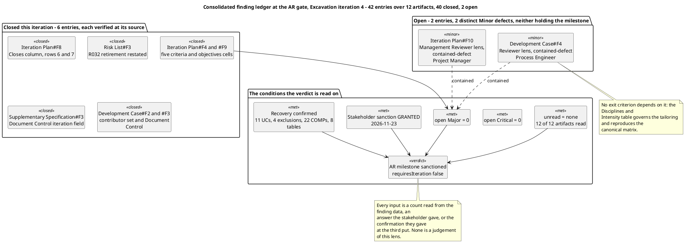

**Open findings — two Minors, distinct defects, neither holding the milestone.**

| Artifact | Key | Lens | Criterion | Owner | The corrective action |
|---|---|---|---|---|---|
| Development Case | F4 | Reviewer | `contained-defect` | Process Engineer | Add the Project Management discipline to the Excavation, Consolidation, Inception, Elaboration, Construction and Transition partitions of ACT-DC-01, naming its stage as the Survey partition does — in Excavation, "Project Management Medium — ProjectManager: Risk List, Iteration Plan". Change nothing in the Disciplines and Intensity table, which is correct. If the diagram illustrates only the Environment opening, retitle it and drop the per-phase intensity annotations that make it read as a full schedule |
| Iteration Plan | F10 | Management Reviewer | `contained-defect` | Project Manager | Set A12 to "Met — 2026-11-23", stating both puts as given: the third confirmed the recovered set and refused the advance while a Major stood, the fourth granted the advance on records that agree with the set. Set fine-plan item 7's state to the answer, and set the human-gate table's Answer cell to record that the fourth put was answered Yes. Change nothing in A1, A10 and A11, which are correct as restated, and nothing in the recovered content |

Both are contained: no role builds on the defective half of either, and no exit criterion turns on either. Each is corrected in its owner's next stage — Consolidation schedules both the Process Engineer and the Project Manager — and neither is carried out of the phase unattended, as the stakeholder ordered at the SBC close.

**Closed this iteration — six entries, each verified at the source rather than on its owner's report.**

| Finding | Criterion | What verified the closure |
|---|---|---|
| `Iteration Plan#F4` (Reviewer) and `Iteration Plan#F9` (Management Reviewer) | `consumed-defect` / `exit-criterion-unmet` | A1 reads "Met" and requotes the five `COMP-014` `Realizes` edges — `UC-006` to `UC-010` — from a fresh graph query, none marked; A10 reads "Met — certified on the recovered set" and names the Use-Case Model's R6 as the fourth artifact under `AN-024`; A11 reads "Met — four of four"; O2 reads "Met"; A12 records the third put in both halves. Read at the artifact, cell by cell |
| `Iteration Plan#F8` (Management Reviewer) | `contained-defect` | Every Closes cell of the fine plan holds a finding key and nothing else; no cell names a moment |
| `Risk List#F3` (Reviewer) | `contained-defect` | R032's strategy cell reads "avoidance performed on all six citing artifacts; the exposure is retired", names R6 with its current wording under `AN-024`, records the warning sign as no longer firing, and relabels the diagram's node to the single residual. Verified against `appsettings.Development.json` (50/50/50) and `RateLimitExtensions.cs:22-24` (100/100/100) |
| `Supplementary Specification#F3` (Reviewer) | `contained-defect` | Document Control reads Iteration 4, Cycle 1; no other field and no content changed |
| `Development Case#F2` (Management Reviewer) and `#F3` (Reviewer) | `contained-defect` | The co-owned-artifact sentence names all six lenses and CLS-DC-01 draws the matching edges; Document Control reads Phase Excavation, Iteration 3 at closure and 4 under this review |

**Cross-lens reconciliation — where two lenses spoke on one subject.**

| Subject | The two lenses | Resolution recorded here |
|---|---|---|
| The five cells of the plan's criteria and objectives tables | Reviewer records `Iteration Plan#F4` at the four artifact-content places; Management Reviewer records `Iteration Plan#F9` at the criteria table the verdict is decided on and on the A12 cell | **One defect, two keys, both closed in this iteration by one owner pass.** Neither entry is doubled in the action plan |
| `Development Case#F2` and `#F3` | Two keys, two lenses, two distinct defects on one artifact, both counted by A11 | **Not a duplicate.** Both were corrected in one turn by one owner in the Environment stage and both are closed |
| `Risk List#F3` (two entries over the phase) | The Management Reviewer's `#F3` closed on R030 at iteration 3; the technical lens's `#F3` was recorded at iteration 3 against R032 and closed this iteration | **Distinct subjects, one key.** R030's retirement landed and stays live; R032's avoidance has landed on all six citing artifacts. Both closed, under their own lenses |
| `Iteration Plan#F10` against `#F9` | The Management Reviewer recorded `#F9` at iteration 3 and recorded `#F10` this iteration | **Successive, not duplicative.** `#F9`'s five cells are closed; `#F10` is the one class the earlier pass could not reach, because the fourth put's answer did not exist when those three cells were written |
| `Development Case#F4` and A11 | The technical lens records it now; A11 counts the four Minors the SBC review left open | **Not a re-opening.** A11's count is not changed and `#F4` was recorded after it; the criterion is neither re-opened nor left unattended |

No lens contradicts another on a fact. No finding at this gate carries a disputed severity band. A12 is decided on the stakeholder's answer alone and no lens disputes it.

**Priority of what remains — Minor only, Major first by construction since none exists.**

| Priority | Finding | Why it ranks here |
|---|---|---|
| 1 | `Iteration Plan#F10` | Three cells record a gate answer the stakeholder has given; the plan is the record the next milestone verdict is read on |
| 2 | `Development Case#F4` | One diagram's per-phase discipline list; the table it disagrees with is the governing statement |

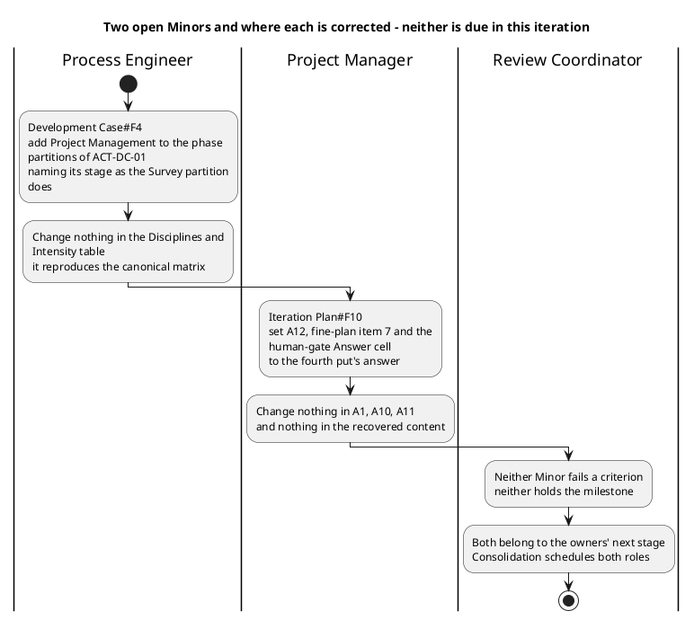

## Resolutions and Actions
### Reviewer lens
<!-- review: Consolidation I1 -->

#### Closed this milestone by this lens

| Finding | Criterion | What closed it | Verified at |
|---|---|---|---|
| `Development Case#F4` | `contained-defect` | ACT-DC-01 now names Project Management in all seven phase partitions, at the canonical intensity for each phase; the diagram and the intensity table agree | Development Case — Disciplines and Intensity, ACT-DC-01 |

#### Open, and what closes each

| Finding | Criterion | Severity | What closes it | Owner | Where the work belongs |
|---|---|---|---|---|---|
| `Design Model#F2` | `trace-gap` | Major | Clear `CLS-020 → UC-007`, `CLS-020 → UC-010` (System Analyst) and `CLS-001 → TBL-001`, `CLS-007 → TBL-002` (Designer), each stating the reading that keeps it; then restate the Traceability section's closing paragraphs at the state the graph holds | System Analyst, Designer | Analysis & Design — both hold a stage in this phase. Closes `R033` and G7 |
| `Supplementary Specification#F4` | `consumed-defect` | Major | Correct S8 and S18 against `Todo.Api/Program.cs:44,49-58`: the reference UI and both health endpoints are Development-only, the OpenAPI document is mapped unconditionally, the logging stage runs in every environment | System Analyst | Requirements — this phase's stage. Unblocks the Deployment Manager and the Technical Writer |
| `System Inventory#F4` | `exit-criterion-unmet` | Major | State the ratio over the 94 files that are the delivery's own tree (84 opened, 89.4%) beside the 139-file count, and have `G4` cite the ratio that meets the bar with its denominator named | Software Archaeologist, then Project Manager for G4 | Discovery — this phase's stage |
| `Vision#F2` | `contained-defect` | Minor | Correct the Constraints row: the OpenAPI document is served in every environment | System Analyst | Requirements — after the Majors |
| `SAD#F2` | `contained-defect` | Minor | Restate "one setting" as one configuration binding, with the Development-only surfaces named beside it as the Deployment Model counts them | Software Architect | Analysis & Design — after the Majors |

#### What the two Majors have in common, and why it matters for the next iteration

`Supplementary Specification#F4` and `SAD#F2` are the same class of defect this project has now recorded seven times across three phases: one fact, stated twice, in two artifacts, with two answers. The rule that closes the class is already written in the Development Case's "Process rule this phase adds" — a document that reports another artifact's state re-derives it from that artifact in the same turn the artifact changes. It has held for the Iteration Plan this iteration and the plan's cells are clean; it has not yet been applied to the four artifacts that describe the environment, which is where both of these findings sit.

`System Inventory#F4` is a different class, and it is the one this milestone should not lose: the reading is thorough (every unopened file named, every reason given, the arithmetic reproducing) and the number it publishes understates what it did, because the denominator counts a vendored bootstrap bundle as though it were the delivery. The correction is one sentence. What would be wrong is to read the 60.4% as a thin reading and order more of the tree opened — nothing is hidden, and the 45 unopened Bootstrap files carry no behaviour of the system.

#### Actions the next iteration carries

| # | Action | Owner | Closes |
|---|---|---|---|
| 1 | Clear the four suspect edges at their own ends | System Analyst (2), Designer (2) | `Design Model#F2`, `R033`, G7 |
| 2 | Correct S8 and S18 to the code's actual gating | System Analyst | `Supplementary Specification#F4` |
| 3 | State the coverage ratio over the delivery's own tree, and have G4 cite it | Software Archaeologist, Project Manager | `System Inventory#F4`, G4 |
| 4 | Correct the Vision's Constraints row | System Analyst | `Vision#F2` |
| 5 | Restate the SAD's "one setting" sentence | Software Architect | `SAD#F2` |
| 6 | Re-read all four environment-describing artifacts against `Todo.Api/Program.cs` in one pass once actions 2, 4 and 5 land, so the class closes rather than the instance | System Analyst, Software Architect | closes the class, not a finding |

No action above schedules work a later phase performs. Actions 1 to 5 sit in stages this phase runs; action 6 is a reading, not new content.

### Management Reviewer lens
<!-- review: Consolidation I1 -->

<!-- review: Consolidation I1 -->

Findings my lens closed at this milestone: one. All six Major defects and three Minor stand open and are the further iteration's work.

| Artifact | Key | Criterion | Owner | The corrective action |
|---|---|---|---|---|
| Iteration Plan | F11 | `exit-criterion-unmet` | Project Manager | Write the threshold into G4 — every file either opened or named with its reason, and coverage of the delivery's own tree at 80% or more — and state both ratios in the evidence cell: 84 of 139 raw, and 84 of 94 (89.4%) over the tree the reading is about, naming the 45 vendored Bootstrap files as the one excluded third-party distribution. The stakeholder ruled that denominator on 2026-11-23 |
| Iteration Plan | F12 | `consumed-defect` | Project Manager | Name the second cause in G3's evidence cell — the Supplementary Specification's S8 and S18 against `Todo.Api/Program.cs:58` and against the SAD's M12 and the Deployment Model's Environment Mapping — and list both corrections in the further iteration's work items, not the four trace edges alone |
| Iteration Plan | F13 | `exit-criterion-unmet` | Project Manager | Restate G6's evidence cell to carry R033 at the state the register records — exposure in the High band, avoidance unperformed, warning sign firing, all four edges marked — and decide the criterion on that state rather than on the strategy label |
| Design Model | F2 | `trace-gap` | Designer (2 edges), System Analyst (2 edges) | Each owner reads its own end and clears the edge stating why it still holds, or retires and re-registers it with the link type its evidence supports: `CLS-001 → TBL-001` and `CLS-007 → TBL-002` for the Designer; `CLS-020 → UC-007` and `CLS-020 → UC-010` for the System Analyst. The evidence is already written in the model, so no re-reading of the code is needed |
| Supplementary Specification | F4 | `consumed-defect` | System Analyst | Correct S8 and S18 against the code: `MapOpenApi()` is mapped at `Todo.Api/Program.cs:58`, outside the `if (app.IsDevelopment())` block at 49-56, so the OpenAPI document is served in every environment and is a diagnostic surface an operating instance does publish. Bring S18's conclusion with it |
| System Inventory | F4 | `exit-criterion-unmet` | Software Archaeologist | State the two ratios the tree actually has and settle which one coverage is counted on. Keep 139 files / 84 opened / 55 unopened as the raw count and add the ratio over the 94 files that are the delivery's own tree — 84 opened, 89.4%, 67 anchored — with the 45 vendored Bootstrap files named as one third-party distribution the stakeholder does not call their system. Change no count and no per-area row: the arithmetic reproduces |
| Risk List | F4 | `contained-defect` | Project Manager | Restate R033's probability at 5 with a one-line basis naming what the evidence states, or state why an exposure whose warning sign has already fired is scored in the 51 to 70% band. Apply the same test to R031 |
| Vision | F2 | `contained-defect` | System Analyst | Settle the OpenAPI gating with `Supplementary Specification#F4`; one correction closes both |
| Software Architecture Document | F2 | `contained-defect` | Software Architect | State which count "one setting" and "two settings" each refer to, or adopt the Deployment Model's count and say so — the facts already agree and only the word differs |

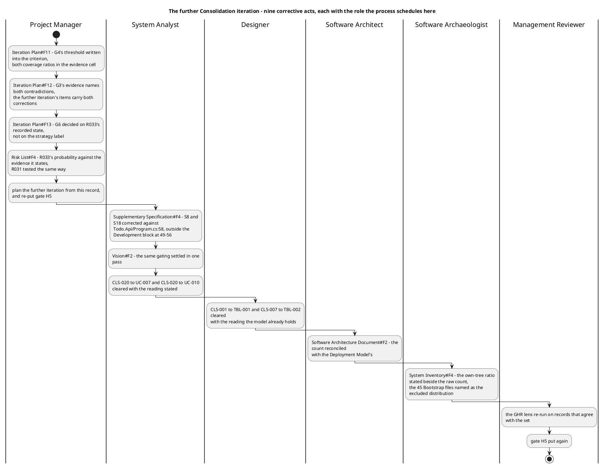

**Why this is one iteration's work and not more.** Every one of the nine acts belongs to a role the process schedules in Consolidation — Environment, Requirements, Analysis & Design, Discovery and Project Management all run here, and the three lenses of the milestone review follow them. None requires a decision from the stakeholder: the one decision that was theirs, the coverage denominator, they gave in the answer that refused the sanction. None requires re-reading the code: the four trace edges carry their evidence in the model, the OpenAPI fact is anchored at a line number, and the coverage arithmetic reproduces from the table. No recovered content is touched, which is why the stakeholder's confirmation of the eleven use cases, four exclusions, twenty-two components and eight tables is unaffected by any act on this list.

**The one closure this lens recorded.** `Iteration Plan#F10` — three cells recording gate H4's fourth put as unanswered — is closed and verified: the plan now carries GHR's criteria in place of the AR criteria, and the fourth put is recorded as passed in the milestone sequence. The one gate the plan records as unput is H5, a different gate, which genuinely had not been put at the time and has now been put and refused.

**Two Minors the technical lens and I recorded that no criterion turns on.** `Risk List#F4` and `Software Architecture Document#F2` are inside their artifacts; the further iteration lists them with the Majors because their owners are working those artifacts anyway, not because they hold anything.

### Review Coordinator lens
<!-- review: Excavation I4 -->

**Actions this consolidation carries into Consolidation.** Each action is the remediation its recording lens wrote. No action carries a calendar date: the phase declares none, and a date projected from an estimate would read downstream as an observation. The due point is a state of the work — the owner's first stage in the next phase.

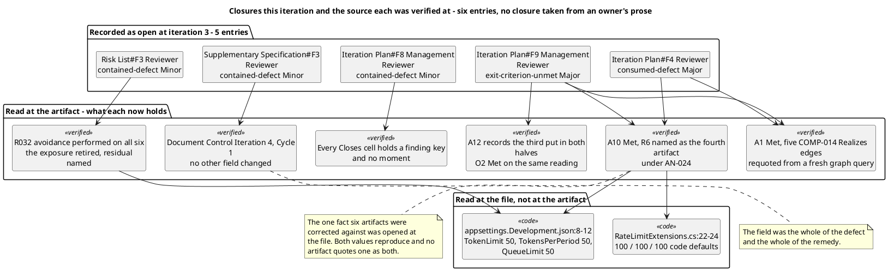

| # | Action | Artifact | Owner | Closes | Due point | Escalates if |
|---|---|---|---|---|---|---|
| 1 | Set A12 to "Met — 2026-11-23", stating both puts as given: the third confirmed the recovered set and refused the advance while a Major stood, the fourth granted the advance on records that agree with the set. Set fine-plan item 7's state to the answer and the human-gate table's Answer cell to the fourth put's answer. Change nothing else — A1, A10 and A11 are correct as restated | Iteration Plan | Project Manager | `Iteration Plan#F10` | The Project Manager's first stage in Consolidation | Any of the three cells again records the fourth put as unanswered |
| 2 | Add the Project Management discipline to the Excavation, Consolidation, Inception, Elaboration, Construction and Transition partitions of ACT-DC-01, naming its stage as the Survey partition does. Change nothing in the Disciplines and Intensity table | Development Case | Process Engineer | `Development Case#F4` | The Process Engineer's first stage in Consolidation | The diagram is retitled to the Environment opening alone and the per-phase intensity annotations left in place |

**Escalation at this gate.**

| Item | State | Why |
|---|---|---|
| `Iteration Plan#F10` and `Development Case#F4` | **Not escalated** | Both are Minor and contained; no exit criterion depends on either, and each owner has a stage in the phase that follows. Neither is overdue: the phase is closing and both due points are the owners' first stage in Consolidation |
| Systemic process failure | **No escalation to the Configuration and Change Management Board** | The ledger shows no repeated architecture violation and no skipped or informal review. The one recurring class — a cell asserting another artifact's state — was recorded four passes running and is now closed in every cell, with the rule it produced written into the plan |
| Stakeholder escalation | **None required** | 0 Critical findings and nothing outstanding requires a decision from them. Gate H4's fourth put granted the advance; the answer is recorded as given in Disposition and nothing is added to it |
| Findings carried out of the phase | **None unattended** | The stakeholder ordered at the SBC close that open Minors be addressed rather than left unattended. Both open Minors have an owner scheduled in Consolidation and an action that closes them; neither is waived, deferred or recorded as closed on a document having been written |

**Review effectiveness — this milestone's measured counts.** Fourth review event of this phase; the comparison is against the three passes of the same milestone that precede it and against nothing older.

| Indicator | Iteration 1 | Iteration 2 | Iteration 3 | Iteration 4 |
|---|---|---|---|---|
| Review coverage | 10 of 10 reviewed artifacts read by both executed lenses | 10 of 10 by both executed lenses | 10 of 10 by both executed lenses; 12 artifacts read for findings | 10 of 10 by both executed lenses; 12 artifacts read for findings |
| Finding entries recorded, cumulative | 29 | 35 | 39 | 42 |
| Open at the gate | 16 — 0 Critical, 8 Major, 8 Minor | 8 — 0 Critical, 5 Major entries over 4 defects, 3 Minor | 5 — 0 Critical, 2 Major entries over 1 defect, 3 Minor | 2 — 0 Critical, 0 Major, 2 Minor |
| Closed by their recording lens, cumulative | 13 | 27 | 34 | 40 |
| Defect density, open entries by discipline | Requirements 6, Analysis & Design 3, Project Management 5, Environment 2, Discovery 0 | Requirements 4 over 2 defects, Project Management 2, Environment 2, Analysis & Design 0, Discovery 0 | Project Management 5 over 2 artifacts, Requirements 1, Environment 0, Analysis & Design 0, Discovery 0 | Environment 1, Project Management 1, Requirements 0, Analysis & Design 0, Discovery 0 |
| Duplicate subjects reached by both lenses | 1 — the rate limiter | 2 — the five `COMP-014` edges, and the rate budget at artifact and criterion | 1 — the five cells of the iteration's tables | 2 — the five cells under `#F4` and `#F9`, and `#F9` against `#F10` as successive keys on one class |
| Defect removal efficiency | Not computable | Not computable | Not computable | Not computable |
| Rework effort | Not measured | Not measured | Not measured | Not measured |

**What the metrics say.** Open entries fell 16 → 8 → 5 → 2, and the artifacts carrying a Major fell 7 → 2 → 1 → 0. Coverage held at 10 of 10 for the whole phase. The gate's condition — no Critical and no Major open — is met for the first time at this milestone, and every condition the verdict is read on is satisfied on the finding data rather than on a lens's account of it.

The one indicator that did not improve on its own is the one this iteration closes by construction: a cell asserting another artifact's state recurred in four consecutive passes (`Iteration Plan#F3`, `#F6`, `#F4`, `#F9`, then `#F10` in the one place the answer did not yet exist). The plan now carries the rule that prevents the next occurrence — a cell that asserts another artifact's state is re-derived from that artifact in the same turn the artifact changes.

Defect removal efficiency and rework effort are not computable and not measured: no test has executed in the sprint zero, so nothing is found by test against which review-found defects could be compared, and no per-finding token or elapsed attribution exists. Neither ratio is invented.

**Cost, in the two currencies this system measures.** Excavation's closed record reads 14,424,767 tokens and 28 minutes of agent time across three iterations, with 7 minutes of stakeholder queue time apart from it. The fourth iteration is unmeasured — its spend is not yet closed — and this report states no forecast for Consolidation. No token budget was declared for this project, so no variance exists to report. Person-weeks, person-months, man-hours and story points are units this system does not produce and none appears in this record.

**Stakeholder contribution — the answer already given, folded in and acted on.** At gate H4's fourth put the stakeholder sanctioned advancing past the Architecture Recovered milestone into Consolidation, having confirmed at the third put that the recovered set is the model of their system: eleven use cases over twenty-two entry points, four stated exclusions, twenty-two components across four processes, and an eight-table data model, nothing wrong or missing and no exclusion re-opened. Verified against the artifacts rather than deferred: thirteen of thirteen AR criteria hold on the artifact that owns each, and the two open Minors are record corrections on documents whose content the stakeholder has already confirmed. That answer is the route of this disposition and no further consultation arises this iteration.

## Disposition
### Reviewer lens
<!-- review: Consolidation I1 -->

**Disposition: Approved with Changes.**

Nine of the twelve artifacts are approved from this lens with nothing recorded against them. Three are not, and the three are reworked before any role consumes them again:

- `Design Model#F2` — four suspect edges open at the phase close, which is the one GHR exit criterion the phase has not moved (`G7`, `R033`)
- `Supplementary Specification#F4` — the OpenAPI document's gating stated backwards in the artifact the Deployment Manager and the Technical Writer will read
- `System Inventory#F4` — the coverage ratio published against a denominator that hides the reading's actual reach, on the criterion `G4` certifies

**No Critical finding is recorded, and none needs the stakeholder to unblock it.** Every defect above is a correction its owner can make inside this phase with the evidence already in hand; none needs a decision on scope, on a contradiction in what was declared, or on a risk only the stakeholder may accept. This lens therefore sends nothing to gate H5 and escalates nothing.

**What this lens does not decide.** Whether the milestone closes is the Review Coordinator's verdict, read on all three lenses and on gate H5's answer. This lens records the technical position only: the set is substantially complete and anchored, its recovered content is confirmed and no finding reopens it, and five corrections stand between it and a clean technical certification.

**On the two that hold the milestone.** `Design Model#F2` and `System Inventory#F4` each fail a criterion the milestone is read on, and each closes on one act in a stage this phase runs. Nothing about either requires another iteration: the owners hold their stages this iteration, the evidence is in the artifacts, and the corrections add no content and reopen no recovered element. If an iteration is opened, it is opened for them, not for the set.

**On the recovered content.** Nothing in this review touches it. The eleven use cases, the four stated exclusions, the twenty-two components and the eight tables stand as the stakeholder confirmed them at gate H4, and this lens found nothing wrong with any of them. `R033` is a bookkeeping defect in the graph, not a defect in what the graph describes — which is why the correction is a clearance and not a re-reading.

**The one thing worth carrying past this milestone.** The class of defect this project keeps paying for is one fact stated twice in two artifacts with two answers. It cost four Majors at the AR milestone and two more here. The rule that closes it is written in the Development Case; it needs applying to the four artifacts that describe the environment, in one pass, in the same turn the fact changes. That is action 6 of this lens's list, and it is the only action that prevents a finding rather than closing one.

### Management Reviewer lens
<!-- review: Consolidation I1 -->

<!-- review: Consolidation I1 -->

**Verdict: No-Go.** The Greenfield Handoff Ready milestone is not achieved at this put. One Major at a lifecycle milestone is a stop signal; six is a phase that has not finished. The burden of proof rests on the project team and it has not been discharged.

**Gate H5 — put 2026-11-23, refused.** The question carried the defect list and the coverage figure inside it, and nothing pre-filled. The stakeholder's answer is the record of the gate, and their second answer is the order the further iteration works to.

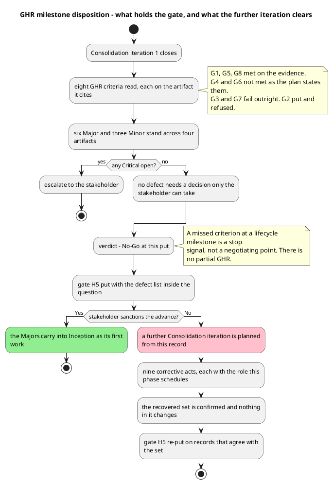

**Project health at this gate.** Four dimensions, each rated on evidence and none on the project's own word.

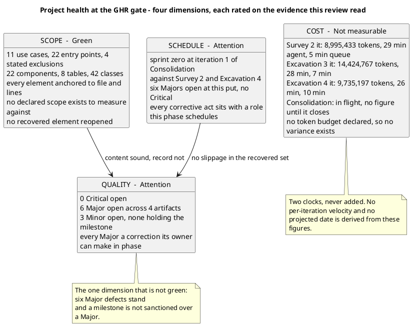

**Risk retirement is real and not uniform, and the difference is the finding.**

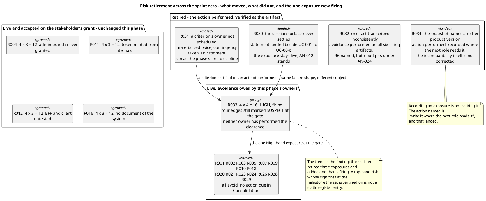

Three exposures retired with their actions observed in the artifacts that carry them, two more with their retirement landed and their exposure correctly stated as live, and one that is firing at the gate: `R033`, a High-band risk whose avoidance both owners still owe. A register that carried the same top risk unchanged across two milestones would be evidence that risk retirement is not occurring; this one did move, and the exposure it added this phase is the one that has not been discharged. That is not a static register — it is a register that tells the truth about where the phase failed.

**What the stakeholder decided.** Two things, and neither is widened here. They refused the sanction: the six Majors are cleared in this phase and the gate is put again. And they ruled the coverage denominator: the 45 Bootstrap files under `Todo.Web/Client/wwwroot/bootstrap/` are a third-party distribution and not their system, so coverage is counted over the delivery's own files. They confirmed the recovered set unchanged — the eleven use cases, the four exclusions, the twenty-two components and the eight tables stand as they confirmed them at gate H4 — so no act on the corrective list touches recovered content.

**What the further iteration must reach before the gate is re-put.** The six Majors closed and verified at their artifacts, and the three Minors corrected with them where the same owner is working the same artifact. `G4` stated with its threshold and with the denominator the stakeholder gave it; `G3` naming both contradictions in the set; `G6` decided on `R033`'s recorded state; all four trace edges cleared by the roles the graph marks; the Supplementary Specification's S8 and S18 corrected against `Todo.Api/Program.cs:58`; the System Inventory's own-tree ratio stated beside its raw count. When those hold, the criteria can be read again on records that agree with the set they report, and gate H5 can be put a second time.

**No milestone, iteration or phase is recorded as completed by this review.** The Review Coordinator reads this verdict and the finding ledger; the milestone's disposition is theirs to record.

### Review Coordinator lens
<!-- review: Excavation I4 -->

**Milestone verdict on the consolidated ledger: the Architecture Recovered (AR) milestone is SANCTIONED. Excavation closes and the project advances into Consolidation.**

The verdict is anchored to the finding data and to the stakeholder's recorded answer, never to judgment:

| Condition for sanction | The data | State |
|---|---|---|
| `[FINDINGS]` unread = none | Twelve artifacts read, none unread | Met |
| Open Critical = 0 | No lens recorded a Critical finding against any artifact | Met |
| Open Major = 0 | No Major stands against any artifact; the four that held iterations 2 and 3 are closed and verified at their sources | Met |
| Stakeholder sanction GRANTED | Gate H4, fourth put, 2026-11-23: **Yes** — the advance sanctioned on records that agree with the set they report | Met |
| Recovery confirmed | Confirmed by the stakeholder at the third put as the model of the existing system — eleven use cases, four stated exclusions, twenty-two components, eight tables | Met |

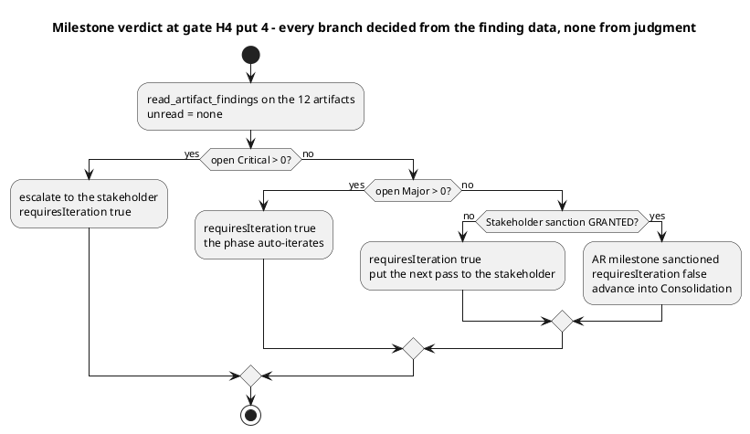

Both executed lenses reach the same conclusion by their own routes. The technical lens returns **Approved with Changes** — one Minor on the Development Case, no Major, and the recovered set clean. The Management Reviewer returns **Go** — thirteen of thirteen exit criteria met on the artifact that owns each, and the sanction granted in words at the fourth put. Neither recorded a Critical finding, so nothing in this ledger requires a stakeholder decision that has not already been given.

**Why no condition is attached.** A Conditional Go defers verification to a later point. There is nothing here to defer: every criterion is decided, both remaining defects are Minors that no exit criterion depends on, and the sanction the gate turns on has been granted. A condition on a Minor would record a hold the stakeholder did not impose and the exit criteria do not require.

**Why the verdict is not withheld for the two open Minors.** The stakeholder's standing order, given at the SBC close, is that open Minors be addressed in the next phase rather than left unattended — and both are: each has an owner whose stage Consolidation schedules, an action that closes it, and a stated due point. A Minor is, by its definition, a defect whose owner fixes it in its next turn and which does not hold the milestone.

**Disposition by artifact.**

| Artifact | Disposition |
|---|---|
| Development Case | **Approved with changes** — `#F4` open, one diagram's per-phase discipline list; contained, no criterion depends on it |
| System Inventory | **Approved** — coverage arithmetic recomputed and reproducing; no open finding from any lens |
| Risk List | **Approved** — `#F3` closed on R032's restated retirement; the grant band reproduces and is correctly granted |
| Iteration Plan | **Approved with changes** — `#F10` open on three gate cells; `#F4`, `#F8` and `#F9` closed and verified |
| Vision | **Approved** — eleven use cases; the two platform mechanisms drawn as components |
| Use-Case Model | **Approved** — R6 states both budgets under `AN-024`; five `COMP-014` edges confirmed in the graph |
| Supplementary Specification | **Approved** — `#F3` closed; M3, S2, P1, R8 and R4 state the two budgets and the two hops apart; Document Control on iteration 4 |
| Software Architecture Document | **Approved** — SP1, M3 and the bounded-load row verified at the file |
| Deployment Model | **Approved** — Environment Mapping verified against the environment files |
| Design Model | **Approved** — `PD-D3` cites `AN-025` for the owner key and `AN-005` only for `EnsureCreated` |
| Iteration Assessment | **Not judged** — authored by the Project Manager in the Assess touchpoint that follows this review; its state before the review is not a finding |

**What this verdict does and does not decide.** It decides that the AR exit criteria are met, that the finding ledger holds no Critical and no Major, and that the stakeholder sanctioned the advance. It does not merge the iteration baseline: that is the Integrator's step after the verdict.

**What leaves the phase.** The recovered set leaves Excavation as the model of the existing system, confirmed by the stakeholder: eleven use cases over twenty-two entry points and twenty-two components across four processes, with four stated exclusions — external-provider sign-in recovered and unreachable in the delivered configuration, the cross-owner admin branch an exceptional entity and not a use case, and `EP-020`, `EP-021` and `EP-022` carrying no use case — and an eight-table data model with the unconverted owner key recorded under `AN-025`. No element of it was added, removed, merged or reclassified by iteration 4, whose four corrections were cells, a field and a retirement claim: records of the recovery, not the recovery.

**What enters Consolidation.** Two Minors, each with an owner and an action, none holding any criterion: `Development Case#F4` (Process Engineer) and `Iteration Plan#F10` (Project Manager). No declared scope is cut or deferred to reach this gate, and no finding is waived, deferred or recorded as closed on a document having been written.
