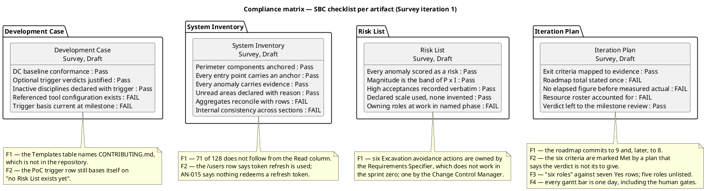
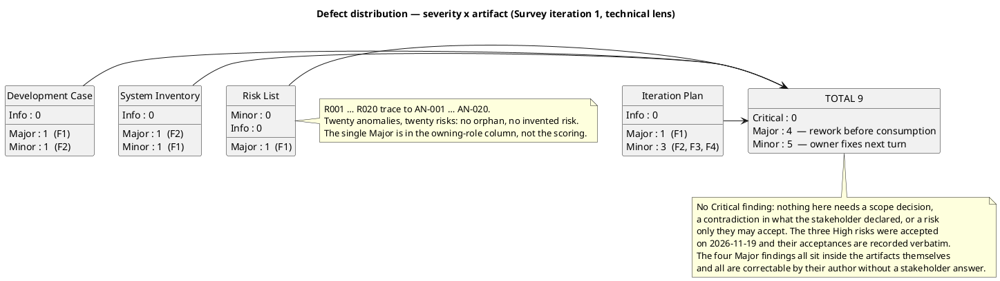
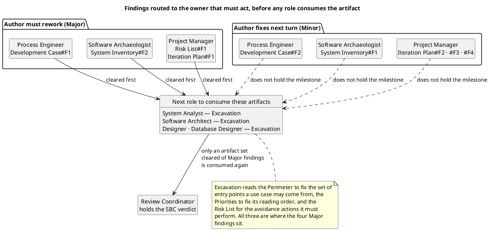
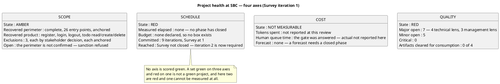
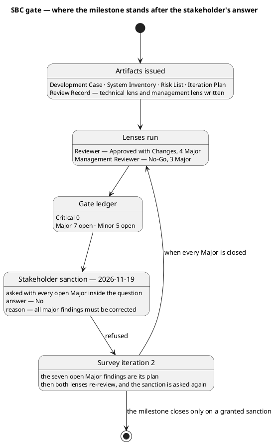

## Document Control
### Reviewer lens
<!-- review: Survey I1 -->

- Phase: Survey
- Status: Draft — technical lens of the end-of-Survey milestone review
- Milestone Target: end of Survey (SBC) — not yet achieved
- Review type: Milestone review (SBC), technical lens — formal inspection against the artifact-type checklists
- Reviewed: Development Case, System Inventory, Risk List, Iteration Plan — all Survey, Draft, iteration 1
- SCM evidence: no pull request in any state; no IARI build on `main`

### Management Reviewer lens
<!-- review: Survey I1 -->

- Phase: Survey
- Status: Draft — management lens of the end-of-Survey milestone review
- Milestone Target: end of Survey (SBC) — not achieved
- Review type: Milestone review (SBC), management lens
- Reviewed: Development Case, System Inventory, Risk List, Iteration Plan — all Survey, Draft, iteration 1
- Verdict: No-Go on the SBC milestone
- Stakeholder sanction: REFUSED

## Review Scope and Criteria
### Reviewer lens
<!-- review: Survey I1 -->

SBC asks one question: is the material the whole recovery will rest on adequate? Four artifacts answer it, and they are the only four anything in Excavation, Consolidation and Inception will cite. Nothing was built in this iteration — no code, no pull request, no build — so the review is entirely an evidence review: does each claim rest on what it cites.

Three lenses of the SBC review follow this one; this block records the technical lens only.

| Artifact | Author | Checklist applied | Version reviewed |
|---|---|---|---|
| Development Case | Process Engineer | DC baseline conformance; optional-trigger justification; validity of every referenced path | Survey, Draft, iteration 1 |
| System Inventory | Software Archaeologist | Anchor verification (each anchor opened and read against its claim); UML/notation correctness of the perimeter and coverage diagrams; internal consistency; Coverage arithmetic | Survey, Draft, iteration 1 |
| Risk List | Project Manager | The declared magnitude scale used and not replaced; every anomaly scored; acceptance verbatim for High; owning roles at work in the phase each action names | Survey, Draft, iteration 1 |
| Iteration Plan | Project Manager | Exit criteria against evidence; no forecast before a measured actual; resource roster; the plan not exercising a verdict it disclaims | Survey, Draft, iteration 1 |

#### What was opened, not merely read

An anchor that does not say what the artifact claims is the defect every later role inherits, so each high-consequence row was checked against its file:

| Anchor opened | Claim it carries | Verdict |
|---|---|---|
| `Todo.Web/Server/Authentication/AuthenticationExtensions.cs` | Four provider schemes registered only when `Authentication:Schemes:<provider>` exists | Confirmed — the exclusion of external provider sign-in rests on code |
| `Todo.Api/Program.cs` | Scalar mapped only in Development, `MapOpenApi()` unguarded, root redirects to `/scalar/v1` | Confirmed — AN-016 accurate |
| `Todo.Web/Server/TodoApi.cs` | Forwarder targets the literal `http://todoapi`; bearer re-signed from the stored token | Confirmed — AN-012 and the BFF description accurate |
| `Todo.Web/Client/TodoClient.cs` | No update method; five calls only | Confirmed — AN-008 accurate |
| `Todo.Web/Client/Components/TodoList.razor` | Checkbox carries no `@bind` and no handler | Confirmed — AN-008 accurate |
| `Todo.Api/Todos/TodoApi.cs` | `owner.IsAdmin` widens read, update and delete | Confirmed — AN-010 accurate |
| `Todo.Api/Users/UsersApi.cs` | `/users` group carries no authorization; provider key unprotected before identity | Confirmed — AN-018 accurate |
| `.github/workflows/ci.yaml` | `actions/setup-dotnet@v3` with no `dotnet-version` | Confirmed — AN-006 accurate |
| `.devcontainer/devcontainer.json` | Base image `sdk:8.0` against a `net9.0` target | Confirmed — AN-005 accurate |
| `Todo.Web/Server/AuthApi.cs` | Register, login and logout call the API; provider challenge and callback present | Confirmed — but see below on refresh |
| `Todo.Api/TodoDbContext.cs`, `Todo.Api/Users/TodoUser.cs` | `IdentityDbContext<TodoUser>` plus `Todos` = 8 entities | Confirmed — the Data Model trigger genuinely does not hold |
| `TodoApp.AppHost/Program.cs` | Two project services plus a container, gated on a migration | Confirmed — the Deployment Model trigger genuinely holds |
| `CONTRIBUTING.md` | Named by the Development Case as the home of three convention families | **Not found** — Development Case#F1 |

One claim did not survive: the Inventory's Perimeter says the delivered product uses token refresh, and nothing in the delivery redeems a refresh token. That is System Inventory#F2.

The UML content was checked as notation, not as illustration: the perimeter diagram types its components and systems and labels each dependency with its mechanism; the coverage diagram separates read from declared-unread and gives each unread set a reason; the Risk List's classification diagram states the scale, the band arithmetic and the acceptance rule. None is a prose summary drawn as arrows. The Inventory's History diagram is the one place a diagram asserts a count that the accompanying table repeats rather than derives — noted, not recorded as a defect, because the per-area commit lists are given in full.

No SCM evidence bears on this milestone. `scm_list_pull_requests` returns nothing in any state, so there is no scaffolding to approve, no code to request changes on, and nothing to defer out of phase; `scm_get_build_status("main")` reports no IARI pipeline yet, which is correct for a phase that builds nothing. The Implementation and Test disciplines have no Survey stage.

### Management Reviewer lens
<!-- review: Survey I1 -->

The management lens asks three questions the technical lens does not: are the six SBC exit criteria met by evidence rather than by assertion; do the artifacts together give a project that can be governed — bounded risk, a plan whose numbers agree, a tailoring its consumers can work under; and does the stakeholder sanction advancing.

Evidence examined. The four Survey artifacts in full. The trace graph for the two artifacts that declare labels — twenty anomalies each refining one risk, and the `DependsOn` edges owned by the anomaly end. SCM carries nothing for this phase: no pull request in any state and no IARI build, which is correct for an iteration that builds nothing. No code, no build and no execution is cited anywhere below.

Scope of this lens's own findings. Only two of the four artifacts carry a management defect: the Risk List and the Iteration Plan. The Development Case and the System Inventory were checked against the SBC criteria and against the governance question and are clean from this lens — their defects are the technical lens's, recorded there.

| Criterion applied to | What was tested |
|---|---|
| Each of the six exit criteria | Whether the evidence named actually exists in the artifact cited, and whether it holds once checked |
| Risk List | Every anomaly scored; magnitude the band of probability × impact on the declared scale; acceptance verbatim for each High risk; **every avoidance action executable by the role named, in the phase named**; the project's own binding constraint bounded somewhere |
| Iteration Plan | One committed total; no forecast before a measured actual; no scope cut to fit an undeclared budget; the tailoring the plan depends on in place before its consumers start |
| Development Case | Baseline conformance, the optional verdicts, and whether the tailoring is usable by the phases that receive it |
| System Inventory | SBC exit criteria 1–3 on the perimeter, the priorities and the declared unread set; the exclusions recorded where the stakeholder put them |

Four axes were then scored across all four artifacts — scope, schedule, cost, quality. The scorecard is in Findings.

## Findings
### Reviewer lens
<!-- review: Survey I1 -->

Nine findings across the four artifacts: four Major, five Minor, no Critical. Each Major is a place where a role in Excavation would consume wrong content; each Minor stays inside its own artifact.

#### Development Case

**Major — Development Case#F1 — `consumed-defect`.** The Templates table names `CONTRIBUTING.md` as the single home of the coding standards, the UI patterns and the test conventions, with three owners. The file is not in the repository. Four roles are directed to a convention source that does not exist, and the table gives no fallback. **Remediation:** re-point the rows at files that exist (`ci.yaml`, `global.json`, `Directory.Build.props`, `Directory.Packages.props`, `nuget.config`) and record the three convention families as undocumented until a declared requirement or Change Request puts a convention file in scope.

**Minor — Development Case#F2 — `contained-defect`.** The Architectural Proof-of-Concept row bases its verdict partly on "no Risk List exists yet". True when issued, false now: 20 scored risks exist, including R020 and R017. The verdict still holds on the phase requirement. **Remediation:** drop the stale clause and let the phase requirement be the whole basis.

The two tailoring decisions this lens was required to audit both pass. Every FIRED optional was checked against its trigger condition: Deployment Model is FIRED and the condition genuinely holds — `TodoApp.AppHost/Program.cs` orchestrates two project services and a container, gated on a migration operation, joined by service discovery and a forwarder, across per-project settings files. Data Model is NOT FIRED and the condition genuinely fails — `IdentityDbContext<TodoUser>` plus `Todos` yields 8 entities, not more than 10. The remaining four NOT-FIRED verdicts hold. Nothing in the artifact redefines the 26-role roster, omits a CORE artifact, reassigns primary ownership, merges two roles, or lists an artifact outside the CORE + OPTIONAL universe plus the System Inventory.

#### System Inventory

**Major — System Inventory#F2 — `consumed-defect`.** The Perimeter's `Todo.Api / Users` row states the delivered product uses "registration, login and token refresh only". AN-015 in the same artifact records that nothing redeems a refresh token — the BFF stores only `accessToken`, `TokenNames` names only `accessToken`, `AuthClient` has no refresh call. A role reading the Perimeter table concludes EP-003 has a caller and recovers a refresh use case; a role reading AN-015 concludes it has none. **Remediation:** restate the Perimeter row to agree with AN-015 and say once, in one place, whether a use case may be recovered from EP-003.

**Minor — System Inventory#F1 — `contained-defect`.** The Coverage aggregate does not reconcile with its own rows: the Read column sums to 72 while the text says 71 of 128 and 57 unread, and the four-category unread breakdown omits `GlobalUsings.cs` and the Inventory's own file. The per-area rows — which are what SBC exit criterion 3 rests on — are correct. **Remediation:** recompute the aggregate from the table, or drop the aggregate and let the per-area rows carry the count.

Anchor verification is the substance of this artifact and it holds: twelve of the thirteen anchors opened say what the artifact claims. Twenty-six entry points each carry a real anchor. Twenty anomalies each cite evidence. Coverage declares every unread area with a reason and no top-level area of the tree is left neither described nor declared unread. The three exclusions are recorded where the stakeholder's answers put them, each with the code anchor that stays as read.

#### Risk List

**Major — Risk List#F1 — `consumed-defect`.** Six Excavation avoidance actions name the Requirements Specifier as owning role (R002, R010, R011, R014, R015, R016), and R014 additionally names the Change Control Manager. Neither works in the sprint zero: Excavation's Requirements stage is the System Analyst's, the Requirements Specifier's first stage is Elaboration, and the Development Case records that the Change Control Manager opens no ledger there. A risk register whose avoidance actions are owned by roles absent from the phase is a register Excavation cannot execute. **Remediation:** re-own the Excavation actions to the System Analyst, keep the Software Architect parts in Excavation, move R014's control part to Inception.

Scoring, strategy and acceptance all pass. Twenty anomalies, twenty risks, no orphan and none invented — each R traces to its AN. Magnitude is the band of P × I throughout, on the declared scale, with no scale of the document's own. All three High risks (R008 16, R009 16, R020 20) were put to the stakeholder and accepted on 2026-11-19, recorded verbatim; all nine Significant risks are handled by avoidance, so no Significant acceptance was self-granted.

#### Iteration Plan

**Major — Iteration Plan#F1 — `consumed-defect`.** The plan commits to two different totals. The roadmap sums 1+1+1+1+2+2+1 and both the preamble and the profile bullets state 9 with Elaboration's second iteration "committed ... planned work, not a reserve". Evaluation Criteria then states "8 iterations, or 9 if Elaboration needs its second" — making conditional what the roadmap commits. Nothing downstream can read a single baseline. **Remediation:** state 9 once, in the roadmap, and delete the "8 or 9" sentence rather than reconciling it in a second place.

**Minor — Iteration Plan#F2 — `contained-defect`.** Evaluation Criteria marks all six criteria "Met — confirmed / recorded / issued" while the same section opens by disclaiming the verdict and the fine plan records the SBC review as "Not started — the reviewers' to give". The plan both withholds the verdict and exercises it. **Remediation:** replace the verdict words with the evidence supplied.

**Minor — Iteration Plan#F3 — `contained-defect`.** Resources states six roles at work but marks seven rows "Yes"; five roles of the active roster appear in no row at all. **Remediation:** restate the profile as six agent roles plus the stakeholder gate, and list the unlisted roles with their exclusion reason.

**Minor — Iteration Plan#F4 — `contained-defect`.** Every bar in both gantt diagrams is "lasts 1 day", including the seven human-gate bars, while Measure and forecast states that no elapsed figure appears in this plan. Summing the bars yields 16 days; the gates are held elsewhere to be a queue-time risk with a 14-day ceiling and "estimate NONE". **Remediation:** remove the day lengths, or keep the diagram carrying ordering only with no numeric duration.

The substance of this plan passes: the six exit criteria each name the evidence they rest on, the no-forecast discipline is correct for a project with no closed phase and no declared budget, the stakeholder's four answers are recorded verbatim where they bind, and the roadmap respects the declined Excavation split by carrying orders 1-6 in one iteration with order 7 as cross-check. No work item names work the IARI process does not run in Survey.

### Management Reviewer lens
<!-- review: Survey I1 -->

Three findings from this lens, all Major, all open. No Critical: nothing here needs a scope decision, a contradiction in what the stakeholder declared, or a risk only they may accept. The seven Major findings open at this milestone — these three and the technical lens's four — are content another role would act on, and none is closed.

```plantuml
@startuml
title SBC exit criteria — evidence, and the outcome of this milestone review (Survey iteration 1)
skinparam shadowing false
skinparam classAttributeIconSize 0
hide empty members
hide circle

class "C1 — Perimeter confirmed\nby the stakeholder" as C1 {
  Evidence : 7 projects + CI · 26 entry points · 3 exclusions, each anchored
  Technical lens : Pass
  Management lens : NOT MET — sanction REFUSED at this review
  Stakeholder : no correction to the perimeter was requested
}
class "C2 — Priorities ordered for\nthe remaining recovery" as C2 {
  Evidence : Priorities — 8 areas, each with its reason and its anchor
  Technical lens : Pass
  Management lens : Pass — order checked against the declined Excavation split
}
class "C3 — Unread areas declared\nwith their reason" as C3 {
  Evidence : Coverage — per-area rows; 57 unread files named and justified
  Technical lens : Pass — rows correct, the aggregate does not reconcile (Minor)
  Management lens : Pass — criterion 3 rests on the rows, and the rows hold
}
class "C4 — Every anomaly a scored risk;\nHigh ones accepted" as C4 {
  Evidence : 20 AN → 20 R by Refines · R008 16 · R009 16 · R020 20, accepted verbatim
  Technical lens : Pass — scoring, strategy and acceptance all hold
  Management lens : NOT MET — the stakeholder gate is bounded nowhere (Risk List#F1)
}
class "C5 — Tailoring issued; trigger\ndecisions recorded" as C5 {
  Evidence : DC-D1 … DC-D7 · six optional verdicts, one fired
  Technical lens : Pass — baseline conformance and every trigger audited
  Management lens : NOT MET — issued, but its consumers cannot use it (Iteration Plan#F1)
}
class "C6 — Roadmap and this iteration's\nfine plan; no invented forecast" as C6 {
  Evidence : 9-milestone roadmap · 9 work items · no token and no elapsed figure
  Technical lens : Pass
  Management lens : Pass — no budget declared, so no box was fitted to scope
}

C1 -[hidden]right-> C2
C2 -[hidden]right-> C3
C4 -[hidden]right-> C5

note bottom of C1
  Three criteria are not met at this review. The milestone
  is not sanctioned: the burden of proof sits on the
  artifact set, and it did not discharge it.
end note
@enduml
```

```plantuml
@startuml
title Risk posture at SBC — magnitude, acceptance, and whether each action is executable where it lands
skinparam shadowing false
skinparam classAttributeIconSize 0
hide empty members
hide circle

package "High 15-25 — accepted by the stakeholder, 2026-11-19 (3)" {
  class "R008 — exposure 16\ntodo cannot be completed from any screen" as R008 {
    Excavation part : System Analyst — executable
    Construction part : Technical Writer via Release Notes — that stage produces User Documentation
    Open : Risk List#F2
  }
  class "R009 — exposure 16\nBFF carries no automated test" as R009 {
    Elaboration part : Test Designer, Tester — executable
  }
  class "R020 — exposure 20\nassembled system has never run" as R020 {
    Elaboration part : Integrator, Tester — executable
    Contingency : first assembled run, the Architecture Build
  }
}

package "Significant 9-12 — avoidance, each naming an action (9)" {
  class "R003 R004 R005 R006 R007\nR012 R015 R017 R018" as SIG {
    R012 R017 R018 : Software Architect, Excavation — executable
  }
}

package "Moderate 5-8 (7) and Minor 3-4 (1); Low 0" {
  class "R001 R002 R010 R011\nR013 R014 R019 — R016" as MOD {
    R002 R010 R011 R014 R015 R016 name the Requirements Specifier or the Change Control Manager
    Neither works in the phase named — Risk List#F1
  }
}

R008 -[hidden]right-> R009
R009 -[hidden]right-> R020

note bottom of MOD
  No trend line is drawn and none can be: this is Survey,
  the first review of the project, and every magnitude is
  the magnitude at issue. Retirement is measured from AR
  onward against these twenty figures as its baseline.
end note
@enduml
```

#### Risk List

**Major — Risk List#F1 (management lens) — `consumed-defect`.** The project's only external dependency — the stakeholder gate — is bounded nowhere in the register. The Iteration Plan states that a human gate is "recorded: Risk List, as the gate's trigger indicator", with a ceiling of 14 days before the process suspends. The register carries no such entry: its twenty risks are each refined from an anomaly, and the Actor check paragraph acknowledges "the only human it waits on is the stakeholder" without scoring the wait. Seven gates sit on the roadmap, each able to suspend the process, and none has a probability, an impact, a magnitude or a contingency. The roadmap is weighed against a bound the plan believes exists and the register does not carry. **Remediation:** add the stakeholder gate as a risk in its own right, scored on the IARI scale like every other — strategy accept, mitigation (each question put in the round that raises it, with the verdict lean and the open defects inside it), contingency (the 14-day ceiling, after which the process suspends and nothing is auto-filled). Give it its `RNNN` and cross-reference it from the plan's Measure and forecast row by that id instead of describing it as already recorded.

**Major — Risk List#F2 (management lens) — `consumed-defect`.** R008's only mitigation for an accepted High risk lands in a phase that does not produce the artifact it names. The action reads "Technical Writer — Construction (Release Notes)", but the process produces Release Notes only from Transition onward: Construction's Deployment stage produces User Documentation, and Release Notes are marked *from Transition*. The gap this accepted exposure exists to record therefore has no executable home in the plan, and a Technical Writer working Construction is directed at an artifact its stage does not produce. The System Inventory's part of the same risk, AN-008, also names the Release Notes as where the missing control is disclosed. **Remediation:** re-home the mitigation against the stage that produces the artifact — name the User Documentation the Technical Writer produces in Construction as where the absent completion control is disclosed, or move the Release Notes part to Transition where that artifact is first produced — and keep the System Analyst's Excavation part unchanged. State the phase against the stage the IARI process actually runs there.

#### Iteration Plan

**Major — Iteration Plan#F1 (management lens) — `consumed-defect`.** The plan schedules the Development Case's correction at Inception and sends both sprint-zero phases that consume it — Excavation and Consolidation — into it first. Resources states for the Process Engineer: "Re-prepared at the next Environment phase, not before — no finding or Change Request demands a tailoring change yet". The tailoring those two phases would work under points three convention families (coding standards, UI patterns, test conventions) at `CONTRIBUTING.md`, which is not in the repository (Development Case#F1, technical lens), so the roles Excavation and Consolidation put to work have no convention source and no fallback, and no work item in the sprint-zero plan puts one in place before they start. Exit criterion 5 sanctions a tailoring as "issued" without regard to whether the phases that consume it can use it. **Remediation:** add a Development Case correction work item to the sprint-zero fine plan, owned by the Process Engineer and sequenced before Excavation, replacing the "no finding … demands a tailoring change yet" clause with the correction this review requires; the Inception re-preparation stays as a separate, later Environment stage rather than as the deferral that carries this one. Alternatively, state in Evaluation Criteria that criterion 5 is met on issuance alone, and that the corrections Excavation depends on are a precondition verified before AR.

#### Development Case and System Inventory — clean from this lens

Both were checked against the SBC criteria and against the governance question and carry no management defect. The tailoring is a valid delta: no role omitted without its trigger condition, no CORE artifact dropped, no ownership reassigned, no artifact outside the CORE + OPTIONAL universe plus the System Inventory, and the one fired optional genuinely holds against the AppHost topology while the Data Model verdict genuinely fails at 8 entities. The System Inventory draws its perimeter from code with an anchor per row and puts each of the three exclusions where the stakeholder's own answers put them. Their defects are the technical lens's, recorded in its block, and this lens does not duplicate them.

## Resolutions and Actions
### Reviewer lens
<!-- review: Survey I1 -->

Iteration 1 of Survey: this lens has no prior finding to close, and none is resolved, deferred or rejected here. Every finding recorded above is new in this iteration and every one is open.

| Finding | Owner | What closes it | Holds the milestone |
|---|---|---|---|
| Development Case#F1 | Process Engineer | Templates rows re-pointed at files that exist; the three convention families recorded as undocumented | Yes |
| Development Case#F2 | Process Engineer | Stale "no Risk List exists yet" clause removed from the PoC trigger row | No |
| System Inventory#F2 | Software Archaeologist | Perimeter `/users` row restated to agree with AN-015; one statement of whether EP-003 supports a use case | Yes |
| System Inventory#F1 | Software Archaeologist | Coverage aggregate recomputed from the Read column, or dropped for the per-area rows | No |
| Risk List#F1 | Project Manager | Six Excavation avoidance actions re-owned to the System Analyst; R014's control part moved to Inception | Yes |
| Iteration Plan#F1 | Project Manager | One committed total stated once in the roadmap; the "8 or 9" sentence deleted | Yes |
| Iteration Plan#F2 | Project Manager | Evidence-supplied wording in place of "Met — …" | No |
| Iteration Plan#F3 | Project Manager | Assignment profile and role table made consistent; unlisted roles given their exclusion reason | No |
| Iteration Plan#F4 | Project Manager | Day lengths removed from the gantt bars, the gate included | No |

Closure has two parts and this lens will perform both in the next iteration: the `resolve_artifact_finding` call that moves the state, and the entry here that records what the corrected content says. A finding whose defect still stands is re-recorded under its key rather than duplicated.

No action on this list needs a stakeholder decision. The nine defects are content and arithmetic errors inside artifacts whose authors are at work in this process; the four Major ones are correctable in a single rework turn each. Nothing here reopens a decision the stakeholder has already taken, and nothing here proposes a change to the recovered scope.

No escalation is open against this lens. The three High risks were accepted on 2026-11-19 and the perimeter was confirmed on the same day; this review found no contradiction in what was declared and no risk that only the stakeholder may accept.

### Management Reviewer lens
<!-- review: Survey I1 -->

**Stakeholder sanction: REFUSED**

The sanction proposition and the answer received, verbatim:

| What was put | Their answer, verbatim | Recorded |
|---|---|---|
| My verdict lean — Conditional — with all 7 open Major and 5 Minor findings stated inside the question, and the request to confirm the perimeter as the System Inventory records it and sanction advancing past SBC. | "No" | 2026-11-19 |
| Anything the team must know before Excavation opens — a part of the system missing from the perimeter, a correction, a priority to move. | "All major findings must be corrected." | 2026-11-19 |

**What the refusal establishes.** The perimeter itself drew no correction from the stakeholder: no part of the system was asked to be added, removed or moved in priority. What they refused is advancement, and their stated reason is the seven open Major findings. Nothing beyond that sentence is read into their answer.

**No new finding was minted against the refusal.** Every Major defect the order names already has its ledger entry — four from the technical lens, three from this one — and re-recording one would duplicate the same logical defect under a second key. Those seven entries are the statement of what must be corrected, and the table below is the whole of the correction work.

| Finding | Lens | Owner | What closes it |
|---|---|---|---|
| Development Case#F1 | Reviewer | Process Engineer | Templates rows re-pointed at files that exist; the three convention families recorded as undocumented |
| System Inventory#F2 | Reviewer | Software Archaeologist | Perimeter `/users` row restated to agree with AN-015; one statement of whether EP-003 supports a use case |
| Risk List#F1 | Reviewer | Project Manager | Six Excavation avoidance actions re-owned to the System Analyst; R014's control part moved to Inception |
| Iteration Plan#F1 | Reviewer | Project Manager | One committed total stated once in the roadmap; the "8 or 9" sentence deleted |
| Risk List#F1 | Management Reviewer | Project Manager | The stakeholder gate scored as a risk of its own with its 14-day ceiling as trigger indicator and its contingency; cross-referenced by `RNNN` from the plan |
| Risk List#F2 | Management Reviewer | Project Manager | R008's Construction mitigation re-homed to the artifact that stage produces (User Documentation), or the Release Notes part moved to Transition |
| Iteration Plan#F1 | Management Reviewer | Project Manager | A Development Case correction work item in the sprint-zero plan owned by the Process Engineer and sequenced before Excavation |

Not holding the milestone, but open: Development Case#F2, System Inventory#F1, Iteration Plan#F2, #F3, #F4 — all Minor, all owned, all fixed by their author in its next turn after the Major findings.

This lens has no prior finding to close: iteration 1 is the first review of this project, and no finding was resolved, deferred or rejected. Closure in iteration 2 has two parts — the `resolve_artifact_finding` call that moves the state, and the entry that records what the corrected content says. A defect that still stands is re-recorded under its key, not duplicated.

## Disposition
### Reviewer lens
<!-- review: Survey I1 -->

**Technical lens disposition: Approved with Changes.** No artifact is rejected and none is approved for consumption unchanged.

The distinction that matters at SBC: all four artifacts supply the evidence the six exit criteria name, and the evidence itself survived checking. Thirteen anchors were opened against their claims and twelve confirm them. The perimeter is drawn from code, the entry points each carry a real anchor, twenty anomalies each cite evidence, twenty risks each trace to their anomaly, the three High acceptances are recorded verbatim, and every optional trigger verdict holds against the project's real facts. The material the recovery will rest on is substantially there.

What fails is four claims inside that material: a referenced file that does not exist, a Perimeter row contradicted by the artifact's own anomaly, six avoidance actions owned by roles absent from the phase that must perform them, and two different committed iteration totals in one plan. Each of those is content another role would act on, so each must be corrected before Excavation reads the artifact again.

| Artifact | Disposition from this lens |
|---|---|
| Development Case | Approved with Changes — Major F1 before the tailoring governs any role's work |
| System Inventory | Approved with Changes — Major F2 before Excavation fixes the recoverable entry-point set |
| Risk List | Approved with Changes — Major F1 before Excavation executes any avoidance action |
| Iteration Plan | Approved with Changes — Major F1 before any downstream artifact cites an iteration count |

**No Critical finding is open, so nothing in this lens blocks the SBC on a stakeholder decision.** That is a statement about this lens only. The SBC verdict belongs to the Review Coordinator, which weighs this lens with the Management Reviewer's; this block does not declare the milestone met, and no iteration is closed here.

The one thing this lens asks the Review Coordinator to carry forward: an artifact set cleared of its Major findings is the precondition for Excavation, not a formality. Excavation reads the Perimeter to fix the set of entry points a use case may come from, the Priorities to fix its reading order, and the Risk List for the actions it must perform — and all three of the artifacts carrying those are where the Major findings sit.
