## Document Control
### Reviewer lens
<!-- review: Excavation I1 -->

<!-- review: Excavation I1 -->

- Phase: Excavation
- Status: Technical lens complete for the AR (end-of-Excavation) milestone review. Ten findings recorded this milestone: 0 Critical, 6 Major, 4 Minor, 0 Info. Two prior findings of this lens closed. Disposition — Approved with Changes, with the six Majors holding the milestone until their artifacts are reworked.
- Milestone Target: end-of-Excavation (AR) — not achieved. The six Majors are open and the recovery's own figures are contradicted by the code in three artifacts; gate H4 has not been put and is not this lens's to put.
- Iteration: 1, Cycle 1
- Owner: Reviewer

### Management Reviewer lens
<!-- review: Survey I2 -->

- Phase: Survey
- Status: Management lens complete for the re-taken SBC milestone review. Findings recorded by this lens over two iterations: 3 in iteration 1, all resolved this iteration; 2 new this iteration, both Minor and both open. Disposition — Go. Stakeholder sanction GRANTED on 2026-11-23.
- Milestone Target: end-of-Survey (SBC) — every exit criterion met, the perimeter confirmed and the sanction to advance granted. The milestone verdict is the Review Coordinator's.
- Iteration: 2, Cycle 1
- Owner: Management Reviewer

### Review Coordinator lens
<!-- review: Survey I2 -->

<!-- review: Survey I2 -->

- Phase: Survey
- Status: SBC milestone review consolidated at iteration 2. Lenses executed: Technical (Reviewer) and Management (Management Reviewer). Business (BusinessReviewer) — INACTIVE, did not evaluate this review, carries no verdict. Consolidated from the finding ledger: 14 findings recorded across the two iterations, 10 closed by their recording lens, 4 open — 0 Critical, 0 Major, 4 Minor.
- Milestone Target: end-of-Survey (SBC) — every gate condition met on the finding data: 0 open Critical, 0 open Major, the perimeter confirmed as the System Inventory records it and the sanction to advance granted, both by the stakeholder on 2026-11-23.
- Iteration: 2, Cycle 1
- Owner: Review Coordinator

## Review Scope and Criteria
### Reviewer lens
<!-- review: Excavation I1 -->

<!-- review: Excavation I1 -->

**Review type.** Lifecycle milestone review, technical lens, at the AR (end-of-Excavation) review point. The question applied is exit criteria: whether the artifacts this phase produced establish that the system's operations, architecture and data have been recovered from the code — each element resting on the file it cites — and whether that recovered set may be put to the stakeholder at gate H4.

**Artifacts under review — ten, read whole.**

| Artifact | Owner | Discipline | Content read against |
|---|---|---|---|
| Vision | System Analyst | Requirements | The Use-Case Model and the System Inventory's perimeter |
| Use-Case Model | System Analyst | Requirements | The System Inventory's entry points; the registered trace graph |
| Supplementary Specification | System Analyst | Requirements | The mechanisms' anchors, opened |
| Software Architecture Document | Software Architect | Analysis & Design | The manifests, the mechanisms' anchors, the use cases |
| Deployment Model | Software Architect | Analysis & Design | The orchestration, the launch profiles, the environment files |
| Design Model | Designer, Database Designer | Analysis & Design | The migrations, the entity declarations, the anomalies |
| System Inventory | Software Archaeologist | Discovery | Its own arithmetic and its own trace rows |
| Risk List | Project Manager | Project Management | Its own scoring mapping and the artifacts it cites |
| Iteration Plan | Project Manager | Project Management | The exit criteria against the artifacts each cites |
| Development Case | Process Engineer | Environment | The IARI DC baseline in this review's own prompt |

The Iteration Assessment is not reviewed: the Project Manager authors it in the Assess touchpoint that runs after this review, so at review time it cannot describe the iteration being reviewed. Its absence is not a finding and not a gate condition.

**Checklist applied.** The EVIDENCE lens of Excavation, per artifact type: Requirements — every use case traces to the entry point whose code performs it, every entry point carried or its exclusion stated, no cross-cutting mechanism drawn as a use case, trace rows matching the graph. Analysis & Design — every component, class and mechanism resting on an anchor that says what the artifact claims, every declared technology present in a manifest, environment differences stated correctly, subsystem boundaries not named by layer. Discovery — coverage arithmetic reproducing, edge counts reproducing, Document Control naming its own iteration. Project Management — every anomaly carried, every score reproducing from one mapping, the grant band holding the stakeholder's own answers, each exit criterion certified on its own artifact's evidence. Environment — DC baseline conformance and every FIRED optional trigger holding its §5.2 condition.

**Scope of this pass — and what it is not.** This lens re-read all ten artifacts whole. It is not a re-litigation of the two SBC passes: the four Survey artifacts' iteration-2 rework is confirmed closed below and the Survey findings resolved. What is new is that Excavation produced six artifacts that did not exist at SBC, and this is the first pass over them; the two facts it found wrong cut across both the new artifacts and the ones they build on.

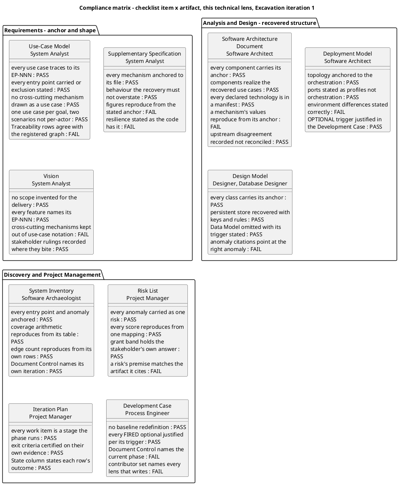

**Prior findings of this lens — reconciled before new defects were recorded.**

| Artifact | Finding | State this pass | What was checked |
|---|---|---|---|
| System Inventory | `System Inventory#F3` (Minor) — Document Control still read iteration 1 | Resolved | Document Control now reads "Iteration: Excavation iteration 1, cycle 1", the iteration its content belongs to |
| Iteration Plan | `Iteration Plan#F3` (Minor) — the fine plan's State column contradicted the artifacts | Resolved | The section commits to stating each row's actual outcome; row 9 cites the Document Control correction, verified in the artifact; row 10 records `Development Case#F2` as Not started rather than complete, which is the true state |

`Development Case#F2` — the contributor set omitting three lenses, ordered corrected by the stakeholder on 2026-11-23 — belongs to the **Management Reviewer's** lens, not this one, and this lens leaves it to that lens. The Iteration Plan's item 10 and its criterion A11 already record it as outstanding and carried as `R031`; the artifact still reads "Reviewer, CodeReviewer, plus the Configuration Manager's baseline record". This lens records nothing against it because it has no finding of its own on it — a second lens's key must be closed by that lens.

**Anchor verdict — the statements this phase's recovery rests on, opened rather than trusted.**

| Claim under review | Anchor opened | Verdict |
|---|---|---|
| The rate-limit values 100 / 100 / 100 are the effective ones because no `RateLimiting` section exists | `Todo.Api/appsettings.Development.json` | **Contradicted** — the file carries `"RateLimiting": { "TokenLimit": 50, "TokensPerPeriod": 50, "QueueLimit": 50 }`. Both launch profiles set `ASPNETCORE_ENVIRONMENT` to Development, so 50 is the value that applies. The System Inventory records this as AN-024 and the Risk List as R025; three of the artifacts under review state the opposite |
| No retry, circuit breaker or fallback is configured on either hop out of the BFF | `TodoApp.ServiceDefaults/Extensions.cs` | **Contradicted** — `ConfigureHttpClientDefaults(http => { http.AddStandardResilienceHandler(); ... })` applies the standard retry, circuit-breaker, timeout and rate-limiter pipeline to every container-built `HttpClient`, which reaches `AuthClient`. Only the YARP forwarder hop carries none. The SAD states this correctly at P6; the Supplementary Specification's R4 says "either hop" |
| The ownership predicate is written four times and the list applies half of it | `Todo.Api/Todos/TodoApi.cs` | **Confirmed** — `Where(todo => todo.OwnerId == owner.Id)` on the list with no admin branch; `todo.OwnerId == owner.Id \|\| owner.IsAdmin` on the read, the update and the delete. AN-018 is accurately stated in the System Inventory, the Supplementary Specification and the SAD |
| `POST /todos` copies the title alone, so a create body asking for a completed row produces `IsComplete` false | `Todo.Api/Todos/TodoApi.cs` | **Confirmed** — `new Todo { Title = newTodo.Title, OwnerId = owner.Id }`, with no assignment from `newTodo.IsComplete`. UC-007's step 5 and the Design Model's R-facts both state it correctly |
| Every entry-point-bearing anomaly edge reproduces from the System Inventory's own row | System Inventory "Traceability" and "Anomalies", both read together | **Confirmed** — 21 `DependsOn` edges across twelve anomalies, matching the Iteration Plan's twelve-row handoff table. `AN-021` carries all three of `EP-004`, `EP-005`, `EP-007`, the edge the earlier pass found missing |

Two of five anchors opened contradicted the artifacts that cite them, and each contradiction is recorded below against every artifact that carries it.

**SCM evidence.** No open pull request exists, and none should: the sprint zero writes no production code — Implementation runs from Inception — so a pull request in this phase would itself be a `scm-phase-discipline` finding. `scm_list_pull_requests(state: open)` returns none. There is no IARI pipeline on `main`, so no build status exists to be red. Nothing is disposed in this review and no code review decision is owed. This is the correct state for Excavation, not an absence to be flagged.

### Management Reviewer lens
<!-- review: Survey I2 -->

This is the Lifecycle Milestone Review of the System Boundary Confirmed gate, held at the end of Survey iteration 2. The question it answers is exit criteria, not feasibility and not iteration completion: do the Survey artifacts collectively establish that the perimeter of the existing system is known, its anomalies are held as owned risks, and the phase may hand off to Excavation.

**Artifacts reviewed, all four read whole plus the findings of every lens on them.** Development Case (Environment), System Inventory (Discovery), Risk List and Iteration Plan (Project Management). The Iteration Assessment was read for its stated state and is not judged: the Project Manager writes it in the Assessment touchpoint that runs after this review, so it cannot describe the iteration being reviewed and its currency is never a gate condition.

**The criteria checked.** The SBC exit criteria as the Iteration Plan states them, each judged against the artifact it cites rather than against the plan's own row. Every one carries the artifact section its verdict rests on.

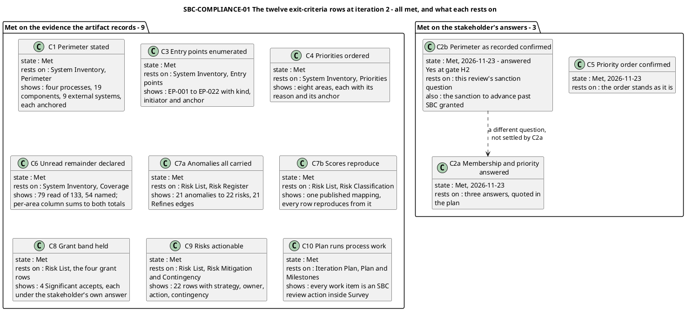

**The checklists applied beyond the criteria.** Each is this lens's own test on the artifacts it reviewed, and each result is stated where the test found something — in Findings, or here when it found nothing.

| Check | Applied to | Result |
|---|---|---|
| Development Case conformance with the IARI baseline: roster, CORE ownership, CORE omissions, artifact universe, role merges | Development Case | Passes. 24 of 26 roles work; the two inactive are declared with the triggers that justify each — `business-process-led = false` and `real-time-system = false`. All 16 CORE artifacts are carried, none changes owner, no artifact outside the CORE, OPTIONAL and System Inventory universe is listed, no role is merged or renamed. |
| Every FIRED optional trigger holds its §5.2 condition | Development Case | Passes. One trigger fires: the Deployment Model, on a genuinely distributed topology — a browser-hosted WebAssembly client, a server host, a separate API process, a SQLite store and a YARP forwarder hop between them, orchestrated by the app host, with an `appsettings` pair per process. The five NOT FIRED verdicts hold on their conditions: the vocabulary is plain English (Glossary), no untried mechanism needs empirical validation (Proof-of-Concept), 8 entity types sit below the >10 threshold with no production data to migrate (Data Model), no UX decision waits on the stakeholder (UI Prototype), and no regulator or contract consumes test reporting (Test Plan). |
| Plan sizing in units this system can produce | Iteration Plan | Passes. The plan is sized in the two currencies that exist — token spend and elapsed time with agent and human queue separated — and no per-item figure is filled where nothing is measured. The coarse roadmap's bars carry no absolute date and no projected span, and the one-day length is stated as the diagram's sequencing device. Item 8 is a human gate, quoted in days of queue time with a ceiling of 14 and no estimate, and the roadmap states the two clocks are never added. No token budget is asserted, because the project declares none. |
| Plan names only work the process runs in the phase | Iteration Plan | Passes, C10. Every iteration-2 work item is an SBC review action against a Survey artifact or the re-taken gate; no role is scheduled in Survey for work the IARI process assigns to a later phase. |
| Unsourced financial or quantitative claims | all four | None found. No cost, revenue, market or staffing figure appears in any of the four artifacts, and no staffing risk is carried — correctly, since the executing agents are not a development organization and the only human is the stakeholder. |
| Risk register is not cosmetic: magnitudes reproduce and the retirement obligation is honest | Risk List | Passes. All 21 anomaly-derived scores reproduce from one published mapping, and the register states plainly that SBC retires no risk — the phase makes the reading's risks owned and the actions that retire them are Excavation's and later. That is the correct state for this gate, not a static list: the register moved this iteration from unreproducible to reproducible, and the four acceptances above the Moderate band each hold the stakeholder's own answer. |

**What is not a finding, and why.** The absence of a Test Plan, a Data Model and a Glossary is the Development Case's NOT FIRED verdict on each, checked against its §5.2 condition above and found to hold. The absence of an Iteration Assessment describing this iteration is correct state, not a gap. The absence of a token budget, a velocity and a forecast is correct: the project declares no budget, no phase has closed, and no figure is filled in its place. No SCM condition holds or clears this gate — the repository carries no IARI pipeline, no branch of this process, no open pull request and no defect issue, so there is no build to be red and no unmerged work to count.

**Four-axis health at the gate.** Cost carries no reading at all, which is the honest state of a phase with no declared budget and no closed phase, not a fourth green.

### Review Coordinator lens
<!-- review: Survey I2 -->

<!-- review: Survey I2 -->

**Review event.** Lifecycle milestone review, System Boundary Confirmed (SBC), the first of the sprint zero's three milestones, consolidated at the end of Survey iteration 2. This is the milestone review the phase closes on — not a PRA review, not an Iteration Acceptance Review carried in its place. The iteration-acceptance question ("did the iteration deliver what it planned") is answered by the Iteration Assessment, which the Project Manager authors; the milestone question answered here is "may the phase advance".

**Lens participation — authoritative.** Declared against the artifact, not inferred from it.

| Lens | Role | Participation | Findings, both iterations |
|---|---|---|---|
| Technical | Reviewer | EXECUTED | 9 — 0 Critical, 4 Major, 5 Minor; 7 resolved, 2 open |
| Business | BusinessReviewer | **INACTIVE — did not evaluate this review** | none |
| Management | Management Reviewer | EXECUTED | 5 — 0 Critical, 2 Major, 3 Minor; 3 resolved, 2 open |

The Business Reviewer does not run at SBC: the IARI Development Process sets the SBC sequence at Reviewer → Management Reviewer → Review Coordinator, and the Business Reviewer enters at LCO. Its non-participation is the process's own schedule. It carries no verdict and no finding, and the milestone decision below rests only on the two lenses that executed.

**Artifacts under review.** Development Case (Process Engineer, Environment), System Inventory (Software Archaeologist, Discovery), Risk List and Iteration Plan (Project Manager, Project Management). The Review Record is the reviewers' own output and is not itself under review. The Iteration Assessment was read for its stated state and is not judged: at review time it cannot describe the iteration being reviewed.

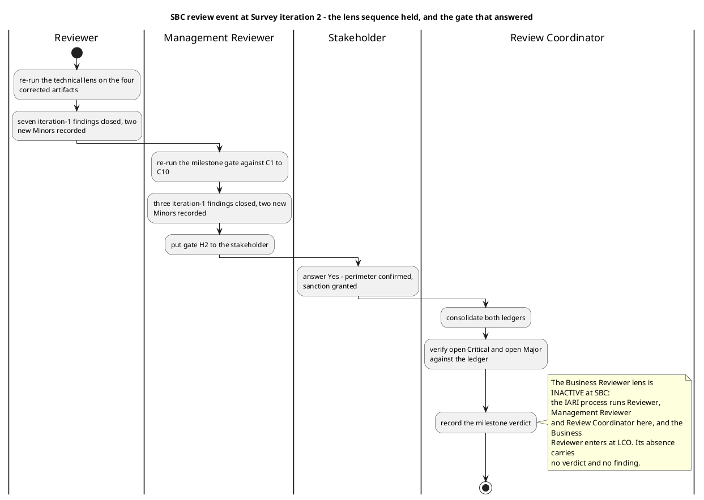

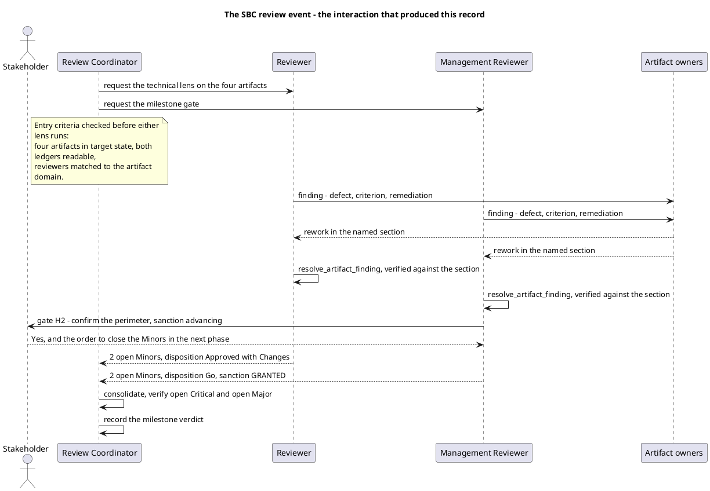

**Entry criteria — checked before this event.**

| Entry condition | State |
|---|---|
| The four artifacts are in their target state, not draft placeholders | Met — all four carry full content; the iteration-2 rework is in the sections the findings named |
| Reviewers assigned with expertise matched to the artifact domain | Met — Environment, Discovery and Project Management artifacts read by the technical and management lenses; no lens reviewing outside its competency |
| Finding ledgers available to the coordinator before consolidation | Met — read from `read_artifact_findings` on all four artifacts plus the Iteration Assessment and the Review Record |
| Exit criteria and the evidence column distributed before the review | Met — the Iteration Plan's Evaluation Criteria table is the evidence column, and the management lens judged each row against the artifact it cites |

**Exit criteria — checked at this event.**

| Exit condition | State |
|---|---|
| Every Critical and Major finding carries an owner and a remediation | Met — 0 open Critical, 0 open Major; the 6 Majors recorded this cycle each carried owner and remediation and each is closed by its recording lens |
| No open Critical/Major remains before the phase advances | Met — 0 and 0 on the ledger |
| The verdict is recorded and archived | Met — recorded in Disposition, this artifact |
| The stakeholder's sanction is recorded verbatim and answered | Met — GRANTED 2026-11-23, recorded in the management lens's Disposition and in this artifact's Disposition |
| The perimeter of the existing system is confirmed by the stakeholder | Met — confirmed as the System Inventory records it, 2026-11-23 |
| The iteration's planned objectives are achieved | Met — assessed by the management lens against all six of the iteration's objectives and, separately, by the Iteration Assessment |

**Review calendar — every event on its iteration boundary, from SBC onward.**

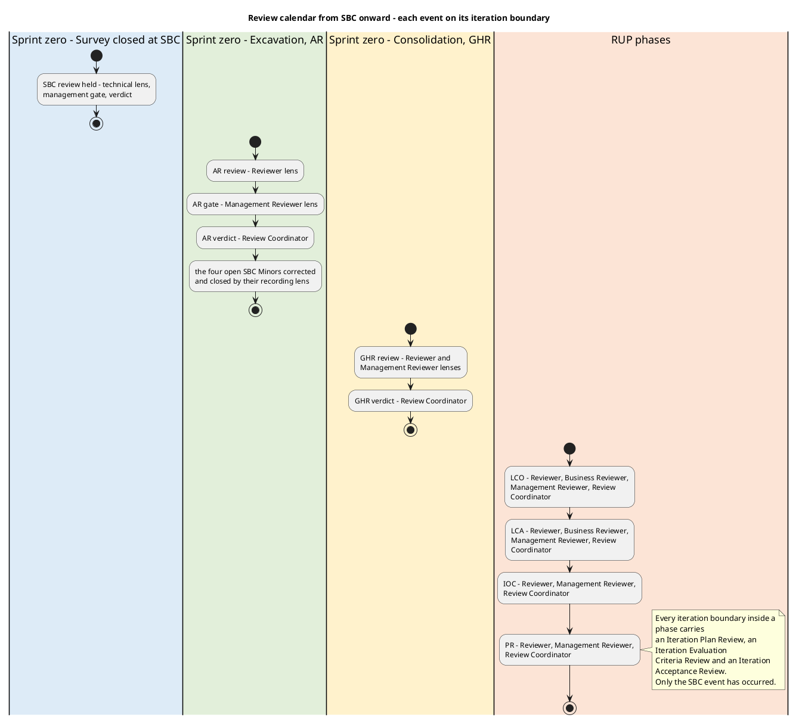

**Review process framework — the types this project runs, and the criteria that gate each.**

| Review type | Triggering activity | Required participants | Entry criteria | Exit criteria | Primary output |
|---|---|---|---|---|---|
| Milestone review SBC (held) | Survey work items complete | Reviewer, Management Reviewer, Review Coordinator | Four artifacts in target state; finding ledgers distributed before the review | 0 open Critical/Major with owner and deadline; verdict recorded; sanction answered | This Review Record, SBC block |
| Milestone review AR | Excavation work items complete | Reviewer, Management Reviewer, Review Coordinator | Recovered Use-Case Model, SAD, Design Model, Deployment Model, Risk List, Iteration Plan in target state | As above, plus every recovered element anchored to its file or entry point | Review Record, AR block |
| Milestone review GHR | Consolidation work items complete | Reviewer, Management Reviewer, Review Coordinator | Coverage counted and declared; recovered set complete | As above | Review Record, GHR block |
| Milestone review LCO | Inception work items complete | Reviewer, **Business Reviewer**, Management Reviewer, Review Coordinator | Vision, Use-Case Model, Supplementary Specification, SAD, Change Request ledger in target state | As above, plus business acceptability stated | Review Record, LCO block |
| Milestone review LCA | Elaboration work items complete | Reviewer, Business Reviewer, Management Reviewer, Review Coordinator | Architecture baseline and executable architecture built and tested | As above, plus the architecture gate passed | Review Record, LCA block |
| Milestone review IOC | Construction work items complete | Reviewer, Management Reviewer, Review Coordinator | Iteration baseline integrated with an iteration baseline build | As above, plus the integrated baseline verified | Review Record, IOC block |
| Milestone review PR | Transition work items complete | Reviewer, Management Reviewer, Review Coordinator | Release build baselined and acceptance-tested | As above, plus every Change Request closed | Review Record, PR block |
| Iteration Plan Review | "Plan for Next Iteration" | Project Manager, Reviewer, Review Coordinator | Next iteration's plan drafted | Findings closed; plan accepted | Review Record entry |
| Iteration Evaluation Criteria Review | "Manage Iteration", before close | Reviewer, Project Manager, Review Coordinator | Exit criteria and their evidence tabled | Each criterion passes or is reclassified | Review Record entry |
| Iteration Acceptance Review | "Manage Iteration", at close | Reviewer, Management Reviewer, Review Coordinator | Evaluation Criteria Review passed | Deliverables formally accepted | Review Record entry |
| Project Acceptance Review | Project close-out | Stakeholder, Management Reviewer, Review Coordinator | All milestones sanctioned | The stakeholder accepts the delivery | Review Record entry |

SBC is the only row that has occurred. Every later row is scheduled, not completed.

## Findings
### Reviewer lens
<!-- review: Excavation I1 -->

<!-- review: Excavation I1 -->

Ten findings, each naming the criterion whose test it meets. Six are Major — another role builds on the wrong content, and the recovered figures the phase would put to the stakeholder at gate H4 are wrong in three artifacts by one cause.

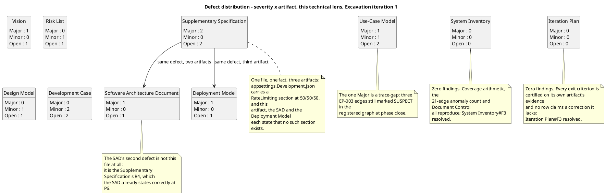

#### Supplementary Specification

**Major** — `Supplementary Specification#F1`, criterion `consumed-defect`. The artifact states four times that no `RateLimiting` configuration section exists and that the code's defaults of 100 / 100 per 10 s / queue 100 are therefore the effective values: mechanism M3 ("no such section exists in the delivery, so these defaults are the effective values"), S2 ("a `RateLimiting` configuration section that does not exist in the delivery ... none is externally tunable as delivered"), P1 ("100 tokens per caller per 10-second period with a queue of 100") and R8. `Todo.Api/appsettings.Development.json` carries exactly such a section at `TokenLimit` 50, `TokensPerPeriod` 50 and `QueueLimit` 50, and both launch profiles set the environment to Development — so the effective budget in the only environment this delivery starts in is half the stated value. The recovery already knows this: the System Inventory records it as AN-024 and the Risk List carries it as R025. The defect reaches the Software Architect, who repeats the figure in SP1 and M3, and the Deployment Model, which copies it into its environment table; any load or throttling reading taken from this artifact is off by a factor of two. **Remediation:** state both values — the code defaults from `RateLimitExtensions.cs:14-31` and the Development override from `appsettings.Development.json:8-12` — in M3, S2, P1 and R8, and cite AN-024 so the three artifacts carry one fact under one identifier.

**Major** — `Supplementary Specification#F2`, criterion `consumed-defect`. R4 reads "No retry, circuit breaker or fallback is configured on either hop." `TodoApp.ServiceDefaults/Extensions.cs:32-42` calls `ConfigureHttpClientDefaults` with `AddStandardResilienceHandler()`, which applies the standard retry, circuit-breaker, timeout and rate-limiter pipeline to every container-built `HttpClient` — and the BFF's `AuthClient` is one, registered at `Todo.Web/Server/Program.cs:23-26`. Only the YARP forwarder carries a default `ForwarderRequestConfig` and no handler. The Software Architecture Document records exactly this at its Process View P6 and states it does not edit this artifact because the System Analyst owns it, so the correction is owed here. A role reading R4 concludes neither hop retries: wrong on the sign-in and registration path, right on the task path, and the asymmetry the architecture recovered is lost. **Remediation:** replace R4 with the two hops stated apart, citing `TodoApp.ServiceDefaults/Extensions.cs:32-42`, `Todo.Web/Server/Program.cs:23-26` and `Todo.Web/Server/TodoApi.cs:12-25`, and record it under AN-023 / R024.

#### Software Architecture Document

**Major** — `Software Architecture Document#F1`, criterion `consumed-defect`. SP1 states "No `RateLimiting` section exists, so these are the effective values and none is tunable as delivered", and mechanism M3 repeats it ("every value bindable from a `RateLimiting` section that does not exist"). The file carries one, at 50 / 50 / 50, and both launch profiles run in Development. The artifact cites its neighbouring anomalies AN-023 and AN-025 but not AN-024, which is the one that records this. This is the copy the Deployment Model's environment table inherits. **Remediation:** correct SP1 and M3 to state both values with their sources and cite AN-024; correct the Quality view's "Availability — bounded load" row so the bound in the measured environment reads 50, not 100.

#### Deployment Model

**Major** — `Deployment Model#F1`, criterion `consumed-defect`. The Environment Mapping preamble states "No environment file in the delivery carries a connection string, a provider credential, a rate-limit value or an address", and the Rate limiting row reads "Code defaults: 100 / 100 per 10 s / queue 100 | Same | No `RateLimiting` section exists anywhere, so the values are not tunable as delivered". `Todo.Api/appsettings.Development.json:8-12` carries the rate-limit values. This is the artifact where the error costs most: the section exists to state what differs between environments, it concludes that one setting separates them, and there are two — the second stated backwards. **Remediation:** narrow the preamble to what is true (no connection string, provider credential or address), and rewrite the Rate limiting row so Development reads 50 / 50 / 50 with its anchor and any other environment reads the code defaults, noting that every launch profile sets Development; cite AN-024 and R025.

#### Use-Case Model

**Major** — `Use-Case Model#F1`, criterion `trace-gap`. Three edges this artifact declares are marked SUSPECT in the registered graph and remain open at the phase close: `EP-003 → UC-006`, `EP-003 → UC-007`, `EP-003 → UC-008`, each «SUSPECT → System Analyst». The Traceability rows assert them and the Survey and every affected flow cite EP-003 — the todo list screen — as the screen an actor enters them through. The edges are substantively right; what is missing is the confirmation that clears the marking. A phase that closes with a suspect trace open leaves the screen route of three of eleven use cases unconfirmed, and the eleven-use-case count gate H4 puts to the stakeholder rests on it. **Remediation:** re-register the three edges as confirmed after checking each — `Todo.Web/Client/Components/TodoList.razor:3-32` carries the new-todo input and the per-row remove control, so it precedes UC-007's and UC-008's step 1, and it is the screen the signed-in shell renders for UC-006's step 1 (`Todo.Web/Server/App.razor:44-52`). Record in the Use-Case Survey beside the three rows why a screen entry point and the forwarded operation differ, so the graph carries the edge and the artifact explains its shape.

**Minor** — `Use-Case Model#F2`, criterion `contained-defect`. The actor-goal matrix and the Source column disagree for two use cases with nothing saying they answer different questions: the matrix draws `A1 --> UC3 : EP-002` and `A1 --> UC4 : EP-001, EP-006`, while the Use-Case Survey gives UC-003 as `EP-007, EP-008, EP-016` and UC-004 as `EP-006`, and the registered graph carries only the latter. The matrix's heading is "with the entry points it uses", which suggests the screen the actor acts on, while Source names the entry point whose code performs the operation. **Remediation:** state the distinction once in the Actors section and relabel the matrix's edges — the actor acts on EP-001 and the POST goes to EP-006 — so two lists answering different questions are visibly doing so.

#### Vision

**Major** — `Vision#F1`, criterion `use-case-shape`. The Features diagram draws two cross-cutting technical mechanisms with use-case notation: `usecase "Start the system and create its schema EP-022" as U12` and `usecase "Observe readiness and liveness EP-020, EP-021" as U13`. Schema migration and health probing are platform mechanisms with no actor goal; the Use-Case Model correctly declines to recover either, and the Supplementary Specification already homes them as M9 and M8. The effect is that the Vision states thirteen use cases in the artifact the stakeholder is asked to confirm at gate H4, while the Use-Case Model, the Iteration Plan's objective O1 and the SAD's Use-Case View all state eleven. The artifact's own note ("this Vision creates none") shows the author saw the problem and drew the shapes anyway. **Remediation:** remove U12, U13 and their package from the diagram, keep the two Features rows re-labelled as platform mechanisms cross-referenced to Supplementary Specification M8 and M9 and to the Use-Case Model's "Not recovered, and why".

#### Risk List

**Minor** — `Risk List#F2`, criterion `contained-defect`. R024's premise reads "The Design Model describes the BFF's two outbound hops as equally protected when they are not". The Design Model does the opposite: its PKG-D3 note reads "A default `ForwarderRequestConfig` and no resilience handler, so this hop neither retries nor breaks the circuit, unlike the `AuthClient` hop", and the SAD states the same at P6. The mitigation therefore names an action two artifacts have already performed, and the risk can never be observed as retired. The underlying anomaly AN-023 is real and correctly anchored; only the sentence about which artifact gets it wrong is wrong. **Remediation:** restate R024 as the risk that a later role assumes the hops are equivalent, and point the mitigation at the artifact that does still carry the open error — the Supplementary Specification's R4.

#### Design Model

**Minor** — `Design Model#F1`, criterion `contained-defect`. The migration-history diagram PD-D3 attributes the unconverted owner key to AN-005: "a row written before migration 3 keeps what it held where the constraint now expects an Id ... AN-005." AN-005's subject is that the test suite builds its schema with `EnsureCreated`; the unconverted owner key is AN-025, and the Risk List carries it correctly as R026 refining AN-025. A reader following the citation from this diagram reaches an anomaly about test coverage rather than about data conversion. **Remediation:** change the PD-D3 citation to AN-025 and keep AN-005 only where the artifact states that the test host builds its schema by `EnsureCreated`.

#### Development Case

**Minor** — `Development Case#F3`, criterion `contained-defect`. Document Control still reads "Phase: Survey", "Status: Draft — produced for the end-of-Survey (SBC) milestone review", "Milestone Target: end-of-Survey (SBC) — not yet achieved", "Iteration: 2, Cycle 1". The project is in Excavation iteration 1 and every other artifact under this review states it. **Remediation:** update the four metadata fields to Excavation iteration 1 and the AR milestone target; the tailoring content is current — both classification verdicts and all six optional triggers were re-evaluated and the Deployment Model's FIRED verdict still holds on its condition.

**Minor, recorded here and carried by another lens** — `Development Case#F2` is the Management Reviewer's finding of the Survey review, and this lens does not close or duplicate it. It stands open: "Roles and Ownership" still reads "Reviewer, CodeReviewer, plus the Configuration Manager's baseline record" and CLS-DC-01 draws no edge into the Review Record from the Management Reviewer, the Business Reviewer or the Review Coordinator. It is named here only because the Iteration Plan's criterion A11 counts it and this review read that row; the finding itself is the Management Reviewer's to reconcile.

#### System Inventory and Iteration Plan — no finding from this lens

Both artifacts were read whole and this lens records nothing against either. The System Inventory's coverage arithmetic reproduces from its own per-area table (84 read, 55 unread of 139), its anomalies carry 21 `DependsOn` edges across twelve entry-point-bearing anomalies matching the Iteration Plan's twelve-row handoff, and its Document Control now names the iteration its content belongs to. The Iteration Plan certifies every exit criterion on the artifact it cites rather than on an adjacent answer, its work items are all stages the phase runs, and its State column states each row's actual outcome. Silence from this lens is approval.

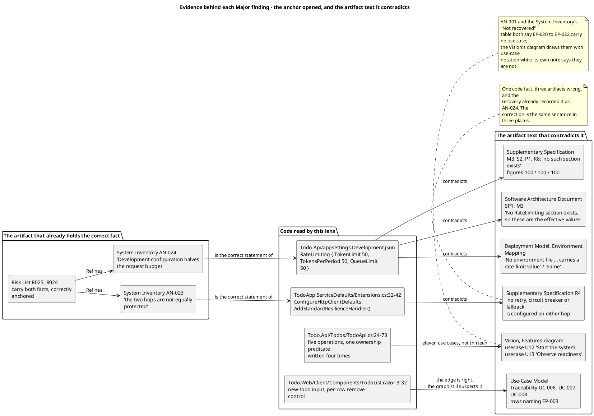

### Management Reviewer lens
<!-- review: Survey I2 -->

Two findings are open from this lens at the end of this review, both Minors. Each is recorded against the artifact that carries the defect, in the finding ledger, not here as prose alone.

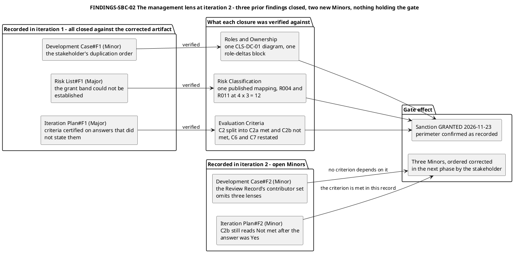

#### Development Case

`Development Case#F2` — Minor, contained defect. The contributor set the tailoring states for the Review Record omits three of the lenses that write into it: it names "Reviewer, CodeReviewer, plus the Configuration Manager's baseline record", while the artifact carries a Management Reviewer lens, a Business Reviewer lens and a Review Coordinator lens besides. The CLS-DC-01 class diagram repeats the omission, drawing no edge from any of those three roles to the Review Record. It stays inside the document: every lens writes its own block whatever the tailoring says, so no role built on wrong content, and no SBC criterion depends on it.

The defect the stakeholder ordered corrected — `Development Case#F1`, the duplicated role-delta list and the duplicated CLS-DC-01 diagram — is closed this iteration and is recorded under Resolutions and Actions, not restated here.

#### Risk List

No finding from this lens. The register is the artifact this iteration changed most and it now holds under the management lens's own tests: every score reproduces from the one mapping published in "Risk Classification", the band table agrees with the register row for row, every Significant-band acceptance carries the stakeholder's own answer verbatim, and the register states without embellishment that SBC retires no risk. `Risk List#F1` is closed under Resolutions and Actions.

#### Iteration Plan

`Iteration Plan#F2` — Minor, contained defect. The Evaluation Criteria table records C2b as "Not met" on the refusal of 2026-11-23, though the stakeholder has since answered gate H2, confirmed the perimeter as recorded and granted the sanction. The row's own clause — "H2 is re-taken after this iteration's review" — has been fulfilled, so the cell states a state the answer superseded. The defect is contained: C2b is verified met in this record on the stakeholder's answer, so no exit criterion fails and no role is blocked by the stale cell; only the plan's evidence column is behind.

`Iteration Plan#F1` is closed: C2 is split into the answered membership and priority questions and the confirmation the stakeholder did not then give, C6 cites the coverage figure the System Inventory reproduces from its own table, and C7 is split into carriage and reproducibility, each decided on the artifact it cites. The plan's evidence column is now the artifact the verdict can rest on.

#### System Inventory

No finding from this lens, in either iteration. The reading is the artifact this gate exists to establish and it is the strongest of the four: the perimeter is anchored component by component, the 22 entry points carry kind, initiator and anchor, the priorities are ordered with the stakeholder's answer recorded in their own words, the coverage figure reproduces from its own per-area table, and every anchor this lens followed read as the artifact cites it. The two questions the reading could not settle were put to the stakeholder and are recorded as decided, with the external-provider path kept as a recovered use case marked unreachable and the `admin` branch recorded as an exceptional entity — both in the reading's own text, not only in an answer that has since been lost.

**Not this lens's findings, and not this lens's to close.** The technical lens's two open Minors — `System Inventory#F3` and `Iteration Plan#F3`, both status metadata — belong to that lens and are closed by it. They are named here only so the Review Coordinator's consolidated count is complete.

### Review Coordinator lens
<!-- review: Survey I2 -->

<!-- review: Survey I2 -->

**Consolidated finding ledger.** Fourteen findings were recorded against the four artifacts by the two executed lenses across the SBC review's two iterations. Ten carry a resolution object and are closed by their recording lens; four are open, all Minor. Counts below are copied from `read_artifact_findings` on each artifact, not from any sentence in a reviewer's narrative.

| Artifact | Key | Lens | Severity | Criterion | Owner | Status | The corrective action |
|---|---|---|---|---|---|---|---|
| Development Case | F1 | Reviewer | Major | consumed-defect | Process Engineer | Resolved | The unsourced enterprise version policy is deleted; "Tool and configuration references" states only what `Directory.Packages.props`, `global.json` and `nuget.config` carry |
| Development Case | F2 | Reviewer | Minor | contained-defect | Process Engineer | Resolved | One role-deltas statement and one CLS-DC-01 diagram retained; the duplicate deleted |
| Development Case | F1 | Management Reviewer | Minor | contained-defect | Process Engineer | Resolved | The same duplication, under the stakeholder's order of 2026-11-23; verified at "Roles and Ownership" |
| Development Case | F2 | Management Reviewer | Minor | contained-defect | Process Engineer | **Open** | The co-owned-artifact sentence and CLS-DC-01 must name Management Reviewer, Business Reviewer and Review Coordinator among the lenses writing into the Review Record |
| System Inventory | F1 | Reviewer | Major | trace-gap | Software Archaeologist | Resolved | AN-021 row reads `DependsOn EP-004, EP-005, EP-007`, matching the diagram and the trace tree |
| System Inventory | F2 | Reviewer | Minor | contained-defect | Software Archaeologist | Resolved | Coverage recommends itself from its own per-area table: 133 files, 79 read, 54 unread; the `docs/` row decided explicitly |
| System Inventory | F3 | Reviewer | Minor | contained-defect | Software Archaeologist | **Open** | Set the Document Control iteration field to 2, Cycle 1 |
| Risk List | F1 | Reviewer | Major | consumed-defect | Project Manager | Resolved | One published word-to-score mapping; all 21 anomaly-derived rows reproduce from it; R004 and R011 land at 4 × 3 = 12 |
| Risk List | F1 | Management Reviewer | Major | exit-criterion-unmet | Project Manager | Resolved | The grant band re-derived from the reconciled exposures; every Significant-band acceptance holds the stakeholder's own answer |
| Iteration Plan | F1 | Reviewer | Major | consumed-defect | Project Manager | Resolved | All twelve entry-point-bearing anomalies named with their 21 edges; the nine with no entry point listed separately |
| Iteration Plan | F2 | Reviewer | Minor | contained-defect | Project Manager | Resolved | Gate H2 placed ahead of the verdict it feeds, in both the coarse roadmap and the critical chain |
| Iteration Plan | F1 | Management Reviewer | Major | exit-criterion-unmet | Project Manager | Resolved | C2 split into C2a and C2b, C6 restated on the reproducible coverage figure, C7 split into carriage and reproducibility |
| Iteration Plan | F3 | Reviewer | Minor | contained-defect | Project Manager | **Open** | Correct the fine-plan State column of rows 4, 5 and 6, or delete the column |
| Iteration Plan | F2 | Management Reviewer | Minor | contained-defect | Project Manager | **Open** | C2b restated as Met on the gate H2 answer, with that answer as its evidence |

Findings on the Iteration Assessment and on the Review Record: none recorded in either iteration.

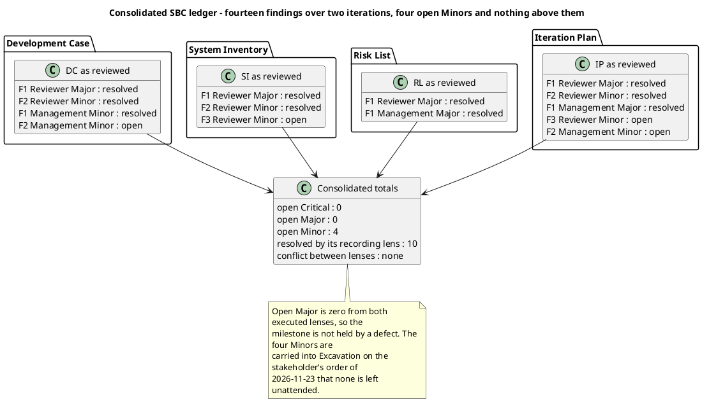

**Cross-lens reconciliation — no conflict, four orderings.**

The two lenses raised no contradictory finding: neither found the other's defect to be absent, no owner received two incompatible instructions, and no defect was recorded twice under different criteria. Where two findings touch one subject, the order of rework was settled — and both orders have since been honoured by the owners:

| Ordering | Findings | Why that order |
|---|---|---|
| Arithmetic before the grant | Risk List#F1 (Reviewer) → Risk List#F1 (Management Reviewer) | The grant band cannot be re-derived from scores that do not reproduce. Both closed in one Project Manager pass |
| Figure before criterion | System Inventory#F2 (Reviewer) → Iteration Plan#F1 (Management Reviewer) on C6 | C6 cites a coverage figure; the figure had to be reproducible first |
| Scores before criterion | Risk List#F1 (Reviewer) → Iteration Plan#F1 (Management Reviewer) on C7 | C7 passed as a counting test while the scores it counted did not reproduce |
| Stakeholder order before the Minor queue | Development Case#F2 (Reviewer) with Development Case#F1 (Management Reviewer) | The duplication was the stakeholder's own order of 2026-11-23 and rose above the un-ordered Minors |

Two findings described one defect each under two keys — `Development Case#F2` with `Development Case#F1`, and `Risk List#F1` with `Risk List#F1 (Management Reviewer)`. One rework pass closed the subject of each pair; each lens closed only its own key, and neither lens closed the other's.

**Priority of what remains — the four open Minors, in the order Excavation should close them.**

| Priority | Finding | Why it ranks here |
|---|---|---|
| 1 | Iteration Plan#F2 (Management Reviewer) | The plan's evidence column currently reads "Not met" on a criterion the stakeholder has answered Yes; it misstates the project's standing to every reader who opens the plan |
| 2 | Iteration Plan#F3 (Reviewer) | The same artifact's State column; the Project Manager corrects both in one turn |
| 3 | Development Case#F2 (Management Reviewer) | The tailoring misdescribes who writes this Review Record — a reader of the tailoring concludes three lenses have no block in the artifact they in fact write |
| 4 | System Inventory#F3 (Reviewer) | Status metadata only; no reader is misled about content |

None of the four holds an exit criterion, blocks a downstream role, or changes the substance of the artifact it sits in. All four are the owners' corrections in Excavation's own iteration, on the stakeholder's order.

**Not findings, and recorded as such.** The absence of a Test Plan, a Data Model and a Glossary is the Development Case's own NOT FIRED verdict on each, checked against its §5.2 condition by both lenses — not a delivery gap. The absence of an Iteration Assessment describing this iteration is correct state at review time. The absence of a token budget, a velocity and a forecast is correct: the project declares no budget and no phase has closed. No SCM condition holds or clears this gate: `ci.yml` does not exist on `main`, no branch of this process exists, no pull request is open and no defect issue is filed — establishing the pipeline is the Integrator's Inception work item, not a Survey defect.

## Resolutions and Actions
### Reviewer lens
<!-- review: Excavation I1 -->

<!-- review: Excavation I1 -->

**Prior findings of this lens, closed this milestone.**

| Finding | Artifact | Resolution | What was checked in the artifact |
|---|---|---|---|
| `System Inventory#F3` | System Inventory | Resolved — the stale Survey-era iteration is gone | Document Control reads "Iteration: Excavation iteration 1, cycle 1", "Status: Draft — produced for the end-of-Excavation (AR) milestone review", "Milestone Target: end-of-Excavation (AR) — not yet achieved". The four artifacts under that Survey review no longer disagree about which iteration's state they record |
| `Iteration Plan#F3` | Iteration Plan | Resolved — the State column states each row's actual outcome against the artifact it names | The section commits to the rule ("no row reads complete whose correction is not in the artifact"); row 9 cites the Document Control correction, verified in the artifact itself; row 10 records `Development Case#F2` as **Not started**, naming the exact sentence that still omits three lenses; rows 11 to 14 read Not started / Queued, matching the review now being taken |

Both were closed by `resolve_artifact_finding` before any new defect was recorded, in the reconciliation state, not in this one. The two Survey Majors this lens recorded — `Development Case#F1` and `Iteration Plan#F1` — were already resolved at the SBC re-take and are not re-opened.

**Open findings this milestone, ordered by what the milestone does with them.**

| Finding | Criterion | Severity | Owner | Action | Holds the milestone |
|---|---|---|---|---|---|
| `Supplementary Specification#F1` | `consumed-defect` | Major | System Analyst | State both rate-limit values with their sources in M3, S2, P1 and R8; cite AN-024 | Yes — the artifact's figures are contradicted by the code |
| `Supplementary Specification#F2` | `consumed-defect` | Major | System Analyst | Replace R4 with the two hops stated apart; cite AN-023 / R024 | Yes |
| `Software Architecture Document#F1` | `consumed-defect` | Major | Software Architect | Correct SP1 and M3; cite AN-024 | Yes — the copy the Deployment Model inherits |
| `Deployment Model#F1` | `consumed-defect` | Major | Software Architect | Narrow the environment preamble; rewrite the Rate limiting row | Yes |
| `Use-Case Model#F1` | `trace-gap` | Major | System Analyst | Re-register the three EP-003 edges as confirmed and explain the screen-versus-operation shape in the Survey | Yes — a suspect trace open at phase close |
| `Vision#F1` | `use-case-shape` | Major | System Analyst | Remove U12 and U13 from the Features diagram | Yes — thirteen use cases where the recovery holds eleven |
| `Use-Case Model#F2` | `contained-defect` | Minor | System Analyst | State the matrix-versus-Survey distinction and relabel the edges | No |
| `Risk List#F2` | `contained-defect` | Minor | Project Manager | Restate R024's premise and point its mitigation at the artifact that still carries the error | No |
| `Design Model#F1` | `contained-defect` | Minor | Designer | Change the PD-D3 citation from AN-005 to AN-025 | No |
| `Development Case#F3` | `contained-defect` | Minor | Process Engineer | Bring the four Document Control fields to Excavation iteration 1 | No |

**One correction, three artifacts.** Four of the six Majors turn on a single file. `Supplementary Specification#F1`, `Software Architecture Document#F1` and `Deployment Model#F1` are the same wrong sentence in three places — the code defaults are not the effective values, because `appsettings.Development.json` overrides all three to 50 and every launch profile runs in Development. The recovery already holds the right answer: the System Inventory records it as AN-024 and the Risk List carries it as R025, in the same phase, correctly anchored. The correction is one fact, and it must land in all three artifacts before the recovered set is put to the stakeholder, because gate H4 asks them to accept figures that are currently off by a factor of two.

`Supplementary Specification#F2` is the fourth: R4 denies a resilience handler the code installs, and the Software Architecture Document already got it right at P6 and said so in the artifact rather than editing one it does not own. That is the right division of ownership; what remains is for the owner to take the correction.

**Actions, and what each requires before the milestone can close.**

1. The three rate-limit corrections and the resilience correction land in the Supplementary Specification, the Software Architecture Document and the Deployment Model, each citing AN-024 or AN-023 so one fact carries one identifier across four artifacts.
2. The three `EP-003` edges are confirmed in the graph and the Use-Case Model explains why a screen entry point and the forwarded operation are both named, so the eleven-use-case count gate H4 puts is unqualified.
3. The Vision's Features diagram carries eleven use cases, matching the Use-Case Model, the Iteration Plan's O1 and the SAD's Use-Case View.
4. The four Minors are corrected in their owners' next turn, after the Majors — `Risk List#F2` and `Design Model#F1` are one-sentence corrections, and `Development Case#F3` is four metadata fields. None holds the milestone.

**Not this lens's to close.** `Development Case#F2` — the contributor set omitting three lenses, which the stakeholder ordered corrected on 2026-11-23 — stays open in the Management Reviewer's ledger. The Iteration Plan records it as outstanding and carries it as `R031`, and criterion A11 reads three of four because of it. This lens neither resolves it nor records a duplicate: a second lens writing its own key against the same defect is what the cross-lens duplicate pattern warns against, and only the lens that emitted a finding may close it.

**Not a finding, and why.** The absence of an Iteration Assessment describing this iteration is correct state — the Project Manager authors it after this review. The absence of a Data Model is the Development Case's NOT FIRED verdict on its trigger, which this lens checked and found to hold: eight persisted entity types, below the >10 threshold, no migration in scope, and the data written inline in the Design Model. The absence of an open pull request is the sprint zero's correct state, not an omission. No finding is recorded for any of the three.

### Management Reviewer lens
<!-- review: Survey I2 -->

Closure was executed in the dedicated reconciliation step before any new finding was recorded: `resolve_artifact_finding` first, this narrative second. All three findings this lens recorded in iteration 1 are closed against the corrected artifact, and each closure names the section it was verified at.

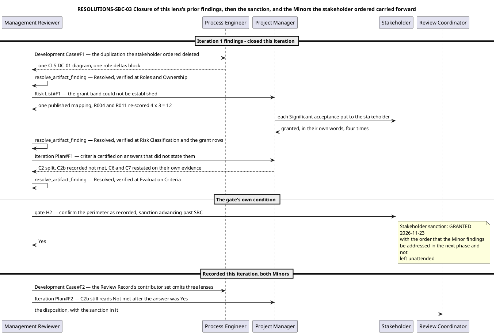

| Artifact | Finding | Severity | Owner | Status | What closed it, and where it was verified |
|---|---|---|---|---|---|
| Development Case | F1 | Minor | Process Engineer | Resolved | "Roles and Ownership" carries one CLS-DC-01 diagram and one role-deltas block listing the two inactive roles; the duplicate of each is gone, as the stakeholder ordered on 2026-11-23. Verified against the section, and against "Tool and configuration references" for the version-policy claim the technical lens removed. |
| Risk List | F1 | Major | Project Manager | Resolved | "Risk Classification" publishes one word-to-score mapping and all 21 anomaly-derived rows reproduce from it; R004 and R011 read 4 × 3 = 12, Significant; the four Significant-band acceptances each carry the stakeholder's own answer and the other ten Significant-band risks avoid. The gate condition is now establishable and reproducible. |
| Iteration Plan | F1 | Major | Project Manager | Resolved | "Evaluation Criteria" splits C2 into C2a (met, the three answers quoted) and C2b (recorded not met against the 2026-11-23 refusal), cites the self-reproducing coverage figure for C6, and splits C7 into carriage and reproducibility, both met on the artifacts they cite. No answer is recorded as a confirmation it does not contain. |
| Development Case | F2 | Minor | Process Engineer | Open | The co-owned-artifact sentence and the CLS-DC-01 diagram must name Management Reviewer, Business Reviewer and Review Coordinator among the lenses that write into the Review Record. |
| Iteration Plan | F2 | Minor | Project Manager | Open | C2b is still "Not met" on the 2026-11-23 refusal; it is met on the answer gate H2 returned, so the state and its evidence cell are restated. |

**The stakeholder's order, carried forward.** Answering the sanction question on 2026-11-23 the stakeholder said: "Yes, let's move on to the next phase. Minor findings should also be addressed during the next phase—let's not leave them unattended." That order governs the four open Minors across the four artifacts under review: `Development Case#F2` and `Iteration Plan#F2` from this lens, and `System Inventory#F3` and `Iteration Plan#F3` from the technical lens. `Iteration Plan` carries two of the four, one from each lens, both the Project Manager's to correct.

**Outstanding actions, with their owners.** These are the Process Engineer's and the Project Manager's next-phase corrections. None holds an exit criterion, none blocks a downstream role, and the four artifacts are approved from this lens on them.

**No change request is opened for any of them.** The Change Control Manager does not work in the sprint zero — no ledger exists and no CR is opened before Inception — so the order reaches its owners through the Work Order and through these ledger entries, which is the route the sprint zero provides. Nothing in this iteration orders a change to declared scope.

**What reopens this gate.** Nothing this lens found. The three Majors this iteration inherited are closed and verified; no Major and no Critical remains open from either executed lens; the gate's own condition is answered Yes.

### Review Coordinator lens
<!-- review: Survey I2 -->

<!-- review: Survey I2 -->

**Closed this milestone — ten findings, each by the lens that recorded it, each verified against the artifact section it names.** Closure is a lens's act: a correction stated in an owner's narrative does not close a finding; the recording lens's `resolve_artifact_finding`, called after it re-read the corrected section, does.

| Artifact | Key | Lens | Owner | Closed against |
|---|---|---|---|---|
| Development Case | F1 | Reviewer | Process Engineer | "Tool and configuration references" — no policy asserted, only the pinning files cited, checked against `global.json` and `nuget.config` |
| Development Case | F2 | Reviewer | Process Engineer | "Roles and Ownership" — one CLS-DC-01 diagram, one role-deltas block |
| Development Case | F1 | Management Reviewer | Process Engineer | The same section, verified by this lens against the stakeholder's order of 2026-11-23 |
| System Inventory | F1 | Reviewer | Software Archaeologist | "Traceability" — the AN-021 row against the Anomalies diagram and the registered edges |
| System Inventory | F2 | Reviewer | Software Archaeologist | "Coverage" — the headline recomputed from the per-area table, 79 + 54 = 133 |
| Risk List | F1 | Reviewer | Project Manager | "Risk Classification" and the register's P/I/exposure columns for all 22 rows |
| Risk List | F1 | Management Reviewer | Project Manager | The grant-band table and the four acceptance rows, each carrying the stakeholder's answer |
| Iteration Plan | F1 | Reviewer | Project Manager | "Use Cases and Scenarios Addressed" — twelve anomalies, 21 edges, against the System Inventory |
| Iteration Plan | F2 | Reviewer | Project Manager | The coarse roadmap and the fine-plan critical chain |
| Iteration Plan | F1 | Management Reviewer | Project Manager | "Evaluation Criteria" — C2a/C2b, C6, C7a/C7b |

**Actions carried into Excavation — four, one per open finding, ordered as in Findings.** Each is the remediation its recording lens wrote; none is the coordinator's own instruction of what the defect should be. No deadline column states a calendar date: the sprint zero declares no date beyond the one on this work order, and a projected date computed from an estimate would read downstream as an observation.

| # | Action | Artifact | Owner | Closes | Due |
|---|---|---|---|---|---|
| 1 | Restate C2b as Met — 2026-11-23 and replace its evidence cell with the answer as given: the stakeholder confirmed the four-process perimeter as the System Inventory records it and sanctioned advancing past SBC into Excavation | Iteration Plan | Project Manager | Iteration Plan#F2 (Management Reviewer) | Excavation iteration 1, first turn |
| 2 | Set rows 4 and 5 of the fine plan to Complete with what closed each, row 6 to In progress until the lens returns — or delete the State column and leave progress to the Iteration Assessment | Iteration Plan | Project Manager | Iteration Plan#F3 (Reviewer) | Excavation iteration 1, first turn, with action 1 |
| 3 | Name every lens that writes into the Review Record in the co-owned-artifact sentence — Reviewer, Management Reviewer, Business Reviewer, Review Coordinator, Code Reviewer, plus the Configuration Manager's baseline record — and draw the corresponding edges in CLS-DC-01 | Development Case | Process Engineer | Development Case#F2 (Management Reviewer) | Excavation iteration 1 |
| 4 | Set the Document Control iteration field to the iteration the content belongs to, matching the three other artifacts under review | System Inventory | Software Archaeologist | System Inventory#F3 (Reviewer) | Excavation iteration 1 |

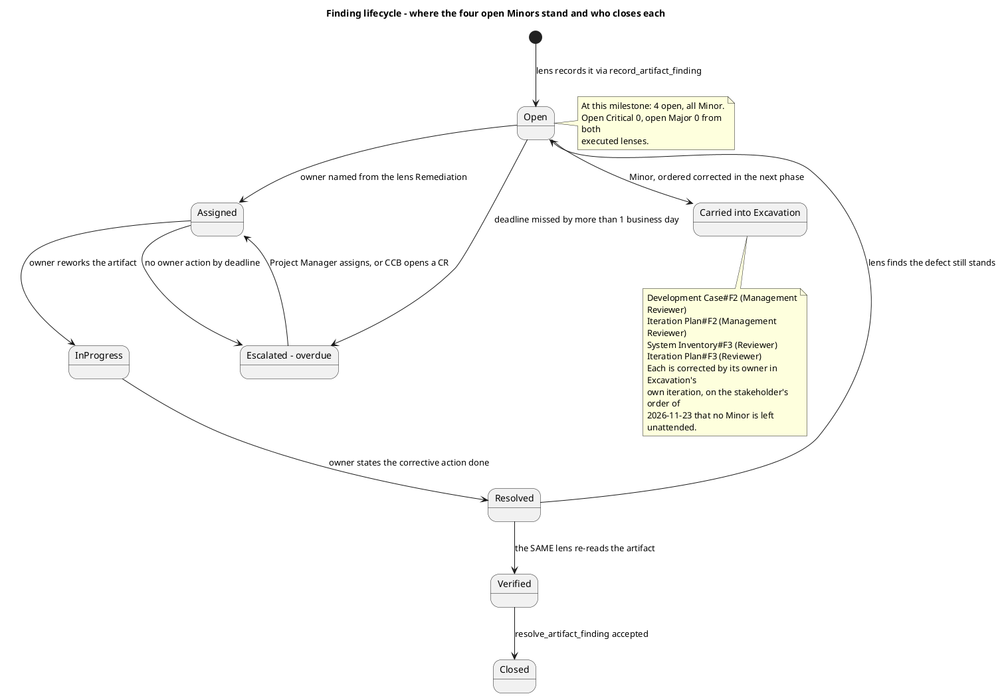

**Closure procedure.** Each of the four closes only when its recording lens re-reads the corrected artifact and calls `resolve_artifact_finding` on that key. Two of the four sit on the Iteration Plan under different lenses: `Iteration Plan#F2` is the Management Reviewer's to close and `Iteration Plan#F3` the Reviewer's, and one Project Manager turn satisfies both subjects. A finding still open at the AR milestone becomes a Major finding against the artifact carrying it — criterion `contained-defect`.

**Escalation channel.** A finding past its due point by more than one business day escalates to the Project Manager in writing, with the ledger entry as evidence. A defect that reappears across artifacts as a process failure escalates to the Configuration and Change Management Board. The coordinator surfaces these; it does not correct them.

**No change request is opened for any of the four.** The Change Control Manager does not work in the sprint zero — no ledger exists and no CR is opened before Inception. The stakeholder's order reaches its owners through this record and through their Work Order, which is the route the sprint zero provides. Nothing in this iteration orders a change to declared scope.

**The stakeholder's order, recorded and acted on.** Answering gate H2 on 2026-11-23: "Yes, let's move on to the next phase. Minor findings should also be addressed during the next phase—let's not leave them unattended." It is folded in as `Stakeholder finding` — verified against the ledger rather than deferred: the four open Minors are exactly the items the order names, all four are assigned with an owner and a due point in Excavation's first iteration, and none is recorded as closed or deferred. No new defect is minted for the order, because every item it names is already in the ledger. The first half of the answer is the sanction, recorded in Disposition.

## Disposition
### Reviewer lens
<!-- review: Survey I2 -->

<!-- review: Survey I2 -->

**Disposition of the technical lens: Approved with Changes.**

Every Major the lens recorded in iteration 1 is closed against the corrected artifact, and each closure is backed by the artifact section plus, where a repository claim was involved, by the file that states it. What remains open from this lens is two Minors, both status metadata — the System Inventory's Document Control iteration field and the Iteration Plan's fine-plan State column. Neither is consumed by a downstream role and neither carries an exit criterion, so neither holds the milestone, and the four artifacts are approved from this lens by default on those two points.

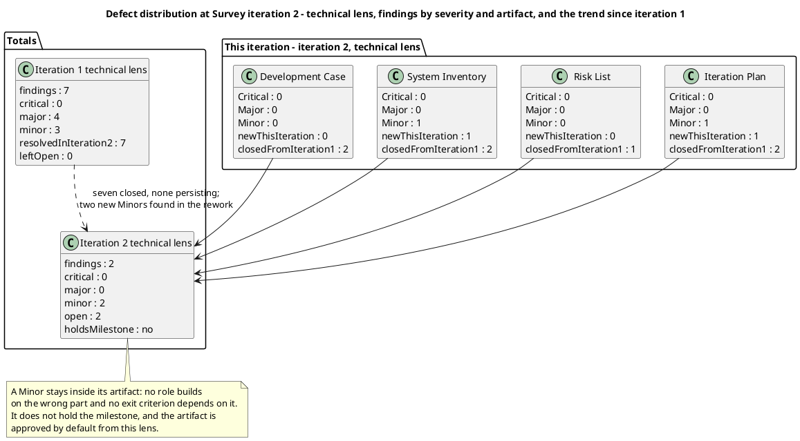

| Artifact | Critical | Major | Minor | Info | Disposition from this lens |
|---|---|---|---|---|---|
| Development Case | 0 | 0 | 0 | 0 | Approved |
| System Inventory | 0 | 0 | 1 | 0 | Approved with Changes — the Document Control iteration field |
| Risk List | 0 | 0 | 0 | 0 | Approved |
| Iteration Plan | 0 | 0 | 1 | 0 | Approved with Changes — the fine-plan State column |

**What this lens found, and what it did not.** The rework resolved every Major; no Major persists and no new one was introduced. The two defects it left behind are both the same class — a status field stating an earlier state than the content it sits beside — which is a consequence of reworking artifacts whose metadata was not touched, not a defect of the rework's substance. No anchor opened this iteration contradicted the artifact citing it: the version-policy claim now rests on `global.json` and `nuget.config` as written, the contribution contract on `docs/CONTRIBUTING.md`, the coverage figure on its own per-area table, and every risk score on one published mapping.

**SCM evidence.** No open pull request, so nothing is disposed and no code-review decision is owed. `ci.yml` does not exist on `main`, so no build exists to be red — establishing the pipeline is the Integrator's Inception work item, not a Survey defect.

**What this lens does not decide.** The SBC milestone is not this lens's verdict. It turns on gate H2 — the stakeholder's confirmation of the perimeter as the System Inventory records it and the sanction to advance — which was refused on 2026-11-23 and is re-taken after this review. The technical lens has no authority over that answer: the artifacts are now certifiable on their evidence, and whether the perimeter is confirmed is the stakeholder's to say.

### Management Reviewer lens
<!-- review: Survey I2 -->

**Disposition from the management lens: Go.**

That is a verdict on the artifacts, and it is the one they have earned. The three Majors this lens recorded in iteration 1 are closed and verified against the corrected sections, not against the owners' assurances: the grant band can now be derived from scores that reproduce, the exit criteria are certified on evidence the artifact each cites actually records, and the duplication the stakeholder ordered deleted is gone. No Major and no Critical finding is open from either executed lens. Every row of the criteria table is met — nine on the reading, the register and the plan, and three on the stakeholder's own answers of 2026-11-23, the last of them in this review.

**Stakeholder sanction: GRANTED** — 2026-11-23.

**Stakeholder acceptance:** "Yes" — asked whether they confirm the perimeter of the existing system as the System Inventory records it — four processes, 22 entry points, 21 anomalies each anchored, eight priority areas with nothing left out — and sanction advancing past the System Boundary Confirmed milestone into Excavation. With the instruction: "Yes, let's move on to the next phase. Minor findings should also be addressed during the next phase—let's not leave them unattended."

**C2b is closed on the stakeholder's answer.** The criterion this lens recorded as not met at 2026-11-23 is now met, on the same day and in the stakeholder's own words, and it is met by their answer and not by an inference of any reviewer's. The perimeter as the System Inventory records it stands confirmed, and the sanction to advance stands granted. Recording that answer is not this lens's verdict on the milestone: the milestone verdict is the Review Coordinator's to take on this disposition.

**The open Minors carry into Excavation, by the stakeholder's order.** Four Minors stand open across the four artifacts and the next phase closes them: `Development Case#F2` (the co-owned-artifact sentence omits the Management Reviewer, Business Reviewer and Review Coordinator lenses) and `Iteration Plan#F2` (C2b still reads "Not met" after the answer was Yes) from this lens, and the technical lens's `System Inventory#F3` and `Iteration Plan#F3`. Each has an owner who corrects it in the next phase's own iteration, and none is left to wait on the owner's convenience.

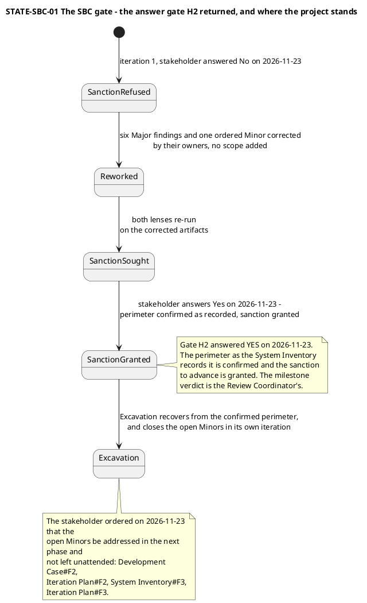

| Axis | State | Basis |
|---|---|---|
| Scope | Green | Nothing declared is worked in the sprint zero, correctly. The perimeter holds four processes, 22 entry points and eight ordered priorities, and the 54 unread files are each named with the reason it was not read and none carries a perimeter fact. |
| Schedule | Green | The gate's own condition is answered: the sanction is granted and the perimeter confirmed, both on 2026-11-23. The second iteration was spent on the rework the stakeholder ordered and it closed every Major that rework named. No forecast is stated, because no phase has closed. |
| Cost | Not measured | No budget is declared, so none is set. Tokens and elapsed time are the two measured quantities and neither figure is filled where nothing has been measured. This axis carries no reading, and a green here would be an invention. |
| Quality | Green | Every criterion row met — nine on artifact evidence, three on the stakeholder's own words. No Critical and no Major open from either lens. Four Minors open, each ordered corrected in the next phase, none of them holding anything. |

**Why the verdict is Go rather than Conditional.** A Conditional Go would name conditions the project team must satisfy before the next gate, and no Major stands for one to be built on. The open Minors are ordered corrected in the next phase and are recorded as the owners' work there, not as a condition on this sanction: the stakeholder granted the sanction with them open and told the team to address them onward. The register is honest that SBC retires no risk — the reading makes the risks owned, and the actions that retire them are Excavation's and later.

**What Excavation inherits from this gate.** A perimeter the stakeholder has confirmed in this review; a constraint list of twelve entry-point-bearing anomalies with the 21 edges the System Inventory records, the nine anomalies with no entry point carried through the Risk List; a register whose every score reproduces and whose four acceptances above the Moderate band each hold the stakeholder's own answer; a plan that names no work the process does not run in Survey; and the order to close the open Minors rather than leave them unattended.

### Review Coordinator lens
<!-- review: Survey I2 -->

<!-- review: Survey I2 -->

**Verdict: Go.** The System Boundary Confirmed milestone is **achieved**, and the phase advances into Excavation on this baseline.

**Basis, copied from the finding data — not from judgment.**

`[FINDINGS] read=Development Case, System Inventory, Risk List, Iteration Plan, Iteration Assessment, Review Record, unread=none, open Critical=0, open Major=0, open Minor=4`

| Gate condition | Actual |
|---|---|
| Artifacts read from the ledger | 6 of the 6 artifacts that exist — unread: none |
| Open Critical | 0 |
| Open Major | 0 |
| Open Minor | 4 |
| Perimeter confirmed by the stakeholder | Yes — 2026-11-23 |
| Stakeholder sanction | GRANTED — 2026-11-23 |
| Lenses executed | 2 of 3 — Business Reviewer INACTIVE by process schedule |
| Milestone verdict | requiresIteration: false |

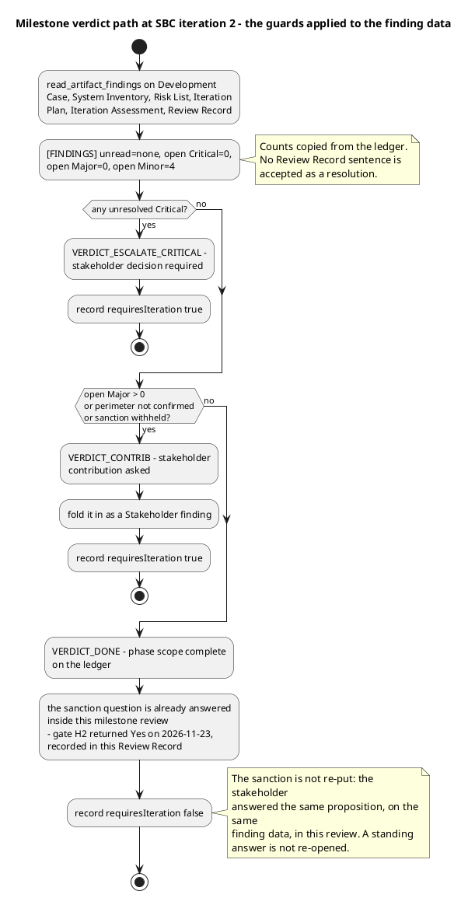

The third branch is the one taken: 0 open Critical, 0 open Major, the perimeter confirmed and the sanction granted. The first two branches are unreachable on this ledger.

**Why the sanction is not put to the stakeholder a second time.** The same proposition — confirm the perimeter as the System Inventory records it, and sanction advancing past SBC — was asked inside this milestone review and answered **Yes** on 2026-11-23, with the added instruction that the open Minors be addressed in Excavation. It was asked on exactly this finding data: 0 Critical, 0 Major, the four Minors, the Business Reviewer INACTIVE. Asking it again in the same review would re-open an answer already given, and the answer would be the same. The answer is on record in the management lens's Disposition and in the table above; it is not restated as a new question.

**Stakeholder finding folded in.** "Yes, let's move on to the next phase. Minor findings should also be addressed during the next phase—let's not leave them unattended." Verified against the ledger rather than deferred: the four open Minors are exactly the four items the order names, all four carry an owner and a due point in Excavation's first iteration (Resolutions and Actions, actions 1 to 4), and none is left without one. No new defect is minted for the order, because every item it names is already in the ledger and the order reaches its owners through this record.

**Review effectiveness — this event, measured values only.** Two iterations of the SBC review have run; the counts below span both. No trend in effort, cost or velocity is claimed: no phase has closed, so neither clock has a closed-phase measurement to compare against, and this report states current values only.

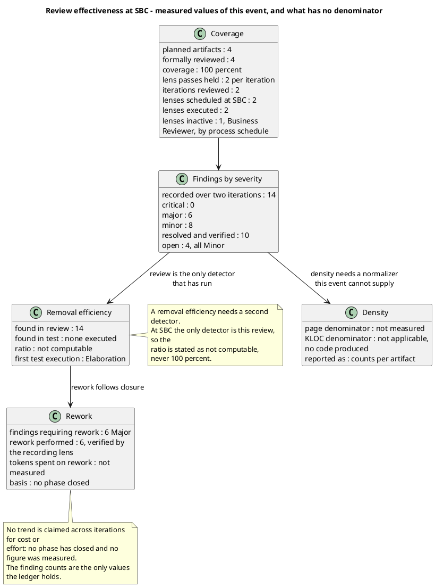

**Interpretation.**

- **Coverage is complete, and that is a reading rather than a compliment.** Four artifacts were scheduled for this review and four were formally reviewed by both lenses the SBC schedule runs, over two iterations. Coverage carries no denominator for code: this phase produces no code.
- **Defect density is reported as counts per artifact, with no page or KLOC denominator.** Page counts are not measured for these artifacts and code volume is zero in Survey. Inventing a normalizer would produce a figure no reader could reproduce — the same class of defect this review recorded against the Risk List's scores.
- **Major findings outnumbered Minors six to eight across the two iterations, and all six Majors sat where a downstream role would build on wrong content:** a version policy no file records, a trace edge missing from a table, thirteen scores contradicting the inventory they cite, five constraints dropped from a handoff, and three exit criteria certified on answers that did not state them. Every one is closed against the corrected section.
- **Defect removal efficiency is not computable at this event** and is not stated as 100 percent. The only defect detector that has run is this review; the ratio needs a second detector, and the first test execution is Elaboration.
- **Rework effort has no measured figure because no phase has closed.** The rework itself is verifiable — six Majors reworked and each closure verified by its recording lens — but the tokens and elapsed time it cost are not measured, and no figure is filled in their place.
- **Both executed lenses were matched to their artifact domain** — Environment, Discovery and Project Management artifacts read by the technical and management lenses. The Business Reviewer's absence is the Survey schedule and is recorded as INACTIVE, never as an approval.

**Iteration acceptance, kept apart from the milestone verdict.** All six of the iteration's objectives are delivered: the tailoring exists, the system is read and its perimeter stated, the unread remainder declared, the anomalies carried as scored and owned risks, the priorities ordered with the stakeholder's answers recorded, and the plan for the sprint zero and the phases exists. That is the Iteration Assessment's question and it is answered in its own artifact. What this record answers is narrower and is the one the phase turns on: whether the four artifacts can be certified to Excavation, and they can.

**What Excavation inherits from this gate.**
- A perimeter the stakeholder has confirmed in this review — four processes, 22 entry points, 21 anomalies each anchored, eight priority areas with nothing left out.
- A constraint list of twelve entry-point-bearing anomalies carrying the 21 edges the System Inventory records, with the nine anomalies that carry no entry point traced through the Risk List.
- A register whose every score reproduces from one published mapping, and whose four acceptances in the Significant band each hold the stakeholder's own answer.
- A plan that names no work the process does not run in Survey, whose evidence column is the artifact the next milestone's verdict will read.
- Four open Minors with owners and due points, ordered closed rather than left unattended.
