## Document Control
### Reviewer lens
<!-- review: Consolidation I2 -->

- Phase: Consolidation
- Status: Draft — the GHR technical lens, taken before the milestone verdict; 0 Critical, 1 Major, 0 Minor open from this lens
- Milestone Target: end-of-Consolidation (GHR) — not yet achieved
- Iteration: 2, Cycle 1
- Review point: Lifecycle Milestone Review, exit-criteria lens
- Review type: formal inspection against checklist
- Reviewer: Reviewer
- Artifacts reviewed: 12 of 12
- Prior findings of this lens: 5 open at the start of this turn, 5 closed this turn, 0 re-recorded
- Disposition: Approved with Changes

### Management Reviewer lens
<!-- review: Consolidation I2 -->

<!-- review: Consolidation I2 -->

- Phase: Consolidation
- Status: Draft — the GHR management lens; gate H5 put a second time and **refused**; 0 Critical, 1 Major, 0 Minor open from this lens
- Milestone Target: end-of-Consolidation (GHR) — not achieved at this put
- Iteration: 2, Cycle 1
- Review point: Lifecycle Milestone Review — exit-criteria lens, re-taken after the first put was refused on 2026-11-23
- Review type: formal inspection against checklist, plus the Project Approval question put to the stakeholder
- Reviewer: Management Reviewer
- Artifacts reviewed: 12 of 12 present; 10 read at source this turn, 2 declared out of scope for the reasons stated in Disposition
- Prior findings of this lens: 4 open at the start of this turn — 3 Major and 1 Minor, all resolved
- New findings recorded this turn: 1 Major (`Risk List#F5`)
- Stakeholder sanction: REFUSED — gate H5, second put, 2026-11-23
- Verdict: No-Go at this put

### Review Coordinator lens
<!-- review: Consolidation I2 -->

- Phase: Consolidation
- Status: Draft — the GHR milestone consolidation; 0 Critical, 2 Major, 0 Minor open from the lenses that executed
- Milestone Target: end-of-Consolidation (GHR) — not yet achieved
- Iteration: 2, Cycle 1
- Owner: Review Coordinator
- Review event: GHR — Greenfield Handoff Ready; gate H5 put a second time, 2026-11-23
- Review type: milestone review at phase exit; the iteration's Evaluation Criteria Review and Acceptance Review are folded into it, because the iteration and the phase close on one boundary in the sprint zero
- Lenses executed: Reviewer (technical), ManagementReviewer (management)
- Lens inactive: BusinessReviewer — did not evaluate this review
- Stakeholder sanction: REFUSED — gate H5, second put, 2026-11-23
- Verdict: phase scope incomplete — Consolidation iteration 3 required, gate H5 re-put there

## Review Scope and Criteria
### Reviewer lens
<!-- review: Consolidation I2 -->

The GHR asks one question: do the artifacts collectively satisfy the conditions for the set to be handed forward as the starting point of the declared change. This lens answers it on the technical artifacts — is every element anchored to the code it cites, does every trace the set declares hold in the graph, and does the set agree with itself. It does not ask whether the stakeholder accepts the set; that is gate H5's question and the Management Reviewer's to put.

#### Checklist applied

| # | Checklist item | Applied to | Where it is decided |
|---|---|---|---|
| C1 | Every artifact of the recovered set is present at this phase and iteration | All 12 | Every artifact's Document Control names Phase Consolidation, Iteration 2, Cycle 1 |
| C2 | Every declared element cites the anchor it was read from — a file and lines, or `Source: EP-NNN` for a recovered use case | Use-Case Model, SAD, Design Model, Supplementary Specification | Sampled at the code: the OpenAPI gating in `Todo.Api/Program.cs`, the eight tables against their migrations, the rate-limit override against `appsettings.Development.json` |
| C3 | Every trace edge the artifact's Traceability table declares is carried by the registered graph, unmarked | Use-Case Model, SAD, Design Model, System Inventory | `model_query_traces` at each end of every edge this review turned on; `model_generate_rtm` over the whole project |
| C4 | No suspect trace is open at the phase close | Design Model | Four edges queried this turn — `CLS-001` → `TBL-001`, `CLS-007` → `TBL-002`, `CLS-020` → `UC-007`, `CLS-020` → `UC-010` — all returned unmarked. Pass |
| C5 | No cross-cutting technical mechanism is modelled as a use case; one declared process is one use case with several scenarios | Use-Case Model, Vision | Eleven use cases; `EP-020`/`EP-021`/`EP-022` drawn as components PM1 and PM2, not use-case ellipses; the `admin` branch an exclusion with its stated reason |
| C6 | The Development Case does not redefine the baseline: roster, CORE ownership, CORE omission, the CORE + OPTIONAL universe, use-case enumeration | Development Case | Deltas only; two roles inactive with the triggers that justify each; six optional verdicts re-evaluated; Project Management named in every ACT-DC-01 partition |
| C7 | Every OPTIONAL artifact the Development Case declares fired has its §5.2 condition genuinely holding | Development Case, Deployment Model | Deployment Model: distributed topology, four processes, a proxy hop, per-project settings pairs — the condition holds |
| C8 | No artifact states a behaviour the code contradicts | Supplementary Specification, SAD, Deployment Model, Vision, Design Model | S8, S18 and `F13` now state the gating on the same anchors as SAD `M12` and the Deployment Model's Environment Mapping. Pass |
| C9 | Every target value in the Supplementary Specification is a value the system has, not a value it is meant to have | Supplementary Specification | Both rate-limit budgets stated under `AN-024`; `R4` states the two hops apart under `AN-023` |
| C10 | The System Inventory's coverage is counted at the bar, over a denominator it names, with every unread area carrying its reason | System Inventory, Iteration Plan | 84 of the delivery's own 94 files, 89.4 per cent, against the 80 per cent bar; raw 84 of 139 stated beside it; all 10 unopened own-tree files named. Pass |
| C11 | A value or a count with no anchor and no stakeholder answer behind it | All 12 | None found; the four accepted grants cite the stakeholder's answers, and no quantitative claim is unsourced |
| C12 | No work item in the plan belongs to a phase that does not run it | Iteration Plan | Every item sits in Environment, Requirements, Analysis & Design, Discovery, Project Management, the lenses, the gate or the verdict |
| C13 | Every artifact carries UML, and each diagram is formally well-formed | All 12 | Every artifact carries at least one validated diagram; stereotypes, multiplicities and object lifelines are used as the notation requires |
| C14 | The set agrees with itself — no two artifacts state one fact with two answers | Whole set | One disagreement remains → `Risk List#F4`. The environment gating is settled across the four artifacts that carry it, and the trace clearance is stated identically in the Design Model and the graph |

#### The prior findings of this lens, reconciled

| Finding | Severity | Resolution | What closed it |
|---|---|---|---|
| `Design Model#F2` | Major | Resolved | All four edges cleared in the graph; the model states the reading that keeps each |
| `Supplementary Specification#F4` | Major | Resolved | S8 and S18 separate the gated surfaces from the unconditionally mapped OpenAPI document |
| `System Inventory#F4` | Major | Resolved | Coverage stated at 84 of 94 own-tree files, 89.4 per cent, with the raw 60.4 per cent beside it and its denominator named |
| `Vision#F2` | Minor | Resolved | The Constraints row and diagram split the gated surfaces from the ungated ones |
| `Software Architecture Document#F2` | Minor | Resolved | The Deployment View counts two environment differences and reconciles the count with the Deployment Model by name |

None was re-recorded: each defect is fixed in the artifact that carried it, verified there and not on the artifact's word.

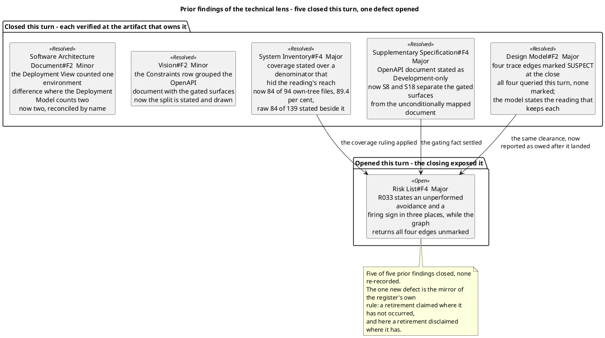

#### Scope of this lens, stated so it is not mistaken for the whole review

This lens reads the artifacts. It does not read the plan's schedule against a calendar, the register's strategy choices against the Project Manager's authority, or the recovered set against what the stakeholder wants — those are the Management Reviewer's and the gate's. Where this lens records a Major, it is because another role builds on the defect or an exit criterion fails, not because a document reads badly.

#### SCM state, read at this turn

No pull request exists in the repository, in any state — the sprint zero writes artifacts, not code, and the Implementation Model is the delivery's own tree, unchanged since `307a1ea`. There is therefore nothing to approve, nothing to request changes on, and no branch whose scope must be deferred out of this phase. The repository carries no IARI pipeline (`ci.yml` does not exist), so there is no build status to report for `main` and this lens claims none — no build was made and none is green or red. Neither absence is a finding: the sprint zero produces no code, and no role in this phase is charged with establishing a build.

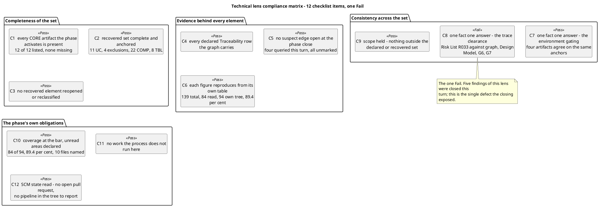

### Management Reviewer lens
<!-- review: Consolidation I2 -->

<!-- review: Consolidation I2 -->

This lens decides whether the organization may hand the recovered set forward as the starting point of the declared change. It asks the exit-criteria question, not the completion question: are the eight GHR criteria true on the artifact each cites, is every High-band exposure accounted for on the register, and does the stakeholder accept the set.

#### Checklist applied

| # | Checklist item | Applied to | Where it is decided |
|---|---|---|---|
| M1 | Every artifact the phase activates is present and its Document Control names this iteration | All 12 | Each names Phase Consolidation, Iteration 2, Cycle 1 |
| M2 | Every GHR exit criterion is true on the artifact its evidence cell cites, read at that artifact and not on the plan's word | Iteration Plan `G1` to `G8` | Criteria table below; `G4` recomputed from the System Inventory's per-area table, `G3` and `G6` from the Specification and the register |
| M3 | The stakeholder accepts the complete set as the starting point of the declared change | gate H5 | Put a second time on 2026-11-23 and **refused**; the answer and the order it carried are recorded in Disposition |
| M4 | No risk in the High or Significant band is accepted on the Project Manager's authority | Risk List, grants table | Four accepts at 4 × 3 = 12, each quoting the stakeholder's own answer; `R015` and `R022` accepted at Moderate 8, which is this role's authority |
| M5 | Every risk's magnitude reproduces from its own stated probability and impact, on the one published scale | Risk List | All 34 rows recomputed; `R031` and `R033` both read 5 × 4 = 20 with the basis each row states |
| M6 | A risk recorded as retired has had its retirement act performed, and a risk whose act was performed is not recorded as owed | Risk List | One row fails — `R033` → `Risk List#F5` |
| M7 | The plan is sized in the currencies the process measures, with the two clocks apart, no token box the project did not declare, and no declared scope cut to fit an estimate | Iteration Plan, measured actuals | Phase-level tokens, agent time and stakeholder queue reported apart; no per-iteration velocity; no projected date; no declared work cut |
| M8 | Every work item belongs to a stage the IARI process runs in Consolidation | Iteration Plan fine plan | Fifteen items in Environment, Requirements, Analysis & Design, Discovery, Project Management, the three lenses, the gate and the verdict |
| M9 | The Development Case does not redefine the baseline: roster, CORE ownership, CORE omission, the CORE + OPTIONAL universe, use-case enumeration | Development Case | Deltas only; two roles inactive with their triggers; six optional verdicts |
| M10 | Every OPTIONAL artifact the Development Case declares fired has its §5.2 condition genuinely holding | Development Case, Deployment Model | One fired — Deployment Model, on a four-process topology with a proxy hop and a per-project settings pair. Holds |
| M11 | No quantitative claim is unsourced and no figure is fabricated | All 12 | The four grants cite the stakeholder's answers; coverage reproduces from its own table; every spend figure is a measured actual of a closed phase |
| M12 | A conditional verdict issued at a prior milestone has its conditions verified resolved before the next verdict | Gate H4's fourth put, gate H5's two puts | Both checked — criterion table below and the prior-findings reconciliation |
| M13 | The plan and the record agree with the artifacts they describe: no cell states as present fact a state its own artifact has superseded | Iteration Plan, Risk List | Four of five prior Majors of this kind closed and verified; one instance remains, recorded in the register rather than the plan |

#### The eight GHR criteria, each read at the artifact it cites

| Criterion | State on the evidence read this turn | What was read |
|---|---|---|
| `G1` set present and anchored | Met | Every artifact's Document Control names this phase; `UC-001` to `UC-011` with four exclusions, `COMP-001` to `COMP-022`, `TBL-001` to `TBL-008` |
| `G2` stakeholder accepts the set | **Not met — refused at the second put, 2026-11-23** | No Yes exists. The answer and the order it carried are recorded in Disposition |
| `G3` no recovered element reopened or contradicted | Met | Both causes the plan names are settled at their artifacts: the four cleared edges, and the OpenAPI gating now stated identically in the Specification's S8, S18 and F13, SAD `M12` and the Deployment Model |
| `G4` coverage counted over the delivery's own tree, at 80 per cent or more | Met | System Inventory, Coverage: 84 of 94 own-tree files opened, 89.4 per cent; 67 anchored, 71.3 per cent; 10 own-tree files unopened, each named; raw 84 of 139 stated beside it as not the figure measured on |
| `G5` every incomplete reading named | Met | The model snapshot's product version, carried as `R034` with an owner and an action performed |
| `G6` every anomaly scored, no accept above Moderate without a grant | Met on the criterion's own terms | 29 `Refines` edges, four grants at exposure 12, no authority-band accept. The criterion is now decided on the act performed |
| `G7` no suspect trace open at the close | Met | I queried three ends this turn: `CLS-001` → `TBL-001`, `CLS-007` → `TBL-002`, `CLS-020` → `UC-007` and `UC-010`. None carries a marking |
| `G8` no work the process does not run here | Met | Fifteen fine-plan items, each in a stage Consolidation runs |

`G6` and `G7` are true on the acts their owners performed. They are *read on* the register, and the register contradicts them — which is `Risk List#F5`, a defect of the register and not of the criteria.

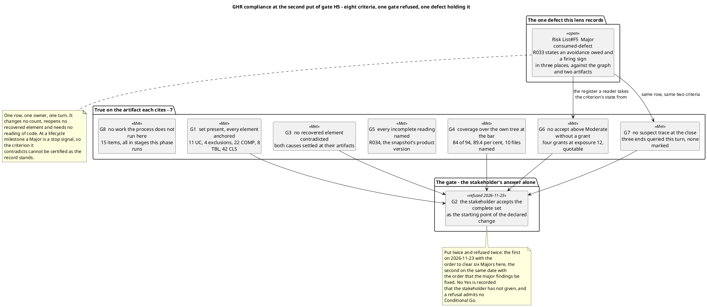

#### Prior findings of this lens, reconciled

| Finding | Severity | Resolution | What closed it, verified at the source |
|---|---|---|---|
| `Risk List#F4` | Minor | Resolved | `R033` now reads 5 × 4 = 20 and `R031` the same, each stating the basis its evidence gives; the register publishes the rule above its tables instead of applying it to the inventory alone |
| `Iteration Plan#F11` | Major | Resolved | `G4` carries the 80 per cent threshold in its own text and states both ratios — 84 of 94 own-tree (89.4 per cent) and raw 84 of 139 (60.4 per cent) — against the System Inventory's identical figures |
| `Iteration Plan#F12` | Major | Resolved | `G3`'s evidence cell names both causes and both are settled: the four cleared edges, and the OpenAPI gating now identical across the Specification's S8, S18 and F13, SAD `M12` and the Deployment Model |
| `Iteration Plan#F13` | Major | Resolved | `G6`'s test now closes "decided on the action performed, never on the strategy word a cell carries", and its evidence records the act for both High-band rows |

None was re-recorded. Each defect is fixed in the artifact that carried it, and each fix was read there rather than taken from the owner's statement.

The four Major findings recorded by the technical lens at the first put are also verified closed at their own artifacts and are not this lens's to close: `System Inventory#F4`, `Supplementary Specification#F4`, `Design Model#F2` and the two Reviewer Minors on Vision and the Software Architecture Document.

#### Prior conditional verdicts, checked

The Excavation close issued no Conditional Go — the AR gate was refused three times and sanctioned at its fourth put on a clean record, so no condition from that milestone survives into this one. Gate H5's two puts issued no Conditional Go either: the stakeholder refused the advance both times, ordering at the first that the six Major findings be cleared here and at the second that the major findings be fixed. Neither condition is dropped silently; both are checked and neither exists.

#### Project health at this gate

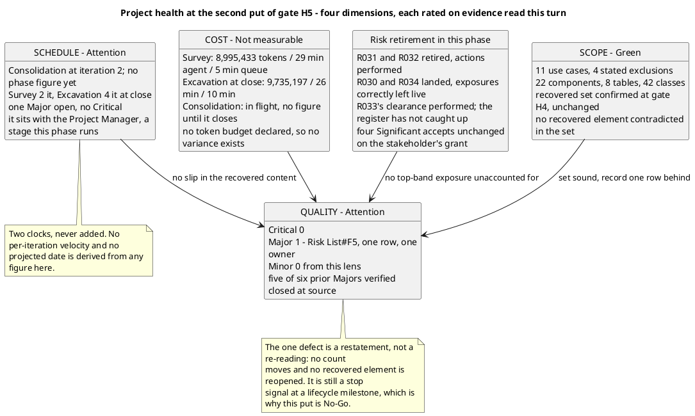

Scope is green: the recovered content is complete, anchored and unchanged, and this iteration reopened nothing. Quality is the dimension that is not green, and it is one row in one artifact. Schedule carries attention only as a consequence — the phase needs the turn it is in, and no work item of it belongs to a phase that does not run here. Cost is not measurable at this point and no figure is invented for it: no phase of Consolidation's shape has closed, the project declares no token budget, so there is no box and no variance.

#### Risk retirement in this phase, and the direction each row moved

Three exposures retired with their acts observed in the artifacts that carry them, two more with the retirement landed and the exposure correctly left live, and one whose act has been performed while its row still says it is owed.

- `R031` (5 × 4 = 20) — materialized twice; the contingency was taken and performed, the Environment stage ran, and the two Development Case Minors A11 counts are corrected.
- `R032` (4 × 3 = 12) — the avoidance is performed on all six citing artifacts, R6 among them under `AN-024`. Its residual was discharged at Excavation's close.
- `R030` (4 × 3 = 12) — retirement landed; the exposure stays live and the row says so, because `AN-012` stands and no test covers the surface. This is the register's rule applied correctly.
- `R034` (3 × 4 = 12) — the action is performed and the incompatibility is not corrected, which the row states, because the snapshot is the delivery's file and this process records the system as it is.
- `R033` (5 × 4 = 20) — the clearance is performed at both owners' ends and the graph returns three queried ends unmarked; the row, the section preamble and the diagram still state the opposite. `Risk List#F5`.

The trend is real and it is not a static register: it retired three exposures and took on one new High-band exposure this phase, which is the one now discharging. What it has not done is keep its own row current with the act its owner performed — the exact mirror of the fault the register's opening rule forbids in the other direction.

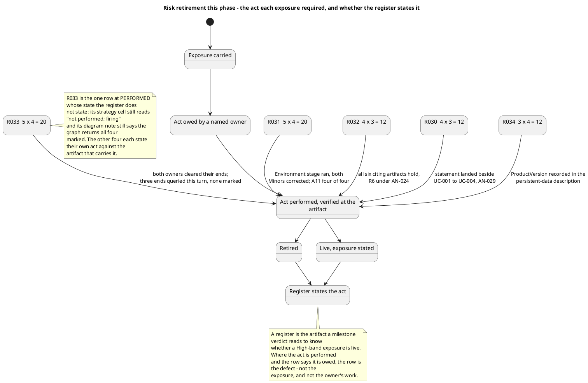

### Review Coordinator lens
<!-- review: Consolidation I2 -->

**Review type:** milestone review at phase exit — the Greenfield Handoff Ready (GHR) review, which sanctions or refuses the transition from Consolidation into Inception. Per decision heuristic 1 no other review substitutes for it, and a PRA Review would answer a different question. The Iteration Evaluation Criteria Review and the Iteration Acceptance Review for Consolidation iteration 2 are folded into it: in the sprint zero the iteration and the phase close on the same boundary, so a separate event for either would review the same artifacts against the same criteria on the same day.

**Trigger:** Consolidation iteration 2's corrective acts performed at the artifacts that owned them and the Iteration Plan's `G1` to `G8` written. Not a calendar date — the review moves with the iteration, and it opened only after the nine entries carried out of put 1 had been worked.

**Scope:** twelve artifacts read, every one of them. The eight CORE artifacts this phase produces, the System Inventory, and this record.

| Artifact | Owner | Why it is in scope at GHR | Read this put |
|---|---|---|---|
| Development Case | Process Engineer | The tailoring that governs every discipline's floor, and the ACT-DC-01 schedule the phase is planned from | Yes |
| System Inventory | Software Archaeologist | The coverage this phase exists to count | Yes |
| Risk List | Project Manager | The register the phase's exposures are carried on and the two criteria are read from | Yes |
| Iteration Plan | Project Manager | The criteria the GHR verdict is read on | Yes |
| Vision | System Analyst | The stakeholder-facing statement of the recovered set | Yes |
| Use-Case Model | System Analyst | The 11 use cases over 22 entry points, and the 4 stated exclusions | Yes |
| Supplementary Specification | System Analyst | The mechanisms the use cases include | Yes |
| Software Architecture Document | Software Architect | The 22-component architecture | Yes |
| Deployment Model | Software Architect | The fired optional trigger's artifact | Yes |
| Design Model | Designer | 42 classes, 8 tables, the edge set | Yes |
| Iteration Assessment | Project Manager | Not judged — its own entry below | No |
| Review Record | Reviewer / Management Reviewer / Review Coordinator | This record | Yes |

**Lens participation — authoritative, read from the record and not inferred from a verdict token.**

| Lens | Status | Entries this milestone | Open | What it contributes to the verdict |
|---|---|---|---|---|
| Technical / Reviewer | EXECUTED | 32 | 1 — `Risk List#F4`, Major | Twelve artifacts read; the artifact-level defect set across Requirements, Analysis & Design, Discovery, Environment and Project Management |
| Management / ManagementReviewer | EXECUTED | 21 | 1 — `Risk List#F5`, Major | Twelve artifacts read; the criteria-table defects the verdict is decided on, plus the gate H5 put and the stakeholder's answer |
| Business / BusinessReviewer | **INACTIVE — did not evaluate this review** | 0 | — | Nothing. Business Modeling is inactive for this project (`business-process-led = false`, Development Case). The lens is recorded as not having evaluated — not as Approved, not as a pass, and no part of the milestone decision is counted from it |
| Review Coordinator | Executing (this role) | — | — | The ledger, the cross-lens reconciliation, the action priorities, the calendar, the metrics and the verdict |

**Entry criteria — enforced before the review began.**

| Criterion | State at entry |
|---|---|
| The artifacts reviewed are in target state, not draft-for-review | Met — every artifact's Document Control names Phase Consolidation, Iteration 2, Cycle 1 |
| Reviewers assigned with matching expertise | Met — the recovered content to the technical lens, the tailoring, coverage and criteria to both executed lenses, the sanction question reserved to the stakeholder |
| Evaluation criteria distributed before the artifact set was read | Met — the Iteration Plan's `G1` to `G8` state them, with thresholds in their own text |
| The tailoring exists, is current and schedules the roles that worked | Met — Development Case made current for Consolidation; every corrective item's owner holds a stage this phase runs |
| The prior review's open entries were scheduled before this review opened | Met — nine entries, each with an owner and a stage, carried out of put 1 |

**Exit criteria — enforced before the verdict.**

| Criterion | State at the close |
|---|---|
| Every Critical and Major finding has an owner and a stage in this phase | Met — both open entries are one act belonging to the Project Manager, who works here |
| Every finding produced by this milestone carries an owner, a severity and a corrective action | Met — 53 entries, each with all three; 51 carry a resolution object |
| No review debt is overdue | Met — nothing carried out of put 1 missed a deadline; the open entries were recorded in this review's own turn |
| The Review Record is signed and committed | Met — this record, committed to the SCM repository |
| No open Critical at the milestone | Met — 0 |
| No open Major at the milestone | **Not met — 2 open keys, one defect.** This is why the milestone is not sanctioned |
| The stakeholder sanction is recorded | Met as recorded — gate H5 was put a second time and **REFUSED**; a refusal is a recorded answer and admits no Conditional Go |
| Coverage counted at the bar the milestone is reviewed against, over a named denominator | Met — 84 of the delivery's own 94 files, 89.4 per cent, against the 80 per cent bar, on the stakeholder's ruling of 2026-11-23 |

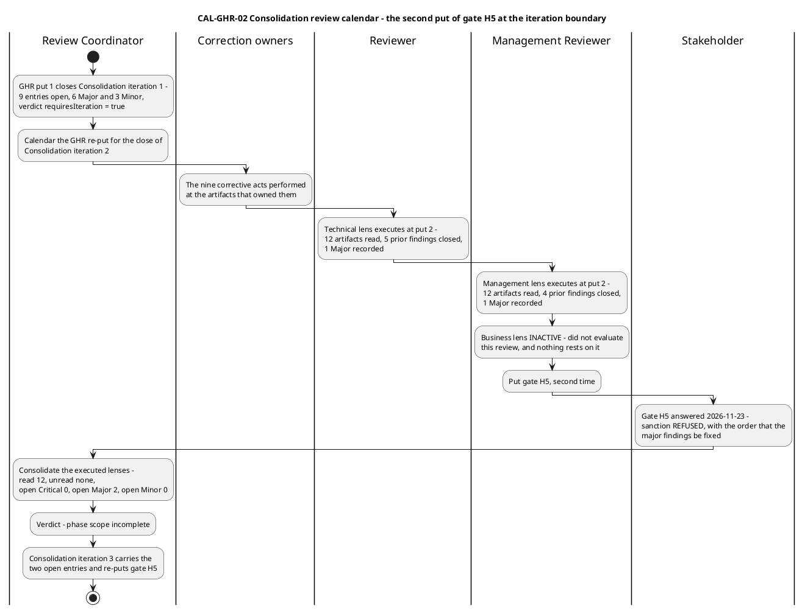

## Findings
### Reviewer lens
<!-- review: Consolidation I2 -->

One finding is open from this lens at this put. Eleven of the twelve artifacts carry no defect this lens can record.

#### Risk List

##### `Risk List#F4` — Major — `consumed-defect`

`R033` is recorded as an unperformed avoidance on a warning sign that is firing, in three places of one artifact, while the graph returns all four of its edges unmarked and two other artifacts certify the clearance performed.

**The three places.** The strategy cell reads "Avoid — **not performed; firing**", closing "The reasoning is written in the Design Model; the clearance itself has not been performed on any of the four. Neither the Project Manager nor the other lens may clear an edge it does not own." The section preamble reads "`R033`, whose warning sign is firing on all four edges now." The diagram beside the table carries the note "the reasoning is written in the Design Model; the clearance is not — it is each owner's act and neither is performed" and "the graph returns all four still marked. This risk is firing."

**What the three contradict.** The registered graph, queried in this turn at each of the four ends: `CLS-001 → TBL-001` (`Specifies`), `CLS-007 → TBL-002` (`Specifies`), `CLS-020 → UC-007` and `CLS-020 → UC-010` (`Realizes`) — all four returned with no SUSPECT marking. The Design Model's Traceability section states the reading that keeps each edge and no longer reports the markings, which is what `Design Model#F2` asked for and what this lens closed on that query. The Iteration Plan's `G7` reads "In this turn the graph was queried again at each of the four ends and returns all four unmarked", and its `G6` reads "`R033`'s avoidance has been performed: all four edges were cleared at the end their owner holds".

**Why it is not contained.** `G6` and `G7` are two of the eight criteria the GHR verdict is read on, and both derive their state from this row. The register is the artifact that records whether a High-band exposure is live; a reader taking `R033` from it concludes a 5 × 4 = 20 exposure stands unmitigated at the gate, when the two owners' acts have landed and the graph says so. The defect is the mirror of the one the register's own opening rule forbids in the other direction — "avoidance is a claim of retirement, not a status note" — and it lands in the same row that rule was written about.

**Recommendation.** Restate `R033` at the state the graph holds, in the Project Manager's turn, and correct all three places in one pass. The strategy cell becomes "Avoid — **clearance performed on all four; the exposure is retired**", naming each edge with the reading its owner stated: `CLS-001 → TBL-001` (four properties in four columns, `Id` autoincrement, `OwnerId` a required cascade FK) and `CLS-007 → TBL-002` (the class adds no member; all fifteen columns inherited) for the Designer, `CLS-020 → UC-007` and `CLS-020 → UC-010` (the filter is attached to the `/todos` group naming `TodoItem`, so the create and the change both carry it) for the System Analyst. The warning-sign cell becomes "fired at the first put, on all four; no longer firing", on the same pattern `R032` already carries. The section preamble drops `R033` from the rows whose sign is firing now. The diagram's note states the clearance performed rather than owed. Keep the score at 5 × 4 = 20 — the probability is scored on the record that the sign fired, which is `R033`'s history and is correct as it stands; only the present state is behind. Change nothing in `R030`, `R031`, `R032` or `R034`: their cells already state their own acts against the artifacts that carry them.

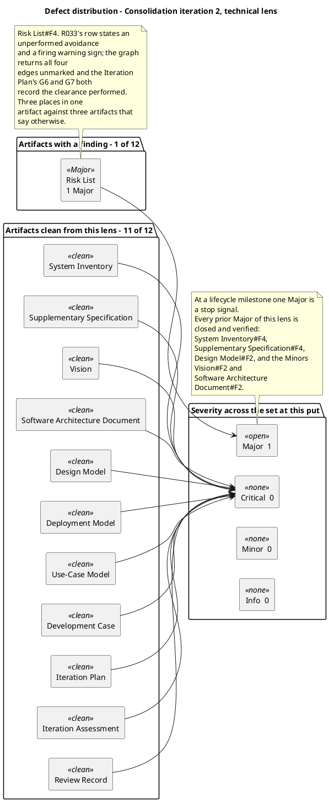

#### The twelve artifacts, and what this lens found in each

| Artifact | Findings from this lens at this put | What this lens verified at the artifact |
|---|---|---|
| System Inventory | None | Coverage counted over the 94 own-tree files, 89.4 per cent, raw 84 of 139 beside it, 10 unopened own-tree files each named with its reason, the three figures named for what each measures |
| Supplementary Specification | None | S8 and S18 state the gating the code has: reference UI and both health endpoints Development-only, OpenAPI document mapped unconditionally at `Program.cs:58`; the section closes on the same anchors as SAD `M12` and the Deployment Model |
| Software Architecture Document | None | The Deployment View counts two environment differences and reconciles the count with the Deployment Model by name; `M12` and the group-answer table state the OpenAPI gating correctly |
| Design Model | None | All four edges unmarked in the graph; the Traceability section states the reading that keeps each and quotes the group registration at `TodoApi.cs:22` as the `CLS-020` evidence |
| Deployment Model | None | Environment Mapping reads 50 / 50 / 50 for Development against the code defaults elsewhere, under `AN-024`; the two-settings count is the same two the SAD states |
| Vision | None | The Constraints row and diagram split the gated surfaces from the ungated ones; eleven use-case ellipses only, `EP-020`/`EP-021`/`EP-022` as components PM1 and PM2 |
| Use-Case Model | None | Eleven use cases, four stated exclusions, `R6` stating both budgets under `AN-024`; `COMP-014` upstream returns five `Realizes` edges, none marked |
| Development Case | None | Deltas only; two roles inactive with their triggers; six optional verdicts; ACT-DC-01 names Project Management in every partition at the matrix's intensity |
| Iteration Plan | None | `G3` names both contradictions in the set; `G4` carries its threshold and the own-tree denominator; `G6` and `G7` decided on the owners' acts, and this lens confirms both acts landed |
| Risk List | **`Risk List#F4`** — Major | `R030`, `R031`, `R032`, `R034` each state their own act against the artifact that carries it; the four grants quote the stakeholder's answers; the score mapping reproduces |
| Iteration Assessment | None | Not judged — the Project Manager authors it on the verdict, and at review time it cannot describe the iteration under review |
| Review Record | None | This record |

#### What this lens does not decide

Whether the milestone closes is the Review Coordinator's verdict, read on all three lenses and on gate H5's answer. This lens records the technical position only: the recovered set is complete, anchored and unchanged, its four exclusions stand, no finding here reopens a recovered element, and five of the six corrections this iteration was opened for are verified closed. One correction remains, in one artifact, on three cells and one note.

### Management Reviewer lens
<!-- review: Consolidation I2 -->

<!-- review: Consolidation I2 -->

One finding is open from this lens at this put, and it is one row of one artifact. The other eleven artifacts carry no defect this lens can record against the GHR criteria, and nine of the ten read at source were clean before this turn.

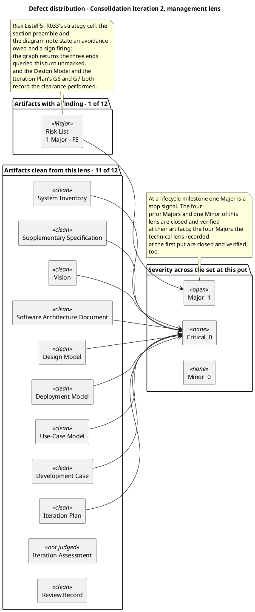

#### Risk List

**Major — `Risk List#F5`, criterion `consumed-defect`.** `R033` is recorded as an unperformed avoidance on a warning sign that is firing, in three places, while the graph returns the edges unmarked and the two artifacts that report the act record it performed.

The three places: the strategy cell reads "Avoid — **not performed; firing**", closing "the clearance itself has not been performed on any of the four"; the section preamble reads "`R033`, whose warning sign is firing on all four edges now"; and the diagram beside the table carries the note "the clearance is not — it is each owner's act and neither is performed" and "the graph returns all four still marked. This risk is firing."

What they contradict: I queried three ends this turn — `CLS-001` downstream returns `Specifies` to `TBL-001`, `CLS-007` downstream returns `Specifies` to `TBL-002`, `CLS-020` upstream returns `Realizes` to `UC-007` and `UC-010` — and none carries a marking. The Design Model's Traceability section states the reading that keeps each edge, which is what `Design Model#F2` asked for. The Iteration Plan's `G7` reads "the graph was queried again at each of the four ends and returns all four unmarked", and its `G6` reads "`R033`'s avoidance has been performed".

Why it is not contained: `G6` and `G7` are two of the eight criteria this verdict is read on, and both derive their state from this row. A reader taking `R033` from the register concludes a 5 × 4 = 20 exposure stands unmitigated at the gate, when the owners' acts have landed and the graph says so. It is the mirror of the fault the register's own opening rule forbids in the other direction — "avoidance is a claim of retirement, not a status note" — landing in the same row that rule was written about.

Remediation: restate `R033` at the state the graph holds, correcting all three places in one pass. The strategy cell becomes "clearance performed on all four; the exposure is retired", naming each edge with the reading its owner stated; the warning-sign cell reads "fired at the first put, on all four; no longer firing", on the pattern `R032` already carries; the preamble drops `R033` from the rows whose sign is firing now; the diagram note states the clearance performed. The score stays 5 × 4 = 20 — the probability is scored on the record that the sign fired, which is history and is correct. `R030`, `R031`, `R032` and `R034` are unchanged, each already stating its own act against the artifact that carries it.

#### The twelve artifacts, and what this lens verified in each

| Artifact | Findings from this lens at this put | What this lens verified at the artifact |
|---|---|---|
| System Inventory | None | Coverage over the 94 own-tree files, 84 opened (89.4 per cent) against the 80 per cent bar, 67 anchored (71.3 per cent), raw 84 of 139 named as not the figure measured on, the 45 vendored Bootstrap files named as one excluded third-party distribution, and all 10 unopened own-tree files named with their reason |
| Supplementary Specification | None | S8 and S18 separate the gated surfaces from the unconditionally mapped OpenAPI document, on `Todo.Api/Program.cs:44,49-58,62`; F13 carries the same as a constraint; the closing section reconciles with SAD `M12` and the Deployment Model by name |
| Vision | None | The Constraints row and its diagram split the gated surfaces from the ungated ones on the same anchors |
| Software Architecture Document | None | `M12` states the gating the code has; the Deployment View counts two environment differences and reconciles the count with the Deployment Model |
| Design Model | None | The Traceability section states the reading that keeps each of the four edges; three ends queried in the graph, none marked |
| Deployment Model | None | Environment Mapping reads 50 / 50 / 50 for Development against the code defaults elsewhere, under `AN-024`; the two-settings count is the same two the SAD states |
| Use-Case Model | None | Eleven use cases over 22 entry points, four stated exclusions, R6 stating both budgets under `AN-024` |
| Development Case | None | Deltas only; two roles inactive with the triggers that justify them; six optional verdicts; ACT-DC-01 names Project Management in every phase partition at the matrix's intensity. Not a baseline redefinition |
| Iteration Plan | None | `G1` to `G8` present with their thresholds; `G4` carrying both ratios and the stakeholder's denominator; `G3` naming both causes; `G6` decided on the act; fifteen fine-plan items, all in stages this phase runs; costs in the two currencies, kept apart, with no per-iteration velocity and no projected date |
| Risk List | **`Risk List#F5`** — Major | Thirty-four risks; 29 `Refines` edges; every magnitude reproducing from the one published scale; four Significant accepts each quoting the stakeholder's own answer; `R030`, `R031`, `R032` and `R034` each stating their own act accurately |
| Iteration Assessment | Not judged | The Project Manager writes it on the verdict; at review time it cannot describe the iteration under review. Its absence is not a defect and not a gate condition |
| Review Record | This record | — |

#### What this lens does not decide

Whether the milestone closes is the Review Coordinator's verdict, read on both executed lenses and on gate H5's answer. This lens records the management position: the recovered set is complete, counted at the bar and unchanged; seven of the eight criteria are true on the artifacts that own them; the gate is the stakeholder's; and one row of one register still tells a reader that a High-band exposure is unmitigated when its clearance has landed.

### Review Coordinator lens
<!-- review: Consolidation I2 -->

**The line every number below is copied from**, written from `read_artifact_findings` across all twelve artifacts in this milestone's turn and never from a lens's narrative:

`[FINDINGS] read=12, unread=none, open Critical=0, open Major=2 [Risk List#F4 — technical lens; Risk List#F5 — management lens], open Minor=0`

Fifty-three finding entries stand against the twelve artifacts. Fifty-one carry a resolution object and were closed by the lens that recorded them. Two are open, both Major, both from a lens that executed. No Critical was recorded by any lens this milestone.

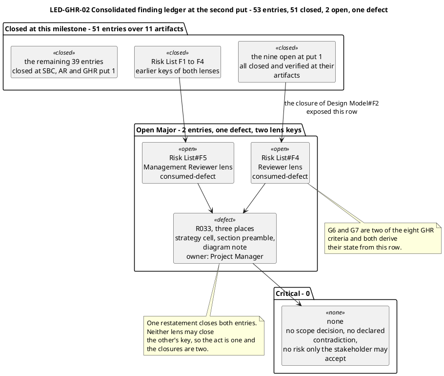

#### Open findings — two keys, one defect, one owner

| Artifact | Key | Lens | Criterion | Severity | Owner | What closes it |
|---|---|---|---|---|---|---|
| Risk List | `F4` | Reviewer (technical) | `consumed-defect` | Major | Project Manager | Restate `R033` at the state the graph holds, correcting all three places in one pass: the strategy cell to "Avoid — clearance performed on all four; the exposure is retired", naming each edge with the reading its owner stated (`CLS-001 → TBL-001` and `CLS-007 → TBL-002` for the Designer, `CLS-020 → UC-007` and `CLS-020 → UC-010` for the System Analyst); the warning-sign cell to "fired at the first put, on all four; no longer firing", on the pattern `R032` already carries; the section preamble minus `R033` from the rows whose sign is firing now; the diagram note stating the clearance performed. Keep the score at 5 × 4 = 20 — the probability is scored on the record that the sign fired, which is history. Change nothing in `R030`, `R031`, `R032` or `R034` |
| Risk List | `F5` | Management Reviewer | `consumed-defect` | Major | Project Manager | The same correction, read against the two criteria it holds: `G6` and `G7` derive their state from this row, and the register a reader takes that state from must agree with the graph. Closes when the technical lens has closed `F4` and the row reads at the state the graph holds |

**Why these are two keys and not a duplicate.** Both lenses read the same three places in the same row, from different questions: the technical lens because the artifact contradicts a fact two other artifacts record, the management lens because two of the eight GHR criteria are certified on the row that contradicts them. The closure invariant admits no cross-lens close — each lens closes its own key — so one owner pass produces two closures. Neither entry is a second round of work. One restatement clears both, and the act is already fully specified by either recommendation.

**Why it is Major and not Critical.** Nothing here is a decision on scope, a contradiction in what the stakeholder declared, or a risk only the stakeholder may accept. The evidence for the correction is in the register's own preamble, the graph, the Design Model and the plan's `G6`/`G7`; no reading of code is owed, no count moves and no recovered element is reopened.

**Why it is not contained.** At a lifecycle milestone a Major is a stop signal, and these two are decided on the register the phase's own two risk criteria are read from. A reader taking `R033` from the register concludes a 5 × 4 = 20 exposure stands unmitigated at the gate, when both owners' acts have landed and the graph returns all four edges unmarked.

#### Closed at this milestone — the nine entries carried out of put 1, each verified at its artifact

| Artifact | Key | Lens | Criterion | Severity | What closed it, read at the artifact and not taken from the owner's word |
|---|---|---|---|---|---|
| Design Model | `F2` | Reviewer | `trace-gap` | Major | The four edges queried at both ends and returned unmarked — `CLS-001 → TBL-001`, `CLS-007 → TBL-002`, `CLS-020 → UC-007`, `CLS-020 → UC-010`. The Traceability section states the reading that keeps each and no longer reports a marking |
| Supplementary Specification | `F4` | Reviewer | `consumed-defect` | Major | S8 removes the OpenAPI document from the Development-only set and names `app.MapOpenApi()` outside the block; S18's conclusion inverts to one diagnostic surface served, three not. `F13` carries the same. Anchors `Todo.Api/Program.cs:44,49-58,62` |
| System Inventory | `F4` | Reviewer | `exit-criterion-unmet` | Major | Coverage counted over the delivery's own 94 files — 84 opened, 89.4 per cent, against the 80 per cent bar; raw 84 of 139 (60.4 per cent) named beside it as not the figure measured on; 67 anchored, 71.3 per cent; the 45 vendored Bootstrap files named as one excluded third-party distribution |
| Iteration Plan | `F11` | Management Reviewer | `exit-criterion-unmet` | Major | `G4` carries the 80 per cent threshold in its own text and states both ratios against the System Inventory's identical figures on the same denominator |
| Iteration Plan | `F12` | Management Reviewer | `consumed-defect` | Major | `G3`'s evidence cell names both causes; both are settled at their own artifacts — the cleared edges and the OpenAPI gating now identical across four artifacts |
| Iteration Plan | `F13` | Management Reviewer | `exit-criterion-unmet` | Major | `G6`'s test closes "decided on the action performed, never on the strategy word a cell carries", and its evidence records the act for both High-band rows |
| Risk List | `F4` | Management Reviewer | `contained-defect` | Minor | `R031` and `R033` both read 5 × 4 = 20 with the basis each row states, and the register publishes the scoring rule above its tables instead of applying it to the inventory alone |
| Vision | `F2` | Reviewer | `contained-defect` | Minor | The Constraints row and diagram split the Development-only surfaces from the unconditionally mapped document, on the same anchors as the Specification and the SAD |
| Software Architecture Document | `F2` | Reviewer | `contained-defect` | Minor | The Deployment View counts two environment differences and reconciles the count with the Deployment Model by name |

All nine were recorded in this milestone and all nine closed inside it. No entry carried out of put 1 was re-recorded under its own key.

#### Entry census by artifact and lens — the whole ledger, not only the open rows

| Artifact | Technical lens | Management lens | Total | Closed | Open |
|---|---|---|---|---|---|
| Development Case | 4 | 2 | 6 | 6 | 0 |
| System Inventory | 4 | 0 | 4 | 4 | 0 |
| Risk List | 4 | 5 | 9 | 7 | 2 |
| Iteration Plan | 4 | 13 | 17 | 17 | 0 |
| Vision | 2 | 1 | 3 | 3 | 0 |
| Use-Case Model | 4 | 1 | 5 | 5 | 0 |
| Supplementary Specification | 4 | 0 | 4 | 4 | 0 |
| Software Architecture Document | 2 | 0 | 2 | 2 | 0 |
| Deployment Model | 1 | 0 | 1 | 1 | 0 |
| Design Model | 2 | 0 | 2 | 2 | 0 |
| Iteration Assessment | 0 | 0 | 0 | 0 | 0 |
| Review Record | 0 | 0 | 0 | 0 | 0 |
| **Total** | **31** | **22** | **53** | **51** | **2** |

The Business Reviewer lens recorded no entry because it did not evaluate this review. Its zero is an absence, not a pass, and is excluded from the totals the verdict is read on.

## Resolutions and Actions
### Reviewer lens
<!-- review: Consolidation I2 -->

Six corrective acts this iteration was opened for. Five are verified closed at the artifact that owned each, and one defect was opened by the closing itself. The register below is the technical lens's residue at this put.

| # | Act | Artifact | Finding | State | Verified at |
|---|---|---|---|---|---|
| 1 | Clear the four trace edges at the ends their owners hold | Design Model, graph | `Design Model#F2` (Major) | Closed | `CLS-001` → `TBL-001`, `CLS-007` → `TBL-002`, `CLS-020` → `UC-007`, `CLS-020` → `UC-010` all queried this turn, none marked |
| 2 | Correct the OpenAPI gating against the code | Supplementary Specification | `Supplementary Specification#F4` (Major) | Closed | S8, S18 and `F13` state the split on `Todo.Api/Program.cs:44,49-58,62` |
| 3 | Correct the same statement where it echoes | Vision | `Vision#F2` (Minor) | Closed | Constraints row and diagram split gated from ungated on the same anchors |
| 4 | Count coverage over the delivery's own tree | System Inventory | `System Inventory#F4` (Major) | Closed | 84 of 94, 89.4 per cent, raw 84 of 139 stated beside it, 10 files named |
| 5 | Reconcile the environment count with the Deployment Model | Software Architecture Document | `Software Architecture Document#F2` (Minor) | Closed | Deployment View counts two and reconciles the count by name |
| 6 | Restate the plan's criteria on the corrected artifacts | Iteration Plan | `Iteration Plan#F11`, `#F12`, `#F13` (Management Reviewer's; not this lens's to close) | Outside this lens | `G3`, `G4`, `G6` read at this turn on the corrected artifacts and on the owners' acts |
| 7 | — | Risk List | `Risk List#F4` (Major) | **Open — opened this turn** | `R033` states an unperformed avoidance in three places against a graph that returns all four edges unmarked |

**The single open act is one correction in one artifact.** It is a restatement, not a re-reading: the three cells and the diagram note assert a state the graph no longer holds, and the Project Manager holds a stage in this phase. It reopens no recovered element, changes no count, and needs no decision from the stakeholder — which is why it is a Major and not a Critical.

**Order of work, carried from the stakeholder's direction of 2026-11-23.** Coverage and the OpenAPI gating first, the plan's cells last because they cite those artifacts. Acts 1 to 5 are closed in that order. Act 7 was exposed by act 1: clearing the edges made the register's own row stale, so it is corrected after the artifacts it reports on and before the plan's cells are re-read at the milestone.

**What the correction does not change.** The recovered content. The eleven use cases, the four stated exclusions, the twenty-two components and the eight tables stand as the stakeholder confirmed them at gate H4's fourth put and reaffirmed on 2026-11-23 — "nothing in the recovered set is wrong". No act on this list touches them, and no finding this iteration recorded reopens or reclassifies one.

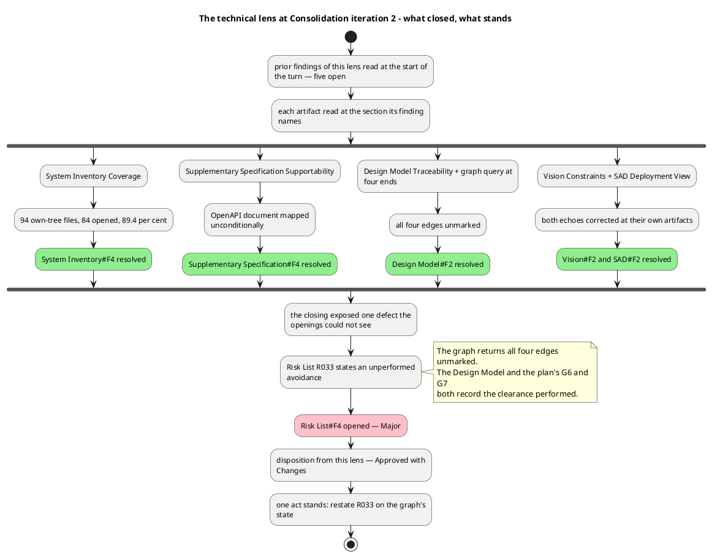

### Management Reviewer lens
<!-- review: Consolidation I2 -->

<!-- review: Consolidation I2 -->

Five actions stand from this lens at this put. Four are closed — the tool call and this table agree, each closure verified in the artifact that carried the defect. One is open, and it is the one act that holds the milestone.

| # | Finding | Severity | Owner | Action that closes it | State |
|---|---|---|---|---|---|
| 1 | `Risk List#F4` | Minor | Project Manager | Restate `R033`'s probability at 5 on the basis its own evidence states, carrying exposure 20, and apply the same test to `R031` | **Resolved** — both rows read 5 × 4 = 20 with their basis stated, and the register publishes the rule above its tables |
| 2 | `Iteration Plan#F11` | Major | Project Manager | Write the coverage threshold into `G4`'s own text and state both ratios in its evidence cell | **Resolved** — the criterion reads "over the delivery's own tree … 80 per cent or more"; evidence states 84 of 94 (89.4 per cent) against the bar and raw 84 of 139 (60.4 per cent) beside it |
| 3 | `Iteration Plan#F12` | Major | Project Manager | Name the second cause in `G3`'s evidence cell — the OpenAPI gating — and list both corrections in the iteration's work items | **Resolved** — the cell names both causes, both settled; the Specification's S8, S18 and F13 now hold the gating SAD `M12` and the Deployment Model state |
| 4 | `Iteration Plan#F13` | Major | Project Manager | Restate `G6`'s evidence cell so the criterion is decided on the act performed rather than on the strategy label | **Resolved** — the criterion's test closes "decided on the action performed, never on the strategy word a cell carries"; the act is recorded for both High-band rows |
| 5 | `Risk List#F5` | Major | Project Manager | Restate `R033`'s strategy cell, the section preamble and the diagram note at the state the graph holds: clearance performed on all four, the exposure retired, the warning sign no longer firing; keep the score at 5 × 4 = 20 | **Open** — the three places still state the avoidance owed and the sign firing |

#### What the closure of each was verified against

| Finding | Verified in the artifact, not on the owner's word |
|---|---|
| `Risk List#F4` | `Risk Register` rows `R031` and `R033` both read 5 \| 4 \| 20 \| High, and the Mitigation section's preamble states the scoring rule the two rows are scored by |
| `Iteration Plan#F11` | `Evaluation Criteria` `G4` — criterion, test and evidence cells; the three figures checked against `System Inventory` → `Coverage`, which states the same three on the same denominator |
| `Iteration Plan#F12` | `Evaluation Criteria` `G3` evidence cell against `Supplementary Specification` S8, S18 and F13, each read in full this turn |
| `Iteration Plan#F13` | `Evaluation Criteria` `G6` test and evidence cells against `model_query_traces` at three ends — `CLS-001` downstream, `CLS-007` downstream, `CLS-020` upstream — none returning a marking |
| `Risk List#F5` (open) | `Risk Mitigation and Contingency` R033 strategy and warning-sign cells; the section preamble; the diagram note. Each still states the avoidance unperformed and the sign firing on all four |

#### Actions this lens does not own

The four Majors the technical lens recorded at the first put are closed at their own artifacts — `System Inventory#F4`, `Supplementary Specification#F4`, `Design Model#F2` — together with its two Minors on the Vision and the Software Architecture Document. They were resolved through that lens, not this one, and are recorded as verified in the Disposition's table rather than here.

`[OMITTED: Change Request — not opened in the sprint zero, where no Change Control Manager works; the stakeholder's orders reach their owners through the Work Order and through this record]`

`[OMITTED: Iteration Assessment — the Project Manager writes it on the verdict, so at review time it cannot describe the iteration under review. Its absence is not a defect and not a gate condition]`

### Review Coordinator lens
<!-- review: Consolidation I2 -->

**Stakeholder finding (2026-11-23, on the second put of gate H5):** "Moor findings must be fixed". Recorded as given. It is read as an order to clear what stands open, in this phase, before the gate is put again — not as a grant, a conditional grant or a narrowing of scope. Nothing is added to it and nothing is subtracted.

**Fourteen corrective actions, all closed but one.** This iteration was opened for nine entries and produced two more, one from each lens, naming a single defect. Fifty-one actions closed at their artifacts; one stands, and both open keys point at it.

#### Priority order — what Consolidation iteration 3 works, and why it ranks where it does

| Priority | Finding | Severity | Why it ranks here |
|---|---|---|---|
| 1 | `Risk List#F4` and `Risk List#F5` | Major | One act, one owner, one artifact. It is the only open defect in the set and the only thing holding the milestone. It depends on nothing else: the four edges are cleared, the Design Model states its reading, and the two criteria are certified. Only the register's own row is behind |
| 2 | Gate H5, third put | — | Follows immediately on priority 1. `G2` is the stakeholder's answer alone and no record can be issued in its place |
| 3 | The verdict | — | Read on the ledger after the gate answers, as this one was |

The order of work set by the stakeholder on 2026-11-23 for the iteration-2 pass was discharged in full: coverage and the OpenAPI gating first, the plan's cells last because they cite those artifacts. Priorities 1 to 5 of that order are closed and verified in that sequence, and the plan's three cells were restated on the corrected artifacts. Nothing from that order is carried forward.

**The one remaining act, completely specified — the Project Manager, in Consolidation iteration 3**

`R033`'s strategy cell becomes "Avoid — **clearance performed on all four; the exposure is retired**", naming each edge with the reading its owner stated: `CLS-001 → TBL-001` (four properties in four columns, `Id` autoincrement, `OwnerId` a required cascade FK) and `CLS-007 → TBL-002` (the class adds no member; all fifteen columns inherited) for the Designer; `CLS-020 → UC-007` and `CLS-020 → UC-010` (the filter is attached to the `/todos` group naming `TodoItem`, so the create and the change both carry it) for the System Analyst. The warning-sign cell becomes "fired at the first put, on all four; no longer firing", on the pattern `R032` already carries. The section preamble drops `R033` from the rows whose sign is firing now, and the diagram note states the clearance performed rather than owed. The score stays at 5 × 4 = 20: the probability is scored on the record the sign fired, which is `R033`'s history and correct as it stands. `R030`, `R031`, `R032` and `R034` are unchanged — each already states its own act against the artifact that carries it.

**Escalations: none.** No finding in this ledger is Critical, no deadline has passed, and no role has failed to deliver an artifact on time. The gate H5 refusal is not an escalation of this role — it is the stakeholder's own decision, recorded as given. Review debt overdue at this close is 0 of 2: both open entries were recorded in this review's own turn and are scheduled in the iteration the verdict requires. The stakeholder's condition at the SBC close — that open Minors be addressed rather than left unattended — holds: three Minors were carried into this iteration and all three are closed.

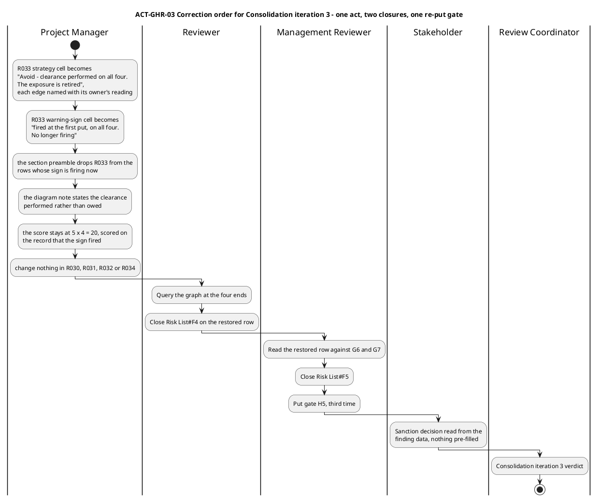

#### Cross-lens reconciliation — every subject on which both executed lenses spoke

| Subject | The two lenses | Resolution recorded here |
|---|---|---|
| `R033`'s row in the Risk List | Technical lens records `Risk List#F4`; the management lens records `Risk List#F5`. Both quote the same three places and the same queried graph ends | **Two keys, one defect, deliberately not merged.** The technical question is whether the artifact contradicts the facts the set holds; the management question is whether the two criteria certified on that row can be certified. The closure invariant admits no cross-lens close, so the single restatement produces two closures. Neither is a second round of work and the owner is one |
| Design Model's four suspect edges | Technical lens closed `Design Model#F2`; the management lens's `Iteration Plan#F13` rested on the same four edges via `G6` | **Two defects, both closed, not duplicates.** `#F2` was the artifact defect; `#F13` was the plan deciding a criterion on a strategy label. Closing the artifact did not close the criterion, and both closures were verified separately — `#F2` on a graph query, `#F13` in the criterion's own text |
| The OpenAPI gating | Technical lens recorded `Supplementary Specification#F4` (Major) and `Vision#F2` (Minor); the management lens recorded `Iteration Plan#F12` naming the same contradiction as `G3`'s unnamed second cause | **One root cause, three entries, all closed.** The Majors and Minors are now stated identically across the Specification, the Vision, the SAD `M12` and the Deployment Model's Environment Mapping, and `G3` names the cause a second time so the next iteration is planned from a complete list |
| The coverage ratio | Technical lens recorded `System Inventory#F4`; the management lens recorded `Iteration Plan#F11` | **Two entries, one dependency, both closed.** `#F4` restated the denominator on the stakeholder's ruling; `#F11` wrote the threshold and cited the ratio `#F4` produced. The sequencing held — the plan's cell was restated after the artifact held the fact |
| Severity bands | The two lenses agree on every shared subject | **No disputed band.** No finding needed reclassification at this consolidation and none was reclassified. Both open entries are Major from both lenses |
| Lens coverage | The technical lens read twelve artifacts; the management lens read ten at source and declared two out of scope | **No conflict.** The two the management lens declared out of scope are the Iteration Assessment, which the Project Manager writes on the verdict, and this record. Its twelve-of-twelve count and the technical lens's twelve-of-twelve count are not in dispute; the difference is a declared reading limit, recorded by that lens |

#### Finding lifecycle at this close

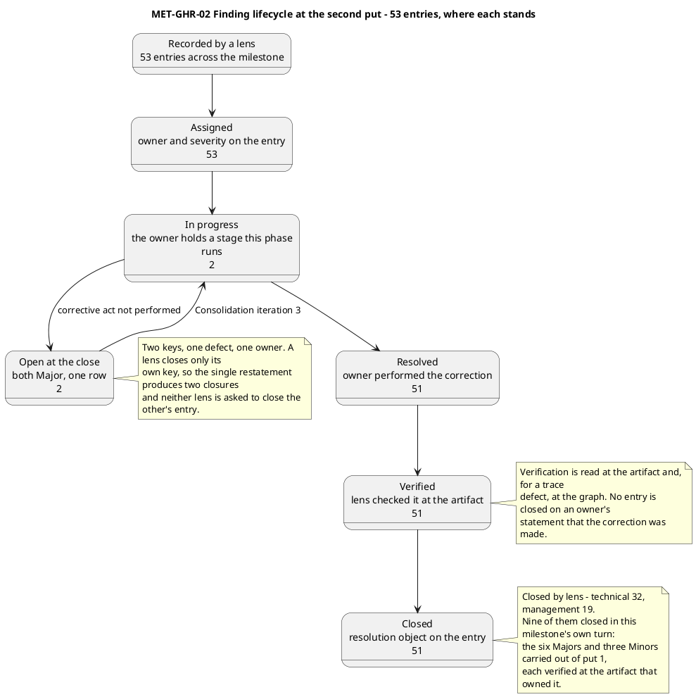

#### The review event, end to end

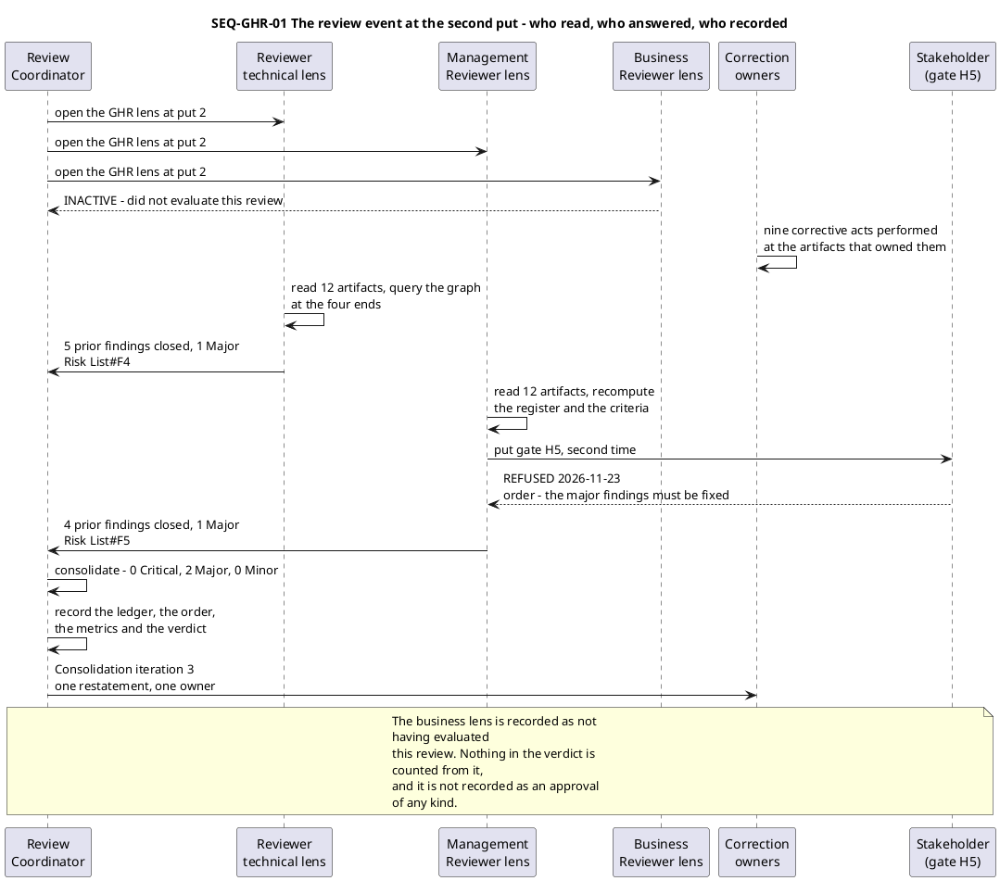

## Disposition
### Reviewer lens
<!-- review: Consolidation I2 -->

**Disposition: Approved with Changes.**

Eleven of the twelve artifacts are approved from this lens with nothing recorded against them. One is not: `Risk List#F4`, corrected by the Project Manager in this phase before any role consumes the register again.

**No Critical finding is open, and none was recorded this turn.** Nothing in the set needs the stakeholder to unblock it: the one open defect is a restatement its owner performs with the evidence already in hand. This lens therefore sends nothing to gate H5 and escalates nothing.

**What moved since the first put of this gate.** Five of the six corrections the phase was opened for are closed and verified at their own artifacts, each checked there rather than on the artifact's word — the coverage ratio on the stakeholder's own ruling of 2026-11-23, the OpenAPI gating against `Todo.Api/Program.cs:58`, and the four trace edges against a fresh graph query. Two of those five closed findings were Minors this lens recorded, and the register's correction (`Risk List#F4`) was exposed by the first of them: clearing the edges made the row that reports them stale.

**What this lens adds to the milestone's reading.** One criterion pair is decided on the register and cannot be certified while it says the opposite of the graph: `G6` and `G7` derive their state from `R033`, and `R033` states a clearance owed that both owners have performed. Restating it is what lets those two criteria be read on an artifact that agrees with its own evidence.

**The class of defect this project keeps paying for, and the instance this turn.** One fact stated twice in two artifacts with two answers cost four Majors at AR and two more at the first put of this gate; the rule that closes it is written in the Development Case and applied here to the environment gating, which now agrees across the four artifacts that carry it. The instance this turn is the same shape in a register rather than a specification: `R033`'s row, the Design Model's Traceability section, the graph and the plan's `G6`/`G7` each hold a version of one fact, and three of the four say the clearance landed. The rule to carry past this milestone is the register's own, applied in both directions — a retirement is claimed only where its act was performed, and disclaimed only where its act was not.

```plantuml
@startuml
title DIS-TECH-01 The technical lens at Consolidation iteration 2
skinparam shadowing false
skinparam wrapWidth 245
hide circle
hide empty members

package "The set, from this lens" {
  class "12 artifacts read\nunread = none" as A1 <<met>>
  class "11 approved, nothing recorded" as A2 <<met>>
  class "1 with a Major — Risk List" as A3 <<open>>
}

package "Prior findings of this lens" {
  class "5 open at the start of the turn" as P1 <<input>>
  class "5 closed this turn, 0 re-recorded" as P2 <<met>>
  class "0 persisting under their own key" as P3 <<met>>
}

package "Severity at this put" {
  class "Critical  0\nnothing escalates to the stakeholder" as S1 <<met>>
  class "Major  1\nRisk List#F4" as S2 <<open>>
  class "Minor  0" as S3 <<met>>
}

package "Disposition" {
  class "Approved with Changes\none act, one owner, this phase" as D <<verdict>>
}

A1 --> D
A2 --> D
P2 --> D
S1 --> D
S2 --> D : holds a clean technical\ncertification
A3 --> S2

note bottom of S2
  A restatement, not a re-reading. It reopens no
  recovered element and changes no count, and the
  Project Manager holds a stage in this phase.
end note
note bottom of D
  The milestone's disposition is the Review
  Coordinator's, read on all three lenses and on
  gate H5's answer. This lens records the
  technical position only.
end note
@enduml
```

**What is left for the verdict.** One restatement by the Project Manager, and the register agrees with the graph, the Design Model and the plan's own two criteria. The recovered set is complete, anchored and unchanged; the coverage is counted at the bar over the denominator the stakeholder ruled on; no suspect trace is open. On this lens's evidence there is no technical obstacle to the gate after that one act, and the gate itself remains the stakeholder's to answer.

### Management Reviewer lens
<!-- review: Consolidation I2 -->

<!-- review: Consolidation I2 -->

**Verdict: No-Go at this put.** The Greenfield Handoff Ready milestone is not achieved. One Major is open at a lifecycle milestone, and at a lifecycle milestone one Major is a stop signal. Five of the six Majors that held the first put are closed and verified at their own artifacts; the sixth is replaced by a defect exposed by its own correction, in the same register.

**Stakeholder sanction: REFUSED** — gate H5, second put, 2026-11-23.

**Stakeholder acceptance:** "Moor findings must be fixed"

**Gate H5 — second put, 2026-11-23.** The question carried the open defect list and the coverage figure inside it, and nothing pre-filled. The answer is recorded as given: the sanction to advance into Inception was refused, and the order was that the major findings be fixed. Nothing is recorded in the answer that it does not contain.

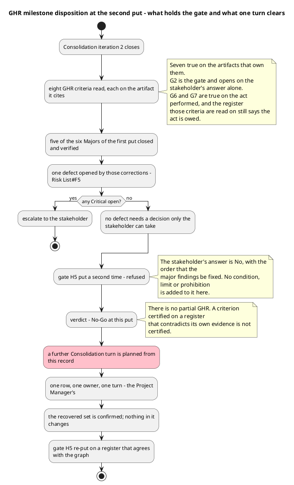

**Why this is not a Critical escalation.** No finding meets the Critical bar. Nothing here is a decision on scope, a contradiction in what the stakeholder declared, or a risk only the stakeholder may accept. The open Major is a restatement the Project Manager performs with evidence already in hand, and the three places to correct are named in the finding.

**Why it is not a Conditional Go either.** A Conditional Go states conditions under which the milestone holds. `Risk List#F5` is a Major against the register the phase's two risk criteria are read on; certifying the milestone conditionally on it would be certifying a criterion on an artifact that says the opposite of its evidence. The stakeholder has refused the advance twice, the second time with the order that the major findings be fixed, and that answer is not reinterpreted as a conditional grant.

**What moved since the first put of this gate.**

| Artifact | Finding at the first put | State now | Verified at |
|---|---|---|---|
| System Inventory | `#F4` Major — coverage over a denominator that hid the reading's reach | Closed | Coverage: 84 of 94 own-tree files (89.4 per cent), 67 anchored (71.3 per cent), 10 unopened named, the 45 vendored files named as one excluded distribution |
| Supplementary Specification | `#F4` Major — the OpenAPI document stated Development-only | Closed | S8, S18 and F13 on `Todo.Api/Program.cs:44,49-58,62`, reconciled with SAD `M12` and the Deployment Model |
| Design Model | `#F2` Major — four trace edges marked at the close | Closed | Three ends queried this turn, none marked; the model states the reading that keeps each |
| Vision | `#F2` Minor — the same gating sentence | Closed | Constraints row and diagram split the gated from the ungated |
| Software Architecture Document | `#F2` Minor — one environment setting against the Deployment Model's two | Closed | Deployment View counts two and reconciles by name |
| Iteration Plan | `#F11`, `#F12`, `#F13` Major — three criteria certified on the wrong evidence | Closed | `G4` carries its threshold and both ratios; `G3` names both causes; `G6` is decided on the act |
| Risk List | `#F4` Minor — the firing exposure scored 4 | Closed | `R031` and `R033` both read 5 × 4 = 20 with their basis stated |
| Risk List | — | **`#F5` Major — the register states an act owed that both owners performed** | The row, the preamble and the diagram note against three queried ends of the graph |

Five of the six Majors are closed at their artifacts; the sixth, `Iteration Plan#F13`, is closed but its subject was the plan's criterion, and the register the criterion is read on was not brought with it. That is the one defect at this put, and it is a defect of the register and not of any criterion's logic.

**What the stakeholder decided, and what is not widened here.** At the first put they refused the sanction, ordered the six Majors cleared in this phase with the gate put again, and ruled the coverage denominator: the 45 Bootstrap files under `Todo.Web/Client/wwwroot/bootstrap/` are a third-party distribution and not their system. Both orders are discharged above — the coverage restatement is at the System Inventory and the threshold is in `G4`'s text. At the second put they refused the sanction again and ordered the major findings fixed. They also confirmed at the first put that nothing in the recovered set is wrong: the eleven use cases, the four exclusions, the twenty-two components and the eight tables stand as confirmed at gate H4, and no act on this iteration's list touched recovered content.

**What the next turn must reach before the gate is put again.** One restatement, in one artifact, by its owner:

- `R033`'s strategy cell at the state the graph holds — clearance performed on all four, the exposure retired, each edge named with the reading its owner stated;
- the warning-sign cell at "fired at the first put, on all four; no longer firing", on the pattern `R032` already carries;
- the section preamble minus `R033` from the rows whose sign is firing now;
- the diagram note stating the clearance performed rather than owed;
- the score left at 5 × 4 = 20, because the probability is scored on the record that the sign fired and that record is history.

When that holds, `G6` and `G7` are read on a register that agrees with the graph, the Design Model and the plan's own two criteria, and gate H5 is put again on records that agree with the set they report.

**Recorded as given.** The stakeholder's answer at the first put, verbatim: "Nothing in the recovered set is wrong: the 11 use cases, the 4 exclusions, the 22 components and the eight tables stand as I confirmed them. I do not accept a handoff with Majors open: clear the six in this phase and put the gate again. One fact for the coverage count: the 45 Bootstrap files under Todo.Web/Client/wwwroot/bootstrap/ are a third-party distribution, not my system — count coverage over the delivery's own files. Nothing else to add." Their answer at the second put, verbatim: "Moor findings must be fixed".

**No milestone, iteration or phase is recorded as completed by this review.** The Review Coordinator reads this verdict and the finding ledger; the milestone's disposition is theirs to record.

### Review Coordinator lens
<!-- review: Consolidation I1 -->

<!-- review: Consolidation I1 -->

**Verdict: the phase scope is incomplete. The GHR milestone is NOT sanctioned, and Consolidation iteration 2 is required.**

The verdict is read from the finding data, not from judgment. Every condition it rests on is a count or a recorded answer:

| Condition the verdict reads | State |
|---|---|
| Artifacts read | 12 of 12, `unread=none` |
| Open Critical | 0 |
| Open Major | **6** — `Design Model#F2`, `Supplementary Specification#F4`, `System Inventory#F4`, `Iteration Plan#F11`, `Iteration Plan#F12`, `Iteration Plan#F13` |
| Open Minor | 3 — `Risk List#F4`, `Vision#F2`, `Software Architecture Document#F2` |
| Stakeholder sanction | **REFUSED** — gate H5 put and answered 2026-11-23 |
| The recovered set confirmed | Yes, and unchanged since gate H4's fourth put |
| The set complete | Yes — 11 use cases, 4 stated exclusions, 22 components, 8 tables |
| Stakeholder direction for the iteration-2 pass | Received 2026-11-23 — the order confirmed, no ranking among the six, all six cleared in this iteration |

`[STATE_BLOCKED: S2_CALENDAR -> milestone_verdict/VERDICT_DONE]` Reason: six unresolved Major findings and a refused stakeholder sanction. The guard into `VERDICT_DONE` requires open Major = 0 and a `Stakeholder sanction: GRANTED` line; neither holds.

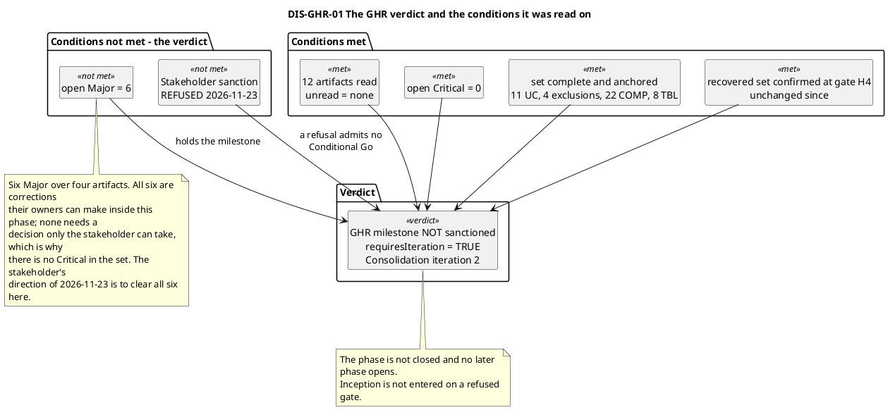

**Why this is not a Critical escalation and not a Conditional Go.** No finding in the ledger meets the Critical bar: nothing here is a decision on scope, a contradiction in what the stakeholder declared, or a risk only the stakeholder may accept. All six Major findings are corrections their owners perform with the evidence already in the artifacts. And a refused sanction admits no Conditional Go — the stakeholder's own decision on 2026-11-23 was to clear the six in this phase and put the gate again, so the process does not reinterpret the refusal as a conditional grant.

**What the next iteration carries.** Nine open entries, in the order recorded above, all by owners the process schedules in Consolidation iteration 2: the Software Archaeologist, the System Analyst, the Designer, the Project Manager, the Software Architect. The recovered content is not at issue in any of the six Majors, so no recovered element is reopened, no count changes, and no per-area row of the System Inventory moves.

**The stakeholder's ruling of 2026-11-23, applied.** The 45 Bootstrap files under `Todo.Web/Client/wwwroot/bootstrap/` are a third-party distribution and not part of the system; coverage is counted over the delivery's own files. That ruling is the substance of `System Inventory#F4` and the threshold `Iteration Plan#F11` must carry. The stakeholder also recorded that nothing in the recovered set is wrong — the 11 use cases, the 4 exclusions, the 22 components and the eight tables stand as confirmed at gate H4.

**Stakeholder input for the iteration-2 pass, 2026-11-23, verbatim:** "Nothing to add. The order stands: coverage and the OpenAPI gating first, the plan's cells last. No priority among the six — clear all six in this iteration."

**Recorded as given — the stakeholder's answer at gate H5, verbatim:** "Nothing in the recovered set is wrong: the 11 use cases, the 4 exclusions, the 22 components and the eight tables stand as I confirmed them. I do not accept a handoff with Majors open: clear the six in this phase and put the gate again. One fact for the coverage count: the 45 Bootstrap files under Todo.Web/Client/wwwroot/bootstrap/ are a third-party distribution, not my system — count coverage over the delivery's own files. Nothing else to add."

**The Iteration Assessment is not judged here.** `[OMITTED: Iteration Assessment — the Project Manager authors it on this verdict; at review time it cannot describe the iteration being reviewed, and its absence is not a defect and not a gate condition]`

**The Change Request ledger does not exist here.** `[OMITTED: Change Request — not opened in the sprint zero, where no Change Control Manager works; the stakeholder's orders reach their owners through the Work Order and through this Review Record]`
