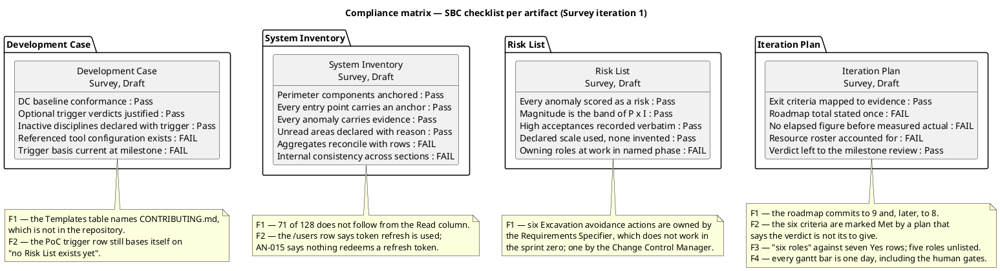
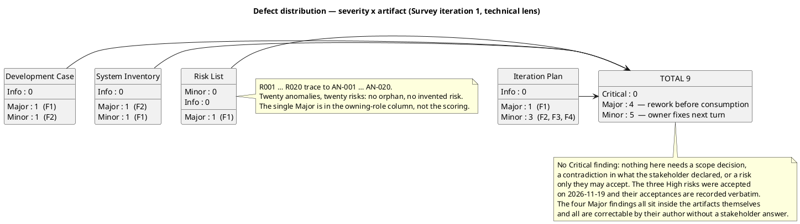
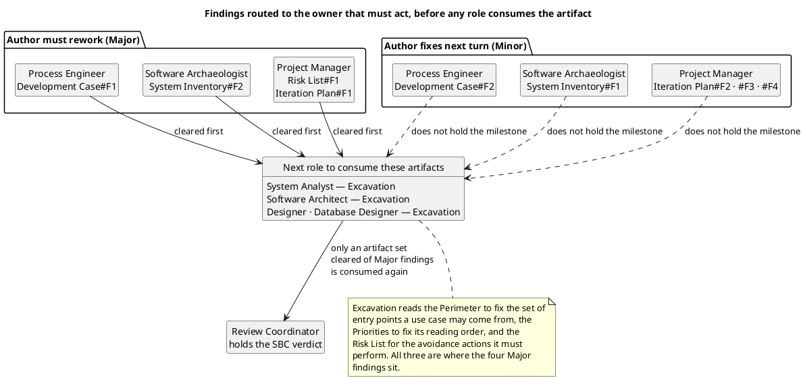

## Document Control
### Reviewer lens
<!-- review: Survey I1 -->

- Phase: Survey
- Status: Draft — technical lens of the end-of-Survey milestone review
- Milestone Target: end of Survey (SBC) — not yet achieved
- Review type: Milestone review (SBC), technical lens — formal inspection against the artifact-type checklists
- Reviewed: Development Case, System Inventory, Risk List, Iteration Plan — all Survey, Draft, iteration 1
- SCM evidence: no pull request in any state; no IARI build on `main`

## Review Scope and Criteria
### Reviewer lens
<!-- review: Survey I1 -->

SBC asks one question: is the material the whole recovery will rest on adequate? Four artifacts answer it, and they are the only four anything in Excavation, Consolidation and Inception will cite. Nothing was built in this iteration — no code, no pull request, no build — so the review is entirely an evidence review: does each claim rest on what it cites.

Three lenses of the SBC review follow this one; this block records the technical lens only.

| Artifact | Author | Checklist applied | Version reviewed |
|---|---|---|---|
| Development Case | Process Engineer | DC baseline conformance; optional-trigger justification; validity of every referenced path | Survey, Draft, iteration 1 |
| System Inventory | Software Archaeologist | Anchor verification (each anchor opened and read against its claim); UML/notation correctness of the perimeter and coverage diagrams; internal consistency; Coverage arithmetic | Survey, Draft, iteration 1 |
| Risk List | Project Manager | The declared magnitude scale used and not replaced; every anomaly scored; acceptance verbatim for High; owning roles at work in the phase each action names | Survey, Draft, iteration 1 |
| Iteration Plan | Project Manager | Exit criteria against evidence; no forecast before a measured actual; resource roster; the plan not exercising a verdict it disclaims | Survey, Draft, iteration 1 |

#### What was opened, not merely read

An anchor that does not say what the artifact claims is the defect every later role inherits, so each high-consequence row was checked against its file:

| Anchor opened | Claim it carries | Verdict |
|---|---|---|
| `Todo.Web/Server/Authentication/AuthenticationExtensions.cs` | Four provider schemes registered only when `Authentication:Schemes:<provider>` exists | Confirmed — the exclusion of external provider sign-in rests on code |
| `Todo.Api/Program.cs` | Scalar mapped only in Development, `MapOpenApi()` unguarded, root redirects to `/scalar/v1` | Confirmed — AN-016 accurate |
| `Todo.Web/Server/TodoApi.cs` | Forwarder targets the literal `http://todoapi`; bearer re-signed from the stored token | Confirmed — AN-012 and the BFF description accurate |
| `Todo.Web/Client/TodoClient.cs` | No update method; five calls only | Confirmed — AN-008 accurate |
| `Todo.Web/Client/Components/TodoList.razor` | Checkbox carries no `@bind` and no handler | Confirmed — AN-008 accurate |
| `Todo.Api/Todos/TodoApi.cs` | `owner.IsAdmin` widens read, update and delete | Confirmed — AN-010 accurate |
| `Todo.Api/Users/UsersApi.cs` | `/users` group carries no authorization; provider key unprotected before identity | Confirmed — AN-018 accurate |
| `.github/workflows/ci.yaml` | `actions/setup-dotnet@v3` with no `dotnet-version` | Confirmed — AN-006 accurate |
| `.devcontainer/devcontainer.json` | Base image `sdk:8.0` against a `net9.0` target | Confirmed — AN-005 accurate |
| `Todo.Web/Server/AuthApi.cs` | Register, login and logout call the API; provider challenge and callback present | Confirmed — but see below on refresh |
| `Todo.Api/TodoDbContext.cs`, `Todo.Api/Users/TodoUser.cs` | `IdentityDbContext<TodoUser>` plus `Todos` = 8 entities | Confirmed — the Data Model trigger genuinely does not hold |
| `TodoApp.AppHost/Program.cs` | Two project services plus a container, gated on a migration | Confirmed — the Deployment Model trigger genuinely holds |
| `CONTRIBUTING.md` | Named by the Development Case as the home of three convention families | **Not found** — Development Case#F1 |

One claim did not survive: the Inventory's Perimeter says the delivered product uses token refresh, and nothing in the delivery redeems a refresh token. That is System Inventory#F2.

The UML content was checked as notation, not as illustration: the perimeter diagram types its components and systems and labels each dependency with its mechanism; the coverage diagram separates read from declared-unread and gives each unread set a reason; the Risk List's classification diagram states the scale, the band arithmetic and the acceptance rule. None is a prose summary drawn as arrows. The Inventory's History diagram is the one place a diagram asserts a count that the accompanying table repeats rather than derives — noted, not recorded as a defect, because the per-area commit lists are given in full.

No SCM evidence bears on this milestone. `scm_list_pull_requests` returns nothing in any state, so there is no scaffolding to approve, no code to request changes on, and nothing to defer out of phase; `scm_get_build_status("main")` reports no IARI pipeline yet, which is correct for a phase that builds nothing. The Implementation and Test disciplines have no Survey stage.

## Findings
### Reviewer lens
<!-- review: Survey I1 -->

Nine findings across the four artifacts: four Major, five Minor, no Critical. Each Major is a place where a role in Excavation would consume wrong content; each Minor stays inside its own artifact.

#### Development Case

**Major — Development Case#F1 — `consumed-defect`.** The Templates table names `CONTRIBUTING.md` as the single home of the coding standards, the UI patterns and the test conventions, with three owners. The file is not in the repository. Four roles are directed to a convention source that does not exist, and the table gives no fallback. **Remediation:** re-point the rows at files that exist (`ci.yaml`, `global.json`, `Directory.Build.props`, `Directory.Packages.props`, `nuget.config`) and record the three convention families as undocumented until a declared requirement or Change Request puts a convention file in scope.

**Minor — Development Case#F2 — `contained-defect`.** The Architectural Proof-of-Concept row bases its verdict partly on "no Risk List exists yet". True when issued, false now: 20 scored risks exist, including R020 and R017. The verdict still holds on the phase requirement. **Remediation:** drop the stale clause and let the phase requirement be the whole basis.

The two tailoring decisions this lens was required to audit both pass. Every FIRED optional was checked against its trigger condition: Deployment Model is FIRED and the condition genuinely holds — `TodoApp.AppHost/Program.cs` orchestrates two project services and a container, gated on a migration operation, joined by service discovery and a forwarder, across per-project settings files. Data Model is NOT FIRED and the condition genuinely fails — `IdentityDbContext<TodoUser>` plus `Todos` yields 8 entities, not more than 10. The remaining four NOT-FIRED verdicts hold. Nothing in the artifact redefines the 26-role roster, omits a CORE artifact, reassigns primary ownership, merges two roles, or lists an artifact outside the CORE + OPTIONAL universe plus the System Inventory.

#### System Inventory

**Major — System Inventory#F2 — `consumed-defect`.** The Perimeter's `Todo.Api / Users` row states the delivered product uses "registration, login and token refresh only". AN-015 in the same artifact records that nothing redeems a refresh token — the BFF stores only `accessToken`, `TokenNames` names only `accessToken`, `AuthClient` has no refresh call. A role reading the Perimeter table concludes EP-003 has a caller and recovers a refresh use case; a role reading AN-015 concludes it has none. **Remediation:** restate the Perimeter row to agree with AN-015 and say once, in one place, whether a use case may be recovered from EP-003.

**Minor — System Inventory#F1 — `contained-defect`.** The Coverage aggregate does not reconcile with its own rows: the Read column sums to 72 while the text says 71 of 128 and 57 unread, and the four-category unread breakdown omits `GlobalUsings.cs` and the Inventory's own file. The per-area rows — which are what SBC exit criterion 3 rests on — are correct. **Remediation:** recompute the aggregate from the table, or drop the aggregate and let the per-area rows carry the count.

Anchor verification is the substance of this artifact and it holds: twelve of the thirteen anchors opened say what the artifact claims. Twenty-six entry points each carry a real anchor. Twenty anomalies each cite evidence. Coverage declares every unread area with a reason and no top-level area of the tree is left neither described nor declared unread. The three exclusions are recorded where the stakeholder's answers put them, each with the code anchor that stays as read.

#### Risk List

**Major — Risk List#F1 — `consumed-defect`.** Six Excavation avoidance actions name the Requirements Specifier as owning role (R002, R010, R011, R014, R015, R016), and R014 additionally names the Change Control Manager. Neither works in the sprint zero: Excavation's Requirements stage is the System Analyst's, the Requirements Specifier's first stage is Elaboration, and the Development Case records that the Change Control Manager opens no ledger there. A risk register whose avoidance actions are owned by roles absent from the phase is a register Excavation cannot execute. **Remediation:** re-own the Excavation actions to the System Analyst, keep the Software Architect parts in Excavation, move R014's control part to Inception.

Scoring, strategy and acceptance all pass. Twenty anomalies, twenty risks, no orphan and none invented — each R traces to its AN. Magnitude is the band of P × I throughout, on the declared scale, with no scale of the document's own. All three High risks (R008 16, R009 16, R020 20) were put to the stakeholder and accepted on 2026-11-19, recorded verbatim; all nine Significant risks are handled by avoidance, so no Significant acceptance was self-granted.

#### Iteration Plan

**Major — Iteration Plan#F1 — `consumed-defect`.** The plan commits to two different totals. The roadmap sums 1+1+1+1+2+2+1 and both the preamble and the profile bullets state 9 with Elaboration's second iteration "committed ... planned work, not a reserve". Evaluation Criteria then states "8 iterations, or 9 if Elaboration needs its second" — making conditional what the roadmap commits. Nothing downstream can read a single baseline. **Remediation:** state 9 once, in the roadmap, and delete the "8 or 9" sentence rather than reconciling it in a second place.

**Minor — Iteration Plan#F2 — `contained-defect`.** Evaluation Criteria marks all six criteria "Met — confirmed / recorded / issued" while the same section opens by disclaiming the verdict and the fine plan records the SBC review as "Not started — the reviewers' to give". The plan both withholds the verdict and exercises it. **Remediation:** replace the verdict words with the evidence supplied.

**Minor — Iteration Plan#F3 — `contained-defect`.** Resources states six roles at work but marks seven rows "Yes"; five roles of the active roster appear in no row at all. **Remediation:** restate the profile as six agent roles plus the stakeholder gate, and list the unlisted roles with their exclusion reason.

**Minor — Iteration Plan#F4 — `contained-defect`.** Every bar in both gantt diagrams is "lasts 1 day", including the seven human-gate bars, while Measure and forecast states that no elapsed figure appears in this plan. Summing the bars yields 16 days; the gates are held elsewhere to be a queue-time risk with a 14-day ceiling and "estimate NONE". **Remediation:** remove the day lengths, or keep the diagram carrying ordering only with no numeric duration.

The substance of this plan passes: the six exit criteria each name the evidence they rest on, the no-forecast discipline is correct for a project with no closed phase and no declared budget, the stakeholder's four answers are recorded verbatim where they bind, and the roadmap respects the declined Excavation split by carrying orders 1-6 in one iteration with order 7 as cross-check. No work item names work the IARI process does not run in Survey.

## Resolutions and Actions
### Reviewer lens
<!-- review: Survey I1 -->

Iteration 1 of Survey: this lens has no prior finding to close, and none is resolved, deferred or rejected here. Every finding recorded above is new in this iteration and every one is open.

| Finding | Owner | What closes it | Holds the milestone |
|---|---|---|---|
| Development Case#F1 | Process Engineer | Templates rows re-pointed at files that exist; the three convention families recorded as undocumented | Yes |
| Development Case#F2 | Process Engineer | Stale "no Risk List exists yet" clause removed from the PoC trigger row | No |
| System Inventory#F2 | Software Archaeologist | Perimeter `/users` row restated to agree with AN-015; one statement of whether EP-003 supports a use case | Yes |
| System Inventory#F1 | Software Archaeologist | Coverage aggregate recomputed from the Read column, or dropped for the per-area rows | No |
| Risk List#F1 | Project Manager | Six Excavation avoidance actions re-owned to the System Analyst; R014's control part moved to Inception | Yes |
| Iteration Plan#F1 | Project Manager | One committed total stated once in the roadmap; the "8 or 9" sentence deleted | Yes |
| Iteration Plan#F2 | Project Manager | Evidence-supplied wording in place of "Met — …" | No |
| Iteration Plan#F3 | Project Manager | Assignment profile and role table made consistent; unlisted roles given their exclusion reason | No |
| Iteration Plan#F4 | Project Manager | Day lengths removed from the gantt bars, the gate included | No |

Closure has two parts and this lens will perform both in the next iteration: the `resolve_artifact_finding` call that moves the state, and the entry here that records what the corrected content says. A finding whose defect still stands is re-recorded under its key rather than duplicated.

No action on this list needs a stakeholder decision. The nine defects are content and arithmetic errors inside artifacts whose authors are at work in this process; the four Major ones are correctable in a single rework turn each. Nothing here reopens a decision the stakeholder has already taken, and nothing here proposes a change to the recovered scope.

No escalation is open against this lens. The three High risks were accepted on 2026-11-19 and the perimeter was confirmed on the same day; this review found no contradiction in what was declared and no risk that only the stakeholder may accept.

## Disposition

