## Document Control
### Reviewer lens
<!-- review: Survey I2 -->

<!-- review: Survey I2 -->

- Phase: Survey
- Status: Draft — technical lens of the end-of-Survey milestone review, iteration 2
- Milestone Target: end of Survey (SBC) — not yet achieved; the sanction has not been asked again
- Review type: Milestone review (SBC), technical lens — formal inspection against the artifact-type checklists
- Reviewed: Development Case, System Inventory, Risk List, Iteration Plan — all Survey, Draft, corrected in iteration 2
- Prior findings of this lens: 9 open at the previous milestone review, 9 closed here
- Findings recorded this iteration: 2, both Minor
- SCM evidence: no pull request in any state; no IARI build on `main`

### Management Reviewer lens
<!-- review: Survey I2 -->

<!-- review: Survey I2 -->

- Phase: Survey
- Status: Draft — governance lens of the end-of-Survey milestone review, iteration 2
- Milestone Target: end of Survey (SBC) — not yet achieved; the sanction is asked in this round
- Review type: Milestone review (SBC), governance lens
- Reviewed: Development Case, System Inventory, Risk List, Iteration Plan — all Survey, Draft, corrected in iteration 2
- Prior findings of this lens: 3 Major open at the previous milestone review, 3 closed here
- Findings recorded this iteration: none from this lens
- Cross-artifact consequence carried from iteration 1: closed — `AN-008` and `R008` name the same two disclosure homes
- SCM evidence: no pull request in any state; no IARI build on `main`

### Review Coordinator lens
<!-- review: Survey I1 -->

<!-- review: Survey I1 -->

- Phase: Survey
- Status: Draft — consolidated coordination block of the end-of-Survey milestone review
- Milestone Target: end of Survey (SBC) — not achieved; the phase iterates
- Review type: Milestone review (SBC), consolidation of the executing lenses
- Lenses executed: Reviewer (technical), Management Reviewer (management)
- Lens not executed: Business Reviewer — INACTIVE, did not evaluate this review
- Verdict: No-Go — 7 open Major, 0 open Critical; requiresIteration true

## Review Scope and Criteria
### Reviewer lens
<!-- review: Survey I2 -->

<!-- review: Survey I2 -->

The SBC question is unchanged: is the material the whole recovery will rest on adequate? What changed is the subject of this pass. Iteration 2 is a correction pass, so the lens asks two things — whether each of the seven Major findings the previous pass recorded was in fact corrected, and whether the corrected content introduced a defect the correction itself created. Nothing was built in this iteration either: no code, no pull request, no build, so both questions are evidence questions.

| Artifact | Author | Checklist applied | Version reviewed |
|---|---|---|---|
| Development Case | Process Engineer | DC baseline conformance; optional-trigger justification; existence and validity of every referenced path; convention content with no file declared as such | Survey, Draft, corrected in iteration 2 |
| System Inventory | Software Archaeologist | Anchor verification — each high-consequence row opened against its file; Coverage arithmetic; internal consistency between Perimeter and anomalies; no use case claimed from an excluded entry point | Survey, Draft, corrected in iteration 2 |
| Risk List | Project Manager | Magnitude the band of probability × impact on the declared scale; every anomaly scored; acceptance verbatim for each High and Significant risk and consistent wherever the register restates it; every owning role at work in the phase its action lands in | Survey, Draft, corrected in iteration 2 |
| Iteration Plan | Project Manager | One committed total; no forecast before a measured actual; no span a reader can sum on any gate; the roster accounted for; no verdict the plan has no standing to give; each section stating its content once | Survey, Draft, corrected in iteration 2 |

#### What was opened, not merely read

The three anchors the corrected Perimeter claims rest on were opened this iteration and read against the claim. Each is the anchor for a statement that changed in the correction, so a claim that survived re-reading survives the whole set:

| Anchor opened | Claim it carries | Verdict |
|---|---|---|
| `Todo.Api/Users/UsersApi.cs` | `MapIdentityApi<TodoUser>()` publishes the stock identity surface; the custom `/users/token/{provider}` is the only endpoint added beside it | Confirmed — the seven self-service operations and the provider endpoint are as the Perimeter draws them |
| `Todo.Web/Server/AuthClient.cs` | Three calls only — `users/register`, `users/login`, `users/token/{provider}` — and no refresh call | Confirmed — `EP-003` has no caller, so no use case is recoverable from it |
| `Todo.Web/Server/Authentication/TokenNames.cs` | `AccessToken = "accessToken"` is the only token name the BFF holds | Confirmed — no refresh token is stored, so none can be redeemed |

The two other anchors the earlier pass's claims rest on were not re-opened: their claims did not change in this correction, and re-reading a file to confirm an unaltered sentence is spend without a delta.

#### What was checked as notation, not as illustration

Both gantt diagrams and the state machine were read as UML rather than as pictures. The two gantts carry a `lasts` declaration on every bar because PlantUML requires one, and every one of them reads zero — so the notation is valid while no bar states a duration a reader can sum. The state machine's transitions carry their guards. The Coverage and Perimeter diagrams type their components and label each dependency with its mechanism; the Risk List's handling diagram states the scale, the band arithmetic and the acceptance rule. None is a prose summary drawn as arrows.

#### SCM evidence

`scm_list_pull_requests` in any state returns nothing: there is no scaffolding to approve, no code to request changes on, and nothing to defer out of phase. That is correct for a phase that writes no code, and it is recorded here so no later reader mistakes the absence for an unexamined surface. `scm_get_build_status("main")` reports no IARI pipeline, correct for an iteration that builds nothing. No pull request, build, execution result, test count or duration is cited anywhere in this block, because none exists to cite.

Entry criteria for this review: the four artifacts in their corrected state — held; the prior findings available with their resolutions — held; the checklists per artifact type prepared before reading — held; the artifacts available in full to every lens — held.

### Management Reviewer lens
<!-- review: Survey I2 -->

<!-- review: Survey I2 -->

Review type: milestone review (SBC), governance lens. Subject: whether the seven Major defects of the previous milestone review were corrected, and whether the artifact set now carries the evidence each SBC exit criterion rests on.

In scope: Development Case, System Inventory, Risk List, Iteration Plan — all Survey, Draft, corrected in Survey iteration 2.

Two tests are applied to each criterion, and a criterion is met only when it survives the stricter of them. The technical test asks whether a magnitude is the band of probability × impact on the IARI scale, whether a trigger decision holds against the project's real facts, and whether an anchor says what the row claims. The governance test, which is mine, asks whether every action the artifact set commits to can be executed by the role and in the phase it names, whether the phases that receive the tailoring can work under it, and whether any figure or forecast appears that the project has not measured.

```plantuml
@startwbs
title SBC exit criteria - what the governance lens tests, and the evidence it reads
skinparam shadowing false

* SBC milestone - governance lens
** C1 Perimeter confirmed
*** Test: did the stakeholder confirm the perimeter as drawn
*** Read: Perimeter, three exclusions, the sanction answer
** C2 Priorities ordered
*** Test: does each of the eight areas carry its reason
*** Read: Priorities; the declined Excavation split
** C3 Unread areas declared
*** Test: is every unread file named with its reason
*** Read: Coverage per-area rows
** C4 Anomalies scored, High ones accepted
*** Test: is every AN scored, and every acceptance in the stakeholder's words
*** Read: Risk Register; Risk Mitigation; the acceptance table
** C5 Tailoring issued and usable
*** Test: can the phases that work under it use it before they start
*** Read: Development Case; fine-plan item 1; the three Undocumented families
** C6 Roadmap and fine plan
*** Test: one committed total; no invented figure; no sized human gate
*** Read: coarse roadmap; fine plan; Measure and forecast
** Findings reconciled
*** Test: is every Major of the previous review closed on evidence
*** Read: read_artifact_findings, all four artifacts
@endwbs
```

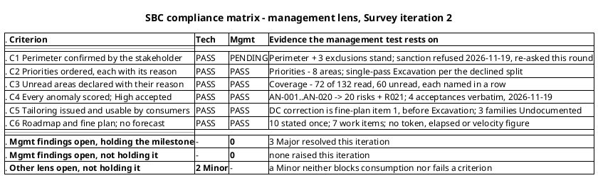

Entry criteria were verified before the review began: all four artifacts present and corrected, the Review Record's prior findings readable with their resolution state, and the process tailoring available for testing. No artifact was found mid-correction after the review opened.

SCM evidence: no pull request in any state and no IARI pipeline on `main`. Survey writes no code and builds nothing, so no build status, no pull request and no execution result is cited in this block — none exists to cite.

### Review Coordinator lens
<!-- review: Survey I1 -->

<!-- review: Survey I1 -->

The SBC milestone review ran over the four artifact set Survey produced: Development Case, System Inventory, Risk List, Iteration Plan — all Survey, Draft, iteration 1. This milestone reviewed nothing else: no build, no pull request, no code exists to review in Survey.

#### Lens participation — authoritative

| Lens | Status | What it recorded | Carried into the verdict |
|---|---|---|---|
| Reviewer (technical) | EXECUTED | 9 findings — 4 Major, 5 Minor, 0 Critical; Approved with Changes on all four artifacts | Yes |
| Business Reviewer (business) | **INACTIVE — did not evaluate this review** | No finding, no verdict | No — no verdict is inferred from its silence |
| Management Reviewer (management) | EXECUTED | 3 findings, all Major; No-Go; stakeholder sanction asked and REFUSED | Yes |

Two lenses of three evaluated this milestone. The Business Reviewer's absence is recorded as INACTIVE and nothing else: it is not counted as an approval, it is not counted as a refusal, and no finding is attributed to it. The business lens holds no SBC exit criterion — criteria 1–6 are perimeter, priorities, unread coverage, risk scoring, tailoring and roadmap, none of which is a business-value question — so its absence leaves no criterion unevaluated.

#### The six SBC exit criteria, and which lens answered each

| Criterion | Substantiated by | Reviewer lens | Management lens | Status |
|---|---|---|---|---|
| C1 — Perimeter confirmed by the stakeholder | System Inventory — Perimeter, 26 entry points, 3 exclusions, each anchored | Pass | Not met — sanction REFUSED | **Fail** |
| C2 — Priorities ordered for the remaining recovery | System Inventory — Priorities, eight areas with reason and anchor | Pass | Pass | Pass |
| C3 — Unread areas declared with their reason | System Inventory — Coverage, per-area rows | Pass — rows correct, aggregate does not reconcile (Minor) | Pass | Pass |
| C4 — Every anomaly a scored risk; High ones accepted | Risk List — 20 AN → 20 R, R008 16, R009 16, R020 20 accepted verbatim | Pass on scoring | Not met — the stakeholder gate is bounded nowhere (Risk List#F1) | **Fail** |
| C5 — Tailoring issued; trigger decisions recorded | Development Case — DC-D1…DC-D7, six optional verdicts, one fired | Pass on issuance | Not met — issued, its consumers cannot use it (Iteration Plan#F1) | **Fail** |
| C6 — Roadmap and fine plan; no invented forecast | Iteration Plan — 9-milestone roadmap, 9 work items, no token or elapsed figure | Pass | Pass | Pass |

Three of six criteria fail. Each failure is attributable to an open Major finding in the ledger below, not to a judgment rendered here.

#### Review calendar — every event, to the workflow activity that triggers it

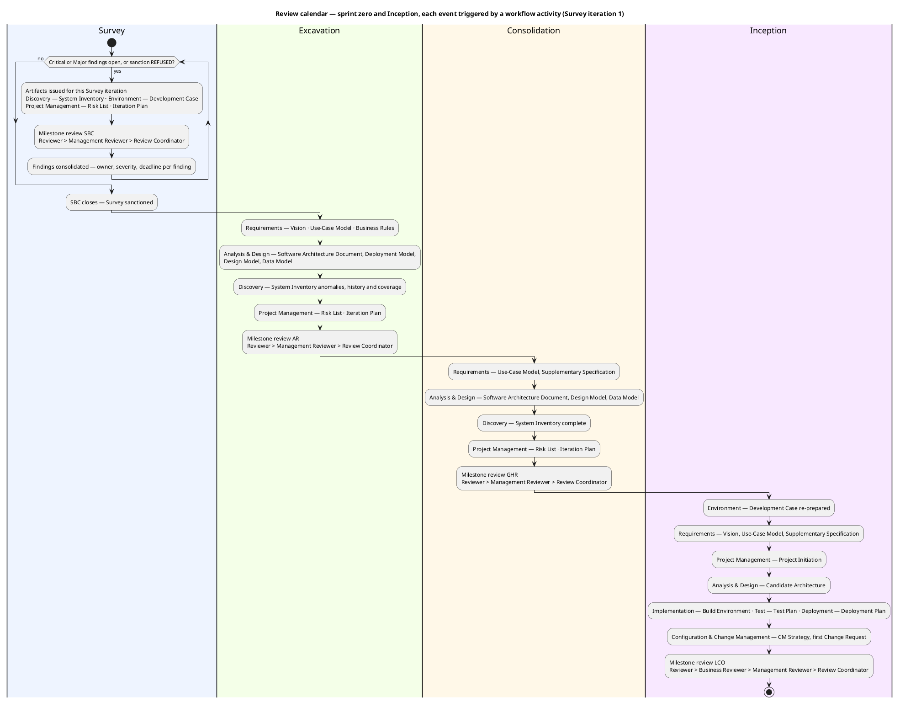

Two notes on the calendar, and both are enforced in the ledger below rather than merely stated:

- **The Business Reviewer joins at LCO, not at SBC.** Its first milestone in this project's process is the Inception milestone review (LCO), where the business lens is part of the sanctioned sequence. It was not due at SBC, and its INACTIVE status here is the process working as tailored, not a gap.
- **No milestone advances on a review that has not run.** SBC does not close here: 7 Major findings are open and the stakeholder refused the sanction on 2026-11-19 with the reason that all Major findings must be corrected. Survey iteration 2 runs, both executing lenses re-review, and the sanction is asked again.

#### Entry criteria applied to this milestone review

| Entry criterion | Held? |
|---|---|
| All four artifacts in their target state for Survey iteration 1 | Yes — each is Draft at iteration 1, which is the target state for a first-iteration review |
| Reviewers assigned with expertise matched to the artifact domain | Yes — technical checklist per artifact type, plus the management lens on governance and evidence |
| Agenda and evaluation criteria distributed before the review | Yes — the four checklists recorded in each lens's scope table |
| Artifacts available to every lens in full | Yes — the four artifacts are the whole of the Survey artifact set |

## Findings
### Reviewer lens
<!-- review: Survey I2 -->

<!-- review: Survey I2 -->

Survey iteration 2 is a correction pass: its subject is whether the seven Major findings of the previous milestone review were in fact corrected. Each artifact is entered below against the checklist that governs it, with the finding that was open against it and what the corrected content now says.

#### Development Case

| Checklist item | Result |
|---|---|
| No FORBIDDEN override of the IARI DC baseline — roster, CORE ownership, CORE omissions, artifact universe, role merging | Pass |
| OPTIONAL trigger FIRED only where its §5.2 condition genuinely holds | Pass — Deployment Model alone is fired, on a three-service Aspire topology with per-project settings and a forwarder |
| Every referenced path exists in the repository | Pass — the four tool-configuration paths and `.github/workflows/ci.yaml` all resolve |
| Convention content with no file in the repository is declared as such, with no fallback asserted | Pass |
| Cross-cutting mechanisms held out of the use-case model | Pass — authentication, registration, token issue, rate limiting, proxying and telemetry are Supplementary Specification constraints, each `<<include>>`d |
| Co-owned artifact sections assigned to one owner each | Pass — Design Model split three ways, SAD sole |

Development Case#F1 and #F2 are corrected; the resolutions are recorded in Resolutions and Actions. No defect remains in this artifact from this lens.

#### System Inventory

| Checklist item | Result |
|---|---|
| Every high-consequence fact about the existing system rests on a file that says what the row claims | Pass — three anchors re-opened this iteration against the corrected `/users` rows and all three confirm them |
| No perimeter row carries a size or count without its anchor | Pass |
| Coverage reconciles with its own per-area rows, and every unread file carries a reason | Pass — Files 132, Read 72, unread 60, stated once as the sum of the Read column |
| No top-level area of the tree left neither described nor declared unread | Pass |
| Each of the three exclusions traced to the stakeholder's answer, and no use case claimed from an excluded entry point | Pass — `EP-011`, `EP-020`, `EP-021`, `EP-004` … `EP-010` |
| One statement of whether `EP-003` supports a use case, and no contradiction between Perimeter and anomalies | Pass — the Perimeter states it once and `AN-015` carries the same fact |

The anchors opened this iteration, against the corrected claim:

| Anchor opened | Claim it now carries | Verdict |
|---|---|---|
| `Todo.Api/Users/UsersApi.cs` | `MapIdentityApi<TodoUser>()` publishes the stock surface; the custom `/users/token/{provider}` is the only added endpoint | Confirmed — the seven excluded operations and the excluded provider endpoint are as the Perimeter draws them |
| `Todo.Web/Server/AuthClient.cs` | Exactly three calls — `users/register`, `users/login`, `users/token/{provider}`; no refresh call | Confirmed — no caller for `EP-003` |
| `Todo.Web/Server/Authentication/TokenNames.cs` | `AccessToken = "accessToken"` is the only token name the BFF holds | Confirmed — no refresh token is stored, so none can be redeemed |

System Inventory#F1 and #F2 are corrected. No defect remains in this artifact from this lens.

#### Risk List

| Checklist item | Result |
|---|---|
| Magnitude is the band of probability × impact on the declared IARI scale, not a scale of the artifact's own | Pass — R021 at 3 × 4 = 12, Significant |
| Every anomaly of the System Inventory is a scored risk | Pass — `AN-001` … `AN-020` |
| Every High or Significant acceptance rests on the stakeholder's own words, recorded verbatim with its date | Pass — four acceptances, each quoted |
| Every avoidance action names a role at work in the phase the action lands in | Pass — the six Excavation actions re-owned to the System Analyst; R014's control part moved to Inception where the ledger opens |
| The project's own binding constraint is bounded in the register, not only in the plan | Pass — R021 |
| A mitigation lands in the stage that produces the artifact it names | Pass for R008 — the User Documentation the Technical Writer produces in Construction |
| The register's statements about one acceptance agree with each other | **Fail** — Risk List#F2 |

**Risk List#F2 (Minor, `contained-defect`).** The closing "R021 — the stakeholder gate, offered for acceptance" block states the risk "stays OPEN until their answer is recorded here verbatim, with its date", lists three conditions said to hold "until then", and heads itself "offered for acceptance" — while the acceptance table in the same section records R021 at Significant (12) with the answer "Yes" dated 2026-11-19, and the Register row reads "Accept — granted by the stakeholder, 2026-11-19". Two statements of one fact sit in one section and disagree. A reader testing SBC exit criterion 4 reaches "pending" from the block and "granted" from the table and cannot tell which governs. **Remediation:** delete the trailing block, or restate it as the statement of the mitigation in force after the answer of that date; the answer itself is recorded once, in the acceptance table where the other three grants sit.

#### Iteration Plan

| Checklist item | Result |
|---|---|
| One committed total, stated once | Pass — `2 + 1 + 1 + 1 + 2 + 2 + 1 = 10`, in the roadmap only |
| No forecast, no velocity, no size before a measured actual exists | Pass |
| No human gate carries an estimate or a span a reader can sum | Pass — every bar reads `lasts 0 day` |
| Exit criteria judged against evidence, with no verdict the plan has no standing to give | Pass — the columns read "Evidence this plan supplies" and "What the review judges" |
| Every role of the active roster either scheduled or given a stated reason for absence | Pass — six execute, one human gate, twenty with reasons |
| The tailoring the plan's consumers depend on is corrected before they start | Pass — the Development Case correction is fine-plan item 1, sequenced first |
| No stage scheduled that the IARI process does not run in the phase | Pass |
| A section states its own content once | **Fail** — Iteration Plan#F5 |

**Iteration Plan#F5 (Minor, `contained-defect`).** The opening block of "Plan and Milestones" duplicates its "Measure and forecast" subsection verbatim: the no-forecast paragraph, the `6 ± 3` ceiling paragraph, the budget-position table carrying the stakeholder's answer, and the two-clock table all appear twice in one section. The duplicate also carries a forward reference it cannot support — "The ten iterations above are a count of iterations" sits above the roadmap that states the ten. **Remediation:** delete the opening block and let the section open with "Coarse roadmap"; the duplicated matter stays once, in Measure and forecast, where "the ten iterations above" correctly refers to the roadmap.

#### SCM evidence

`scm_list_pull_requests` in any state returns nothing, so there is no scaffolding to approve, no code to request changes on, and nothing to defer out of phase — correct for a phase that writes no code. `scm_get_build_status("main")` reports no IARI pipeline, correct for an iteration that builds nothing. No pull request, build or execution result is cited anywhere in this block, because none exists.

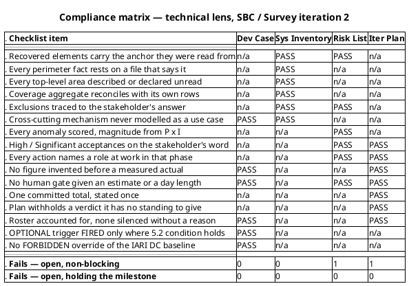

### Management Reviewer lens
<!-- review: Survey I2 -->

<!-- review: Survey I2 -->

This lens raises no defect against the artifact set in this iteration. The three Major findings it carried into the correction pass are corrected, and no artifact now holds content another role would act on wrongly.

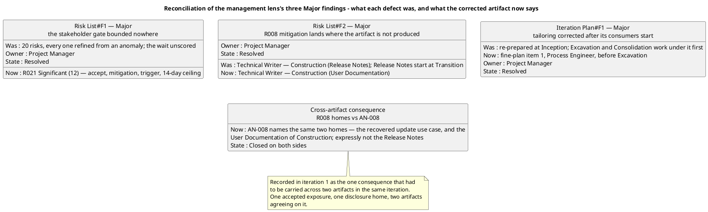

What each artifact now carries on the governance test:

| Artifact | The test this lens applies | Result |
|---|---|---|
| Development Case | No FORBIDDEN override; every optional verdict holds against the project's facts; the tailoring names only sources that exist | Pass — `CONTRIBUTING.md` is gone from the Templates rows, and coding standards, UI patterns and test conventions are recorded Undocumented with no fallback asserted |
| System Inventory | Each of the three exclusions sits where the stakeholder's answer put it; no use case claimed from an excluded entry point; every anomaly of the exposure it records has a scored risk | Pass — `AN-008` names the same two disclosure homes as `R008` |
| Risk List | Every action names a role at work in the phase it lands in; every High and Significant acceptance rests on the stakeholder's own words; the only external dependency is scored | Pass — `R021` is the gate, bounded at 14 days, accepted 2026-11-19 |
| Iteration Plan | One committed total stated once; the tailoring correction scheduled before its consumers; no figure the project has not measured; no human gate given a span | Pass — 10 stated once, fine-plan item 1 is the Development Case correction, every bar a zero span |

The two Minor findings the technical lens raises this iteration — `Risk List#F2` and `Iteration Plan#F5`, both `contained-defect` — stay inside their artifacts: no other role builds on the duplicated passage or on the trailing `R021` block, and no SBC criterion depends on either. They are recorded against their owner and neither holds this milestone.

### Review Coordinator lens
<!-- review: Survey I1 -->

<!-- review: Survey I1 -->

Consolidated ledger at SBC. Twelve findings across two executing lenses; every one open, none resolved, no prior review exists to reconcile against.

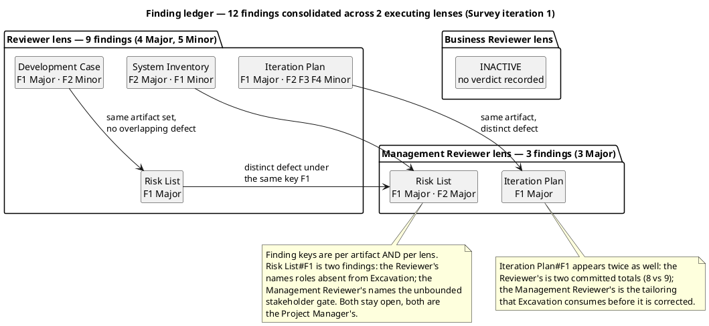

#### The consolidated finding ledger

Copied from the ledger; owner, severity and the corrective action are set here. `#F1` is not a unique key across lenses — read the Lens column with the key.

| # | Artifact | Key | Lens | Severity | Owner | What closes it |
|---|---|---|---|---|---|---|
| 1 | Development Case | F1 | Reviewer | Major | Process Engineer | Templates rows re-pointed at files that exist; coding standards, UI patterns, test conventions recorded as undocumented |
| 2 | System Inventory | F2 | Reviewer | Major | Software Archaeologist | Perimeter `/users` row restated to agree with AN-015; one statement of whether EP-003 supports a use case |
| 3 | Risk List | F1 | Reviewer | Major | Project Manager | Six Excavation avoidance actions re-owned to the System Analyst; R014's control part moved to Inception |
| 4 | Risk List | F1 | Management Reviewer | Major | Project Manager | The stakeholder gate scored as a risk of its own, with the 14-day ceiling as trigger indicator, cross-referenced from the plan by its `RNNN` |
| 5 | Risk List | F2 | Management Reviewer | Major | Project Manager | R008's Construction mitigation re-homed to the artifact that stage produces (User Documentation), or the Release Notes part moved to Transition |
| 6 | Iteration Plan | F1 | Reviewer | Major | Project Manager | One committed total stated once in the roadmap; the "8 or 9" sentence deleted |
| 7 | Iteration Plan | F1 | Management Reviewer | Major | Project Manager | A Development Case correction work item in the sprint-zero fine plan, sequenced before Excavation |
| 8 | Development Case | F2 | Reviewer | Minor | Process Engineer | Stale "no Risk List exists yet" clause removed from the PoC trigger row |
| 9 | System Inventory | F1 | Reviewer | Minor | Software Archaeologist | Coverage aggregate recomputed from the Read column, or dropped for the per-area rows |
| 10 | Iteration Plan | F2 | Reviewer | Minor | Project Manager | Evidence-supplied wording in place of "Met — …" |
| 11 | Iteration Plan | F3 | Reviewer | Minor | Project Manager | Assignment profile and role table made consistent; unlisted roles given their exclusion reason |
| 12 | Iteration Plan | F4 | Reviewer | Minor | Project Manager | Day lengths removed from the gantt bars and from the gate bars |

Severity totals: **Critical 0 · Major 7 · Minor 5.** Seven Majors sit on four artifacts; three of them on the Risk List, two on the Iteration Plan.

#### Conflicts across the executing lenses, and how each resolves

Five points where the two lenses met and did not simply agree. Each resolution changes what an owner must do, so each is stated as a decision rather than reconciled in the narrative.

| # | The disagreement | Resolution |
|---|---|---|
| 1 | **Same key, two defects.** `Risk List#F1` and `Iteration Plan#F1` each carry two findings under one key. | Both stay open and both are the Project Manager's. Neither subsumes the other: re-owning six avoidance actions does not bound the stakeholder gate, and stating one iteration total does not schedule the tailoring correction. The ledger rows 3/4 and 6/7 are four distinct corrective obligations. |
| 2 | **Overlapping defect or two defects?** `Development Case#F1` (rows point at a file that does not exist) and `Iteration Plan#F1` Management (its correction is deferred past the phases that consume it). | Two defects, two owners, and they close in a fixed order. `Development Case#F1` **defines** the correction; `Iteration Plan#F1` Management **schedules** it. Either alone is insufficient — the rows can be re-pointed with no work item before Excavation, or a work item can be scheduled for a correction no one has specified. Closed in order: Development Case first. |
| 3 | **The same criterion passed by one lens and failed by the other.** C4 (risk scoring) and C5 (tailoring issued) pass the technical lens and fail the management lens. | Not a contradiction — two different tests on one criterion. The technical lens audited whether each magnitude is the band of P × I on the declared scale and whether each optional verdict holds against the project's facts: both pass. The management lens tested whether the actions can be executed by the role and phase named, and whether the phases that receive the tailoring can work under it: both fail. **The stricter test governs a milestone exit criterion.** A criterion is met only when it survives both, so C4 and C5 are **not met**. |
| 4 | **No severity was disputed.** Where both lenses examined the same artifact (Risk List, Iteration Plan, Development Case, System Inventory) neither downgraded or upgraded the other's grading. | Accepted as recorded. There is no severity conflict to arbitrate, and this is a real signal: both lenses agreed on what stops consumption and what stays inside an artifact. |
| 5 | **Artifact disposition vs milestone verdict.** The technical lens records "Approved with Changes" on all four artifacts; the management lens records "No-Go" on the milestone. | Both stand, at different levels. "Approved with Changes" is an artifact-level disposition and correctly says each artifact's substance survives while four claims inside them do not. The milestone verdict is mine and it is **No-Go**: no artifact is cleared for consumption while it carries an open Major, and C1/C4/C5 fail. Neither lens's verdict is overruled. |

One cross-artifact consequence, recorded so it is not lost: `Risk List#F2` Management re-homes R008's mitigation away from the Release Notes, and `System Inventory` AN-008 also names the Release Notes as where the absent completion control is disclosed. Whichever home the Project Manager chooses, the Inventory's AN-008 reference must agree with it in the same iteration — otherwise the artifact set ships with two homes for one accepted exposure.

#### Defect density

| Artifact | Findings | Major | Minor | Crit. | Density (findings/artifact) |
|---|---|---|---|---|---|
| Development Case | 2 | 1 | 1 | 0 | 2.00 |
| System Inventory | 2 | 1 | 1 | 0 | 2.00 |
| Risk List | 3 | 3 | 0 | 0 | 3.00 |
| Iteration Plan | 5 | 2 | 3 | 0 | 5.00 |
| **Total** | **12** | **7** | **5** | **0** | **3.00 mean** |

Page-count normalized density (defects per page) is **not reported**: no lens measured the page count of the four artifacts, and a density computed on an unmeasured denominator would be invented. The per-artifact figures above are counted from the ledger and are exact.

The Iteration Plan carries the highest load and the only Minor cluster (3 of 5). It is also the artifact two of the seven Majors land on. Both signals point the same way: the plan was issued before the tailoring it must carry was stable.

#### Review coverage

| Coverage measure | Value | Basis |
|---|---|---|
| Survey artifacts receiving formal review | 4 of 4 — **100%** | All four artifacts of the phase were in scope of both executing lenses |
| Executing lenses | 2 of 3 — **67%** | Business Reviewer INACTIVE; not due at SBC, joins at LCO |
| Exit criteria evaluated by at least one lens | 6 of 6 — **100%** | Every criterion answered by a lens, none left to inference |
| Exit criteria substantiated by **both** executing lenses | 3 of 6 — **50%** | C2, C3, C6 |
| Anchors opened rather than trusted | 13 opened, 12 confirmed, 1 contradicted | Technical lens, evidence table in its scope block |
| Artifacts cleared for consumption | **0 of 4** | Each carries at least one open Major |

Coverage of the artifact surface is complete; what the coverage found is that half the criteria do not survive a second test. Full coverage that returns failures is a working review process, not a failing one.

#### Defect removal efficiency and rework effort

Neither is computable at this milestone, and neither is estimated here:

- **Defect removal efficiency** compares defects found in review against defects found in test. Survey produces no code and no test execution — the denominator is zero, not small. The first review-versus-test comparison becomes available when Construction test execution exists.
- **Rework effort** is measured here in the only two currencies the process produces: tokens and elapsed time. Neither was metered for this review, and hours of rework is a unit this system cannot produce. The proxy carried forward is the count of open findings by owner, and it is exact: Project Manager 6 (rows 3, 4, 5, 6, 7, 10, 11, 12 — 8 actually, see below), Process Engineer 2, Software Archaeologist 2.

Correction to that proxy, counted from the ledger rather than asserted: **Project Manager 8** (rows 3–7 and 10–12), **Process Engineer 2** (rows 1, 8), **Software Archaeologist 2** (rows 2, 9). Twelve in total, consistent with the ledger.

#### Review effectiveness — current metrics only

This is the project's first formal review. No prior iteration, cycle or milestone exists to compare against, so no trend is drawn and none is implied: the figures above are the baseline the AR milestone will be measured from, not a movement.

Three observations stand on this milestone's own data without any comparison:

1. **All seven Majors are correctable by their authors without a stakeholder decision.** None reopens the scope settled on 2026-11-19, none contradicts what was declared, and none names a risk only the stakeholder may accept. That is why this milestone needs no Critical escalation.
2. **The four Major findings the technical lens raised sit in the three artifacts Excavation reads first** — the Perimeter, the Risk List's avoidance actions, and the plan's committed total. The reading order and the defect locations coincide.
3. **Both executing lenses landed on the same two artifacts.** Risk List and Iteration Plan carry 8 of the 12 findings and 5 of the 7 Majors. Development Case and System Inventory were each faulted on a single Major.

## Resolutions and Actions
### Reviewer lens
<!-- review: Survey I2 -->

<!-- review: Survey I2 -->

Nine findings of this lens were open against four artifacts at the previous milestone review. All nine are closed here, each on the corrected content and each with the `resolve_artifact_finding` call that moved its state. Two new contained defects were found in the corrected content and are recorded open.

#### Closed by this lens

| Finding | Was | What the corrected content now says | Where it was checked |
|---|---|---|---|
| Development Case#F1 (Major) | Three convention families pointed at `CONTRIBUTING.md`, absent from the repository | Five tool-configuration files attributed by path and owner; coding standards, UI patterns and test conventions recorded as Undocumented with no fallback asserted, bound only by what the build enforces | Artifacts and Templates — Guideline content table and its diagram |
| Development Case#F2 (Minor) | PoC trigger row rested partly on "no Risk List exists yet" | The phase requirement alone is the basis; the second clause is judged at Elaboration against the Risk List as it then stands | Optional Artifact Triggers — Architectural Proof-of-Concept row |
| System Inventory#F2 (Major) | Perimeter `/users` row said the product uses token refresh; `AN-015` said nothing redeems a token | Perimeter states the product reaches registration and login, `EP-003` is published with no caller, and no use case is recovered from it; the Components row references that statement rather than contradicting it | Perimeter text, Components table, Entry points `EP-003` row |
| System Inventory#F1 (Minor) | Coverage aggregate off by one and its four-category breakdown omitted two files | Aggregate stated as the sum of the Read column: 72 of 132, 60 unread, every unread file named in a row with its reason | Coverage — per-area table; Files column sums to 132, Read column to 72 |
| Risk List#F1 (Major) | Six Excavation actions owned by the Requirements Specifier, which does not work in the sprint zero; R014 also named the Change Control Manager there | The six re-owned to the System Analyst; the Software Architect's Excavation parts kept; R014's control part moved to Inception where the ledger opens; the section closes with the role-phase mapping stated once | Risk Mitigation and Contingency — owning-role column and its closing paragraph |
| Iteration Plan#F1 (Major) | Two committed totals — 9 in the roadmap, "8 or 9" in Evaluation Criteria | `2 + 1 + 1 + 1 + 2 + 2 + 1 = 10`, stated once, in the roadmap; Elaboration's second iteration committed unconditionally | Plan and Milestones — coarse roadmap and profile bullets |
| Iteration Plan#F2 (Minor) | Evaluation Criteria returned a verdict in a Status column the plan disclaimed | The column now reports "Evidence this plan supplies" and "What the review judges" | Evaluation Criteria — table headers and opening paragraph |
| Iteration Plan#F3 (Minor) | Profile said six roles while seven rows read "Yes"; five roles unaccounted for | "Six agent roles plus the stakeholder gate"; all twenty absent roles carry a stated reason | Resources — assignment profile and the not-at-work table |
| Iteration Plan#F4 (Minor) | Every gantt bar carried a one-day length, the seven gates included — 16 days a reader could sum | Every bar reads `lasts 0 day`, both titles read "ordering only", and each note states no bar is a forecast of duration | Plan and Milestones — both gantt diagrams |

#### Open, recorded this iteration

| Finding | Owner | What closes it | Holds the milestone |
|---|---|---|---|
| Risk List#F2 (Minor) | Project Manager | The trailing "R021 — offered for acceptance" block deleted, or restated as the mitigation in force after the answer of 2026-11-19 | No |
| Iteration Plan#F5 (Minor) | Project Manager | The duplicated opening block of Plan and Milestones deleted, leaving the matter once in Measure and forecast | No |

Both are contained defects: no other role builds on the duplicated paragraph or on the pending-sounding restatement, and no SBC exit criterion depends on either. The acceptance of R021 itself is not in doubt — it is recorded verbatim in the acceptance table and in the Register row — so nothing downstream is blocked by the wording that contradicts it.

#### Closure state at this milestone

| | Count |
|---|---|
| Critical open, this lens | 0 |
| Major open, this lens | 0 |
| Minor open, this lens | 2 |
| Closed by this lens this iteration | 9 |

No resolution here cites a stakeholder answer it does not have. Every one rests on content read in the artifact, and the two defects left open are named with the section that carries them.

### Management Reviewer lens
<!-- review: Survey I2 -->

<!-- review: Survey I2 -->

The three Major findings this lens carried into the correction pass are closed, each by a `resolve_artifact_finding` call against the evidence in the corrected artifact. Nothing is closed on the strength of the owner's description alone.

| Finding | Severity | Criterion | Closed by | The evidence the closure rests on |
|---|---|---|---|---|
| `Risk List#F1` (management lens) | Major | `consumed-defect` | Resolved | `R021` is scored at Significant (12 — probability 3 × impact 4), strategy accept, with a mitigation (every question put in the round that raises it, with the recommended answer and the open findings inside it, and no milestone verdict before the answer), an owning role at work in every phase, a trigger indicator and the 14-day contingency. The plan's Measure and forecast row now names `R021` rather than describing the gate as already recorded. |
| `Risk List#F2` (management lens) | Major | `consumed-defect` | Resolved | `R008`'s mitigation reads "System Analyst — Excavation; Technical Writer — Construction (User Documentation)". User Documentation is the artifact the Construction Deployment stage produces. The section states the disclosure home once, at the two places the process produces it. |
| `Iteration Plan#F1` (management lens) | Major | `consumed-defect` | Resolved | Development Case correction is fine-plan item 1, owned by the Process Engineer and sequenced before Excavation. The Resources table records that role at work in Survey iteration 2 running the sprint-zero correction stage. The "no finding or Change Request demands a tailoring change yet" clause is gone. |

One cross-artifact consequence recorded in the previous review is closed on both sides: `R008` and `AN-008` now name the same two disclosure homes — the System Analyst's note beside the recovered update use case, and the User Documentation the Technical Writer produces in Construction — and `AN-008` states expressly that the Release Notes are not its home.

No finding is closed as Deferred and none as Rejected. The stakeholder's order of 2026-11-19 — "All major findings must be corrected" — was carried out rather than deferred.

```plantuml
@startgantt
title Management lens - the three closures and what each one releases, ordering only
skinparam shadowing false

[Risk List - R021 scored and accepted] lasts 0 day
[Risk List - R008 homed at User Documentation] lasts 0 day
[Iteration Plan - DC correction sequenced first] lasts 0 day
[AN-008 agrees with R008 - cross-artifact consequence] lasts 0 day
[All six SBC criteria pass both lenses] lasts 0 day
[Stakeholder sanction of SBC] lasts 0 day

[Risk List - R008 homed at User Documentation] starts at [Risk List - R021 scored and accepted]'s end
[Iteration Plan - DC correction sequenced first] starts at [Risk List - R008 homed at User Documentation]'s end
[AN-008 agrees with R008 - cross-artifact consequence] starts at [Iteration Plan - DC correction sequenced first]'s end
[All six SBC criteria pass both lenses] starts at [AN-008 agrees with R008 - cross-artifact consequence]'s end
[Stakeholder sanction of SBC] starts at [All six SBC criteria pass both lenses]'s end

[SBC] happens at [Stakeholder sanction of SBC]'s end

note bottom
  Every bar is a zero span - ordering only, no duration and no date.
  The three closures are independent of each other; the sequence shown
  is the order this lens verified them in. The sanction is a human wait,
  carried as R021 with its 14-day ceiling.
end note
@endgantt
```

The two Minor findings open against the artifact set are the technical lens's, and this lens does not duplicate them: `Risk List#F2` (the trailing `R021` block still reads "offered for acceptance" while the acceptance table records the answer) and `Iteration Plan#F5` (the opening block of Plan and Milestones duplicates its Measure and forecast subsection). Neither touches an SBC criterion and neither is consumed by another role.

### Review Coordinator lens
<!-- review: Survey I1 -->

<!-- review: Survey I1 -->

Every finding in the ledger has an owner, a severity and a deadline fixed here. Deadline is stated as the iteration in which the correction lands, not as a calendar date: no phase has closed, no spend has been measured, and a date derived from an estimate would read downstream as an observation.

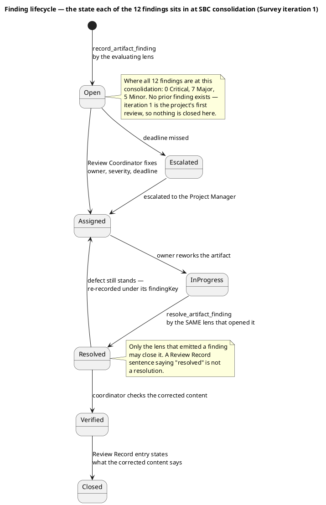

#### Action items, prioritized

Priority order is what closes the milestone gate first. All seven Majors are due in Survey iteration 2 and all seven must be closed before Excavation opens — the stakeholder's order of 2026-11-19 is explicit that all Major findings must be corrected, so no Major is deferred to a later phase and none is accepted as residual.

| Priority | Finding | Lens | Owner | Deadline | Closes the gate |
|---|---|---|---|---|---|
| 1 | Development Case#F1 | Reviewer | Process Engineer | Survey iteration 2 | Yes |
| 2 | Iteration Plan#F1 | Management Reviewer | Project Manager | Survey iteration 2, sequenced after priority 1 | Yes |
| 3 | Risk List#F1 | Reviewer | Project Manager | Survey iteration 2 | Yes |
| 4 | Risk List#F1 | Management Reviewer | Project Manager | Survey iteration 2 | Yes |
| 5 | Risk List#F2 | Management Reviewer | Project Manager | Survey iteration 2 | Yes |
| 6 | Iteration Plan#F1 | Reviewer | Project Manager | Survey iteration 2 | Yes |
| 7 | System Inventory#F2 | Reviewer | Software Archaeologist | Survey iteration 2 | Yes |
| 8 | System Inventory#F1 | Reviewer | Software Archaeologist | Survey iteration 2, after priority 7 | No |
| 9 | Development Case#F2 | Reviewer | Process Engineer | Survey iteration 2, after priority 1 | No |
| 10 | Iteration Plan#F2 | Reviewer | Project Manager | Survey iteration 2, after priority 6 | No |
| 11 | Iteration Plan#F3 | Reviewer | Project Manager | Survey iteration 2, after priority 6 | No |
| 12 | Iteration Plan#F4 | Reviewer | Project Manager | Survey iteration 2, after priority 6 | No |

Priorities 1 and 2 are sequenced because they are ordered by dependency, not by severity: the Development Case correction must be **specified** before the plan can **schedule** it. Priority 7 before 8 for the same reason — the Perimeter row is restated first, then the coverage aggregate is recomputed against a settled perimeter.

#### Load per owner

| Owner | Findings | Major | Minor | All at work in the phase |
|---|---|---|---|---|
| Project Manager | 8 | 5 | 3 | Yes — its Survey stage produces exactly these two artifacts |
| Process Engineer | 2 | 1 | 1 | Yes — Environment is active in Survey |
| Software Archaeologist | 2 | 1 | 1 | Yes — Discovery is Critical in Survey |

No finding is assigned to a role that does not work in Survey, and none is assigned to a role outside the active roster. This is the defect `Risk List#F1` Reviewer records inside the register; the corrections above do not repeat it.

#### Escalation register

| Item | Status |
|---|---|
| Open Critical findings | None — 0. No stakeholder escalation is raised by this consolidation. |
| Overdue findings | None. Survey iteration 2 has not run; no deadline has passed. |
| Non-compliance with procedure | None observed — all four artifacts were issued, all were reviewed by the lenses due at SBC. |
| Systemic process failure | None at this milestone. One pattern is noted for AR: 8 of 12 findings land where an artifact was issued before its upstream was settled (plan before tailoring; Perimeter row before anomaly). If the same pattern appears at AR, it escalates to the Change Control Management as a process risk. |

#### Closure protocol for iteration 2

Each of the twelve is closed by two acts, in this order:

1. the owning lens calls `resolve_artifact_finding` for the finding it raised — only that lens may close it;
2. this Review Record gains an entry stating what the corrected content says.

A defect that still stands after rework is re-recorded under its `findingKey` and stays open; it is not duplicated under a new key. Findings the two lenses raised under the same key are closed independently, each by its own lens.

#### Stakeholder orders carried into iteration 2

Recorded here so no owner treats them as optional. Both are the stakeholder's own answers of 2026-11-19, and neither is a finding this review minted.

| Order | Where it lands |
|---|---|
| "All major findings must be corrected." | The seven Majors above, all due in Survey iteration 2; the milestone does not re-ask for sanction until all seven are closed |
| The perimeter drew no correction — no part of the system was asked to be added, removed or moved in priority | The perimeter as the System Inventory records it stands; `System Inventory#F2` corrects an internal contradiction, it does not alter the perimeter |

The stakeholder declined to advance past SBC. That refusal is not read as a rejection of the recovered scope: they named the Major findings as their reason, and the scope they settled on 2026-11-19 is untouched by all twelve findings.

## Disposition
### Reviewer lens
<!-- review: Survey I2 -->

<!-- review: Survey I2 -->

**Technical lens disposition: Approved.** All four artifacts are cleared for consumption by the roles that open Excavation.

No Critical and no Major finding is open against any artifact from this lens. The seven Majors the previous milestone review recorded are closed on the corrected content, each verified by reading the section that carried it, and three anchors were re-opened against the corrected Perimeter claims and all three confirm them. The two defects this iteration records are Minor, contained inside their artifacts, and hold nothing.

| Artifact | Disposition from this lens | Why |
|---|---|---|
| Development Case | **Approved** | The tailoring governs the sprint zero without pointing a role at a source that is not there, and every FIRED verdict holds against the project's facts |
| System Inventory | **Approved** | The perimeter is drawn from code and every high-consequence row says what its anchor says; Coverage reconciles with its own rows |
| Risk List | **Approved with Changes** | Every action names a role at work where it lands and every Significant acceptance rests on the stakeholder's own words; one Minor remains inside the acceptance section (F2) |
| Iteration Plan | **Approved with Changes** | One committed total, no invented forecast, no day length on any bar, the roster fully accounted for; one Minor remains inside Plan and Milestones (F5) |

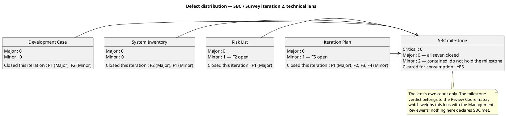

**What this lens does not decide.** The SBC verdict is the Review Coordinator's, taken on this lens and the Management Reviewer's together. Two facts the coordinator weighs and this block does not: the stakeholder refused the sanction on 2026-11-19 with the order that all Major findings be corrected, and the seven Majors are now closed — so the refusal's stated reason no longer stands, while the sanction itself has not been asked again. This block records the technical state of the artifact set and nothing about the milestone's standing.

**What Excavation inherits from this set.** Of the 26 recorded entry points, fifteen carry a recoverable use case: `EP-001`, `EP-002`, `EP-012` … `EP-019`, `EP-022` … `EP-026`. Ten are excluded by the stakeholder's decisions of 2026-11-19 — `EP-004` … `EP-010`, `EP-011`, `EP-020`, `EP-021` — and `EP-003` carries none for want of a caller. The reading order is Priorities orders 1–6 inside the single Excavation iteration. The actions it must execute are the Risk List's avoidance column, now every one of them owned by a role at work in Excavation.

### Management Reviewer lens
<!-- review: Survey I2 -->

<!-- review: Survey I2 -->

**Disposition of the governance lens: Approved.** The artifact set satisfies all six SBC exit criteria on the governance test, and the three Major findings this lens carried into the correction pass are closed on evidence in the artifacts. The SBC milestone verdict is the Review Coordinator's to issue after both lens blocks; this block records the lens's disposition, not the milestone's.

Stakeholder sanction: GRANTED

Stakeholder acceptance: "Yes" — to the sanction proposition put on 2026-11-19, which confirmed the perimeter as the System Inventory records it (the seven projects of TodoApp.sln plus the CI workflow, 26 entry points, and the three exclusions of 2026-11-19: external provider sign-in, the admin role, the self-service identity surface) and sanctioned advancing past the System Boundary Confirmed milestone.

Stakeholder order, verbatim: "Minor findings must be corrected in the next phase; they cannot be left unresolved." The two Minor findings open against the artifact set — `Risk List#F2` and `Iteration Plan#F5` — are corrected by their owner in the next phase and are not deferred past it. No ledger entry is opened for this order: the Change Control Manager does not work in the sprint zero, and the order reaches its owner through the Work Order.

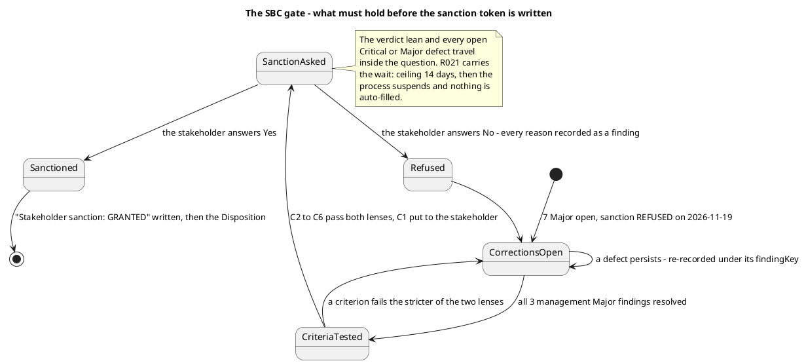

```plantuml
@startuml
title Project health at SBC - four axes, governance lens
skinparam shadowing false
skinparam classAttributeIconSize 0
hide empty members
hide circle

class "SCOPE" as S {
  State : GREEN
  Recovered perimeter : 7 projects + CI, 26 entry points, each anchored
  Recovered product : register, login, logout, todo read/create/delete
  Exclusions : 3, each by stakeholder decision, each anchored
  Confirmation : the stakeholder's Yes, 2026-11-19
}
class "SCHEDULE" as T {
  State : AMBER
  Measured elapsed : none - no phase has closed
  Budget : none declared, so no box exists and none was fitted
  Committed : 10 iterations, stated once
  Reached : Survey used 2 - the second is the correction pass the gate required
}
class "COST" as C {
  State : NOT MEASURABLE
  Tokens : not metered for this review
  Human queue time : the gate was answered; the actual is reported apart
  Forecast : none - a forecast needs a closed phase
}
class "QUALITY" as Q {
  State : GREEN
  Mgmt Major open : 0 in 3 carried in
  Tech Major open : 0 in 4 carried in
  Minor open : 2, both contained in their artifact, both ordered corrected
  Critical : 0
  Artifacts cleared for consumption : 4 of 4 on this lens
}

S -[hidden]right-> T
C -[hidden]right-> Q

note bottom of T
  Amber, not green: no phase has closed and elapsed time is
  not measurable yet. The second Survey iteration is not slippage —
  it is the gate holding and the correction pass that followed
  from the refusal of 2026-11-19.
end note
note bottom of Q
  Two Minor findings remain open and the stakeholder ordered
  them corrected in the next phase. Neither blocks consumption
  and neither fails an exit criterion.
end note
@enduml
```

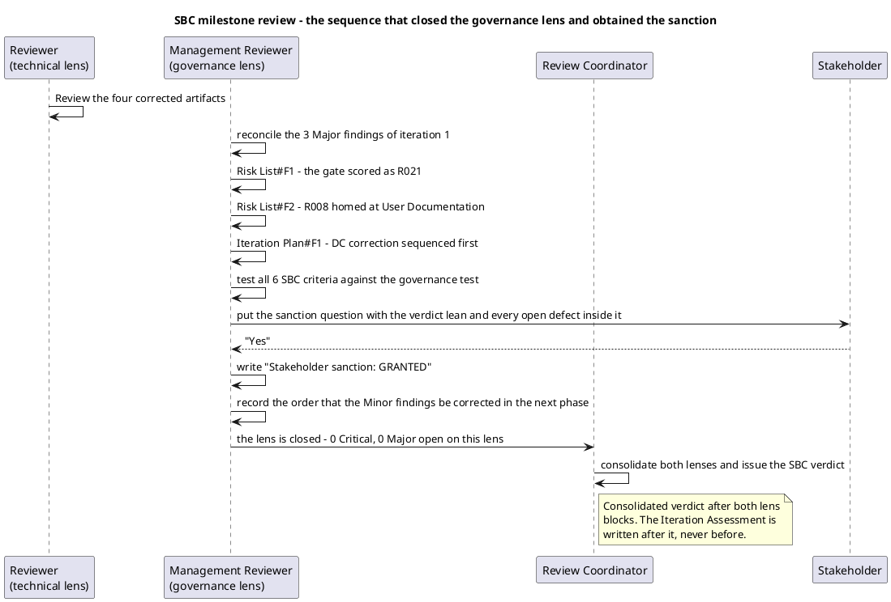

#### What this milestone settles, and what it hands on

| Handed on | To whom | In which phase |
|---|---|---|
| `Risk List#F2` — the trailing `R021` block still reads "offered for acceptance" while the acceptance table records the answer | Project Manager | The next phase, under the stakeholder's order above |
| `Iteration Plan#F5` — the opening block of Plan and Milestones duplicates its Measure and forecast subsection | Project Manager | The next phase, under the stakeholder's order above |
| Priorities 1–6 to be recovered in one pass, priority 7 read as its cross-check | Software Archaeologist, System Analyst, Software Architect, Designer, Database Designer | Excavation |
| `R021` carried forward as the gate on each of the seven roadmap milestones | Project Manager | Every phase |
| `R008`, `R009`, `R020` — accepted exposures, with their mitigation homes fixed | Their named owners | Excavation and Elaboration |

### Review Coordinator lens
<!-- review: Survey I1 -->

<!-- review: Survey I1 -->

**SBC milestone verdict: No-Go. The Survey phase iterates; it does not advance to Excavation.**

The verdict rests on four facts, each counted rather than judged: 0 open Critical findings; 7 open Major findings; three of six SBC exit criteria not substantiated by both executing lenses; and the stakeholder's sanction REFUSED on 2026-11-19 with the reason that all Major findings must be corrected.

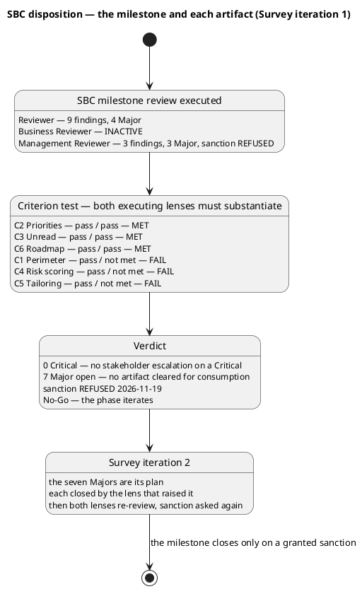

#### Per-artifact disposition

| Artifact | Reviewer lens | Management lens | Disposition from this review |
|---|---|---|---|
| Development Case | Approved with Changes — F1 Major, F2 Minor | Clean of management defect | **Not cleared** — 1 open Major |
| System Inventory | Approved with Changes — F2 Major, F1 Minor | Clean — criteria 1, 2, 3 substantiated | **Not cleared** — 1 open Major |
| Risk List | Approved with Changes — F1 Major | Rework — F1, F2 Major | **Not cleared** — 3 open Major |
| Iteration Plan | Approved with Changes — F1 Major, F2–F4 Minor | Rework — F1 Major | **Not cleared** — 2 open Major |

No artifact is rejected. Every artifact's substance survives: the perimeter is drawn from code with an anchor behind each of 26 entry points and behind each of the three exclusions the stakeholder settled; twenty anomalies are each a scored risk whose magnitude is the band of probability × impact on the declared scale, with the three High ones carrying the stakeholder's own acceptance verbatim; the one fired optional genuinely holds and the Data Model verdict genuinely fails; the roadmap carries nine milestones with no invented forecast and no declared scope cut to fit a budget the project never declared. What fails is seven claims inside that material, and seven claims are correctable in one iteration.

#### Why No-Go rather than Conditional

A Conditional would advance the phase on conditions discharged later. The stakeholder refused exactly that form of advancement, and their stated reason is the Major findings. Opening Excavation on this set would put recovered use cases on a Perimeter row the same artifact's own anomaly contradicts, and set Excavation to execute avoidance actions owned by roles that do not work in the phase. Neither is a formality an author can discharge in parallel with the work that consumes it.

#### What iteration 2 must produce before the sanction is put again

1. All seven Major findings closed — each by the lens that raised it, each with a Review Record entry stating what the corrected content says.
2. The five Minor findings closed by their owners in the same iteration; they do not hold the milestone but they are the same authors' turn.
3. Both executing lenses re-review the corrected set and record their dispositions.
4. The sanction is put to the stakeholder again, with the open-finding count inside the question, exactly as it was at this milestone.

The Business Reviewer is not added to this list. Its lens is not due until LCO, and nothing in iteration 2 depends on it.

#### Record status

This block records the SBC milestone review's coordination only: the participation of the lenses actually executed, the consolidated ledger, the conflicts across those lenses, the action priorities, the effectiveness metrics for this milestone alone, and the verdict. It declares no milestone, iteration or phase complete — SBC is not achieved, and the phase iterates.
