## Document Control
### Reviewer lens
<!-- review: Excavation I4 -->

<!-- review: Excavation I4 -->

- Phase: Excavation
- Status: Technical lens complete for the AR (end-of-Excavation) milestone review, iteration 4. Three findings of this lens closed at their sources; one Minor recorded. No Major and no Critical stands from this lens.
- Milestone Target: end-of-Excavation (AR) — not achieved
- Iteration: 4, Cycle 1
- Owner: Reviewer

### Management Reviewer lens
<!-- review: Excavation I4 -->

- Phase: Excavation
- Status: Lifecycle Milestone Review (AR) taken at iteration 4 — 0 Critical, 0 Major, 1 Minor open. Gate H4 put a fourth time and granted
- Milestone Target: end-of-Excavation (AR) — sanctioned by the stakeholder at gate H4 put 4 on 2026-11-23; the milestone verdict is the Review Coordinator's, issued after this review
- Iteration: 4, Cycle 1
- Review point: Lifecycle Milestone Review, exit-criteria lens
- Reviewers executed: Reviewer, then Management Reviewer; the Business Reviewer is inactive at AR
- Verdict this lens issues: Go
- Stakeholder sanction: GRANTED
- Stakeholder acceptance: "Yes" — asked whether, on records that agree with the set they report, they sanction advancing past the Architecture Recovered milestone into Consolidation, having confirmed at the third put that the recovered set is the model of their system

### Review Coordinator lens
<!-- review: Excavation I3 -->

<!-- review: Excavation I3 -->

- Phase: Excavation
- Status: Consolidation complete for the AR (end-of-Excavation) milestone review, iteration 3, cycle 1 — 2 open Major entries over 1 distinct defect, 3 open Minor, 0 Critical
- Milestone Target: end-of-Excavation (AR) — not achieved; the phase auto-iterates
- Iteration: 3, Cycle 1
- Owner: Review Coordinator

## Review Scope and Criteria
### Reviewer lens
<!-- review: Excavation I4 -->

<!-- review: Excavation I4 -->

#### Review scope — Excavation iteration 4, technical lens

The ten artifacts of the recovered set, read at the sections the corrections of this iteration touch and at the sections this lens has found defective in earlier passes. Every closure asserted below was verified at its source — the registered graph, the file the anchor names, or the peer artifact as it now reads — and never taken from a finding's own remedy or from an owner's report of it.

| Artifact | Reviewed for | Iteration-4 outcome |
|---|---|---|
| Development Case | Document Control; the Disciplines and Intensity table; ACT-DC-01 as the project's role schedule; all six optional-trigger verdicts | 1 Minor recorded — F4, ACT-DC-01 omits Project Management after Survey |
| System Inventory | Coverage arithmetic and headline; every anchor spot-checked | Clean |
| Risk List | R032 against the artifact it names; R030 and R031 left unchanged; the grant band | Clean — F3 closed |
| Iteration Plan | Every criteria and objectives cell against the artifact its evidence names; the Closes column; the fine plan's sequence | Clean from this lens — F4 closed |
| Vision | Use-case count against the Use-Case Model | Clean |
| Use-Case Model | R6 against `AN-024`; the five `COMP-014` rows against a fresh graph query; the trace rows | Clean |
| Supplementary Specification | Document Control against the set; the recovered figures under `AN-024` and `AN-023` | Clean — F3 closed |
| Software Architecture Document | `SP1`, `M3`, the bounded-load row and the component trace rows against the graph | Clean |
| Deployment Model | Environment Mapping against the files it maps | Clean |
| Design Model | Anomaly citations; `PD-D3` against `AN-025`; the trace rows against the graph | Clean |

#### Criteria applied

This milestone's question is EXIT CRITERIA. The nine items are those the two previous passes used, unchanged, so that a pass's verdict is comparable with the ones before it. Each is a test with a pass or fail answer, and each is decided on the artifact's own text.

| # | Criterion | What passes |
|---|---|---|
| C1 | Recovered, not declared | No element claims scope the delivery does not hold; a recovered element cites the file it was read from |
| C2 | Anchored | Every recovered element rests on the file and lines it names |
| C3 | No cross-cutting mechanism as a use case | Authentication, sync, logging, audit, health and migration are mechanisms, not actor goals |
| C4 | One goal, one use case | A multi-actor process is one use case with scenarios; never one per actor |
| C5 | Trace rows carried | Every row a trace-chain artifact declares is carried by the registered graph |
| C6 | No suspect trace open at the phase close | No edge named in a declared row carries a SUSPECT marking |
| C7 | Document Control current | Phase, Status, Milestone Target and Iteration name the phase and iteration whose review the artifact is under |
| C8 | Diagram-dominant | Formal UML carries the content; prose supplements what a diagram cannot express |
| C9 | Asserted state matches its subject | A cell or sentence stating another artifact's state agrees with that artifact as it now reads |

#### SCM and build evidence

The repository reports no pull request in any state, and no IARI pipeline file exists, so there is no diff to dispose and no CI result to weigh at this gate. That is the phase's correct state and not a gap: Excavation produces no production code, the tree's own code is unchanged since `307a1ea`, and this iteration's work is four corrections across two owners. Every disposition below rests on artifact, graph and code evidence, and the absence of SCM evidence is stated here rather than passed over in silence.

#### Evidence verified at source this iteration

| Fact | Where checked | Read at | Result |
|---|---|---|---|
| The request budget is halved in every environment the delivery starts in | Use-Case Model R6 and its note; Supplementary Specification R8, P1, S2, M3; Software Architecture Document SP1, M3 and the bounded-load row; Deployment Model Environment Mapping | `Todo.Api/appsettings.Development.json` — `RateLimiting` `TokenLimit` 50, `TokensPerPeriod` 50, `QueueLimit` 50; `Todo.Api/Extensions/RateLimitExtensions.cs:22-24` — 100 / 100 / 100 | Reproduces at the file. No artifact states one value as both |
| The two outbound hops out of the BFF are not equally protected | Supplementary Specification R4 under `AN-023`; Software Architecture Document P6; Design Model `PKG-D3` | `TodoApp.ServiceDefaults/Extensions.cs` — `ConfigureHttpClientDefaults(http => { http.AddStandardResilienceHandler(); ... })` | Reproduces. A container-built client inherits the handler; the YARP forwarder does not |
| The five `COMP-014` carriage edges are confirmed | Use-Case Model Traceability and the Software Architecture Document's `COMP-014` row | `model_generate_rtm` on the project — `COMP-014` upstream returns `UC-006`, `UC-007`, `UC-008`, `UC-009`, `UC-010`, `Realizes`, state OK, no SUSPECT | Reproduces. No suspect marking survives the phase |
| Every declared trace row is carried by the graph | Use-Case Model (11 rows), Risk List (32 rows), Design Model (42 rows), System Inventory (51 rows), Software Architecture Document (22 rows) | The same RTM projection, row by row | Reproduces. Each declared row has its edges; the four `—` rows of the Risk List and the four component rows with no use case are stated as such in the artifacts and are correct |
| Coverage arithmetic | System Inventory Coverage | Per-area Files column sums to 139, Read to 84, unread to 55; headline reproduces | Reproduces from the table, not accepted |
| Project Management runs in every phase | Development Case Disciplines and Intensity table; ACT-DC-01 | The canonical intensity matrix — Project Management Medium in Excavation | The table reproduces; the diagram does not. Recorded as `Development Case#F4` |

#### What this iteration closed, and how it was verified

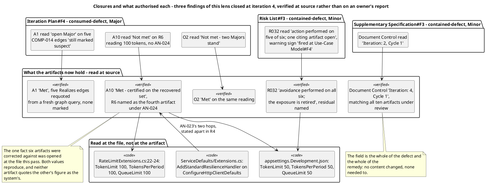

| Finding | Criterion | Verified at |
|---|---|---|
| `Iteration Plan#F4` | consumed-defect | A1 reads "Met" and requotes the five `COMP-014` edges from a fresh graph query; A10 reads "Met — certified on the recovered set" and names the Use-Case Model's R6 as the fourth artifact with its current wording under `AN-024`; O2 reads "Met" on the same reading. A11's cell and the sequence were not in this finding's scope and were checked separately, below |
| `Risk List#F3` | contained-defect | R032's strategy cell reads "avoidance performed on all six citing artifacts; the exposure is retired", names R6 among the six with its current wording under `AN-024`, and records the warning sign as no longer firing against a closed finding; the diagram's sixth-artifact node is relabelled to the one residual — the four artifacts re-read in a single pass. `R030` and `R031` unchanged, as the finding required |
| `Supplementary Specification#F3` | contained-defect | Document Control reads Phase Excavation, Status Draft — produced for the end-of-Excavation (AR) milestone review, Milestone Target not yet achieved, Iteration 4, Cycle 1. No other field and no content changed. All ten artifacts under this review now read iteration 4 |

Each closure was confirmed by re-reading the corrected section and then, where the fact turns on the code, by opening the file. The three findings are closed through `resolve_artifact_finding` under this lens.

#### Artifacts with no finding from this lens

System Inventory, Risk List, Iteration Plan, Vision, Use-Case Model, Supplementary Specification, Software Architecture Document, Deployment Model and Design Model carry no open finding from this lens at this pass. Each was re-read at the sections earlier passes found defective — the Risk List's R032, the plan's criteria and objectives tables, the Use-Case Model's R6 and its trace rows, the Supplementary Specification's Document Control — and each now holds. Silence from this lens is the approval, and it is recorded as silence rather than as a pass claimed on prose.

No Major stands against any artifact from this lens. The two Majors the Management Reviewer recorded against the Iteration Plan at iteration 3 are not re-recorded here: they are that lens's keys, and my `Iteration Plan#F4` — the same defect read at the artifact's cells rather than at the criteria table — is closed on the evidence above.

#### Scope this lens did not re-open

The four exclusions the stakeholder ruled on 2026-11-23 stand untouched and no finding here approaches them: external-provider sign-in is recovered and marked unreachable in the delivered configuration, the `admin` branch of `EP-011`, `EP-013` and `EP-014` is an exceptional entity and not a use case, and `EP-020`, `EP-021` and `EP-022` carry no use case. The recovered set — eleven use cases over twenty-two entry points, twenty-two components across four processes, eight persisted entity types — is unchanged by this iteration, whose four corrections added and removed no element.

### Management Reviewer lens
<!-- review: Excavation I4 -->

#### Scope of this review and the criteria it is decided on

Twelve artifacts under review: Development Case, System Inventory, Risk List, Iteration Plan, Vision, Use-Case Model, Supplementary Specification, Software Architecture Document, Deployment Model, Design Model. The Iteration Assessment is outside this review's scope — the Project Manager authors it in the Assess touchpoint that follows, so its state before this review is not a finding.

The lens is exit criteria, not feasibility and not completion. The AR gate is decided on thirteen criteria recorded in the Iteration Plan's Evaluation Criteria table; this review re-derives each from the artifact that owns it and tests that artifact itself, never from the plan's account of it. Two upstream artifacts govern the gate: the **System Inventory** states what the existing system is and the anomalies it carries; the **Risk List** states what those anomalies expose and whether each exposure is retired or accepted by the right authority.

| Review point | Question this lens applies |
|---|---|
| Lifecycle Milestone Review (AR) | Do the artifacts collectively satisfy the conditions for phase transition — recovery complete, anchored, measured, and confirmed by the stakeholder? |
| Iteration Acceptance, folded into the same review | Were the phase's three stated objectives met on the artifacts that carry them? |
| Conditional-verdict enforcement | Was the last milestone's sanction actually granted, and does this review verify what an earlier Conditional or Go rested on? |

#### Compliance matrix — thirteen criteria against the artifact that owns each

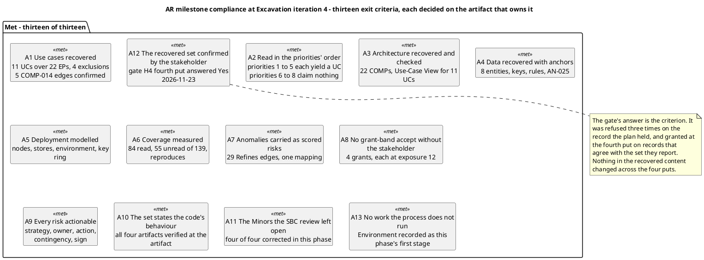

| # | Criterion | Met when | State | The artifact it is decided on |
|---|---|---|---|---|
| A1 | The operations the system performs are recovered as use cases | Every use case traces to the entry point whose code performs it, and every entry point is either carried or its exclusion stated | Met | Use-Case Model — `UC-001` to `UC-011`, each with its `EP-NNN`; "Not recovered, and why" accounts for `EP-020`, `EP-021`, `EP-022` and the admin branch. Carriage confirmed by direct query: `COMP-014` upstream returns five `Realizes` edges — `UC-006` to `UC-010` — none carrying a SUSPECT marking |
| A2 | The recovered use cases are read from the priorities the reading ordered first | Priorities 1 to 5 each yield at least one recovered use case | Met | System Inventory — Priorities areas 1 to 5; the eleven use cases trace to `EP-NNN` in each. The criterion claims nothing about priorities 6 to 8 |
| A3 | The architecture is recovered and checked against the use cases | The SAD's components carry the paths the recovered use cases take | Met | Software Architecture Document — Logical View `COMP-001` to `COMP-022` and Use-Case View naming the components each of the eleven paths crosses |
| A4 | The data is recovered with its anchors | Entities, keys, associations and enforced rules, each with the file it was read from | Met | Design Model — `DM-D1`, `CLS-001`, `CLS-007`, `CLS-006`, the relationship inventory, anchored to `TodoDbContext.cs:11-17` and the three migrations; `AN-025` recorded against the owner key |
| A5 | The deployment is modelled | The fired OPTIONAL records the processes, the stores and what must be shared | Met | Deployment Model — topology, nodes and connectors, Environment Mapping; shared key ring `AN-010`, database directory `AN-013` |
| A6 | The coverage is measured and the remainder declared | Every file is read or named with its reason, and the headline reproduces from the per-area table | Met | System Inventory — Coverage: 84 opened, 55 unread of 139; the per-area Read column sums to 84 and Files to 139 |
| A7 | Every anomaly the recovery surfaced is carried as a scored risk | No anomaly maps to no risk, and every score reproduces from the one published mapping | Met | Risk List — Risk Register: 29 `Refines` edges from `AN-NNN`, plus `R022`, `R031` and `R032` with their separate origins stated |
| A8 | No accepted risk above Moderate lacks the stakeholder's grant | No risk at Significant or High is accepted on the Project Manager's authority | Met — 2026-11-23 | Risk List — the grant table: four grants on `R004`, `R011`, `R012`, `R016`, each at 4 × 3 = 12, recorded verbatim |
| A9 | Every risk is actionable | Every risk names a strategy, an owner, an action, a contingency and a warning sign | Met | Risk List — Risk Mitigation and Contingency. `R030`, `R031` and `R032` each state the action performed rather than the intention to perform it |
| A10 | The recovery states what the code does, not what it was meant to do | No artifact in the recovered set states a behaviour the code contradicts | Met — certified on all four artifacts the test names | Supplementary Specification M3, S2, P1, R8 and R4; Software Architecture Document SP1, M3 and the bounded-load row; Deployment Model Environment Mapping — each verified at the artifact. Use-Case Model R6 reads "In force: 50 tokens, 50 per 10 s, queue 50. Code defaults: 100 tokens, 100 per 10 s, queue 100 … `AN-024`" |
| A11 | The Minors the SBC review left open are closed | Each is corrected in the artifact that carries it | Met — four of four, as the SBC review counted them | `Iteration Plan#F2` and `#F3` closed in iteration 1; `System Inventory#F3` closed in iteration 1; `Development Case#F2` and `#F3` closed in iteration 3 by the Process Engineer in the Environment stage. The criterion stays as written: corrected in this phase |
| A12 | The recovered set is confirmed by the stakeholder | Gate H4 answered Yes | Met — 2026-11-23 | Gate H4, put four times. The third put confirmed the recovered set as the model of the existing system and refused the advance while a Major stood; the fourth put granted the advance. Both answers recorded as given |
| A13 | The plan names no work the process does not run | Each work item belongs to a stage the IARI DEVELOPMENT PROCESS runs in Excavation | Met | Iteration Plan — the milestone sequence, coarse roadmap and Resources record Environment as this phase's first discipline at Low intensity. Every item of this iteration belongs to a stage the process runs here |

#### Findings — defect distribution at this pass

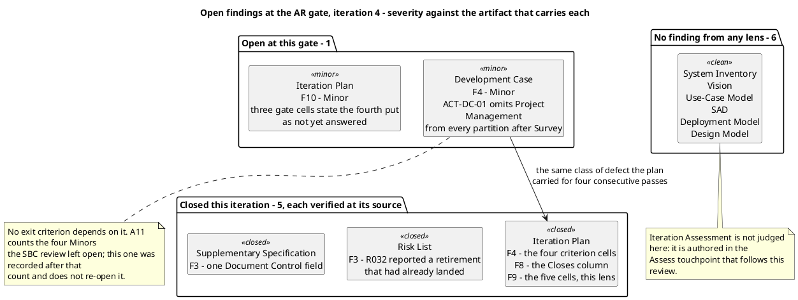

**One defect recorded against this milestone. Two Minors stand open across the set; neither holds the milestone and neither fails a criterion.**

`Iteration Plan#F10` — Minor, `contained-defect`. A12's state cell, fine-plan item 7 and the human-gate table's Answer cell all state the fourth put as unanswered, and the stakeholder answered Yes on 2026-11-23. This is the same class this lens closed as `Iteration Plan#F9` in this iteration, in the one place the earlier pass could not reach because the answer did not exist when the cells were written. Contained: A12's criterion is satisfied by the answer recorded in this lens's Disposition, and no role builds on the stale half.

`Development Case#F4` — Minor, `contained-defect`, recorded by the technical lens this iteration. ACT-DC-01 draws Project Management only in the Survey partition while the same document's Disciplines and Intensity table declares it active in all phases per the canonical matrix. The table governs the tailoring and the plan takes its intensities from the canonical matrix, so no role builds on the diagram's phase list.

#### What was verified at its source, and what was not

Every closure in this pass was checked at the thing it asserts, not accepted from an owner's account of it. Direct query of `COMP-014` upstream returned five `Realizes` edges to `UC-006` through `UC-010`, none marked suspect — the graph state that `A1`, `Iteration Plan#F4` and `Iteration Plan#F9` all turn on. The Use-Case Model's rules diagram was read at the artifact and its R6 states both budgets under `AN-024`, which is the fourth artifact `A10`'s own test names. The Supplementary Specification's Document Control reads Iteration 4, Cycle 1. Every finding of this lens against the recovered set in earlier iterations of this phase — the Vision's use-case shapes, the Risk List's grant band, R030's unperformed retirement — is closed and re-verified in the ledger rather than assumed.

Two judgments in this review rest on a role's turn rather than on this lens's reading, and both were verified afterwards at the artifact: `A11` on the Process Engineer's Environment stage, and `A10` on four artifacts of which three belong to other roles. `A12` rests on nothing this lens can read — it is the stakeholder's answer, recorded in gate H4 as given.

#### The four exclusions and the declared scope

The stakeholder confirmed the recovered set as the model of their system at the third put: eleven use cases, four stated exclusions, twenty-two components across four processes, eight tables — nothing wrong or missing, no exclusion re-opened. That statement stands and this review neither adds to it nor narrows it. External-provider sign-in is recovered and marked unreachable in the delivered configuration; the cross-owner admin branch in `GET`, `PUT` and `DELETE /todos/{id}` is an exceptional entity and not a recovered use case; `EP-020`, `EP-021` and `EP-022` carry no use case. No element of the recovered set addresses a functional area outside what the code performs, and every recovered element cites the file and lines it was read from — so no `[DERIVED]` marker and no scope question arises in this phase.

#### No financial or unsourced quantitative claim

This review carries no financial figure and no market or staffing estimate. The only numbers in it are artifact identifiers, counts read from the artifacts, and risk exposures computed on the published probability × impact mapping. The plan's cost record is quoted in the two currencies the system measures — tokens and elapsed agent time, apart from stakeholder queue time — and no person-week, person-month or story-point figure appears anywhere in the set under review.

### Review Coordinator lens
<!-- review: Excavation I3 -->

<!-- review: Excavation I3 -->

**Lens participation at this milestone — authoritative, not inferred from the artifact.** Excavation's milestone review runs Reviewer, then Management Reviewer, then Review Coordinator. The Business Reviewer's first scheduled stage is LCO, so at AR it is not a participant.

| Lens | Participation | What it evaluated | Bearing on the verdict |
|---|---|---|---|
| Reviewer (technical) | EXECUTED | Ten artifacts against nine checklist items; every closure re-verified at the graph, the file or the peer artifact | Counted in full — 1 Major, 2 Minor |
| Management Reviewer | EXECUTED | The thirteen AR exit criteria A1 to A13 against the artifact each is decided on, the grant band, and gate H4 | Counted in full — 1 Major, 2 Minor |
| Business Reviewer | **INACTIVE — did not evaluate this review** | Nothing | No verdict attributed and none inferred |
| Review Coordinator | EXECUTED | The consolidated ledger, cross-lens reconciliation, action priority, the milestone verdict | Records the verdict in Disposition |

**Review events of this milestone, each triggered by a workflow activity.** No event sits on a calendar date; each follows the activity that produces the artifacts it judges.

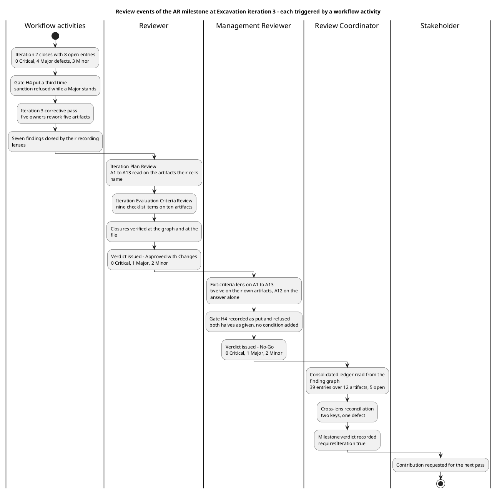

**Entry and exit criteria enforced at each event.**

| Event | Entry criterion | Exit criterion | Enforced |
|---|---|---|---|
| Iteration Plan Review | The plan carries this iteration's work items with owners, and each criterion is read on the artifact its evidence cell names | Every criterion decided on its own artifact's evidence | **Passed at the artifacts, failed at the plan's cells** — A1, A10, A11, O2 and A12 report states their own artifacts and the gate have superseded (`Iteration Plan#F4`, `#F9`) |
| Iteration Evaluation Criteria Review | The recovered artifacts are in their target state and the anchors exist to be checked | Every finding verified at the section it names, and at the source where the finding turns on a recovered fact | Yes — seven closures each cite the graph, the file or the peer artifact at which they were verified |
| Milestone Review AR | Both executed lenses have returned and the stakeholder's gate answer is on the record | 0 Critical and 0 Major open, and the stakeholder's sanction GRANTED | **No** — one Major defect open and the sanction refused |

**Scope of this consolidation.** Twelve artifacts were read for findings: the ten under review, plus the Iteration Assessment and this Review Record. Two carry no finding from any lens — the Iteration Assessment (authored by the Project Manager after this review) and the Review Record itself. The Data Model, the Glossary and the Test Plan are absent on the Development Case's NOT FIRED verdict on each trigger; both executed lenses checked each verdict against its §5.2 condition and neither carries a finding.

**No SCM surface is reviewed.** The repository reports no pull request in any state and no IARI pipeline file exists. Excavation produces no production code, so the absence of a diff and of a CI result is the phase's correct state, not a gap in this review's coverage.

## Findings
### Reviewer lens
<!-- review: Excavation I4 -->

<!-- review: Excavation I4 -->

#### Compliance matrix

Each of the ten artifacts against the nine items of this milestone's checklist. An item is marked Pass only where the artifact carries the evidence itself; N/A marks an item the artifact's shape does not engage.

```plantuml
@startuml
title Compliance: the recovered set at Excavation iteration 4 - 10 artifacts, 9 checklist items, every item decided on its own evidence

skinparam shadowing false
skinparam classAttributeIconSize 0
skinparam wrapWidth 220
hide circle
hide empty members

package "Checklist items tested" {
  class "C1 Recovered, not declared" as C1 <<check>>
  class "C2 Anchored to the file it cites" as C2 <<check>>
  class "C3 No cross-cutting mechanism\ncarried as a use case" as C3 <<check>>
  class "C4 One goal, one use case" as C4 <<check>>
  class "C5 Declared trace rows carried\nby the registered graph" as C5 <<check>>
  class "C6 No suspect trace open\nat the phase close" as C6 <<check>>
  class "C7 Document Control on this\nphase and iteration" as C7 <<check>>
  class "C8 Diagram-dominant" as C8 <<check>>
  class "C9 A state a row asserts about\nanother artifact matches it" as C9 <<check>>
}

package "Artifacts reviewed - 10, no open finding from this lens" {
  class "Development Case" as A_DC <<pass>>
  class "System Inventory" as A_SI <<pass>>
  class "Risk List" as A_RL <<pass>>
  class "Iteration Plan" as A_IP <<pass>>
  class "Vision" as A_VIS <<pass>>
  class "Use-Case Model" as A_UCM <<pass>>
  class "Supplementary Specification" as A_SS <<pass>>
  class "Software Architecture Document" as A_SAD <<pass>>
  class "Deployment Model" as A_DM <<pass>>
  class "Design Model" as A_DES <<pass>>
}

C7 --> A_SS : pass on the field that failed last pass
C9 --> A_RL : pass - R032 now states R6 as R6 reads
C9 --> A_IP : pass - A1, A10, A11, A12 and O2\nre-derived from their artifacts
C5 --> A_UCM : pass - 11 rows against 22 EP edges
C5 --> A_SAD : pass - 22 COMP rows against the graph
C5 --> A_DES : pass - 42 CLS rows against the graph
C6 --> A_UCM : pass - COMP-014 returns five\nRealizes edges, none marked
C2 --> A_SI : pass - coverage recomputed:\n84 + 55 = 139

note right of A_UCM
  Every item passes, on four successive passes of
  correction. The rules diagram's R6 states both
  budgets and the five COMP-014 edges are confirmed.
end note
note bottom of A_IP
  The one Info entry of this pass is an observation on
  A11's evidence cell, not a failed item: the cell's count
  is right, its enumeration does not say which four it counts.
end note
note bottom of A_SI
  Coverage arithmetic and every anchor spot-checked
  against the file: appsettings.Development.json binds
  50/50/50, RateLimitExtensions.cs:22-24 carries 100/100/100.
end note

@enduml
```

| Artifact | C1 | C2 | C3 | C4 | C5 | C6 | C7 | C8 | C9 |
|---|---|---|---|---|---|---|---|---|---|
| Development Case | N/A | Pass | Pass | N/A | N/A | N/A | Pass | **Pass with observation** | Pass |
| System Inventory | Pass | Pass | Pass | N/A | N/A | Pass | Pass | Pass | N/A |
| Risk List | Pass | Pass | N/A | N/A | Pass | Pass | Pass | Pass | Pass |
| Iteration Plan | N/A | Pass | N/A | N/A | N/A | N/A | Pass | Pass | Pass |
| Vision | Pass | Pass | Pass | Pass | N/A | N/A | Pass | Pass | N/A |
| Use-Case Model | Pass | Pass | Pass | Pass | Pass | Pass | Pass | Pass | N/A |
| Supplementary Specification | Pass | Pass | Pass | Pass | N/A | N/A | Pass | Pass | N/A |
| Software Architecture Document | Pass | Pass | N/A | Pass | Pass | Pass | Pass | Pass | N/A |
| Deployment Model | Pass | Pass | N/A | N/A | N/A | N/A | Pass | Pass | N/A |
| Design Model | Pass | Pass | N/A | N/A | Pass | Pass | Pass | Pass | N/A |

The Development Case's C8 cell is the only qualified one: ACT-DC-01 is a formal activity diagram that carries the phase sequence correctly, and the discipline list it annotates per phase omits Project Management after Survey. That is one defect on one diagram, recorded below as a Minor, and not a failure of the artifact's diagram-dominance.

#### Defect distribution

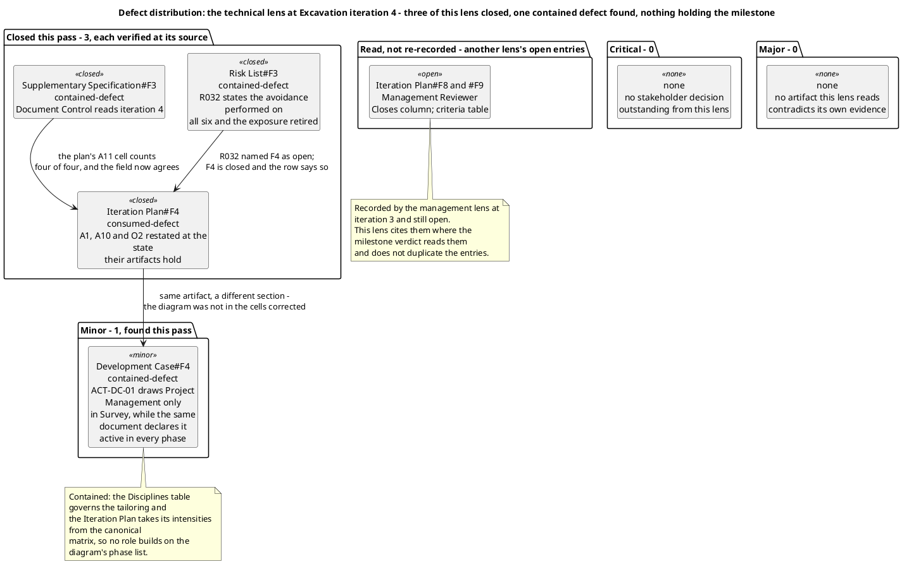

#### Development Case#F4 — ACT-DC-01 omits Project Management from every phase after Survey (Minor, `contained-defect`)

ACT-DC-01 names disciplines for each phase it draws: "Excavation (AR) — Requirements High, Analysis and Design Critical", "Consolidation (GHR) — Requirements High, Analysis and Design Medium, Discovery Critical", "Inception (LCO) — Requirements Critical". Project Management appears once, in the Survey partition, and never again. The same document's Disciplines and Intensity table declares it "Active in all phases, per canonical matrix", and the canonical matrix assigns it Medium in Excavation, High in Inception and Construction, Medium in every phase that follows.

The omission is not a generalisation the picture leaves open; it is a per-phase list that drops a discipline, so a reader taking the diagram as the project's role schedule concludes the Project Manager does not work in Excavation — which the artifact's own table, its six optional-trigger verdicts and every iteration of this phase's plan contradict. The Project Manager demonstrably works here: the Risk List and the Iteration Plan under this review are its output.

Contained: the Disciplines and Intensity table is the governing tailoring statement, the Iteration Plan takes its intensities from the canonical matrix and not from the picture, and no exit criterion turns on the diagram. It is recorded rather than held, and it does not affect the milestone.

**Remediation.** Add the Project Management discipline to the Excavation, Consolidation, Inception, Elaboration, Construction and Transition partitions of ACT-DC-01, naming its stage as the Survey partition does — in Excavation, "Project Management Medium — ProjectManager: Risk List, Iteration Plan". Change nothing in the Disciplines and Intensity table, which is correct. If the diagram illustrates only the Environment opening, retitle it and drop the per-phase intensity annotations that make it read as a full schedule.

#### An observation on A11's evidence cell — no defect, no action required

The Iteration Plan's A11 cell certifies "Met — four of four, as the SBC review counted them" and then names five items: `Iteration Plan#F2`, `Iteration Plan#F3`, `System Inventory#F3`, and `Development Case#F2` with `#F3`. The count of four is correct — `F2` and `F3` on the Iteration Plan were the two the Survey review counted as one pair, and the cell's own text reads them as such — but a reader counting the identifiers reads five against a stated four. The evidence is not wrong and nothing follows from the presentation; it is recorded here so the Project Manager may make the enumeration self-counting in the next turn it takes on the plan.

#### Artifacts with no finding from this lens

System Inventory, Risk List, Iteration Plan, Vision, Use-Case Model, Supplementary Specification, Software Architecture Document, Deployment Model and Design Model carry no open finding from this lens. Each was re-read at the sections earlier passes found defective, and each now holds. Silence from this lens is the approval.

The two Majors the Management Reviewer recorded against the Iteration Plan at iteration 3 are cited where the milestone verdict reads them and are not re-recorded as duplicates: `Iteration Plan#F8` and `#F9` are that lens's keys. My own `Iteration Plan#F4` — the same defect class read at the artifact's cells rather than at the criteria table — is closed on the evidence in Resolutions and Actions.

### Management Reviewer lens
<!-- review: Excavation I4 -->

#### Risk retirement at this gate — the trend, not the register

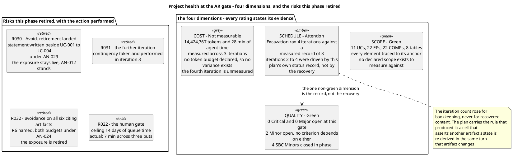

Risk retirement is real but not uniform, and the difference matters at the gate. `R031` — the exposure that a milestone slips and needs an iteration it did not plan — was taken as a contingency and performed: iterations 2, 3 and 4 were each planned from the record rather than assumed. `R032` — that a citing artifact lags the fact it cites — is retired on all six citing artifacts with R6 named and both budgets under `AN-024`. `R030` records its retirement action as landed while stating the exposure stays live, because `AN-012` still stands and no test covers the session surface; that distinction is correct and the row claims neither more nor less than has occurred. The two Significant risks that remain live — `R012` (the client and BFF carry no test) and `R016` (the delivery carries no document at all) — are not retirable in the sprint zero; both carry the stakeholder's own grant of 2026-11-23 at exposure 12 and neither is claimed retired.

**The SCHEDULE dimension is the one that is not green, and it is the record that drew it out.** Excavation ran four iterations against a measured record of three, and the fourth was not caused by the recovery: it was caused by this plan's own cells reporting defects their artifacts had already corrected, for four consecutive passes. That is a governance finding about the record-keeping, not about the recovered content, and the plan now carries the rule that closes it — a cell asserting another artifact's state is re-derived from that artifact in the same turn that artifact changes.

#### Development Case

**Approved, with `#F4` open.** Both Minors the stakeholder ordered corrected at the AR re-take are closed and verified at the artifact: the contributor set names every lens that writes into the Review Record — Reviewer, CodeReviewer, ManagementReviewer, BusinessReviewer, ReviewCoordinator and the ConfigurationManager's baseline record — with CLS-DC-01 drawing the matching edges, and Document Control reads Phase Excavation, Iteration 4, Cycle 1. The tailoring is on the baseline the stakeholder restated: Environment active in every phase, first in Excavation at Low intensity.

`#F4` stands and does not hold the milestone. ACT-DC-01 omits Project Management from every phase partition after Survey while the artifact's own Disciplines and Intensity table declares it active in all phases per the canonical matrix. Contained because the table is the governing tailoring statement: the Iteration Plan takes its intensities from the canonical matrix, and the Project Manager demonstrably works in this phase. A11 counts the four Minors the SBC review left open; `#F4` was recorded after that count, so the criterion is neither re-opened nor left unattended — it is the owner's next turn.

#### System Inventory

**Approved.** Coverage reads 84 opened and 55 unread of 139, the per-area Read column summing to 84 and its Files column to 139; the arithmetic was recomputed and reproduces. No finding from any lens stands. The inventory is the artifact the recovered set's anchors rest on and its anomalies table is what the Risk List's 29 `Refines` edges hang from, so its cleanliness is load-bearing for `A1` and `A7`.

#### Risk List

**Approved, `#F3` closed this iteration.** `R032` now reads "avoidance performed on all six citing artifacts; the exposure is retired", names the six with R6 among them and quotes its current wording under `AN-024`; the warning-sign cell records the sign as no longer firing rather than fired against a closed finding, and the diagram's sixth-artifact node is relabelled to the single residual. `R030` and `R031` are unchanged. The grant table holds four grants, each at 4 × 3 = 12, recorded verbatim; no risk in the grant band takes the accept strategy on the Project Manager's authority.

#### Iteration Plan

**Approved, with `#F10` open.** The Major that held the third put is closed and its four cells verified at their artifacts: `A1` on a fresh `COMP-014` query, `A10` on R6's current wording, `A11` on four of four Minors, `O2` on the same reading. The restated table no longer cites a superseded sentence.

`#F10` records the one defect this pass finds: three cells still describe the fourth put as unanswered, and it has been answered Yes. The same class as `#F9`, in the one place the earlier pass could not reach — the answer did not exist when the cells were written. Contained: `A12` is satisfied by the answer itself, which is recorded in this lens's Disposition, and the Review Coordinator reads it there.

#### Vision, Use-Case Model, Supplementary Specification, Software Architecture Document, Deployment Model, Design Model

**Approved — no open finding from any lens.** Each Major recorded against these artifacts in earlier iterations of this phase is closed and was re-verified at its source for this review: the Vision's two platform mechanisms are drawn as components and the section states eleven use cases, agreeing with the Use-Case Model, the Iteration Plan's `A1` and the SAD's Use-Case View; the Use-Case Model's R6 states both budgets under `AN-024` and the five `COMP-014` edges are confirmed in the graph; the Supplementary Specification's Document Control reads Iteration 4, Cycle 1, with M3, S2, P1, R8 and R4 stating the two budgets and the two outbound hops apart; the SAD's SP1, M3 and bounded-load row read 50 / 50 / 50 as the bound in force; the Deployment Model's Environment Mapping is narrowed to what the files hold and its Rate limiting row reads 50 / 50 / 50 for Development; the Design Model's PD-D3 cites `AN-025` for the unconverted owner key and `AN-005` only for the `EnsureCreated` schema.

#### Iteration Assessment

**Not judged.** The Project Manager authors it in the Assess touchpoint that follows this review, so at review time it cannot describe the iteration being reviewed. Its state is not a finding and not a gate condition.

### Review Coordinator lens
<!-- review: Excavation I3 -->

<!-- review: Excavation I3 -->

**Consolidated finding ledger.** Every count below is copied from `read_artifact_findings` on each of the twelve artifacts, never from a lens's narrative. The line this section rests on, verbatim:

`[FINDINGS] read=12, unread=none, open Critical=0, open Major=2 [Iteration Plan#F4, Iteration Plan#F9 — one defect, two lens keys], open Minor=3 [Iteration Plan#F8, Risk List#F3, Supplementary Specification#F3]`

Thirty-nine finding entries stand against the twelve artifacts read. Thirty-four carry a resolution object and were closed by the lens that recorded them. Five are open: none Critical, two Major entries covering one distinct defect, three Minor.

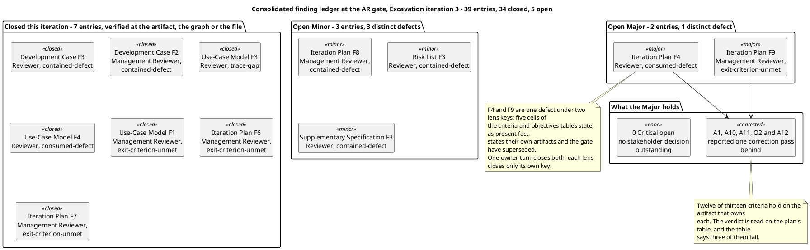

**Open findings — one Major defect, two entries.**

| # | Defect | Entries | Lens | Criterion | Owner | The corrective action |
|---|---|---|---|---|---|---|
| 1 | Five cells of the Evaluation Criteria and Objectives tables state, as present fact, states their own artifacts and the gate have superseded — A1 on five `COMP-014` edges the graph returns confirmed, A10 on R6 reading 100 where R6 now states both budgets under `AN-024`, A11 reading two of four open where all four Minors are closed, O2 on the same two closed findings, A12 recording the second put alone | `Iteration Plan#F4` (Reviewer), `Iteration Plan#F9` (Management Reviewer) | both | `consumed-defect` / `exit-criterion-unmet` | Project Manager | One pass over the five cells, each restated at the state its evidence supports: A1 "Met" with the five `COMP-014` edges requoted from a fresh graph query; A10 "Met — certified on the recovered set", R6 named as the fourth artifact with its wording under `AN-024`; A11 "Met — four of four"; O2 met on its own terms; A12 recording the third put as given — the recovered set confirmed, the sanction refused while a Major stands. Change nothing in the sequence, the fine plan or A13 |

**Open findings — three Minors. Recorded, owned, none holding the milestone.**

| Artifact | Key | Lens | Criterion | Owner | The corrective action |
|---|---|---|---|---|---|
| Iteration Plan | F8 | Management Reviewer | `contained-defect` | Project Manager | Drop "written in this turn" from the Closes cells of fine-plan rows 6 and 7 and leave the finding key, as every other row of the column does |
| Risk List | F3 | Reviewer | `contained-defect` | Project Manager | Restate R032: the action performed on all six citing artifacts, R6 named with its wording under `AN-024`, the exposure recorded as retired by the avoidance; relabel the diagram's contingency node to the one residual; set the warning-sign cell to the state it now holds. Leave `R030` and `R031` unchanged |
| Supplementary Specification | F3 | Reviewer | `contained-defect` | System Analyst | Set the Document Control Iteration field to "3, Cycle 1". Change no other field and no content |

**Closed this iteration — seven entries, each verified at the source.** `Development Case#F3` (Document Control brought to Excavation iteration 3), `Development Case#F2` (contributor set names all six lenses; CLS-DC-01 draws `RV`, `CRV`, `MRV`, `BRV`, `RCO` and `CFM` edges into `RR`), `Use-Case Model#F3` and `#F1` (five `COMP-014` `Realizes` edges confirmed in the registered graph; the rules diagram draws R6 to U6 to U10), `Use-Case Model#F4` (R6 states "In force: 50 tokens, 50 per 10 s, queue 50. Code defaults: 100 tokens, 100 per 10 s, queue 100 … AN-024", its note citing `RateLimitExtensions.cs:14-31` and `appsettings.Development.json:8-12`), `Iteration Plan#F6` (A10's cell opens "Decided on all four artifacts the criterion's own test names"), `Iteration Plan#F7` (A13 cites the Environment stage as this phase's first discipline, the coarse roadmap carries the stage bar, fine-plan items 1 to 3 sit against the Process Engineer under it).

**Cross-lens reconciliation — where two lenses spoke on one subject.**

| Subject | The two lenses | Resolution recorded here |
|---|---|---|
| The five cells of this iteration's tables | Reviewer records `Iteration Plan#F4` at the four artifact-content places; Management Reviewer records `Iteration Plan#F9` at the criteria table the verdict is decided on | **One defect, two keys.** `#F4` reads the defect at the artifact, `#F9` reads it at the criterion, and `#F9` also carries the A12 cell `#F4` does not reach. One owner pass closes both; each lens closes only its own key and neither entry is doubled in the action plan |
| The five `COMP-014` edges | Both lenses recorded the defect at iteration 2 — `Use-Case Model#F3` and `#F1` — and both closed it this iteration against the same graph query | **Closed by both lenses.** No reconciliation is needed at this gate |
| `Development Case#F2` and `#F3` | Two keys, two lenses, two distinct defects on one artifact, both counted by A11 | **Not a duplicate.** Both were corrected in one turn by one owner in the Environment stage and both are closed |
| `Risk List#F3` (two entries) | The Management Reviewer's `#F3` closed on R030 this iteration; the technical lens's `#F3` was recorded this iteration against R032 | **Distinct subjects, one key.** R030's retirement landed and stays live; R032's action has now landed on all six citing artifacts. Only R032 remains open, under the technical lens |
| The five `COMP-014` edges (A10's reading) | `Iteration Plan#F6` closed on the widening of A10's cell; `#F4` and `#F9` record that the widened cell quotes R6's superseded wording | **Successive, not contradictory.** The omission of the fourth artifact is corrected; the residual is the cell's content, recorded under its own keys |

No lens contradicts another on a fact. No finding at this gate carries a disputed severity band. A12 is decided on the stakeholder's answer alone and neither lens disputes it.

**Priority of what remains — one iteration, Major before Minor.**

| Priority | Finding | Why it ranks here |
|---|---|---|
| 1 | `Iteration Plan#F4` and `#F9` | The plan is the record the milestone verdict is read on; five cells restated in one pass close the only Major and free the gate |
| 2 | `Risk List#F3` | The register reports a Significant exposure as unmitigated when its mitigation has landed; contained, and its remedy is a transcription |
| 3 | `Iteration Plan#F8` | Same artifact and same owner turn as priority 1, a different column |
| 4 | `Supplementary Specification#F3` | One metadata field; the artifact's recovered facts are current |

## Resolutions and Actions
### Reviewer lens
<!-- review: Excavation I4 -->

<!-- review: Excavation I4 -->

#### Resolutions and actions

Three findings emitted by this lens were open at the start of this pass. Each was re-read at its artifact, then at the source its fact turns on, and each defect is gone. All three are closed through `resolve_artifact_finding` under this lens — the tool call first, this narrative second.

| Finding | Criterion | Resolution | Verified at |
|---|---|---|---|
| `Iteration Plan#F4` | consumed-defect | **Resolved** | A1 reads "Met" and requotes the five `COMP-014` edges from a fresh graph query — the RTM returns `UC-006` to `UC-010`, `Realizes`, state OK, no marking. A10 reads "Met — certified on the recovered set" and names the Use-Case Model's R6 as the fourth of four, quoting "In force: 50 tokens, 50 per 10 s, queue 50. Code defaults: 100 tokens, 100 per 10 s, queue 100" under `AN-024`. O2 reads "Met" on the same reading |
| `Risk List#F3` | contained-defect | **Resolved** | R032's strategy cell reads "avoidance performed on all six citing artifacts; the exposure is retired", names R6 among the six with its current wording under `AN-024`, records the warning sign as no longer firing against a closed finding, and relabels the diagram's sixth-artifact node to the one residual — the four artifacts re-read in a single pass. `R030` and `R031` unchanged |
| `Supplementary Specification#F3` | contained-defect | **Resolved** | Document Control reads Phase Excavation, Status Draft — produced for the end-of-Excavation (AR) milestone review, Milestone Target not yet achieved, Iteration 4, Cycle 1 |

#### Actions arising for other owners

| Artifact | Key | Owner | Criterion | The corrective action |
|---|---|---|---|---|
| Development Case | F4 | Process Engineer | contained-defect | Add Project Management to the Excavation, Consolidation, Inception, Elaboration, Construction and Transition partitions of ACT-DC-01, naming its stage as the Survey partition does. Change nothing in the Disciplines and Intensity table, which is correct |
| Iteration Plan | F8, F9 | Project Manager | contained-defect, exit-criterion-unmet | Recorded by the Management Reviewer at iteration 3 and open. Cited here because the milestone verdict reads that table; not re-recorded |
| Iteration Plan | — (observation) | Project Manager | observation | Make A11's enumeration self-counting: the cell certifies four and lists five identifiers, the count being right. No defect and no action required |
| Development Case | — (reported) | Process Engineer | contained-defect | `Development Case#F4` is recorded this pass. It does not hold the milestone |

#### What this pass changed in the record, and what it did not

The recovered set is untouched. No correction this iteration added, removed, merged or reclassified a use case, a component, a class or a table; the eleven use cases over twenty-two entry points, the twenty-two components across four processes and the eight persisted entity types stand as the stakeholder confirmed them at the third put of gate H4. The four corrections were cells, a field and a retirement claim — records of the recovery, not the recovery.

No finding of this lens holds the milestone. The artifact that does is the Iteration Plan, under the Management Reviewer's `#F9`, and it is one owner pass over five cells.

### Management Reviewer lens
<!-- review: Excavation I4 -->

#### Findings this lens closed in this pass

Each closure was materialized in the ledger with `resolve_artifact_finding` and verified at the thing it asserts before the call was made.

| Finding | Resolution | What verified it |
|---|---|---|
| `Iteration Plan#F9` | Resolved | Read at the artifact: `A1` "Met" on a fresh `COMP-014` upstream query returning five `Realizes` edges, none marked; `A10` "Met — certified on the recovered set" naming the Use-Case Model's R6 as the fourth artifact with its current wording under `AN-024`; `A11` "Met — four of four"; `A12` recording the third put in both halves; `O2` "Met". No cell quotes a superseded sentence |
| `Iteration Plan#F8` | Resolved | Read at the fine plan: every Closes cell holds a finding key and nothing else; no cell names a moment |

#### Actions this gate leaves open

| Action | Owner | Bearing on the milestone |
|---|---|---|
| `Development Case#F4` — add the Project Management discipline to the partitions of ACT-DC-01 after Survey, naming its stage as the Survey partition does; change the intensity table not at all, since it is correct | Process Engineer | None. Minor, contained, approved by default; no exit criterion depends on it |
| `Iteration Plan#F10` — set `A12` to "Met — 2026-11-23" recording both puts as given, set fine-plan item 7's state to the answer, and set the human-gate table's Answer cell to the fourth put's answer | Project Manager | None on the criterion, which the answer satisfies; the three cells are a record correction in the owner's next turn |

Both are Minors and both are corrected in their owners' next turns. Neither is carried out of the phase: the stakeholder ordered at the SBC close that open Minors be addressed rather than left unattended, and `A11` is satisfied on the four Minors the SBC review counted.

#### The conditional verdict this gate carries forward

No Conditional Go was issued at the previous milestone and none is issued here. The third put refused the sanction outright and this lens recorded **No-Go**, with the reason stated: `A12` turns on the stakeholder's answer alone, and a Conditional Go would have recorded on their behalf the one thing they declined to record. That refusal is now answered — the fourth put granted the advance on records that agree with the set they report — and nothing this lens attached to the No-Go stands.

### Review Coordinator lens
<!-- review: Excavation I3 -->

<!-- review: Excavation I3 -->

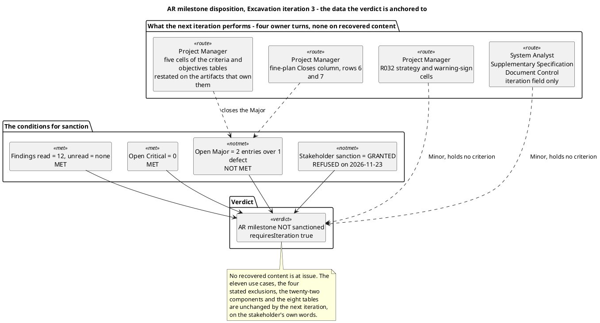

**Actions, in the order the next iteration takes them.** Each action is the remediation its recording lens wrote. No action carries a calendar date: the phase declares none, and a date projected from an estimate would read downstream as an observation. The due point is a state of the work, all within one further iteration of Excavation.

| # | Action | Artifact | Owner | Closes | Due point | Escalates if |
|---|---|---|---|---|---|---|
| 1 | Restate the five cells at the state their evidence supports: A1 "Met" with the five `COMP-014` edges requoted from a fresh graph query; A10 "Met — certified on the recovered set" naming R6 as the fourth artifact with its current wording under `AN-024`; A11 "Met — four of four" naming the four closed Minors; O2 met on its own terms; A12 recording the third put — the recovered set confirmed, the sanction refused while a Major stands. Change nothing in the sequence, the fine plan or A13 | Iteration Plan | Project Manager | `Iteration Plan#F4`, `Iteration Plan#F9` | First — it is the only Major and the verdict is read on it | Any of the five cells again reports a state its artifact has superseded |
| 2 | Drop "written in this turn" from the Closes cells of fine-plan rows 6 and 7 and leave the finding key | Iteration Plan | Project Manager, same pass | `Iteration Plan#F8` | With action 1 | — |
| 3 | Restate R032: the action performed on all six citing artifacts, R6 named with its wording under `AN-024`, the exposure recorded as retired by the avoidance; relabel the diagram's contingency node to the one residual — the four artifacts re-read in one pass; set the warning-sign cell to the state it now holds. Leave `R030` and `R031` unchanged | Risk List | Project Manager | `Risk List#F3` | After action 1 | The row claims a retirement in either direction |
| 4 | Set the Document Control Iteration field to "3, Cycle 1". Change no other field and no content | Supplementary Specification | System Analyst | `Supplementary Specification#F3` | Owner's next turn, after the Major | — |

**Escalation at this gate.**

| Item | State | Why |
|---|---|---|
| Any open Major or Minor | **Not escalated** | Each owner holds a stage in this phase and a turn in the next iteration. No finding is overdue: the phase has not closed, and the due point of each is that iteration's work |
| `Development Case#F2` and `#F3` | **Closed; the escalation of the previous two gates is discharged** | The escalation stood because the Process Engineer had no stage in this phase. The stage now exists — Environment runs in every phase and is Excavation's first discipline — and both Minors were corrected in it this iteration |
| Systemic process failure | **No escalation to the Configuration and Change Management Board** | The ledger shows no repeated architecture violation and no skipped review. Two lenses reaching the same defect is convergence on a real defect, not process failure. The Change Control Manager does not work in the sprint zero, so no change request is opened for any finding |
| Stakeholder escalation | **None required** | 0 Critical findings. A12 is recorded on the stakeholder's answer already given; nothing outstanding requires a new decision from them |

**Review effectiveness — this milestone's measured counts.** Fourth review event of this phase; the comparison is against the three passes of the same milestone that precede it and against nothing older.

| Indicator | Iteration 1 | Iteration 2 | Iteration 3 |
|---|---|---|---|
| Review coverage | 10 of 10 reviewed artifacts read by both executed lenses | 10 of 10 by both executed lenses | 10 of 10 by both executed lenses; 12 artifacts read for findings |
| Finding entries recorded, cumulative | 29 | 35 | 39 |
| Open at the gate | 16 — 0 Critical, 8 Major, 8 Minor | 8 — 0 Critical, 5 Major entries over 4 defects, 3 Minor | 5 — 0 Critical, 2 Major entries over 1 defect, 3 Minor |
| Closed by their recording lens, cumulative | 13 | 27 | 34 |
| Defect density, open entries by discipline | Requirements 6, Analysis & Design 3, Project Management 5, Environment 2, Discovery 0 | Requirements 4 over 2 defects, Project Management 2, Environment 2, Analysis & Design 0, Discovery 0 | Project Management 5 over 2 artifacts (4 on the Iteration Plan, 1 on the Risk List), Requirements 1, Environment 0, Analysis & Design 0, Discovery 0 |
| Duplicate subjects reached by both lenses | 1 — the rate limiter | 2 — the five `COMP-014` edges, and the rate budget at artifact and criterion | 1 — the five cells of this iteration's tables |
| Defect removal efficiency | Not computable | Not computable | Not computable |
| Rework effort | Not measured | Not measured | Not measured |

**What the metrics say.** Open entries fell from 16 to 8 to 5, and the artifacts carrying a Major fell from 7 to 2 to 1, while coverage held. The recovery converged this iteration: seven findings closed, every one verified at the graph, the file or the peer artifact, and no artifact's recovered content now carries an open finding from any lens. Every remaining defect sits on two Project Management artifacts and one Requirements metadata field.

The indicator that did not improve is the one the gate turns on. A cell asserting another artifact's state has now been recorded in three consecutive passes — `Iteration Plan#F3` and `#F6`, then `#F4`, then `#F9`. The process caught each in the same pass that recorded it, which is the mechanism working; it has not prevented the recurrence, and the Project Manager's plan now needs the rule written into it: a cell that asserts another artifact's state is re-read in the same turn that artifact changes, not at the next milestone.

Defect removal efficiency and rework effort are not computable and not measured: no test has executed in the sprint zero, so nothing is found by test against which review-found defects could be compared, and no per-finding token or elapsed attribution exists. Neither ratio is invented.

**Stakeholder contribution — the answer already given, folded in and acted on.** At gate H4's third put the stakeholder refused the sanction and stated that the recovered set is confirmed as the model of their system, that no recovered content is at issue, and that the next iteration changes none of it. Verified against the artifacts, not deferred: twelve of the thirteen criteria hold on the artifact that owns each, and every one of the five open cells names an artifact whose correction is already in place. That answer is the route of this disposition and needs no further consultation this iteration.

## Disposition
### Reviewer lens
<!-- review: Excavation I4 -->

<!-- review: Excavation I4 -->

#### Disposition — technical lens

**Approved with Changes.** No Critical and no Major stands from this lens. One Minor is recorded against the Development Case and does not hold the milestone; it is approved by default and corrected in its owner's next turn.

| Artifact | This lens's disposition |
|---|---|
| Development Case | **Approved with changes** — `#F4` open, one diagram's per-phase discipline list; contained, holds no criterion |
| System Inventory | **Approved** — coverage arithmetic recomputed and reproducing; anchors spot-checked at the file |
| Risk List | **Approved** — `#F3` closed on R032's restated retirement |
| Iteration Plan | **Approved** — `#F4` closed; A1, A10 and O2 re-derived from their artifacts |
| Vision | **Approved** — no finding from this lens at this pass |
| Use-Case Model | **Approved** — R6 states both budgets under `AN-024`; five `COMP-014` edges confirmed in the graph |
| Supplementary Specification | **Approved** — `#F3` closed; Document Control on iteration 4 |
| Software Architecture Document | **Approved** — SP1, M3 and the bounded-load row verified at the file |
| Deployment Model | **Approved** — Environment Mapping verified against the environment files |
| Design Model | **Approved** — trace rows carried by the graph; `PD-D3` consistent with `AN-023` |
| Iteration Assessment | **Not judged** — authored in the Assess touchpoint after this review; its state before the review is not a finding |

#### What the exit criteria do and do not support at this milestone

This lens certifies the recovered set, not the gate. Twelve of the thirteen AR criteria hold on the artifact that owns each, and the twelfth is the stakeholder's answer — the set confirmed as the model of the existing system, the sanction to advance refused while a Major stood. Nothing this lens found contradicts that set, and nothing it closed changed it.

The milestone itself does not close on this lens's disposition. The Management Reviewer's `Iteration Plan#F9` is the open Major, it is one owner pass over five cells of the criteria and objectives tables, and this lens's `Iteration Plan#F4` — the same defect read at the artifact's cells — is closed on evidence that the cells' subjects now hold.

#### The phase's evidence base, stated plainly

Every closure in this pass was verified at the thing it asserts: the registered trace graph for the five `COMP-014` carriage edges, the environment file for both request budgets, the service-defaults file for the resilience asymmetry, and the artifacts themselves for the states their peers assert about them. Three of the four previous passes recorded the same defect class — a document stating another artifact's state after that artifact changed — against the Iteration Plan. That class is closed at this pass in the cells this lens owns, and the plan now carries the rule that produced it: a cell asserting another artifact's state is re-derived from that artifact in the same turn the artifact changes.

No SCM evidence exists for this iteration and none is owed: no pull request stands in any state, no pipeline runs, and Excavation writes no production code. The repository's own code is unchanged since `307a1ea`.

### Management Reviewer lens
<!-- review: Excavation I4 -->

**Verdict: GO.** Gate H4 granted the sanction at its fourth put on 2026-11-23. Thirteen of thirteen AR exit criteria are met on the artifact that owns each, and no Critical and no Major finding stands against any artifact in the set.

**0 Critical, 0 Major, 2 Minor.** Both Minors are contained, neither fails a criterion, and both are corrected in their owners' next turns.

#### Disposition

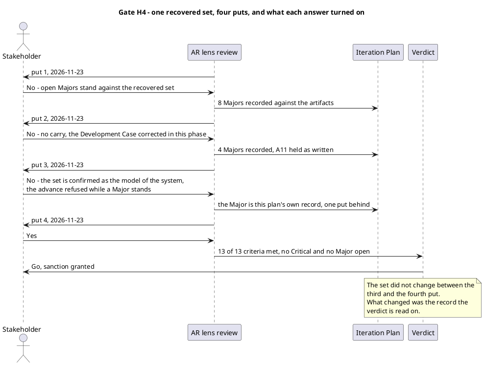

#### Why Go and not a Conditional Go

Nothing is left to condition. A Conditional Go defers verification to a later point; there is nothing here to defer — every criterion is decided, both remaining defects are Minors that no criterion depends on, and the sanction the gate turns on has been granted in words. Issuing a condition on a Minor would record a hold the stakeholder did not impose and the exit criteria do not require.

At the third put this lens refused the same verdict, and for the opposite reason: the sanction had been declined and a Major stood. That No-Go turned on `A12` and on `Iteration Plan#F9`, and both are now settled — `A12` by the fourth put's answer, `F9` by the plan's five cells restated at the state their artifacts hold.

#### Stakeholder sanction

**GRANTED** at gate H4 put 4 on 2026-11-23. Asked whether, on records that agree with the set they report, they sanction advancing past the Architecture Recovered milestone into Consolidation, the stakeholder answered **Yes**, having confirmed at the third put that the recovered set is the model of their system. No condition, limit or prohibition was stated with the answer and none is recorded.

Across the phase, gate H4 was put four times. The three earlier answers were refusals and each is recorded as given. The fourth put differs from the third in the record the verdict is read on, not in the recovered set: the stakeholder stated at the third put that no recovered content is at issue and that the next iteration changes none of it, and none did.

#### Disposition by artifact

| Artifact | Disposition from this lens |
|---|---|
| Development Case | **Approved with changes** — `#F4` open, one diagram's per-phase discipline list; contained, holds no criterion |
| System Inventory | **Approved** — coverage arithmetic recomputed and reproducing; no open finding from any lens |
| Risk List | **Approved** — `#F3` closed on `R032`'s restated retirement; the grant band is reproducible and correctly granted |
| Iteration Plan | **Approved with changes** — `#F10` open on three gate cells; `#F4`, `#F8` and `#F9` closed and verified |
| Vision | **Approved** — eleven use cases, the two platform mechanisms drawn as components |
| Use-Case Model | **Approved** — R6 states both budgets under `AN-024`; five `COMP-014` edges confirmed in the graph |
| Supplementary Specification | **Approved** — M3, S2, P1, R8 and R4 state the two budgets and the two hops apart; Document Control on iteration 4 |
| Software Architecture Document | **Approved** — SP1, M3 and the bounded-load row verified at the file |
| Deployment Model | **Approved** — Environment Mapping verified against the environment files |
| Design Model | **Approved** — `PD-D3` cites `AN-025` for the owner key and `AN-005` only for `EnsureCreated` |
| Iteration Assessment | **Not judged** — authored in the Assess touchpoint after this review; its state before the review is not a finding |

#### What this verdict does and does not decide

This is the Management Reviewer's lens. The milestone verdict on the consolidated ledger is the Review Coordinator's, taken after this lens and read on the answer recorded here. What this lens decides is that the exit criteria are met and that the sanction was granted; it does not merge the iteration baseline, which is the Integrator's step after the verdict.

The recovered set leaves this phase as the model of the existing system, confirmed by the stakeholder: eleven use cases over twenty-two entry points and twenty-two components across four processes, with four stated exclusions — external-provider sign-in recovered and unreachable in the delivered configuration, the cross-owner admin branch an exceptional entity and not a use case, and `EP-020`, `EP-021` and `EP-022` carrying no use case — and an eight-table data model with the unconverted owner key recorded under `AN-025`. Nothing in it changed across the four puts and nothing in it is deferred to Consolidation.

### Review Coordinator lens
<!-- review: Excavation I3 -->

<!-- review: Excavation I3 -->

**Milestone verdict on the consolidated ledger: the Architecture Recovered milestone is NOT sanctioned. Excavation iteration 3 does not close it, and the phase auto-iterates.**

The verdict is anchored to the finding data and to the stakeholder's recorded answer, never to judgment:

| Condition for sanction | The data | State |
|---|---|---|
| `[FINDINGS]` unread = none | Twelve artifacts read, none unread | Met |
| Open Critical = 0 | No lens recorded a Critical finding against any artifact | Met |
| Open Major = 0 | One distinct Major defect, two lens entries — `Iteration Plan#F4` and `#F9` | **Not met** |
| Stakeholder sanction GRANTED | REFUSED on 2026-11-23; the answer is recorded as given, and no condition is inferred from it | **Not met** |
| Recovery confirmed | Confirmed by the stakeholder as the model of the existing system — eleven use cases, four stated exclusions, twenty-two components, eight tables | Met |

Both executed lenses reach the same conclusion by different routes. The technical lens returns **Approved with Changes**, holding on the plan's four cells. The Management Reviewer returns **No-Go**, holding on the same defect as `#F9` and on A12. Neither recorded a Critical finding, so nothing in this ledger requires a stakeholder decision the stakeholder has not already been asked for.

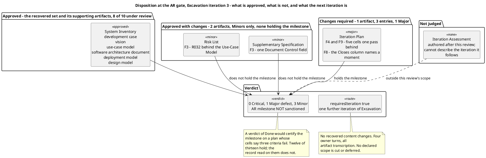

**What this consolidation records as settled.** Twelve of the thirteen AR exit criteria are met on the artifact that owns each: A2, A3, A4, A5, A6, A7, A8, A9, A10, A11 and A13, plus A1. The recovered set is not in question and the stakeholder has confirmed it in words — eleven use cases over twenty-two entry points, a twenty-two component architecture across four processes, and an eight-table data model, each resting on the file and lines it cites. Seven findings were closed this iteration and each closure was verified at the graph, the file or the peer artifact rather than accepted from its owner's prose. No finding is waived, deferred or recorded as closed on a document having been written.

The four exclusions the stakeholder ruled on stand untouched and no finding here approaches them: external-provider sign-in is recovered and marked unreachable in the delivered configuration; the cross-owner admin branch is an exceptional entity and not a use case; and `EP-020`, `EP-021` and `EP-022` carry no use case.

**What it records as requiring work.** One Major defect in five cells of the Iteration Plan's Evaluation Criteria and Objectives tables, and three Minors — two on the plan's Closes column and the Risk List's R032, one on a Document Control field. Every one is a transcription against content that already exists in the artifact it names. No role is added, no use case or component changes, and nothing is deferred to Consolidation to reach the gate.

**Disposition by artifact.**

| Artifact | Disposition |
|---|---|
| System Inventory | **Approved** — no open finding from any lens; coverage arithmetic recomputed and reproducing |
| Development Case | **Approved** — both Minors closed and verified; the contributor set names six lenses and Document Control reads this phase and iteration |
| Vision | **Approved** — both lenses' findings closed on verified evidence |
| Use-Case Model | **Approved** — both Majors and the Management Reviewer's `#F1` closed; the five `COMP-014` edges confirmed in the graph and R6 states both budgets under `AN-024` |
| Software Architecture Document | **Approved** — Major closed and verified at source |
| Deployment Model | **Approved** — Major closed and verified at source |
| Design Model | **Approved** — Minor closed and verified |
| Risk List | **Approved with changes** — `#F3` open on R032; contained, holds no criterion |
| Supplementary Specification | **Approved with changes** — `#F3` open, one metadata field |
| Iteration Plan | **Changes required** — `#F4`, `#F9` and `#F8` open; the Major holds the milestone |
| Iteration Assessment | **Not judged** — authored by the Project Manager after this review; its absence before the review is not a finding |

**The route — one further iteration, four owner turns.** `Risk List#R031`'s contingency, planned from the record at iteration 2 and now taken for the second consecutive iteration: one further iteration of Excavation performing actions 1 to 4 of Resolutions and Actions, then gate H4 put a fourth time once the plan's cells agree with the set they report. The stakeholder stated that no recovered content is at issue and that the next iteration changes none of it, and this disposition adds nothing to that and narrows nothing in it.

`R031` is recorded, scored 3 × 4 = 12 and carried as avoided. Recording it did not retire it and this disposition does not claim otherwise.
