## Document Control
### Reviewer lens
<!-- review: Excavation I3 -->

<!-- review: Excavation I3 -->

- Phase: Excavation
- Status: Technical lens complete for the AR (end-of-Excavation) milestone review, iteration 3. Three findings of this lens closed on verified evidence; three open — 0 Critical, 1 Major, 2 Minor. Disposition — Approved with Changes; the one Major holds the milestone until the plan is re-read.
- Milestone Target: end-of-Excavation (AR) — not achieved. The recovered set holds; the plan that reports it does not.
- Iteration: 3, Cycle 1
- Owner: Reviewer

### Management Reviewer lens
<!-- review: Excavation I3 -->

<!-- review: Excavation I3 -->

- Phase: Excavation
- Status: Lifecycle Milestone Review (AR) taken at iteration 3 — 0 Critical, 1 Major, 3 Minor open. The recovered set is confirmed by the stakeholder as the model of the existing system; the sanction is refused while the Major stands
- Milestone Target: end-of-Excavation (AR) — not achieved
- Iteration: 3, Cycle 1
- Review point: Lifecycle Milestone Review, exit-criteria lens
- Reviewers executed: Reviewer, then Management Reviewer; the Business Reviewer is inactive at AR
- Verdict this lens issues: No-Go

### Review Coordinator lens
<!-- review: Excavation I2 -->

<!-- review: Excavation I2 -->

- Phase: Excavation
- Status: Consolidation complete for the AR (end-of-Excavation) milestone review, iteration 2, cycle 1. Eight findings open over ten artifacts — 0 Critical, 5 Major entries over 4 distinct defects, 3 Minor.
- Milestone Target: end-of-Excavation (AR) — not achieved
- Iteration: 2, Cycle 1
- Owner: Review Coordinator

## Review Scope and Criteria
### Reviewer lens
<!-- review: Excavation I3 -->

<!-- review: Excavation I3 -->

#### Review scope — Excavation iteration 3, technical lens

The three artifacts this lens held open at the AR re-take, the eight this lens reads for exit-criteria evidence, and the two SCM surfaces that answer for the iteration's code state. Each corrected fact was checked at its source — the file, the graph or the peer artifact — not taken from the finding's own remedy.

| Artifact | Reviewed for | Iteration-3 outcome |
|---|---|---|
| Development Case | Document Control; the contributor set in CLS-DC-01; the Environment statement as against the canonical matrix | Clean — F3 closed; CLS-DC-01 carries all six lenses |
| System Inventory | Coverage arithmetic and anchors re-checked after the Risk List was restated | Clean |
| Risk List | Every retirement claim against the artifact it names; the grant band | 1 Minor open — F3, R032 behind the Use-Case Model |
| Iteration Plan | Every exit-criterion cell against the artifact its evidence names | **1 Major open** — F4, four places behind their artifacts |
| Vision | Use-case count against the Use-Case Model | Clean — F1 closed at the previous pass and holding |
| Use-Case Model | The rules diagram's figures; the five `COMP-014` rows against a fresh graph query | Clean — F3 and F4 closed |
| Supplementary Specification | The recovered figures under `AN-024` and `AN-023`; Document Control | 1 Minor open — F3, one metadata field |
| Software Architecture Document | `SP1`, `M3` and the bounded-load row; the component trace rows against the graph | Clean — F1 closed at the previous pass and holding |
| Deployment Model | Environment Mapping against the files it maps | Clean — F1 closed at the previous pass and holding |
| Design Model | Anomaly citations; `PD-D3` against `AN-025` | Clean — F1 closed at the previous pass and holding |

#### Criteria applied

This milestone's question is EXIT CRITERIA. Eight items are inherited from the previous pass unchanged, and one is added because this iteration produced the defect the eighth does not catch: a document asserting another artifact's state. Each item is a test with a pass or fail answer.

| # | Criterion | What passes |
|---|---|---|
| C1 | Recovered, not declared | No element claims scope the delivery does not hold; a recovered element cites the file it was read from |
| C2 | Anchored | Every recovered element rests on the file and lines it names |
| C3 | No cross-cutting mechanism as a use case | Authentication, sync, logging, audit, health and migration are mechanisms, not actor goals |
| C4 | One goal, one use case | A multi-actor process is one use case with scenarios; never one per actor |
| C5 | Trace rows carried | Every row a trace-chain artifact declares is carried by the registered graph |
| C6 | No suspect trace open at the phase close | No edge named in a declared row carries a SUSPECT marking |
| C7 | Document Control current | Phase, Status, Milestone Target and Iteration name the phase and iteration whose review the artifact is under |
| C8 | Diagram-dominant | Formal UML carries the content; prose supplements what a diagram cannot express |
| C9 | Asserted state matches its subject | A cell or sentence stating another artifact's state agrees with that artifact as it now reads |

#### SCM and build evidence

The repository reports no pull requests in any state, and no IARI pipeline file exists, so there is no diff to dispose and no CI result to weigh at this gate. That is the phase's correct state rather than a gap: Excavation produces no production code, the tree's own code is unchanged since `307a1ea`, and the iteration's work is artifact correction. Every disposition below therefore rests on artifact, graph and code evidence, and the absence of SCM evidence is stated here rather than passed over in silence.

#### Evidence verified at source this iteration

| Fact | Artifact statements checked | Read at | Result |
|---|---|---|---|
| Development halves the request budget | Use-Case Model R6 and its note; Supplementary Specification R8, P1, S2, M3 | `Todo.Api/appsettings.Development.json` — `RateLimiting` `TokenLimit` 50, `TokensPerPeriod` 50, `QueueLimit` 50; `Todo.Api/Extensions/RateLimitExtensions.cs` for the code defaults 100 | Reproduces. R6 states both under `AN-024`; the one-budget reading is gone |
| The bucket gates the whole `/todos` group | The five `COMP-014` rows in the Software Architecture Document Traceability | `Todo.Api/Todos/TodoApi.cs:19-20` — `group.RequirePerUserRateLimit();` applied to the group before every handler | Reproduces. The graph returns five `Realizes` edges with no SUSPECT marking |
| The contributor set of the Review Record | Development Case co-owned-artifact sentence; CLS-DC-01 edges | `read_artifact` on the Review Record's three lenses — Reviewer, Management Reviewer, Review Coordinator each writing a block | Reproduces. Six contributors named, six edges drawn, including `CRV`, `MRV`, `BRV`, `RCO` and `CFM` |
| Environment runs in Excavation | Development Case Disciplines and Intensity; Iteration Plan Resources and A13 | The canonical intensity matrix — Environment Low in Excavation, High in Survey and Inception | Reproduces. The Development Case states the baseline; the plan records the stage first |
| Coverage arithmetic | System Inventory Coverage | The per-area Files column sums to 139, the Read column to 84, the unread cells to 55 | Reproduces from the table, not accepted |

#### What this iteration closed, and how it was verified

| Finding | Criterion | Verified at |
|---|---|---|
| Development Case#F3 | contained-defect | Document Control reads Phase: Excavation, Iteration 3, Cycle 1; the four Survey fields are gone |
| Use-Case Model#F3 | trace-gap | `model_query_traces` on `COMP-014` upstream returns five `Realizes` edges — UC-010, UC-009, UC-008, UC-007, UC-006 — none carrying a SUSPECT marking. The Software Architecture Document's row for `COMP-014` names the same five |
| Use-Case Model#F4 | consumed-defect | R6 reads "In force: 50 tokens, 50 per 10 s, queue 50. Code defaults: 100 tokens, 100 per 10 s, queue 100. Over budget answers 429. AN-024", its note citing `RateLimitExtensions.cs:14-31` and `appsettings.Development.json:8-12`; the file was opened and binds 50 / 50 / 50 |

#### Disposition by artifact

| Artifact | This lens's disposition |
|---|---|
| Development Case | **Approved** — `#F3` closed; the tailoring matches the baseline on both deltas, the Environment statement and all six optional triggers |
| System Inventory | **Approved** — no open finding from any lens; coverage arithmetic recomputed and reproducing |
| Risk List | **Approved with changes** — `#F3` open on `R032`; contained, holds no criterion |
| Iteration Plan | **Changes required** — `#F4` open; a Major, because A1, A10 and A11 are decided on those cells |
| Vision | **Approved** — `#F1` closed; eleven use cases, mechanisms drawn as components |
| Use-Case Model | **Approved** — `#F3` and `#F4` closed on graph and code evidence |
| Supplementary Specification | **Approved with changes** — `#F3` open, one metadata field |
| Software Architecture Document | **Approved** — `#F1` closed and verified at source |
| Deployment Model | **Approved** — `#F1` closed and verified at source |
| Design Model | **Approved** — `#F1` closed and verified |
| Iteration Assessment | **Not judged** — authored in the Assess touchpoint after this review; its state before the review is not a finding |

#### Scope this lens did not re-open

The four exclusions the stakeholder ruled on 2026-11-23 stand untouched and no finding here approaches them: external-provider sign-in is recovered and marked unreachable in the delivered configuration, the `admin` branch of `EP-011`, `EP-013` and `EP-014` is an exceptional entity and not a use case, and `EP-020`, `EP-021` and `EP-022` carry no use case. The recovered set — eleven use cases over twenty-two entry points, twenty-two components across four processes, eight persisted entity types — is unchanged by this iteration's corrections, none of which added or removed an element.

### Management Reviewer lens
<!-- review: Excavation I2 -->

This lens reviews the end-of-Excavation (AR) milestone as a Lifecycle Milestone Review. The question is exit criteria: do the artifacts collectively satisfy the conditions for the phase to advance? It is not a completion review of one iteration's work.

**Artifacts reviewed (11).** Development Case, System Inventory, Risk List, Iteration Plan, Vision, Use-Case Model, Supplementary Specification, Software Architecture Document, Deployment Model, Design Model, Iteration Assessment. The Iteration Assessment was read as evidence and is not judged: the Project Manager authors it in the Assess touchpoint after this review, so it cannot yet describe the iteration being reviewed.

**Review type and date.** Lifecycle Milestone Review, exit-criteria lens, taken 2026-11-23 at Excavation iteration 2 cycle 1.

**Upstream read before this lens ruled.** Every artifact above, plus the registered trace graph for `COMP-014` and for `UC-006`, and the finding ledgers of all three lenses via `read_artifact_findings`. No artifact was reviewed on its own text alone.

**Checklist applied.** The thirteen AR exit criteria `A1` to `A13` as the Iteration Plan states them, each tested against the artifact its evidence cell names; and the four management quality criteria this lens owns — evidence grounding, milestone criteria coverage, risk magnitude accuracy, verdict clarity.

```plantuml
@startuml
title AR-C1 Exit-criteria compliance - the thirteen AR criteria at the iteration-2 re-take, the state each is certified in, and what the state rests on

skinparam shadowing false
skinparam classAttributeIconSize 0
skinparam wrapWidth 245
hide circle
hide empty members

package "Met on the artifact that owns the evidence - 8" {
  class "A2 Read from priorities 1 to 5\nnarrowed this iteration to what it establishes" as A2 <<met>>
  class "A3 Architecture recovered and checked\n22 COMPs, Use-Case View for all 11 UCs" as A3 <<met>>
  class "A4 Data recovered with its anchors\nentities, keys, rules, owner key" as A4 <<met>>
  class "A5 Deployment modelled\nthe fired OPTIONAL, nodes, stores, key ring" as A5 <<met>>
  class "A6 Coverage measured\n84 read, 55 unread of 139, per-area sums" as A6 <<met>>
  class "A7 Anomalies carried as risks\n29 Refines edges, separate origins stated" as A7 <<met>>
  class "A8 No grant-band accept without the stakeholder\n4 grants, each at exposure 12" as A8 <<met>>
  class "A9 Every risk actionable\nstrategy, owner, action, contingency, sign" as A9 <<met>>
}

package "Contested - held by an open Major at its own artifact - 3" {
  class "A1 Operations recovered as use cases\n11 UCs anchored, but five COMP-014 edges\nsit SUSPECT at the phase close" as A1 <<contested>>
  class "A10 The set states the code's behaviour\nthe Use-Case Model's R6 still says 100" as A10 <<contested>>
  class "A13 No work the process does not run\nits evidence says Environment is inactive here,\nwhile the order schedules the role" as A13 <<contested>>
}

package "Not met - 2" {
  class "A11 The SBC Minors closed\n3 of 4 - Development Case#F2 stands" as A11 <<notmet>>
  class "A12 The recovered set confirmed\ngate H4 re-put and answered No" as A12 <<refused>>
}

class "Use-Case Model#F3  Major\nfive COMP-014 edges SUSPECT" as D1 <<open>>
class "Use-Case Model#F4  Major\nR6 states one budget where two are in force" as D2 <<open>>
class "Iteration Plan#F6  Major\nA10 certified on three of its four artifacts" as D3 <<open>>
class "Iteration Plan#F7  Major\nA13 states a premise the order overturned" as D4 <<open>>

D1 --> A1 : the widest mechanism unconfirmed\nfor UC-006 to UC-010
D2 --> A10 : a Designer reads R6 and gets\nthe wrong budget
D3 --> A10 : the criterion's own test\nnames four artifacts, checks three
D4 --> A13 : the milestone sequence\nomits the stage the order creates

note bottom of A11
  A11 stays as written on the stakeholder's order of
  2026-11-23. It is not waived and not restated.
  A third iteration of this phase performs it.
end note
note bottom of A12
  Certified by the stakeholder's answer alone. No artifact
  can hold it, so no evidence cell cites one.
end note
@enduml
```

| # | Criterion | State | The evidence this lens read |
|---|---|---|---|
| A1 | Operations recovered as use cases | **Contested** | Use-Case Model — 11 UCs each with its `EP-NNN`; exclusions stated for `EP-020`, `EP-021`, `EP-022` and the `admin` branch. The recovery is right; the Use-Case View's widest mechanism is not confirmed. `Use-Case Model#F3` |
| A2 | Read from priorities 1 to 5 | Met | Narrowed this iteration to what its evidence establishes; states that priorities 6 to 8 carry no use case and requires no deferred-set sentence. `Iteration Plan#F4` closed on this |
| A3 | Architecture recovered and checked | Met | Software Architecture Document — `COMP-001` to `COMP-022` with connectors, and a Use-Case View naming the components each of the 11 use cases crosses. `Software Architecture Document#F1` closed |
| A4 | Data recovered with anchors | Met | Design Model — persisted classes `DM-D1`, `CLS-001`, `CLS-006`, `CLS-007`, the relationship inventory, and "What the code does not hold", each anchored to `TodoDbContext.cs:11-17` and the three migrations; `AN-025` recorded as fact. `Design Model#F1` closed |
| A5 | Deployment modelled | Met | Deployment Model — trigger confirmed fired; topology, nodes and connectors, environment mapping, the shared key ring (`AN-010`), the database directory (`AN-013`), and `AN-024` stated correctly. `Deployment Model#F1` closed |
| A6 | Coverage measured, remainder declared | Met | System Inventory — 84 read and 55 unread of 139; the per-area Read column sums to 84 and the Files column to 139. Recomputed by this lens, not accepted. |
| A7 | Every anomaly carried as a scored risk | Met | Risk List — 29 `Refines` edges from `AN-NNN`, plus `R022`, `R031`, `R032` with separate origins stated; every anomaly-derived row reproduces from the one published mapping. |
| A8 | No grant-band accept without the stakeholder | Met | Risk List — `R004`, `R011`, `R012`, `R016` each at 4 × 3 = 12 with the stakeholder's grant of 2026-11-23 quoted verbatim. `R031` and `R032` avoid. No acceptance sits in the grant band on the Project Manager's authority. |
| A9 | Every risk actionable | Met | Risk List — every row names strategy, owner, action, contingency and warning sign. `R030`'s row is behind its artifact on one clause, recorded as a Minor (`Risk List#F3`); the row itself remains actionable. |
| A10 | The set states the code's behaviour | **Contested** | Three of the four artifacts the criterion's test covers are corrected and verified by this lens: Supplementary Specification M3, Software Architecture Document SP1, Deployment Model Environment Mapping, all stating 50 / 50 / 50 under `AN-024`. The Use-Case Model's R6 still reads 100 / 100 per 10 s / queue 100 with no `AN-024` citation. `Use-Case Model#F4`, `Iteration Plan#F6` |
| A11 | The SBC Minors closed | **Not met — three of four** | `Iteration Plan#F2`, `Iteration Plan#F3` and `System Inventory#F3` are corrected in their artifacts. `Development Case#F2` stands. A11 stays as written on the stakeholder's order; the Process Engineer is scheduled in this phase from the next iteration. |
| A12 | The recovered set confirmed by the stakeholder | **Not met — refused** | Gate H4 was re-put at this review and answered **No**. The answer is recorded as given and nothing in it is recorded as a confirmation it did not contain. |
| A13 | No work the process does not run | **Contested** | The plan's evidence cell states the Process Engineer's two items are "recorded as the stakeholder's order of 2026-11-23, not as a discipline stage, and the Development Case records Environment as High in Survey and Inception and inactive here". The stakeholder has since scheduled that role in this phase by order and refused the carry. The milestone sequence records no such stage. `Iteration Plan#F7` |

**Eight met, three contested, two not met. No criterion is certified on another criterion's answer.**

### Review Coordinator lens
<!-- review: Excavation I2 -->

<!-- review: Excavation I2 -->

**Lens participation at this milestone — authoritative, not inferred from the artifact.** Excavation's milestone review runs Reviewer, Management Reviewer, Review Coordinator. The Business Reviewer's first scheduled stage is LCO, so at AR it is not a participant. It did not evaluate this review and no verdict is attributed to it, and none is inferred from its absence.

| Lens | Participation | What it evaluated | Bearing on the verdict |
|---|---|---|---|
| Reviewer (technical) | EXECUTED | Ten artifacts, eight checklist items per artifact, nine prior findings re-verified at their section and at the code behind the recovered facts | Counted in full — 2 Major, 1 Minor open |
| Management Reviewer | EXECUTED | The thirteen AR exit criteria A1 to A13 against the artifact each evidence cell names, the grant band, and gate H4 | Counted in full — 3 Major, 2 Minor open |
| Business Reviewer | **INACTIVE — did not evaluate this review** | Nothing | No verdict attributed, none inferred |
| Review Coordinator | EXECUTED | The consolidated ledger, cross-lens reconciliation, action priority, the milestone verdict | Records the verdict in Disposition |

**Review events of this milestone, each triggered by a workflow activity.** No event sits on a calendar date; each follows the activity that produces the artifacts it judges.

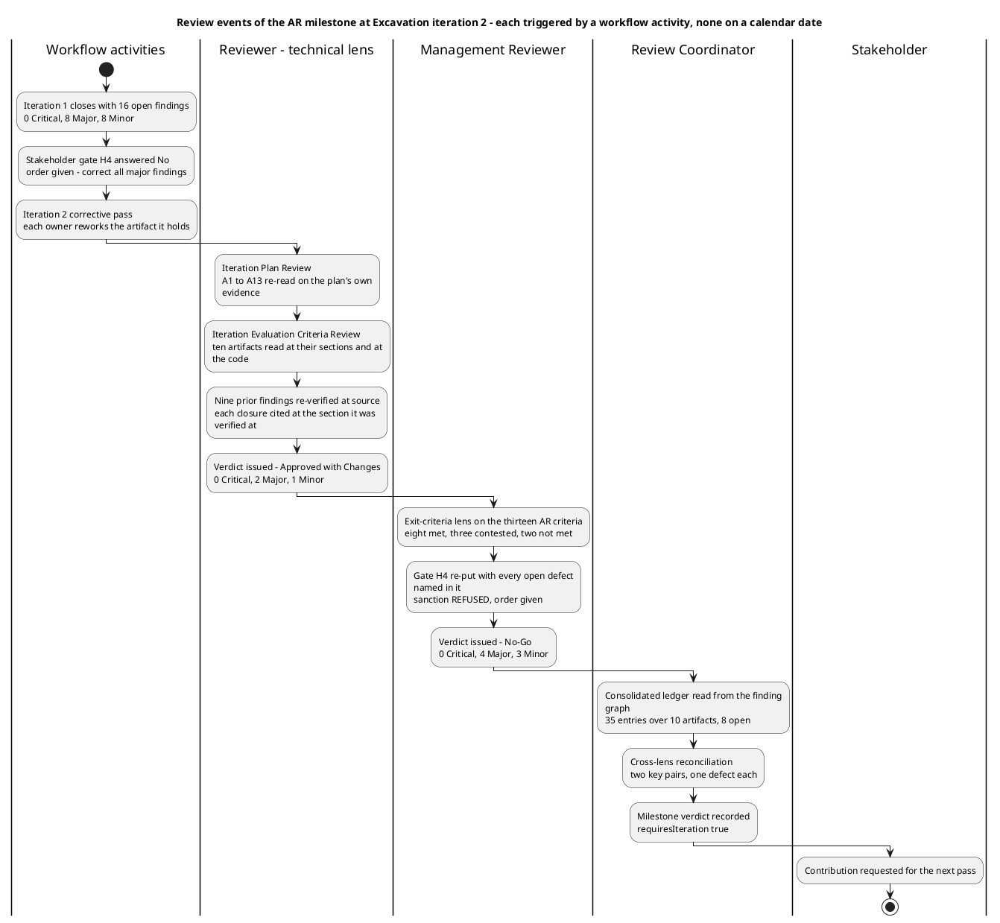

**Entry and exit criteria enforced at each event.**

| Event | Entry criterion | Exit criterion | Held |
|---|---|---|---|
| Iteration Plan Review | The plan carries this iteration's work items with owners, and each exit criterion is read on the artifact its evidence cell names | Every criterion decided on its own artifact's evidence, not on a neighbouring one | **Partly** — A10's cell names three artifacts of the four its test covers (`Iteration Plan#F6`), and A13 rests on a premise the stakeholder's order overturned (`Iteration Plan#F7`) |
| Iteration Evaluation Criteria Review | The recovered artifacts are in their target state and the anchors exist to be checked | Every finding verified at the section it names, and at the code where the finding turns on a recovered fact | Yes — nine closures each cite the section read; the four recovered-fact closures were checked against `appsettings.Development.json`, `ServiceDefaults/Extensions.cs` and `TodoApi.cs` |
| Milestone Review AR | Both executed lenses have returned and the stakeholder's gate answer is on the record | 0 Critical and 0 Major open, and the stakeholder's sanction GRANTED | **No** — 5 Major entries open and the sanction REFUSED |

**Scope of this consolidation.** Ten artifacts carry findings or an explicit no-finding statement from both executed lenses. The Iteration Assessment and this Review Record are not review subjects at their own milestone: the Project Manager authors the Assessment after this review, and this record is the review's output.

**Two artifacts carry no finding from either lens and are recorded as approved without reservation:** System Inventory (three prior findings closed, coverage arithmetic recomputed and reproducing) and the Iteration Assessment (no findings — its status as written after the review is a scheduling fact, not a defect). Vision's two findings are closed by both lenses. The Supplementary Specification, Software Architecture Document, Deployment Model and Design Model each closed their Majors this iteration and carry no open finding.

## Findings
### Reviewer lens
<!-- review: Excavation I3 -->

<!-- review: Excavation I3 -->

#### Compliance matrix

Each artifact against the nine items of this milestone's checklist. An item is marked Pass only where the artifact carries the evidence itself; N/A marks an item the artifact's shape does not engage.

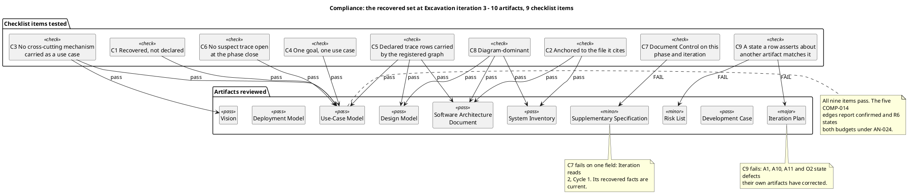

| Artifact | C1 | C2 | C3 | C4 | C5 | C6 | C7 | C8 | C9 |
|---|---|---|---|---|---|---|---|---|---|
| Development Case | N/A | Pass | Pass | N/A | N/A | N/A | Pass | Pass | Pass |
| System Inventory | Pass | Pass | Pass | N/A | N/A | Pass | Pass | Pass | N/A |
| Risk List | Pass | Pass | N/A | N/A | Pass | Pass | Pass | Pass | **Fail** |
| Iteration Plan | N/A | Pass | N/A | N/A | N/A | N/A | Pass | Pass | **Fail** |
| Vision | Pass | Pass | Pass | Pass | N/A | N/A | Pass | Pass | N/A |
| Use-Case Model | Pass | Pass | Pass | Pass | Pass | Pass | Pass | Pass | N/A |
| Supplementary Specification | Pass | Pass | Pass | Pass | N/A | N/A | **Fail** | Pass | N/A |
| Software Architecture Document | Pass | Pass | N/A | Pass | Pass | Pass | Pass | Pass | N/A |
| Deployment Model | Pass | Pass | N/A | N/A | N/A | N/A | Pass | Pass | N/A |
| Design Model | Pass | Pass | N/A | N/A | Pass | Pass | Pass | Pass | N/A |

#### Defect distribution

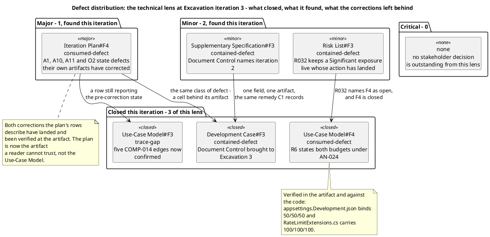

#### Iteration Plan#F4 — four places state a defect their own artifact has corrected (Major, consumed-defect)

**A1** reads "**Not met — open Major**" and gives one reason: "five `COMP-014 → UC-006` to `UC-010` `Realizes` edges are still marked suspect in the registered graph at the close". A fresh query of the graph on `COMP-014` upstream returns the five edges with no SUSPECT marking. `Use-Case Model#F3` is closed.

**A10** reads "**Not met — open Major**" and closes on "**Use-Case Model** — the fourth of the four — does not hold: its rules diagram's R6 reads … 100 tokens … and cites no `AN-024`". R6 now reads "In force: 50 tokens, 50 per 10 s, queue 50. Code defaults: 100 tokens, 100 per 10 s, queue 100 … AN-024", with both files cited in its note. `Use-Case Model#F4` is closed, and all four artifacts the criterion's own test names hold.

**A11** reads "**Not met — two of four open**" and quotes both Development Case Minors as standing. Document Control now reads Phase: Excavation, Iteration 3, Cycle 1, and CLS-DC-01 draws `CRV`, `MRV`, `BRV` and `RCO` edges into `RR` with the co-written sentence naming all six contributors. Both Minors A11 counts are corrected.

**O2** reads "**Not met** … Two Majors stand: `Use-Case Model#F3` … and `Use-Case Model#F4`" — the same two closed findings, stated a fourth time at the head of the plan.

These are three of the thirteen criteria this milestone is decided on. The plan tells the Management Reviewer's re-take and the Review Coordinator's verdict that three criteria fail on defects that have been fixed, one of which the stakeholder ordered corrected by name. The cell that asserts another artifact's state is the artifact that must be re-read when that state changes — not at the next milestone.

**Remediation.** Re-read the four places against the corrected artifacts and restate each at the state its evidence now supports: A1 "Met" with the five edges recorded as confirmed and requoted from a fresh graph query; A10 "Met — certified on the recovered set", naming R6 as the fourth artifact verified corrected and quoting its current wording under `AN-024`; A11 "Met — four of four", naming the four closed Minors and quoting no superseded sentence; O2 met on its own terms, since neither correction added or removed a use case. The sequence, the fine plan and A13's cell are correct and need no change.

#### Risk List#F3 — R032 keeps a live exposure whose retirement action has landed (Minor, contained-defect)

R032's strategy cell reads "**Avoid — action performed on five of six; one citing artifact open**" and names the sixth as "the Use-Case Model's rules diagram R6, whose correction is `Use-Case Model#F4`". The warning-sign cell reads "**fired** at `Use-Case Model#F4`; the register keeps the row open until the fourth artifact holds", and the diagram beside the table carries a contingency node for the sixth. R6 states both budgets under `AN-024` and `#F4` is closed, so all six citing artifacts hold and the register reports a Significant exposure as unmitigated. The register's own opening rule is the one broken, in the other direction: a claim about a retirement that has occurred.

**Remediation.** Restate R032: the action performed on all six citing artifacts, R6 named among them with its current wording under `AN-024`, the exposure retired by the avoidance. Remove or relabel the diagram's contingency node to the one residual — the four artifacts re-read in one pass at the next milestone — and set the warning-sign cell to the state it now holds. `R030` and `R031` are correct as written and unchanged.

#### Supplementary Specification#F3 — Document Control names iteration 2 (Minor, contained-defect)

It reads "Iteration: 2, Cycle 1" while the other nine artifacts under this review read iteration 3. The artifact's content was corrected in iteration 2 and not touched this iteration, which is why the field was not brought forward. Contained: M3, S2, P1 and R8 state both budgets under `AN-024` and R4 the two hops under `AN-023`, no role builds on the metadata and no criterion turns on it. C7 asks each artifact to name the iteration whose review it is under.

**Remediation.** Set the Iteration field to "3, Cycle 1". Change no other field and no content.

#### Artifacts with no finding from this lens

Development Case, System Inventory, Vision, Use-Case Model, Software Architecture Document, Deployment Model and Design Model carry no open finding from this lens. Each was re-read at the sections this lens previously found defective and each now holds. Silence from this lens is the approval.

The three closures this iteration are the substance of it. `Use-Case Model#F4` was the last artifact of the six that cite `AN-024` or `AN-023`, and it now states the fact the other five carry, under the same identifier and against the same file. `Use-Case Model#F3` was the last suspect marking in the graph: `COMP-014` now returns five `Realizes` edges and every one is confirmed, so the Use-Case View states its widest mechanism as confirmed for `UC-006` to `UC-010`. `Development Case#F3` brings the tailoring document onto the phase whose process it governs; the contributor-set defect the Management Reviewer recorded on the same artifact is corrected in the same text — CLS-DC-01 draws six edges into `RR`, and the co-owned sentence names Reviewer, CodeReviewer, Management Reviewer, Business Reviewer, Review Coordinator and the Configuration Manager's baseline record. That defect is the Management Reviewer's to dispose of under its own key.

The System Inventory's coverage arithmetic was recomputed rather than accepted: the per-area Files column sums to 139, the Read column to 84, the unread cells to 55, and the headline reproduces. Every unread area is named with its reason and none carries a perimeter fact.

### Management Reviewer lens
<!-- review: Excavation I2 -->

Every finding below was recorded through `record_artifact_finding` before this section was written. The Majors of the other lenses are cited because the milestone verdict reads them; they are not re-recorded here as duplicates.

#### Defect distribution

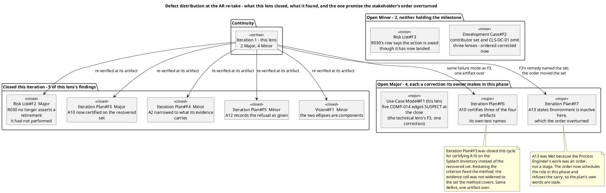

#### Iteration Plan#F6 — A10 certifies three of the four artifacts its own test names (Major, exit-criterion-unmet)

A10's test was rewritten this cycle to "No artifact in the recovered set states a behaviour the code contradicts", and its evidence cell opens "Checked in the artifacts themselves, not in the System Inventory's anomalies table." It then names three artifacts and stops: the Supplementary Specification, the Software Architecture Document, the Deployment Model.

The Use-Case Model is in the recovered set and its rules diagram states one budget where two are in force. R6 reads "The per-user token bucket, /todos only: 100 tokens, 100 per 10 s, queue 100, 429" and cites no `AN-024`, while the same artifact's shared gate diagram states "the code defaults TokenLimit 100 ... and appsettings.Development.json binds all three to 50, which both launch profiles select". `Todo.Api/appsettings.Development.json:8-12` binds 50. One artifact now carries two answers to one question, and the plan certifies that no artifact contradicts the code.

This is the failure mode `Iteration Plan#F3` recorded and this lens closed in the same cycle. Restating the criterion fixed how it is certified; the evidence cell was not widened to the set the method covers, so the defect returns one artifact over. The four rules diagrams are what a Designer or a Test Designer reads to know what the flows enforce — the wrong half is the half that gets carried into design.

#### Iteration Plan#F7 — A13 states a premise the stakeholder's order overturned (Major, exit-criterion-unmet)

A13 is certified Met because each work item "belongs to a stage the IARI DEVELOPMENT PROCESS runs in Excavation". Its evidence cell says the opposite of what the order now creates: "The Process Engineer's two items are recorded as the stakeholder's order of 2026-11-23, not as a discipline stage, and the Development Case records Environment as High in Survey and Inception and inactive here."

At this review the stakeholder refused the carry and ordered: the Development Case corrected now, before the milestone closes, the Process Engineer scheduled in this phase from the next iteration, A11 unchanged. The plan records no such stage: the coarse roadmap ends Excavation at this iteration, the iteration-2 fine plan ends at item 16, and no row carries the third iteration the order requires. Two work items now belong to a role the stakeholder has scheduled here by order, and the milestone sequence does not record them.

#### Iteration Plan — the Majors of the technical lens this verdict reads

`Use-Case Model#F3` (Major, `trace-gap`) — five `COMP-014 → UC-006` to `UC-010` edges still marked «SUSPECT → System Analyst» at the phase close. This lens queried the registered graph directly and confirms it: `model_query_traces` on `COMP-014` returns five `Realizes` edges each carrying the marking, with no closure recorded. The edges are substantively right — `Todo.Api/Todos/TodoApi.cs:19-20` applies `RequirePerUserRateLimit()` to the whole `/todos` group, and the artifact's own gate diagram states the step. What is missing is the confirmation that clears the marking. Recorded under this lens as `Use-Case Model#F1` because the milestone verdict reads the graph; one correction closes both.

`Use-Case Model#F4` (Major, `consumed-defect`) — the rules diagram's R6 states one budget where two are in force, and the same artifact states both several sections later. Detailed at `Iteration Plan#F6` above: the two findings are the same defect read from the criterion and from the artifact, and one correction closes both.

#### Development Case#F2 — the Minor the stakeholder ordered corrected now (Minor, contained-defect)

The contributor set for the Review Record still reads "Reviewer, CodeReviewer, plus the Configuration Manager's baseline record", omitting the Management Reviewer, the Business Reviewer and the Review Coordinator, all of which write their own block; CLS-DC-01 draws no edge from them. The defect is unchanged in content and is contained — each lens writes its block whatever the tailoring says.

What changed is its status. The stakeholder answered at this review: "No carry. I order the Development Case corrected now, before the milestone closes: the Process Engineer is scheduled in this phase from the next iteration and corrects Development Case#F2 and #F3 there. A11 stays as written." A11 therefore stays as written and counts this finding, and the next iteration of this phase performs it. `Risk List#R031`'s contingency — another Excavation iteration planned from this record — is the mechanism.

#### Risk List#F3 — R030's row is behind the artifact it points at (Minor, contained-defect)

R030's strategy cell reads "**Avoid — not yet retired.** The retirement action is owed and not yet performed: the Use-Case Model carries no statement of the session surface beside UC-001 to UC-004. Iteration 2 item 5 performs it." The Use-Case Model now carries that statement, titled "The instability UC-001 to UC-004 sit on", citing `AN-029`, `AN-012` and `R030`, and opens the Use-Case Specifications section with a pointer to it. The register's own premise is false, and a reader is told a Significant exposure is unmitigated when its mitigation has landed. Contained — the register understates rather than overstates, and the risk itself remains live: `AN-012` stands, no test covers the surface, and the statement records an exposure rather than removing it.

#### Closed this iteration — five of this lens's own findings

Each was re-verified at the section named and, where the finding turned on a recovered fact, at the code.

| Finding | Criterion | What closed it |
|---|---|---|
| Risk List#F2 | exit-criterion-unmet | R030 no longer records itself as avoided. Its strategy cell reads "**Avoid — not yet retired.** The retirement action is owed and not yet performed", and the Use-Case Model now carries the statement citing `AN-029`. Avoidance was a claim of retirement; the register no longer makes it |
| Iteration Plan#F3 | exit-criterion-unmet | A10 is certified on the recovered set: its evidence cell opens "Checked in the artifacts themselves, not in the System Inventory's anomalies table" and the three artifacts it names are verified corrected. That the cell omits a fourth is a new finding (`#F6`), not this one recurring |
| Iteration Plan#F4 | contained-defect | A2 no longer certifies a clause its evidence lacks. The criterion is narrowed to priorities 1 to 5, and the cell states "no deferred-set statement is required of any artifact for this row to hold" |
| Iteration Plan#F5 | contained-defect | A12 records "**Not met — refused**" with the answer as given, and the gate is re-put once. No row states a gate the answer superseded |
| Vision#F1 | contained-defect | `EP-020`, `EP-021` and `EP-022` are `component` shapes PM1 and PM2 under "Platform mechanisms - no actor goal, not use cases", noted to Supplementary Specification M8 and M9. Eleven `usecase` ellipses only; the count matches the Use-Case Model |

#### The eight Majors of iteration 1 — all cleared and verified

| Major | Verified at |
|---|---|
| Supplementary Specification#F1 | M3: code defaults 100 / 100 per 10 s / queue 100 and Development 50 / 50 / 50, both under `AN-024`; S2, P1 and R8 likewise |
| Supplementary Specification#F2 | R4 states the two hops apart — the token hop inherits the standard resilience handler, the forwarder hop nothing — under `AN-023` |
| Software Architecture Document#F1 | SP1: "**50 tokens, 50 per 10 s and a queue of 50 is the budget in force wherever this delivery runs** ... The fact is AN-024"; M3 and the bounded-load row likewise |
| Deployment Model#F1 | Preamble narrowed to what is true; Rate limiting row reads 50 / 50 / 50 for Development against the code defaults; "**Two settings separate the environments, not one.**" |
| Use-Case Model#F1 (technical) | The three `EP-003` edges report confirmed and the screen-entry reading is stated beside the rows |
| Vision#F1 (technical) | The two ellipses are components; the section states eleven use cases |
| Risk List#F2 (technical) | R024 no longer misattributes; the risk is a later role assuming equal protection, aimed at the Supplementary Specification's R4 |
| Iteration Plan#F3 (technical) | The fine plan's State column states each row's actual outcome against the artifact it names |

#### Artifacts with no open finding from this lens

System Inventory, Supplementary Specification, Software Architecture Document, Deployment Model, Design Model and Iteration Assessment carry no open finding from this lens. Each was read at the sections this lens previously found defective and each now holds. Silence from this lens is the approval.

The System Inventory's coverage arithmetic was recomputed rather than accepted: the Files column sums to 139, the Read column to 84, the unread cells to 55, and the headline reproduces. The Risk List's 32 rows each name strategy, owner, action, contingency and warning sign, and `R030` and `R031` state "not yet retired" and "materialized" rather than claiming retirements that have not occurred.

### Review Coordinator lens
<!-- review: Excavation I2 -->

<!-- review: Excavation I2 -->

**Consolidated finding ledger.** Every count below is copied from `read_artifact_findings` on each of the twelve artifacts, never from a lens's narrative. The line this section rests on, verbatim:

`[FINDINGS] read=12, unread=none, open Critical=0, open Major=5, open Minor=3`

Thirty-five finding entries stand against the ten artifacts under review. Twenty-seven carry a resolution object and were closed by the lens that recorded them. Eight are open: none Critical, five Major entries covering four distinct defects, three Minor.

**Open findings — the four Major defects.**

| # | Defect | Entries | Lens | Criterion | Owner | The corrective action | Holds |
|---|---|---|---|---|---|---|---|
| 1 | Five `COMP-014 → UC-006` … `UC-010` edges remain marked SUSPECT in the registered graph at the phase close | `Use-Case Model#F3` (Reviewer), `Use-Case Model#F1` (Management Reviewer) | both | `trace-gap` / `exit-criterion-unmet` | System Analyst | Re-register the five edges as confirmed, each checked against the gate diagram the artifact already carries and against `Todo.Api/Todos/TodoApi.cs:19-20`; record beside the gate diagram why a throttling mechanism that gates an operation is not the operation itself — the reading already written for the `EP-003` screen edges | A1 |
| 2 | The rules diagram's R6 states one request budget where two are in force | `Use-Case Model#F4` | Reviewer | `consumed-defect` | System Analyst | State both values in R6 — the code defaults 100 / 100 per 10 s / queue 100 from `Todo.Api/Extensions/RateLimitExtensions.cs:14-31`, and the Development override 50 / 50 / 50 from `Todo.Api/appsettings.Development.json:8-12`, which is what the delivery enforces — and cite `AN-024` as the other rules do | A10 |
| 3 | A10 is certified on three of the four artifacts its own test covers | `Iteration Plan#F6` | Management Reviewer | `exit-criterion-unmet` | Project Manager | Name the Use-Case Model's R6 in A10's evidence cell and hold the criterion until it states both budgets under `AN-024`, or narrow the stated test to the artifacts the cell verifies | A10 |
| 4 | A13 states Environment is inactive in this phase, while the process runs it here as the first discipline | `Iteration Plan#F7` | Management Reviewer | `exit-criterion-unmet` | Project Manager | Record the Environment stage in the milestone sequence as the phase's first discipline, place the two Development Case items against the Process Engineer in the next iteration, and restate A13's evidence cell to cite that stage rather than a stakeholder order | A13 |

**Open findings — the three Minors. Recorded, owned, none holding the milestone.**

| Artifact | Key | Lens | Criterion | Owner | The corrective action |
|---|---|---|---|---|---|
| Development Case | F2 | Management Reviewer | `contained-defect` | Process Engineer | Name every lens writing into the Review Record — Reviewer, Management Reviewer, Business Reviewer, Review Coordinator, CodeReviewer, plus the Configuration Manager's baseline record — and draw the corresponding edges in CLS-DC-01. **A11 counts this finding** |
| Development Case | F3 | Reviewer | `contained-defect` | Process Engineer | Bring the four Document Control fields forward from Survey to Excavation iteration 2; the tailoring content is otherwise current. **A11 counts this finding** |
| Risk List | F3 | Management Reviewer | `contained-defect` | Project Manager | Restate R030's strategy cell: the retirement action has been performed and is in the Use-Case Model under `AN-029`; the exposure stays live because `AN-012` stands and no test covers the surface |

```plantuml
@startuml
title The eight findings open at the AR gate - severity, what each blocks, and the act that closes it

skinparam shadowing false
skinparam classAttributeIconSize 0
skinparam wrapWidth 235
hide circle
hide empty members

package "Major - 5 entries, 4 distinct defects" {
  class "Use-Case Model#F3 (Reviewer)\nUse-Case Model#F1 (Management Reviewer)\ntrace-gap\nfive COMP-014 edges SUSPECT at the close" as M1 <<major>>
  class "Use-Case Model#F4 (Reviewer)\nconsumed-defect\nR6 states 100 where Development binds 50" as M2 <<major>>
  class "Iteration Plan#F6 (Management Reviewer)\nexit-criterion-unmet\nA10 checks three of the four artifacts its test names" as M3 <<major>>
  class "Iteration Plan#F7 (Management Reviewer)\nexit-criterion-unmet\nA13 states Environment inactive here; it is the phase's first discipline" as M4 <<major>>
}

package "Minor - 3 entries, 3 distinct defects" {
  class "Development Case#F2 (Management Reviewer)\ncontained-defect\ncontributor set omits three lenses; A11 counts it" as m1 <<minor>>
  class "Development Case#F3 (Reviewer)\ncontained-defect\nDocument Control a phase behind" as m2 <<minor>>
  class "Risk List#F3 (Management Reviewer)\ncontained-defect\nR030's strategy cell behind the artifact it points at" as m3 <<minor>>
}

package "Blocks the milestone" {
  class "A1 contested" as A1 <<criterion>>
  class "A10 contested" as A10 <<criterion>>
  class "A13 contested" as A13 <<criterion>>
  class "A11 not met - two of four closed" as A11 <<criterion>>
}

M1 --> A1 : one confirmation per edge
M2 --> A10 : the rules diagram is in the set
M3 --> A10 : the cell must cover the set
M4 --> A13 : the sequence must carry the stage
m1 --> A11 : a Minor A11 counts
m2 --> A11 : same artifact, same turn

note right of m1
  The stakeholder's answer of 2026-11-23 places the
  Process Engineer's turn in the next Excavation
  iteration, alongside the other corrections, and
  keeps A11 as written.
end note
note bottom of m3
  Contained: A9 holds, the register understates the
  position, nothing is carried into design on it.
end note

@enduml
```

**Cross-lens reconciliation — where two lenses spoke on one subject.**

| Subject | The two lenses | Resolution recorded here |
|---|---|---|
| The five `COMP-014` edges | Reviewer records `Use-Case Model#F3`; Management Reviewer records `Use-Case Model#F1` — same five edges, same marking, same remedy | **One defect, two keys.** Each lens verified it against the registered graph independently. One correction closes both, and each lens closes only its own key. Neither entry is doubled in the action plan |
| The request budget (AN-024) | Reviewer records `Use-Case Model#F4` at the artifact; Management Reviewer records `Iteration Plan#F6` at the criterion | **One cause, two consequences.** `#F6` cannot pass while R6 says 100; `#F4` is the correction that lets it pass. Reconciled as two findings because two things must change — the artifact and the criterion's evidence cell — and each has its own owner act |
| The Vision's two ellipses | Both lenses recorded `Vision#F1` at iteration 1, the Reviewer as Major and the Management Reviewer as Minor | **Closed by both lenses.** No reconciliation is needed at this gate; the disagreement on consequence was resolved at the previous milestone in favour of the Major band, and one correction closed both keys |
| `Development Case#F2` and `#F3` | Two keys, two lenses, two distinct defects on one artifact, both counted by A11 | **Not a duplicate.** Both are corrected in one turn by one owner and are sequenced as one action |
| `Risk List#F2` (Reviewer, Minor) and `Risk List#F3` (Management Reviewer, Minor) | `#F2` closed on R024; `#F3` was recorded open against R030's strategy cell in the same pass | **Successive, not contradictory.** `#F3` arose from the correction `#F2` and the Management Reviewer's own R030 closure; the register now understates the position rather than overstating it |

No lens contradicts another on a fact. The one severity disagreement of this milestone was adjudicated at the previous gate; no finding at this gate carries a disputed band.

**Stakeholder finding recorded at this milestone — Environment is a discipline stage in Excavation.**

The stakeholder answered the routing question put with this verdict. Their answer, verbatim: "Same iteration: the Process Engineer works in the next Excavation iteration, with the Use-Case Model and Iteration Plan corrections, so the phase closes in one iteration. It is not an exception on my order: the process now runs Environment in every phase, and in Excavation it is the first discipline, with the Process Engineer's stage. In that turn the Process Engineer corrects Development Case#F2 and #F3 and brings what the Development Case states about when Environment runs to the baseline — active in every phase. A11 stays as written; A13's evidence cites the Environment stage, not an order of mine."

Verified against the artifacts, not deferred: the Iteration Plan's A13 evidence cell states "the Development Case records Environment as High in Survey and Inception and inactive here", and the Development Case is where that statement is made — so the artifact the order corrects is identified and the correction is a tailoring statement, not a new role. The answer matches the canonical intensity matrix, under which Environment runs in every phase (Low in Excavation) — the phase is not one the process skips it in. `Development Case#F2` and `#F3` remain open findings with their own criteria; this answer supplies the stage on which their owner acts, and closes neither.

**Priority of what remains — one iteration, Major before Minor, and within the Major band the item that unblocks another first.**

| Priority | Finding | Why it ranks here |
|---|---|---|
| 1 | `Iteration Plan#F7` | Establishes the stage every other action depends on and the one criterion that turns on the plan's own sequence. It is the Project Manager's record of a discipline stage, not of an exception |
| 2 | `Use-Case Model#F4` | One diagram, one citation; also the artifact behind `Iteration Plan#F6`, so correcting it is the precondition for that criterion to be certifiable |
| 3 | `Use-Case Model#F3` and `#F1` | Five confirmations against evidence the artifact already holds; closes A1 and the widest mechanism in the Use-Case View |
| 4 | `Iteration Plan#F6` | A certification cell, corrected once action 2 supplies the fact it must name |
| 5 | `Development Case#F2` | Names every lens writing into the Review Record and draws the edges; the Process Engineer's turn is the same iteration |
| 6 | `Development Case#F3` | The four Document Control fields, in the same turn and by the same owner |
| 7 | Environment's stage stated in the Development Case baseline | Active in every phase, first discipline in Excavation — the tailoring correction the stakeholder ordered in the same turn as the two Minors |
| 8 | `Risk List#F3` | A transcription of a fact that has already landed; a Minor that holds no criterion |

**What the ledger says about the review process.** Four of the eight open entries are four distinct defects, not eight problems: the recovery is substantively right and its remaining fault is transcription and confirmation, not reading. The two lenses converged on the same defect twice without seeing each other's keys, which is the signature of a real defect rather than a lens artefact. Every open finding now has an owner with a stage in this phase and a turn in the next iteration — the condition `Development Case#F2` lacked for two iterations, and which the stakeholder has now supplied.

## Resolutions and Actions
### Reviewer lens
<!-- review: Excavation I3 -->

<!-- review: Excavation I3 -->

#### Closures materialized this iteration

Each row is a `resolve_artifact_finding` call that transitioned the ledger, not a narrative claim. The evidence column names where the corrected content was read.

| Finding | Criterion | Resolution | Evidence read |
|---|---|---|---|
| Development Case#F3 | contained-defect | Resolved | Document Control: "- Phase: Excavation / - Status: Draft — made current for the end-of-Excavation (AR) milestone review / - Milestone Target: end-of-Excavation (AR) — not yet achieved / - Iteration: 3, Cycle 1" |
| Use-Case Model#F3 | trace-gap | Resolved | `model_query_traces` on `COMP-014` upstream: five `Realizes` edges — UC-010, UC-009, UC-008, UC-007, UC-006 — none marked SUSPECT; Software Architecture Document Traceability row `COMP-014` names the same five |
| Use-Case Model#F4 | consumed-defect | Resolved | Use-Case Model rules diagram R6: "In force: 50 tokens, 50 per 10 s, queue 50. Code defaults: 100 tokens, 100 per 10 s, queue 100. Over budget answers 429. AN-024"; note citing `RateLimitExtensions.cs:14-31` and `appsettings.Development.json:8-12` |

#### Actions this iteration opens

Each is an owner's corrective action, stated so it can be performed without a follow-up question. The first holds the milestone; the other two do not.

| Finding | Owner | Action | Holds the milestone |
|---|---|---|---|
| Iteration Plan#F4 | Project Manager | Re-read the four places against the corrected artifacts and restate each: A1 "Met" with the five `COMP-014` edges confirmed and requoted from a fresh graph query; A10 "Met — certified on the recovered set" naming R6 as the fourth artifact and quoting its current wording under `AN-024`; A11 "Met — four of four"; O2 met on its own terms. Requote no superseded sentence and change nothing in the sequence, the fine plan or A13 | Yes — A1, A10 and A11 are three of the thirteen criteria the milestone is decided on, and the verdict reads those cells |
| Risk List#F3 | Project Manager | Restate R032: the action performed on all six citing artifacts, R6 named with its wording under `AN-024`, the exposure retired by the avoidance; remove or relabel the diagram's contingency node to the residual — the four artifacts re-read in one pass at the next milestone; set the warning-sign cell to its current state. Leave `R030` and `R031` unchanged | No — a Minor, contained, no criterion turns on it |
| Supplementary Specification#F3 | System Analyst | Set the Iteration field to "3, Cycle 1". Change no other field and no content | No — a Minor, one metadata field |

#### Carried state read for this disposition

| Item | State read |
|---|---|
| Gate H4 (the stakeholder's confirmation of the recovered set) | The AR review of iteration 2 records it answered No, twice, with the order that the Development Case be corrected in this phase and that every Major be corrected. That order is performed: both Development Case Minors are corrected and both Use-Case Model Majors are closed. Re-putting the gate is not this lens's to do |
| The stakeholder's routing answer of 2026-11-23 | Applied and verified in the artifacts, not merely recorded: the Iteration Plan puts the Process Engineer's three items in this iteration under the Environment stage, and the Development Case states Environment active in every phase with Excavation first. A11 is neither waived nor restated |
| `Risk List#F3` (Management Reviewer) | R030's strategy cell now reads "**Avoid — retirement landed; the exposure stays live**", with the statement located in the Use-Case Model under `AN-029` and the reason it stays live — `AN-012` stands, no test covers the surface. That finding is closed by its own lens; this lens reads the cell and finds it true |
| Suspect traces | None. `COMP-014` — the only component this lens ever found carrying a marking — now returns five confirmed edges, and the three `EP-003` edges were confirmed at the previous pass |
| Open pull requests | None in any state. The repository was queried: no pull request exists to approve, request changes on, or defer, and none is expected — Excavation produces no production code |
| Build status | No IARI pipeline file exists; nothing is reported for `main`. This is the phase's correct state, not a gap |
| Exit criterion A10 (the recovery states what the code does) | Certifiable on the recovered set as this lens reads it. The four artifacts its test names all hold: Supplementary Specification M3, S2, P1, R8 and F10; Software Architecture Document SP1, M3 and the bounded-load row; Deployment Model Environment Mapping; Use-Case Model R6. The criterion's evidence cell is the plan's to restate — `Iteration Plan#F4` |

### Management Reviewer lens
<!-- review: Excavation I2 -->

#### Stakeholder consultation — gate H4 re-put, and the order it returned

Gate H4 was re-put at this review. Both questions were put with this lens's verdict leaning and every open defect named inside them, and neither carried a pre-filled sanction.

**Stakeholder sanction: REFUSED**

**Stakeholder acceptance, question 1 — verbatim:** "No"

**Stakeholder acceptance, question 2 — verbatim:** "No carry. I order the Development Case corrected now, before the milestone closes: the Process Engineer is scheduled in this phase from the next iteration and corrects Development Case#F2 and #F3 there. A11 stays as written."

**Stakeholder acceptance, question 3 — verbatim:** no answer given.

Three consequences follow, and this lens applies no more than the stakeholder stated:

1. The recovered set is **not confirmed**. `A12` is not met. The stakeholder refused the sanction; no condition, limit or prohibition beyond the refusal was stated and none is recorded.
2. The Development Case is **not carried to Inception**. It is corrected in this phase, before the milestone closes, and the Process Engineer is scheduled here from the next iteration. `A11` stays as written. Both `Development Case#F2` and `Development Case#F3` are named in the order and are corrected in that turn.
3. The plan must record the stage the order creates. `Iteration Plan#F7` states the gap: the milestone sequence ends Excavation at this iteration and records no Process Engineer stage.

The recommendation this lens made in question 2 — restate `A11` and carry the Minors to Inception — was **declined**. It is not applied. Recorded here so that no later role reads the declined recommendation as a decision.

#### Closure ledger — five findings disposed this iteration

| Finding | Criterion | Disposition | Where verified |
|---|---|---|---|
| Risk List#F2 | exit-criterion-unmet | **Resolved** | R030 no longer records itself as avoided; the Use-Case Model carries the statement citing `AN-029` |
| Iteration Plan#F3 | exit-criterion-unmet | **Resolved** | A10 certified on the recovered set, its cell naming three artifacts verified corrected. The omitted fourth is `#F6`, a new defect |
| Iteration Plan#F4 | contained-defect | **Resolved** | A2 narrowed to priorities 1 to 5; the cell requires no deferred-set sentence |
| Iteration Plan#F5 | contained-defect | **Resolved** | A12 reads "**Not met — refused**" with the answer as given |
| Vision#F1 | contained-defect | **Resolved** | The two ellipses are components; eleven use cases stated |

`Risk List#F2`, `Iteration Plan#F3`, `Iteration Plan#F4`, `Iteration Plan#F5` and `Vision#F1` were each closed by `resolve_artifact_finding` on this lens's own key, and each closure cites the section it was verified at.

`Development Case#F2` is **not** closed and is **not** deferred: it was re-recorded under its existing key with the stakeholder's order attached. Its state is open and its owner is scheduled.

#### What each open finding needs, and who performs it

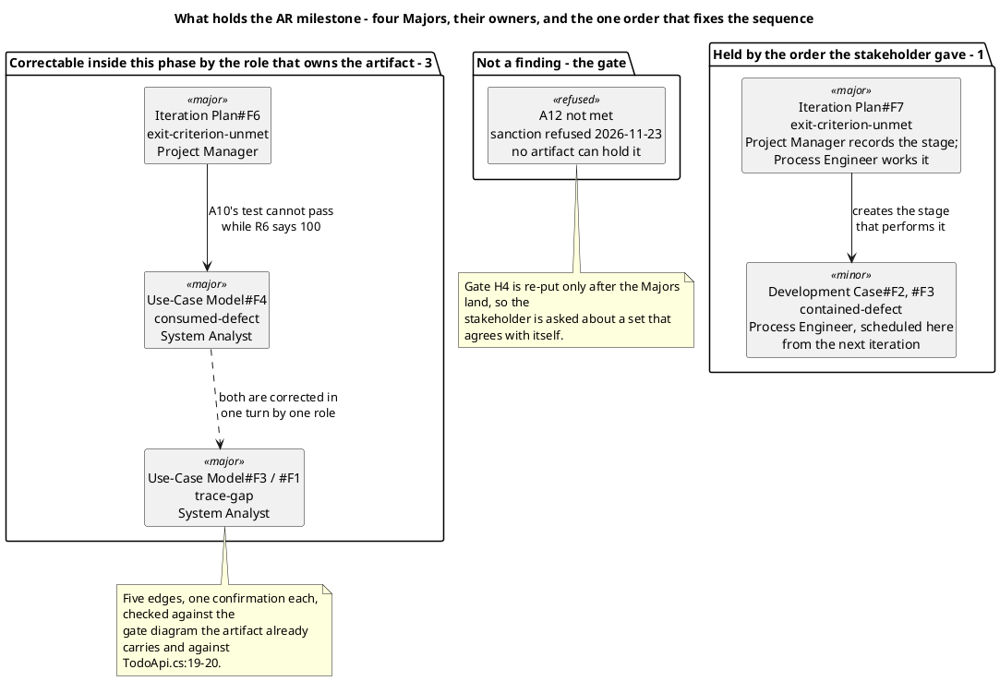

| # | Finding | Owner | The corrective action | Clears |
|---|---|---|---|---|
| 1 | Use-Case Model#F3 and this lens's #F1 | System Analyst | Re-register the five `COMP-014 → UC-006` to `UC-010` edges as confirmed, each checked against the gate diagram and `TodoApi.cs:19-20`, and record beside that diagram why the throttling mechanism gates the operation without being it — the reading already used for the `EP-003` screen edges | A1 |
| 2 | Use-Case Model#F4 | System Analyst | State both budgets in R6 under `AN-024` — the code defaults 100 / 100 per 10 s / queue 100 from `RateLimitExtensions.cs:14-31`, and the Development override 50 / 50 / 50 from `appsettings.Development.json:8-12`, which is what the delivery enforces — and cite `AN-024` as the other rules do | A10 |
| 3 | Iteration Plan#F6 | Project Manager | Name the Use-Case Model's R6 in A10's evidence cell, so the criterion is certified on all four artifacts its test covers, or narrow the test to the artifacts the cell verifies | A10 |
| 4 | Iteration Plan#F7 | Project Manager | Record the stakeholder's order of 2026-11-23 as the stage it creates: add the next Excavation iteration to the milestone sequence, place the two Development Case items in it against the Process Engineer, and restate A13's evidence cell to state that the role runs here from that iteration on the order — not as a discipline stage, not as work carried elsewhere | A13 |
| 5 | Development Case#F2 | Process Engineer, scheduled here from the next iteration | Name every lens that writes into the Review Record — Reviewer, Management Reviewer, Business Reviewer, Review Coordinator, CodeReviewer, plus the Configuration Manager's baseline record — and draw the corresponding edges in CLS-DC-01 | A11 |
| 6 | Development Case#F3 (Reviewer lens) | Process Engineer, same turn | Bring the four Document Control fields to the phase the document governs | A11 |
| 7 | Risk List#F3 | Project Manager | Restate R030's strategy cell: the retirement action has been performed and is in the Use-Case Model under `AN-029`; the risk stays live because `AN-012` stands and no test covers the surface | — |

Priority: Majors before Minors. Item 4 ranks first among the Majors because it is the only one the stakeholder ordered by name at this review, and because it creates the stage that performs item 5. Items 1 and 2 are one turn's work by one role on one artifact. Item 7 is a transcription.

#### Why this lens does not certify the milestone

The verdict below is No-Go, and the reason is not the count of findings. Four Majors would be an ordinary corrective pass. What this lens will not do is certify `A11` while the phase records no stage that can satisfy it, and will not certify `A10` while the criterion's own test names four artifacts and its evidence checks three. Both are criteria this lens is accountable for, and both fail on their own evidence rather than on a neighbouring artifact's opinion.

### Review Coordinator lens
<!-- review: Excavation I2 -->

<!-- review: Excavation I2 -->

**Actions, in the order the next iteration of this phase takes them.** Each action is the remediation its recording lens wrote. No action carries a calendar date: the phase declares none, and a date projected from an estimate would read downstream as an observation. The due point is a state of the work. Every action is performed in **one** iteration — the stakeholder placed the Process Engineer's turn in the same iteration as the Use-Case Model and Iteration Plan corrections, so the phase closes in one iteration.

| # | Action | Artifact | Owner | Closes | Due point | Escalates if |
|---|---|---|---|---|---|---|
| 1 | Record the Environment stage in the milestone sequence as the phase's first discipline, place the two Development Case items against the Process Engineer in the next iteration, and restate A13's evidence cell to cite that stage | Iteration Plan | Project Manager | `Iteration Plan#F7` | First, so the stage exists before the role's turn | The plan again records Environment as inactive in this phase |
| 2 | State both budgets in R6 under `AN-024` — code defaults 100 / 100 per 10 s / queue 100, Development override 50 / 50 / 50 as the value in force — and cite `appsettings.Development.json:8-12` | Use-Case Model | System Analyst | `Use-Case Model#F4` | Same iteration, first among the artifact corrections | R6 and the gate diagram still give two answers |
| 3 | Re-register the five `COMP-014 → UC-006` … `UC-010` edges as confirmed, each checked against `TodoApi.cs:19-20`, and record beside the gate diagram why the bucket gates the operation without being it | Use-Case Model | System Analyst | `Use-Case Model#F3`, `Use-Case Model#F1` | Same turn as action 2 | Any edge still carries a SUSPECT marking when the graph is re-queried |
| 4 | Name the Use-Case Model's R6 in A10's evidence cell so the criterion is certified on all four artifacts its test covers, or narrow the stated test to the artifacts the cell verifies | Iteration Plan | Project Manager | `Iteration Plan#F6` | After action 2 lands — the cell cannot certify what is not yet correct | A10 is recorded met on a subset again |
| 5 | Name every lens writing into the Review Record in the co-owned-artifact sentence and draw the corresponding edges in CLS-DC-01 | Development Case | Process Engineer | `Development Case#F2` | Same iteration, in the Environment stage action 1 records | The role's turn is again absent from the phase plan |
| 6 | Bring the four Document Control fields forward to the phase the document governs | Development Case | Process Engineer, same turn | `Development Case#F3` | With action 5 | — |
| 7 | State in the Development Case that Environment runs in every phase, and in Excavation as its first discipline, so the tailoring matches the baseline the rest of the document is read against | Development Case | Process Engineer, same turn | The tailoring statement the stakeholder ordered corrected alongside `#F2` and `#F3` | With actions 5 and 6 | The Development Case again states a phase in which the role does not run |
| 8 | Restate R030's strategy cell: the retirement action has landed in the Use-Case Model under `AN-029`; the exposure stays live because `AN-012` stands and no test covers the surface | Risk List | Project Manager | `Risk List#F3` | Owner's next turn, after the Majors | The row claims a retirement that has not occurred, in either direction |

Actions 2 and 3 are one turn by one owner on one artifact, sequenced only because `#F4` supplies the fact A10's cell must name. Actions 5, 6 and 7 are one turn by one owner and are the content of the stakeholder's answer. Actions 1 and 4 are the Project Manager's, and both are records of a stage or a criterion rather than corrections to recovered content.

**Escalation — what is escalated, and what is not.**

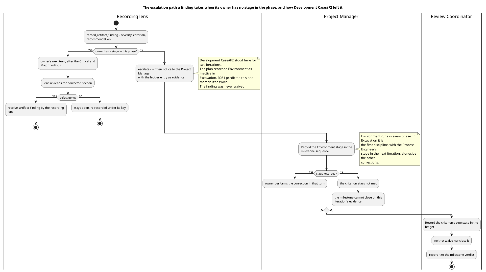

| Item | State | Why |
|---|---|---|
| `Development Case#F2` | **Escalated until action 1 is performed** | Its owner had no stage in this phase for two iterations, which is what `R031` predicted and what materialized. The stage now exists in the process and the stakeholder placed the role in the next iteration; action 1 is the Project Manager recording it in the plan. Until that record exists the finding's owner has no scheduled turn, and a criterion depends on it |
| Every other open finding | **Not escalated** | Each owner holds a stage in this phase and a turn in the next iteration. No finding is overdue: the phase has not closed, and the due point of each is that iteration's work |
| Systemic process failure | **No escalation to the Configuration and Change Management Board** | The ledger shows no repeated architecture violation and no skipped review. The same defect appearing twice across lenses is convergence, not process failure. The Change Control Manager does not work in the sprint zero, so no change request is opened for any finding; the stakeholder's answer reaches its owners through this record and through their Work Orders |

**Review effectiveness — this milestone's measured counts.** Second review event of this phase; the previous one is this milestone's iteration-1 pass, so the comparison is against that pass and nothing older.

| Indicator | Iteration 1 | Iteration 2 | What it is computed from |
|---|---|---|---|
| Review coverage | 10 of 10 reviewed artifacts read by both executed lenses | 10 of 10 read by both executed lenses; 9 received an explicit no-finding statement | The artifacts under review at each pass |
| Finding entries recorded | 29 | 35 cumulative | `read_artifact_findings` across the ten artifacts |
| Open at the gate | 16 — 0 Critical, 8 Major, 8 Minor | 8 — 0 Critical, 5 Major entries over 4 defects, 3 Minor | The `[FINDINGS]` line |
| Closed by their recording lens | 13 | 27 cumulative | Resolution objects on the ledger |
| Defect density, open entries by discipline | Requirements 6, Analysis & Design 3, Project Management 5, Environment 2, Discovery 0 | Requirements 4 over 2 defects, Project Management 2, Environment 2, Analysis & Design 0, Discovery 0 | Open entries at each gate, by the artifact carrying them |
| Duplicate subjects reached by both lenses | 1 — the rate limiter | 2 — the five `COMP-014` edges, and the rate budget at artifact and criterion | The reconciliation table in Findings |
| Scope of the correction required | 8 Majors across 7 artifacts | 4 Major defects across 2 artifacts, all correctable in one iteration | The open Major ledger |
| Defect removal efficiency | Not computable | Not computable | No test execution has occurred in the sprint zero; nothing is found by test against which review-found defects could be compared, and no ratio is invented |
| Rework effort | Not measured | Not measured | No per-finding token or elapsed-time attribution exists; the phase has not closed, so no measured actual is available to attribute |

**What the metrics say.** Open entries fell from 16 to 8 and the artifacts carrying a Major fell from 7 to 2, while coverage held at 10 of 10. The remaining work is concentrated in two artifacts and one owner turn each, and the stage the two Development Case Minors needed now exists in the plan the next iteration will carry. The indicator that did not improve is the one the gate turns on — a criterion whose evidence cell certifies a subset of what its own test covers reappeared one artifact over; `Iteration Plan#F3` closed at this pass and `#F6` opened against the same method. The process found it in the same pass that recorded it, which is the mechanism working; it did not prevent it.

**No finding is recorded for three absences.** The Data Model, the Glossary and the Test Plan are absent on the Development Case's NOT FIRED verdict on each trigger, which both executed lenses checked against the §5.2 conditions. The Iteration Assessment describes no iteration being reviewed because the Project Manager authors it after this review. No SCM condition exists to report: the sprint zero runs no build, opens no pull request and files no defect, which is the phase's correct state.

## Disposition
### Reviewer lens
<!-- review: Excavation I3 -->

<!-- review: Excavation I3 -->

#### Disposition — Approved with Changes

The recovered set converged this iteration. The three findings this lens held at the AR re-take are closed, each verified at its artifact and, where it turned on a recovered fact, at the code or the graph. What remains is not the recovery: it is the plan that reports on it.

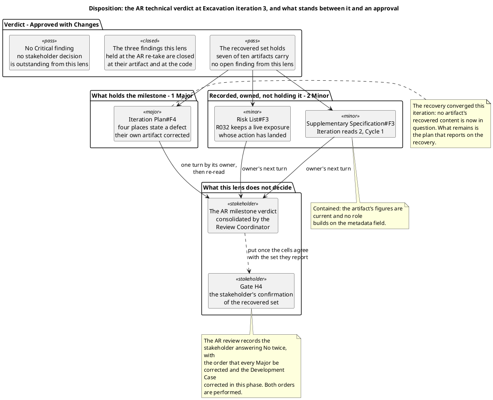

#### The verdict on the AR exit criteria, as this lens reads them

| Criterion | This lens's reading | Basis |
|---|---|---|
| A1 Operations recovered as use cases | **Met** | Eleven use cases, each tracing to the `EP-NNN` whose code performs it; all twenty-two entry points carried or their exclusion reasoned. The five `COMP-014` edges are confirmed in the graph, so the widest mechanism in the Use-Case View is stated as confirmed for `UC-006` to `UC-010` |
| A3 Architecture recovered and checked | **Met** | Twenty-two components with connectors; the Use-Case View names a component path for each of the eleven use cases. `SP1`, `M3` and the bounded-load row state 50 / 50 / 50 under `AN-024` |
| A4 Data recovered with its anchors | **Met** | Eight persisted entity types with keys, indexes, referential actions and enforced rules; `AN-025` at PD-D3 and `AN-005` confined to `EnsureCreated` |
| A5 Deployment modelled | **Met** | The fired optional records the processes, the stores, the ports, the key ring and the two settings that separate the environments, each anchored |
| A6 Coverage measured | **Met** | 84 read and 55 unread of 139; the per-area columns reproduce and every unread category is named |
| A7 Anomalies carried as risks | **Met** | Thirty-two risks, twenty-nine on `Refines` edges from the anomalies, three with their separate origins stated |
| A9 Every risk actionable | **Met** | Every row names a strategy, an owner, an action, a contingency and a warning sign. `R030` and `R031` state the exposure or the materialization rather than a retirement. `R032`'s count is a transcription `Risk List#F3` records |
| A10 The recovery states what the code does | **Met on the recovered set** | All four artifacts the criterion's test names hold: Supplementary Specification M3/S2/P1/R8/F10, Software Architecture Document SP1/M3/bounded-load, Deployment Model Environment Mapping, Use-Case Model R6 — each stating both budgets under `AN-024` or the two hops under `AN-023`. The plan's evidence cell still reports the pre-correction state: that is `Iteration Plan#F4`, not the set |
| A11 The SBC Minors closed | **Met on the artifacts** | All four corrected: `Iteration Plan#F2`, `Iteration Plan#F3`, `System Inventory#F3`, and `Development Case#F2` and `#F3`, both closed this iteration. The plan's cell still reads "two of four open": that is `Iteration Plan#F4` |
| A12 The recovered set confirmed | **Not met — refused** | Gate H4 answered No at the iteration-2 review. Not an artifact's to hold; re-put once the cells agree with the set they report |
| A13 No work the process does not run | **Met** | The plan's sequence records the Environment stage as the phase's first discipline, and every fine-plan item sits under a stage this phase runs. The cell cites the stage, not a stakeholder order |

A10 and A11 are certified on the artifacts each criterion governs, which is what the criteria ask. Their evidence cells are wrong, and a wrong cell is a defect in the plan, not a failure of the artifact the cell describes. This lens holds the difference deliberately: resting a criterion's state on the plan's own text would make the plan's error into a failure of the recovered set, which is the shape of defect `Iteration Plan#F3` and `#F6` recorded in the two previous passes.

#### Why this is Approved with Changes and not Rejected

A rejection would say the recovered set is not a model of the existing system. It is. The eleven use cases, the twenty-two components and the eight tables each rest on the file they cite, and this lens verified the iteration's corrected facts at source rather than accepting them from the artifacts' own prose. The one open Major is a plan whose cells lag its artifacts by one correction pass. Nothing in the recovery is in question.

#### Why it is not Approved

Approval would pass to the Management Reviewer's re-take and the Review Coordinator's verdict a plan that states three criteria fail on defects that have been fixed, one of which the stakeholder ordered corrected by name. The verdict reads the plan. A cell that asserts another artifact's state is a claim about that artifact, and while it stands the record the milestone is decided on does not describe the set the milestone is deciding.

#### The route this lens sees

One turn by the Project Manager restates the four places, and one turn each by the Project Manager and the System Analyst closes the two Minors in their own next turns. The corrections the iteration was opened for have all landed. The phase's declared scope is untouched, no role is added, and nothing is deferred to Consolidation to reach the gate.

#### Preserved

No artifact outside the ten reviewed was re-read for a finding, and none is changed by this lens. The Review Record is this lens's only output.

### Management Reviewer lens
<!-- review: Excavation I2 -->

**Verdict: NO-GO.** The Architecture Recovered milestone is not sanctioned. Excavation iteration 2 does not close it, and the project does not advance into Consolidation on this evidence.

**0 Critical, 4 Major, 3 Minor.** The eight Majors that held iteration 1 are all closed and verified at their artifacts. No finding is deferred, none is waived, and no criterion is recorded as met on an answer it does not carry.

#### Disposition — No-Go

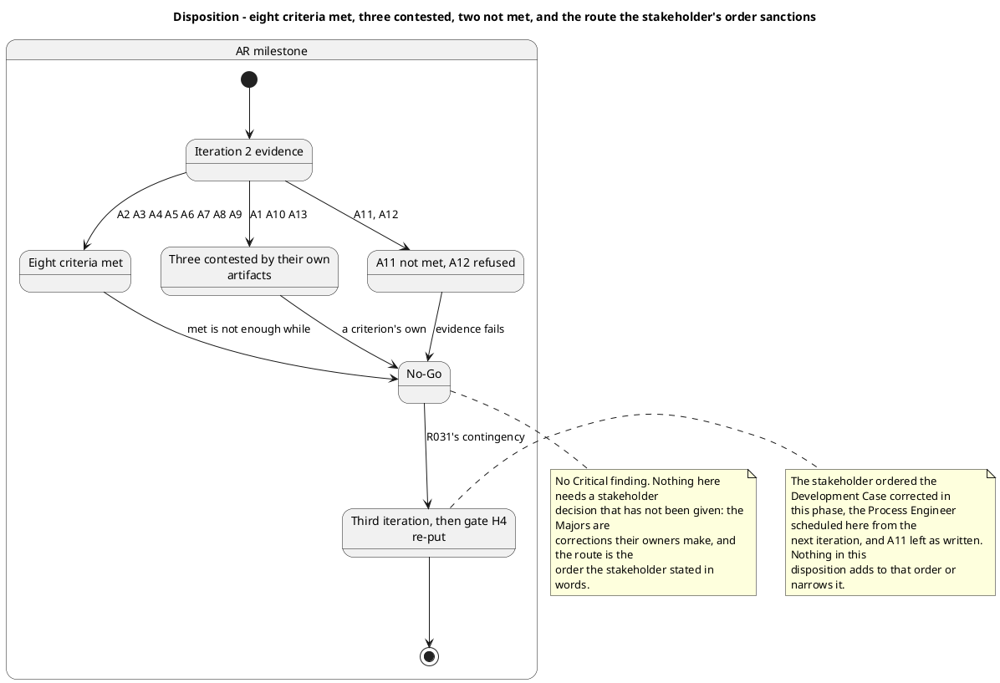

#### Why No-Go rather than Conditional

A Conditional Go is a sanction with conditions: the gate opens and the conditions are verified at the next milestone. This lens may not issue one here, for three reasons that are about the criteria rather than about the finding count.

1. **`A12` is refused, not pending.** The stakeholder was asked at this review whether they confirm the recovered set and sanction advancing into Consolidation, with every open Major named inside the question. They answered **No**. A conditional sanction would assert on their behalf the one thing they declined to assert; `A12` turns on their answer alone and no artifact can hold it.

2. **`A11` records no stage that can satisfy it, and the stakeholder has ordered otherwise.** The plan's `A13` states Environment runs at no intensity in Excavation. The order of 2026-11-23 refuses the carry, schedules the Process Engineer in this phase from the next iteration, and leaves `A11` as written. Until the plan records that stage, the phase carries a criterion its own milestone sequence contradicts.

3. **`A10` fails on its own test.** The criterion claims no artifact in the recovered set states a behaviour the code contradicts, and its evidence cell verifies three of the four artifacts the set contains. The Use-Case Model's R6 states 100 where Development binds 50 — the same fact `AN-024` records, in the artifact a Designer reads first.

A milestone is not advanced because the calendar says the iteration is over. It advances when its exit criteria are met, and three are not.

#### What this disposition does not say

- It does not dispute the recovery. The eleven use cases, the 22-component architecture, the eight-table data model and the deployment all rest on anchors and are, in substance, right. The defects are three sentences and one missing stage.
- It does not re-open a single one of the four exclusions. External-provider sign-in is recovered and marked unreachable; the `admin` branch is an exceptional entity; `EP-020`, `EP-021` and `EP-022` are not use cases. Each stands on the stakeholder's 2026-11-23 answer and no finding here touches them.
- It does not order a change the stakeholder did not order. Items 1 to 3 and 7 of the action table are corrections the artifacts' own owners make to defects this lens recorded. Item 4 records the order the stakeholder gave. Items 5 and 6 are that order's content.
- It records no condition, limit or prohibition beyond what the stakeholder stated.

#### The route this lens sanctions

`Risk List#R031`'s contingency, planned from this record: **a third iteration of Excavation**, performing items 1 to 4 of the action table, then gate H4 re-put once the recovered set agrees with itself. Nothing in the phase's declared scope is cut or deferred to reach it, and no role is added that the phase does not run — the Process Engineer is scheduled by the stakeholder's order, and that order is the only authority that places the role here.

`R031` has materialized for the second consecutive iteration. It is recorded, scored at 4 × 3 = 12 and avoided; recording it has not retired it, and this disposition does not claim otherwise.

#### Disposition by artifact

| Artifact | Disposition from this lens |
|---|---|
| Development Case | **Changes required** — `#F2` open, ordered corrected in this phase; `#F3` open (Reviewer lens) |
| System Inventory | **Approved** — no open finding from any lens; coverage arithmetic recomputed and reproducing |
| Risk List | **Approved with changes** — `#F3` open, one strategy cell behind its artifact |
| Iteration Plan | **Changes required** — `#F6` and `#F7` open |
| Iteration Assessment | **Not judged** — authored in the Assess touchpoint after this review; its absence before the review is not a finding |
| Vision | **Approved** — `#F1` closed this iteration |
| Use-Case Model | **Changes required** — `#F3` and `#F4` open (technical lens), `#F1` open (this lens) |
| Supplementary Specification | **Approved** — `#F1` and `#F2` closed and verified |
| Software Architecture Document | **Approved** — `#F1` closed and verified |
| Deployment Model | **Approved** — `#F1` closed and verified |
| Design Model | **Approved** — `#F1` closed and verified |

### Review Coordinator lens
<!-- review: Excavation I2 -->

<!-- review: Excavation I2 -->

**Milestone verdict on the consolidated ledger: the Architecture Recovered milestone is NOT sanctioned. Excavation iteration 2 does not close it.**

The verdict is anchored to the finding data and to the stakeholder's recorded answer, not to judgment:

| Condition for sanction | The data |
|---|---|
| `[FINDINGS]` unread = none | Met — twelve artifacts read, none unread |
| Open Critical = 0 | Met — none recorded by either executed lens |
| Open Major = 0 | **Not met** — five Major entries over four distinct defects |
| Stakeholder sanction GRANTED | **Not met** — REFUSED on 2026-11-23, with the order that all major findings be corrected |
| Recovery confirmed | **Not confirmed** — A12 turns on the stakeholder's answer alone |

Both executed lenses reach the same conclusion by different routes: the technical lens returns **Approved with Changes**, holding on the two Use-Case Model Majors; the Management Reviewer returns **No-Go**, holding on A11, A12 and A13. Neither lens recorded a Critical finding, so nothing in this ledger requires a stakeholder decision that has not already been given.

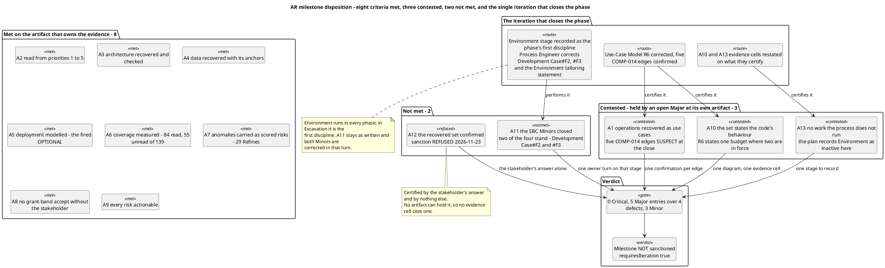

**What this consolidation records as settled.** Eight of the thirteen AR criteria are met on the artifact that owns each. The recovered set is not in question: eleven use cases, a 22-component architecture across four processes, and an eight-table data model, each resting on the file and lines it cites. Seven Major findings were cleared this iteration and verified at source rather than accepted from the artifacts' own text, and no finding is waived, deferred or recorded as closed on its owner's prose. The four exclusions the stakeholder ruled on stand untouched: external-provider sign-in is recovered and unreachable, the admin branch is an exceptional entity, and `EP-020`, `EP-021` and `EP-022` are not use cases.

**What it records as requiring work.** Four Major defects and three Minors, all corrections their owners make inside this phase, itemized in Resolutions and Actions. Three of the four Major defects sit on two artifacts, and one owner turn performs both Use-Case Model corrections. `Iteration Plan#F7` gates the rest: the plan records Environment as inactive in Excavation, so the stage on which `Development Case#F2` and `#F3` are corrected does not exist in it — the condition `R031` predicted and which has now materialized twice.

**The route — one iteration.** `Risk List#R031`'s contingency and the stakeholder's answer of 2026-11-23 both point to a single further iteration of this phase, performing actions 1 to 8, then gate H4 re-put once the recovered set agrees with itself. The stakeholder placed the Process Engineer's turn in that same iteration, so the phase closes in one iteration rather than two, and stated that Environment runs in every phase and is Excavation's first discipline with the Process Engineer's stage — not an exception to the process. A13's evidence cell cites that stage. No declared scope is cut or deferred to reach it.

**Disposition by artifact.**

| Artifact | Disposition |
|---|---|
| System Inventory | **Approved** — no open finding from any lens; coverage arithmetic recomputed and reproducing |
| Vision | **Approved** — both lenses' findings closed on verified evidence |
| Supplementary Specification | **Approved** — both Majors closed and verified at source |
| Software Architecture Document | **Approved** — Major closed and verified at source |
| Deployment Model | **Approved** — Major closed and verified at source |
| Design Model | **Approved** — Minor closed and verified |
| Risk List | **Approved with changes** — `#F3` open, one strategy cell behind the artifact it points at; holds no criterion |
| Use-Case Model | **Changes required** — `#F4`, `#F3` and the Management Reviewer's `#F1` open |
| Iteration Plan | **Changes required** — `#F6` and `#F7` open |
| Development Case | **Changes required** — `#F2` and `#F3` open, plus the Environment tailoring statement; the owner's stage is recorded in the next iteration |
| Iteration Assessment | **Not judged** — authored after this review; it cannot describe the iteration it follows |

**Stakeholder contribution — answered and recorded.** The stakeholder's answer to the routing question is folded into Findings as a stakeholder finding and into Resolutions and Actions as the due point of every action. A11 stays as written; the two Development Case Minors are corrected in the next iteration; A13's evidence cites the Environment stage, not an order. Nothing beyond what the stakeholder stated is recorded.
