## Document Control
### Reviewer lens
<!-- review: Survey I2 -->

<!-- review: Survey I2 -->

- Phase: Survey
- Status: Technical lens complete for the re-taken SBC milestone review. Two findings recorded: 0 Critical, 0 Major, 2 Minor, 0 Info. Disposition — Approved with Changes (the Changes are the two Minors, which no role consumes and no exit criterion depends on).
- Milestone Target: end-of-Survey (SBC) — not achieved. Gate H2 was refused on 2026-11-23 and nothing in this lens closes it; the sanction is the stakeholder's to re-take.
- Iteration: 2, Cycle 1
- Owner: Reviewer

### Management Reviewer lens
<!-- review: Survey I1 -->

- Phase: Survey
- Status: Management lens complete for the SBC milestone review. Three findings recorded by this lens: 0 Critical, 2 Major, 1 Minor. Disposition — No-Go. Stakeholder sanction REFUSED on 2026-11-23.
- Milestone Target: end-of-Survey (SBC) — not achieved; the sanction was withheld and six Major findings stand across the four artifacts under review.
- Iteration: 1, Cycle 1
- Owner: Management Reviewer

### Review Coordinator lens
<!-- review: Survey I1 -->

<!-- review: Survey I1 -->

- Phase: Survey
- Status: SBC milestone consolidated. Lenses executed: Technical (Reviewer), Management (Management Reviewer). Business lens — INACTIVE — did not evaluate this review. Consolidated ledger: 10 findings, 0 Critical, 6 Major, 4 Minor, 0 Info, all open. Disposition — No-Go; the milestone is not sanctioned and the stakeholder refused the sanction on 2026-11-23.
- Milestone Target: end-of-Survey (SBC) — not achieved. Six Major findings require rework before any role consumes these artifacts and before Excavation begins.
- Iteration: 1, Cycle 1
- Owner: Review Coordinator

## Review Scope and Criteria
### Reviewer lens
<!-- review: Survey I1 -->

**Review type.** Milestone review, technical lens, at the SBC (end-of-Survey) review point. The question applied is exit criteria: whether the four artifacts collectively satisfy the conditions for transition into Excavation — not whether the iteration's objectives were completed.

**Artifacts under review.** Development Case (Process Engineer), System Inventory (Software Archaeologist), Risk List (Project Manager), Iteration Plan (Project Manager). All four are the artifacts the SBC inventory carries; the Review Record is this lens's own output.

**Checklist applied.** Per artifact type: Environment tailoring → DC Baseline Conformance and Optional Trigger Justification against the IARI baseline held in this prompt. Recovery → EVIDENCE, the Survey lens: every fact about an existing system must rest on the file it cites, so the anchors were opened rather than trusted. Project Management → the IARI risk scale, the two-currency rule, and the phase's exit criteria.

**Method.** All 41 registered trace edges were read. The perimeter and anomaly anchors were opened in the repository: `Todo.Api/Program.cs`, `Todo.Api/Todos/TodoApi.cs`, `Todo.Api/Todos/Todo.cs`, `Todo.Api/Users/UsersApi.cs`, `Todo.Api/Authorization/CurrentUser.cs`, `Todo.Api/Extensions/RateLimitExtensions.cs`, `Todo.Api/TodoDbContext.cs`, `Todo.Web/Server/AuthApi.cs`, `Todo.Web/Server/AuthClient.cs`, `Todo.Web/Server/Program.cs`, `Todo.Web/Server/TodoApi.cs`, `Todo.Web/Server/Authentication/AuthenticationExtensions.cs`, `Todo.Web/Server/appsettings.json`, `Todo.Web/Server/Todo.Web.Server.csproj`, `Todo.Web/Client/TodoList.razor`, `Todo.Web/Client/TodoClient.cs`, `Todo.Web/Client/TodoApp.razor`, `Todo.Web/Client/Components/LogInForm.razor`, `Todo.Web/Server/App.razor`, `Todo.Web/Shared/SharedClass.cs`, `Todo.Api.Tests/TodoApplication.cs`, `Todo.Api.Tests/TokenService.cs`, `Todo.Api.Tests/Todo.Api.Tests.csproj`, `TodoApp.AppHost/Extensions.cs`, `.devcontainer/devcontainer.json`, `Directory.Build.props`, `global.json`, `README.md`, `Requests/todo.http`, `docs/CONTRIBUTING.md`, `.iari/README.md`.

**Anchor verdict.** Every load-bearing anchor states what the artifacts claim it states, including the claims that carry the most risk: the admin branch at `TodoApi.cs:33,59,69` with nothing granting the role, `AuthApi.cs:55-62` taking the provider name straight from the route, `AuthApi.cs:64-97` redirecting to `/` on every path, `UsersApi.cs:16`'s own service-to-service auth TODO, the two `/todos` policies in `Program.cs` versus `UsersApi.cs:10-20`, `TodoList.razor:24-27`'s unbound checkbox, and `.devcontainer/devcontainer.json`'s SDK 8.0 image against `net10.0` — the target in `Directory.Build.props` being `net9.0` and the pin `9.0.100`. No finding is raised against the reading's accuracy. Every finding below sits in a count, an edge, a score or an unsourced assertion.

**SCM evidence.** No open pull requests exist, so nothing is disposed in this review. The repository carries no IARI pipeline file on `main`: the build environment is the Integrator's Inception work item and no branch or build of this process exists yet. No red build and no open pull request is therefore a finding, and no phase-discipline defect is available to detect.

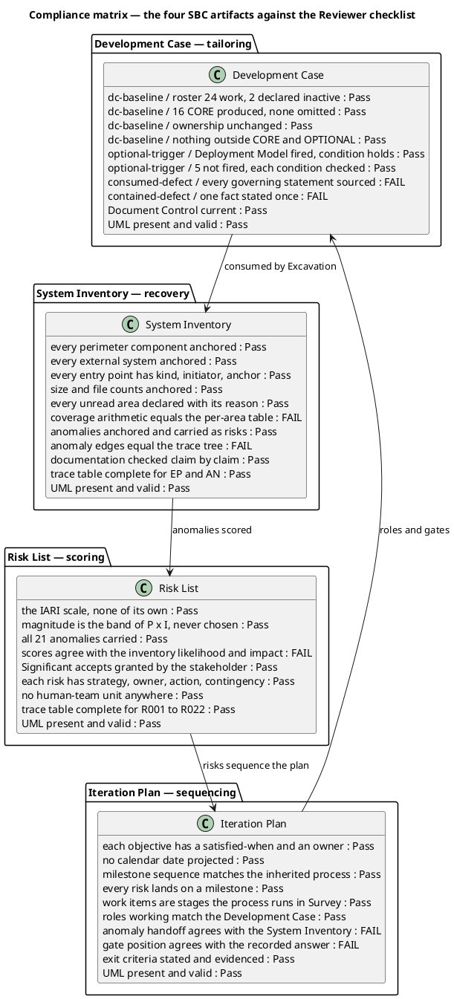

### Management Reviewer lens
<!-- review: Survey I1 -->

<!-- review: Survey I1 -->

**Review type.** Lifecycle milestone review at the end-of-Survey gate — System Boundary Confirmed (SBC) — second lens, held after the Reviewer's technical lens. The question applied is exit criteria: whether the Development Case, the System Inventory, the Risk List and the Iteration Plan collectively satisfy the conditions for advancing into Excavation. This is not a completion review of the iteration's work items; that question is answered separately below as the iteration-acceptance part of this gate.

**Why this gate exists.** SBC is the first of the sprint zero's three milestones. It gates on one thing: the perimeter of the existing system is known, its priorities are set, the anomalies the reading found are carried as scored risks, and the stakeholder confirms that perimeter. Excavation recovers use cases, architecture and design from the perimeter this gate fixes. Nothing downstream can detect a perimeter that was confirmed on the team's word — the recovered set would rest on it silently. That is why the perimeter confirmation is a criterion and not a formality.

**Artifacts under review.** Development Case (Process Engineer, Environment), System Inventory (Software Archaeologist, Discovery), Risk List and Iteration Plan (Project Manager, Project Management). The Review Record is this lens's own output and is not reviewed here.

**Upstream consumption.** All four were read in full, plus the Reviewer lens's block and its seven findings, and the finding ledgers of all four artifacts (`read_artifact_findings`: 2 on System Inventory, 1 on Risk List, 2 on Iteration Plan, 2 on Development Case — all of them the Reviewer's, none resolved, none this lens's).

**Checklist applied.**

| Checklist | Applied to | Source of the standard |
|---|---|---|
| Lifecycle milestone exit criteria | The four SBC criteria set and the plan's ten | The phase's own declared criteria plus the IARI Development Process's Survey row |
| Risk magnitude scale and grant band | Risk List | The IARI probability, impact and magnitude tables |
| Two-currency plan sizing | Iteration Plan | Token spend and elapsed agent time, human gates as queue time only; no human-team unit |
| Development Case baseline conformance | Development Case | The IARI DC baseline in this prompt: 26 roles, 16 CORE, 6 OPTIONAL, canonical intensity matrix |
| Optional trigger justification | Development Case | The §5.2 conditions, each against the project's real facts |
| Iteration objective traceability | The iteration's six objectives | The Iteration Plan's own "Satisfied when" column |

**SBC exit criteria — pass or fail per criterion, on the evidence each cites.**

```plantuml
@startuml
title SBC exit criteria at the management gate — C1 to C10, each against the artifact that evidences it

skinparam shadowing false
skinparam classAttributeIconSize 0
hide empty members

class "C1  The perimeter is stated" as C1 {
  verdict : Pass
  evidence : four processes, their components and stores, each anchored
}
class "C2  The perimeter is confirmed by the stakeholder" as C2 {
  verdict : Fail
  evidence : the confirmation and the sanction were answered No on 2026-11-23
}
class "C3  The entry points are enumerated" as C3 {
  verdict : Pass
  evidence : EP-001 to EP-022 with kind, initiator and anchor
}
class "C4  The priorities are ordered" as C4 {
  verdict : Pass
  evidence : eight areas, each with its reason
}
class "C5  The priority order is confirmed" as C5 {
  verdict : Pass
  evidence : answered 2026-11-23, nothing left out
}
class "C6  The unread remainder is declared" as C6 {
  verdict : Pass with reservation
  evidence : the unread files are named, the headline count does not reproduce
}
class "C7  Every anomaly is carried as a scored risk" as C7 {
  verdict : Pass with reservation
  evidence : 21 of 21 carried, thirteen scores do not reproduce from the inventory
}
class "C8  Every accept above Moderate carries the grant" as C8 {
  verdict : Fail
  evidence : R004 and R011 may sit in the Significant band and were never put to the stakeholder
}
class "C9  No risk is left unactionable" as C9 {
  verdict : Pass
  evidence : strategy, owner, action and contingency on every row
}
class "C10  The plan names no work the process does not run" as C10 {
  verdict : Pass
  evidence : every work item is a Survey stage of the inherited process
}

class "SBC milestone" as M {
  sanction : refused by the stakeholder 2026-11-23
  critical : 0
  major : 5
  minor : 1
  state : not achieved
}

C1 --> M
C2 --> M
C3 --> M
C4 --> M
C5 --> M
C6 --> M
C7 --> M
C8 --> M
C9 --> M
C10 --> M
@enduml
```

Six criteria hold on their own evidence: the perimeter is stated with anchors, all 22 entry points carry kind, initiator and anchor, the eight areas are ordered with reasons and that order was confirmed, the unread remainder is declared rather than left implicit, every anomaly is carried and every risk row names a strategy, an owner, an action and a contingency, and every work item belongs to a stage the inherited process actually runs in Survey.

Three do not, and one of those is the gate's own condition:

- **C2 — Fail.** Asked at this review whether they confirm the perimeter as the System Inventory records it and sanction advancing past SBC, the stakeholder answered **"No"**. The two answers of 2026-11-23 that the Iteration Plan cites as C2's evidence settle two perimeter-membership questions — the external-provider path as an unreachable recovered use case, the admin branch as an exceptional entity — and confirm the priority order. Neither confirms the perimeter as stated.
- **C8 — Fail.** The register records R004 at Minor and accepts it on the Project Manager's authority, and records R011 at Moderate and accepts it likewise, while the System Inventory states "likely / moderate" for both, which scores 12 — the Significant band whose acceptance is the stakeholder's alone. A grant band that cannot be derived from the register cannot certify that every risk the stakeholder must accept reached them.
- **C6 and C7 — pass with a reservation on each.** C6's subject — the unread files named with reasons — is satisfied; the figure quoted beside it does not reproduce from the artifact's own table, and a criterion certified on a number that does not reconcile is met in substance and defective in evidence. C7 is a counting test and passes as one (21 anomalies, 21 risks, none silently dropped); what it counts does not reproduce, which is the Risk List Major below.

**Iteration acceptance — the six objectives of this iteration against what it delivered.**

```plantuml
@startuml
title Iteration objectives O1 to O6 — each against what the iteration delivered

skinparam shadowing false
skinparam classAttributeIconSize 0
hide empty members

class "O1  The sprint-zero tailoring exists" as O1 {
  verdict : Met
  evidence : Development Case — two disciplines inactive with their conditions, one OPTIONAL fired, measurement policy
}
class "O2  The system is read and its perimeter stated" as O2 {
  verdict : Met
  evidence : System Inventory — four processes, 19 components, 9 external systems, 5 stores
}
class "O3  The unread remainder is declared" as O3 {
  verdict : Met, one count unreconciled
  evidence : Coverage names each unread file and its reason; the headline does not reproduce from the table
}
class "O4  The anomalies are carried as scored risks" as O4 {
  verdict : Met in structure, not in arithmetic
  evidence : 21 of 21 carried with strategy, owner, action, contingency; thirteen scores contradict the inventory
}
class "O5  The priorities are ordered and the answer recorded" as O5 {
  verdict : Met
  evidence : eight areas ordered with reasons; the 2026-11-23 answer quoted
}
class "O6  The plan for the sprint zero and the phases exists" as O6 {
  verdict : Met
  evidence : coarse roadmap of seven milestones, this iteration's nine work items with owners
}

class "Iteration acceptance" as IA {
  objectives : 6 of 6 delivered
  caveat : two delivered with a defect inside them
  note : objective delivery and milestone exit are separate questions
}

O1 --> IA
O2 --> IA
O3 --> IA
O4 --> IA
O5 --> IA
O6 --> IA
@enduml
```

All six objectives were delivered. Two carry a defect inside them — O3's coverage arithmetic and O4's scores — and neither defect is a missing objective: the reading happened, the remainder is declared, the anomalies are carried. The iteration's work was done; what it produced is not yet certifiable. That distinction is why the iteration is accepted and the milestone is not.

**Risk retirement trend.** SBC does not retire risk and claims none. It converts the reading's anomalies into owned, scored, actionable risks — 22 of 22 owned, 0 retired by design, because no artifact of the sprint zero can retire a risk the code carries.

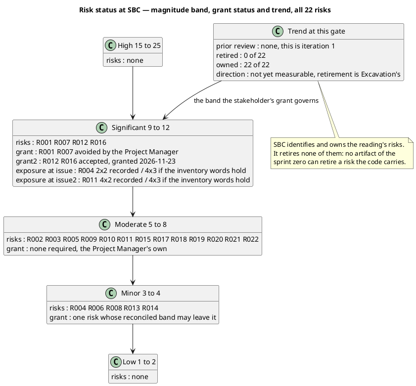

What this gate does owe is that every band above Moderate is grantable. R012 and R016 are, in the stakeholder's own words of 2026-11-23. R001 and R007 are avoided, which is the Project Manager's authority. R004 and R011 sit in the band below the grant requirement only because their scores were lowered from what the inventory states for the same anomalies — a grant-band defect, recorded against the Risk List below.

One further trend worth stating: R022, the risk that a milestone waits on a stakeholder gate, did not bite this iteration. Gate H1's three answers arrived in-iteration on 2026-11-23, ahead of the review, and the 14-day ceiling was never approached. The sanction question at this review was answered at once. R022 stays Moderate and unretired, correctly, because it governs every later gate too.

**Four-axis health.**

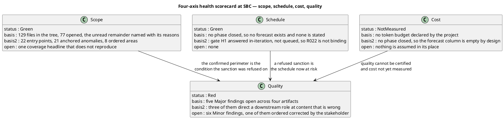

Quality is red and that is the finding. Scope is green: the reading's perimeter is complete for what the phase requires, the entry points enumerate, the priorities are ordered and confirmed, and the unread remainder is declared rather than hidden. Schedule is green on the only measure available — no phase has closed, no date is projected from an estimate, and the one human gate this iteration depended on was answered ahead of the review rather than queued behind it. Cost is not measured: the project declares no token budget and no phase has closed, so the plan's forecast column is empty rather than filled, which is the correct state and not a defect.

**Feasibility and acceptability.** The plan is feasible: sequential end to end, the roles working are exactly those the Survey row of the inherited process names plus its three reviewing roles, no work item belongs to a stage the process does not run in Survey, and the milestone sequence runs the sprint zero then the four RUP phases in order. Acceptability was put to the stakeholder as a question, not assumed, and the answer is below.

**SCM evidence.** The repository carries no IARI pipeline and no branch of this process; no build of this project exists to be red, no pull request is open, and no defect issue is filed. No SCM condition can therefore hold this gate, and none is reported as passing or failing — the gate is judged on the artifacts, which is what the sprint zero produces.

### Review Coordinator lens
<!-- review: Survey I1 -->

<!-- review: Survey I1 -->

**Review event.** Lifecycle milestone review, System Boundary Confirmed (SBC), the first of the sprint zero's three milestones. Consolidation of two executed lenses into one authoritative record.

**Lens participation — authoritative.**

| Lens | Role | Participation | Findings recorded |
|---|---|---|---|
| Technical | Reviewer | EXECUTED | 7 — 0 Critical, 4 Major, 3 Minor |
| Business | BusinessReviewer | **INACTIVE — did not evaluate this review** | none |
| Management | Management Reviewer | EXECUTED | 3 — 0 Critical, 2 Major, 1 Minor |

The Business Reviewer does not work in Survey: the IARI Development Process runs `Reviewer → Management Reviewer → Review Coordinator` at SBC, and the Business Reviewer enters from LCO. Its absence is correct process behaviour and carries no verdict. The milestone decision below rests on the two lenses that executed.

**Review type and authority.** This is not a PRA review and not an Iteration Acceptance Review carried in place of a milestone review. The management lens stated the iteration-acceptance question separately and answered it all six objectives delivered, while withholding the milestone. Those are different questions and this record keeps them apart — the milestone verdict is the one recorded below.

**Artifacts under review.** Development Case (Process Engineer, Environment), System Inventory (Software Archaeologist, Discovery), Risk List and Iteration Plan (Project Manager, Project Management). The Review Record is the reviewers' own output and is not itself under review.

**Review schedule — the review events this project runs, on their iteration boundaries.**

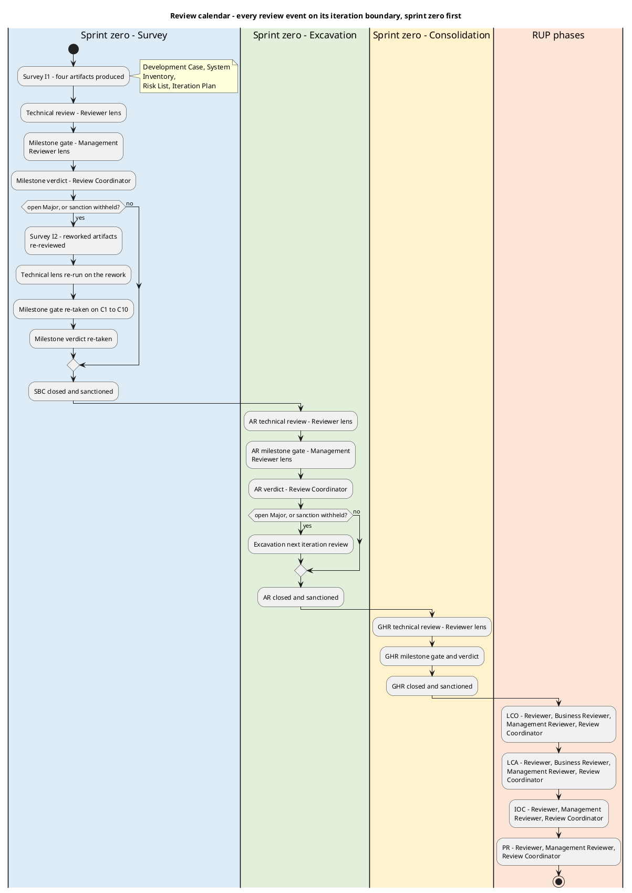

**Review process framework — the review types this project runs, with the criteria that gate each.**

| Review type | Triggering activity | Required participants | Entry criteria | Exit criteria | Primary output |
|---|---|---|---|---|---|
| Milestone review SBC (this event) | Survey work items complete | Reviewer, Management Reviewer, Review Coordinator | Four artifacts in target state; findings ledgers distributed before the review | Every Critical and Major carries owner and deadline; verdict recorded; sanction answers recorded | This Review Record |
| Milestone review AR | Excavation work items complete | Reviewer, Management Reviewer, Review Coordinator | Recovered Use-Case Model, SAD, Design Model, Deployment Model, Risk List, Iteration Plan in target state | As above, plus the recovered set anchored | Review Record, AR block |
| Milestone review GHR | Consolidation work items complete | Reviewer, Management Reviewer, Review Coordinator | Coverage counted and declared; recovered set complete | As above | Review Record, GHR block |
| Milestone review LCO | Inception work items complete | Reviewer, **Business Reviewer**, Management Reviewer, Review Coordinator | Vision, Use-Case Model, Supplementary Spec, SAD, Change Request ledger in target state | As above, plus business acceptability stated | Review Record, LCO block |
| Milestone review LCA | Elaboration work items complete | Reviewer, Business Reviewer, Management Reviewer, Review Coordinator | Architecture baseline and executable architecture built and tested | As above, plus architecture gate passed | Review Record, LCA block |
| Milestone review IOC | Construction work items complete | Reviewer, Management Reviewer, Review Coordinator | Iteration baseline integrated with green CI | As above, plus integrated baseline verified | Review Record, IOC block |
| Milestone review PR | Transition work items complete | Reviewer, Management Reviewer, Review Coordinator | Release build baselined and acceptance-tested | As above, plus every Change Request closed | Review Record, PR block |
| Iteration Plan Review | "Plan for Next Iteration" | Project Manager, Reviewer, Review Coordinator | Next iteration's plan drafted | Findings closed; plan accepted | Review Record entry |
| Iteration Evaluation Criteria Review | "Manage Iteration", before close | Reviewer, Project Manager, Review Coordinator | Exit criteria and evidence tabled | Each criterion passes or is reclassified | Review Record entry |
| Iteration Acceptance Review | "Manage Iteration", at close | Reviewer, Management Reviewer, Review Coordinator | Evaluation criteria review passed | Deliverables formally accepted | Review Record entry |
| Project Acceptance Review | Project close-out | Stakeholder, Management Reviewer, Review Coordinator | All milestones sanctioned | Stakeholder accepts the delivery | Review Record entry |

The SBC event in this table is the only one that has occurred. Every later row is scheduled, not completed.

**Entry criteria — checked at this event.**

| Entry condition | State |
|---|---|
| The four artifacts are in their target state, not draft placeholders | Met — all four carry full content |
| The reviewers are assigned with expertise matched to the artifact domain | Met — Environment, Discovery and Project Management artifacts, read by the technical and management lenses |
| The finding ledgers are available to the coordinator before consolidation | Met — 10 findings read from the ledger |
| The stakeholder's answers to the gate questions are on record | Met — answered 2026-11-23 |

**Exit criteria — checked at this event.**

| Exit condition | State |
|---|---|
| Every Critical and Major finding carries an owner and a remediation | Met — 6 Major, each with owner and remediation from its lens |
| The verdict is recorded and archived | Met — No-Go, below |
| The stakeholder's sanction is recorded verbatim | Met — REFUSED, 2026-11-23 |
| Zero open Critical/Major before the phase advances | **Not met** — 6 open Major |

**Method.** Both lenses opened the load-bearing anchors in the repository rather than trusting the claims: the perimeter files, the authorization surface, the `/auth` flows, the client components, the test host, the build and container manifests, `docs/CONTRIBUTING.md` and `.iari/README.md`. The technical lens found no defect against the reading's accuracy on any anchor it opened. Every finding sits in a count, a trace edge, a score, or an assertion no file supports — not in a misread file.

**SCM evidence.** No IARI pipeline file exists on `main`, no branch of this process exists, no pull request is open, and no defect issue is filed. No SCM condition holds or clears this gate; none is reported as passing.

## Findings
### Reviewer lens
<!-- review: Survey I1 -->

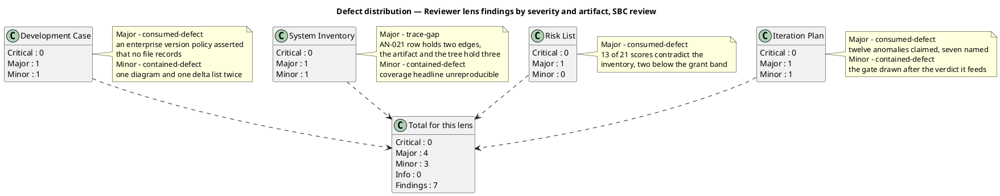

#### Development Case

Two findings. The tailoring verdicts themselves hold: two disciplines inactive each with its own recorded condition (`business-process-led = false`, `real-time-system = false`), 24 roles working, no CORE artifact omitted or reassigned, nothing listed outside the CORE + OPTIONAL universe, and the one fired OPTIONAL — Deployment Model — justified by a genuinely distributed four-process topology with a YARP proxy hop and per-process configuration pairs. The five NOT FIRED verdicts were each checked against its §5.2 condition and each holds: eight entity types is below the Data Model threshold, the architecture already runs so no mechanism needs empirical validation, no regulator or contract consumes test reporting, no UX decision waits on the stakeholder, and the vocabulary is plain English.

- **Development Case#F1 — Major, `consumed-defect`.** The "Tool and configuration references" section asserts that an enterprise version policy "is recorded with the process and is anchored by the Software Architect in the Software Architecture Document" and that "it governs over the registry's latest for every package the delivery adds". `docs/CONTRIBUTING.md` records central pinning in `Directory.Packages.props` and the nuget.org-only source rule; neither states a rule preferring a pinned version over a registry's latest, and no file in the tree records such a policy. The Software Architect is directed in Excavation to anchor a document that does not exist. **Remediation:** name the file that records the policy, or replace the sentence with what is true — version selection follows central pinning, nuget.org being the only configured source.

- **Development Case#F2 — Minor, `contained-defect`.** The role deltas are stated twice inside "Roles and Ownership" and the CLS-DC-01 role-artifact diagram is embedded twice, verbatim. **Remediation:** keep one statement of the deltas and one CLS-DC-01 diagram; delete the duplicate.

#### System Inventory

Two findings. The recovery itself is the strongest artifact of the four: 22 entry points each with kind, initiator and file anchor; 19 perimeter components and 9 external systems each anchored; every anomaly row carrying evidence with line numbers; and a Coverage section that declares its unread remainder and why rather than leaving it implicit. The two stakeholder decisions of 2026-11-23 are carried consistently into the Perimeter prose, the Perimeter diagram notes and the affected entry-point rows — the external-provider path as a recovered use case marked unreachable, the admin branch as an exceptional entity. No `[DERIVED]` or `[SCOPE_QUESTION]` marker survives an answered question.

- **System Inventory#F1 — Major, `trace-gap`.** The Traceability row for AN-021 reads `DependsOn EP-004, EP-005`. The artifact's own Anomalies diagram carries `A21 --> E4`, `A21 --> E5` and `A21 --> E7`, and the registered trace tree carries the same three edges. The row registers two of the three the artifact and the tree hold. **Remediation:** add EP-007 to the AN-021 row.

- **System Inventory#F2 — Minor, `contained-defect`.** Coverage states "77 were opened" of 129, while the per-area Read column sums to 76 (23+7+8+0+14+1+6+2+1+7+1+2+1+1+1+1), and the docs row records `3 | 1` beside a note saying all three were opened. The Iteration Plan cites the derived figure — "52 files unread of 129" — as criterion C6's evidence. **Remediation:** recompute the headline from the per-area table, decide explicitly whether the two artifact files under `docs/` count as read, and make the column and the headline agree.

#### Risk List

One finding. The register's structure is sound: the IARI scale is reproduced from the baseline and no scale of its own is defined, magnitude is derived as the band of exposure rather than chosen, all 21 anomalies are carried with an explicit note explaining the 22nd risk's separate origin, every row names a strategy, an owner, an action, a contingency and a warning sign, and the two Significant accepts carry the stakeholder's grant in their own words. No person-week, person-month or story-point unit appears anywhere.

- **Risk List#F1 — Major, `consumed-defect`.** Thirteen of the twenty-one rows score a risk differently from the likelihood and impact the System Inventory states for the same anomaly, and the same inventory word scores differently in different rows: "likely / moderate" gives 4×3 for AN-001 but 4×2 for AN-003 and AN-011; "likely / low" gives 4×1 for AN-006 and AN-008 but 2×2 or 4×2 for AN-013, AN-014, AN-015, AN-017 and AN-019; "possible / high" becomes 2×3 for AN-002. The consequence is not cosmetic. AN-004's "likely / moderate" would place R004 at exposure 12 — the Significant band whose acceptance is the stakeholder's to grant — where it is recorded 2×2 and accepted by the Project Manager; the same applies to R011. The magnitudes then sequence the Iteration Plan's milestones and underlie the same grant band the stakeholder's R012 and R016 accepts came from. **Remediation:** score each risk once from the IARI scale and reconcile it against the inventory's column, or delete the inventory's likelihood and impact as a scoring claim and state that the score is the Project Manager's own reading of the cited evidence. Where a reconciled score lands in the Significant or High band, put that acceptance to the stakeholder in this iteration — R004 and R011 are the candidates.

#### Iteration Plan

Two findings. The plan is otherwise conformant to the process it must instantiate: the milestone sequence runs Survey → Excavation → Consolidation → Inception → Elaboration → Construction → Transition, every discipline intensity quoted matches the canonical matrix, the roles recorded as working in this iteration are exactly those the Survey row of the inherited process names plus its three reviewing roles, every work item is a stage that process actually runs in Survey, no calendar date is projected from an estimate, and the two currencies are kept apart with the human gate bounded as R022 rather than estimated.

- **Iteration Plan#F1 — Major, `consumed-defect`.** "Use Cases and Scenarios Addressed" states that "the 12 anomalies that sit on an entry point" are handed to Excavation and then names seven: AN-001, AN-002, AN-004, AN-018, AN-019, AN-020, AN-021. AN-008, AN-009, AN-010, AN-015 and AN-017 are dropped, and they are the ones constraining the reference-UI, Identity, key-ring and app-host reading — priorities 6 and 8 of the order Excavation reads in. Excavation is told a count and handed a list that does not match it. **Remediation:** name all twelve, or drop the enumeration and point at the System Inventory's Anomalies table as Excavation's constraint list.

- **Iteration Plan#F2 — Minor, `contained-defect`.** The critical-chain activity diagram places Gate H1 after the Review Coordinator's verdict, while the coarse roadmap, exit criteria C2/C5/C8 and the H1 row all record the gate answered on 2026-11-23 ahead of the review. **Remediation:** move Gate H1 ahead of the Reviewer in the diagram.

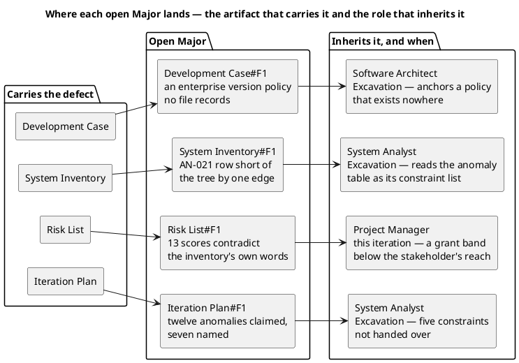

### Management Reviewer lens
<!-- review: Survey I1 -->

<!-- review: Survey I1 -->

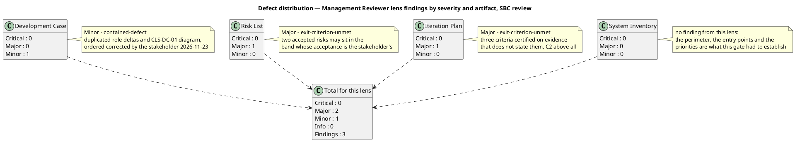

This lens records three findings of its own. The five Major findings the Reviewer's lens recorded at this gate are content this verdict also rests on, and they are cited where each bears on an exit criterion below rather than re-recorded here.

#### Development Case

No Critical finding and no Major finding from the management lens. The tailoring verdicts hold under their own checklist: 24 roles working with two declared inactive, each behind its recorded condition (`business-process-led = false`, `real-time-system = false`), none of the 16 CORE artifacts omitted or reassigned, nothing listed outside the CORE + OPTIONAL universe, no intensity level assigned in contradiction to the canonical matrix, and the single fired OPTIONAL — Deployment Model — justified by a genuinely distributed topology (browser-hosted client, host, separate API, SQLite store, a YARP proxy hop, per-process configuration pairs). Each of the five NOT FIRED verdicts was checked against its §5.2 condition and holds: eight entity types sits below the Data Model threshold, the architecture already runs so no mechanism awaits empirical validation, no regulator or contract consumes test reporting, no UX decision waits on the stakeholder, and the vocabulary is plain English.

One Minor, and the stakeholder ordered it corrected on 2026-11-23 — an order no role declines, which lifts it above the ordinary Minor queue.

- **Development Case#F1 — Minor, `contained-defect`.** "Roles and Ownership" states the two role deltas twice — as the bullet list opening "BusinessProcessAnalyst — does not work" and again in the "### Role deltas" block — and embeds the CLS-DC-01 role-artifact class diagram twice, verbatim. **Remediation:** keep one statement of the role deltas and one CLS-DC-01 diagram and delete the duplicate. This is the stakeholder's order of 2026-11-23, in their words: "The development case contains duplicated diagrams and text; it needs to be corrected." It is corrected before the milestone is re-taken, not after the Majors as an un-ordered Minor would be.

#### System Inventory

No finding from this lens. The System Inventory is the artifact this gate exists to certify and it does what the phase asks: 22 entry points each with kind, initiator and anchor; 19 perimeter components and 9 external systems each anchored; 5 stores and a data-protection key ring described; documentation checked claim by claim against the tree; a Coverage section that names its unread remainder and why. Both stakeholder decisions of 2026-11-23 are carried consistently into the perimeter prose, the perimeter diagram notes and the affected entry-point rows, and no marker survives the question it recorded — which is the defect this gate would otherwise have had to record.

That the perimeter was not confirmed is not a defect of this artifact: it is a defect of the plan that records a confirmation which did not happen, and it is recorded against the Iteration Plan below. The Reviewer's two findings against this artifact (`System Inventory#F1`, `System Inventory#F2`) belong to that lens and are not this lens's to close.

#### Risk List

The register's structure is sound and its classification table imports the IARI scale rather than defining one, deriving each magnitude as the band its exposure falls in. All 21 anomalies are carried as 21 risks with an explicit note for the 22nd's separate origin, every row names a strategy, an owner, an action, a contingency and a warning sign, and no human-team unit appears anywhere. The two Significant accepts carry the stakeholder's grant in their own words of 2026-11-23.

One Major, and it is a gate condition rather than an arithmetic slip.

- **Risk List#F1 — Major, `exit-criterion-unmet`.** SBC criterion C8 — every accepted risk above Moderate carries the stakeholder's grant — cannot be established from this register. R004 is recorded 2×2 (Minor) and accepted on the Project Manager's authority; R011 is recorded 4×2 (Moderate) and accepted likewise. The System Inventory states "likely / moderate" for both anomalies, which scores 4×3 = 12, the Significant band whose acceptance is the stakeholder's alone. Two rows therefore sit below the grant requirement only because their scores were lowered from what the inventory says of the same anomalies — and the R012 and R016 grants already relied on rest on the same scoring method, so the defect reaches a grant the project has already taken, not only the two rows at issue. **Remediation:** reconcile the scores first, deriving each from the IARI scale and its cited evidence; re-derive the grant band from the reconciled exposures; then put every risk landing at Significant or High to the stakeholder in this cycle, with R004 and R011 as the two candidates, before the SBC verdict is re-taken. Until a magnitude reproduces from its stated probability and impact, no claim that its acceptance is the Project Manager's can stand.

#### Iteration Plan

The plan is otherwise conformant to the process it instantiates: the milestone sequence runs the sprint zero then the four RUP phases in order, every discipline intensity quoted matches the canonical matrix, the roles recorded as working are exactly the Survey row's plus its three reviewing roles, every work item is a stage the inherited process runs in Survey, no calendar date is projected from an estimate, and the two currencies are kept apart with the human gate bounded as R022 and never estimated. Every one of the six objectives carries a "satisfied when" and an owner, and all six were delivered.

One Major, and it decides this verdict.

- **Iteration Plan#F1 — Major, `exit-criterion-unmet`.** The Evaluation Criteria table certifies C2, C5 and C8 as "Met — 2026-11-23" on the gate H1 answers. None of the three answers given on 2026-11-23 confirms the perimeter as the System Inventory states it: two of them settle whether the external-provider path and the admin branch are inside the perimeter, and the third declines to reorder the priorities. Asked at this review whether they confirm the perimeter as recorded and sanction advancing past SBC, the stakeholder answered "No" — so C2 is not met and is recorded as met, which is the one error a gate cannot absorb: the plan's evidence column is exactly what the Review Coordinator's verdict reads. Two further criteria ride on the same weakness: C6 rests on a coverage figure the System Inventory itself cannot reproduce, and C7 passes as a counting test while the scores it counts do not reproduce — the Risk List finding above. **Remediation:** restate C2 as two criteria — the perimeter-membership questions and the priority order, which are answered and quote the answers, and the perimeter as recorded confirmed by the stakeholder, which is not met pending re-take. Cite the recomputed coverage figure for C6 once the System Inventory settles it. Split C7 into "every anomaly is carried" (met, 21 of 21) and "every score reproduces from its stated inputs" (not met). Never record an answer as a confirmation it does not contain.

The Reviewer's further two findings against this artifact (`Iteration Plan#F1` — the twelve-anomaly handoff that names seven, `Iteration Plan#F2` — the gate drawn after the verdict it feeds) belong to that lens; the first is content Excavation would consume and so also bears on C10's substance, which is why C10 is passed on the work items while the handoff list is corrected under that lens.

### Review Coordinator lens
<!-- review: Survey I1 -->

<!-- review: Survey I1 -->

**Consolidated finding ledger.** Ten findings were recorded by two executed lenses; none carries a resolution object. Counts below are copied from `read_artifact_findings`, not from any sentence in this record: open Critical 0, open Major 6, open Minor 4, open Info 0.

| Artifact | Key | Lens | Severity | Criterion | Owner | What the owner must do |
|---|---|---|---|---|---|---|
| Development Case | F1 | Reviewer | Major | consumed-defect | Process Engineer | Name the file recording the version policy, or replace the claim with central pinning and nuget.org-only |
| Development Case | F2 | Reviewer | Minor | contained-defect | Process Engineer | Delete the duplicated role-delta list and the duplicated CLS-DC-01 diagram |
| Development Case | F1 | Management Reviewer | Minor | contained-defect | Process Engineer | The same duplication, under the stakeholder's order of 2026-11-23 |
| System Inventory | F1 | Reviewer | Major | trace-gap | Software Archaeologist | Add EP-007 to the AN-021 Traceability row |
| System Inventory | F2 | Reviewer | Minor | contained-defect | Software Archaeologist | Recompute Coverage from the per-area table; settle the `docs/` read count |
| Risk List | F1 | Reviewer | Major | consumed-defect | Project Manager | Score every risk once from the IARI scale and reconcile against the inventory, or declare the score the Project Manager's own reading |
| Risk List | F1 | Management Reviewer | Major | exit-criterion-unmet | Project Manager | Re-derive the grant band from the reconciled exposures and put every Significant or High risk to the stakeholder |
| Iteration Plan | F1 | Reviewer | Major | consumed-defect | Project Manager | Name all twelve entry-point-bearing anomalies, or point at the Anomalies table |
| Iteration Plan | F1 | Management Reviewer | Major | exit-criterion-unmet | Project Manager | Restate C2, C6 and C7 on the evidence each actually has |
| Iteration Plan | F2 | Reviewer | Minor | contained-defect | Project Manager | Move Gate H1 ahead of the Reviewer in the critical-chain diagram |

**Finding lifecycle and escalation path.**

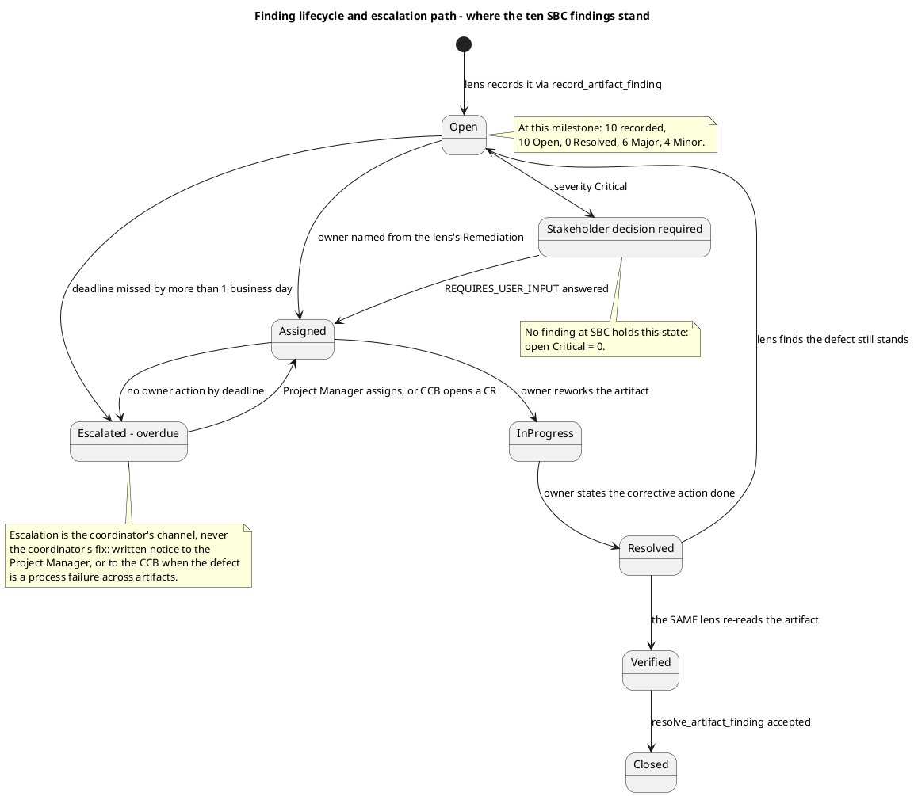

**Cross-lens reconciliation — no conflict, four chains.**

The two lenses raised no contradictory finding: neither found the other's defect to be absent, and no owner was given two incompatible instructions. Four relationships govern the order of rework:

```plantuml
@startuml
title Cross-lens reconciliation - ten findings on four artifacts, and which rework unblocks which

skinparam shadowing false
skinparam wrapWidth 260

package "Development Case" {
  class "Development Case#F1\nReviewer / Major / consumed-defect\nan enterprise version policy no file records" as DC1
  class "Development Case#F2\nReviewer / Minor / contained-defect\nduplicated role deltas and diagram" as DC2
  class "Development Case#F1\nManagement Reviewer / Minor / contained-defect\nthe same duplication, ordered by the stakeholder" as DC3
}

package "System Inventory" {
  class "System Inventory#F1\nReviewer / Major / trace-gap\nAN-021 row short of the tree by one edge" as SI1
  class "System Inventory#F2\nReviewer / Minor / contained-defect\nCoverage headline does not reproduce" as SI2
}

package "Risk List" {
  class "Risk List#F1\nReviewer / Major / consumed-defect\n13 scores contradict the inventory" as RL1
  class "Risk List#F1\nManagement Reviewer / Major / exit-criterion-unmet\nC8 cannot be certified on these scores" as RL2
}

package "Iteration Plan" {
  class "Iteration Plan#F1\nReviewer / Major / consumed-defect\ntwelve anomalies claimed, seven named" as IP1
  class "Iteration Plan#F1\nManagement Reviewer / Major / exit-criterion-unmet\nC2, C6, C7 certified on evidence that does not state them" as IP2
  class "Iteration Plan#F2\nReviewer / Minor / contained-defect\nGate H1 drawn after the verdict it feeds" as IP3
}

DC2 -right-> DC3 : same defect, two keys\none correction, each lens closes its own
RL1 --> RL2 : arithmetic first,\nthe grant band second
SI2 --> IP2 : the recomputed coverage figure\nis C6's evidence
RL1 --> IP2 : reconciled scores\nare C7's evidence
DC1 --> DC3 : one rework pass,\none owner
IP1 --> IP2 : the dropped five are\nconstraints the criteria certify
@enduml
```

1. **Development Case#F2 (Reviewer) and Development Case#F1 (Management Reviewer) are one defect under two keys.** Both describe the duplicated role-delta list and the duplicated CLS-DC-01 diagram. One rework pass by the Process Engineer closes the subject of both; each lens closes its own key with `resolve_artifact_finding`, and no finding is closed by the other lens's verification.
2. **Risk List#F1 (Reviewer) is upstream of Risk List#F1 (Management Reviewer).** Reconciling the scores is the precondition for re-deriving the grant band. The Project Manager performs both in one pass; the stakeholder question it raises cannot be asked before the arithmetic is settled.
3. **System Inventory#F2 (Reviewer) is upstream of Iteration Plan#F1 (Management Reviewer) on criterion C6.** C6 cites a coverage figure the System Inventory cannot reproduce. The figure settles first, then the criterion cites the settled figure.
4. **Risk List#F1 (Reviewer) is upstream of Iteration Plan#F1 (Management Reviewer) on criterion C7.** C7 passes as a counting test while the scores it counts do not reproduce; it splits only once the scores are reconciled.

**Priority order of the rework actions** — by consequence, not by artifact order:

| Priority | Finding | Why it ranks here |
|---|---|---|
| 1 | Risk List#F1 (Management Reviewer) with Risk List#F1 (Reviewer) | The defect reaches a grant the project has already taken; the stakeholder question it raises must be asked in this cycle |
| 2 | Iteration Plan#F1 (Management Reviewer) | It is the evidence column the milestone verdict reads, and it records a confirmation the stakeholder refused |
| 3 | Development Case#F1 (Reviewer) | It directs the Software Architect at a policy that exists nowhere, and Excavation is the next phase |
| 4 | Iteration Plan#F1 (Reviewer) | Five constraints on the areas ranked sixth and eighth are not handed to Excavation |
| 5 | System Inventory#F1 (Reviewer) | One trace edge; the artifact and the tree already hold the truth |
| 6 | Development Case#F1 (Management Reviewer), Development Case#F2 (Reviewer) | The stakeholder ordered this correction; it rises above the ordinary Minor queue and is not deferred behind them |
| 7 | System Inventory#F2, Iteration Plan#F2 (Reviewer) | Contained in one artifact each; no role builds on the wrong content |

**Not findings, and recorded as such.** The absence of a Test Plan, a Data Model and a Glossary is the Development Case's own NOT FIRED verdict on each, checked against its §5.2 condition by both lenses; it is not a delivery gap. The absence of an Iteration Assessment is correct at this point — the Project Manager authors it after this review. The absence of a token budget, a velocity and a forecast is correct: the project declares no budget, no phase has closed, and an empty forecast column is the honest state. No SCM condition holds this gate. The Business Reviewer's non-participation is the process's own schedule, not a gap in this review.

## Resolutions and Actions
### Reviewer lens
<!-- review: Survey I1 -->

**Prior findings of this lens.** None. This is iteration 1 of Survey and no finding of the Reviewer lens existed on any of the four artifacts before this review, so nothing is resolved, deferred or rejected in this pass.

**Actions ordered by this review.** Each is the remediation of a finding above, and each is closed by the same lens that raised it in the next pass.

| Action | Artifact | Owner | Finding |
|---|---|---|---|
| Name the file recording the version policy, or replace the claim with central pinning and nuget.org-only | Development Case | Process Engineer | Development Case#F1 |
| Delete the duplicated role-delta list and the duplicated CLS-DC-01 diagram | Development Case | Process Engineer | Development Case#F2 |
| Add EP-007 to the AN-021 Traceability row | System Inventory | Software Archaeologist | System Inventory#F1 |
| Recompute Coverage from the per-area table; settle whether the `docs/` rows count as read | System Inventory | Software Archaeologist | System Inventory#F2 |
| Reconcile every probability and impact against the inventory, or state the score is the Project Manager's own reading; put any Significant or High acceptance to the stakeholder | Risk List | Project Manager | Risk List#F1 |
| Name all twelve entry-point-bearing anomalies, or point at the Anomalies table | Iteration Plan | Project Manager | Iteration Plan#F1 |
| Move Gate H1 ahead of the Reviewer in the critical-chain diagram | Iteration Plan | Project Manager | Iteration Plan#F2 |

**Not a finding.** The absence of a Test Plan, a Data Model and a Glossary is the Development Case's own NOT FIRED verdict on each, checked and found to hold — not a gap in the delivery. The absence of an Iteration Assessment is correct at this point: the Project Manager authors it after this review, and its absence is never a gate condition.

### Management Reviewer lens
<!-- review: Survey I1 -->

<!-- review: Survey I1 -->

**Prior findings of this lens.** None. This is iteration 1 of Survey and no Management Reviewer finding existed on any of the four artifacts before this review, so nothing is resolved, deferred or rejected in this pass. The two findings this lens records above are new and carry no `findingKey` from an earlier cycle. The seven findings of the Reviewer's lens on these artifacts belong to that lens and are not this lens's to close.

**Stakeholder sanction: REFUSED**

**Stakeholder acceptance:** "No" — to confirming the perimeter of the existing system as the System Inventory records it and to sanctioning advancement past the System Boundary Confirmed milestone; with the instruction: "The development case contains duplicated diagrams and text; it needs to be corrected. Additionally, the major findings must be corrected."

Both reasons the stakeholder gave are recorded. The first names an artifact and is carried as `Development Case#F1`, ordered corrected above the ordinary Minor queue because the order is the stakeholder's. The second names no artifact and no new defect: every one of the six Major findings open across these four artifacts already carries rework-required status, and no duplicate finding is minted to say so — the ledger's own Major rows are the record of that instruction.

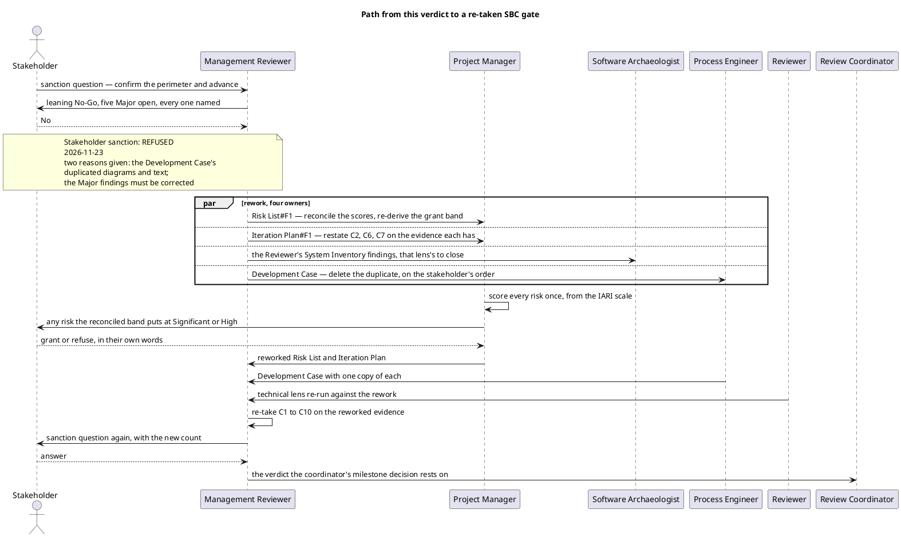

**Actions ordered by this lens.** Each is the remediation of a finding this lens raised, and each is closed by this lens when the finding's own artifact is reworked.

| Action | Artifact | Owner | Finding |
|---|---|---|---|
| Reconcile every probability and impact to the IARI scale and its cited evidence, then re-derive the grant band and put every risk landing at Significant or High to the stakeholder in this cycle — R004 and R011 are the two candidates | Risk List | Project Manager | Risk List#F1 |
| Restate C2 as two criteria — the answered perimeter-membership and priority questions, and the confirmation of the recorded perimeter which is not met; cite the recomputed coverage figure for C6; split C7 into carriage and reproducibility | Iteration Plan | Project Manager | Iteration Plan#F1 |
| Delete the duplicated role-delta list and the duplicated CLS-DC-01 diagram, on the stakeholder's order | Development Case | Process Engineer | Development Case#F1 |

**Carried, not this lens's to close.** The Reviewer's five Major findings stand open and each is content a downstream role would build on: `Development Case#F1` (a version policy no file records), `System Inventory#F1` (the AN-021 row short of the tree by one edge), `Risk List#F1` (thirteen scores contradicting the inventory), `Iteration Plan#F1` (twelve anomalies claimed, seven named). They are reconciled by their own lens in its next pass, and this gate cannot be re-taken while any of them remains open.

**What is not a finding.**

- The absence of a Test Plan, a Data Model and a Glossary is the Development Case's own NOT FIRED verdict on each, checked against its §5.2 condition and found to hold.
- The absence of an Iteration Assessment is correct at this point: the Project Manager authors it after this review, and its absence is never a gate condition.
- The absence of a token budget, a velocity and a forecast is correct: the project declares no budget, no phase has closed, and an empty forecast column is the honest state rather than a gap. No figure is invented in its place.
- No SCM condition is available to hold or clear this gate: the repository carries no IARI pipeline, no branch of this process, no open pull request and no defect issue.
- The perimeter not being confirmed is not a defect of the System Inventory. It is a defect of the plan that records a confirmation which did not happen, and it is recorded there.

### Review Coordinator lens
<!-- review: Survey I1 -->

<!-- review: Survey I1 -->

**Actions ordered, with owner and the finding each closes.** Every action is the remediation the recording lens wrote; none is the coordinator's own instruction of what the defect should be.

| # | Action | Artifact | Owner | Closes | Deadline |
|---|---|---|---|---|---|
| 1 | Score each of the 21 risks once, deriving probability and impact from the IARI scale and its cited evidence — or delete the inventory's likelihood/impact as a scoring claim and declare the score the Project Manager's own reading. Then re-derive the grant band and put every risk landing at Significant or High to the stakeholder in this cycle (R004 and R011 are the two candidates) | Risk List | Project Manager | Risk List#F1 (Reviewer), Risk List#F1 (Management Reviewer) | Before the SBC gate is re-taken |
| 2 | Restate C2 as two criteria — the answered perimeter-membership and priority questions, and the confirmation of the recorded perimeter which is not met; cite the recomputed coverage figure for C6; split C7 into carriage and reproducibility | Iteration Plan | Project Manager | Iteration Plan#F1 (Management Reviewer) | Before the SBC gate is re-taken |
| 3 | Name the file recording the version policy, or replace the claim with central pinning in `Directory.Packages.props` and nuget.org as the only configured source | Development Case | Process Engineer | Development Case#F1 (Reviewer) | Before Excavation consumes the tailoring |
| 4 | Name all twelve entry-point-bearing anomalies, or drop the enumeration and point at the System Inventory's Anomalies table | Iteration Plan | Project Manager | Iteration Plan#F1 (Reviewer) | Before Excavation reads its constraint list |
| 5 | Add EP-007 to the AN-021 Traceability row | System Inventory | Software Archaeologist | System Inventory#F1 (Reviewer) | Next turn |
| 6 | Delete the duplicated role-delta list and the duplicated CLS-DC-01 diagram — the stakeholder's order of 2026-11-23, taken before the un-ordered Minors | Development Case | Process Engineer | Development Case#F1 (Management Reviewer), Development Case#F2 (Reviewer) | Next turn |
| 7 | Recompute the Coverage headline from the per-area table; settle whether the `docs/` rows count as read | System Inventory | Software Archaeologist | System Inventory#F2 (Reviewer) | Next turn |
| 8 | Move Gate H1 ahead of the Reviewer in the critical-chain diagram | Iteration Plan | Project Manager | Iteration Plan#F2 (Reviewer) | Next turn |

**Stakeholder order folded in.** The stakeholder's answer of 2026-11-23 carries two instructions. The first — "The development case contains duplicated diagrams and text; it needs to be corrected" — is action 6, executed before the un-ordered Minors because the order is theirs. The second — "the major findings must be corrected" — names no artifact and no new defect: all six Major findings above already require rework, and no duplicate finding is minted to say so. The ledger's Major rows are the record of that instruction. No change request is opened: the Change Control Manager does not work in the sprint zero, and the order has reached its owner through this record.

**What is not recorded as an action.** No action is raised for the perimeter not being confirmed: that is not a defect of the System Inventory but of the Iteration Plan that recorded a confirmation which did not happen, and action 2 carries it. No action is raised for the absence of a Test Plan, Data Model or Glossary, for an Iteration Assessment, or for a token budget — each is correct state, stated under Findings.

**Closure procedure.** Each action closes only when its recording lens re-reads the corrected artifact and calls `resolve_artifact_finding` on that key. A correction stated in this record does not close a finding; a lens's verification does. The two Development Case keys close separately. The coordinator escalates to the Project Manager any finding past its deadline by more than one business day, and to the Configuration and Change Management Board any defect that reappears across artifacts as a process failure.

**What reopens the gate.** All six Major findings reworked and closed by their recording lenses, both executed lenses re-run against the rework, the Development Case duplication deleted on the stakeholder's order, and any risk the reconciled scores place at Significant or High put to the stakeholder and granted or refused in their own words. Then the sanction question is asked again with the new count, and the SBC verdict is re-taken.

## Disposition
### Reviewer lens
<!-- review: Survey I1 -->

**Approved with Changes.**

No Critical finding was raised: nothing in these four artifacts needs a decision only the stakeholder can take, and the two decisions this iteration did need — the priority order, and the R012 and R016 acceptances — were already answered on 2026-11-23. The three Minor findings are recorded for their owners' next turn and do not hold the milestone.

The four Major findings do. Each is content another role builds on: the Software Architect is directed to a policy no file records, the System Analyst is handed a constraint list five short of the count stated beside it, and the magnitudes sequence the milestones on scores that cannot be reproduced from their stated inputs. The SBC milestone is therefore not sanctioned by this lens until those four are reworked and this review re-runs against them. Excavation reads the recovered perimeter, not these corrected assertions, so it may proceed in parallel only on the reading itself.

### Management Reviewer lens
<!-- review: Survey I1 -->

<!-- review: Survey I1 -->

**No-Go.**

The System Boundary Confirmed milestone is **not achieved**, and the stakeholder withheld the sanction on 2026-11-23. The project does not advance into Excavation on this baseline.

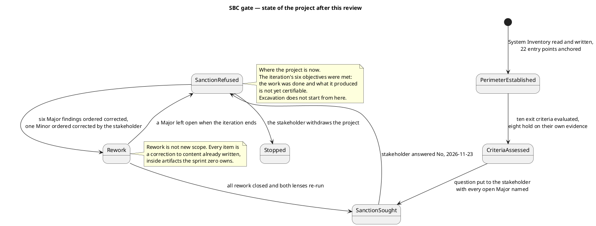

The gate's own condition failed first: asked whether they confirm the perimeter of the existing system as the System Inventory records it and sanction advancing past SBC, the stakeholder answered "No". A perimeter confirmation is not the reviewers' to infer, and the Iteration Plan records one that did not happen. That is a defect in the plan and the reason the verdict cannot be anything but No-Go even before the technical findings are counted.

Six Major findings stand open across the four artifacts under review — two from this lens, four from the Reviewer's — plus six Minor. No Critical finding was raised: nothing here needs a decision only the stakeholder can take in order to be corrected, and the two decisions this iteration did need — the perimeter-membership questions and the priority order — were answered on 2026-11-23. The one Major that will require a stakeholder decision, the grant band R004 and R011 may occupy, becomes a question the moment the Project Manager reconciles the scores, and that question is ordered in the actions above.

The defects are corrections to content already written, not new scope, and all six fall inside artifacts the sprint zero already owns. The reading itself — the perimeter, the entry points, the priorities, the stores, the documentation — is what this gate exists to establish and it holds without a finding from this lens: the System Inventory is the strongest artifact of the four and the only one this lens passes untouched.

**Iteration acceptance, stated apart from the milestone verdict.** The iteration's six objectives were all delivered: the tailoring exists, the system is read and its perimeter stated, the unread remainder is declared, the anomalies are carried as scored and owned risks, the priorities are ordered with the stakeholder's answer recorded, and the plan for the rest of the sprint zero and the phases exists. The work of iteration 1 is done. What it produced is not yet certifiable. Those are different questions and this record answers them differently on purpose.

**What reopens this gate.** All six Major findings reworked and closed by their owners, both review lenses re-run against the rework, the Development Case's duplication deleted on the stakeholder's order, and any risk the reconciled scores place at Significant or High put to the stakeholder and granted or refused in their own words. Then the sanction question is asked again — with the new count in it — and the verdict re-taken. Until then the Review Coordinator has no sanction to record and Excavation has no perimeter to recover from.

**Sanction token for the record.** Stakeholder sanction: REFUSED — 2026-11-23.

### Review Coordinator lens
<!-- review: Survey I1 -->

<!-- review: Survey I1 -->

**Verdict: No-Go.** The System Boundary Confirmed milestone is **not achieved**. The stakeholder refused the sanction on 2026-11-23 and six Major findings stand open. The project does not advance into Excavation on this baseline.

**Basis, copied from the finding data — not from judgment.**

| Gate condition | Actual |
|---|---|
| Artifacts read from the ledger | 4 of 4, plus the Review Record — unread: none |
| Open Critical | 0 |
| Open Major | 6 |
| Open Minor | 4 |
| Perimeter confirmed by the stakeholder | No |
| Stakeholder sanction | REFUSED — 2026-11-23 |
| Milestone verdict | requiresIteration: true |

**The guard the verdict was taken on.**

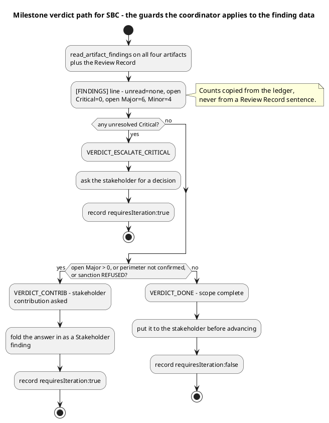

The path taken is the second branch: open Major 6, perimeter not confirmed, sanction REFUSED. The third branch — scope complete and advance — is not reachable on this data, because three of its guards fail at once.

Zero Critical findings means nothing at this gate needs a stakeholder decision in order to be *corrected*. It does not mean the gate passes: the decision the gate itself required — confirming the perimeter — was put to the stakeholder and answered No, and six Major findings require rework before any role consumes these artifacts.

**Review effectiveness — this event only.** This is the project's first review: no prior review event exists, so no trend is computed and none is claimed. The metrics below are this event's measured values.

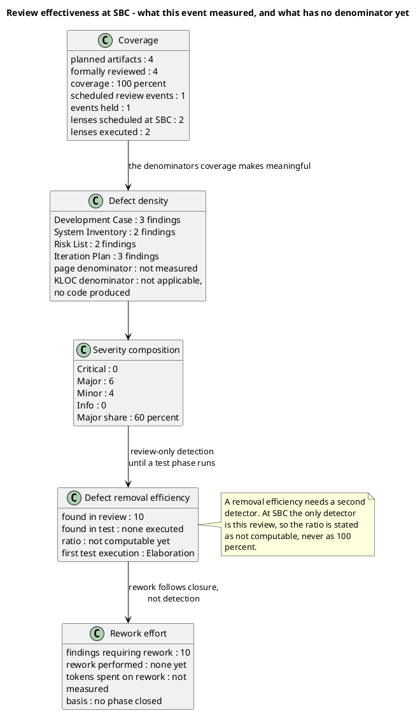

**Interpretation.**

- **Coverage is complete and that is the honest reading, not a flattering one.** Four artifacts were scheduled for this review and four were formally reviewed by both lenses the Survey schedule runs. Coverage carries no denominator for code: this phase produces no code.
- **Defect density is reported as counts per artifact, without a page or KLOC denominator.** Page counts are not measured for these artifacts and code volume is zero in Survey. Inventing a normalizer would produce a number no reader could reproduce — the same defect this review records against the Risk List's scores.
- **Six of ten findings are Major, and that concentration is the finding about the artifacts, not about the review.** Each Major sits where a downstream role would build on wrong content: a version policy no file records, a constraint list five short of its own count, thirteen scores that contradict the inventory they cite, and three exit criteria certified on answers that do not state them.
- **Defect removal efficiency is not computable at this event** and is not stated as 100 percent. The only defect detector that has run is this review. The ratio needs a second detector, and the first test execution is Elaboration.
- **Rework effort has no measurement because no rework has occurred.** No phase has closed, so no measured spend exists, and no figure is filled in its place.
- **Both lenses executed and neither was mismatched to its artifact domain.** The Business Reviewer's absence is the Survey schedule, and is recorded as INACTIVE rather than as an approval.

**Iteration acceptance, kept apart from the milestone verdict.** The management lens assessed all six of this iteration's objectives and found every one delivered: the tailoring exists, the system is read and its perimeter stated, the unread remainder declared, the anomalies carried as scored and owned risks, the priorities ordered with the stakeholder's answer recorded, and the plan for the sprint zero and the phases exists. The work of iteration 1 was done. What it produced is not certifiable. Those are different questions, and this record answers them differently on purpose.

**Sanction token for the record.** Stakeholder sanction: REFUSED — 2026-11-23.

**Stakeholder finding folded in.** "The development case contains duplicated diagrams and text; it needs to be corrected. Additionally, the major findings must be corrected." Verified against the finding ledger rather than deferred: the duplication is a recorded defect under two keys (Development Case#F2 Reviewer, Development Case#F1 Management Reviewer), both assigned to the Process Engineer, and the Major findings are six recorded defects, all open, all owned. No new defect is minted for the second instruction, because every Major it names is already in the ledger. This is also the contribution the coordinator's verdict path requires of the stakeholder before the phase iterates, and it was given inside this milestone review rather than asked for a second time.

**Not asked at this gate, and why.** The grant of R004 and R011 — the two risks whose reconciled scores may land in the stakeholder's band — is not put to the stakeholder now. Their current scores are exactly what this review has declared unreproducible, so the question cannot be stated on data the register does not yet hold. The Project Manager reconciles the scores first and puts the acceptance immediately after, as action 1 orders.
