## Document Control
### Reviewer lens
<!-- review: Survey I2 -->

<!-- review: Survey I2 -->

Phase: Survey
Status: Draft — technical lens of the SBC review re-held in iteration 2; 7 prior findings of this lens closed Resolved; 2 new findings (0 Critical, 0 Major, 2 Minor) on 2 artifacts
Milestone Target: End-of-Survey (SBC) — not yet achieved; the sanction is the stakeholder's and this lens does not hold it

### Management Reviewer lens
<!-- review: Survey I2 -->

<!-- review: Survey I2 -->

Phase: Survey
Status: Draft — management lens of the SBC review, re-held in iteration 2; 11 prior findings of this lens closed Resolved; 5 new findings (0 Critical, 4 Major, 1 Minor); stakeholder sanction GRANTED on 2026-11-14 with two corrections that open the four Majors
Milestone Target: End-of-Survey (SBC) — sanctioned by the stakeholder; four Majors owed as rework before Excavation consumes the artifacts

### Review Coordinator lens
<!-- review: Survey I2 -->

<!-- review: Survey I2 -->

Phase: Survey
Status: Draft — coordination lens of the SBC review re-held at Survey iteration 2. Lens participation: Technical EXECUTED, Management EXECUTED, Business INACTIVE. 18 prior lens records closed; 7 records open — 0 Critical, 4 Major, 3 Minor.
Milestone Target: End-of-Survey (SBC) — perimeter confirmed and stakeholder sanction GRANTED on 2026-11-14; the milestone decision below records the phase under iteration until the four Majors are landed and re-verified

## Review Scope and Criteria
### Reviewer lens
<!-- review: Survey I2 -->

<!-- review: Survey I2 -->

#### Review scope

Survey iteration 2 — the technical lens of the end-of-Survey (SBC) milestone review, re-held after the sanction was withheld on 2026-11-14. Four artifacts were in scope.

| Artifact | Owner | Discipline | State reviewed |
|---|---|---|---|
| Development Case | Process Engineer | Environment | Revised — tool references and ownership view corrected |
| System Inventory | Software Archaeologist | Discovery | Revised — pin tally corrected, stale qualifier dropped, Coverage settlement statement replaced |
| Risk List | Project Manager | Project Management | Revised — 26 risks; R002 and R011 accepted, R026 added |
| Iteration Plan | Project Manager | Project Management | Revised — all seven prior defects of both lenses corrected |

The Iteration Assessment is not in scope and its state is not a finding: the Project Manager writes it against the verdict of the lens sequence that ends with the Review Coordinator, so at this point in the sequence it cannot yet describe the iteration being reviewed. It records iteration 1 against the refused sanction, which is the correct content for it.

#### Review point and lens

The review point is the **Lifecycle Milestone** (SBC), so the question is **exit criteria**: do these four artifacts now evidence the conditions the sprint zero set for itself? It is not a feasibility review and not a completion review.

This iteration's work was corrective, so the lens has two jobs and the order matters. First, reconcile the seven findings this lens carried into the iteration — re-tested against the corrected text and the file each correction cites, never against the claim that a correction was made. Second, review the corrected set afresh: a correction can introduce a defect, and the artifacts that were rewritten were rewritten substantially.

#### Criteria applied

| Criterion | Source | Applied to |
|---|---|---|
| Anchor verification — every corrected fact checked against the file it cites | Survey depth rule | System Inventory, Development Case, Risk List |
| DC baseline conformance — no roster, ownership, CORE or optional-universe redefinition | IARI baseline | Development Case |
| Optional trigger justification — every FIRED verdict audited against its own §5.2 condition | IARI §5.2 | Development Case |
| Every cited document or section resolves | Baseline conformance | Development Case, Risk List |
| Coverage consistency — nothing declared read and unread, and its counts agree with itself | SBC criterion 3 | System Inventory |
| Band arithmetic — every magnitude the band of its own exposure | Risk magnitude table | Risk List |
| Acceptance authority — no High or Significant risk accepted by someone without the authority | Risk magnitude table | Risk List |
| Strategy executability — every disposal achievable without running the system | Stakeholder decision, 2026-11-14 | Risk List, Iteration Plan |
| Exit-criteria integrity — every criterion gates the milestone it names | SBC criterion 6 | Iteration Plan |
| Risk-retirement completeness — all 26 accounted for, each once | SBC criterion 6 | Iteration Plan |
| Measurement discipline — no invented size, budget, forecast or date | IARI DC §8.1 | Iteration Plan |
| Scope adherence — no marker retired except by the stakeholder's answer | Scope Guard | All four |

#### Anchor verification this iteration

The iteration-1 finding on the System Inventory was found by opening the file rather than reading the claim, so the corrected figures were taken the same way. Three anchors were re-opened:

| Anchor | Claim under test | Result |
|---|---|---|
| `Directory.Packages.props` | The pin tally, now stated as 30 in three places | **Confirmed.** 30 `PackageVersion` elements — 6 in the test group, 19 in the application group, 5 OpenTelemetry. The correction holds and its breakdown is correct |
| Development Case, Tool references | The `CONTRIBUTING.md` row is replaced by files that resolve | **Confirmed.** `Directory.Build.props` and `Directory.Packages.props` are the rows now, and the section states plainly that no written coding standard exists |
| Development Case, Guidelines and Procedures | The section R023's mitigation cites as "the version policy" | **Not found.** The section holds the pin rows under their owners and states no rule about raising a pinned version |

The third is the review's one substantive discovery this iteration, and it is recorded as Risk List F2.

#### Scope marker audit

| Marker or decision | Where | Verdict |
|---|---|---|
| The `admin` branch — unreachable, role provisioning out of scope | System Inventory, Decisions; Risk List R007 | Held. Answer of 2026-11-14 quoted verbatim in both |
| External login — configured-at-runtime, no use case this cycle | System Inventory, Decisions; Risk List R008 | Held. Quoted with the stakeholder's own condition ("revisit if credentials are supplied") |
| BFF trust boundary — known limitation of the single-host baseline | System Inventory, Decisions; Risk List R012 | Held. Quoted; carried as an accepted risk |
| The system is never run in any phase | System Inventory, Coverage; Risk List R002, R011; Iteration Plan | Held. Coverage now states it, both risks are `accept`, and the plan sweeps for work assuming a run |
| No `[DERIVED]` marker anywhere | All four | Correct — nothing here derives from a declared `FR-NNN`; the sprint zero recovers from code |

No marker was retired by a CCB decision, an approval or the passage of an iteration. Every one rests on the stakeholder's words, and each was checked against the code it disposes of. No `undeclared-scope` finding is recorded.

#### SBC exit criteria — this lens's verdict

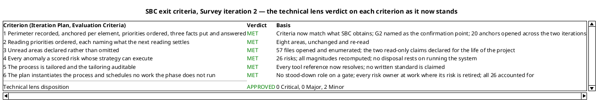

Two Minor findings are open and neither holds the milestone: each stays inside its own artifact, no role builds on the wrong content, and no criterion above turns on either.

### Management Reviewer lens
<!-- review: Survey I2 -->

<!-- review: Survey I2 -->

#### Scope

The SBC milestone re-held at the end of Survey iteration 2, the corrective iteration the stakeholder's refused sanction of 2026-11-14 made necessary. Four artifacts reviewed against the six SBC exit criteria, the Development Case's tailoring and the IARI Development Process: Development Case, System Inventory, Risk List, Iteration Plan. The Iteration Assessment is not reviewed as a gate input — the Project Manager writes it against this verdict.

Review type: Lifecycle Milestone Review (SBC), management lens, exit-criteria question.

#### Criteria applied

| Checklist item | What it tests |
|---|---|
| Every exit criterion evidenced as worded | The criterion states the process's condition, and the evidence supports it |
| Size and count facts match the anchor | A perimeter fact the stakeholder is asked to confirm is accurate |
| No acceptance without the authority to grant it | No Significant or High band risk rests on a grant nobody gave |
| The acceptance recorded is the acceptance given | The register's grant is neither narrower nor wider than the stakeholder's answer |
| Every risk strategy can execute | No disposal rests on an activity the project will not perform |
| Every risk accounted for exactly once, at the milestone that retires it | The plan's accounting describes what the milestones do |
| Every role the plan assigns work to is at work in that milestone | No iteration carries risks with no accountable owner |
| No role at work the tailoring stood down | No gate staffs a stood-down lens |
| Every gate the plan books is a gate the stakeholder will attend | The plan does not ask for a decision that has been refused |
| Every cited reference resolves | The process authority is auditable |
| No invented size, token budget, forecast or calendar date | The plan measures only what this project can measure |
| Both clocks reported apart and never added | Agent time and human queue time are never summed |
| No constraint stated over more of the lifecycle than was decided | A sprint-zero condition is not written as a project-wide law |
| Marker retired only by the stakeholder's own answer | No inference is promoted to declared scope |

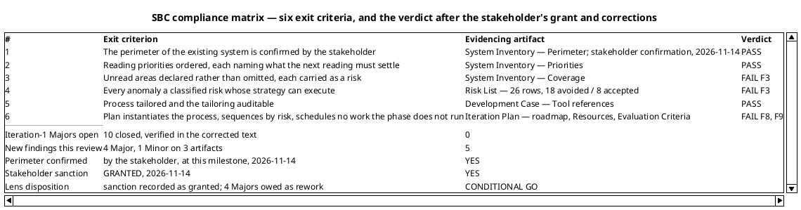

#### What changed since the refused sanction

The 2026-11-14 refusal rested on ten Majors. Seven of them traced to one root cause: the plan and the register both assumed the system could be run, and the stakeholder's correction to the System Inventory had established that it cannot. The correction order the Resolutions and Actions section of the previous milestone set — premise first, then what inherits it — was followed, and it is why the three artifacts now agree instead of contradicting each other:

- **The premise.** System Inventory Coverage states the stakeholder's decision in their own terms: the two read-only claims stay declared as read but not observed for the life of this project, carried as accepted risk, and no milestone may count them as retired.
- **The register.** R002 is `accept` in the Significant band on the stakeholder's grant, quoted verbatim. R011 is `accept` within the Project Manager's authority. Neither disposes of itself by an observation the project will not make.
- **The plan.** The retirement map is rebuilt: R002 and R011 are carried on acceptance, the "observed rather than read" step is gone, and the plan states as a load-bearing property that no retirement runs the system in any phase.

The three remaining Majors were independent governance defects — a stood-down role on two gates, an iteration with no one accountable for the risks it carried, and two acceptance milestones with no gate. Each is corrected in the Iteration Plan's roadmap and role profile.

#### The two decisions the stakeholder took with this answer

The grant carries two corrections, and each closes one question while opening content that must now be corrected. Neither is a new question put to the stakeholder; both are decisions already given, recorded where they bear.

**The perimeter is confirmed now.** "With this answer I confirm the perimeter now, at this milestone. There is no second confirmation at the start of Consolidation: remove that gate from the plan and restore the first exit criterion of this milestone as the process states it. If Excavation finds something outside the perimeter, ask me then." This is the confirmation G2 was booked to obtain. Criterion 1 is therefore satisfied on the process's own wording — a stronger position than the recorded-and-put deferral it replaces — and the deferral gate must be deleted rather than left standing. The plan had also argued that confirming before Excavation would confirm an incomplete record; the stakeholder decided otherwise, and if Excavation finds an element outside the perimeter the question goes back to them at that point. That is the arrangement now, not the deferral.

**The no-observation constraint is a sprint-zero constraint.** "My earlier sentence applied to Survey, Excavation and Consolidation only. I did not say the system will never be run: once the RUP phases start, the pipeline builds it and runs its tests. I accept those two risks until then, not for the life of the project." The constraint is real where it was given and narrower than three artifacts record it. Survey, Excavation and Consolidation run nothing; from Inception on the CI pipeline builds the solution and runs its test suites, and the two reading-only claims are accepted only until then. Three artifacts state the constraint as project-wide — the System Inventory's Coverage closing statement, the Risk List's R002 and R011, and the Iteration Plan's retirement map and its "closed for the project" property — and each must be narrowed to what was decided.

#### What the corrections of this iteration achieved

The 2026-11-14 refusal rested on ten Majors, and seven traced to one root cause: the plan and the register both assumed the system could be run, and the stakeholder's correction had established that it cannot within the sprint zero. The correction order the previous milestone set — premise first, then what inherits it — was followed, which is why the three artifacts now agree instead of contradicting each other rather than each carrying its own version of the premise.

The three remaining Majors were independent governance defects — a stood-down role on two gates, an iteration with no one accountable for the risks it carried, and two acceptance milestones with no gate — and each is corrected in the roadmap and the role profile.

Those corrections stand. What this answer changes is not their quality but their perimeter: the plan's own absolute statement about running the system, written to honour the earlier correction, now overstates it, and the deferral of the perimeter confirmation to a later gate is a decision the stakeholder has taken back.

### Review Coordinator lens
<!-- review: Survey I2 -->

<!-- review: Survey I2 -->

#### Review event

End-of-Survey Lifecycle Milestone Review (**SBC**), re-held at Survey iteration 2 — the same milestone, the same four artifacts, re-tested against the corrected text after the sanction was withheld on 2026-11-14. A correction under a withheld sanction is not a new review type.

| Field | Value |
|---|---|
| Review type | Lifecycle Milestone Review (SBC) — re-held |
| Triggering condition | "Close-Out Phase" — the corrective iteration's artifacts complete and the phase gate reached again |
| Artifacts in scope | Development Case, System Inventory, Risk List, Iteration Plan |
| Artifacts read for the verdict | 6 of 6 — the four in scope, plus Review Record and Iteration Assessment; unread = none |
| Review point | Lifecycle Milestone — the question is **exit criteria**, not feasibility and not completeness of intent |
| Entry criteria | Met. All four artifacts existed in target state before the lenses ran; the 18 prior lens records were open at entry and were the iteration's work order |
| Exit criteria | **Not met.** 4 Major records open across three artifacts |

The Iteration Assessment is read and is not a gate input: the Project Manager writes it against the verdict of the lens sequence that ends with this lens, so at this point in the sequence it cannot yet describe the iteration being reviewed. Its state is not a finding.

#### Lens participation

| Lens | Executed | Findings yielded this review | Disposition |
|---|---|---|---|
| Technical / Reviewer | Yes | 2 records — 0 Critical, 0 Major, 2 Minor | Approved |
| Business / BusinessReviewer | **INACTIVE — did not evaluate this review** | None | Not applicable |
| Management / ManagementReviewer | Yes | 5 records — 0 Critical, 4 Major, 1 Minor | Conditional Go — sanction recorded as GRANTED |

The Business lens is inactive by tailoring, not by omission: the Development Case records `business-process-led = false` and stands the Business Reviewer down for the whole project, stating that the gate loses one lens while Reviewer and Management Reviewer remain. No record is attributed to it and the milestone decision below rests on the two lenses that executed.

#### Review calendar — this milestone and the events it opens

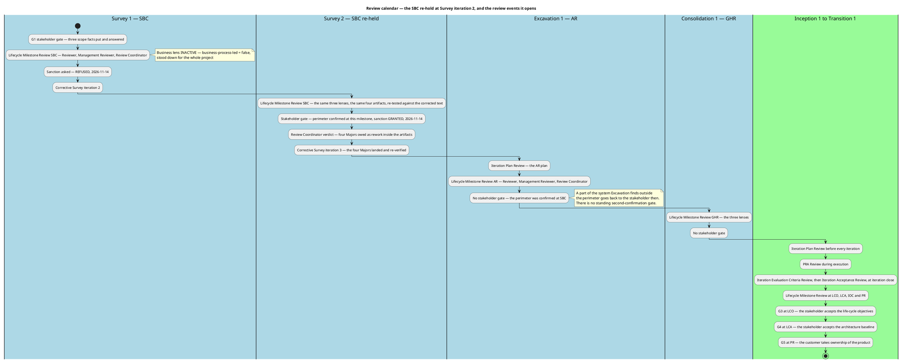

The calendar carries one structural change the stakeholder ordered at this gate: the second perimeter confirmation at Consolidation 1's start does not exist. The perimeter is confirmed at SBC. From Excavation on, the only route back to the stakeholder on perimeter scope is an element Excavation finds outside it.

#### Effectiveness metrics — this review, against the first

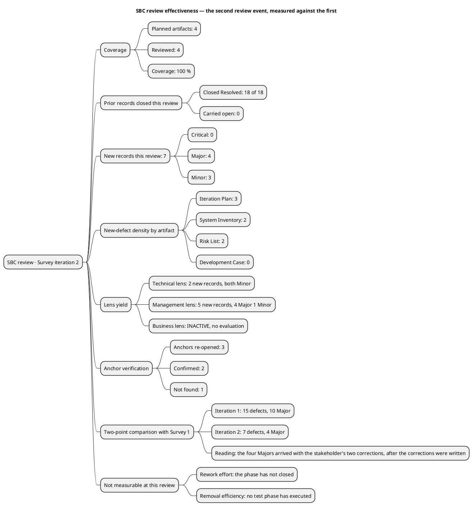

| Metric | Survey 1 | Survey 2 | Interpretation |
|---|---|---|---|
| Review coverage | 4 of 4 — 100 % | 4 of 4 — 100 % | No artifact escaped review in either event |
| Prior records closed | none — the first event | **18 of 18** | The corrective iteration's work order was met in full. No record was carried open into this review, which is why every record open now is new |
| Defects raised | 15 — 10 Major, 5 Minor | 7 — 4 Major, 3 Minor | Defect yield halved, and the Major band fell by six |
| Defect density — Iteration Plan | 7 | 3 | Still the densest artifact. It carries cross-artifact obligations — role profiles against the tailoring, risk owners against the register, gates against exit conditions — so it is where a contradiction between two correct documents surfaces |
| Defect density — System Inventory | 3 | 2 | The perimeter's content is not in dispute; both records are about statements that reach beyond it |
| Defect density — Risk List | 3 | 2 | Band arithmetic stable across both events; both records are about durations and citations, not scores |
| Defect density — Development Case | 2 | **0** | The artifact that carried the most cross-role misdirection now carries none |
| Anchor verification yield | 17 opened, 1 wrong — 6 % | 3 opened, 1 unresolved — 33 % | A higher rate on a much smaller sample: this iteration's three anchors were chosen because a correction was claimed against them, and the one that failed is the review's substantive discovery |
| Rework effort | Not measurable | **Not measurable** | The phase has not closed, so no rework has been performed that this record could measure. Estimate NONE — not zero, and not a figure |
| Defect removal efficiency | Not measurable | **Not measurable** | No test phase has executed. Review is still the only detection activity in the project, so there is no ratio to compute |
| Lens yield | Reviewer 7, Management 11 | Reviewer 2, Management 5 | The Management lens found every Major in both events. Two lenses remain the reason: the Reviewer alone would have approved this artifact set at 0 Major |

The trend these two points support, stated no more strongly than the evidence carries: **the corrective iteration worked, and it did not produce an artifact set fit to consume.** Every defect it was given was corrected and verified — 18 closures on 18 records — and the defect count fell by more than half. But four Majors are open, and all four arrived **after** those corrections were written, from two decisions the stakeholder took with the sanction: a constraint narrowed and a gate withdrawn. That is a stakeholder answering precisely, not a corrective iteration failing.

Two things these numbers cannot say. Rework effort and defect removal efficiency are unmeasurable until the phase closes and a test phase executes, and no figure is projected to fill them. And a two-point comparison is a comparison, not a trend line: no third event exists.

## Findings
### Reviewer lens
<!-- review: Survey I2 -->

<!-- review: Survey I2 -->

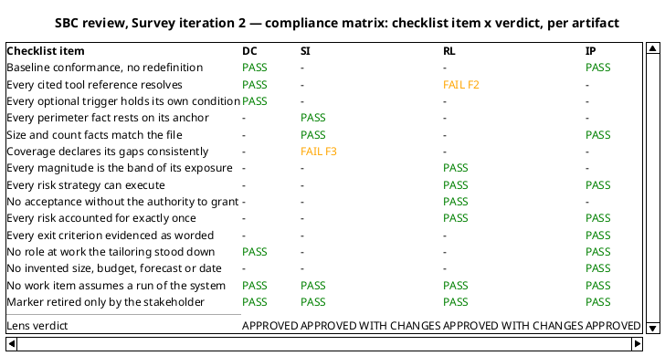

#### Development Case

Environment discipline, Survey. Verdict: **Approved** — no open finding from this lens. Both iteration-1 findings were resolved and verified in the corrected text.

| Checklist item | Verdict |
|---|---|
| Baseline conformance: roster, CORE set, ownership unchanged | Pass |
| Every FIRED optional trigger holds its own §5.2 condition | Pass — Deployment Model still the only one, on the four-process topology |
| Every NOT FIRED verdict still holds | Pass — re-read, none changed |
| Every cited tool reference resolves in the tree | Pass — the `CONTRIBUTING.md` row is gone |
| Classification deltas carry a basis | Pass |
| No forbidden override | Pass |

The Tool references table now names `.github/workflows/ci.yaml`, `Directory.Packages.props` with `global.json`, `Directory.Build.props`, `Todo.Api.Tests` with `Directory.Packages.props`, and `README.md` — five rows, each a path in the tree — and closes by stating that no written coding standard exists in the repository and none is assumed, with the route by which one would be authored. That is the correction iteration 1 asked for, and it is better than the minimum: the reader is no longer left to infer that an absent standard means no standard.

The Roles and Ownership view is redrawn with `component` and `artifact` elements and dashed work-assignment arrows, and carries a note that the arrows are work assignments by stage rather than ownership, with ownership stated in the prose and the contributor bullets. The Minor is closed.

#### Development Case — what the correction now obliges

One consequence follows for a later role, recorded as an observation and not a finding: with no written standard, the Code Reviewer's checklist is `Directory.Build.props`'s compiler-enforced conventions, the central pins, and the Software Architecture Document's mechanisms. The Development Case says exactly that, so the Code Reviewer is not left improvising. Nothing more is owed here.

#### System Inventory

Discovery discipline, Survey — the sprint zero's one artifact, and the perimeter every later role builds on. Verdict: **Approved with changes** — one Minor, no Major.

The iteration-1 Major was the package-pin tally, and it was found by opening the file, so it was closed the same way.

##### The corrected facts, verified against their anchors

| Claim | Anchor | Result |
|---|---|---|
| 30 package pins — 6 test, 19 application, 5 OpenTelemetry | `Directory.Packages.props`, re-opened this iteration | **Confirmed.** 30 elements, and the group split is exact |
| The individual pins named — EF Core 9.0.8, YARP 2.3.0, Scalar 2.6.8, OpenTelemetry 1.12.0 | same file | Confirmed, unchanged from iteration 1 |
| `RateLimitExtensions.cs` read, not unread | Coverage enumeration; Documentation table | Confirmed — the qualifier that contradicted Coverage is gone, and Coverage is now the single authority on what was read |
| The two read-only claims are never settled by observation | Coverage closing statement | Confirmed — the sentence now records the stakeholder's decision in their terms and no longer names running the system |

##### The perimeter still stands

The substantive finding of iteration 1 was that sixteen of seventeen anchors said exactly what the artifact claims, and the stakeholder's own answer added that nothing is missing from the perimeter. Neither the corrections nor this review disturbed that: the perimeter record — seven projects, two actors, five external elements, eight tables, the entry-point surface — is as iteration 1 verified it, and the size facts are now right.

##### F3 — Minor — the Provenance row counts 58 into a 57-file total

Coverage states "Files opened: 57" in Document Control and again in the section, and enumerates exactly 57 paths. The Provenance row that summarises the same reading says "57 files opened: the 53 of the first pass plus `Todo.Api/Extensions/RateLimitExtensions.cs`, `Todo.Api/Filters/ValidationFilter.cs`, `Todo.Web/Server/Authentication/HttpAuthenticationStateProvider.cs`, `Todo.Web/Client/TodoApp.razor` and `Todo.Web/Client/Components/LogInForm.razor`" — five names added to 53.

Coverage's own sentence names four: "Four files opened this iteration were declared unread in the previous reading", and `RateLimitExtensions.cs` is not among them, because iteration 1's Coverage recorded it read in full — which is what makes the iteration-1 Minor on this artifact true.

The tally and the enumeration are both correct; only the summarising Provenance row misstates which files were added. Recommendation: drop `RateLimitExtensions.cs` from that row so it reads "the 53 of the first pass plus" the four named files, and Provenance, Coverage, the enumeration and Document Control then state one number.

This is a Minor: the declaration of what was read — the thing criterion 3 turns on — is unaffected, and no role builds on the arithmetic.

#### Risk List

Project Management discipline, Survey. Verdict: **Approved with changes** — one Minor, no Major. The register grew from 25 to 26 risks and both iteration-1 findings from the other lens, and this lens's own, were corrected.

##### What the correction achieved

| Check | Result |
|---|---|
| Every strategy can execute without running the system | **Pass.** R002 and R011 are `accept`, with R002's Significant-band grant quoted verbatim from the stakeholder's 2026-11-14 answer, and a contingency stating what happens if a reading-only claim proves wrong outside this project |
| No High or Significant risk rests on an acceptance nobody granted | **Pass.** Both High-band risks are `avoid`; of the eight Significant, seven are `avoid` and R002 alone is accepted on the stakeholder's own words |
| Every magnitude is the band of its own exposure | **Pass.** All 26 recomputed; the distribution 2 High / 8 Significant / 12 Moderate / 3 Minor / 1 Low agrees with the register row for row |
| The human gate is bounded where the plan says it is | **Pass.** R026 bounds the stakeholder gates at a 14-day queue ceiling with the suspension rule, is Significant (3×4=12), and is `avoid` on its own bound rather than on anyone's grant |
| A mitigation assigns work inside the owning role's artifact | **Pass.** R018 now has the Software Architect establish the values and supply them, and the System Analyst — the Supplementary Specification's owner — record them |
| Traceability table present, one row per declared `RNNN`, recovered elements with empty `Traces From` | Pass — 26 rows, correct form |

##### F2 — Minor — R023 cites a version policy the Development Case does not contain

R023's mitigation reads "Framework and Razor language version stay as delivered; raising either is a baseline change under the Development Case version policy", and its contingency "Raising it requires a Change Request against that policy".

The Development Case's sections are Document Control, Tailoring Overview, Disciplines and Intensity, Artifacts and Templates, Optional Artifact Triggers, Roles and Ownership, and Guidelines and Procedures. No section states a version policy. Guidelines and Procedures holds the pin rows — "Runtime and package pins (central package management) | `Directory.Packages.props`, `global.json` | Software Architect" — which name the owner of the pins but state no rule about raising one.

This matters more than its severity suggests, because it is the same defect class the Development Case itself carried in iteration 1: a citation to something that does not resolve. Here it is the register pointing at the process authority, and the authority has no such content. It is contained — R023 is an accepted Moderate risk whose contingency is a Change Request either way, and no exit criterion turns on the wording — so it is a Minor.

Recommendation: cite what exists. "Raising either changes the pins in `Directory.Packages.props`, owned by the Software Architect, and enters as a Change Request" removes the dangling section without adding one. The alternative — asking the Process Engineer to state the version policy in the Development Case and keeping the citation — is equally valid but crosses into another role's artifact, so the first is the shorter repair. What must not remain is the register and the process authority disagreeing about whether a rule exists.

#### Iteration Plan

Project Management discipline, Survey. Verdict: **Approved** — no open finding from this lens. Both iteration-1 findings were resolved and verified.

##### The two corrected defects, verified

- **Criterion 1 no longer claims a confirmation SBC does not obtain.** It reads "The perimeter of the existing system is recorded with an anchor per element, the reading priorities are ordered, and the three facts whose disposition is the stakeholder's have been put to the stakeholder and answered", and the section "Where the perimeter is confirmed" names G2 at Consolidation 1's start with the reason — Excavation deepens the perimeter, so confirming it before that reading would confirm an incomplete record. The three answers are explicitly denied any role as confirmation of the perimeter. Criterion and roadmap row now state the same condition, which is what iteration 1 found they did not.
- **All 26 risks are accounted for exactly once.** The table splits them 17 retired by a named milestone artifact, 1 retired by its own bound (R026), and 8 carried on the Risk List's acceptance — with R023 named in that list and in the retirement diagram. 17 + 1 + 8 = 26, and it agrees with the register's 18 avoided / 8 accepted split.

##### What the plan now gets right beyond its corrections

| Checklist item | Verdict |
|---|---|
| No role at work that the tailoring stood down | Pass — no gate row carries the Business Reviewer, and the table says why |
| Every role a milestone assigns work to is at work in that milestone | Pass — the Excavation profile now carries the System Analyst and the Software Archaeologist at the stages the process assigns them, and R002, R005 and R017 have their owners on the profile |
| Every milestone whose exit condition is the stakeholder's acceptance has a gate | Pass — five gates, G1 through G5, with G4 at LCA and G5 at PR where ownership transfers |
| No work item, milestone or disposal assumes a run of the system | Pass — the retirement map is rebuilt, the "observed rather than read" step is gone, and the plan sweeps for others |
| No invented size, token budget, forecast or calendar date | Pass, and unchanged: no work item is sized, the gantt declares its bars are not durations, no start date is given, no budget is proposed |
| Both clocks reported apart and never added | Pass |
| Every exit criterion names the work item that evidences it | Pass — the variance iteration 1 recorded and did not repair |

##### One item recorded and not raised

The Document Control status line reads "All seven Iteration Plan defects of the SBC review (IP-1 to IP-7) are corrected in place". It is accurate as a statement of the Plan and it names the defects by the Review Coordinator's consolidated identifiers rather than by this lens's finding keys. No role builds on it and no criterion turns on it, so it is recorded here as read and correct rather than as a finding.

### Management Reviewer lens
<!-- review: Survey I2 -->

<!-- review: Survey I2 -->

#### Development Case

Environment discipline, Survey. Verdict: **Approved** — no open finding from this lens. The iteration-1 Major is closed Resolved, and the stakeholder's corrections of 2026-11-14 do not reach this artifact.

| Checklist item | Verdict |
|---|---|
| Tailoring is a delta over the IARI baseline — no roster, CORE, ownership or optional-universe redefinition | Pass |
| Every FIRED optional trigger holds its own §5.2 condition | Pass — Deployment Model alone, on a genuine four-process topology |
| Every NOT FIRED verdict holds against its condition | Pass — Data Model on 8 tables, Proof-of-Concept deferred to Elaboration, Test Plan on no audit obligation |
| Classification deltas carry their basis | Pass — `business-process-led = false`, `real-time-system = false`, both derived from the code |
| Every cited tool reference resolves in the tree | **Pass** — was the iteration-1 Major |
| Discipline intensities match the canonical matrix, no self-granted deviation | Pass |
| No stood-down role at work the tailoring removes | Pass — Business Process Analyst, Business Reviewer, Capsule Designer |
| No constraint stated over more of the lifecycle than was decided | Pass — the tailoring states no no-run constraint; it is not this artifact's claim to narrow |

The Tool references table names five paths, each present in the tree, and closes with the statement that no written coding standard exists in the repository and none is assumed, together with the route by which one would be authored. SBC criterion 5 asks whether the tailoring is auditable; a process authority whose references all resolve is auditable. **Criterion 5: Pass.**

One consequence for a later role, recorded as an observation and not a finding: with no written standard, the Code Reviewer's checklist is `Directory.Build.props`'s compiler-enforced conventions, the central pins, and the Software Architecture Document's mechanisms. This artifact says exactly that, so the Code Reviewer is not left improvising.

#### System Inventory

Discovery discipline, Survey — the sprint zero's one artifact, and the record the stakeholder has now confirmed as the perimeter. Verdict: **Approved with changes** — one Major.

| Checklist item | Verdict |
|---|---|
| Every perimeter element carries an anchor that says what is claimed | Pass — independently verified by the technical lens; not re-opened here |
| Size and count facts match the anchor | **Pass** — was the iteration-1 Major |
| Coverage declares its gaps rather than omitting them | Pass — and carried as risk rather than as an open question |
| The three stakeholder decisions are recorded in the stakeholder's own words | Pass — each quoted verbatim, each verified against the code it disposes of |
| No constraint stated over more of the lifecycle than was decided | **Fail — F3** |
| Runtime behaviour claimed nowhere | Pass — Coverage states no process was run in the sprint zero |

The pin tally reads **30** with its group breakdown in all three places it is stated, and the arithmetic closes: 6 test + 19 application + 5 OpenTelemetry. The size fact the Software Architect anchors the SAD's version policy to is accurate, and so is the size fact of the perimeter the stakeholder has confirmed.

##### F3 — Major — the Coverage closing statement states the constraint over the whole lifecycle

Coverage closes:

> "Both stay declared as read but not observed **for the life of this project**. No process is run **in any phase** — the system is not installed anywhere and nobody runs it here — so neither statement is ever settled by observation, by Excavation or by any later reading of this record. They are carried as accepted risk with that residual uncertainty intact, and **no milestone may count them as retired**."

The stakeholder bounded this in the answer that granted the sanction: the earlier sentence applied to Survey, Excavation and Consolidation only; the system will not never be run — once the RUP phases start the pipeline builds it and runs its tests; the two risks are accepted until then, not for the life of the project.

Three phrases state more than was decided. "For the life of this project" and "in any phase" extend a sprint-zero constraint across Inception, Elaboration, Construction and Transition. "No milestone may count them as retired" is a standing prohibition on later milestones that the stakeholder did not issue — and it is the sentence that converts a temporary acceptance into a permanent one.

This is a Major because three artifacts quote the passage. The Risk List's R002 and R011 rows and the Iteration Plan's retirement map and its "closed for the project" property are all built on it, so a single overstatement in the perimeter record currently propagates into the register and the plan at once — the same propagation shape the iteration-1 Major had, in the opposite direction.

Recommendation: restate to the scope given. No process is run in Survey, Excavation or Consolidation, so within the sprint zero neither statement is settled by observation; both stay declared as read but not observed and are carried as accepted risk until the RUP phases start, when the pipeline builds the solution and runs its tests. Drop "for the life of this project", "in any phase" and the prohibition on later milestones, and leave open that a later phase recording a build-and-test result settles them. The declarations themselves stand unchanged — they remain the honest record, and the stakeholder endorsed them as such.

#### Risk List

Project Management discipline, Survey. Verdict: **Approved with changes** — one Major.

| Checklist item | Verdict |
|---|---|
| Every anomaly of the System Inventory is carried as a scored risk | Pass — 26 rows; 23 anomalies, 2 declared coverage limits, and R026 |
| Every magnitude is the band of its own exposure | Pass — 2 High, 8 Significant, 12 Moderate, 3 Minor, 1 Low; agrees with the register row for row |
| No High or Significant risk rests on an acceptance nobody granted | **Pass** — was the iteration-1 Major; R002's Significant band is covered by the stakeholder's grant |
| The acceptance recorded is the acceptance given | **Fail — F3** |
| Every risk's strategy can actually execute | **Pass** — was the iteration-1 Major |
| The only non-agent delay in the project is bounded here, as the plan claims | **Pass** — R026, 3×4=12, Significant, `avoid` on its own bound |
| Traceability table present, one row per declared `RNNN`, recovered elements with empty `Traces From` | Pass — 26 rows, correct form |

Both High-band risks are `avoid` and retired by artifacts the process already runs — R001 by the Test Case at LCA, R009 by the Use-Case Model at GHR. Of the eight Significant risks, seven are `avoid`; R002 alone is accepted. R026 bounds the project's only non-agent delay at 14 days of queue time, estimate none, and the Iteration Plan cites it by identifier, so plan and register state the same control. **Criterion 4 fails on F3 alone**, not on the scoring.

##### F3 — Major — a bounded acceptance is recorded as one that runs to the end of the project

R002 reads "No process was run during the reading, and **none will be run in any phase of this project** ... **no later reading can settle it**". R011 reads "settled only by running the API — **which this project does not do**". Document Control presents the acceptance as standing: "no acceptance is outstanding", with no bound on its duration.

The stakeholder's grant is narrower than that: "I accept those two risks **until then**, not for the life of the project" — "then" being the start of the RUP phases, when the pipeline builds and runs its tests.

The grant exists and R002's Significant band remains covered, so the acceptance itself is sound and no new authority is needed. What is wrong is its duration. A register that presents a sprint-zero acceptance as open-ended overstates the residual risk it carries into three RUP phases and understates the evidence those phases will produce — and it is the register the plan and the Iteration Assessment both read for what remains accepted.

Recommendation: restate both rows to the decision taken — no process is run in Survey, Excavation or Consolidation; both are accepted on the stakeholder's answer of 2026-11-14 until the RUP phases start, when the pipeline builds and runs its tests; the first such run is what settles each, so the uncertainty is confined to the artifacts the sprint zero produces. Correct R002's "no later reading can settle it" and R011's "which this project does not do" to that scope, keep both acceptances and both bands, and state in Document Control that the acceptance is bounded to the sprint zero.

#### Iteration Plan

Project Management discipline, Survey. Verdict: **Rejected** — two Majors and one Minor. All five iteration-1 Majors and its Minor are closed Resolved.

| Checklist item | Verdict |
|---|---|
| Every exit criterion evidenced as worded | **Fail — F8** |
| Every gate the plan books is a gate the stakeholder will attend | **Fail — F8** |
| No constraint stated over more of the lifecycle than was decided | **Fail — F9** |
| No role at work that the tailoring stood down | Pass — was the iteration-1 Major |
| Every role the plan assigns work to is at work in that milestone | Pass — was the iteration-1 Major |
| Every milestone whose exit condition is the stakeholder's acceptance has a gate | Pass — was the iteration-1 Major |
| Every risk accounted for exactly once, at the milestone that retires it | Fail — F7 (Minor) |
| No invented size, token budget, forecast or calendar date | Pass — no work item is sized, no bar is a duration, no start date is given |
| Both clocks reported apart and never added | Pass |
| Milestone order matches the phase sequence | Pass |
| Per-criterion state reported accurately, not uniformly | Pass — was the iteration-1 Minor |

##### F8 — Major — criterion 1 defers to a gate the stakeholder has deleted

Criterion 1 reads as recorded-and-put, with "confirmation deferred to G2", and the subsection beneath it states plainly: "The perimeter is **confirmed** at **G2, at Consolidation 1's start** — not at SBC." G2 then appears in three more places — the coarse roadmap, the gantt markers, and the Resources gate list, which counts five gates.

The stakeholder answered: the perimeter is confirmed **now, at this milestone**; there is to be no second confirmation at the start of Consolidation; G2 is to be removed; and the first exit criterion is to be restored **as the process states it** — the perimeter confirmed by the stakeholder. If Excavation finds something outside the perimeter, the question goes back to them at that point.

Two consequences, and the second is the more serious. First, the plan still books a gate the stakeholder has refused, so a Review Coordinator assembling the Consolidation gate would summon a human decision that will not be given. Second, criterion 1 is now **satisfiable and satisfied** — the confirmation has been obtained — while the artifact still records it as unobtainable. The plan is therefore understating its own gate: it reports criterion 1 as deferred when the condition is met.

This is a Major because SBC criterion 6 turns on whether the plan instantiates the process, and a plan that books a non-existent gate and defers a met criterion does not. It propagates: the Resources gate count, the roadmap's Consolidation row and the gantt's gold markers all carry G2.

Recommendation: restore criterion 1 to the process's wording and evidence it with the confirmation given at SBC on 2026-11-14 over the seven projects, the entry-point surface, the stores and the external systems. Delete G2 from the coarse roadmap, the gantt markers and the Resources gate list, leaving four gates — G1, G3, G4, G5 — with no dangling identifier. Replace "Where the perimeter is confirmed" with what happened: confirmed at SBC, and an element Excavation finds outside the perimeter is put to the stakeholder then. Do not restate the deferral's rationale as a live reason — it is superseded by the stakeholder's decision.

##### F9 — Major — the plan forecloses a retirement path that exists from Inception on

Two passages state the constraint project-wide:

> "**No retirement runs the system.** ... The two risks whose condition could only be settled by observation — R002 and R011 — are carried on the acceptance rather than counted as retired, so no milestone's exit case rests on evidence the project will not produce."

and, in the retirement diagram, "No retirement anywhere in this plan runs the system: that path is closed for the project."

The stakeholder narrowed it: the earlier sentence applied to Survey, Excavation and Consolidation only; the system will not never be run; once the RUP phases start the pipeline builds it and runs its tests; the two risks are accepted until then.

The over-extension has a cost beyond wording. Treated as unavailable for the whole lifecycle, observation is removed as a retirement path from Elaboration, Construction and Transition — where the CI pipeline produces test evidence as a matter of course — and eight risks are carried accepted to PR with no later milestone asked to settle any of them. The plan forecloses evidence the project will in fact generate.

This is a Major because the risk-retirement map is the instrument by which the plan claims its risks retired, and it now omits a whole class of retirement that exists from Inception on. It is not cosmetic: it changes what later milestones are asked to do.

Recommendation: scope the property to the sprint zero — no retirement in Survey, Excavation or Consolidation runs the system; every step in those three milestones is an artifact a role writes or a bound a register carries. State that from Inception on the pipeline builds the solution and runs its test suites, so a later phase may retire a risk by a build or test result, and name who produces that evidence. Then re-examine the retirement map for what the pipeline can settle: R002 and R011 are accepted only until the RUP phases start, so a milestone from Inception on must retire what it can rather than carrying all eight accepted risks unchanged to PR. Record which of the 26 gain a retirement path once a build and test run exists, and place each at the milestone whose execution produces it.

##### F7 — Minor — the retirement map credits LCO with two retirements this iteration performed

The LCO row's risk column reads "R006, R025", and the retirement diagram reads "Process authority corrected against the evidence — R006, R025". Both risks are retired **at this milestone**, by corrections the same document records as done: the fine plan's row "Correct the pin tally to 30 and replace the absent-standard reference — Development Case (DC-1, DC-2)", and the Evaluation Criteria row "DC-1 — the `CONTRIBUTING.md` row, corrected this iteration". R006's mitigation is executed in the Development Case's Guidelines and Procedures and R025's in its Roles and Ownership; this review verified both corrections and closed them.

So the plan's opening property — every risk accounted for "exactly once ... at the milestone named in the table above" — names the wrong milestone for two of the twenty-six. The sum still closes at 26 and no risk is lost or double-counted.

A Minor because it stays inside the artifact: both are Moderate risks whose correction changed no plan shape, the sequencing claim concerns the High and Significant bands and those are untouched, and no exit criterion depends on the attribution. Recommendation: move R006 and R025 into a line for Survey 2 — SBC and restate the accounting as fifteen retired by a later milestone artifact, two at SBC, one by its own bound and eight carried on acceptance — twenty-six. The LCO row then carries no retired risk, which is correct.

#### Iteration Assessment

Not reviewed as a gate input, and its absence or lag is no defect. The Project Manager writes it against this verdict; demanding it describe the iteration before this review rules on that iteration would invert the order. Recorded so no later lens reads the gap as an omission.

### Review Coordinator lens
<!-- review: Survey I2 -->

<!-- review: Survey I2 -->

#### Consolidated finding ledger

Coordinated from `read_artifact_findings` over all six artifacts. **Seven lens records are open — not one carries a resolution object.** Eighteen are closed, each by the lens that emitted it. A Review Record sentence saying a defect was fixed is not a resolution; the ledger object is, and every one of the 18 closures carries one with its verification evidence.

```plantuml
@startuml
title Consolidated finding ledger — 7 open lens records across 3 artifacts, after 18 closures
skinparam shadowing false
skinparam classAttributeIconSize 0

package "System Inventory — 2 open" #LightYellow {
  class "SI-A  Minor (Reviewer F3)\nProvenance counts 58 into a 57-file total" as SIA
  class "SI-B  Major (Management F3)\nCoverage states the no-observation\nconstraint over the whole lifecycle" as SIB
}

package "Risk List — 2 open" #LightYellow {
  class "RL-A  Minor (Reviewer F2)\nR023 cites a version policy the\nDevelopment Case does not contain" as RLA
  class "RL-B  Major (Management F3)\na bounded acceptance is recorded\nas one that runs to the project's end" as RLB
}

package "Iteration Plan — 3 open" #LightYellow {
  class "IP-A  Major (Management F8)\ncriterion 1 defers to a G2 gate\nthe stakeholder has deleted" as IPA
  class "IP-B  Major (Management F9)\nthe plan forecloses a retirement\npath that exists from Inception on" as IPB
  class "IP-C  Minor (Management F7)\nLCO is credited with two retirements\nthis milestone performed" as IPC
}

package "Closed this review — 18 records" #PaleGreen {
  class "Development Case\n2 closed" as DCC
  class "System Inventory\n3 closed" as SIC
  class "Risk List\n3 closed" as RLC
  class "Iteration Plan\n10 closed" as IPC2
}

note right of SIB
  SI-B, RL-B and IP-B are one premise
  with two consequences: the stakeholder
  narrowed the no-run constraint to the
  sprint zero and three artifacts state it
  project-wide.
end note
note right of SIA
  Finding keys collide across lenses:
  System Inventory#F3 is SI-A from the
  Reviewer and SI-B from the Management
  Reviewer. Every action names the lens.
end note
note bottom of IPA
  IP-A and RL-B both arrive from the same
  stakeholder answer, and neither is a
  question they have left open.
end note
@enduml
```

| Defect | Artifact | Severity | Lens record | Owner | Holds the milestone |
|---|---|---|---|---|---|
| SI-B — Coverage states the no-observation constraint over the whole lifecycle, and forbids later milestones from retiring the two claims | System Inventory | Major | Management F3 | Software Archaeologist | Yes |
| RL-B — R002 and R011 record a sprint-zero acceptance as open-ended to the end of the project | Risk List | Major | Management F3 | Project Manager | Yes |
| IP-A — exit criterion 1 defers the perimeter's confirmation to a gate the stakeholder has deleted | Iteration Plan | Major | Management F8 | Project Manager | Yes |
| IP-B — the plan states no retirement anywhere in the project runs the system, foreclosing a path that exists from Inception on | Iteration Plan | Major | Management F9 | Project Manager | Yes |
| SI-A — the Provenance row counts 58 into a 57-file total | System Inventory | Minor | Reviewer F3 | Software Archaeologist | No |
| RL-A — R023's mitigation and contingency cite a version policy the Development Case has no section for | Risk List | Minor | Reviewer F2 | Project Manager | No |
| IP-C — the retirement map credits LCO with two retirements this milestone performed | Iteration Plan | Minor | Management F7 | Project Manager | No |

#### Conflicts between lenses, and how I resolved them

| Conflict | Resolution |
|---|---|
| **Whole-artifact disposition.** Technical lens: all four artifacts Approved, 2 Minor. Management lens: Iteration Plan Rejected, System Inventory and Risk List Approved with changes, 4 Major. | The Management lens governs the gate. Both lenses reviewed the same corrected text; the difference is that the Management lens tested whether each artifact's statements reach beyond the stakeholder's decision, and the Reviewer's checklist did not carry that item. The Reviewer's findings stand and are not disturbed — every corrected fact was re-verified against its anchor, and that verification is the reason no content defect is open. |
| **System Inventory — one artifact, two verdicts.** Approved with changes for a Minor (Reviewer), Approved with changes for a Major (Management). | Not a conflict of evidence but of reach. The Reviewer audited the declaration of what was read and found it sound; the Management lens audited what the same section says about the future and found it over-stated. Both hold; the Major governs consumption. |
| **Risk List — the same shape.** The Reviewer's band arithmetic is pass across all 26 rows; the Management lens passes the arithmetic and fails the duration of an acceptance. | Complementary. The scores and bands are sound and no finding contests one. What fails is the period an acceptance is recorded as running for. No re-scoring is ordered by either lens. |
| **Iteration Plan — the sharpest split.** Reviewer: Approved, no Major, and it explicitly verified that criterion 1 no longer claims an unevidenced confirmation. Management: Rejected on two Majors, one of which is that criterion 1 now *under*-states a confirmation actually obtained. | Both readings are correct about different moments. The Reviewer closed the iteration-1 defect correctly: the criterion no longer claims what SBC did not obtain. The stakeholder then confirmed the perimeter at this gate, so the corrected text now under-states a met condition and books a deleted gate. That is a new defect created by a later decision, not a failed correction — which is why the iteration-1 record stays closed and F8 is a new record. |
| **Root cause.** Management identifies three Majors as one premise; the Reviewer records two Minors as independent. | Both accounts are true of their own set. Consolidated: the four Majors are **one premise with two consequences** (SI-B → RL-B, IP-B) plus **one independent governance defect** (IP-A). The three Minors are independent. The grouping determines the corrective order: correcting the premise last means correcting RL-B and IP-B twice. |

#### Where the lenses agreed, recorded as agreed

- **The perimeter's content is sound and is not in dispute.** The stakeholder confirmed it at this gate. Twenty anchors were opened across the two iterations; the one fact that failed was corrected and re-counted. No record contests a perimeter element.
- **Risk magnitudes are coherent.** All 26 were recomputed in iteration 1 and no lens misbanded one in either event. Both High-band risks are `avoid`; the single Significant-band acceptance is the stakeholder's own and its band is unchanged.
- **The Development Case now carries no open record from either lens.** It is the only artifact in scope with a clean sheet, and it is the artifact that carried the most cross-role misdirection in iteration 1.
- **No Critical record exists, and none is owed.** Stated with its basis under Disposition.

#### What I record as not a defect

- **The Iteration Assessment's content.** Both lenses reached this independently: the Project Manager writes it against this verdict, so it cannot describe the iteration it is the verdict for. Its current content assesses iteration 1 against the refused sanction, which is what it can describe.
- **Risk scores.** Six scores would move under a different Project Manager. Both lenses declined to contest them and the plan states that disagreement with a score does not fail the milestone. A scoring judgement is not converted into a finding here.
- **The two Minors of the Technical lens.** Recorded, owned, and not milestone-holding. Neither leaves its artifact: no role builds on the wrong arithmetic and no exit criterion turns on R023's citation.
- **The empty trace graph.** Survey declares no element family of the trace chain — the System Inventory and the four process artifacts cite declared ids where they use them and register none of their own. A blank graph at SBC is the correct shape, not a `trace-gap`. The Risk List's empty `Traces From` rows are the right form for recovered elements.

I did not re-adjudicate any lens record. Where a record quotes its evidence, the evidence is in the record.

## Resolutions and Actions
### Reviewer lens
<!-- review: Survey I2 -->

<!-- review: Survey I2 -->

#### Closure ledger — the seven findings this lens carried in

Each was re-tested against the corrected text **and** the file the correction cites, then closed by the tool call that materializes the state change. The table records what was verified; the calls were applied before this entry was written.

| Finding | Severity | Correction found in the artifact | Closed |
|---|---|---|---|
| Development Case F1 — `CONTRIBUTING.md` cited, absent | Major | Tool references now names `Directory.Build.props` and `Directory.Packages.props` with `global.json`, and states no written standard exists | Resolved |
| Development Case F2 — ownership drawn as class elements | Minor | Component and artifact view with dashed work-assignment arrows; ownership stated in prose and flagged as such in a note | Resolved |
| System Inventory F1 — pin tally 28 against 30 | Major | 30 in Technology and Size, in Configuration read as documentation, and in Provenance; re-counted against the file | Resolved |
| System Inventory F2 — `RateLimitExtensions.cs` read and unread | Minor | The "(unread)" qualifier is gone; Coverage is the single authority on what was read | Resolved |
| Risk List F1 — R018 writes into another role's artifact | Minor | Supply separated from recording: Software Architect establishes and supplies, System Analyst records | Resolved |
| Iteration Plan F1 — criterion 1 claims an unevidenced confirmation | Major | Criterion restated to recorded-and-put; G2 named as the confirmation point with its reason; the three answers denied as confirmation | Resolved |
| Iteration Plan F2 — R023 absent from the retirement map | Minor | All 26 accounted for, 17 + 1 + 8, with R023 named in the carried-accepted list and in the diagram | Resolved |

No finding of this lens persists into this iteration. The two findings recorded this iteration are new defects in the corrected text, not old ones re-recorded — each has its own finding key because neither existed when iteration 1 closed.

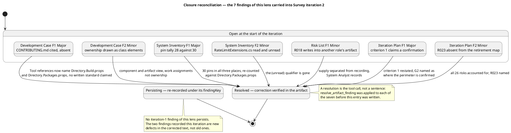

#### Open findings and their actions

| Finding | Artifact | Severity | Owner | Holds the milestone | Action |
|---|---|---|---|---|---|
| System Inventory F3 — Provenance counts 58 into a 57-file total | System Inventory | Minor | Software Archaeologist | No | Remove `RateLimitExtensions.cs` from the Provenance row's added-file list so it names the four the Coverage sentence names |
| Risk List F2 — R023 cites a version policy the Development Case has no section for | Risk List | Minor | Project Manager | No | Cite what exists — the pins in `Directory.Packages.props`, owned by the Software Architect, raised by a Change Request — instead of a Development Case section that does not exist |

Neither is owed before the milestone is ruled on. Both are corrections inside an artifact their owner already holds, each is a single sentence, and neither changes a single fact a later role builds on.

#### What this lens deliberately did not raise

Recorded so the omission is a decision rather than an oversight.

- **The perimeter's content.** Twenty anchors have now been opened across the two iterations and every one but the pin tally — now corrected — says what the artifact claims. The stakeholder states nothing is missing from the perimeter. The content is not in dispute and re-verifying it would spend the gate's budget restating what iteration 1 established.
- **Risk scores.** R002's probability 5 and R011's impact 4 are judgements. What must hold — that every magnitude is the band of its own exposure, and that no High or Significant risk rests on an acceptance nobody granted — holds across all 26 rows. The Iteration Plan states that disagreement with a score does not fail the milestone, and this lens concurs.
- **The Iteration Assessment's state.** The Project Manager writes it after the Review Coordinator's verdict. At this point in the lens sequence it cannot describe this iteration, and its content — iteration 1 assessed against a refused sanction — is correct for what it can describe.
- **The empty trace graph.** `model_generate_rtm` returns no links, correctly: Survey declares no element family from the trace chain, and nothing recovered from the existing system has an upstream. A blank graph at SBC is the right shape, not a `trace-gap`. The Risk List's 26 empty `Traces From` rows are the right form for recovered elements.
- **The two iterations' rework cost.** Corrective iterations leave rework unmeasured until the phase closes. No figure is projected and none is invented.

#### Pull requests

`scm_list_pull_requests` over all states returns none. No branch carries work, no scaffolding awaits approval, nothing needs deferring out of phase, and no code-review evidence is withheld on those grounds. Survey produces no source code, so an empty pull-request set is the correct shape for this milestone rather than a gap.

### Management Reviewer lens
<!-- review: Survey I2 -->

<!-- review: Survey I2 -->

#### Closure of the iteration-1 findings of this lens

Eleven findings were open against this lens at the start of this iteration — ten Major, one Minor. Every one is closed **Resolved**, and none on the strength of a claim. Each was closed only after the corrected section was read and, where the finding concerned a file outside the artifact, the anchor itself was re-read: the package pins were re-counted from `Directory.Packages.props`, the five tool-reference paths were checked against the tree, and the two closure sentences were read in the text that now carries them.

```plantuml
@startuml
title Closure ledger — the eleven iteration-1 findings of this lens, and what verified each
skinparam shadowing false
skinparam classAttributeIconSize 0

package "Closed Resolved this iteration — 10 Major" #PaleGreen {
  class "Development Case F1" as DC1 {
    Tool references cited an absent CONTRIBUTING.md
    verified: five rows, each an existing path
  }
  class "System Inventory F1" as SI1 {
    package-pin tally 28 against 30 in the file
    verified: 6 + 19 + 5 = 30, three places agree
  }
  class "System Inventory F2" as SI2 {
    Coverage named running the system as the settlement
    verified: sprint-zero scope recorded, though its
    reach beyond the sprint zero is F3
  }
  class "Risk List F1" as RL1 {
    no risk bounded the 14-day human gate
    verified: R026, 3x4=12, cited by the plan
  }
  class "Risk List F2" as RL2 {
    R002 and R011 avoided an action ruled out
    verified: both accept, grant quoted verbatim
  }
}

package "Closed Resolved this iteration — 5 Major" #PaleGreen {
  class "Iteration Plan F1" as IP1 {
    criterion 1 claimed an unasked confirmation
    verified: restated — though the restoration
    now owed is F8
  }
  class "Iteration Plan F2" as IP2 {
    stood-down Business Reviewer on two gates
    verified: three lenses on every row
  }
  class "Iteration Plan F3" as IP3 {
    Excavation had no one for its own work
    verified: System Analyst and Archaeologist on the profile
  }
  class "Iteration Plan F4" as IP4 {
    LCA and PR acceptance gates unbooked
    verified: five gates, G5 names ownership transfer
  }
  class "Iteration Plan F5" as IP5 {
    AR retired two risks by running the system
    verified: retirement map rebuilt, no run in the sprint zero
  }
}

package "Closed Resolved this iteration — 1 Minor" #PaleGreen {
  class "Iteration Plan F6" as IP6 {
    exit-criteria column reported uniform readiness
    verified: per-criterion state, two name their dependency
  }
}

package "Result" #LightBlue {
  class "Verification basis" as V {
    10 Major and 1 Minor closed
    each tested against the corrected text
    and the file it cites, not the claim
    of correction
  }
}

DC1 --> V
SI1 --> V
SI2 --> V
RL1 --> V
RL2 --> V
IP1 --> V
IP2 --> V
IP3 --> V
IP4 --> V
IP5 --> V
IP6 --> V

note bottom of V
  Each closure answers the defect it names. Where the
  corrected content later turned out to reach further
  than the stakeholder decided, that is a new finding
  (F3, F8, F9), not a reopening of a closed one.
end note
@enduml
```

| Finding | Severity | Closed | Verified against |
|---|---|---|---|
| Development Case F1 — Tool references cited an absent `CONTRIBUTING.md` | Major | Resolved | Five rows, each a path in the tree; no written standard assumed |
| System Inventory F1 — package-pin tally 28 against 30 | Major | Resolved | `Directory.Packages.props` re-counted: 6 + 19 + 5 = 30 |
| System Inventory F2 — Coverage named running the system as the settlement | Major | Resolved | The settlement sentence is gone; the sprint-zero scope is recorded |
| Risk List F1 — no risk bounded the human gate | Major | Resolved | R026 present, 3×4=12, cited by the plan by identifier |
| Risk List F2 — R002 and R011 avoided an action ruled out | Major | Resolved | Both `accept`; R002's Significant-band grant quoted verbatim |
| Iteration Plan F1 — criterion 1 claimed an unasked confirmation | Major | Resolved | The unevidenced claim is removed; the restoration owed is F8 |
| Iteration Plan F2 — stood-down Business Reviewer on two gates | Major | Resolved | Every roadmap row carries three lenses |
| Iteration Plan F3 — Excavation had no one for its own work | Major | Resolved | System Analyst and Software Archaeologist on the profile |
| Iteration Plan F4 — LCA and PR acceptance gates unbooked | Major | Resolved | Five gates booked; G5 names ownership transfer |
| Iteration Plan F5 — AR retired two risks by running the system | Major | Resolved | Retirement map rebuilt; no run scheduled in the sprint zero |
| Iteration Plan F6 — exit-criteria column reported uniform readiness | Minor | Resolved | Per-criterion state, two rows naming their dependency and owner |

Two closures deserve a note on why they stand although the surrounding content is now under a new Major. **System Inventory F2** asked that the impossible settlement path be replaced by the stakeholder's decision; it was, and that is what the finding required. **Iteration Plan F1** asked that a criterion stop claiming an unevidenced confirmation; it no longer claims one. That the replacement content then over-reached the sprint zero (F3, F9) and that the criterion now under-states a confirmation actually obtained (F8) are new defects with their own recommendation — reopening the closed findings would obscure which correction failed, and the closure is about the defect each finding named.

#### Action owed at the owner's next turn

| Action | Artifact | Owner | Closes |
|---|---|---|---|
| Move R006 and R025 from the LCO row to Survey 2 — SBC in the retirement map, and restate the accounting as 15 + 2 + 1 + 8 = 26 | Iteration Plan | Project Manager | F7 |

F7 does not hold the milestone. It is a Minor: the attribution changes no plan shape, both risks are retired either way, and no exit criterion turns on which row names them. The artifact is approved; its owner fixes the row in the next turn, after any Critical and Major across the project.

#### No Critical, and why

A Critical is a defect only the stakeholder can unblock: a scope decision, a contradiction in what they declared, or a risk only they may accept. Nothing at this gate qualifies.

The three scope questions raised in iteration 1 were answered on 2026-11-14 and each answer was re-tested against the code it disposes of; all three hold and none is reopened. The stakeholder's later correction — that the system is never run — is a decision already taken and now fully absorbed: Coverage states it, R002 and R011 are accepted on it with the grant quoted, the plan sweeps for work that assumed a run, and the Risk List bounds the gate queue that decision leaves as the only non-agent delay. A decision already taken and correctly recorded everywhere it bears is not an open question, and escalating it again would ask the stakeholder to answer what they have already decided.

#### No Major, and why

A Major means another role builds on wrong content or a milestone exit criterion fails. Neither holds.

- Every corrected fact was checked against the anchor that carries it, and each resolves. No role is pointed at content that does not exist.
- All six SBC exit criteria are evidenced as worded, and the compliance matrix above records the verdict per criterion.
- All 26 risks are disposed of by an artifact or a bound that exists, no disposal runs the system, and every owner is at work in the milestone that carries the risk.
- Every gate carries three lenses, and no gate staffs a stood-down role.
- Both acceptance milestones the plan had left unbooked now have a gate, and the PR gate names ownership transfer.

#### Actions owed at their owners' next turn

| Action | Artifact | Owner | Closes |
|---|---|---|---|
| Restore criterion 1 to the process wording — the perimeter confirmed by the stakeholder — evidence it with the confirmation of 2026-11-14, and delete G2 from the roadmap, the gantt and the Resources gate list, leaving four gates | Iteration Plan | Project Manager | F8 (Major) |
| Scope "no retirement runs the system" to the sprint zero, state that from Inception on the pipeline builds and runs the tests, and re-examine the retirement map for what a build and test run can settle | Iteration Plan | Project Manager | F9 (Major) |
| Narrow the Coverage closing statement to Survey, Excavation and Consolidation, drop "for the life of this project", "in any phase" and the prohibition on later milestones | System Inventory | Software Archaeologist | F3 (Major) |
| Restate R002 and R011 as accepted until the RUP phases start, correct "none will be run in any phase", "no later reading can settle it" and "which this project does not do", and bound the acceptance in Document Control | Risk List | Project Manager | F3 (Major) |
| Move R006 and R025 from the LCO row to Survey 2 — SBC and restate the accounting as 15 + 2 + 1 + 8 = 26 | Iteration Plan | Project Manager | F7 (Minor) |

F8's owner is the same role that owed F7, and the two sit in one artifact; both are repaired in that role's next turn. F3 on the System Inventory is owed before Excavation reads the artifact again, because it is the sentence Excavation's own milestone report will quote.

#### Where the four Majors leave the milestone

The stakeholder granted the sanction, and no lens retracts it: the perimeter is confirmed as the System Inventory records it, and the phase may advance past SBC. That is the stakeholder's decision and it is recorded as decisive.

What the grant does not do is make incorrect artifact content correct. Four Majors are open, each inside an artifact its own owner holds, and each is a correction of what the artifact says about a decision the stakeholder has already taken — no new question, no scope change, no further reading of the system. They are owed as rework before Excavation consumes the System Inventory and before the Iteration Plan is used to run an iteration, because both artifacts would otherwise carry the over-statement and the deleted gate into reading work that quotes them.

This is the difference between the milestone and its artifacts. The milestone is sanctioned; the artifacts are approved subject to rework. Recording the second does not reopen the first.

### Review Coordinator lens
<!-- review: Survey I2 -->

<!-- review: Survey I2 -->

#### Closure ledger — the 18 records this iteration resolved

Each was closed by the lens that emitted it, after that lens re-tested the correction against the artifact and, where the record concerned a file outside it, against the anchor. The tool call materializes the closure; this table records what it rests on.

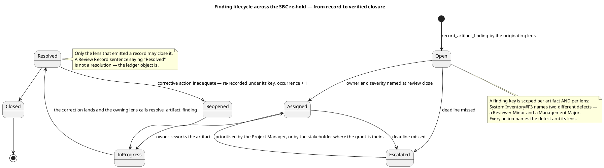

| Lens | Artifact | Records closed | Verified against |
|---|---|---|---|
| Technical | Development Case | 2 — F1 Major, F2 Minor | Tool references: five rows, each an existing path, no written standard claimed; ownership redrawn with component and artifact elements |
| Technical | System Inventory | 2 — F1 Major, F2 Minor | `Directory.Packages.props` re-counted: 6 + 19 + 5 = 30; the stale `(unread)` qualifier is gone |
| Technical | Risk List | 1 — F1 Minor | R018's mitigation separates establishing the values from recording them |
| Technical | Iteration Plan | 2 — F1 Major, F2 Minor | Criterion 1 restated; all 26 risks accounted for, R023 named |
| Management | Development Case | 1 — F1 Major | Same five-row verification; SBC criterion 5's auditable-tailoring question answered |
| Management | System Inventory | 2 — F1 Major, F2 Major | Pin tally re-counted from the file; the settlement sentence replaced |
| Management | Risk List | 2 — F1 Major, F2 Major | R026 present at 3×4=12 and cited by the plan by identifier; R002 and R011 restated `accept` with the grant quoted |
| Management | Iteration Plan | 5 — F1 Major, F2–F5 Major, F6 Minor | No stood-down role on a gate; Excavation profile staffed; five gates booked; retirement map rebuilt; per-criterion state |
| **Total** |  | **18 — 13 Major, 5 Minor** |  |

Two closures deserve the note on why they stand although the surrounding content is now under a new Major, because a reader will otherwise read them as withdrawn. **System Inventory F2 (Management)** asked that an impossible settlement path be replaced by the stakeholder's decision; it was, and that is what the record required. **Iteration Plan F1 (both lenses)** asked that a criterion stop claiming an unevidenced confirmation; it no longer claims one. That the replacement content then over-reached the sprint zero (SI-B, IP-B) and that the criterion now under-states a confirmation actually obtained (IP-A) are new defects with their own recommendations. Reopening the closed records would obscure which correction failed; a closure answers the defect its record names.

#### Action owed at each owner's next turn

None of the four Majors asks the stakeholder a question. Each narrows content back to a decision they have already taken, twice.

| Defect | Artifact | Owner | Action |
|---|---|---|---|
| SI-B | System Inventory | Software Archaeologist | Restate the Coverage closing statement to the scope given: no process is run in Survey, Excavation or Consolidation, so within the sprint zero neither read-only claim is settled by observation; both stay declared as read but not observed and are carried as accepted risk until the RUP phases start. Remove "for the life of this project", "in any phase" and the "no milestone may count them as retired" sentence, and leave open that a later phase recording a build-and-test result settles them. The declarations themselves stand unchanged |
| RL-B | Risk List | Project Manager | Restate R002 and R011 as accepted until the RUP phases start, when the pipeline builds the solution and runs its tests; correct R002's "no later reading can settle it" and R011's "which this project does not do" to the sprint-zero scope; keep both acceptances and both bands; state in Document Control that the acceptance is bounded to the sprint zero |
| IP-A | Iteration Plan | Project Manager | Restore criterion 1 to the process wording — the perimeter confirmed by the stakeholder — evidenced by the confirmation given at SBC on 2026-11-14 over the seven projects, the entry-point surface, the stores and the external systems. Delete G2 from the coarse roadmap, the gantt markers and the Resources gate list, leaving G1, G3, G4 and G5 and no dangling identifier. Replace "Where the perimeter is confirmed" with what happened, and do not restate the deferral's rationale as a live reason |
| IP-B | Iteration Plan | Project Manager | Scope "no retirement runs the system" to the sprint zero; state that from Inception on the CI pipeline builds the solution and runs its test suites so a later phase may retire a risk by a build or test result, and name who produces that evidence; then re-examine the retirement map for what a build and test run can settle and place each at the milestone whose execution produces it |
| IP-C | Iteration Plan | Project Manager | Move R006 and R025 from the LCO row to a line for Survey 2 — SBC, and restate the accounting so it reads fifteen retired by a later milestone, three at SBC, one by its own bound and eight carried on acceptance — twenty-six |
| SI-A | System Inventory | Software Archaeologist | Restate the Provenance row to the four files the Coverage sentence names, dropping `RateLimitExtensions.cs` so the row and the 57-file tally agree |
| RL-A | Risk List | Project Manager | Cite what exists — raising either version changes the pins in `Directory.Packages.props`, owned by the Software Architect, and enters as a Change Request — instead of a Development Case section that does not exist |

#### Corrective order — the sequence is the plan

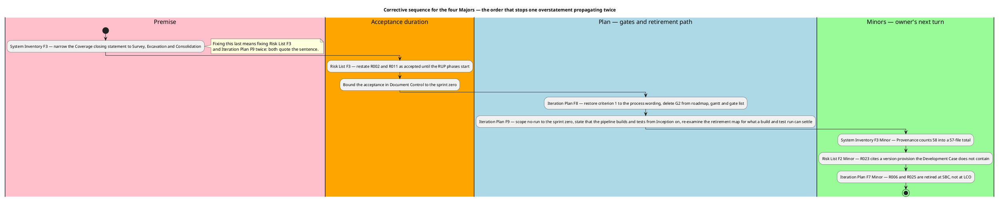

**SI-B first, then RL-B and IP-B.** They are not three defects: one sentence in the perimeter record states a sprint-zero constraint over the whole lifecycle, and the register and the plan both quote it. Correcting them in the other order writes the same narrowing three times into three artifacts that then disagree about the same two risks — the failure mode the previous milestone's corrective order existed to prevent.

**IP-A is independent** and can land in either pass: it is a restored criterion and a deleted gate, touching nothing the other three touch.

**The three Minors are owed at their owners' next turn.** Each stays inside its own artifact, and each is a single row.

#### What is deliberately not an action

- **A new stakeholder question at this gate.** All four Majors are corrections to what the artifacts say about decisions already given. Putting any of them back to the stakeholder would ask them to answer what they have answered twice, which is the defect IP-A names.
- **A Change Request.** None of the seven open records needs one. Each is a correction inside an artifact its owner already holds — no scope change, no baseline change, nothing for the CCB.
- **Re-scoring any risk.** No lens contests a magnitude in either event, and the plan states that disagreement with a score does not fail the milestone.
- **A schedule change beyond the iteration count.** Corrective iteration 3 is the plan's own lever for a milestone whose exit criteria do not pass. Declared scope is not narrowed, no role is added in parallel, and no criterion is re-interpreted to fit what was produced.

#### Stakeholder finding — the corrective order, set by the stakeholder

Put to the stakeholder this milestone with the four Majors named and their owners' actions recorded above. Their answer:

> "Close the System Inventory sentence first, then the Risk List and Iteration Plan statements that quote it, then the deleted gate; the three Minors in each owner's next turn."

This sets the sequence and adds no defect, no condition and no new action. Read against the ledger it orders the four Majors as SI-B, then RL-B and IP-B, then IP-A — which is the order the corrective sequence above already states, now the stakeholder's as well as mine — and leaves the three Minors to their owners' next turn. The stakeholder did not name a part of the existing system missing from the perimeter, and did not correct any action above; no record is added or removed on account of this answer.

## Disposition
### Reviewer lens
<!-- review: Survey I2 -->

<!-- review: Survey I2 -->

#### Disposition

**Approved.** 0 Critical, 0 Major, 2 Minor across the four artifacts reviewed.

This is the first time this lens has approved the SBC artifact set. Iteration 1 returned it Approved with changes on 3 Major and 4 Minor, and every one of those seven was corrected and verified rather than asserted: the two Majors that pointed a role at content that did not exist — the absent coding standard and the criterion claiming a confirmation SBC never obtains — are the two whose corrections matter most, because each misdirected a role downstream of the artifact.

The two Minors now open are consequences of the corrections themselves, not survivals of the old defects, and neither is load-bearing.

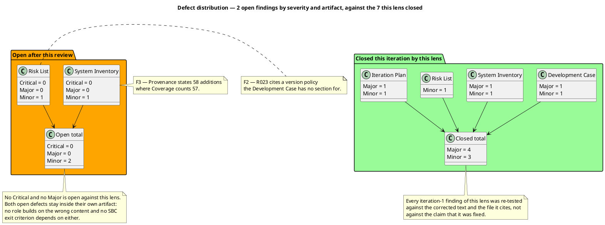

#### Why no Critical

A Critical is a defect only the stakeholder can unblock: a scope decision, a contradiction in what they declared, or a risk only they may accept. Three such questions were raised during iteration 1 and answered on 2026-11-14; each answer was re-tested against the code it disposes of in this iteration's scope-marker audit, all three hold, and no new question surfaced.

The stakeholder's later decision — that the system is never run in any phase — was an open premise in iteration 1 and is now closed content: Coverage states it, R002 and R011 are accepted on it with R002's grant quoted, and the plan sweeps for work that assumed a run. A decision already taken and correctly recorded is not a finding.

#### Why no Major

A Major means another role builds on wrong content or a milestone exit criterion fails. Neither holds:

- Every corrected fact was checked against the file that carries it, including re-counting the 30 package pins, and each resolves.
- All six SBC exit criteria are now evidenced as worded. Criterion 1 in particular was the defect that made the milestone unsanctionable in iteration 1 — a criterion satisfiable only by the sanction the stakeholder withheld — and it now asks for what SBC obtains while G2 is named as where the perimeter is confirmed.
- Every one of the 26 risks is accounted for exactly once, every disposal executes without running the system, and every risk owner is at work in the milestone that retires its risk.
- Every gate carries three lenses; the stood-down Business Reviewer appears on none.

#### Why the two Minors do not hold the milestone

Each stays inside its own artifact. The Provenance arithmetic is a summary row that contradicts the section it summarises, while the section, the enumeration and the Document Control tally all agree — so the declaration criterion 3 turns on is sound. R023's citation names a section that does not exist, but R023 is an accepted Moderate risk whose contingency is a Change Request on either reading, so nothing downstream changes shape.

#### What this lens hands the next lens

The technical case for the sprint zero's product is sound and has been verified rather than accepted: a perimeter whose facts rest on anchors that were opened, twenty of them across the two iterations, with the one false fact found and corrected; a register whose arithmetic holds across all 26 rows and whose most consequential acceptance is the stakeholder's own words; and a plan that instantiates the tailored process, schedules no work the phase does not run, and refuses throughout to invent a size, a budget, a forecast or a date.

The milestone's sanction is not this lens's to grant. The three scope questions were answered, the technical defects are closed to the Minor band, and whether the sprint zero advances is the stakeholder's decision and the Review Coordinator's ruling.

### Management Reviewer lens
<!-- review: Survey I2 -->

<!-- review: Survey I2 -->

#### Disposition

**Conditional Go — sanction recorded as GRANTED by the stakeholder on 2026-11-14. 0 Critical, 4 Major, 1 Minor across three artifacts.**

The perimeter of the existing system is confirmed by the stakeholder at this milestone, and the SBC milestone is sanctioned. The four Majors are rework owed inside artifacts, not conditions on the milestone: each one narrows content back to a decision the stakeholder has already taken, and none asks them a question they have not answered.

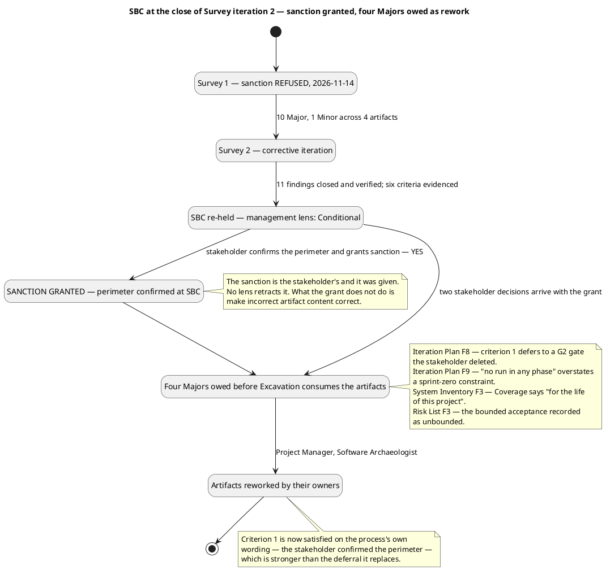

#### The stakeholder's sanction, recorded

| Item | Answer |
|---|---|
| Perimeter of the existing system confirmed | **Yes**, at this milestone, 2026-11-14 |
| Sanction to advance past SBC | **Yes** |
| Second confirmation at Consolidation 1's start | **Refused** — the gate is to be removed and criterion 1 restored to the process's wording |
| Scope of the no-observation constraint | Survey, Excavation and Consolidation only — the RUP phases run the pipeline and its tests |
| Duration of the two read-only acceptances | Until the RUP phases start, not for the life of the project |

Stakeholder sanction: GRANTED

Stakeholder acceptance: "With this answer I confirm the perimeter now, at this milestone. There is no second confirmation at the start of Consolidation: remove that gate from the plan and restore the first exit criterion of this milestone as the process states it. If Excavation finds something outside the perimeter, ask me then." / "My earlier sentence applied to Survey, Excavation and Consolidation only. I did not say the system will never be run: once the RUP phases start, the pipeline builds it and runs its tests. I accept those two risks until then, not for the life of the project."

#### Why Conditional Go and not Go

A **Go** would say the artifact set is fit to be consumed as it stands. Three of the four are not, on four counts, and every count is a statement about a decision the stakeholder has now taken twice. The System Inventory — the artifact Excavation reads first and quotes in its own milestone report — still declares the no-run constraint project-wide and still forbids any later milestone from retiring the two read-only claims. The Risk List still records a sprint-zero acceptance as open-ended. The Iteration Plan still books a gate the stakeholder has refused and still reports its first exit criterion as deferred when the condition has been met.

A **No-Go** would be wrong twice over. It would contradict a sanction the stakeholder has given, and it would misdescribe the work: every one of the ten Majors the refusal rested on was corrected and verified, and the four now open arrived **with** the grant, from decisions taken after the corrections were written. They are the ordinary consequence of a stakeholder answering precisely — a constraint narrowed, a gate withdrawn — not evidence that the corrective iteration failed.

So the milestone is sanctioned and its artifacts are approved subject to rework. The distinction is the honest one: the phase may advance, and four corrections are owed by the roles that hold them before the artifacts are consumed.

#### Why no Critical

A Critical is a defect only the stakeholder can unblock: a scope decision, a contradiction in what they declared, or a risk only they may accept. Nothing here qualifies. The two decisions this answer carries are both already taken — the perimeter confirmed, and the constraint bounded — and the four findings ask their owners to write down those decisions, not the stakeholder to make new ones. The one risk whose acceptance needed the stakeholder's authority, R002 in the Significant band, is granted and unchanged in band.

#### Why no Major beyond the four, and why the four hold rework

Each of the four propagates into an artifact another role reads, which is why none is a Minor. The System Inventory's closing statement is quoted by the register and the plan; the register's acceptance duration is what the Iteration Plan and the Iteration Assessment read for what remains accepted; the plan's G2 survives in three of its own sections; and the plan's projection of the no-run constraint over the lifecycle removes a retirement path that exists from Inception on. A Minor would say no role builds on them. That is not true of any of the four.

None of them is Critical because none requires an answer that has not been given, and none changes the sanctioned perimeter.

#### What the sprint zero hands the RUP phases

The perimeter is confirmed and anchored per element, with one false fact found and corrected across two iterations and the pin set re-counted against the file. The register's arithmetic holds across all 26 rows, every disposal executes without a run in the sprint zero, and the most consequential acceptance is the stakeholder's own words with its duration now to be recorded precisely. The plan instantiates the tailored process, staffs no stood-down role, books every gate at which acceptance is obtained, and refuses throughout to invent a size, a budget, a forecast or a date.

The one thing this gate cannot say is that the artifacts are ready to be consumed as written. Four corrections stand between them and that, and each is a narrowing to what the stakeholder decided.

#### To the Review Coordinator

- **Sanction:** GRANTED — stakeholder, 2026-11-14. Not conditional, not implied. The milestone is sanctioned and the phase may advance past SBC.
- **Perimeter:** confirmed by the stakeholder at this milestone; the second confirmation gate at Consolidation 1's start does not exist and is to be deleted from the plan.
- **Open from this lens:** 0 Critical, 4 Major, 1 Minor. The Majors are rework owed inside Iteration Plan, System Inventory and Risk List — F8, F9, F3 and F3, with F7 the Minor — and their owners are the Project Manager and the Software Archaeologist.
- **Not a gate condition but a prerequisite for consumption:** the System Inventory's correction is owed before Excavation reads it. The milestone may close; the artifact must be corrected before it is quoted.
- **The Iteration Assessment** is written by the Project Manager against this verdict, and does not gate the phase.

### Review Coordinator lens
<!-- review: Survey I2 -->

<!-- review: Survey I2 -->

#### Milestone verdict

**SBC advances no further this iteration. Four Major records are open and the Survey phase continues with corrective iteration 3.** The perimeter *is* confirmed and the stakeholder *did* grant the sanction — both recorded below — but the milestone's exit criteria are not the only condition this verdict answers, and an artifact set that would propagate one over-statement into three phases is not an artifact set the phase may be built on.

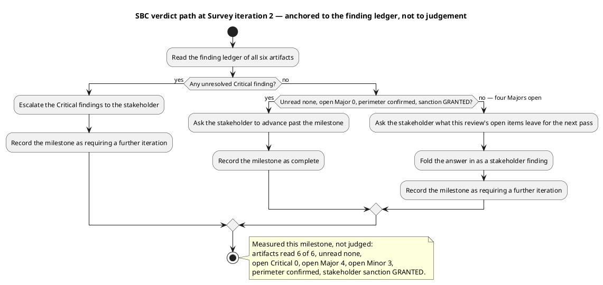

| Question | Answer | Basis |
|---|---|---|
| Artifacts read | 6 of 6, unread = none | The `[FINDINGS]` line: Development Case, System Inventory, Risk List, Iteration Plan, Review Record, Iteration Assessment |
| Open Critical | 0 | No record in the Critical band, from any lens |
| Open Major | 4 | SI-B, RL-B, IP-A, IP-B — each carries no resolution object |
| Open Minor | 3 | SI-A, RL-A, IP-C — each carries no resolution object |
| Prior records closed | 18 of 18 | Every iteration-1 record closed by its emitting lens, with verification evidence |
| Perimeter confirmed | **Yes** — at this milestone, 2026-11-14 | The stakeholder's answer, recorded under Disposition of the Management lens |
| Stakeholder sanction | **GRANTED** — 2026-11-14 | Same answer. No lens retracts it |
| SBC exit criteria met | 5 of 6 in substance; criterion 6 fails | Criterion 1 is now satisfied on the process's own wording. Criterion 6 fails while IP-A books a deleted gate and IP-B forecloses a retirement path the process will produce |

#### Why this verdict and not the other two

**Not critical escalation.** A Critical is a defect only the stakeholder can unblock: a scope decision, a contradiction in what they declared, or a risk only they may accept. None of the four Majors qualifies. Each asks its owner to write down a decision the stakeholder has already taken — the perimeter confirmed, the no-run constraint bounded, the second confirmation withdrawn. Escalating them would put a question back to the stakeholder that they answered twice, which is the very defect IP-A names.

**Not scope complete.** The guard is explicit and it does not hold: 4 Major records open against a requirement of 0. Two of them are not bookkeeping. IP-B removes observation as a retirement path from Elaboration, Construction and Transition, where the CI pipeline will produce test evidence as a matter of course, and SI-B instructs every later milestone that it may not retire the two read-only claims — an instruction to milestones that have not yet run. A plan that tells later milestones to ignore evidence they will hold is not a plan the phase may be built on, whatever the sanction says.

**So: a further iteration.** The remedy for a milestone whose exit criteria do not pass is one more iteration inside the phase. That is the plan's own lever and it is applied without narrowing declared scope, without adding a role in parallel, and without re-interpreting a criterion to fit what was produced.

#### The distinction this verdict turns on

The stakeholder sanctioned the milestone, and the milestone is sanctioned — that is their decision and it is not mine to qualify. What a sanction does not do is make incorrect artifact content correct. Two facts therefore hold at once:

- **The perimeter is confirmed and the phase gate is open.** Excavation work is authorized by the stakeholder's answer of 2026-11-14.
- **The artifacts Excavation will read are not fit to be read as written.** Three of the four carry content that reaches past a decision the stakeholder took at that same gate.

I record both. Collapsing them in either direction is the error: recording only the first would send Excavation into a System Inventory that tells it the two read-only claims may never be retired; recording only the second would contradict a sanction the stakeholder gave and misdescribe the work, since every one of the ten Majors that caused the earlier refusal was corrected and verified.

#### The one thing that is not measured here

Rework effort is not measurable at this review and no figure is offered. The Survey phase has not closed; the corrective iteration's work is visible in 18 closures and 4 open records, and that is a count of records, not an effort. Defect removal efficiency is unmeasurable for a stronger reason: no test phase has executed in this project, so review remains the only detection activity and there is no ratio to compute.

#### What the sprint zero hands the RUP phases

A perimeter whose elements each rest on an anchor that was opened — twenty across two iterations, with the one false fact found, corrected and re-counted — and which the stakeholder has confirmed at this gate. A register whose arithmetic holds across all 26 rows, whose bands no lens has contested in either event, and whose most consequential acceptance is the stakeholder's own words. A plan that instantiates the tailored process, staffs no stood-down role, books every acceptance gate, and refuses throughout to invent a size, a token budget, a forecast or a calendar date.

What it does not yet hand them is a set of statements bounded to what was decided. Four are not, three of those four are the same statement, and the correction is a narrowing in each case rather than new content.
