## Document Control
### Reviewer lens
<!-- review: Survey I1 -->

Phase: Survey
Status: Draft — technical lens of the SBC review recorded; 7 findings (3 Major, 4 Minor, 0 Critical) on 4 artifacts
Milestone Target: End-of-Survey (SBC) — not yet achieved

## Review Scope and Criteria

## Findings
### Reviewer lens
<!-- review: Survey I1 -->

#### Development Case

Reviewed at SBC. Environment discipline, Survey. Verdict: Approved with changes — one Major, one Minor.

| Checklist item | Verdict |
|---|---|
| Baseline conformance: roster, CORE set, ownership unchanged | Pass |
| Every FIRED optional trigger holds its own condition | Pass |
| Every cited tool reference resolves in the tree | Fail — F1 |
| UML notation fits what it expresses | Fail — F2 |
| Classification deltas carry a basis | Pass |
| No forbidden override present | Pass |

##### All six optional verdicts audited against their conditions

Each verdict is an auditable claim, so each was checked against the project's real facts rather than accepted:

| Optional | Verdict | Audit result |
|---|---|---|
| Deployment Model | FIRED | Holds. Four processes — `Todo.Api`, `Todo.Web.Server`, `Todo.Web.Client`, `TodoApp.AppHost` — with YARP forwarding and service discovery between them. A genuine distributed topology, not a single node. |
| Data Model | NOT FIRED | Holds. `TodoDbContextModelSnapshot.cs` declares 8 tables — `Todos`, `AspNetUsers` and 6 Identity framework tables — so both the ">10 entities" and "data-centric" limbs fail; no production data and no migration in scope, so the third limb fails too. |
| Architectural Proof-of-Concept | NOT FIRED | Holds for the sprint zero. The condition requires Elaboration *and* a scored risk; the Risk List post-dates this artifact in the same iteration and Proof-of-Concept is excluded from sprint zero by the process. Correctly deferred, not dismissed. |
| User-Interface Prototype | NOT FIRED | Holds. A working Blazor UI exists in `Todo.Web` and no new UI is declared. |
| Test Plan | NOT FIRED | Holds. MIT sample code, no audit obligation, no contractual test reporting. |
| Glossary | NOT FIRED | Holds. The domain vocabulary is `Todo`, `IsComplete`, `Owner` — fixed by the recovered schema. |

##### Classification and disciplines

`business-process-led = false` is correctly derived — `Todo` carries `Title`, `IsComplete`, `OwnerId` and no policy. `real-time-system = false` follows from a request/response pipeline with no hosted service (`Todo.Api/Program.cs`, read in full: no `IHostedService`, no timer). Business Modeling declared INACTIVE on the correct trigger; Capsule Designer and Business Reviewer stood down consistently with it. All other disciplines at canonical matrix intensities, with no self-granted deviation.

##### F1 — Major — Tool references cites a file that does not exist

The row `| Coding standard and review conventions | CONTRIBUTING.md | Software Architect, with the Code Reviewer |` sends two roles to a document the repository does not contain. A read of `TodoApp/CONTRIBUTING.md` returns "was not found" and the tree carries no such entry.

The consequence is not cosmetic: this artifact is the process authority both the Software Architect and the Code Reviewer read, and it tells them their coding standard lives elsewhere. The System Inventory already records the absence and the Risk List carries it as R006 with the correction due at LCO — but the misdirection is in the artifact now, and LCO is two milestones away. Recommendation: replace the row with what actually governs — `Directory.Build.props` (nullable, implicit usings, `LangVersion preview`) and `Directory.Packages.props`, owner Software Architect — and author a written standard through a Change Request if one is wanted.

##### F2 — Minor — Ownership drawn with class elements and association arrows

`class "ProcessEngineer" as PE` … `PE --> DC : owns` models role-to-artifact ownership as an association between two classes. Ownership is not a class relationship, and the ownership table beneath the diagram states it correctly and unambiguously. Already carried as R025. The artifact is approved by default on this finding; it does not hold the milestone.

```plantuml
@startuml
title Development Case — compliance of the tailoring decisions, section by section
skinparam shadowing false
skinparam componentStyle rectangle

package "Checked and passing" {
  component "Tailoring Overview — classification basis stated" as P1
  component "Disciplines and Intensity — canonical, no self-granted delta" as P2
  component "Artifacts and Templates — UC enumeration rule correct" as P3
  component "Optional Artifact Triggers — 6 of 6 audited" as P4
  component "Roles and Ownership — stood-down roles consistent" as P5
  component "Version policy — net9.0 and SDK 9.0.100 verified" as P6
}

package "Findings" {
  component "Tool references — CONTRIBUTING.md absent (Major)" as F1 #Pink
  component "Roles and Ownership — class notation (Minor)" as F2 #Orange
}

note right of P3
  The use-case enumeration rule the DC fixes is the
  baseline's and is correct: one UC per endpoint surface,
  with auth, rate limiting, logging and telemetry excluded
  as mechanisms into the Supplementary Specification.
end note
note right of F1
  R006's remediation, brought forward from LCO.
  Two roles are currently pointed at a file the
  repository does not contain.
end note
note bottom of P6
  net9.0, 9.0.100 with rollForward latestFeature, and the
  EF Core 9.0.8 / YARP 2.3.0 / Scalar 2.6.8 pins were each
  checked against the files the policy cites, and resolve.
end note
@enduml
```

#### System Inventory

Reviewed at SBC. Discovery discipline, Survey — the sprint zero's one artifact, and the perimeter every later role builds on. Verdict: Approved with changes — one Major, one Minor.

This is the artifact with the most riding on it, so it received the deepest review of the four: **seventeen source files were opened by hand** to test whether the anchors say what the artifact claims.

##### What held under direct verification

| Claim | Anchor opened | Result |
|---|---|---|
| Owner-or-admin on `GET/PUT/DELETE /todos/{id}`; `FindAsync` before the ownership check | `Todo.Api/Todos/TodoApi.cs` | Confirmed exactly as recorded |
| `AddIdentityCore` with no `AddRoles`, no role store, no seeding | `Todo.Api/Program.cs` | Confirmed — the `admin` branch is genuinely unreachable |
| `CurrentUser.IsAdmin` reads `IsInRole("admin")` | `Todo.Api/Authorization/CurrentUser.cs` | Confirmed |
| The authorization gate asks nothing about lock-out | `Todo.Api/Authorization/CheckCurrentUserAuthHandler.cs` | Confirmed — succeeds on `User is not null` alone, TODO in place |
| The caller is re-resolved from the API's own store per request | `Todo.Api/Authorization/CurrentUserExtensions.cs` | Confirmed |
| No service-to-service authentication, recorded as a TODO | `Todo.Api/Users/UsersApi.cs` | Confirmed — first statement in `MapUsers` |
| Four external schemes, each gated on its own config section | `AuthenticationExtensions.cs` | Confirmed — `section.Exists()` guard on all four |
| Neither delivered BFF appsettings carries such a section | both `Todo.Web/Server` appsettings | Confirmed — logging keys only, 167 and 144 bytes |
| YARP forwarder rewrites the cookie token into a Bearer header | `Todo.Web/Server/TodoApi.cs` | Confirmed |
| No `RateLimiting` in `appsettings.json`; 50/50/50 in Development only | `Todo.Api` appsettings pair | Confirmed — R018's premise is true |
| 8 tables and `ProductVersion` 8.0.0 against 9.0.8 pins | `TodoDbContextModelSnapshot.cs` | Confirmed — and the Data Model NOT FIRED verdict rests on the count and holds |
| The completion toggle has no screen | `TodoList.razor` | Confirmed — unbound `<input type="checkbox">`, no handler, no update call in `TodoClient` |
| The database is created only by the AppHost, only when `.db` is absent | `TodoApp.AppHost/Extensions.cs` | Confirmed — `IsRunMode` guard inside `Directory.Exists` |
| One test project, referencing `Todo.Api` only | `Todo.Api.Tests/Todo.Api.Tests.csproj` | Confirmed — and it is precisely what makes R001 true |

##### The three stakeholder decisions hold against the code they dispose of

This was the review's central question, because these three answers bind every role that reads the artifact:

- **The `admin` branch.** `CurrentUser.IsAdmin` reads a role claim; `AddIdentityCore` registers no role store, no `AddRoles`, no seeding. Nothing in the delivered system produces the claim. Recorded as unreachable and role provisioning out of scope — correct and complete.
- **The dormant external providers.** All four schemes are behind `if (section.Exists())`, and neither delivered appsettings file supplies a section. Recorded as configured-at-runtime, no external-login use case this cycle — correct and complete.
- **The BFF trust boundary.** `UsersApi` records the gap as a TODO in the code itself, and the API accepts any valid bearer token. Recorded as a known limitation and carried to the Risk List as R012 with the stakeholder's grant — correct and complete.

Each decision names what it settles and what it does not. None is over-read into a scope claim the stakeholder did not make.

##### F1 — Major — the package-pin tally is short by two

The artifact states "28 pins" in two places; `Directory.Packages.props` declares **30** `PackageVersion` elements — 6 in the test group, 19 in the application group, 5 OpenTelemetry. Every individual pin the artifact names (EF Core 9.0.8, YARP 2.3.0, Scalar 2.6.8, the OpenTelemetry 1.12.0 set) is correct. Only the tally is wrong.

It is a Major rather than a Minor because the Software Architect reads this row when anchoring the SAD to the Development Case's version policy, and a pin set is a size fact of the SBC perimeter the stakeholder is being asked to confirm. Recommendation: correct both occurrences to "30 pins" and the matching Provenance row; no pin value changes.

##### F2 — Minor — `RateLimitExtensions.cs` is marked both read and unread

The Documentation section's "What has no document at all" table sends the reader to "`Todo.Api/Extensions/RateLimitExtensions.cs` (unread)", while Coverage enumerates the file among the 53 opened and describes its contents in detail. The "(unread)" parenthetical is stale. Recommendation: drop it; Coverage is the authority on what was read.

```plantuml
@startuml
title System Inventory — the seventeen anchors opened by hand, and what each verified
skinparam shadowing false
skinparam componentStyle rectangle

package "Authentication and the BFF boundary" {
  component "Todo.Api/Todos/TodoApi.cs" as A1 #PaleGreen
  component "Todo.Api/Program.cs" as A2 #PaleGreen
  component "Todo.Api/Authorization/CurrentUser.cs" as A3 #PaleGreen
  component "Todo.Api/Authorization/CheckCurrentUserAuthHandler.cs" as A4 #PaleGreen
  component "Todo.Api/Authorization/CurrentUserExtensions.cs" as A5 #PaleGreen
  component "Todo.Api/Users/UsersApi.cs" as A6 #PaleGreen
  component "Todo.Web/Server/Authentication/AuthenticationExtensions.cs" as A7 #PaleGreen
  component "Todo.Web/Server/TodoApi.cs" as A8 #PaleGreen
}

package "Configuration, data and evidence base" {
  component "Directory.Packages.props" as B1 #Pink
  component "Todo.Api appsettings pair" as B2 #PaleGreen
  component "Todo.Web.Server appsettings pair" as B3 #PaleGreen
  component "Todo.Api/Migrations/TodoDbContextModelSnapshot.cs" as B4 #PaleGreen
  component "Todo.Web/Client/Components/TodoList.razor" as B5 #PaleGreen
  component "TodoApp.AppHost/Extensions.cs" as B6 #PaleGreen
  component "Todo.Api.Tests/Todo.Api.Tests.csproj" as B7 #PaleGreen
}

note right of A1
  Owner-or-admin on GET/PUT/DELETE by id, exactly
  as recorded; FindAsync before the ownership
  check, confirmed.
end note
note right of A2
  AddIdentityCore with no AddRoles, no role store,
  no seeding, confirmed. UseHttpLogging then
  UseRateLimiter with no UseAuthentication between
  them, confirmed. MapOpenApi outside the Development
  branch, confirmed.
end note
note right of A3
  IsAdmin reads IsInRole("admin"), confirmed.
end note
note right of A4
  Succeeds on currentUser.User is not null alone,
  with the lock-out TODO in place, confirmed.
end note
note right of A5
  The IClaimsTransformation that resolves the caller
  from the store, confirmed — and it is why a valid
  token for a deleted user is rejected.
end note
note right of A6
  The service-to-service TODO is the first statement
  in MapUsers, confirmed.
end note
note right of A7
  Four schemes each gated on section.Exists(),
  confirmed. Neither delivered appsettings file
  carries such a section, confirmed.
end note
note right of A8
  YARP MapForwarder {*path} with the cookie-to-Bearer
  transform over "http://todoapi", confirmed.
end note
note top of B1
  <b>The one anchor that did not hold.</b> 30 PackageVersion
  elements, not 28. Every individual pin the artifact
  names is correct — the tally is short by two.
end note
note right of B2
  No RateLimiting section in appsettings.json;
  50/50/50 present only in appsettings.Development.json.
  Both confirmed — this is what makes R018's premise true.
end note
note right of B3
  Logging keys only, 167 and 144 bytes. No
  Authentication:Schemes section in either file —
  the dormancy claim holds.
end note
note left of B4
  ProductVersion 8.0.0 against 9.0.8 pins, 8 tables,
  confirmed. The Data Model NOT FIRED verdict rests
  on this count, and it holds.
end note
note left of B5
  Renders an unbound checkbox with no @bind and no
  handler; TodoClient exposes no update call. The
  completion-toggle gap is real.
end note
note bottom of B6
  Runs dotnet ef database update only when
  Directory.Exists is false, in run mode only,
  with the connection-string TODO. Confirmed.
end note
note bottom of B7
  References Todo.Api only — not Todo.Web.Server.
  Confirmed, and it is what makes R001 true.
end note
@enduml
```

##### Traceability

No `## Traceability` table is expected of this artifact and its absence is not a finding: the System Inventory declares no element family from the trace chain. Everything it records is recovered from the existing system and cites its anchor where it sits; the trace graph is empty, correctly, and every recovered element will hang from the anchors verified above when Excavation registers them.

#### Risk List

Reviewed at SBC. Project Management discipline, Survey. Verdict: Approved — one Minor, no Major.

##### What the audit checked

| Checklist item | Verdict |
|---|---|
| Every anomaly in the System Inventory became a scored risk | Pass — 25 risks, traced back to an anomaly or a declared coverage limit |
| Every magnitude is the band of that risk's own exposure | Pass — all 25 recomputed |
| No High or Significant risk rests on an acceptance nobody granted | Pass — see below |
| Every risk has an owner, a strategy, a mitigation and, where accepted, a contingency | Pass |
| A mitigation assigns work inside the owning role's artifact | **Fail — F1** |
| Traceability table present with one row per declared `RNNN` | Pass — 25 rows, `Traces From` empty as recovery elements require |
| No invented figure | Pass |

##### The band arithmetic holds across all 25

Every exposure was recomputed as the product of its own two scores and checked against the band table. None is misbanded. The distribution is 2 High, 7 Significant, 12 Moderate, 3 Minor, 1 Low, and the artifact's three summary tables agree with its register row for row.

##### No acceptance is self-granted

This is the check that matters at SBC, and it passes:

- **Both High-band risks are `avoid`** — R001 (16) retired by the Test Case at LCA, R009 (15) retired by the Use-Case Model at GHR. Neither depends on anyone's acceptance.
- **All seven Significant risks are `avoid`** — R003, R004, R005, R017, R002, R018, R016. Again none rests on acceptance.
- **The three accepted risks that are the stakeholder's** — R007 (Low), R008 (Minor), R012 (Moderate) — each quote the stakeholder's answer of 2026-11-14 verbatim, and each answer was verified against the code it disposes of in the System Inventory entry above. R012 is Moderate, where acceptance is the Project Manager's to take anyway; it was escalated and granted regardless, which is the conservative direction.
- **The three accepted risks within PM authority** — R015, R019, R023 — all sit at Minor or Moderate, where the acceptance is legitimately the Project Manager's.

No risk in the High or Significant band is left resting on an acceptance no one granted. The classification section's claim to that effect is true.

##### Scoring judgements reviewed and not contested

The Exit Criteria for this phase are explicit that risk scores are judgements and that disagreement with a score does not fail the milestone. Two scores are worth noting for the record without being findings:

- **R011 at Moderate (2×4).** The rate-limiter partition key being null yields one shared bucket — Impact 4 assumes a real operator scenario. Defensible; the artifact also correctly marks the behaviour as undetermined by reading.
- **R002 at Significant (5×2).** Probability 5 is honest — no process was run — and Impact 2 is defensible because the reading's own Coverage section marks which claims are read-only. The pairing is coherent.

Neither is a defect, and neither is recorded as one.

##### F1 — Minor — R018's mitigation writes into another role's artifact

The mitigation reads: "The Software Architect records both threshold sets and the 10-second replenishment in the Supplementary Specification's rate-limiting constraint."

The Supplementary Specification is the System Analyst's artifact — the Development Case states "Primary ownership is the baseline's and is unchanged" and declares the Database Designer as the only project-specific contributor to a co-owned artifact. As written, two roles would edit the same section, and the Software Architect is not a declared contributor there.

Recommendation: split the supply from the recording — "The Software Architect establishes both threshold sets and the 10-second replenishment by running the API, and supplies them to the System Analyst, who records them in the Supplementary Specification." R018's owner may stay the Software Architect; settling the partition key by observation is that role's work.

This is a Minor: no role builds on the wrong content, and no SBC exit criterion depends on it. It is worth fixing before Elaboration rather than at LCO, because the Supplementary Specification is first written at Consolidation.

```plantuml
@startuml
title Risk List — the 25 risks by magnitude band, the strategy each carries, and where the audit found a defect
skinparam shadowing false
skinparam componentStyle rectangle

package "High (15-25) — 2 risks" #Pink {
  component "R001 BFF covered by no test — 4x4=16 / avoid, retired at LCA" as H1
  component "R009 completion toggle has no screen — 5x3=15 / avoid, retired at GHR" as H2
}

package "Significant (9-12) — 7 risks" #Orange {
  component "R003 4x3=12   R004 4x3=12   R005 4x3=12" as S1
  component "R017 4x3=12   R002 5x2=10   R018 5x2=10" as S2
  component "R016 3x3=9" as S3
}

package "Moderate (5-8) — 12 risks" #LightBlue {
  component "R010 4x2=8   R011 2x4=8   R006 2x3=6   R013 2x3=6" as M1
  component "R014 3x2=6   R023 3x2=6   R012 1x5=5   R019 5x1=5" as M2
  component "R020 5x1=5   R022 5x1=5   R024 5x1=5   R025 5x1=5" as M3
}

package "Minor (3-4) — 3 risks" #LightGreen {
  component "R008 2x2=4   R015 2x2=4   R021 4x1=4" as N1
}

package "Low (1-2) — 1 risk" #PaleGreen {
  component "R007 1x2=2" as L1
}

note right of H1
  Both High-band risks are disposed of by avoid,
  and each names the artifact that does the
  retiring. Neither rests on an acceptance the
  Project Manager granted. Verified.
end note
note right of S3
  R016 is 3x3=9, Significant, strategy avoid — so
  no Significant risk depends on an unsought
  acceptance either. Verified across all seven.
end note
note right of M2
  R012 is the one risk whose acceptance is the
  stakeholder's at Moderate, granted 2026-11-14 and
  quoted in the mitigation section. Verified against
  the System Inventory's decision record.
end note
note right of M1
  <b>MINOR F1 sits here:</b> R018's mitigation has the
  Software Architect writing into the Supplementary
  Specification, which the System Analyst owns. The
  score and band are correct; the mitigation's owner
  is not.
end note
note bottom of N1
  Every magnitude in all 25 rows was recomputed as the
  product of its own two scores and checked against the
  band table. None is misbanded.
end note
@enduml
```

#### Iteration Plan

Reviewed at SBC. Project Management discipline, Survey. Verdict: Approved with changes — one Major, one Minor.

##### What the plan gets right

| Checklist item | Verdict |
|---|---|
| No role or artifact named that the Survey process does not run | Pass |
| Milestone order matches the process's phase sequence | Pass |
| No invented size, token budget, forecast or calendar date | Pass |
| Parallelism not claimed where the chain is sequentially dependent | Pass |
| Every exit criterion gates the milestone it names | **Fail — F1** |
| The risk-retirement map accounts for every scored risk | **Fail — F2** |
| Both clocks reported apart and never summed | Pass |

The plan's discipline on measurement is correct and worth recording: no work item carries a size, the gantt's bars are explicitly declared to be the renderer's unit step and not durations, no project start date is given because none has been measured, and human gates carry a 14-day ceiling with estimate none. The plan states plainly that it declares no token budget and cuts no declared scope to fit an estimate. That is the right behaviour and it is executed without hedging.

The critical-chain reasoning also holds: six sequential agent stretches plus one gate, each link consuming the one before it, is the correct reading of a chain whose links are data dependencies.

##### F1 — Major — criterion 1 claims a confirmation nothing at SBC asks for

Criterion 1 reads: "The perimeter of the existing system is **confirmed by the stakeholder**", evidenced by "the three scope facts put to the stakeholder and answered 2026-11-14".

Two things are wrong. First, the evidence does not support the claim: the three answers disposed of the `admin` role, the dormant external providers and the BFF-to-API boundary — three facts. They confirm nothing about the seven projects, the entry-point surface, the stores or the external systems, which is what "the perimeter" means. Second, the plan schedules the gate that does confirm the perimeter **two milestones after the SBC it is supposed to gate**: "G2 stakeholder confirms the perimeter happens at Consolidation 1's start".

The plan contradicts itself here. Its own roadmap row for SBC states the weaker and correct condition — "The perimeter of the existing system is **recorded and put to the stakeholder**" — so the milestone description and the exit criterion disagree about whether confirmation is required at SBC.

This is a Major because an SBC exit criterion cannot be satisfied as written, and the milestone's sanction would rest on an unevidenced claim. Recommendation: restate criterion 1 as "the perimeter is recorded with an anchor per element, the reading priorities are ordered, and the three facts whose disposition is the stakeholder's have been put to the stakeholder and answered (2026-11-14)", and cite G2 at Consolidation 1's start as where the perimeter is confirmed. **Do not move G2 into SBC** — Excavation deepens the perimeter, so confirming it before that reading would confirm an incomplete record.

##### F2 — Minor — R023 is missing from the risk-retirement map

The roadmap's per-milestone retirement rows account for 24 of the 25 scored risks: AR carries 11, GHR 4, LCO 2, LCA 3, IOC 2, PR 2. **R023** (`RazorLangVersion` 8.0 under `net9.0`, Moderate, strategy `accept`) appears in none of them, and the plan's note "No risk above the Moderate band is carried into Construction or Transition" says nothing about a Moderate risk that is carried accepted.

A reader tracing all 25 risks through the plan finds one that stops at the Risk List. Recommendation: add a line recording that R023 and the other accepted risks (R007, R008, R012, R015, R019) are carried on the acceptance recorded in the Risk List rather than disposed of by an artifact, so the plan accounts for all 25. No schedule change follows.

```plantuml
@startuml
title Iteration Plan — the six SBC exit criteria, each tested against what the artifacts actually evidence
skinparam shadowing false
skinparam componentStyle rectangle

package "Criteria that hold" #PaleGreen {
  component "2  Reading priorities ordered, each naming what the next reading must settle" as C2
  component "3  Unread areas declared, not omitted" as C3
  component "4  Every anomaly is a scored, banded, owned, disposed risk" as C4
  component "5  The process is tailored and the tailoring auditable" as C5
}

package "Criterion with a finding" #Orange {
  component "1  Perimeter confirmed by the stakeholder — MAJOR F1: nothing at SBC asks for it; G2 that does is at Consolidation 1's start" as C1
}

package "Criterion whose wording is correct" #LightBlue {
  component "6  The plan instantiates the process and schedules no work the phase does not run" as C6
}

note right of C1
  The roadmap's own SBC row states the correct, weaker
  condition — "recorded and put to the stakeholder" —
  while criterion 1 claims "confirmed". The two disagree,
  and the three scope answers cited as evidence disposed
  of three facts, not of the perimeter.
end note
note right of C2
  Verified: the eight priorities were read against the
  System Inventory and each names an open question for
  the next reading.
end note
note right of C3
  Verified, and this is the criterion the plan itself
  flags as the one that can fail. It holds — the
  declared-unread groups are real and the two statements
  marked read-not-observed are honest.
end note
note right of C4
  Verified against the Risk List: 25 risks, each scored,
  banded, owned and disposed.
end note
note bottom of C6
  No role or artifact the plan names is outside the Survey
  process. No size, no token budget, no forecast and no
  calendar date is invented anywhere in the artifact — and
  the gantt says so in its own note.
end note
@enduml
```

##### No pull requests to dispose

`scm_list_pull_requests` over all states returns none: no branch carries work, no scaffolding awaits approval, and nothing needs to be deferred out of phase. There is also no IARI build to report — the pipeline file does not exist in the repository yet, which says nothing about the repository's own `ci.yaml`. Nothing in this iteration is a code-review or integration question, so no review evidence is withheld on those grounds.

## Resolutions and Actions

## Disposition

