## Document Control
### Reviewer lens
<!-- review: Survey I3 -->

Phase: Survey
Status: Draft — technical lens of the SBC review, re-held at iteration 3. Two prior findings of this lens closed Resolved; 4 new findings (0 Critical, 2 Major, 2 Minor) on 2 artifacts.
Milestone Target: End-of-Survey (SBC) — not yet achieved; the sanction is the stakeholder's and this lens does not hold it

### Management Reviewer lens
<!-- review: Survey I3 -->

<!-- review: Survey I3 -->

Phase: Survey
Status: Draft — management lens of the SBC review, re-held at Survey iteration 3. Five findings of this lens closed Resolved against the corrected text and its anchors; 1 new finding of this lens (0 Critical, 0 Major, 1 Minor). Two Major records of the technical lens remain open on the Risk List and the Iteration Plan, both on the R005 row, and they hold the milestone.
Milestone Target: End-of-Survey (SBC) — sanctioned by the stakeholder on 2026-11-14; the four Major corrections that sanction required are landed and verified. The artifact set is not yet clean: one restatement of one risk row, in two artifacts, stands between it and a clean gate.

### Review Coordinator lens
<!-- review: Survey I3 -->

<!-- review: Survey I3 -->

Phase: Survey
Status: Draft — coordination lens of the SBC review re-held at Survey iteration 3. Lens participation: Technical EXECUTED, Management EXECUTED, Business INACTIVE — did not evaluate this review. 25 prior lens records closed by their own lenses; 5 open — 0 Critical, 2 Major, 3 Minor.
Milestone Target: End-of-Survey (SBC) — perimeter confirmed and stakeholder sanction GRANTED, 2026-11-14; the milestone decision records the phase under correction until the two Major records are landed and re-verified

## Review Scope and Criteria
### Reviewer lens
<!-- review: Survey I3 -->

Phase: Survey, iteration 3. The third hold of the end-of-Survey (SBC) milestone review, technical lens. Four artifacts in scope, all read in full this iteration.

| Artifact | Owner | Discipline | State reviewed |
|---|---|---|---|
| Development Case | Process Engineer | Environment | Revised — Guidelines and Procedures gained a Version policy and a Measurement policy subsection |
| System Inventory | Software Archaeologist | Discovery | Revised — the Provenance row now names the four files Coverage names |
| Risk List | Project Manager | Project Management | Revised — R002 and R011 bounded to the RUP phases, R023's citation repaired, Document Control bounded |
| Iteration Plan | Project Manager | Project Management | Revised — criterion 1 restored, G2 deleted, the retirement map rebuilt, the accounting restated |

The Iteration Assessment is read and is not a gate input, and its absence or lag is no defect: the Project Manager writes it against this verdict.

#### Review point and lens

The review point is the **Lifecycle Milestone** (SBC), so the question is **exit criteria**. Two jobs, in this order. First, reconcile the two findings this lens carried in — re-tested against the corrected text and the file each correction cites, never against a claim that a correction was made. Second, review the corrected set afresh: three artifacts were rewritten substantially this iteration, and a correction can introduce a defect. That second job is where both Majors come from.

#### Criteria applied

| Criterion | Source | Applied to |
|---|---|---|
| Anchor verification — every corrected fact checked against the file or section it cites | Survey depth rule | All four |
| DC baseline conformance — no roster, ownership, CORE or optional-universe redefinition | IARI baseline | Development Case |
| Optional trigger justification — every FIRED verdict audited against its own §5.2 condition | IARI §5.2 | Development Case |
| Every cited document, section or file resolves to what it is cited for | Baseline conformance | Development Case, Risk List |
| Coverage consistency — nothing declared read and unread, and the counts agree with the enumeration | SBC criterion 3 | System Inventory |
| Band arithmetic — every magnitude the band of its own exposure | Risk magnitude table | Risk List |
| Acceptance authority — no High or Significant risk accepted by someone without the authority | Risk magnitude table | Risk List |
| Strategy executability — every disposal names work that remains to be done | SBC criterion 4 | Risk List |
| Exit-criteria integrity — every criterion gates the milestone it names, and claims nothing it does not have | SBC criterion 6 | Iteration Plan |
| Risk-retirement completeness — all 26 accounted for once, at the milestone that actually retires each | SBC criterion 6 | Iteration Plan |
| Role accounting — every role at work in the iteration is on its profile, and no stood-down role is | Development Case tailoring | Iteration Plan |
| Measurement discipline — no invented size, budget, forecast or date | IARI DC §8.1 | Iteration Plan |
| Scope adherence — no marker retired except by the stakeholder's answer | Scope Guard | All four |

#### Anchor verification this iteration

The two closures rest on opening what the corrections cite, not on reading the corrections.

| Anchor | Claim under test | Result |
|---|---|---|
| System Inventory, Provenance vs Coverage | The Provenance row agrees with the section it summarises | **Confirmed.** Four files named, no fifth; 53 + 4 = 57 agrees with Document Control, the "Files opened: 57" statement and the enumeration |
| Development Case, Guidelines and Procedures | R023's repair cites the pins, and the Version policy the iteration-2 finding said was absent | **Confirmed, and the section now exists.** It states the pins are the policy and that raising one is a Change Request owned by the Software Architect |
| `Todo.Web/Server/Todo.Web.Server.csproj` (sha d31a15d, 1115 bytes) | R023's repair names the file the change touches | **Not confirmed.** `<RazorLangVersion>8.0</RazorLangVersion>` is in that file's `PropertyGroup`; the file carries seven `PackageReference` entries and no Razor package. Recorded as Risk List F4 |
| System Inventory, Coverage vs Risk List R005 | R005's premise and its `avoid` strategy describe work still to be done | **Not confirmed.** Coverage enumerates `HttpAuthenticationStateProvider.cs` among the 57 opened and closes "No file in that group blocks a use case now". Recorded as Risk List F3 |

Two of four confirmed and two not, on six facts cross-checked. The two failures are the review's findings.

#### Scope marker audit

| Marker or decision | Where | Verdict |
|---|---|---|
| The `admin` branch — unreachable, role provisioning out of scope | System Inventory, Decisions; Risk List R007 | Held. Quoted verbatim in both |
| External login — configured-at-runtime, no use case this cycle | System Inventory, Decisions; Risk List R008 | Held, with the stakeholder's own condition ("revisit if credentials are supplied") |
| BFF trust boundary — known limitation of the single-host baseline | System Inventory, Decisions; Risk List R012 | Held, carried as an accepted risk |
| The system is never run in any phase | Nowhere — superseded | **Correctly retired, and by the right authority.** Coverage, the Risk List and the Iteration Plan all narrow it to Survey, Excavation and Consolidation, on the stakeholder's answer of 2026-11-14. No artifact states the project-wide version any longer |
| The perimeter confirmed at this milestone, no second confirmation | System Inventory, Perimeter; Iteration Plan, Evaluation Criteria | Held. G2 is deleted from roadmap, gantt and gate list; four gates remain |
| No `[DERIVED]` marker anywhere | All four | Correct — nothing here derives from a declared `FR-NNN`; the sprint zero recovers from code |

No marker was retired by a CCB decision, an approval or the passage of an iteration. The one that disappeared was retired by the stakeholder's own later answer, which is the only authority that could retire it. No `undeclared-scope` finding is recorded.

#### SBC exit criteria — this lens's verdict

```plantuml
@startsalt
title SBC exit criteria, Survey iteration 3 — the technical lens verdict on each criterion as it now stands
{
{S
<b>Criterion (Iteration Plan, Evaluation Criteria)</b> | <b>Verdict</b> | <b>Basis</b>
1 The perimeter is confirmed by the stakeholder | <color:green>MET</color> | Process wording restored; evidenced by the confirmation of 2026-11-14 over seven projects, the entry-point surface, the stores and the external systems; no later gate re-obtains it
2 The reading priorities are ordered | <color:green>MET</color> | Eight areas, each naming what the next reading settles
3 The unread areas are declared rather than omitted | <color:green>MET</color> | 57 files opened and enumerated; Provenance now agrees; the two read-only claims declared for the sprint zero
4 Every anomaly is a classified risk whose strategy can execute | <color:orange>FAIL F3</color> | 26 risks, all bands correct — but R005's avoid names work already performed, so its strategy cannot execute and its evidence already exists
5 The process is tailored and the tailoring is auditable | <color:green>MET</color> | Five tool rows resolve; every optional verdict checked against its condition; two new subsections audited
6 The plan instantiates the process and schedules no work the phase does not run | <color:orange>FAIL F3</color> | Criterion 1 and the gates are right, and every owner is on its milestone — but the retirement map books R005 at AR for work Survey 2 performed
--
Technical lens disposition | <color:orange>APPROVED WITH CHANGES</color> | 0 Critical, 2 Major, 2 Minor
}
}
@endsalt
```

Criteria 1, 2, 3 and 5 are met on this lens's evidence and none of the four Majors touches them. Criterion 4 fails on one row of 26 and criterion 6 on one row of the retirement map — the same row. No other criterion is affected.

### Management Reviewer lens
<!-- review: Survey I3 -->

#### Review point and scope

The end-of-Survey Lifecycle Milestone Review (**SBC**), re-held at Survey iteration 3 — the same milestone, the same four artifacts, re-tested against the text as corrected by the stakeholder's corrective order. The question at this review point is **exit criteria**, not feasibility and not completeness of intent.

| Artifact | Owner | Revised this iteration | State reviewed |
|---|---|---|---|
| Development Case | Process Engineer | No | Read in full — the Version policy and Measurement policy subsections added at Survey 2, and the sprint-zero read-only property in Disciplines and Intensity |
| System Inventory | Software Archaeologist | Yes — the Coverage closing statement narrowed to the sprint zero | Coverage and Provenance read against the corrected text and the enumeration |
| Risk List | Project Manager | Yes — R002 and R011 bounded, the Classification premise and Document Control rewritten | Read in full |
| Iteration Plan | Project Manager | Yes — criterion 1 restored, G2 deleted, the retirement map rebuilt, the LCO row corrected | Read in full |

The Iteration Assessment is read and is not a gate input: the Project Manager writes it against the verdict of the lens sequence that ends with this lens, so it cannot yet describe the iteration being reviewed. Its state is not a finding and not a gate condition.

#### Criteria applied

| Checklist item | What it tests |
|---|---|
| Every exit criterion evidenced as worded | The criterion states the process's condition and the evidence supports it |
| Size and count facts match the anchor | A perimeter fact the stakeholder confirmed is accurate |
| No acceptance without the authority to grant it | No Significant or High band risk rests on a grant nobody gave |
| The acceptance recorded is the acceptance given | The register's grant is neither narrower nor wider than the stakeholder's answer |
| No acceptance stated over more of the lifecycle than was decided | A sprint-zero acceptance is not recorded as running to the project's end |
| Every risk strategy can execute | No disposal rests on an activity the project does not perform |
| Every risk accounted for exactly once, at the milestone that retires it | The plan's accounting describes what the milestones do |
| Every role the plan assigns work to is at work in that milestone | No iteration carries risks with no accountable owner |
| No role at work the tailoring stood down | No gate staffs a stood-down lens |
| Every gate the plan books is a gate the stakeholder will attend | The plan asks for no decision that has been refused |
| Every cited reference resolves | The process authority and the register are auditable |
| No invented size, token budget, forecast or calendar date | The plan measures only what this project can measure |
| Both clocks reported apart and never added | Agent time and human queue time are never summed |
| Marker retired only by the stakeholder's own answer | No inference is promoted to declared scope |
| State column reports the gate as it now stands | A status column does not overstate or understate an open defect |

#### Anchor verification this iteration

Each closure rests on opening the corrected text and, where the finding concerned a fact outside the artifact, the anchor that carries it — never on a claim that a correction was made.

| Anchor | Claim under test | Result |
|---|---|---|
| System Inventory, Coverage closing statement | The no-observation constraint is bounded to the sprint zero and leaves a later build-and-test run as a settlement path | **Confirmed.** "No process is run in Survey, Excavation or Consolidation … carried as accepted risk until the RUP phases start, when the pipeline builds the solution and runs its test suites; the first such run is what settles each." "For the life of this project", "in any phase" and the prohibition on later milestones are gone, and the Runtime behaviour row carries the same horizon |
| Risk List, R002 and R011 | Both acceptances are bounded to the start of the RUP phases and neither band changed | **Confirmed.** R002 reads "accept until the RUP phases start — stakeholder grant, 2026-11-14" at 5×2=10; R011 reads "accept until the RUP phases start" at 2×4=8; Document Control states no acceptance runs to the end of the project |
| Risk List, Band and Strategy distribution | The register's own tallies agree with its rows | **Confirmed.** 2 High / 8 Significant / 12 Moderate / 3 Minor / 1 Low closes at 26; 18 avoided and 8 accepted names every row once |
| Iteration Plan, Evaluation Criteria row 1 | Criterion 1 carries the process wording and the confirmation of 2026-11-14 as its evidence | **Confirmed.** "The perimeter of the existing system is confirmed by the stakeholder … confirmed by the stakeholder at the SBC gate of 2026-11-14 … Evidenced — the confirmation has been given" |
| Iteration Plan, gantt markers, roadmap and Resources gate list | G2 exists nowhere and no reference dangles | **Confirmed.** Four gold markers, G1, G3, G4 and G5; Resources books four gates; no roadmap row names G2 |
| Iteration Plan, retirement property and the accounting table | Observation is a retirement path from Inception on, and all 26 risks are accounted for once | **Confirmed.** "No retirement in the sprint zero runs the system, and observation returns as a path from Inception on", the Tester named as producer and the Test Manager as recorder; 15 + 2 + 1 + 8 = 26 |
| Iteration Plan, LCO row | R006 and R025 are no longer credited to LCO | **Confirmed.** The LCO row's risk column reads "—" and the Survey 2 row carries R006, R025 and R026 |
| Iteration Plan, Evaluation Criteria row 3 and the fine plan's Minors row | The Provenance Minor is reported as outstanding | **Not confirmed.** It closed Resolved this iteration and the row is correct. Recorded as Iteration Plan F10 |

Seven of eight confirmed, on thirteen facts cross-checked. The one failure is this lens's finding.

#### Scope marker audit

| Marker or decision | Where | Verdict |
|---|---|---|
| The `admin` branch — unreachable, role provisioning out of scope | System Inventory, Decisions; Risk List R007 | Held. The stakeholder's words are quoted verbatim in both |
| External login — configured-at-runtime, no use case this cycle | System Inventory, Decisions; Risk List R008 | Held, with the stakeholder's own condition ("revisit if credentials are supplied") |
| BFF trust boundary — known limitation of the single-host baseline | System Inventory, Decisions; Risk List R012 | Held, carried as an accepted risk |
| The system is never run in any phase | Nowhere — superseded everywhere it stood | **Correctly retired, and by the right authority.** The System Inventory, the Risk List, the Iteration Plan and the Development Case all narrow it to Survey, Excavation and Consolidation on the stakeholder's answer of 2026-11-14. No artifact states the project-wide version |
| The perimeter confirmed at this milestone, no second confirmation | System Inventory, Perimeter; Iteration Plan, Evaluation Criteria | Held. G2 is gone from the gantt, the roadmap and the gate list; four gates remain, and an element Excavation finds outside the perimeter goes back then |
| No `[DERIVED]` marker anywhere | All four | Correct — nothing here derives from a declared `FR-NNN`; the sprint zero recovers from code |

No marker was retired by a CCB decision, a lens's approval or the passage of an iteration. The one that disappeared was retired by the stakeholder's own later answer, which is the only authority that could retire it. No `undeclared-scope` finding is recorded.

### Review Coordinator lens
<!-- review: Survey I3 -->

<!-- review: Survey I3 -->

#### Review event

End-of-Survey Lifecycle Milestone Review (**SBC**), re-held at Survey iteration 3 — the same milestone, the same four artifacts, re-tested against the text as corrected under the stakeholder's corrective order. A correction under an existing sanction is not a new review type.

| Field | Value |
|---|---|
| Review type | Lifecycle Milestone Review (SBC) — re-held |
| Triggering condition | "Close-Out Phase" — the corrective iteration's artifacts complete and the phase gate reached again |
| Artifacts in scope | Development Case, System Inventory, Risk List, Iteration Plan |
| Artifacts read for the verdict | 6 of 6 — the four in scope, plus Review Record and Iteration Assessment; unread = none |
| Review point | Lifecycle Milestone — the question is **exit criteria**, not feasibility and not completeness of intent |
| Entry criteria | Met. All four artifacts existed in target state before the lenses ran; the 7 records open at entry were the iteration's work order and all 7 were resolved by their emitting lenses |
| Exit criteria | **Not met.** 2 Major records open on 2 artifacts |

The Iteration Assessment is read and is not a gate input: the Project Manager writes it against the verdict of the lens sequence that ends with this lens, so at this point in the sequence it cannot describe the iteration being reviewed. Its state is not a finding and not a gate condition.

#### Lens participation

| Lens | Executed | Findings yielded this review | Disposition |
|---|---|---|---|
| Technical / Reviewer | Yes | 4 records — 0 Critical, 2 Major, 2 Minor | Approved with changes |
| Business / BusinessReviewer | **INACTIVE — did not evaluate this review** | None | Not applicable |
| Management / ManagementReviewer | Yes | 1 record — 0 Critical, 0 Major, 1 Minor | Conditional Go — sanction recorded as GRANTED |

The Business lens is inactive by tailoring, not by omission: the Development Case records `business-process-led = false`, stands the Business Reviewer down for the whole project, and states that the gate loses one lens while Reviewer and Management Reviewer remain. No record is attributed to it, no verdict of any kind is recorded for it, and the milestone decision below rests on the two lenses that executed.

#### Review calendar — this milestone and the events it opens

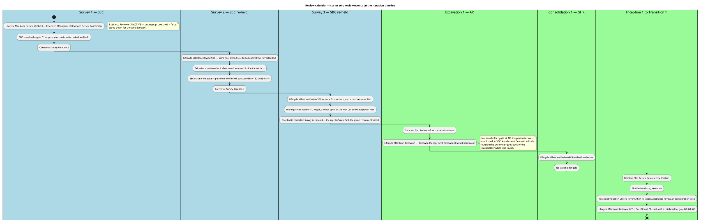

The calendar carries the one structural change the stakeholder ordered: no second perimeter confirmation exists at Consolidation 1's start. From Excavation on, the only route back to the stakeholder on perimeter scope is an element Excavation finds outside it.

## Findings
### Reviewer lens
<!-- review: Survey I3 -->

#### Development Case

Environment discipline, Survey. Verdict: **Approved** — no open finding from this lens, and none carried in.

| Checklist item | Verdict |
|---|---|
| Baseline conformance: roster, CORE set, ownership unchanged | Pass |
| Every FIRED optional trigger holds its own §5.2 condition | Pass — Deployment Model alone, on the four-process topology read from `TodoApp.sln` and the YARP forwarder |
| Every NOT FIRED verdict still holds | Pass — Data Model on eight tables of which six are framework-generated, Proof-of-Concept deferred to Elaboration on its own terms, Test Plan on no audit obligation, UI Prototype on a delivered UI, Glossary on common words fixed by the schema |
| Every cited tool reference resolves in the tree | Pass — five rows, each a path |
| No constraint stated over more of the lifecycle than was decided | Pass |

This artifact changed this iteration: Guidelines and Procedures gained a **Version policy** subsection and a **Measurement policy** subsection. Both are audited here.

The Version policy states that the delivered pins are the policy — `net9.0` and `LangVersion preview` in `Directory.Build.props`, the 30 central pins in `Directory.Packages.props` — and that raising a framework, language or package version is a baseline change owned by the Software Architect and entering as a Change Request. It is consistent with the register, and it repairs the defect this lens recorded in iteration 2: R023 no longer cites a policy the Development Case does not contain, because the policy now exists. One clause of it under-reaches and is recorded against the Risk List as F4 rather than here: it names only `Directory.Packages.props` and `Directory.Build.props`, while R023's property lives in `Todo.Web/Server/Todo.Web.Server.csproj`.

The Measurement policy states the three quantities the baseline measures and, for each, the decision it enables and who reads it, then binds three rules: the two clocks are never added, no figure is quoted as a velocity, no budget is assumed. It invents no figure and names no authority to narrow scope to meet one. It is a policy about measurement, not a measurement.

#### System Inventory

Discovery discipline, Survey — the perimeter record the stakeholder confirmed at the SBC gate of 2026-11-14. Verdict: **Approved** — no open finding from this lens.

| Checklist item | Verdict |
|---|---|
| Every perimeter element carries an anchor that says what is claimed | Pass — not re-opened; 20 anchors verified across the two prior iterations and no correction disturbed one |
| Size and count facts match the file | Pass — 30 pins in all three places, 6 + 19 + 5 |
| Coverage declares its gaps rather than omits them | Pass — F3 of iteration 2 closed |
| The Provenance row agrees with the section it summarises | **Pass** — was F3, closed this iteration |
| No constraint stated over more of the lifecycle than was decided | Pass — the closing statement now reads "No process is run in Survey, Excavation or Consolidation … carried as accepted risk until the RUP phases start, when the pipeline builds the solution and runs its test suites; the first such run is what settles each" |
| Runtime behaviour claimed nowhere | Pass — Coverage states no process was run, and the two claims stay marked read-not-observed |

F3 is verified against the text, not against a claim of correction. Provenance now reads "57 files opened — the 53 of the first pass plus the four `Coverage` names as added in the second reading", names `ValidationFilter.cs`, `HttpAuthenticationStateProvider.cs`, `TodoApp.razor` and `LogInForm.razor`, and no longer names `RateLimitExtensions.cs`. 53 + 4 = 57 agrees with the Document Control tally, the "Files opened: 57" statement and the path-by-path enumeration.

The narrowing the Management lens required is also in place, and it is stated twice — in Coverage and in Perimeter completeness and its limits — with the same horizon. The declarations the stakeholder endorsed stand unchanged. This artifact carries no open record from this lens.

#### Risk List

Project Management discipline, Survey. Verdict: **Changes owed** — one Major, one Minor.

| Checklist item | Verdict |
|---|---|
| Every anomaly of the System Inventory is carried as a scored risk | Pass — 26 rows; 22 anomaly rows plus the absence finding set, the declared coverage limits, and R026 |
| Every magnitude is the band of its own exposure | Pass — all 26 recomputed against the exposure grid and the band distribution; 2 High / 8 Significant / 12 Moderate / 3 Minor / 1 Low closes at 26 and agrees with the register row for row |
| Every risk's strategy can actually execute | **Fail — F3** |
| No High or Significant risk rests on an acceptance nobody granted | Pass — both High-band risks `avoid`; R002 alone accepted in the Significant band, on the stakeholder's words |
| Every acceptance bounded to its horizon | **Pass** — was the Management lens's F3; R002 and R011 read "accept until the RUP phases start", the Mitigation section opens "Every acceptance in this register is bounded by the same horizon", and Document Control states it |
| The recorded acceptance is the acceptance given | Pass |
| Traceability table present, one row per declared `RNNN`, recovered elements with empty `Traces From` | Pass — 26 rows, correct form |
| The only non-agent delay is bounded here, as the plan claims | Pass — R026, 3×4=12, `avoid` on its own bound |

##### F3 — Major — R005 is scored on a condition the perimeter record says was already eliminated

R005 reads "Six files are declared unread, and one — `HttpAuthenticationStateProvider.cs` — blocks the login and logout scenarios", and its mitigation is "The System Analyst opens `HttpAuthenticationStateProvider.cs` before recovering the login and logout scenarios".

Coverage enumerates that file among the 57 opened. It records it as one of the four opened in the previous iteration — "the authentication-state bridge flagged as the one file blocking a use case" — and closes "No file in that group blocks a use case now." Provenance already carries the fact the row was opened for: "The Blazor authentication state is `HttpContext.User` or an empty identity; the provider holds no token and no provider state (369 bytes)."

Two things follow. The strategy `avoid` is attached to work already performed, so it does not name an artifact a role will write — it names one a role has written. And "six files are declared unread" no longer describes Coverage's declaration set, which is two Razor imports plus `Server/App.razor`, `OpenApiOptionsExtensions.cs`, six migration files, three manifests, five launch and appsettings files, the assets, two fixture files and the four project-management records.

This is a Major because two artifacts consume the row: the Iteration Plan books R005's retirement at AR and names it in the System Analyst's Excavation risk column. It is the only Significant-band risk in the register whose evidence the perimeter record says already exists.

Recommendation: restate R005 as the anomaly at the first reading with its resolution — declared unread at Survey 1, opened at Survey 2, its content recorded in Provenance, retired at Survey 2 — SBC. Drop or restate the "six files" clause to Coverage's current set. Keep the band, the owner and the exposure: the risk was real and was retired by an artifact the process ran, so no re-scoring is owed. While restating the Risk Register's opening sentence, make the composition exact: R025 enters from a review finding, not from an anomaly of the Inventory.

##### F4 — Minor — R023's restated mitigation routes the change to the wrong file

R023 now reads "Framework and Razor language version stay as delivered. Raising either changes the pins in `Directory.Packages.props`, which the Software Architect owns, and enters as a Change Request."

Its own anchor is `Todo.Web/Server/Todo.Web.Server.csproj`, and that is where the property sits: the file declares `<RazorLangVersion>8.0</RazorLangVersion>` in its `PropertyGroup` and carries seven `PackageReference` items, none of them a Razor package. Raising the Razor language version edits that project file, not the central pin file.

The iteration-2 defect is genuinely closed — the row no longer cites a Development Case section that does not exist, and the Development Case now has the section. What remains is the same misdirection in a new place: the register names a file the change does not touch.

Recommendation: read "Raising it sets `<RazorLangVersion>` in `Todo.Web/Server/Todo.Web.Server.csproj`, owned by the Software Architect, and enters as a Change Request." The Development Case's Version policy sentence should gain "or the project file that declares the property", so the policy covers this case and the register can cite it.

#### Iteration Plan

Project Management discipline, Survey. Verdict: **Changes owed** — one Major, one Minor.

| Checklist item | Verdict |
|---|---|
| Exit criterion 1 carries the process wording and is evidenced | **Pass** — was the Management lens's F8; criterion 1 reads "The perimeter of the existing system is confirmed by the stakeholder", evidenced by the confirmation of 2026-11-14 over the seven projects, the entry-point surface, the stores and the external systems |
| No gate the plan books has been deleted | **Pass** — G2 is gone from the coarse roadmap, the gantt markers and the Resources gate list; four gates remain, G1, G3, G4, G5, with no dangling identifier |
| No constraint stated over more of the lifecycle than was decided | **Pass** — was the Management lens's F9; the retirement property reads "No retirement in the sprint zero runs the system, and observation returns as a path from Inception on", and the Tester and Test Manager are named as the evidence's producer and recorder |
| A retirement path that exists is used, not foreclosed | **Pass** — R011 and the observable statements of R002 are placed at LCA on the first build-and-test run, each with its producer named |
| Every risk accounted for exactly once, at the milestone that retires it | **Fail — F3** |
| Every role a milestone assigns work to is at work in that milestone | Pass — every one of the 26 risk owners appears on the profile of the milestone whose row retires the risk |
| Roles at work reported as they were | **Fail — F4** |
| No role at work that the tailoring stood down | Pass — Business Process Analyst, Business Reviewer and Capsule Designer sit on no gate and execute no stage |
| No invented size, budget, forecast or date | Pass — no work item sized, every bar declared "the renderer's unit step", no start date, no budget proposed |
| Both clocks reported apart and never added | Pass |
| Milestone order matches the phase sequence | Pass |

##### F3 — Major — the retirement map books R005 at AR by re-opening a file already opened

Three places carry it. The retirement diagram reads "AR — Excavation 1: Reading completed — R005, opening `HttpAuthenticationStateProvider.cs` first". The disposal table lists R005 among the 15 "retired by a milestone artifact". The Excavation 1 role profile names R005 in the System Analyst's risk column.

The System Inventory's Coverage enumerates the file among the 57 opened and states no file in that group blocks a use case now, and Provenance records what it was opened for. The evidence R005's retirement rests on exists and was produced at Survey 2.

So the plan schedules reading work already performed, reports a met retirement as pending, and counts R005 in the wrong group of the accounting it publishes as 15 + 2 + 1 + 8 = 26. The arithmetic still closes at 26 and no risk is lost or double-counted — what is wrong is which milestone the plan says retires R005.

This is a Major because the risk-retirement map is the instrument by which the plan claims its risks retired, and the plan currently sends a Significant-band risk's retirement to a milestone that has nothing left to do for it. It propagates into the Excavation 1 profile, which will brief the System Analyst to open a file it will find already read.

Recommendation: move R005 into the "Retired at Survey 2 — SBC" group and restate the accounting as 14 + 3 + 1 + 8 = 26. Drop R005's step from the AR row of the diagram and from the Excavation 1 risk-owner column, leaving R017 as the System Analyst's AR owner. Restate the Risk List's R005 row in the same turn so register and plan state one retirement.

##### F4 — Minor — Resources states no role but two was at work, and a third was

Resources states: "No other role is at work: every open defect of this gate sits in an artifact the Software Archaeologist or the Project Manager holds, and the three lenses review. The Development Case carries no open record from either lens, so the Process Engineer executes no stage here."

The Development Case was revised this iteration. Its Guidelines and Procedures now carries a **Version policy** subsection and a **Measurement policy** subsection — both of which the Management Reviewer's iteration-2 review recorded as absent, in terms: "No section states a version policy." The correction is real and it is the one R023's citation needed.

The statement that R006 and R025 were retired at Survey 2 is correct. The conclusion drawn from it is not: the Process Engineer executed a stage here. The fine plan lists eight work items and none of them is the Development Case revision, so this iteration contains a ninth piece of work with no work item, no owner on the profile and no attribution.

A Minor because it stays inside the plan's own reporting: the work was done, is correct, and changes no roadmap row, no gate and no criterion. It is the same class of defect the iteration-2 review recorded as F7 — a misattributed correction.

Recommendation: add the Development Case revision as a work item — Process Engineer, Development Case — Guidelines and Procedures, the Version policy and Measurement policy subsections added — and name the Process Engineer on this iteration's role profile; or state in Resources that the Process Engineer revised the Development Case at Survey 3 and for what purpose. "No new artifact is produced" stays true; "no other role is at work" does not.

#### Pull requests

`scm_list_pull_requests` over all states returns none. Survey produces no source code, so an empty pull-request set is the correct shape for this milestone rather than a gap. Nothing awaits approval, nothing needs changes requested, and nothing needs deferring out of phase.

### Management Reviewer lens
<!-- review: Survey I3 -->

#### Development Case

Environment discipline, Survey. Verdict: **Approved** — no open finding from this lens, and none carried in.

| Checklist item | Verdict |
|---|---|
| Tailoring is a delta over the IARI baseline — no roster, CORE, ownership or optional-universe redefinition | Pass |
| Every FIRED optional trigger holds its own §5.2 condition | Pass — Deployment Model alone, on the genuine four-process topology read from `TodoApp.sln` and the YARP forwarder |
| Every NOT FIRED verdict holds against its condition | Pass — Data Model on the tables the snapshot declares, Proof-of-Concept deferred to Elaboration on its own terms, Test Plan on no audit obligation, UI Prototype on a delivered UI |
| Every cited tool reference resolves in the tree | Pass — five rows, each a path |
| Discipline intensities match the canonical matrix, no self-granted deviation | Pass — Discovery Critical in Survey, Environment High, `business-process-led` and `real-time-system` false |
| No stood-down role at work the tailoring removes | Pass — Business Process Analyst and Business Reviewer stood down, Capsule Designer for `real-time-system = false` |
| No constraint stated over more of the lifecycle than was decided | Pass |

This artifact is the one that carried the most cross-role misdirection at the first hold of this milestone, and it now carries no open record from any lens. The sprint-zero read-only property in Disciplines and Intensity is the narrowing this lens required elsewhere, stated at its source: "In Survey, Excavation and Consolidation no process is run … From Inception on the pipeline runs the solution", with the explicit close "The sprint-zero read-only property is not carried past Consolidation, and no artifact of this tailoring states it over the RUP phases." A role reading its process authority now finds the correct horizon there rather than in a register or a plan. **Criterion 5: Pass.**

One consequence for a later role, recorded as an observation and not a finding: with no written coding standard in the repository, the Code Reviewer's checklist is `Directory.Build.props`'s compiler-enforced conventions, the central pins and the Software Architecture Document's mechanisms. The Development Case states exactly that, so the Code Reviewer is not left improvising.

#### System Inventory

Discovery discipline, Survey — the perimeter record the stakeholder confirmed at the SBC gate of 2026-11-14. Verdict: **Approved** — no open finding from this lens, and the one carried in is closed.

| Checklist item | Verdict |
|---|---|
| Every perimeter element carries an anchor that says what is claimed | Pass — not re-opened here; twenty anchors verified across the prior iterations and no correction disturbed one |
| Size and count facts match the file | Pass — the pin tally is 30 in all three places it is stated, 6 + 19 + 5 |
| Coverage declares its gaps rather than omits them | Pass |
| No constraint stated over more of the lifecycle than was decided | **Pass** — was F3, closed this iteration |
| Runtime behaviour claimed nowhere, and the two read-only claims still marked as such | Pass — the declarations stand and the settlement path is now the first build-and-test run |

F3 is verified against the text, not against a claim of correction. Coverage now closes: "No process is run in Survey, Excavation or Consolidation … Within the sprint zero, therefore, neither statement is settled by observation, and both stay declared as read but not observed. They are carried as accepted risk until the RUP phases start, when the pipeline builds the solution and runs its test suites; the first such run is what settles each." All three overreaching phrases are absent, the Runtime behaviour row of the unread table carries the same horizon, and the closing clause states what the declarations are — "the honest record of what this reading could and could not establish, and no reading alone promotes either to fact."

The Provenance row reads "57 files opened — the 53 of the first pass plus the four `Coverage` names as added in the second reading", and 53 + 4 = 57 agrees with the Document Control tally, the "Files opened: 57" statement and the path-by-path enumeration.

#### Risk List

Project Management discipline, Survey. Verdict: **Approved** — no open finding from this lens, and the one carried in is closed.

| Checklist item | Verdict |
|---|---|
| Every anomaly of the System Inventory is carried as a scored risk | Pass — 26 rows |
| Every magnitude is the band of its own exposure | Pass — 2 High / 8 Significant / 12 Moderate / 3 Minor / 1 Low closes at 26 and agrees with the register row for row |
| No High or Significant risk rests on an acceptance nobody granted | Pass — both High-band risks `avoid`; R002 alone accepted in the Significant band, on the stakeholder's own words |
| The acceptance recorded is the acceptance given | Pass |
| No acceptance stated over more of the lifecycle than was decided | **Pass** — was F3, closed this iteration |
| Every risk's strategy can execute | Pass — from Inception on a build or test result is a retirement path the plan uses, and within the sprint zero every `avoid` names an artifact a role writes |
| The only non-agent delay in the project is bounded here, as the plan claims | Pass — R026, 3×4=12, `avoid` on its own bound |
| Traceability table present, one row per declared `RNNN` | Pass — 26 rows, recovered elements with empty `Traces From`, which is the right form |

F3 is verified against the rows and against the register's own tallies. R002 now reads "none is run in Survey, Excavation or Consolidation … From Inception on the pipeline builds the solution and runs its test suites, and a result it produces settles the statements it covers", with strategy "accept until the RUP phases start — stakeholder grant, 2026-11-14", band 5×2=10 unchanged. R011 drops "which this project does not do" for "not settled by reading within the sprint zero" and adds "A test that exercises the limiter settles it from Inception on", strategy "accept until the RUP phases start", band 2×4=8 unchanged. Document Control states the bound: "No acceptance here runs to the end of the project." Risk Mitigation and Contingency opens "Every acceptance in this register is bounded by the same horizon", and Risk Classification narrows the observation claim to "unavailable as a retirement path **within the sprint zero**".

Both High-band risks remain `avoid` and retired by artifacts the process already runs — R001 by the Test Case at LCA, R009 by the Use-Case Model at GHR. Of the eight Significant risks, seven are `avoid`; R002 alone is accepted and its grant is the stakeholder's. R026 bounds the project's only non-agent delay at 14 days of queue time, estimate none, and the Iteration Plan cites it by identifier, so plan and register state the same control.

What this lens did not test on these rows is whether the artefact a strategy names already exists. The technical lens tested it and found it failed for R005; that record is open and is carried in Disposition.

#### Iteration Plan

Project Management discipline, Survey. Verdict: **Approved with changes** — one Minor.

| Checklist item | Verdict |
|---|---|
| Every exit criterion evidenced as worded | Pass — criterion 1 carries the process wording and the confirmation given at SBC |
| Every gate booked is a gate the stakeholder will attend | Pass — four gates, G1, G3, G4, G5, and no dangling identifier |
| No constraint stated over more of the lifecycle than was decided | Pass |
| A retirement path that exists is used, not foreclosed | Pass — R011 and the observable statements of R002 are placed at LCA on the first build-and-test run, with the Tester named as producer and the Test Manager as recorder |
| Every risk accounted for exactly once, at the milestone that retires it | Pass on the arithmetic — 15 + 2 + 1 + 8 = 26 and the LCO row carries no retired risk — but one risk's milestone is wrong under the technical lens's record |
| Every role a milestone assigns work to is at work in that milestone | Pass — every one of the 26 risk owners appears on the profile of the milestone whose row retires the risk |
| No role at work that the tailoring stood down | Pass |
| No invented size, budget, forecast or date | Pass — no work item sized, every bar declared the renderer's unit step, no start date, no budget proposed |
| Both clocks reported apart and never added | Pass |
| Milestone order matches the phase sequence | Pass |
| State column reports the gate as it now stands | **Fail — F10** |

Three findings of this lens on this artifact are closed this iteration, and one Minor is new.

##### F10 — Minor — the exit-criteria table reports a defect that has closed

Criterion 3's state column reads "Evidenced — the declaration holds; the Provenance row is its owner's Minor", and the fine plan carries the work item "Restate the Provenance row to the four files Coverage names … Owner's next turn". That Provenance Minor is the technical lens's System Inventory#F3, and it was closed Resolved at the start of this iteration: the row names exactly the four files Coverage names and 53 + 4 = 57 agrees with the tally and the enumeration.

The plan therefore tells a reader of the SBC exit-criteria table that a declaration is under an open record when the record has closed and the row is correct. It is the mirror image of the defect this lens recorded as F6 at the first hold — a status column that misreports where the gate stands — in the opposite direction: F6 understated an open defect, F10 overstates a closed one.

A Minor because it stays inside the artifact's own reporting. Criterion 3's evidence and verdict are unaffected, the declaration the criterion turns on holds either way, and no roadmap row, gate or criterion follows from it. It does not hold the milestone, and its owner fixes it in the next turn after any Critical and Major across the project.

Recommendation: restate criterion 3's state to "Evidenced — the declaration holds; the Provenance row now agrees with the enumeration the Coverage section publishes", and drop the "Restate the Provenance row" row from the fine plan's work items. The work is performed and verified, not owed. No other row of the Evaluation Criteria table changes.

#### Pull requests

`scm_list_pull_requests` over all states returns none. Survey produces no source code, so an empty pull-request set is the correct shape for this milestone rather than a gap. Nothing awaits approval, nothing needs changes requested, and nothing needs deferring out of phase.

#### Source-control evidence

Survey produces no source code, so there is no implementation state to verify: no branch, no build, no pull request and no open defect exists to cite, and this lens holds no source-control tool with which to query one. No build status, test count or pull-request identifier is reported in this block, because none was observed and none can be. The milestone's evidence is artifact evidence, and where this block states a fact it cites the artifact section that carries it.

### Review Coordinator lens
<!-- review: Survey I3 -->

<!-- review: Survey I3 -->

#### Consolidated finding ledger

Coordinated from `read_artifact_findings` over all six artifacts. **Five lens records are open — none carries a resolution object.** Twenty-five are closed, each by the lens that emitted it. A Review Record sentence saying a defect was fixed is not a resolution; the ledger object is, and every one of the 25 closures carries one with its verification evidence.

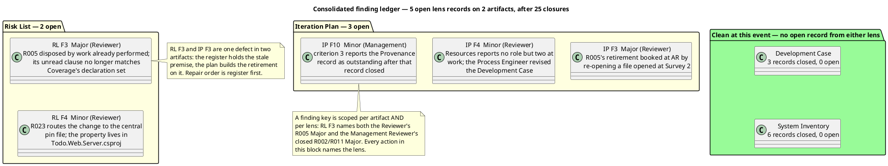

| Defect | Artifact | Severity | Lens record | Owner | Holds the milestone |
|---|---|---|---|---|---|
| RL F3 — R005 is scored `avoid` on a condition the System Inventory's Coverage records as already eliminated, and its "six files are declared unread" clause no longer matches Coverage's declaration set | Risk List | Major | Reviewer F3 | Project Manager | Yes |
| IP F3 — the retirement map, the disposal table and the Excavation 1 role profile book R005's retirement at AR by re-opening a file opened at Survey 2 | Iteration Plan | Major | Reviewer F3 | Project Manager | Yes |
| RL F4 — R023's mitigation routes the change to `Directory.Packages.props` while `<RazorLangVersion>` lives in `Todo.Web/Server/Todo.Web.Server.csproj` | Risk List | Minor | Reviewer F4 | Project Manager | No |
| IP F4 — Resources states no role but two was at work this iteration, while the Process Engineer revised the Development Case | Iteration Plan | Minor | Reviewer F4 | Project Manager | No |
| IP F10 — exit criterion 3's state column reports the Provenance record as an outstanding Minor after that record closed Resolved | Iteration Plan | Minor | Management Reviewer F10 | Project Manager | No |

**No Critical record exists, and none is owed.** A Critical is a defect only the stakeholder can unblock: a scope decision, a contradiction in what they declared, or a risk only they may accept. All three scope facts put at Survey 1 were answered on 2026-11-14 and each answer was re-tested against the code it disposes of; the two corrections the stakeholder added to their sanction are absorbed in all four artifacts that stated them. A decision already taken and correctly recorded where it bears is not an open question, and escalating it again would ask the stakeholder to answer what they have answered twice — which is the defect IP F3's neighbour IP F8 named before it was closed.

#### Conflicts between lenses, and how I resolved them

| Conflict | Resolution |
|---|---|
| **Risk List — two lenses, two verdicts on the same 26 rows.** Technical: one Major and one Minor against the R005 and R023 rows. Management: Approved, no open finding, and it states in terms that it did not test whether the artefact a strategy names already exists. | Not a conflict of evidence but of test coverage. The Management lens tested the band, the owner, the acceptance authority and the duration of every acceptance — all pass. The Technical lens tested whether the work a strategy names remains to be done, and R005's does not. The Major governs; the Management approval is not withdrawn, and it is not a competing finding. |
| **Iteration Plan — the Management lens approved with one Minor while the Technical lens records a Major on the same artifact.** | The Management lens's own checklist flagged the row as "ONE ROW FAILS" in its compliance matrix and passed it in Disposition as a technical-lens record it does not re-adjudicate. Both statements are consistent: the Management lens's own criteria pass, and the artifact is not clean. Consolidated: the artifact is under an open Major it does not own. |
| **The same R005 defect is recorded against two artifacts under two keys.** Reviewer F3 on the Risk List and Reviewer F3 on the Iteration Plan. | One defect, two carriers, and the ledger is right to hold both: the register holds the stale premise, the plan builds a retirement on it, and closing one does not close the other. They are repaired in one turn, register first. Treated as one corrective action in Resolutions and Actions, not two independent ones. |
| **The Process Engineer's stage, unrecorded.** The Technical lens records it as a Minor against the Iteration Plan (IP F4); the Management lens records it as an observation and confirms the Development Case carries no open record. | Both hold. The work was performed and is correct — the Development Case has the Version policy and Measurement policy subsections and neither lens contests their content. What fails is the plan's report that no other role worked. The defect stays inside the Iteration Plan's own reporting, so it is IP F4 and not a Development Case finding. |
| **F10 against the closed System Inventory record.** The Management lens's own closure ledger closes the System Inventory Provenance record and, in the same event, records that the Iteration Plan still reports it as outstanding. | Not a contradiction: the closure answers the system inventory's text, F10 answers the plan's state column. The Technical lens reached the same fact independently and did not record it, having tested the plan against its own criteria rather than against the other lens's ledger. |

#### Where the lenses agreed, recorded as agreed

- **The perimeter's content is sound and is not in dispute.** The stakeholder confirmed it at SBC on 2026-11-14 and stated nothing was missing from it. Twenty anchors were opened across three iterations and no record of either lens contests a perimeter element.
- **No acceptance outlives its grant.** R002 is the only Significant-band acceptance, its words are the stakeholder's own, its band is unchanged at 5×2=10, and every acceptance in the register names the RUP phases as its horizon. Document Control, Risk Classification and Risk Mitigation and Contingency all state it.
- **The four Major corrections the sanction required are genuinely repaired, not deferred.** Each was verified against the sentence now in the artifact: the no-observation constraint is bounded to the sprint zero in all four artifacts that stated it; criterion 1 carries the process wording with G2 absent from the roadmap, the gantt and the gate list; and observation is restored as a retirement path from Inception on with the Tester named as producer and the Test Manager as recorder.
- **Risk scoring is coherent.** No lens has misbanded a risk in three events; 2 High / 8 Significant / 12 Moderate / 3 Minor / 1 Low closes at 26 and agrees with the register row for row.
- **The Development Case and the System Inventory now carry no open record from either lens.** Both were the artifacts with the most cross-role misdirection at the first hold of this milestone.
- **No marker was retired by anything but the stakeholder.** The one that disappeared went on their own later answer. No `undeclared-scope` finding is recorded by either lens.

#### What I record as not a defect

- **The Iteration Assessment's content.** Both lenses reached this independently: the Project Manager writes it against this verdict, so it cannot describe the iteration it is the verdict for. Its absence or lag is no gate condition.
- **Risk scores.** Six scores would move under a different Project Manager. Neither lens contests one, and R005's exposure was real and was retired by an artifact the process ran — the defect is where the register records the retirement, not the number. Re-scoring would misprice a risk whose control worked.
- **The empty pull-request set.** Survey produces no source code, so an empty set is the correct shape for this milestone rather than a gap.
- **The empty trace graph.** Survey declares no element family of the trace chain — the System Inventory and the four process artifacts cite declared ids where they use them and register none of their own. A blank graph at SBC is the correct shape, not a `trace-gap`. The Risk List's empty `Traces From` rows are the right form for recovered elements.
- **The Development Case's new subsections.** Audited by both lenses, contested by neither. The Version policy under-reaches by one clause and that is recorded against the Risk List as RL F4, because the artifact that misdirects the reader is the register.
- **The two Minor records of the Technical lens.** Recorded, owned, and not milestone-holding. Neither leaves its artifact: no role builds on the wrong file and no exit criterion turns on R023's citation.

I did not re-adjudicate any lens record. Where a record quotes its evidence, the evidence is in the record.

## Resolutions and Actions
### Reviewer lens
<!-- review: Survey I3 -->

#### Closure ledger — the two findings this lens carried in

Each was re-tested against the corrected text **and** against the file or section the correction cites, then closed by the tool call that materializes the state change. Both calls were applied before this entry was written.

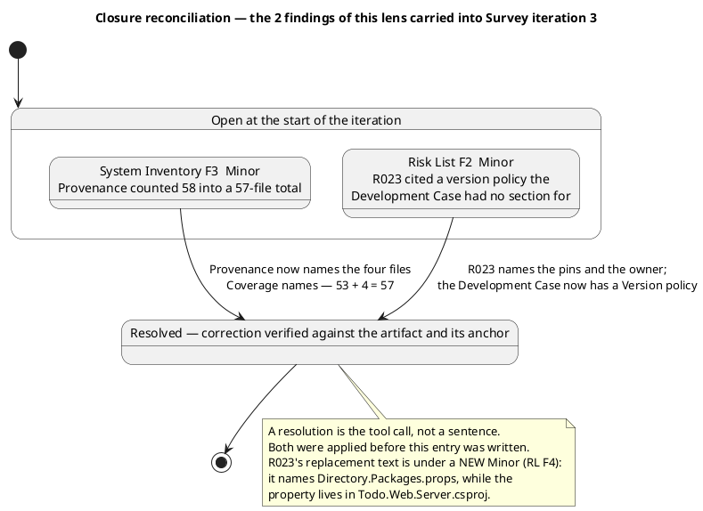

| Finding | Severity | Correction found in the artifact | Closed |
|---|---|---|---|
| System Inventory F3 — Provenance counted 58 into a 57-file total | Minor | The row reads "the 53 of the first pass plus the four `Coverage` names as added in the second reading", names `ValidationFilter.cs`, `HttpAuthenticationStateProvider.cs`, `TodoApp.razor` and `LogInForm.razor`, and no longer names `RateLimitExtensions.cs` | Resolved |
| Risk List F2 — R023 cited a version policy the Development Case had no section for | Minor | R023 now reads "Raising either changes the pins in `Directory.Packages.props`, which the Software Architect owns, and enters as a Change Request", and the Development Case's Guidelines and Procedures gained a Version policy subsection stating the same rule | Resolved |

Neither closure rests on a claim of correction. The Provenance row was counted against Coverage's enumeration, and R023's citation was read against the Development Case section the Process Engineer added.

The second closure is recorded with its residue: the replacement text names a file the change does not touch, and that is a new defect with its own key (Risk List F4), not a reopening. The finding asked that the citation resolve; it now resolves. Whether it resolves to the right file is a separate test that the replacement fails.

#### Open findings and their actions

| Finding | Artifact | Severity | Owner | Holds the milestone | Action |
|---|---|---|---|---|---|
| Risk List F3 — R005 is scored `avoid` on a condition Coverage records as already eliminated, and its "six files are declared unread" no longer matches Coverage's set | Risk List | Major | Project Manager | Yes | Restate R005 as the anomaly at the first reading with its resolution at Survey 2 — SBC; correct the unread count; keep band, owner and exposure; make the Register's composition sentence exact about R025 |
| Iteration Plan F3 — the retirement map, the disposal table and the Excavation 1 profile book R005's retirement at AR by re-opening a file opened at Survey 2 | Iteration Plan | Major | Project Manager | Yes | Move R005 to "Retired at Survey 2 — SBC" and restate the accounting as 14 + 3 + 1 + 8 = 26; drop it from the AR diagram step and the Excavation 1 risk column |
| Risk List F4 — R023's mitigation routes the change to `Directory.Packages.props`, while `<RazorLangVersion>` lives in `Todo.Web/Server/Todo.Web.Server.csproj` | Risk List | Minor | Project Manager | No | Name the property and the project file that holds it; add "or the project file that declares the property" to the Development Case's Version policy so the register can cite it |
| Iteration Plan F4 — Resources states no role but the Software Archaeologist and the Project Manager was at work, while the Process Engineer revised the Development Case this iteration | Iteration Plan | Minor | Project Manager | No | Add the Development Case revision as a work item and name the Process Engineer on this iteration's profile, or state in Resources that the revision happened and why |

Risk List F3 and Iteration Plan F3 are one defect in two artifacts: the register holds the stale premise and the plan builds the retirement on it. They are repaired in one turn, and the register's row is the one that must be corrected first — the plan's disposal table derives from it.

The two Minors are independent and each stays inside its own artifact. Risk List F4 crosses into the Development Case only to the extent of one clause in a sentence that already exists; the Process Engineer is named as the role to add it, and the Project Manager may name the file and the owner without it.

#### What this lens deliberately did not raise

Recorded so each omission is a decision rather than an oversight.

- **The perimeter's content.** Twenty anchors have been opened across the three iterations and every one says what the artifact claims. The stakeholder confirmed the perimeter at this milestone. No record of any lens contests an element of it, and re-verifying it would spend the gate's budget restating what is established.
- **Risk scores.** No lens has misbanded a risk in three events. R005's exposure is real and was retired by an artifact the process ran; the defect is where the artifact records the retirement, not the number. Re-scoring would misprice a risk whose control worked.
- **The Development Case's new subsections.** Audited, not contested. The Version policy under-reaches by one clause, recorded against the Risk List as F4 rather than as a Development Case finding, because the artifact that misdirects the reader is the register.
- **The empty pull-request set.** Survey produces no source code, so an empty set is the correct shape for this milestone.
- **The empty trace graph.** Survey declares no element family of the trace chain. A blank graph at SBC is the right shape, not a `trace-gap`.
- **The Iteration Assessment.** The Project Manager writes it against this verdict. Its absence or lag is no defect and no gate condition.

### Management Reviewer lens
<!-- review: Survey I3 -->

#### Closure ledger — the five findings this lens carried into Survey iteration 3

Each was re-tested against the corrected text **and**, where the finding concerned a fact outside the artifact, against the anchor that carries it. The `resolve_artifact_finding` call materializes the state change; all five were applied before this entry was written.

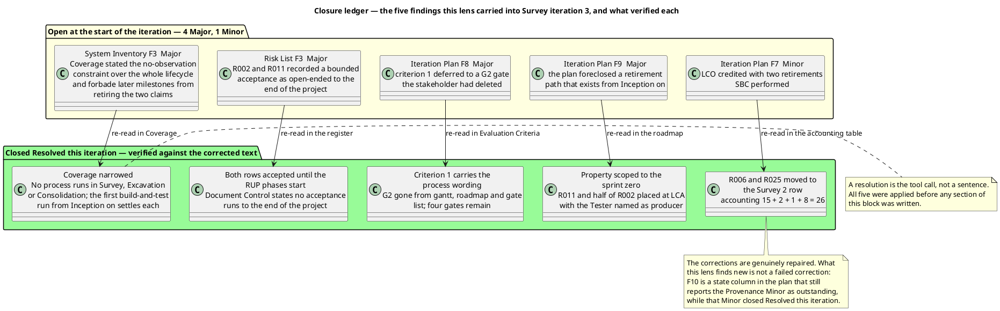

| Finding | Severity | Correction found in the artifact | Closed |
|---|---|---|---|
| System Inventory F3 — Coverage stated the no-observation constraint over the whole lifecycle and forbade later milestones from retiring the two claims | Major | Coverage now reads "No process is run in Survey, Excavation or Consolidation … carried as accepted risk until the RUP phases start, when the pipeline builds the solution and runs its test suites; the first such run is what settles each"; all three overreaching phrases gone; the declarations stand unchanged | Resolved |
| Risk List F3 — R002 and R011 recorded a bounded acceptance as open-ended to the end of the project | Major | Both rows read "accept until the RUP phases start"; R002's 5×2=10 and R011's 2×4=8 unchanged; Document Control, Risk Classification and Risk Mitigation and Contingency all state the horizon | Resolved |
| Iteration Plan F8 — criterion 1 deferred the perimeter's confirmation to a gate the stakeholder had deleted | Major | Criterion 1 carries the process wording, evidenced by the confirmation of 2026-11-14; G2 is absent from the gantt, the roadmap and the gate list, which books four gates | Resolved |
| Iteration Plan F9 — the plan foreclosed a retirement path that exists from Inception on | Major | The property is scoped to the sprint zero, observation returns from Inception on, and a section places R011 and the observable statements of R002 at LCA with the Tester as producer | Resolved |
| Iteration Plan F7 — the retirement map credited LCO with two retirements this milestone performed | Minor | The LCO row's risk column reads "—"; R006 and R025 sit on the Survey 2 row; the accounting reads 15 + 2 + 1 + 8 = 26 | Resolved |

No closure rests on a claim of correction. Each rests on the sentence now in the artifact and, for the two that turn on a fact, on the register's own tallies and the plan's own gate list.

#### The stakeholder's corrective order, and how it was followed

The order set at this gate was: the System Inventory sentence first, then the Risk List and Iteration Plan statements that quote it, then the deleted gate, then the three Minors in each owner's next turn. The artifacts show that sequence held — the premise is narrowed identically in all four artifacts, and no artifact now states the project-wide version.

Two Minors of the three the stakeholder named are closed: the Iteration Plan's F7 above, and the Risk List's citation, closed by the technical lens under its own key. The third — the System Inventory's Provenance arithmetic — was closed by the technical lens this iteration. All three are therefore resolved; the only new record is F10, which reports one of them as still outstanding.

#### Action owed at the owner's next turn

| Action | Artifact | Owner | Closes |
|---|---|---|---|
| Restate criterion 3's state to record that the Provenance row now agrees with the enumeration, and drop the "Restate the Provenance row" row from the fine plan's work items | Iteration Plan | Project Manager | F10 |

F10 does not hold the milestone. It is a Minor: the state column changes no evidence, no gate and no criterion, and the declaration criterion 3 turns on holds either way. The artifact is approved; its owner corrects the column in the next turn.

#### Action owed at the owner's next turn — carried from the technical lens

Four records from the technical lens are open on two artifacts the Project Manager owns. They are not my lens's to close, and I record them here only so the owner sees one list:

| Record | Artifact | Severity | Holds the milestone |
|---|---|---|---|
| Risk List F3 — R005 is scored `avoid` on a condition Coverage records as already eliminated | Risk List | Major | Yes |
| Iteration Plan F3 — the retirement map books R005's retirement at AR by re-opening a file opened at Survey 2 | Iteration Plan | Major | Yes |
| Risk List F4 — R023's mitigation routes the change to a directory-pin file while the property lives in the project file | Risk List | Minor | No |
| Iteration Plan F4 — Resources states no role but two was at work, while the Development Case was revised this iteration | Iteration Plan | Minor | No |

The two Majors are one defect in two artifacts: the register holds a stale premise and the plan builds the retirement on it. My lens did not find them — the technical lens did, by checking R005's premise against the Coverage enumeration — and I do not re-adjudicate them. What I record is their consequence for the milestone, in Disposition below.

#### No Critical, and why

A Critical is a defect only the stakeholder can unblock: a scope decision, a contradiction in what they declared, or a risk only they may accept. Nothing at this gate qualifies.

All three scope questions put at Survey 1 were answered on 2026-11-14 and each answer was re-tested against the code it disposes of; all three hold and none is reopened. The two corrections the stakeholder added to their sanction are fully absorbed: the perimeter is confirmed at SBC with no second gate anywhere in the plan, and the no-observation constraint is narrowed to the sprint zero in all four artifacts that stated it. A decision already taken and correctly recorded everywhere it bears is not an open question, and escalating it again would ask the stakeholder to answer what they have decided twice.

#### No Major from this lens, and why

A Major means another role builds on wrong content or a milestone exit criterion fails. Neither holds for this lens's checklist.

- Every correction this lens ordered was checked against the anchor that carries it, and each resolves. No role is pointed at content that does not exist.
- Five of the six SBC exit criteria are evidenced as worded on this lens's evidence, and the sixth is evidenced on the artifacts' own text.
- Every acceptance is bounded, R002's Significant-band grant is the stakeholder's own and its band is unchanged, and no acceptance outlives its horizon.
- Every risk strategy can execute: within the sprint zero each `avoid` names an artifact a role writes, and from Inception on a build or test result is a path the plan uses rather than forecloses.
- All 26 risks are accounted for once, and the owner of every one is at work in the milestone whose row retires it.
- Four gates are booked, each is a decision the stakeholder will give, and none staffs a stood-down lens.

### Review Coordinator lens
<!-- review: Survey I3 -->

<!-- review: Survey I3 -->

#### Closure ledger — the 25 records this milestone closed

Each was closed by the lens that emitted it, after that lens re-tested the correction against the text and, where the record concerned a file outside the artifact, against the anchor that carries it. The tool call materializes the closure; this table records what it rests on.

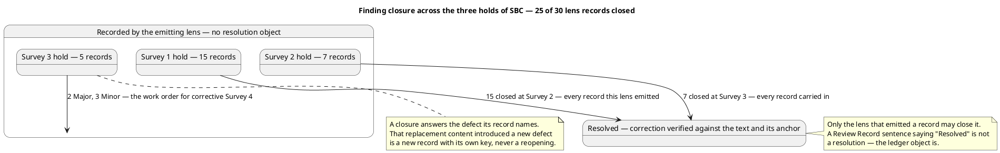

| Hold | Lens | Records closed | Verified against |
|---|---|---|---|
| Survey 1 → Survey 2 | Technical | 7 — 3 Major, 4 Minor | Five tool references each resolving to an existing path; the pin tally re-counted; the stale `(unread)` qualifier gone; R018 separating establishment from recording |
| Survey 1 → Survey 2 | Management | 11 — 9 Major, 2 Minor | The pin tally and the settlement sentence; R026 present at 3×4=12 and cited by the plan by identifier; five gates booked; the retirement map rebuilt; the tailoring auditable |
| Survey 2 → Survey 3 | Technical | 2 — 2 Minor | The Provenance row counted against Coverage's enumeration at 53 + 4 = 57; R023's citation resolving to a Development Case section that now exists |
| Survey 2 → Survey 3 | Management | 5 — 4 Major, 1 Minor | Coverage, R002 and R011, criterion 1, the retirement property and the LCO row, each re-read against the sentence now in the artifact |
| **Total** | | **25 — 16 Major, 9 Minor, 0 Critical** | |

Two closures are recorded with their residue, because a reader would otherwise read them as withdrawn. **Risk List Reviewer F2** asked that R023's citation resolve; it now resolves, and the replacement names a file the change does not touch — a new record (RL F4), not a reopening. **Iteration Plan Management F7** asked that R006 and R025 stop being credited to LCO; they are moved, and the row it moved them to is now under the R005 Major (IP F3) — again a new record, not a failed correction. Reopening a closed record would obscure which correction failed; a closure answers the defect its record names.

#### Corrective order — the sequence is the plan

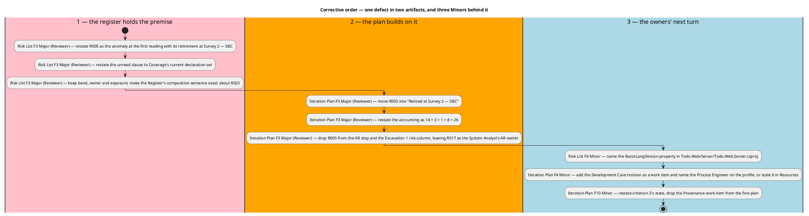

**The register's row first, then the plan's retirement.** They are not two independent defects: the plan's disposal table derives from the register's row, and correcting them in the other order writes the same retirement into two artifacts that then disagree about one risk. This is the same failure mode the stakeholder's corrective order at the previous gate existed to prevent, applied to this one.

#### Action owed at each owner's next turn

None of the five asks the stakeholder a question. Each is a correction inside an artifact its owner already holds.

| Defect | Artifact | Owner | Action | Position |
|---|---|---|---|---|
| RL F3 — R005 disposed by work already performed | Risk List | Project Manager | Restate R005 as the anomaly at the first reading with its resolution: declared unread at Survey 1, opened at Survey 2, its content recorded in Provenance, retired at Survey 2 — SBC. Drop or restate the "six files are declared unread" clause to Coverage's current declaration set — two Razor imports plus `Server/App.razor`, `OpenApiOptionsExtensions.cs`, six migration files, three manifests, five launch and appsettings files, the assets, two fixture files and the four project-management records. Keep band 4×3=12, owner and exposure: the risk was real and was retired by an artifact the process ran, so no re-scoring is owed. While restating the Register's opening sentence, make the composition exact — R025 enters from a review finding, not from an anomaly of the Inventory | 1 |
| IP F3 — R005's retirement booked at AR | Iteration Plan | Project Manager | Move R005 into the "Retired at Survey 2 — SBC" group and restate the accounting as 14 + 3 + 1 + 8 = 26. Drop R005's step from the AR row of the retirement diagram and R005 from the Excavation 1 risk-owner column, leaving R017 as the System Analyst's AR owner. Restate the Risk List's R005 row in the same turn so register and plan state one retirement; the Significant-band count of 8 is unaffected, only where R005 retires | 2 |
| RL F4 — R023 routes the change to the wrong file | Risk List | Project Manager | Read "Raising it sets `<RazorLangVersion>` in `Todo.Web/Server/Todo.Web.Server.csproj`, owned by the Software Architect, and enters as a Change Request." The Development Case's Version policy sentence gains "or the project file that declares the property", so the policy covers this case and the register can cite it | 3 — owner's next turn |
| IP F4 — Resources reports no role but two at work | Iteration Plan | Project Manager | Add the Development Case revision as a work item — Process Engineer, Development Case — Guidelines and Procedures, the Version policy and Measurement policy subsections added — and name the Process Engineer on this iteration's role profile; or state in Resources that the Process Engineer revised the Development Case at Survey 3 and for what purpose. "No new artifact is produced" stays true; "no other role is at work" does not | 3 — owner's next turn |
| IP F10 — criterion 3 reports a closed record as outstanding | Iteration Plan | Project Manager | Restate criterion 3's state to "Evidenced — the declaration holds; the Provenance row now agrees with the enumeration the Coverage section publishes", and drop the "Restate the Provenance row" row from the fine plan's work items. The work is performed and verified, not owed. No other row of the Evaluation Criteria table changes | 3 — owner's next turn |

#### What is deliberately not an action

- **A new stakeholder question at this gate.** All five records are corrections inside artifacts their owners hold. Putting any back to the stakeholder would ask them to answer what they have answered twice — the defect class the plan's own IP F8 named at the previous hold.
- **A Change Request.** None of the five needs one. No scope change, no baseline change, nothing for the CCB.
- **Re-scoring any risk.** Neither lens contests a magnitude in any of the three events, and the plan states that disagreement with a score does not fail the milestone.
- **A schedule change beyond the iteration count.** Corrective iteration 4 is the plan's own lever for a milestone whose exit criteria do not pass. Declared scope is not narrowed, no role is added in parallel, and no criterion is re-interpreted to fit what was produced.
- **A second perimeter confirmation.** Deleted by the stakeholder's own answer; it appears on no calendar this block publishes.

#### Stakeholder finding — the corrective order set at the previous gate, and its status

Put to the stakeholder at Survey iteration 2 with the four Majors named:

> "Close the System Inventory sentence first, then the Risk List and Iteration Plan statements that quote it, then the deleted gate; the three Minors in each owner's next turn."

That order held and is verified: all four Majors it named are closed against the corrected text, and all three Minors it named are closed — the System Inventory Provenance record by the Technical lens, the Risk List citation by the Technical lens, and the Iteration Plan's LCO attribution by the Management lens. The order stands as the precedent applied to this iteration's two Majors, one of which (R005) is the same shape of defect: a statement two artifacts build on, repaired in the register first.

The stakeholder's earlier answer also set the perimeter as confirmed at this milestone, with no second confirmation at Consolidation's start and the process's first exit criterion restored. That is verified in the Iteration Plan and appears on no other artifact.

#### Stakeholder answer — the corrective order for RL F3 and IP F3

Put at this milestone with the two Majors named, their owners' actions recorded above, and the three Minors listed. The stakeholder's answer:

> "Nothing to add. Close it as you describe: the Risk List row first, then the retirement map."

Read against the ledger it confirms the corrective order this block set — RL F3 first, IP F3 immediately after — and adds no defect, no condition and no new action. The stakeholder named no part of the existing system missing from the perimeter and amended none of the five actions above; no record is added or removed on account of this answer, and the position column above carries the order they confirmed.

## Disposition
### Reviewer lens
<!-- review: Survey I3 -->

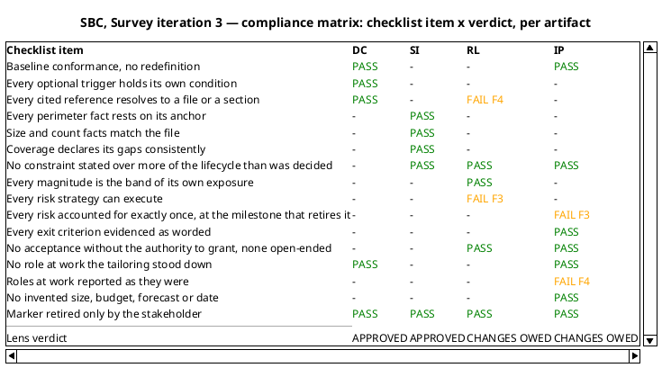

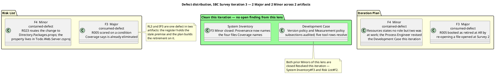

#### Technical lens disposition

**Approved with changes.** 0 Critical, 2 Major, 2 Minor. Two of the four artifacts carry no open record from this lens. The milestone itself is the Review Coordinator's to rule on: this lens reports its verdict on the artifacts, it does not sanction the phase.

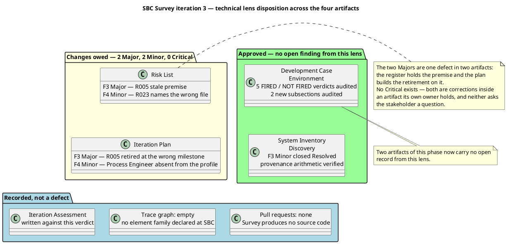

#### The seven findings of the previous gate, as this lens now finds them

Five are closed on evidence and two on this iteration's corrections. Each closure rests on reading the corrected text, not on a claim of correction.

| Prior finding | Lens | Status this iteration |
|---|---|---|
| Coverage stated the no-observation constraint over the whole lifecycle | Management, System Inventory | Corrected. Coverage and Perimeter completeness both read "No process is run in Survey, Excavation or Consolidation … carried as accepted risk until the RUP phases start; the first such run is what settles each" |
| R002 and R011 recorded a bounded acceptance as open-ended | Management, Risk List | Corrected. Both rows read "accept until the RUP phases start", the section opens with the horizon, and Document Control states it |
| The plan foreclosed a retirement path that exists from Inception on | Management, Iteration Plan | Corrected. The property is scoped to the sprint zero, and R011 and the observable statements of R002 are placed at LCA with the Tester named as producer |
| Criterion 1 deferred to a deleted gate | Management, Iteration Plan | Corrected. Criterion 1 carries the process wording, evidenced by the confirmation given at SBC; G2 is gone from roadmap, gantt and gate list, leaving four gates |
| The retirement map credited LCO with two retirements SBC performed | Management, Iteration Plan | Corrected. The disposal table now reads "Retired at Survey 2 — SBC … R006, R025" |
| Provenance counted 58 into a 57-file total | Technical, System Inventory | Closed Resolved this iteration |
| R023 cited a version policy the Development Case lacks | Technical, Risk List | Closed Resolved this iteration; its replacement text is under the new Minor RL F4 |

The four Majors are genuinely repaired. What this lens finds new is not a failure of those corrections: it is a defect none of them touched, in a risk row no prior finding named.

#### Why the two Majors are Major and not Critical

A Critical is a question only the stakeholder can answer. Neither Major is one.

R005's row and the plan's retirement of it are both wrong about a fact the artifacts already establish between themselves: Coverage says the file was opened and states no file in that group blocks a use case. The correction is a restatement inside two artifacts their owner holds. There is no scope decision, no contradiction in what the stakeholder declared, and no risk for them to accept. Putting it to them would ask a question the perimeter record already answers.

Both hold the milestone on one ground each: the Risk List's strategy for a Significant-band risk does not name work that remains to be done, and the plan's retirement map names the wrong milestone for that same risk.

#### Why the two Minors do not hold the milestone

Each stays inside its own artifact. RL F4 misdirects a reader of an accepted Moderate risk's mitigation to a file the change does not touch — no exit criterion turns on it, and R023's contingency, a Change Request, is the same either way. IP F4 misreports which roles worked this iteration — the work was done and is correct, and no roadmap row, gate or criterion depends on the reporting.

They are recorded and owned, owed at their owner's next turn, after the two Majors.

#### What this lens confirms and does not disturb

- **The perimeter is confirmed and is not in dispute.** The stakeholder confirmed it at this gate over the seven projects, the entry-point surface, the stores and the external systems. Twenty anchors were opened across the three iterations and the one fact that failed was corrected and re-counted. No record of this lens contests an element.
- **The tailoring is auditable.** Every cited reference resolves, every optional verdict is checked against its own §5.2 condition, and the two subsections added this iteration are policy rather than measurement.
- **No acceptance outlives its grant.** R002 is the only Significant-band acceptance and its words are the stakeholder's; every acceptance states a horizon and none runs to the end of the project.
- **No work item assumes a run of the system inside the sprint zero, and observation returns as a path from Inception on**, with its producer and recorder named.
- **No invented figure anywhere.** No work item is sized, no bar is a duration, no start date is given, no token budget is proposed.

### Management Reviewer lens
<!-- review: Survey I3 -->

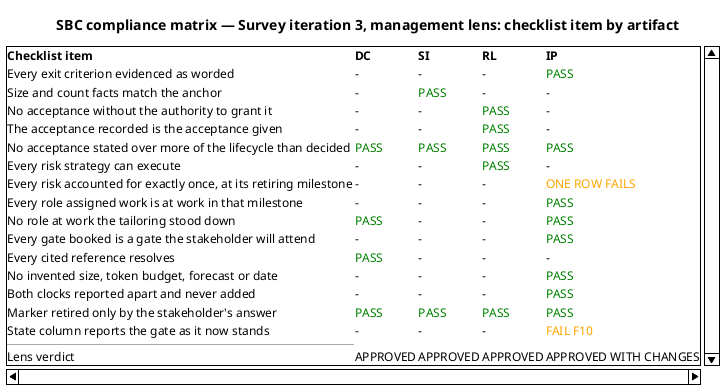

| Criterion | Management lens verdict | Basis |
|---|---|---|
| 1 — The perimeter is confirmed by the stakeholder | Met | The confirmation of 2026-11-14, evidenced in criterion 1 with the process wording restored and the second-confirmation gate deleted |
| 2 — The reading priorities are ordered | Met | Eight areas, each naming what the next reading settles |
| 3 — The unread areas are declared rather than omitted | Met | The declaration holds; the Provenance row now agrees with the enumeration |
| 4 — Every anomaly is a classified risk whose strategy can execute | **Under a technical-lens Major** | R005's `avoid` names work already performed, so one of 26 strategies does not execute; the scoring, the bands and every acceptance are sound |
| 5 — The process is tailored and the tailoring is auditable | Met | Every cited reference resolves; every optional verdict checked against its condition |
| 6 — The plan instantiates the process and schedules no work the phase does not run | **Under a technical-lens Major** | The retirement map books R005 at AR for work Survey 2 performed; the gates, the roles and the sequencing are sound |

Criteria 1, 2, 3 and 5 are met on this lens's own evidence. Criteria 4 and 6 are met on everything this lens tests and fail on one row of the Risk List and the same row of the retirement map — a defect my lens did not find and does not re-adjudicate.

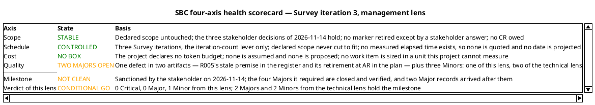

#### Management lens disposition

**Conditional Go.** This lens records 0 Critical, 0 Major and 1 Minor. Every finding it carried into the iteration is closed against the corrected text, and the four Major corrections the stakeholder's sanction required are landed and verified.

The milestone is nonetheless not clean, and this lens does not report it as clean. Two Major records stand open from the technical lens, and both concern one risk row: R005 is scored `avoid` on a condition the System Inventory's Coverage says was already eliminated, and the Iteration Plan books its retirement at AR by re-opening a file opened at Survey 2. They hold the milestone on the ground SBC criteria 4 and 6 turn on — every strategy must execute, and the plan must account for each risk at the milestone that retires it.

That finding is the technical lens's, verified against the Coverage enumeration rather than against the register's own words, and it is a genuine discovery of this review. My lens checked the R005 row's band, its owner and its acceptance authority and found all three sound; it did not check whether the artefact the strategy names already exists. The two lenses tested different properties of the same row and only one tested this one — which is the reason the gate carries two lenses rather than one.

#### What this review confirms

- **The perimeter is confirmed and is not in dispute.** The stakeholder confirmed it at this gate over the seven projects, the entry-point surface, the stores and the external systems, and stated nothing was missing from it. Twenty anchors were opened across the three iterations; no record of either lens contests a perimeter element.
- **The four Major corrections are genuinely repaired, not deferred.** Each was verified against the sentence now in the artifact. The no-observation constraint is bounded to the sprint zero in all four artifacts that stated it; every acceptance names a horizon and none runs to the end of the project; criterion 1 carries the process wording with the deleted gate absent from the gantt, the roadmap and the gate list; and observation is restored as a retirement path from Inception on, with R011 and the observable statements of R002 placed at LCA and their producer named.
- **No acceptance outlives its grant.** R002 is the only Significant-band acceptance, its words are the stakeholder's, its band is unchanged, and every acceptance in the register is bounded by the same horizon.
- **No invented figure anywhere.** No work item is sized, no bar is a duration, no start date is given and no token budget is proposed. Both clocks are reported apart and never added.
- **No marker was retired by anything but the stakeholder.** The one marker that disappeared went on their own later answer, which is the only authority that could retire it.

#### What this disposition does not do

It does not sanction the phase, and it does not withhold it. The stakeholder sanctioned SBC on 2026-11-14 and no lens retracts that decision. What stands between the artifact set and a clean gate is a correction inside two artifacts the Project Manager already holds — a restatement of one row in the register and one row of the retirement map, in one turn, register first — and nothing that needs a stakeholder question, a scope change or a Change Request.

The Iteration Assessment is not assessed here. The Project Manager writes it against the verdict of the lens sequence that ends with this lens, so at this point it cannot describe the iteration being reviewed; its state is not a finding and not a gate condition.

#### Stakeholder sanction

The sanction was put at this milestone with the open defects named and the lens verdicts attached. The stakeholder's answer:

> "Yes"

**Stakeholder sanction: GRANTED**, 2026-11-14 — the perimeter confirmed as the System Inventory records it, and the phase sanctioned to advance past the System Boundary Confirmed milestone.

Recorded against their accompanying statements, which bound it:

> "With this answer I confirm the perimeter now, at this milestone. There is no second confirmation at the start of Consolidation: remove that gate from the plan and restore the first exit criterion of this milestone as the process states it. If Excavation finds something outside the perimeter, ask me then."

> "My earlier sentence applied to Survey, Excavation and Consolidation only. I did not say the system will never be run: once the RUP phases start, the pipeline builds it and runs its tests. I accept those two risks until then, not for the life of the project."

The corrective order they set for the four Majors was followed and is verified in Resolutions and Actions: the System Inventory sentence first, then the Risk List and Iteration Plan statements that quote it, then the deleted gate. The question is not put again at this iteration — all three of the stakeholder's decisions are already answered and recorded where they bear, and re-putting a question already answered twice is the defect the plan's own F8 named.

#### What stands between this artifact set and a clean gate

One correction, inside two artifacts the Project Manager already holds: restate R005 as the anomaly at the first reading with its resolution at Survey 2 — SBC, and move its retirement out of the AR row so the accounting reads 14 + 3 + 1 + 8 = 26. The register's row is corrected first, because the plan's disposal table derives from it. Nothing in that correction needs a stakeholder question, a scope change or a Change Request, and nothing in it reopens the sanction.

Three Minors are owed at their owners' next turn: the Iteration Plan's F10 from this lens, and the Risk List's citation and the plan's role reporting from the technical lens.

The Iteration Assessment is not assessed here. The Project Manager writes it against the verdict of the lens sequence that ends with this lens, so at this point it cannot describe the iteration being reviewed; its state is not a finding and not a gate condition.

### Review Coordinator lens
<!-- review: Survey I3 -->

<!-- review: Survey I3 -->

#### Effectiveness metrics — three review events, measured

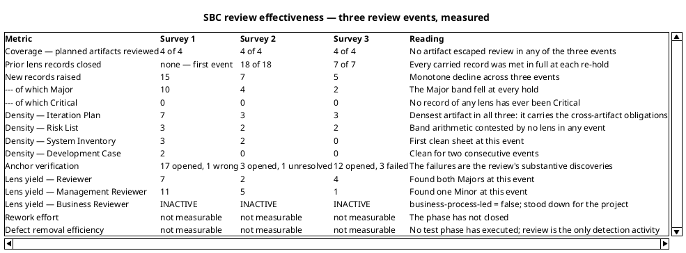

| Metric | Reading across the three events |
|---|---|
| Review coverage | 100 % at every hold — no artifact of this phase has entered a gate unreviewed |
| Prior records closed | 25 of 25 closed by their emitting lenses; no record has ever been carried open past the iteration that could close it |
| New records | 15 → 7 → 5. The Major band 10 → 4 → 2 |
| Densest artifact | The Iteration Plan, in all three events — 7, 3, 3. It carries the cross-artifact obligations (role profiles against the tailoring, risk owners against the register, gates against exit conditions), so it is where a contradiction between two correct documents surfaces first |
| Lens yield | The Management lens found every Major in the first two events; at this event the Technical lens found both. Two lenses remain the reason the set is not approved at 0 Major — either alone would have passed this artifact set |
| Anchor verification | 17 → 3 → 12 anchors opened, 1 → 1 → 3 failing. The failures are what the review is for: at this event two of the three are the R005 premise and the Razor language property |
| Rework effort | Not measurable — the phase has not closed. Estimate NONE: not zero, and no figure projected |
| Defect removal efficiency | Not measurable — no test phase has executed, so there is no ratio to compute. Review remains the only detection activity in the project |

**The trend these three points support, stated no more strongly than the evidence carries.** The correction machinery works and is converging: every record carried into an iteration is closed, the defect yield has fallen by two thirds in three events, and two of the four artifacts now carry no open record at all. What the trend does not support is a claim that the set is clean. The two Majors open now are the same shape as the previous iteration's — a statement in the Risk List that the Iteration Plan builds on — and both concern a single risk row.

**What these numbers cannot say.** Rework effort and defect removal efficiency are unmeasurable until the phase closes and a test phase executes; no figure is projected to fill them. Three points are a comparison, not a trend line, and no velocity is quoted from them. Cost is the second currency and it is not measured here: the project declares no token budget, none is assumed and none is proposed, and both clocks are reported apart.

#### Milestone decision

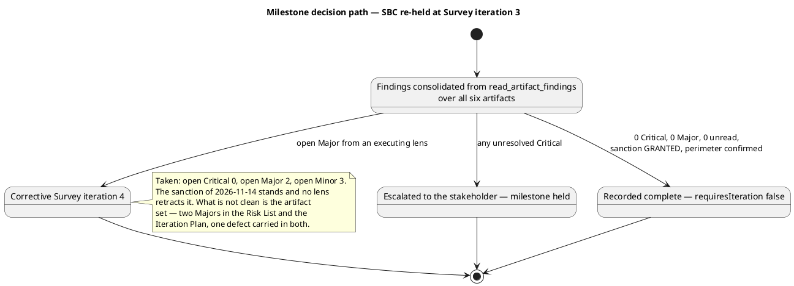

| Question | Answer, from the ledger |
|---|---|
| Unresolved Critical findings | 0 |
| Open Major findings | 2 — Risk List Reviewer F3, Iteration Plan Reviewer F3 |
| Open Minor findings | 3 — Risk List Reviewer F4, Iteration Plan Reviewer F4, Iteration Plan Management Reviewer F10 |
| Artifacts read | 6 of 6, unread = none |
| Perimeter confirmed | Yes — by the stakeholder at SBC, 2026-11-14 |
| Stakeholder sanction | **GRANTED**, 2026-11-14 |

**Decision: the phase is under corrective iteration. This milestone is not recorded complete.**

The perimeter is confirmed and the stakeholder's sanction stands; no lens retracts it and this block does not withhold it. What is not clean is the artifact set. SBC exit criteria 4 and 6 fail on one row: R005's strategy in the register names work already performed, and the plan books that risk's retirement at a milestone with nothing left to do for it. One correction inside two artifacts the Project Manager already holds closes both, and nothing in it needs a stakeholder question, a scope change or a Change Request.

Recording this milestone complete while two Major findings hold its own exit criteria would falsely open the phase gate — the highest-impact error available at this point, and the one this block exists to prevent.

#### Stakeholder sanction, as recorded by the Management lens

> "Yes"

**Stakeholder sanction: GRANTED**, 2026-11-14 — the perimeter confirmed as the System Inventory records it, and the phase sanctioned to advance past the System Boundary Confirmed milestone.

The sanction is not re-put at this iteration. All three of the stakeholder's decisions are answered and recorded where they bear; a decision already taken and correctly recorded everywhere it bears is not an open question, and escalating it a third time would ask them to answer what they have already answered twice.

#### Escalations

None. No record is overdue: every record open at entry to this iteration was closed within it, and the five open now were raised at this event. No review procedure was skipped or performed late in this milestone — the three lenses ran in sequence with the Business lens stood down by tailoring, and the four artifacts entered review in target state. No systemic process failure is recorded, so there is nothing for the Change Control Board.

#### What this milestone hands to Excavation

- **A confirmed perimeter.** The System Inventory and the Development Case carry no open record from either lens — the first time in this milestone that two of four artifacts are clean.
- **A bounding discipline that held.** Every acceptance in the register names the RUP phases as its horizon, and observation returns as a retirement path from Inception on with its producer and recorder named.
- **A register and a plan that must state one retirement for R005 before either is consumed.** Both artifacts are read by the System Analyst in Excavation 1, whose risk column currently sends that role to open a file it will find already read.
