## Document Control
### Reviewer lens
<!-- review: Survey I2 -->

<!-- review: Survey I2 -->

Phase: Survey
Status: Draft — technical lens of the SBC review re-held in iteration 2; 7 prior findings of this lens closed Resolved; 2 new findings (0 Critical, 0 Major, 2 Minor) on 2 artifacts
Milestone Target: End-of-Survey (SBC) — not yet achieved; the sanction is the stakeholder's and this lens does not hold it

### Management Reviewer lens
<!-- review: Survey I2 -->

<!-- review: Survey I2 -->

Phase: Survey
Status: Draft — management lens of the SBC review, re-held in iteration 2; 11 prior findings of this lens closed Resolved; 5 new findings (0 Critical, 4 Major, 1 Minor); stakeholder sanction GRANTED on 2026-11-14 with two corrections that open the four Majors
Milestone Target: End-of-Survey (SBC) — sanctioned by the stakeholder; four Majors owed as rework before Excavation consumes the artifacts

### Review Coordinator lens
<!-- review: Survey I1 -->

Phase: Survey
Status: Draft — coordination lens of the SBC review recorded; 18 lens records open (0 Critical, 10 Major, 5 Minor defects across 4 artifacts); stakeholder sanction REFUSED; milestone OPEN, corrective iteration 2 required
Milestone Target: End-of-Survey (SBC) — NOT achieved; no phase advance

## Review Scope and Criteria
### Reviewer lens
<!-- review: Survey I2 -->

<!-- review: Survey I2 -->

#### Review scope

Survey iteration 2 — the technical lens of the end-of-Survey (SBC) milestone review, re-held after the sanction was withheld on 2026-11-14. Four artifacts were in scope.

| Artifact | Owner | Discipline | State reviewed |
|---|---|---|---|
| Development Case | Process Engineer | Environment | Revised — tool references and ownership view corrected |
| System Inventory | Software Archaeologist | Discovery | Revised — pin tally corrected, stale qualifier dropped, Coverage settlement statement replaced |
| Risk List | Project Manager | Project Management | Revised — 26 risks; R002 and R011 accepted, R026 added |
| Iteration Plan | Project Manager | Project Management | Revised — all seven prior defects of both lenses corrected |

The Iteration Assessment is not in scope and its state is not a finding: the Project Manager writes it against the verdict of the lens sequence that ends with the Review Coordinator, so at this point in the sequence it cannot yet describe the iteration being reviewed. It records iteration 1 against the refused sanction, which is the correct content for it.

#### Review point and lens

The review point is the **Lifecycle Milestone** (SBC), so the question is **exit criteria**: do these four artifacts now evidence the conditions the sprint zero set for itself? It is not a feasibility review and not a completion review.

This iteration's work was corrective, so the lens has two jobs and the order matters. First, reconcile the seven findings this lens carried into the iteration — re-tested against the corrected text and the file each correction cites, never against the claim that a correction was made. Second, review the corrected set afresh: a correction can introduce a defect, and the artifacts that were rewritten were rewritten substantially.

#### Criteria applied

| Criterion | Source | Applied to |
|---|---|---|
| Anchor verification — every corrected fact checked against the file it cites | Survey depth rule | System Inventory, Development Case, Risk List |
| DC baseline conformance — no roster, ownership, CORE or optional-universe redefinition | IARI baseline | Development Case |
| Optional trigger justification — every FIRED verdict audited against its own §5.2 condition | IARI §5.2 | Development Case |
| Every cited document or section resolves | Baseline conformance | Development Case, Risk List |
| Coverage consistency — nothing declared read and unread, and its counts agree with itself | SBC criterion 3 | System Inventory |
| Band arithmetic — every magnitude the band of its own exposure | Risk magnitude table | Risk List |
| Acceptance authority — no High or Significant risk accepted by someone without the authority | Risk magnitude table | Risk List |
| Strategy executability — every disposal achievable without running the system | Stakeholder decision, 2026-11-14 | Risk List, Iteration Plan |
| Exit-criteria integrity — every criterion gates the milestone it names | SBC criterion 6 | Iteration Plan |
| Risk-retirement completeness — all 26 accounted for, each once | SBC criterion 6 | Iteration Plan |
| Measurement discipline — no invented size, budget, forecast or date | IARI DC §8.1 | Iteration Plan |
| Scope adherence — no marker retired except by the stakeholder's answer | Scope Guard | All four |

#### Anchor verification this iteration

The iteration-1 finding on the System Inventory was found by opening the file rather than reading the claim, so the corrected figures were taken the same way. Three anchors were re-opened:

| Anchor | Claim under test | Result |
|---|---|---|
| `Directory.Packages.props` | The pin tally, now stated as 30 in three places | **Confirmed.** 30 `PackageVersion` elements — 6 in the test group, 19 in the application group, 5 OpenTelemetry. The correction holds and its breakdown is correct |
| Development Case, Tool references | The `CONTRIBUTING.md` row is replaced by files that resolve | **Confirmed.** `Directory.Build.props` and `Directory.Packages.props` are the rows now, and the section states plainly that no written coding standard exists |
| Development Case, Guidelines and Procedures | The section R023's mitigation cites as "the version policy" | **Not found.** The section holds the pin rows under their owners and states no rule about raising a pinned version |

The third is the review's one substantive discovery this iteration, and it is recorded as Risk List F2.

#### Scope marker audit

| Marker or decision | Where | Verdict |
|---|---|---|
| The `admin` branch — unreachable, role provisioning out of scope | System Inventory, Decisions; Risk List R007 | Held. Answer of 2026-11-14 quoted verbatim in both |
| External login — configured-at-runtime, no use case this cycle | System Inventory, Decisions; Risk List R008 | Held. Quoted with the stakeholder's own condition ("revisit if credentials are supplied") |
| BFF trust boundary — known limitation of the single-host baseline | System Inventory, Decisions; Risk List R012 | Held. Quoted; carried as an accepted risk |
| The system is never run in any phase | System Inventory, Coverage; Risk List R002, R011; Iteration Plan | Held. Coverage now states it, both risks are `accept`, and the plan sweeps for work assuming a run |
| No `[DERIVED]` marker anywhere | All four | Correct — nothing here derives from a declared `FR-NNN`; the sprint zero recovers from code |

No marker was retired by a CCB decision, an approval or the passage of an iteration. Every one rests on the stakeholder's words, and each was checked against the code it disposes of. No `undeclared-scope` finding is recorded.

#### SBC exit criteria — this lens's verdict

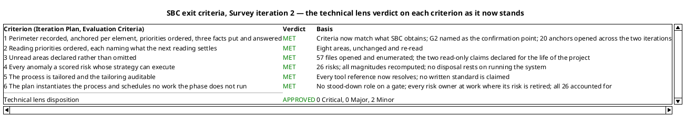

Two Minor findings are open and neither holds the milestone: each stays inside its own artifact, no role builds on the wrong content, and no criterion above turns on either.

### Management Reviewer lens
<!-- review: Survey I2 -->

<!-- review: Survey I2 -->

#### Scope

The SBC milestone re-held at the end of Survey iteration 2, the corrective iteration the stakeholder's refused sanction of 2026-11-14 made necessary. Four artifacts reviewed against the six SBC exit criteria, the Development Case's tailoring and the IARI Development Process: Development Case, System Inventory, Risk List, Iteration Plan. The Iteration Assessment is not reviewed as a gate input — the Project Manager writes it against this verdict.

Review type: Lifecycle Milestone Review (SBC), management lens, exit-criteria question.

#### Criteria applied

| Checklist item | What it tests |
|---|---|
| Every exit criterion evidenced as worded | The criterion states a condition the iteration can satisfy without a sanction it cannot obtain |
| Size and count facts match the anchor | A perimeter fact the stakeholder is asked to confirm is accurate |
| No acceptance without the authority to grant it | No Significant or High band risk rests on a grant nobody gave |
| Every risk strategy can execute | No disposal rests on an activity the project will not perform |
| Every risk accounted for exactly once, at the milestone that retires it | The plan's accounting describes what the milestones do |
| Every role the plan assigns work to is at work in that milestone | No iteration carries risks with no accountable owner |
| No role at work the tailoring stood down | No gate staffs a stood-down lens |
| Every milestone whose exit condition is the stakeholder's has a gate | Acceptance is obtained at an event, not assumed |
| Every cited reference resolves | The process authority is auditable |
| No invented size, token budget, forecast or calendar date | The plan measures only what this project can measure |
| Both clocks reported apart and never added | Agent time and human queue time are never summed |
| Marker retired only by the stakeholder's own answer | No inference is promoted to declared scope |
| Optional triggers hold their own §5.2 condition | Tailoring is not inflated |

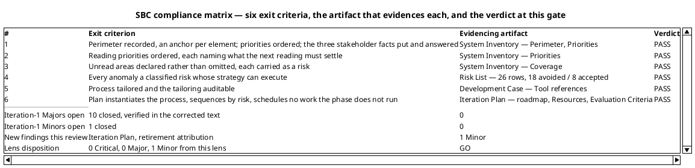

#### What changed since the refused sanction

The 2026-11-14 refusal rested on ten Majors. Seven of them traced to one root cause: the plan and the register both assumed the system could be run, and the stakeholder's correction to the System Inventory had established that it cannot. The correction order the Resolutions and Actions section of the previous milestone set — premise first, then what inherits it — was followed, and it is why the three artifacts now agree instead of contradicting each other:

- **The premise.** System Inventory Coverage states the stakeholder's decision in their own terms: the two read-only claims stay declared as read but not observed for the life of this project, carried as accepted risk, and no milestone may count them as retired.
- **The register.** R002 is `accept` in the Significant band on the stakeholder's grant, quoted verbatim. R011 is `accept` within the Project Manager's authority. Neither disposes of itself by an observation the project will not make.
- **The plan.** The retirement map is rebuilt: R002 and R011 are carried on acceptance, the "observed rather than read" step is gone, and the plan states as a load-bearing property that no retirement runs the system in any phase.

The three remaining Majors were independent governance defects — a stood-down role on two gates, an iteration with no one accountable for the risks it carried, and two acceptance milestones with no gate. Each is corrected in the Iteration Plan's roadmap and role profile.

### Review Coordinator lens
<!-- review: Survey I1 -->

#### Review event

End-of-Survey Lifecycle Milestone Review (**SBC**), Survey iteration 1. First review event of the project: no earlier milestone, cycle or iteration exists, so nothing in this record is a trend and no prior metric is reported.

| Field | Value |
|---|---|
| Review type | Lifecycle Milestone Review |
| Triggering condition | "Close-Out Phase" — the Survey iteration's artifacts complete and the phase gate reached |
| Artifacts in scope | Development Case, System Inventory, Risk List, Iteration Plan |
| Review point | Lifecycle Milestone — the question is **exit criteria**, not feasibility and not completeness of intent |
| Entry criteria | Met. The four artifacts existed in target state before review began; `read_artifact_findings` returned an empty list for all four at the start, confirming no unresolved prior record was carried in |
| Exit criteria | **Not met.** 10 Major defects open and the stakeholder's sanction withheld |

#### Lens participation

| Lens | Executed | Findings yielded | Disposition |
|---|---|---|---|
| Technical / Reviewer | Yes | 7 records — 3 Major, 4 Minor, 0 Critical | Approved with changes |
| Business / BusinessReviewer | **INACTIVE — did not evaluate this review** | None | Not applicable |
| Management / ManagementReviewer | Yes | 11 records — 10 Major, 1 Minor, 0 Critical | Conditional — sanction REFUSED |

The Business lens is inactive by tailoring, not by omission: the Development Case records `business-process-led = false`, stands the Business Reviewer down for the whole project, and states that the gate loses one lens while Reviewer and Management Reviewer remain. The milestone decision below is taken on the two lenses that executed.

#### Review calendar — this milestone and the events it opens

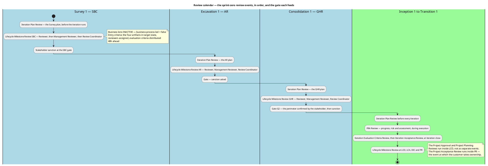

The SBC gate reopens in a **corrective Survey iteration 2**: the same three lenses, the same four artifacts plus whatever the corrections touch, against the corrected exit criteria. No new review type is introduced for it — a correction under a withheld sanction is the same milestone re-held, not a new event.

#### Effectiveness metrics — this review only

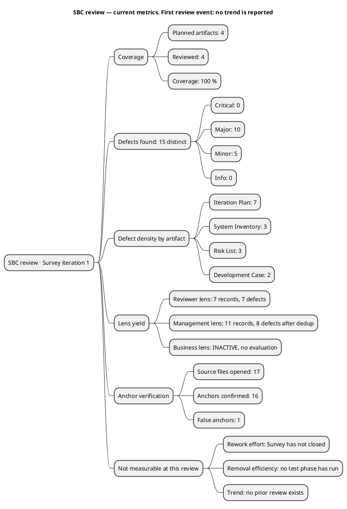

| Metric | Value | Interpretation |
|---|---|---|
| Review coverage | 4 of 4 planned artifacts — 100 % | The Survey process produces exactly these four and all four were reviewed. No artifact escaped review |
| Defect density — Iteration Plan | 7 defects on one artifact | The highest of the four by a wide margin. The plan is the artifact that carries cross-artifact obligations — role profiles against the tailoring, risk owners against the register, gates against milestone exit conditions — so it is where a contradiction between two correct documents shows up. Not a signal that the plan was written carelessly: it is the only artifact whose correctness depends on three others |
| Defect density — System Inventory | 3 defects on the sprint zero's central artifact | Low for the artifact that received the deepest review. Seventeen anchors were opened and sixteen confirmed, so the perimeter's content is sound and the three defects are a stale count and two stale qualifiers |
| Defect density — Risk List | 3 defects | 23 of 25 risks dispose of themselves correctly; the three defects sit on two rows plus one mitigation's ownership |
| Defect density — Development Case | 2 defects | One broken reference and one notation choice |
| Anchor verification yield | 1 false anchor in 17 opened — 6 % | Direct verification was worth performing and was performed: the one defect it found (the package-pin tally) is invisible to a reading of the artifact alone |
| Business lens yield | Not applicable | The lens did not run; its absence is tailoring, and no finding is recorded against it |
| Rework effort | **Not measurable at this review** | Survey has not closed and no corrective iteration has run, so no rework has been performed to measure. The estimate is NONE — not zero, and not a figure |
| Defect removal efficiency | **Not measurable at this review** | No test phase has executed in this project. Review is the only detection activity that has occurred, so there is no ratio to compute |
| Trend | **None reported** | This is the first review event. A trend requires a second. No earlier cycle, iteration or metric is invented to populate one; the comparison begins at the corrective iteration |

The one interpretive claim these numbers support: **the review process is finding defects at a rate that justifies the gate**. A 15-defect yield with 10 in the Major band, from two lenses, on four artifacts — that is a review that did work rather than a rubber stamp. What the numbers cannot yet say is whether the process is *improving*, and nothing here claims it is.

## Findings
### Reviewer lens
<!-- review: Survey I2 -->

<!-- review: Survey I2 -->

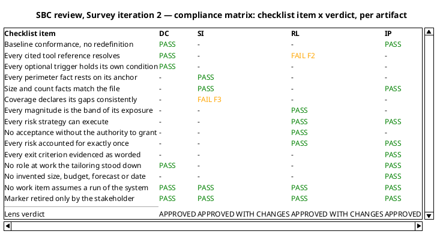

#### Development Case

Environment discipline, Survey. Verdict: **Approved** — no open finding from this lens. Both iteration-1 findings were resolved and verified in the corrected text.

| Checklist item | Verdict |
|---|---|
| Baseline conformance: roster, CORE set, ownership unchanged | Pass |
| Every FIRED optional trigger holds its own §5.2 condition | Pass — Deployment Model still the only one, on the four-process topology |
| Every NOT FIRED verdict still holds | Pass — re-read, none changed |
| Every cited tool reference resolves in the tree | Pass — the `CONTRIBUTING.md` row is gone |
| Classification deltas carry a basis | Pass |
| No forbidden override | Pass |

The Tool references table now names `.github/workflows/ci.yaml`, `Directory.Packages.props` with `global.json`, `Directory.Build.props`, `Todo.Api.Tests` with `Directory.Packages.props`, and `README.md` — five rows, each a path in the tree — and closes by stating that no written coding standard exists in the repository and none is assumed, with the route by which one would be authored. That is the correction iteration 1 asked for, and it is better than the minimum: the reader is no longer left to infer that an absent standard means no standard.

The Roles and Ownership view is redrawn with `component` and `artifact` elements and dashed work-assignment arrows, and carries a note that the arrows are work assignments by stage rather than ownership, with ownership stated in the prose and the contributor bullets. The Minor is closed.

#### Development Case — what the correction now obliges

One consequence follows for a later role, recorded as an observation and not a finding: with no written standard, the Code Reviewer's checklist is `Directory.Build.props`'s compiler-enforced conventions, the central pins, and the Software Architecture Document's mechanisms. The Development Case says exactly that, so the Code Reviewer is not left improvising. Nothing more is owed here.

#### System Inventory

Discovery discipline, Survey — the sprint zero's one artifact, and the perimeter every later role builds on. Verdict: **Approved with changes** — one Minor, no Major.

The iteration-1 Major was the package-pin tally, and it was found by opening the file, so it was closed the same way.

##### The corrected facts, verified against their anchors

| Claim | Anchor | Result |
|---|---|---|
| 30 package pins — 6 test, 19 application, 5 OpenTelemetry | `Directory.Packages.props`, re-opened this iteration | **Confirmed.** 30 elements, and the group split is exact |
| The individual pins named — EF Core 9.0.8, YARP 2.3.0, Scalar 2.6.8, OpenTelemetry 1.12.0 | same file | Confirmed, unchanged from iteration 1 |
| `RateLimitExtensions.cs` read, not unread | Coverage enumeration; Documentation table | Confirmed — the qualifier that contradicted Coverage is gone, and Coverage is now the single authority on what was read |
| The two read-only claims are never settled by observation | Coverage closing statement | Confirmed — the sentence now records the stakeholder's decision in their terms and no longer names running the system |

##### The perimeter still stands

The substantive finding of iteration 1 was that sixteen of seventeen anchors said exactly what the artifact claims, and the stakeholder's own answer added that nothing is missing from the perimeter. Neither the corrections nor this review disturbed that: the perimeter record — seven projects, two actors, five external elements, eight tables, the entry-point surface — is as iteration 1 verified it, and the size facts are now right.

##### F3 — Minor — the Provenance row counts 58 into a 57-file total

Coverage states "Files opened: 57" in Document Control and again in the section, and enumerates exactly 57 paths. The Provenance row that summarises the same reading says "57 files opened: the 53 of the first pass plus `Todo.Api/Extensions/RateLimitExtensions.cs`, `Todo.Api/Filters/ValidationFilter.cs`, `Todo.Web/Server/Authentication/HttpAuthenticationStateProvider.cs`, `Todo.Web/Client/TodoApp.razor` and `Todo.Web/Client/Components/LogInForm.razor`" — five names added to 53.

Coverage's own sentence names four: "Four files opened this iteration were declared unread in the previous reading", and `RateLimitExtensions.cs` is not among them, because iteration 1's Coverage recorded it read in full — which is what makes the iteration-1 Minor on this artifact true.

The tally and the enumeration are both correct; only the summarising Provenance row misstates which files were added. Recommendation: drop `RateLimitExtensions.cs` from that row so it reads "the 53 of the first pass plus" the four named files, and Provenance, Coverage, the enumeration and Document Control then state one number.

This is a Minor: the declaration of what was read — the thing criterion 3 turns on — is unaffected, and no role builds on the arithmetic.

#### Risk List

Project Management discipline, Survey. Verdict: **Approved with changes** — one Minor, no Major. The register grew from 25 to 26 risks and both iteration-1 findings from the other lens, and this lens's own, were corrected.

##### What the correction achieved

| Check | Result |
|---|---|
| Every strategy can execute without running the system | **Pass.** R002 and R011 are `accept`, with R002's Significant-band grant quoted verbatim from the stakeholder's 2026-11-14 answer, and a contingency stating what happens if a reading-only claim proves wrong outside this project |
| No High or Significant risk rests on an acceptance nobody granted | **Pass.** Both High-band risks are `avoid`; of the eight Significant, seven are `avoid` and R002 alone is accepted on the stakeholder's own words |
| Every magnitude is the band of its own exposure | **Pass.** All 26 recomputed; the distribution 2 High / 8 Significant / 12 Moderate / 3 Minor / 1 Low agrees with the register row for row |
| The human gate is bounded where the plan says it is | **Pass.** R026 bounds the stakeholder gates at a 14-day queue ceiling with the suspension rule, is Significant (3×4=12), and is `avoid` on its own bound rather than on anyone's grant |
| A mitigation assigns work inside the owning role's artifact | **Pass.** R018 now has the Software Architect establish the values and supply them, and the System Analyst — the Supplementary Specification's owner — record them |
| Traceability table present, one row per declared `RNNN`, recovered elements with empty `Traces From` | Pass — 26 rows, correct form |

##### F2 — Minor — R023 cites a version policy the Development Case does not contain

R023's mitigation reads "Framework and Razor language version stay as delivered; raising either is a baseline change under the Development Case version policy", and its contingency "Raising it requires a Change Request against that policy".

The Development Case's sections are Document Control, Tailoring Overview, Disciplines and Intensity, Artifacts and Templates, Optional Artifact Triggers, Roles and Ownership, and Guidelines and Procedures. No section states a version policy. Guidelines and Procedures holds the pin rows — "Runtime and package pins (central package management) | `Directory.Packages.props`, `global.json` | Software Architect" — which name the owner of the pins but state no rule about raising one.

This matters more than its severity suggests, because it is the same defect class the Development Case itself carried in iteration 1: a citation to something that does not resolve. Here it is the register pointing at the process authority, and the authority has no such content. It is contained — R023 is an accepted Moderate risk whose contingency is a Change Request either way, and no exit criterion turns on the wording — so it is a Minor.

Recommendation: cite what exists. "Raising either changes the pins in `Directory.Packages.props`, owned by the Software Architect, and enters as a Change Request" removes the dangling section without adding one. The alternative — asking the Process Engineer to state the version policy in the Development Case and keeping the citation — is equally valid but crosses into another role's artifact, so the first is the shorter repair. What must not remain is the register and the process authority disagreeing about whether a rule exists.

#### Iteration Plan

Project Management discipline, Survey. Verdict: **Approved** — no open finding from this lens. Both iteration-1 findings were resolved and verified.

##### The two corrected defects, verified

- **Criterion 1 no longer claims a confirmation SBC does not obtain.** It reads "The perimeter of the existing system is recorded with an anchor per element, the reading priorities are ordered, and the three facts whose disposition is the stakeholder's have been put to the stakeholder and answered", and the section "Where the perimeter is confirmed" names G2 at Consolidation 1's start with the reason — Excavation deepens the perimeter, so confirming it before that reading would confirm an incomplete record. The three answers are explicitly denied any role as confirmation of the perimeter. Criterion and roadmap row now state the same condition, which is what iteration 1 found they did not.
- **All 26 risks are accounted for exactly once.** The table splits them 17 retired by a named milestone artifact, 1 retired by its own bound (R026), and 8 carried on the Risk List's acceptance — with R023 named in that list and in the retirement diagram. 17 + 1 + 8 = 26, and it agrees with the register's 18 avoided / 8 accepted split.

##### What the plan now gets right beyond its corrections

| Checklist item | Verdict |
|---|---|
| No role at work that the tailoring stood down | Pass — no gate row carries the Business Reviewer, and the table says why |
| Every role a milestone assigns work to is at work in that milestone | Pass — the Excavation profile now carries the System Analyst and the Software Archaeologist at the stages the process assigns them, and R002, R005 and R017 have their owners on the profile |
| Every milestone whose exit condition is the stakeholder's acceptance has a gate | Pass — five gates, G1 through G5, with G4 at LCA and G5 at PR where ownership transfers |
| No work item, milestone or disposal assumes a run of the system | Pass — the retirement map is rebuilt, the "observed rather than read" step is gone, and the plan sweeps for others |
| No invented size, token budget, forecast or calendar date | Pass, and unchanged: no work item is sized, the gantt declares its bars are not durations, no start date is given, no budget is proposed |
| Both clocks reported apart and never added | Pass |
| Every exit criterion names the work item that evidences it | Pass — the variance iteration 1 recorded and did not repair |

##### One item recorded and not raised

The Document Control status line reads "All seven Iteration Plan defects of the SBC review (IP-1 to IP-7) are corrected in place". It is accurate as a statement of the Plan and it names the defects by the Review Coordinator's consolidated identifiers rather than by this lens's finding keys. No role builds on it and no criterion turns on it, so it is recorded here as read and correct rather than as a finding.

### Management Reviewer lens
<!-- review: Survey I2 -->

<!-- review: Survey I2 -->

#### Development Case

Environment discipline, Survey. Verdict: **Approved** — no open finding from this lens. The iteration-1 Major is closed Resolved.

| Checklist item | Verdict |
|---|---|
| Tailoring is a delta over the IARI baseline — no roster, CORE, ownership or optional-universe redefinition | Pass |
| Every FIRED optional trigger holds its own §5.2 condition | Pass — Deployment Model alone, on a genuine four-process topology |
| Every NOT FIRED verdict holds against its condition | Pass — Data Model on 8 tables, Proof-of-Concept deferred to Elaboration, Test Plan on no audit obligation |
| Classification deltas carry their basis | Pass — `business-process-led = false`, `real-time-system = false`, both derived from the code |
| Every cited tool reference resolves in the tree | **Pass** — was the iteration-1 Major |
| Discipline intensities match the canonical matrix, no self-granted deviation | Pass |
| No stood-down role at work the tailoring removes | Pass — Business Process Analyst, Business Reviewer, Capsule Designer |

The Tool references table now names five paths, each present in the tree — `.github/workflows/ci.yaml`, `Directory.Packages.props` with `global.json`, `Directory.Build.props`, `Todo.Api.Tests` with `Directory.Packages.props`, `README.md`. It closes with the statement that no written coding standard exists in the repository and none is assumed, and names the route by which one would be authored. SBC criterion 5 asks whether the tailoring is auditable; a process authority whose references all resolve is auditable, and this one is. **Criterion 5: Pass.**

The correction obliges nothing further of this artifact. One consequence for a later role is recorded as an observation, not a finding: with no written standard, the Code Reviewer's checklist is `Directory.Build.props`'s compiler-enforced conventions, the central pins, and the Software Architecture Document's mechanisms. The Development Case says exactly that, so the Code Reviewer is not left improvising.

#### System Inventory

Discovery discipline, Survey — the sprint zero's one artifact and the perimeter every later role builds on. Verdict: **Approved** — no open finding from this lens. Both iteration-1 Majors are closed Resolved.

| Checklist item | Verdict |
|---|---|
| Every perimeter element carries an anchor that says what is claimed | Pass — independently verified by the technical lens; not re-opened here |
| Size and count facts match the anchor | **Pass** — was the iteration-1 Major |
| Coverage declares its gaps rather than omitting them | Pass — and now carried as risk rather than as an open question |
| The three stakeholder decisions are recorded in the stakeholder's own words | Pass — each quoted verbatim, each verified against the code it disposes of |
| No forward commitment rests on an activity the project will not perform | **Pass** — was the iteration-1 Major |
| Runtime behaviour claimed nowhere | Pass — Coverage states no process was run and none is run in any phase |

The pin tally reads **30** with its group breakdown in all three places it is stated, and the arithmetic closes: 6 test + 19 application + 5 OpenTelemetry. The size fact the Software Architect anchors the SAD's version policy to is now accurate, and so is the size fact of the perimeter the stakeholder is asked to confirm.

Coverage's closing statement now carries the stakeholder's decision in their terms: the two read-only claims stay declared as read but not observed for the life of the project, carried as accepted risk with the residual uncertainty intact, and no milestone may count them as retired. The declarations themselves stand unchanged — they are the honest record the stakeholder endorsed. **Criterion 3: Pass.**

The perimeter's content is not disturbed by either correction, and the stakeholder's own answer states that nothing is missing from it that they know of.

#### Risk List

Project Management discipline, Survey. Verdict: **Approved** — no open finding from this lens. Both iteration-1 Majors are closed Resolved.

| Checklist item | Verdict |
|---|---|
| Every anomaly of the System Inventory is carried as a scored risk | Pass — 26 rows; 23 anomalies, 2 declared coverage limits, and R026 |
| Every magnitude is the band of its own exposure | Pass — 2 High, 8 Significant, 12 Moderate, 3 Minor, 1 Low; agrees with the register row for row |
| No High or Significant risk rests on an acceptance nobody granted | **Pass** — was the iteration-1 Major |
| Every risk's strategy can actually execute | **Pass** — was the iteration-1 Major |
| The only non-agent delay in the project is bounded here, as the plan claims | **Pass** — R026, 3×4=12, Significant, `avoid` on its own bound |
| Every accepted risk at Significant or above quotes its grant | Pass — R002 alone, on the stakeholder's answer of 2026-11-14 |
| Traceability table present, one row per declared `RNNN`, recovered elements with empty `Traces From` | Pass — 26 rows, correct form |

Both High-band risks are `avoid` and retired by artifacts the process already runs — R001 by the Test Case at LCA, R009 by the Use-Case Model at GHR. Of the eight Significant risks, seven are `avoid`; R002 alone is accepted, and it rests on the stakeholder's own words quoted verbatim, with a contingency stating what happens if a reading-only claim proves wrong when the system is first run outside this project. No acceptance in the register is outstanding, and the Document Control status line now says so accurately.

R026 bounds the project's only non-agent delay: 14 days of queue time, estimate none, actual measured and reported apart from agent time, the process suspends rather than filling the gap with an assumption. The Iteration Plan cites it by identifier, so the plan and the register now state the same control — a control asserted in one document and absent from the other was the iteration-1 defect, and it is closed. **Criterion 4: Pass.**

#### Iteration Plan

Project Management discipline, Survey. Verdict: **Approved with changes** — one Minor, no Major. All five iteration-1 Majors and the Minor are closed Resolved.

| Checklist item | Verdict |
|---|---|
| Every exit criterion is evidenced as worded | **Pass** — was the iteration-1 Major |
| No role at work that the tailoring stood down | **Pass** — was the iteration-1 Major |
| Every role the plan assigns work to is at work in that milestone | **Pass** — was the iteration-1 Major |
| Every milestone whose exit condition is the stakeholder's acceptance has a gate at which it is obtained | **Pass** — was the iteration-1 Major |
| No milestone retires a risk by an activity the project will not perform | **Pass** — was the iteration-1 Major |
| Per-criterion state reported accurately, not uniformly | **Pass** — was the iteration-1 Minor |
| Every risk accounted for exactly once, at the milestone that retires it | **Fail — F7 (Minor)** |
| No invented size, token budget, forecast or calendar date | Pass — no work item is sized, no bar is a duration, no start date is given |
| Both clocks reported apart and never added | Pass |
| Milestone order matches the phase sequence | Pass |
| Parallelism not claimed where the chain is data-dependent | Pass |

##### What the five corrections achieved

Criterion 1 no longer claims a confirmation SBC does not obtain: it asks for recorded-and-put, and the section that follows names **G2 at Consolidation 1's start** as where the perimeter is confirmed, with the reason — Excavation deepens the record, so confirming before that reading would confirm an incomplete one. The three answers of 2026-11-14 are explicitly denied any role as confirmation of the perimeter. This was the defect that made the milestone unsanctionable in iteration 1: a criterion satisfiable only by a sanction the stakeholder withheld. It is now a criterion SBC can satisfy, and it is satisfied.

Two of the three governance Majors are corrected in the roadmap and the role profile. The Business Reviewer appears on no gate, and the roadmap states why — every row reads Reviewer, Management Reviewer, Review Coordinator, matching the plan's own Resources section and the tailoring that governs it. Excavation 1 now carries the System Analyst and the Software Archaeologist at the stages the process assigns them, beside the Software Architect, Designer, Database Designer and Project Manager, so every risk owner named in a milestone row is at work in the milestone that carries its risk. The fifth Major is corrected in the retirement map: R002 and R011 are carried on the Risk List's acceptance rather than counted as retired at AR, and the plan states as a load-bearing property that no retirement anywhere runs the system.

The third governance Major — the unbooked acceptance gates — is corrected by booking five: G4 at Elaboration 1's end for the architecture baseline, G5 at Transition 1's end for the product, and the PR row now names "the customer taking ownership of the product (G5)". A milestone that exists to transfer ownership now has an event at which ownership transfers.

##### F7 — Minor — the retirement map credits LCO with two retirements this iteration performed

The LCO row's risk column reads "R006, R025", and the retirement diagram reads "Process authority corrected against the evidence — R006, R025". Both risks are retired **at this milestone**, by corrections the same document records as done: the fine plan's row "Correct the pin tally to 30 and replace the absent-standard reference — Software Archaeologist, Process Engineer — Development Case (DC-1, DC-2)", and the Evaluation Criteria row "DC-1 — the `CONTRIBUTING.md` row, corrected this iteration". R006's mitigation is executed in the Development Case's Guidelines and Procedures and R025's in its Roles and Ownership; this review verified both corrections and closed them.

So the plan's opening property — every risk accounted for "exactly once ... at the milestone named in the table above" — names the wrong milestone for two of the twenty-six. The sum still closes at 26, no risk is double-counted, and no risk is lost.

A Minor because it stays inside the artifact. R006 and R025 are Moderate risks whose correction changed no plan shape; the roadmap's sequencing claim concerns the High and Significant bands, which are untouched; and no exit criterion depends on the attribution. Nothing downstream is built on the wrong milestone.

Recommendation: move R006 and R025 into a line for Survey 2 — SBC and adjust the accounting to fifteen retired by a later milestone artifact, two at SBC, one by its own bound (R026) and eight carried on acceptance. The sum stays twenty-six, and the LCO row then carries no retired risk — correct, because Inception's work is the declared-scope artifacts, not the correction of the process authority.

#### Iteration Assessment

Not reviewed as a gate input, and its absence or lag is no defect. The Project Manager writes it against this verdict; demanding it describe the iteration before this review rules on that iteration would invert the order. Recorded here so no later lens reads the gap as an omission.

### Review Coordinator lens
<!-- review: Survey I1 -->

#### Consolidated finding ledger

Coordinated from `read_artifact_findings` over all five artifacts. **18 lens records are open — not one carries a resolution object.** A Review Record sentence saying a defect was fixed is not a resolution; the ledger object is, and no such object exists. Closure ledger below is therefore empty of closures, correctly.

Two executing lenses raised records against the same artifacts. Where they name the same defect I collapse them into one defect with two lens records, both of which must close separately: each lens closes its own record and a cross-lens close is rejected by the handler.

```plantuml
@startuml
title Consolidated finding ledger — 18 lens records, deduplicated to 15 defects across 4 artifacts
skinparam shadowing false
skinparam classAttributeIconSize 0

package "Development Case — 2 defects" #LightYellow {
  class "DC-1  Major\nTool references cites CONTRIBUTING.md,\nabsent from the tree" as DC1
  class "DC-2  Minor\nownership drawn with class elements" as DC2
}

package "System Inventory — 3 defects" #LightYellow {
  class "SI-1  Major\npackage-pin tally 28, the file holds 30" as SI1
  class "SI-2  Major\nCoverage says the read-only claims are\nsettled by running the system" as SI2
  class "SI-3  Minor\nRateLimitExtensions.cs marked read\nand unread in two sections" as SI3
}

package "Risk List — 3 defects" #LightYellow {
  class "RL-1  Major\nno risk bounds the 14-day gate ceiling" as RL1
  class "RL-2  Major\nR002 and R011 avoid an action ruled out;\nR002's Significant grant unrecorded" as RL2
  class "RL-3  Minor\nR018 mitigation writes into the\nSystem Analyst's artifact" as RL3
}

package "Iteration Plan — 7 defects" #LightYellow {
  class "IP-1  Major\ncriterion 1 claims an unevidenced\nstakeholder confirmation" as IP1
  class "IP-2  Major\nstood-down Business Reviewer staffed\nat LCO and LCA" as IP2
  class "IP-3  Major\nExcavation roles withheld from the\nExcavation profile" as IP3
  class "IP-4  Major\nLCA and PR stakeholder gates unbooked" as IP4
  class "IP-5  Major\nAR retires R002 and R011 by running\nthe system, which is ruled out" as IP5
  class "IP-6  Minor\nexit-criteria column reports uniform\nreadiness" as IP6
  class "IP-7  Minor\nR023 absent from the retirement map" as IP7
}

note right of DC1
  Two lens records, one defect:
  Reviewer F1 and Management F1.
  Both must close it, each from its own lens.
end note
note right of SI1
  Two lens records, one defect.
  Every individual pin resolves; only the count is wrong.
end note
note right of IP1
  Two lens records, one defect.
  The defect the stakeholder's refusal resolved:
  a criterion satisfiable only by the sanction withheld.
end note
note bottom of IP5
  RL-2, SI-2 and IP-5 are one root cause
  and its two consequences: the plan and the
  register both assume the system can be run,
  and the stakeholder has ruled it out.
end note
@enduml
```

| Defect | Artifact | Severity | Lens records | Owner | Holds milestone |
|---|---|---|---|---|---|
| SI-2 Coverage names an impossible settlement path for the two read-only claims | System Inventory | Major | Management F2 | Software Archaeologist | Yes |
| RL-2 R002 and R011 avoided on an action ruled out; R002's Significant grant unrecorded | Risk List | Major | Management F2 | Project Manager | Yes |
| IP-5 AR retires R002 and R011 by running the system | Iteration Plan | Major | Management F5 | Project Manager | Yes |
| IP-1 SBC criterion 1 claims an unevidenced stakeholder confirmation | Iteration Plan | Major | Reviewer F1, Management F1 | Project Manager | Yes |
| IP-2 Stood-down Business Reviewer staffed at LCO and LCA | Iteration Plan | Major | Management F2 | Project Manager | Yes |
| IP-3 Excavation roles withheld from the Excavation profile | Iteration Plan | Major | Management F3 | Project Manager | Yes |
| IP-4 LCA and PR stakeholder gates unbooked | Iteration Plan | Major | Management F4 | Project Manager | Yes |
| RL-1 No risk bounds the 14-day human-gate ceiling | Risk List | Major | Management F1 | Project Manager | Yes |
| DC-1 Tool references cites an absent `CONTRIBUTING.md` | Development Case | Major | Reviewer F1, Management F1 | Process Engineer | Yes |
| SI-1 Package-pin tally 28 against 30 in the file | System Inventory | Major | Reviewer F1, Management F1 | Software Archaeologist | Yes |
| DC-2 Ownership drawn with class elements | Development Case | Minor | Reviewer F2 | Process Engineer | No |
| SI-3 `RateLimitExtensions.cs` marked read and unread | System Inventory | Minor | Reviewer F2 | Software Archaeologist | No |
| RL-3 R018 mitigation writes into the System Analyst's artifact | Risk List | Minor | Reviewer F1 | Project Manager | No |
| IP-6 Exit-criteria column reports uniform readiness | Iteration Plan | Minor | Management F6 | Project Manager | No |
| IP-7 R023 absent from the risk-retirement map | Iteration Plan | Minor | Reviewer F2 | Project Manager | No |

#### Key collisions across lenses

`Iteration Plan#F2` names **two different defects**: the Reviewer's is IP-7 (R023 absent from the retirement map, Minor); the Management Reviewer's is IP-2 (stood-down role staffed, Major). `System Inventory#F1` and `System Inventory#F2` likewise carry one record from each lens with different content in three of the four cases.

This is the identifier convention working as specified — a finding key is scoped per artifact **and per lens** — but it is a coordination hazard in this record set: a reader told to "fix Iteration Plan F2" fixes the Minor and leaves the Major. Every action below therefore names the defect **and** its lens, never the bare key.

#### Conflicts between lenses, and how I resolved them

| Conflict | Resolution |
|---|---|
| **Risk List disposition.** Reviewer: "Approved — one Minor, no Major". Management: "Approved with changes — two Majors". | The Management lens governs. Its two Majors rest on the stakeholder's correction of 2026-11-14, which arrived after the Reviewer had already audited the register and could not have been tested by that lens. The Reviewer's band arithmetic — all 25 magnitudes recomputed, none misbanded — stands and is not disturbed. Both readings are correct about different questions. |
| **Iteration Plan disposition.** Reviewer: "Approved with changes — one Major". Management: "Rejected — five Majors". | Both stand; the stricter governs the gate. A Major is a Major whoever finds it, and the plan carries six of the ten. The Reviewer's lens tested exit-criteria integrity and measurement discipline and found the plan's refusal to invent a size, budget, forecast or date correct — that finding stands and is recorded as strength, not contradicted. |
| **System Inventory depth.** Reviewer verified 17 anchors and found 1 wrong; Management accepted that verification without repeating it and found a second Major from a different angle. | Complementary, not conflicting. The consolidated artifact carries both: the perimeter's *content* is verified sound (16 of 17 anchors confirmed, and the stakeholder states nothing is missing from it), while its *forward commitments* and one size fact are wrong. |
| **Root cause.** Management identifies seven Majors as one cause; the Reviewer records three Majors as independent. | Both accounts are true of their own set. Consolidated: 10 Majors are **one root cause with two consequences** (SI-2, RL-2, IP-5) plus **six independent defects** (IP-1, IP-2, IP-3, IP-4, RL-1, DC-1, SI-1 — of which IP-1 is raised by both lenses). The seven-in-one grouping is what determines the correction order; treating them independently would produce artifacts that disagree with each other. |

#### What no lens raised, and I record as not-a-defect

- **The Iteration Assessment's absence.** The Project Manager writes it against this verdict and it does not gate the phase. Both lenses reached this independently and correctly.
- **Risk scores.** Both lenses declined to contest individual scores, citing the plan's own statement that disagreement with a score does not fail the milestone. I do not convert a scoring judgement into a finding.
- **The empty trace graph.** Survey declares no traceable element family — the System Inventory and the four process artifacts all cite declared ids where they use them and register no element of their own. A blank trace graph at SBC is the correct shape, not a `trace-gap`. The Risk List's 25 empty `Traces From` rows are the right form for recovered elements.
- **Scope markers.** No `[DERIVED]`, `[SCOPE_QUESTION]` or `[ASSUMPTION]` marker survives in any of the four artifacts. The three stakeholder decisions of 2026-11-14 were re-tested by the Reviewer against the code each disposes of and all three hold. No marker was retired by anything other than the stakeholder's own words — which is the only thing that may retire one.

I did not re-adjudicate any lens finding. Where a record quotes its evidence, the evidence is in the record; re-deriving it would spend the gate's budget restating what has been established.

## Resolutions and Actions
### Reviewer lens
<!-- review: Survey I2 -->

<!-- review: Survey I2 -->

#### Closure ledger — the seven findings this lens carried in

Each was re-tested against the corrected text **and** the file the correction cites, then closed by the tool call that materializes the state change. The table records what was verified; the calls were applied before this entry was written.

| Finding | Severity | Correction found in the artifact | Closed |
|---|---|---|---|
| Development Case F1 — `CONTRIBUTING.md` cited, absent | Major | Tool references now names `Directory.Build.props` and `Directory.Packages.props` with `global.json`, and states no written standard exists | Resolved |
| Development Case F2 — ownership drawn as class elements | Minor | Component and artifact view with dashed work-assignment arrows; ownership stated in prose and flagged as such in a note | Resolved |
| System Inventory F1 — pin tally 28 against 30 | Major | 30 in Technology and Size, in Configuration read as documentation, and in Provenance; re-counted against the file | Resolved |
| System Inventory F2 — `RateLimitExtensions.cs` read and unread | Minor | The "(unread)" qualifier is gone; Coverage is the single authority on what was read | Resolved |
| Risk List F1 — R018 writes into another role's artifact | Minor | Supply separated from recording: Software Architect establishes and supplies, System Analyst records | Resolved |
| Iteration Plan F1 — criterion 1 claims an unevidenced confirmation | Major | Criterion restated to recorded-and-put; G2 named as the confirmation point with its reason; the three answers denied as confirmation | Resolved |
| Iteration Plan F2 — R023 absent from the retirement map | Minor | All 26 accounted for, 17 + 1 + 8, with R023 named in the carried-accepted list and in the diagram | Resolved |

No finding of this lens persists into this iteration. The two findings recorded this iteration are new defects in the corrected text, not old ones re-recorded — each has its own finding key because neither existed when iteration 1 closed.

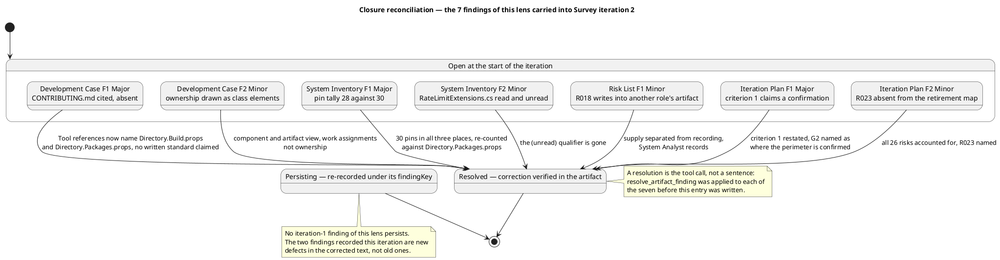

#### Open findings and their actions

| Finding | Artifact | Severity | Owner | Holds the milestone | Action |
|---|---|---|---|---|---|
| System Inventory F3 — Provenance counts 58 into a 57-file total | System Inventory | Minor | Software Archaeologist | No | Remove `RateLimitExtensions.cs` from the Provenance row's added-file list so it names the four the Coverage sentence names |
| Risk List F2 — R023 cites a version policy the Development Case has no section for | Risk List | Minor | Project Manager | No | Cite what exists — the pins in `Directory.Packages.props`, owned by the Software Architect, raised by a Change Request — instead of a Development Case section that does not exist |

Neither is owed before the milestone is ruled on. Both are corrections inside an artifact their owner already holds, each is a single sentence, and neither changes a single fact a later role builds on.

#### What this lens deliberately did not raise

Recorded so the omission is a decision rather than an oversight.

- **The perimeter's content.** Twenty anchors have now been opened across the two iterations and every one but the pin tally — now corrected — says what the artifact claims. The stakeholder states nothing is missing from the perimeter. The content is not in dispute and re-verifying it would spend the gate's budget restating what iteration 1 established.
- **Risk scores.** R002's probability 5 and R011's impact 4 are judgements. What must hold — that every magnitude is the band of its own exposure, and that no High or Significant risk rests on an acceptance nobody granted — holds across all 26 rows. The Iteration Plan states that disagreement with a score does not fail the milestone, and this lens concurs.
- **The Iteration Assessment's state.** The Project Manager writes it after the Review Coordinator's verdict. At this point in the lens sequence it cannot describe this iteration, and its content — iteration 1 assessed against a refused sanction — is correct for what it can describe.
- **The empty trace graph.** `model_generate_rtm` returns no links, correctly: Survey declares no element family from the trace chain, and nothing recovered from the existing system has an upstream. A blank graph at SBC is the right shape, not a `trace-gap`. The Risk List's 26 empty `Traces From` rows are the right form for recovered elements.
- **The two iterations' rework cost.** Corrective iterations leave rework unmeasured until the phase closes. No figure is projected and none is invented.

#### Pull requests

`scm_list_pull_requests` over all states returns none. No branch carries work, no scaffolding awaits approval, nothing needs deferring out of phase, and no code-review evidence is withheld on those grounds. Survey produces no source code, so an empty pull-request set is the correct shape for this milestone rather than a gap.

### Management Reviewer lens
<!-- review: Survey I2 -->

<!-- review: Survey I2 -->

#### Closure of the iteration-1 findings of this lens

Eleven findings were open against this lens at the start of this iteration — ten Major, one Minor. Every one is closed **Resolved**, and none on the strength of a claim. Each was closed only after the corrected section was read and, where the finding concerned a file outside the artifact, the anchor itself was re-read: the package pins were re-counted from `Directory.Packages.props`, the five tool-reference paths were checked against the tree, and the two closure sentences were read in the text that now carries them.

```plantuml
@startuml
title Closure ledger — the eleven iteration-1 findings of this lens, and what verified each
skinparam shadowing false
skinparam classAttributeIconSize 0

package "Closed Resolved this iteration — 10 Major" #PaleGreen {
  class "Development Case F1" as DC1 {
    Tool references cited an absent CONTRIBUTING.md
    verified: five rows, each an existing path
  }
  class "System Inventory F1" as SI1 {
    package-pin tally 28 against 30 in the file
    verified: 6 + 19 + 5 = 30, three places agree
  }
  class "System Inventory F2" as SI2 {
    Coverage named running the system as the settlement
    verified: stakeholder decision recorded in their terms
  }
  class "Risk List F1" as RL1 {
    no risk bounded the 14-day human gate
    verified: R026, 3x4=12, cited by the plan
  }
  class "Risk List F2" as RL2 {
    R002 and R011 avoided an action ruled out
    verified: both accept, grant quoted verbatim
  }
}

package "Closed Resolved this iteration — 5 Major" #PaleGreen {
  class "Iteration Plan F1" as IP1 {
    criterion 1 claimed an unasked confirmation
    verified: recorded-and-put, G2 named for confirmation
  }
  class "Iteration Plan F2" as IP2 {
    stood-down Business Reviewer on two gates
    verified: three lenses on every row
  }
  class "Iteration Plan F3" as IP3 {
    Excavation had no one for its own work
    verified: System Analyst and Archaeologist on the profile
  }
  class "Iteration Plan F4" as IP4 {
    LCA and PR acceptance gates unbooked
    verified: five gates, G5 names ownership transfer
  }
  class "Iteration Plan F5" as IP5 {
    AR retired two risks by running the system
    verified: retirement map rebuilt, no run in any phase
  }
}

package "Closed Resolved this iteration — 1 Minor" #PaleGreen {
  class "Iteration Plan F6" as IP6 {
    exit-criteria column reported uniform readiness
    verified: per-criterion state, two name their dependency
  }
}

package "Result" #LightBlue {
  class "Verification basis" as V {
    10 Major and 1 Minor closed
    each tested against the corrected text
    and the file it cites, not the claim
    of correction
  }
}

DC1 --> V
SI1 --> V
SI2 --> V
RL1 --> V
RL2 --> V
IP1 --> V
IP2 --> V
IP3 --> V
IP4 --> V
IP5 --> V
IP6 --> V

note bottom of V
  Nothing was closed because the author said it was fixed.
  Each closure carries the corrected sentence as evidence.
end note
@enduml
```

| Finding | Severity | Closed | Verified against |
|---|---|---|---|
| Development Case F1 — Tool references cited an absent `CONTRIBUTING.md` | Major | Resolved | Five rows, each a path in the tree; no written standard assumed |
| System Inventory F1 — package-pin tally 28 against 30 | Major | Resolved | `Directory.Packages.props` re-counted: 6 + 19 + 5 = 30 |
| System Inventory F2 — Coverage named running the system as the settlement | Major | Resolved | Coverage's closing statement, in the stakeholder's terms |
| Risk List F1 — no risk bounded the human gate | Major | Resolved | R026 present, 3×4=12, cited by the plan by identifier |
| Risk List F2 — R002 and R011 avoided an action ruled out | Major | Resolved | Both `accept`; R002's Significant-band grant quoted verbatim |
| Iteration Plan F1 — criterion 1 claimed an unasked confirmation | Major | Resolved | Criterion restated; G2 named as the confirmation point |
| Iteration Plan F2 — stood-down Business Reviewer on two gates | Major | Resolved | Every roadmap row carries three lenses |
| Iteration Plan F3 — Excavation had no one for its own work | Major | Resolved | System Analyst and Software Archaeologist on the profile |
| Iteration Plan F4 — LCA and PR acceptance gates unbooked | Major | Resolved | Five gates; G5 names ownership transfer |
| Iteration Plan F5 — AR retired two risks by running the system | Major | Resolved | Retirement map rebuilt; no run scheduled in any phase |
| Iteration Plan F6 — exit-criteria column reported uniform readiness | Minor | Resolved | Per-criterion state, two rows naming their dependency and owner |

#### Action owed at the owner's next turn

| Action | Artifact | Owner | Closes |
|---|---|---|---|
| Move R006 and R025 from the LCO row to Survey 2 — SBC in the retirement map, and restate the accounting as 15 + 2 + 1 + 8 = 26 | Iteration Plan | Project Manager | F7 |

F7 does not hold the milestone. It is a Minor: the attribution changes no plan shape, both risks are retired either way, and no exit criterion turns on which row names them. The artifact is approved; its owner fixes the row in the next turn, after any Critical and Major across the project.

#### No Critical, and why

A Critical is a defect only the stakeholder can unblock: a scope decision, a contradiction in what they declared, or a risk only they may accept. Nothing at this gate qualifies.

The three scope questions raised in iteration 1 were answered on 2026-11-14 and each answer was re-tested against the code it disposes of; all three hold and none is reopened. The stakeholder's later correction — that the system is never run — is a decision already taken and now fully absorbed: Coverage states it, R002 and R011 are accepted on it with the grant quoted, the plan sweeps for work that assumed a run, and the Risk List bounds the gate queue that decision leaves as the only non-agent delay. A decision already taken and correctly recorded everywhere it bears is not an open question, and escalating it again would ask the stakeholder to answer what they have already decided.

#### No Major, and why

A Major means another role builds on wrong content or a milestone exit criterion fails. Neither holds.

- Every corrected fact was checked against the anchor that carries it, and each resolves. No role is pointed at content that does not exist.
- All six SBC exit criteria are evidenced as worded, and the compliance matrix above records the verdict per criterion.
- All 26 risks are disposed of by an artifact or a bound that exists, no disposal runs the system, and every owner is at work in the milestone that carries the risk.
- Every gate carries three lenses, and no gate staffs a stood-down role.
- Both acceptance milestones the plan had left unbooked now have a gate, and the PR gate names ownership transfer.

### Review Coordinator lens
<!-- review: Survey I1 -->

#### Closure ledger

No closure is recorded. This is the project's first review event, `read_artifact_findings` returned an empty list for all four artifacts at the start of the review, and every one of the 18 records now in the ledger is open — none carries a resolution object.

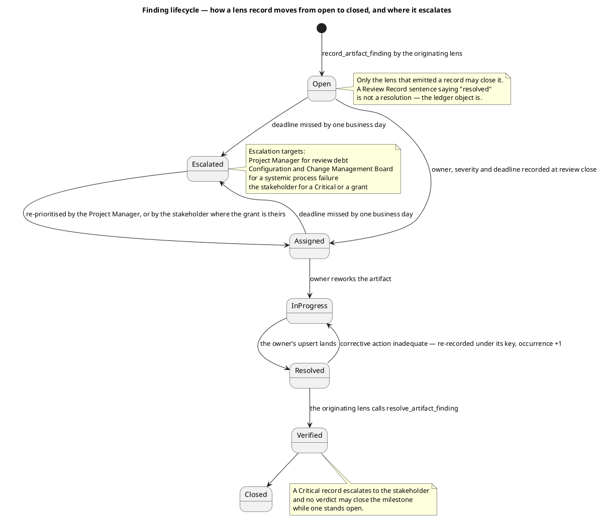

#### Review debt

| Measure | Value |
|---|---|
| Open lens records | 18 |
| Distinct defects | 15 |
| Overdue | 0 — no deadline has yet been set; all deadlines begin at this record |
| Critical | 0 |
| Major | 10 defects (13 lens records) |
| Minor | 5 defects (6 lens records) |
| Escalations raised | 0 — nothing is overdue, so nothing escalates. The stakeholder escalation of this milestone is the sanction question, recorded under Disposition, not review debt |

Every record is assigned an owner at this close. Deadlines are **not** dates on a calendar: no start date has been measured on this project, so a deadline here is "the owner's next turn in corrective iteration 2", which is where the iteration's exit criteria bind. A record that misses that turn becomes overdue and escalates on the next business day.

#### Corrective action plan — the order is the plan

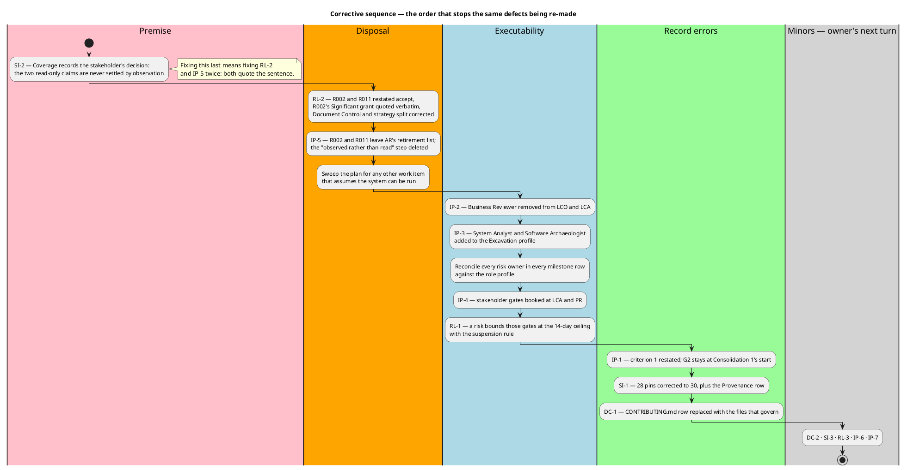

| Step | Defect | Owner | Action | Done when |
|---|---|---|---|---|
| 1 | SI-2 | Software Archaeologist | Replace the Coverage closing sentence with the stakeholder's decision in their own terms: the two read-only claims stand declared for the life of the project, carried as accepted risk, settled by no later reading. The declarations themselves stay unchanged | The sentence names the decision and no longer names running the system |
| 2 | RL-2 | Project Manager | Restate R002 and R011 as `accept`; quote the stakeholder's 2026-11-14 answer verbatim as R002's Significant-band grant; give both a contingency for a reading-only claim proving wrong when the system is first run outside this project; correct the Document Control status line and the strategy distribution | Register, status line and strategy split state the same disposal |
| 3 | IP-5 | Project Manager | Remove R002 and R011 from AR's retirement list; delete the "observed rather than read" step; then sweep every milestone for any other work item assuming the system can be run | No milestone retires a risk by an activity the project will not perform |
| 4 | IP-2, IP-3 | Project Manager | Remove Business Reviewer from the LCO and LCA rows; add System Analyst and Software Archaeologist to the Excavation profile at the stages the process assigns them; reconcile every risk owner in every milestone row against the role profile | The register's owner column and the plan's role profile name one set of roles |
| 5 | IP-4 | Project Manager | Book a stakeholder gate at PR for formal project acceptance — the event at which ownership passes — and one at LCA for the architecture baseline's acceptability. Record both as queue time: ceiling 14 days, estimate none, actual reported apart, process suspends rather than assuming | Every milestone whose exit condition is the stakeholder's acceptance has a gate |
| 6 | RL-1 | Project Manager | Add a risk covering the stakeholder gates, with the 14-day ceiling and the suspension rule as its bound and mitigation, or delete the plan's claim that one exists | The plan and the register state the same control |
| 7 | IP-1 | Project Manager | Restate criterion 1 to what SBC gates: the perimeter recorded with an anchor per element, the priorities ordered, the three stakeholder facts put and answered 2026-11-14. Cite G2 at Consolidation 1's start as where the perimeter is confirmed. **G2 does not move** — Excavation deepens the perimeter, so confirming it earlier confirms an incomplete record | The criterion is satisfiable without a sanction that has been withheld |
| 8 | SI-1 | Software Archaeologist | Correct 28 to 30 pins in both places and in the matching Provenance row. No pin value changes | The tally matches `Directory.Packages.props` |
| 9 | DC-1 | Process Engineer | Replace the `CONTRIBUTING.md` row with `Directory.Build.props` and `Directory.Packages.props` as the compiler-enforced conventions, owner Software Architect, stating that no written coding standard exists. A standard, if wanted, is authored under a Change Request | Every tool reference resolves in the tree |
| 10 | DC-2, SI-3, RL-3, IP-6, IP-7 | Process Engineer, Software Archaeologist, Project Manager | The five Minors, in each owner's next turn | Each is fixed as its own record recommends |

**Steps 1–3 are one root cause and must be done before the rest.** SI-2, RL-2 and IP-5 are not three defects: the plan and the register both assume the system can be run, the stakeholder has ruled it out, and the System Inventory is where that assumption is written down. Correcting them out of order produces three artifacts that disagree about the same two risks.

**Steps 4–6 make the plan executable as a governing instrument.** None of them is an accuracy defect — each is a defect in whether the plan can be run: a role summoned that does not work on the project, an iteration assigned work with no one accountable for its risks, milestones that transfer ownership with no event at which it transfers. Adding the gates in step 5 without step 6 leaves the new gates unbounded, which is why they are ordered together and before the record errors.

**Steps 7–9 are record corrections.** Small, independent, and each one is a claim a milestone or another role relies on.

#### What is deliberately not an action

- **An Iteration Assessment.** The Project Manager writes it against this verdict. It is not owed by this review and ordering it here would invert the sequence the process fixes.
- **A Change Request.** None is required for any of the 15 defects. Each is a correction inside an artifact its owner already owns — no scope change, no baseline change, nothing for the CCB.
- **Any schedule change.** Corrective iteration 2 is the iteration-count lever, which is the plan's own stated remedy for a milestone whose exit criteria do not pass. Declared scope is not reduced, no role is added in parallel, and no criterion is narrowed.

## Disposition
### Reviewer lens
<!-- review: Survey I2 -->

<!-- review: Survey I2 -->

#### Disposition

**Approved.** 0 Critical, 0 Major, 2 Minor across the four artifacts reviewed.

This is the first time this lens has approved the SBC artifact set. Iteration 1 returned it Approved with changes on 3 Major and 4 Minor, and every one of those seven was corrected and verified rather than asserted: the two Majors that pointed a role at content that did not exist — the absent coding standard and the criterion claiming a confirmation SBC never obtains — are the two whose corrections matter most, because each misdirected a role downstream of the artifact.

The two Minors now open are consequences of the corrections themselves, not survivals of the old defects, and neither is load-bearing.

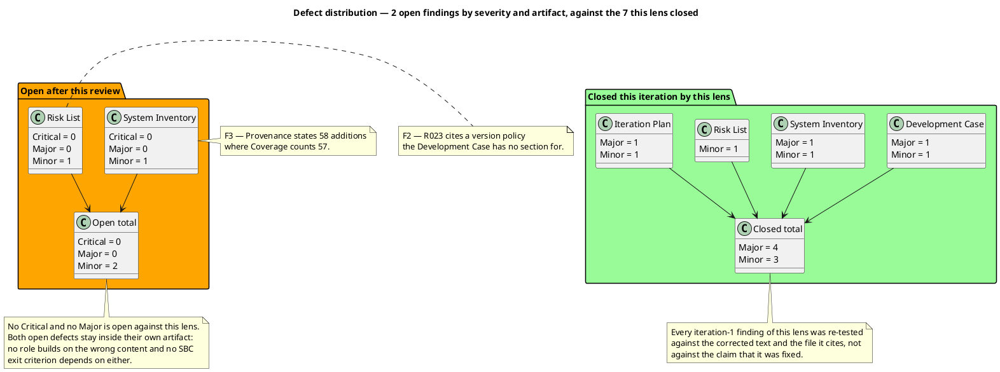

#### Why no Critical

A Critical is a defect only the stakeholder can unblock: a scope decision, a contradiction in what they declared, or a risk only they may accept. Three such questions were raised during iteration 1 and answered on 2026-11-14; each answer was re-tested against the code it disposes of in this iteration's scope-marker audit, all three hold, and no new question surfaced.

The stakeholder's later decision — that the system is never run in any phase — was an open premise in iteration 1 and is now closed content: Coverage states it, R002 and R011 are accepted on it with R002's grant quoted, and the plan sweeps for work that assumed a run. A decision already taken and correctly recorded is not a finding.

#### Why no Major

A Major means another role builds on wrong content or a milestone exit criterion fails. Neither holds:

- Every corrected fact was checked against the file that carries it, including re-counting the 30 package pins, and each resolves.
- All six SBC exit criteria are now evidenced as worded. Criterion 1 in particular was the defect that made the milestone unsanctionable in iteration 1 — a criterion satisfiable only by the sanction the stakeholder withheld — and it now asks for what SBC obtains while G2 is named as where the perimeter is confirmed.
- Every one of the 26 risks is accounted for exactly once, every disposal executes without running the system, and every risk owner is at work in the milestone that retires its risk.
- Every gate carries three lenses; the stood-down Business Reviewer appears on none.

#### Why the two Minors do not hold the milestone

Each stays inside its own artifact. The Provenance arithmetic is a summary row that contradicts the section it summarises, while the section, the enumeration and the Document Control tally all agree — so the declaration criterion 3 turns on is sound. R023's citation names a section that does not exist, but R023 is an accepted Moderate risk whose contingency is a Change Request on either reading, so nothing downstream changes shape.

#### What this lens hands the next lens

The technical case for the sprint zero's product is sound and has been verified rather than accepted: a perimeter whose facts rest on anchors that were opened, twenty of them across the two iterations, with the one false fact found and corrected; a register whose arithmetic holds across all 26 rows and whose most consequential acceptance is the stakeholder's own words; and a plan that instantiates the tailored process, schedules no work the phase does not run, and refuses throughout to invent a size, a budget, a forecast or a date.

The milestone's sanction is not this lens's to grant. The three scope questions were answered, the technical defects are closed to the Minor band, and whether the sprint zero advances is the stakeholder's decision and the Review Coordinator's ruling.

### Management Reviewer lens
<!-- review: Survey I1 -->

<!-- review: Survey I1 -->

#### Disposition

**Conditional — sanction REFUSED. The SBC milestone is NOT achieved and the phase does not advance.** 0 Critical, 10 Major, 1 Minor across 4 artifacts.

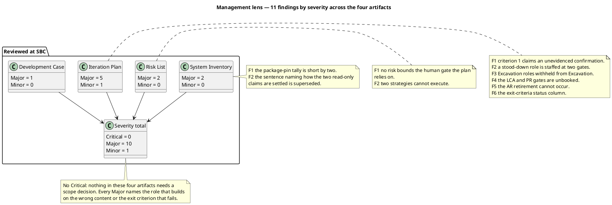

#### Why Conditional and not No-Go

A **No-Go** would say the sprint zero's product is unsound and the iteration's work is wasted. It is not. The perimeter is anchored per element, sixteen of seventeen verified anchors confirmed, the three stakeholder decisions are recorded in the stakeholder's own words and hold against the code they dispose of, twenty-three of twenty-five risks are disposed of correctly, and the plan refuses to invent a size, a budget, a forecast or a date. That is a real product.

A **Conditional** says the work stands and specific conditions must be met before the gate reopens. That is this gate's state: every one of the ten Majors is a correction **inside** an artifact, seven of them trace to a single root cause and its consequence, and none requires re-deriving the perimeter, re-scoring the register, or a further reading of the system.

**But the condition is the stakeholder's to set, not mine.** I asked for the sanction with the verdict and all open defects inside the question. The answer was **No**. Under this process the sanction is an affirmative grant, not a default and not a formality, and a withheld sanction — whatever the reviewers think of the artifacts — leaves the milestone open. I record the stakeholder's decision as decisive and I do not overturn it.

#### Why no Critical

A Critical is a defect only the stakeholder can unblock: a scope decision, a contradiction in what they declared, or a risk only they may accept. Three such questions were raised during this iteration and answered on 2026-11-14; each answer was verified against the code it disposes of and none is reopened here.

The stakeholder's new correction — that the system will not be run — is **not** an open question: it is a decision already taken, and it is recorded as findings against the artifacts that contradict it. Recording a decision as a defect is not the same as escalating a question.

Two findings touch acceptance the stakeholder must grant: Risk List F2 needs R002's Significant-band grant **recorded** (the grant exists — "stay declared as such, with their risk"), and Iteration Plan F4 needs gates **booked** where acceptance is obtained. Neither asks the stakeholder a new question; both ask the Project Manager to write down what the stakeholder already decided.

#### The finding that carries the most weight into the corrective iteration

Seven of the ten Majors are one root cause and its consequence: **the plan and the register both assume the system can be run, and the stakeholder has said it cannot.** System Inventory F2 states the assumption, Risk List F2 disposes two risks by it, Iteration Plan F5 retires two risks by it. Correcting them out of order produces artefacts that disagree; correcting them in the order given in Resolutions and Actions fixes the premise before anything inherits it.

The remaining three stand alone and each is a governance defect the technical lens cannot see, because none is a defect in an artifact's accuracy — each is a defect in whether the plan can be executed as a governing instrument: a stood-down role summoned to two gates, an iteration assigned work with no one accountable for the risks it carries, and two milestones whose exit condition is the stakeholder's acceptance with no event at which that acceptance is obtained.

#### Handoff to the Review Coordinator

The management case for advancing past SBC does **not** hold, and the stakeholder has withheld the sanction. The Review Coordinator rules on the milestone; my lens reports:

- **Sanction:** REFUSED by the stakeholder, 2026-11-14. Not to be recorded as granted, conditional, or implied.
- **Milestone state:** open. Do not mark Survey, SBC, or iteration 1 complete, and do not advance to Excavation.
- **Remedy:** a corrective iteration in the owners' next turn, against the ten Majors in the order given. The iteration-count lever applies — this is a further iteration inside Survey at schedule cost, never a narrowing of what SBC requires and never a re-interpretation of the stakeholder's answer.
- **Re-review:** the gate is re-held once the ten Majors are corrected. The Reviewer's seven are re-checked at that point as well, since three of them touch the same artifacts.
- **The Iteration Assessment** is written by the Project Manager against this verdict, not before it, and does not gate the phase.

### Review Coordinator lens
<!-- review: Survey I1 -->

#### Milestone verdict

**SBC is NOT achieved. The Survey phase does not advance. Corrective Survey iteration 2 is required.**

| Question | Answer | Basis |
|---|---|---|
| Artifacts read | 5 of 5 | `[FINDINGS]` line — Development Case, System Inventory, Risk List, Iteration Plan, Review Record; **unread = none** |
| Open Critical | 0 | No record in the Critical band |
| Open Major | 10 defects / 13 lens records | Ledger above; none carries a resolution object |
| Open Minor | 5 defects / 6 lens records | Ledger above; none carries a resolution object |
| SBC exit criteria met | 4 of 6 | Criteria 2 and 3 hold on their evidence. Criterion 1 fails as worded (IP-1); criterion 5 fails on an unresolvable tool reference (DC-1); criterion 6 fails on four independent plan defects (IP-2, IP-3, IP-4, IP-5). Criterion 4 holds formally but its register carries RL-1 and RL-2 |
| Perimeter confirmed | No | G2 sits at Consolidation 1's start and has not occurred. The stakeholder states nothing is missing from the perimeter, but a statement that nothing is missing is not the confirmation G2 asks for, and IP-4 shows the gates that obtain acceptance are themselves unbooked |
| **Stakeholder sanction** | **REFUSED** — 2026-11-14 | Recorded in the Management Reviewer's lens and confirmed in the answer to this gate's question |

#### Why this verdict and not another

The finding data decides, not judgement. `VERDICT_DONE` is disqualified twice over: 10 Major defects are open, and the sanction line reads REFUSED. `VERDICT_ESCALATE_CRITICAL` does not apply — no Critical record exists, and none should: the three scope questions this iteration raised were answered by the stakeholder on 2026-11-14, each answer was verified against the code it disposes of, and no new question surfaced. Nothing here needs a decision only the stakeholder can take.

That last point is what makes this a **corrective iteration** rather than an escalation. Every one of the 15 defects is a correction inside an artifact its own owner already holds. None needs a scope change, a baseline change, a Change Request, or a further reading of the system.

#### What the two executing lenses agreed and disagreed about

Both lenses reached the same overall shape: the sprint zero's *product* is sound, and its *governing instruments* are not yet correct.

| Question | Technical lens | Management lens | Consolidated |
|---|---|---|---|
| Is the perimeter accurate? | 17 anchors opened, 16 confirmed | Verified independently, not repeated | Yes — not in dispute. The stakeholder states nothing is missing from it |
| Is the risk scoring sound? | All 25 magnitudes recomputed, none misbanded | No High or Significant risk accepted without authority — one exception, RL-2 | Yes. The scores are coherent; two *dispositions* are wrong |
| Is the plan measurable? | Exemplary — no invented size, budget, forecast or date | Pass | Yes. This is the artifact's strongest quality and survives every correction |
| Can the plan be executed? | Tested only exit-criteria integrity — one Major | Tested executability — five Majors | **No.** The stricter reading governs: six Majors sit on the plan |
| How far to corrective action? | Three textual corrections | Rebuild the retirement map, reconcile roles, book the gates | The Management lens governs, because its findings rest on the stakeholder's correction of 2026-11-14 which arrived after the Reviewer's audit |

Where the Management lens is stricter, it governs — a Major is a Major whoever finds it. Where the Reviewer's lens found the artifacts *sound* — band arithmetic, anchor verification, measurement discipline, the three stakeholder decisions holding against the code — those findings stand and no correction below disturbs them.

#### The decision that is not mine

The remedy for a milestone whose exit criteria fail is one more iteration inside the phase, at schedule cost. That is the plan's own stated lever and I apply it: the phase does not advance, the declared scope is not narrowed, no role is added in parallel, and no criterion is re-interpreted to fit what was produced. A criterion that could only be satisfied by the sanction the stakeholder withheld is a criterion written wrong (IP-1, step 7) — the fix is to the criterion, never to what the milestone requires.
