## Document Control
### Reviewer lens
<!-- review: Excavation I2 -->

<!-- review: Excavation I2 -->

- Phase: Excavation
- Status: Technical lens complete for the AR (end-of-Excavation) milestone review, iteration 2. Nine findings of this lens closed on verified evidence; three open — 0 Critical, 2 Major, 1 Minor. Disposition — Approved with Changes; the two Majors hold the milestone until their artifact is reworked.
- Milestone Target: end-of-Excavation (AR) — not achieved. Two Majors are open on the Use-Case Model, and a suspect trace remains registered at the phase close.
- Iteration: 2, Cycle 1
- Owner: Reviewer

### Management Reviewer lens
<!-- review: Excavation I1 -->

- Phase: Excavation
- Status: AR (end-of-Excavation) milestone review taken at the end of Excavation iteration 1. This lens records 2 Major and 3 Minor this milestone, and carries 1 Minor from the SBC gate (`Development Case#F2`) that the phase's own criterion A11 counts. Read with the technical lens, the gate has 8 Major open and 0 Critical. Four findings of this lens closed at this gate.
- Milestone Target: end-of-Excavation (AR) — **not achieved**. Sanction refused by the stakeholder at gate H4 on 2026-11-23; the order given is "We must correct all major findings."
- Iteration: 1, Cycle 1
- Owner: Management Reviewer
- Review type: Lifecycle Milestone Review (AR) — exit-criteria lens. Nine of the thirteen AR criteria established on their own evidence; two not establishable as written; two not met.
- Verdict: **No-Go**
- Stakeholder sanction: **REFUSED**

### Review Coordinator lens
<!-- review: Excavation I1 -->

<!-- review: Excavation I1 -->

- Phase: Excavation
- Status: Iteration 1 consolidated; the AR milestone verdict is recorded in Disposition
- Milestone Target: end-of-Excavation (AR) — not sanctioned on this iteration's evidence
- Iteration: 1, Cycle 1
- Owner: Review Coordinator

## Review Scope and Criteria
### Reviewer lens
<!-- review: Excavation I2 -->

<!-- review: Excavation I2 -->

#### Review scope — Excavation iteration 2, technical lens

The ten artifacts the AR review left findings against, plus the two this lens read for exit-criteria evidence. Each was re-read at the section its finding named, and each corrected fact was checked at its source code rather than taken from the finding's remedy.

| Artifact | Reviewed for | Iteration-2 outcome |
|---|---|---|
| Development Case | Document Control currency; tailoring against the IARI baseline; optional triggers | 1 Minor open |
| System Inventory | Coverage arithmetic; anomalies anchored; entry points accounted for | Clean |
| Risk List | Score reproducibility; retirement claims; the grant band | Clean — F2 closed |
| Iteration Plan | Exit-criteria evidence; risk sequencing | Clean |
| Vision | Use-case count; mechanism shapes | Clean — F1 closed |
| Use-Case Model | The recovered set; trace rows against the graph; the two entry-point readings | 2 Major open |
| Supplementary Specification | The recovered figures under AN-024 and AN-023 | Clean — F1, F2 closed |
| Software Architecture Document | The recovered figures; component trace rows | Clean — F1 closed |
| Deployment Model | Environment mapping against the files it maps | Clean — F1 closed |
| Design Model | Anomaly citations; the persistent store | Clean — F1 closed |

#### Criteria applied

This milestone's question is EXIT CRITERIA, not feasibility or completion. Eight items were tested; each is a test with a pass or fail answer, not an opinion.

| # | Criterion | What passes |
|---|---|---|
| C1 | Recovered, not declared | No element claims scope the delivery does not hold; a recovered element cites the file it was read from |
| C2 | Anchored | Every recovered element rests on the file and lines it names |
| C3 | No cross-cutting mechanism as a use case | Authentication, sync, logging, audit, health and migration are mechanisms, not actor goals |
| C4 | One goal, one use case | A multi-actor process is one use case with scenarios; not one per actor |
| C5 | Trace rows carried | Every row a trace-chain artifact declares is carried by the registered graph |
| C6 | No suspect trace open at the phase close | No edge named in a declared row carries a SUSPECT marking |
| C7 | Document Control current | Phase, Status, Milestone Target and Iteration name the phase and iteration whose review the artifact is under |
| C8 | Diagram-dominant | Formal UML carries the content; prose supplements what a diagram cannot express |

#### Evidence verified at source this iteration

The four Majors the AR review raised were all about one class of defect — a recovered fact transcribed inconsistently into the artifacts citing it. Closing them on the artifact's own text alone would have repeated the mistake that created them, so each corrected fact was opened at the code it cites.

| Fact | Artifact statements checked | Code opened | Result |
|---|---|---|---|
| Development halves the request budget | Supplementary Specification M3, S2, P1, R8, F10; SAD SP1, M3, Process View P4, Quality; Deployment Model Environment Mapping and its Rate limiting row | `Todo.Api/appsettings.Development.json` — `RateLimiting` `TokenLimit` 50, `TokensPerPeriod` 50, `QueueLimit` 50; `RateLimitExtensions.cs` — the code defaults 100, 100, queue 100 bound from a `RateLimiting` section | Reproduces. All three artifacts now state both values under AN-024 |
| Two BFF hops, unequal resilience | Supplementary Specification R4 | `TodoApp.ServiceDefaults/Extensions.cs:32-42` — `ConfigureHttpClientDefaults` with `AddStandardResilienceHandler()`; `Todo.Web/Server/TodoApi.cs` — `MapForwarder("{*path}", "http://todoapi", new ForwarderRequestConfig(), …)` with no handler | Reproduces. R4 states the two hops apart under AN-023 |
| Coverage arithmetic | System Inventory Coverage — 139 files, 84 read, 55 unread | Per-area Files column sums to 139, Read to 84, unread cells to 55; every unread category is named | Reproduces |
| The three EP-003 trace edges | Use-Case Model Traceability rows for UC-006, UC-007, UC-008 | Trace graph, EP-003 downstream | All three now report OK; the SUSPECT marking is gone |

#### SCM and build evidence

The repository reports no pull requests in any state and no IARI pipeline file, so there is no code review or CI result to weigh at this gate. That is correct for the phase rather than a defect: Excavation produces no production code, and the tree's own code is unchanged since `307a1ea` of 2026-02-12. This lens's disposition therefore rests on artifact evidence alone, and the absence of SCM evidence is stated here rather than silently omitted.

### Management Reviewer lens
<!-- review: Excavation I1 -->

Entry criteria were checked before the review: all twelve Excavation artifacts exist and are readable, the Software Architecture Document — the artifact this lens cannot proceed without — is present, and the Iteration Plan carries the AR exit criteria the milestone is judged on. No review was taken against a placeholder.

**Review point and lens.** This is the Lifecycle Milestone Review at the Architecture Recovered gate. The question is neither feasibility (Project Approval, Planning) nor completion (Iteration Acceptance): it is whether the artifacts collectively satisfy the conditions for the phase transition. The criteria are the Project Manager's A1 to A13, and each is re-decided here against the artifact it names, not against the criterion's own state cell.

**Artifacts read in full, not sampled:** Vision, Use-Case Model, Supplementary Specification, Software Architecture Document, Deployment Model, Design Model, System Inventory, Risk List, Iteration Plan, Development Case, and the findings ledger of every artifact under review. The Iteration Assessment is absent and its absence is not a finding: the Project Manager authors it after this review, so it cannot yet describe the iteration being judged.

#### The criteria, re-decided

| # | Criterion | State after this lens | What the state rests on |
|---|---|---|---|
| A1 | Operations recovered as use cases | Met | 11 use cases, each with its `EP-NNN`; the four exclusions stated and ruled by the stakeholder on 2026-11-23. Use-Case Model#F1 carries the closure of three suspect screen edges |
| A2 | Priorities 1 to 5 reached, remainder named for Consolidation | **Not met as written** | Iteration Plan#F4: the `EP-020`/`EP-021`/`EP-022`/admin rows are permanent exclusions, not work deferred to Consolidation, and priorities 6 to 8 are named nowhere |
| A3 | Architecture recovered and checked against the use cases | **Contested, not certifiable** | 22 components with `Realizes` rows for eleven use cases, and SEQ-1 to SEQ-3 walk three of them. But Software Architecture Document#F1 (Major) leaves SP1 and M3 stating a value the code contradicts |
| A4 | Data recovered with anchors | Met | Design Model PD-D1 to PD-D5: eight tables, keys, indexes, referential actions, enforced and unenforced rules, each anchored to the migrations and the snapshot |
| A5 | Deployment modelled | **Contested, not certifiable** | The fired OPTIONAL exists and states nodes, stores and the shared key ring. But Deployment Model#F1 (Major) states the one setting that differs between environments backwards |
| A6 | Coverage measured and remainder declared | Met | System Inventory Coverage: 84 opened, 55 unread of 139; the per-area Read column sums to 84 and the Files column to 139, and all 55 unread are named by category |
| A7 | Every anomaly carried as a scored risk | Met | 29 `Refines` edges from `AN-NNN`; `R022` and `R031` state their separate origins; every anomaly-derived row reproduces from the one published word-to-score mapping |
| A8 | No grant-band accept without the stakeholder | Met | Four accepts at 4 × 3 = 12, each holding the stakeholder's verbatim answer of 2026-11-23; the sixteen other Significant-band risks avoid, which the Project Manager may do at any band |
| A9 | Every risk actionable | Met | 31 rows carrying strategy, action, owner, contingency and warning sign |
| A10 | The recovery states what the code does | **Not met as written** | Iteration Plan#F3: certified on the System Inventory identifying a contradiction while three artifacts still state the contradicted value as fact |
| A11 | The four SBC Minors closed | **Not met — three of four** | `Iteration Plan#F2`, `Iteration Plan#F3` and `System Inventory#F3` are corrected in their artifacts and verified closed. `Development Case#F2` stands: "Roles and Ownership" still reads "Reviewer, CodeReviewer, plus the Configuration Manager's baseline record", and CLS-DC-01 draws no edge into the Review Record from the Management Reviewer, the Business Reviewer or the Review Coordinator. Carried as `R031` |
| A12 | The recovered set confirmed by the stakeholder | **Not met — refused** | Asked at this review, the stakeholder answered "No" and ordered that all major findings be corrected |
| A13 | The plan names no work the process does not run | Met | Items 1 to 12 and 14 are Excavation stages or the stakeholder's own order; the Process Engineer's single item is recorded as that order and not as a discipline stage |

**The one criterion this lens adds.** A milestone gate is also the place a Conditional verdict from a prior gate is verified as resolved. The SBC re-take issued Go with one open Minor — `Development Case#F2` — and the stakeholder ordered it closed in this phase. It is not closed, and it is the only reason a criterion the phase's own plan counts cannot be certified. That is not a surprise the review should absorb silently; it is the exposure `R031` predicted, and it has materialized.

#### Risk retirement, as the review reads it

A review that only counts open findings misses the question the register exists to answer: are the high-magnitude exposures moving? At this gate, five of the twenty Significant-band risks were due to be retired in this iteration by an action an Excavation role performs.

| Risk | Exposure | Action due in this iteration | What the artifacts show |
|---|---|---|---|
| R002 | 4 × 3 = 12 | Software Architect records that the BFF-to-API hop carries no service authentication | Performed — ADR-003 and the Process View record it, anchored to the code's own `TODO` |
| R009 | 3 × 3 = 9 | Software Architect records the limiter's coverage and the partition-key gap | Performed — M3 and ADR-007 state `/todos` only, and why the policy cannot move as written |
| R019, R020, R021 | 4 × 2 = 8; 4 × 3 = 12; 4 × 3 = 12 | System Analyst records the challenge's unchecked scheme, the callback's single exit, and the one 401 | Performed — UC-003 A1 and A2, and UC-001 A1 / UC-002 A1, each anchored |
| R023 | 4 × 3 = 12 | System Analyst records that lockout is checked at sign-in alone | Performed — UC-002 step 5 and the shared gate diagram |
| R024 | 3 × 3 = 9 | (Software Architect) record that the two hops differ | Performed in SAD P6, but Supplementary Specification#F2 shows the artifact that carries the false half is still uncorrected |
| **R030** | **4 × 3 = 12** | **System Analyst records the session surface's instability beside those flows** | **Not performed — and the register records the risk as avoided.** Risk List Management Reviewer#F2 |

Ten of the twenty Significant-band risks are retired on evidence in an artifact. R030 is the one recorded as retired by an action that is not in any artifact, and it is the largest band present. Its own warning sign — "a design cites the session surface as settled" — is precisely what Consolidation will do with a Use-Case Model that presents UC-001 to UC-004 without that caveat.

#### What this review does not claim

The Development Case's optional-trigger table is audited rather than accepted. Deployment Model FIRED on a genuinely distributed topology: a browser-hosted WebAssembly client, a server host, a separate API process, a SQLite store and a reverse-proxy hop, with per-project settings pairs. That condition holds. The five NOT FIRED verdicts each hold against the project's real facts: eight persisted entity types sit below the >10 Data Model threshold, no untried mechanism needs empirical validation, the UI is recovered rather than designed, and no regulator or contract consumes test reporting. No trigger is over-fired and none is unjustified.

### Review Coordinator lens
<!-- review: Excavation I1 -->

<!-- review: Excavation I1 -->

**Lens participation at this milestone — authoritative, not inferred from the artifact.** Excavation's milestone review runs Reviewer, Management Reviewer, Review Coordinator. The Business Reviewer's first stage is LCO, so at AR it is not a scheduled participant.

| Lens | Participation | What it evaluated | Bearing on the verdict |
|---|---|---|---|
| Reviewer (technical) | EXECUTED | Ten findings over nine artifacts — 6 Major, 4 Minor — each against an anchor in the code | Counted in full |
| Management Reviewer | EXECUTED | The thirteen AR criteria, the grant band, and the two Majors of its own; 2 Major and 4 Minor recorded | Counted in full |
| Business Reviewer | **INACTIVE — did not evaluate this review** | Nothing | No verdict is attributed to it, and none is inferred from its absence |
| Review Coordinator | Consolidating this milestone | The consolidated ledger, the cross-lens reconciliation, the verdict | Records the verdict in Disposition |

**Review events of this milestone, each triggered by a workflow activity.** The calendar is the sprint zero's full sequence; the two Excavation events are this milestone's.

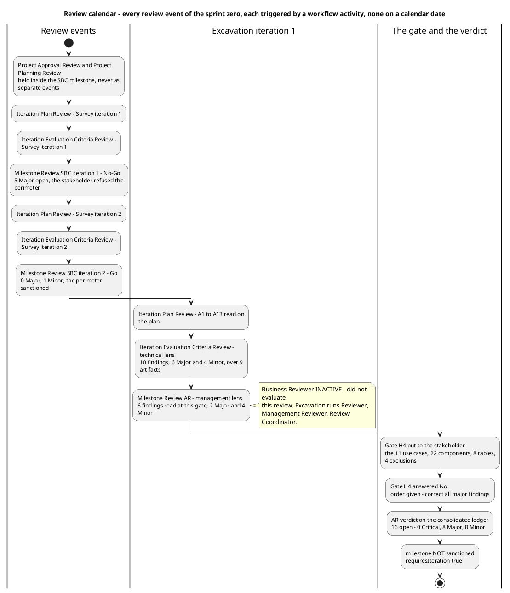

**Entry and exit criteria actually enforced at this milestone.**

| Event | Entry criterion | Exit criterion | Held |
|---|---|---|---|
| Iteration Plan Review | The plan carries this iteration's work items with owners and its exit criteria read on the artifact each cites | Every criterion decided on its own artifact's evidence | Yes — the plan was re-read and the two Minors it carried closed; the Management Reviewer then found A10 certified on an adjacent artifact |
| Iteration Evaluation Criteria Review | The recovered artifacts are in their target state and the anchors exist to be checked | Every criterion decided on evidence the cited section carries | Yes — the technical lens read the code behind each Major |
| Milestone Review AR | Both executed lenses have returned and the stakeholder's gate answer is on the record | 0 Critical, 0 Major open; the stakeholder's sanction GRANTED | **No** — 8 Major open and the sanction REFUSED |

**The review process for a finding at this milestone** — the state each of the 16 open findings is in, and who owns the act that closes it.

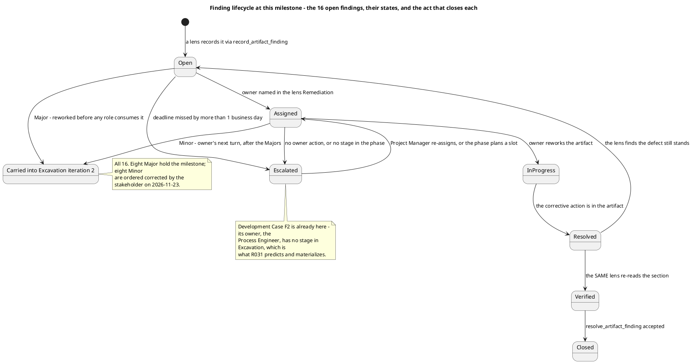

A finding closes only when the lens that recorded it re-reads the corrected section and calls `resolve_artifact_finding`. A correction an owner states in prose does not close it; a coordinator's consolidation does not close it.

## Findings
### Reviewer lens
<!-- review: Excavation I1 -->

<!-- review: Excavation I1 -->

Ten findings, each naming the criterion whose test it meets. Six are Major — another role builds on the wrong content, and the recovered figures the phase would put to the stakeholder at gate H4 are wrong in three artifacts by one cause.

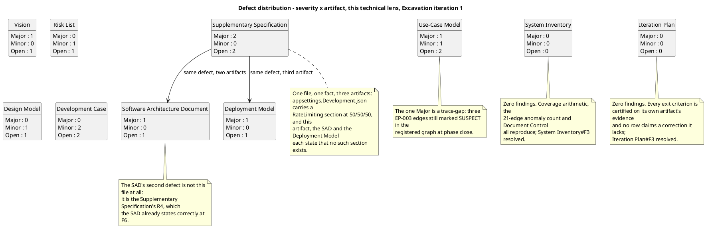

#### Supplementary Specification

**Major** — `Supplementary Specification#F1`, criterion `consumed-defect`. The artifact states four times that no `RateLimiting` configuration section exists and that the code's defaults of 100 / 100 per 10 s / queue 100 are therefore the effective values: mechanism M3 ("no such section exists in the delivery, so these defaults are the effective values"), S2 ("a `RateLimiting` configuration section that does not exist in the delivery ... none is externally tunable as delivered"), P1 ("100 tokens per caller per 10-second period with a queue of 100") and R8. `Todo.Api/appsettings.Development.json` carries exactly such a section at `TokenLimit` 50, `TokensPerPeriod` 50 and `QueueLimit` 50, and both launch profiles set the environment to Development — so the effective budget in the only environment this delivery starts in is half the stated value. The recovery already knows this: the System Inventory records it as AN-024 and the Risk List carries it as R025. The defect reaches the Software Architect, who repeats the figure in SP1 and M3, and the Deployment Model, which copies it into its environment table; any load or throttling reading taken from this artifact is off by a factor of two. **Remediation:** state both values — the code defaults from `RateLimitExtensions.cs:14-31` and the Development override from `appsettings.Development.json:8-12` — in M3, S2, P1 and R8, and cite AN-024 so the three artifacts carry one fact under one identifier.

**Major** — `Supplementary Specification#F2`, criterion `consumed-defect`. R4 reads "No retry, circuit breaker or fallback is configured on either hop." `TodoApp.ServiceDefaults/Extensions.cs:32-42` calls `ConfigureHttpClientDefaults` with `AddStandardResilienceHandler()`, which applies the standard retry, circuit-breaker, timeout and rate-limiter pipeline to every container-built `HttpClient` — and the BFF's `AuthClient` is one, registered at `Todo.Web/Server/Program.cs:23-26`. Only the YARP forwarder carries a default `ForwarderRequestConfig` and no handler. The Software Architecture Document records exactly this at its Process View P6 and states it does not edit this artifact because the System Analyst owns it, so the correction is owed here. A role reading R4 concludes neither hop retries: wrong on the sign-in and registration path, right on the task path, and the asymmetry the architecture recovered is lost. **Remediation:** replace R4 with the two hops stated apart, citing `TodoApp.ServiceDefaults/Extensions.cs:32-42`, `Todo.Web/Server/Program.cs:23-26` and `Todo.Web/Server/TodoApi.cs:12-25`, and record it under AN-023 / R024.

#### Software Architecture Document

**Major** — `Software Architecture Document#F1`, criterion `consumed-defect`. SP1 states "No `RateLimiting` section exists, so these are the effective values and none is tunable as delivered", and mechanism M3 repeats it ("every value bindable from a `RateLimiting` section that does not exist"). The file carries one, at 50 / 50 / 50, and both launch profiles run in Development. The artifact cites its neighbouring anomalies AN-023 and AN-025 but not AN-024, which is the one that records this. This is the copy the Deployment Model's environment table inherits. **Remediation:** correct SP1 and M3 to state both values with their sources and cite AN-024; correct the Quality view's "Availability — bounded load" row so the bound in the measured environment reads 50, not 100.

#### Deployment Model

**Major** — `Deployment Model#F1`, criterion `consumed-defect`. The Environment Mapping preamble states "No environment file in the delivery carries a connection string, a provider credential, a rate-limit value or an address", and the Rate limiting row reads "Code defaults: 100 / 100 per 10 s / queue 100 | Same | No `RateLimiting` section exists anywhere, so the values are not tunable as delivered". `Todo.Api/appsettings.Development.json:8-12` carries the rate-limit values. This is the artifact where the error costs most: the section exists to state what differs between environments, it concludes that one setting separates them, and there are two — the second stated backwards. **Remediation:** narrow the preamble to what is true (no connection string, provider credential or address), and rewrite the Rate limiting row so Development reads 50 / 50 / 50 with its anchor and any other environment reads the code defaults, noting that every launch profile sets Development; cite AN-024 and R025.

#### Use-Case Model

**Major** — `Use-Case Model#F1`, criterion `trace-gap`. Three edges this artifact declares are marked SUSPECT in the registered graph and remain open at the phase close: `EP-003 → UC-006`, `EP-003 → UC-007`, `EP-003 → UC-008`, each «SUSPECT → System Analyst». The Traceability rows assert them and the Survey and every affected flow cite EP-003 — the todo list screen — as the screen an actor enters them through. The edges are substantively right; what is missing is the confirmation that clears the marking. A phase that closes with a suspect trace open leaves the screen route of three of eleven use cases unconfirmed, and the eleven-use-case count gate H4 puts to the stakeholder rests on it. **Remediation:** re-register the three edges as confirmed after checking each — `Todo.Web/Client/Components/TodoList.razor:3-32` carries the new-todo input and the per-row remove control, so it precedes UC-007's and UC-008's step 1, and it is the screen the signed-in shell renders for UC-006's step 1 (`Todo.Web/Server/App.razor:44-52`). Record in the Use-Case Survey beside the three rows why a screen entry point and the forwarded operation differ, so the graph carries the edge and the artifact explains its shape.

**Minor** — `Use-Case Model#F2`, criterion `contained-defect`. The actor-goal matrix and the Source column disagree for two use cases with nothing saying they answer different questions: the matrix draws `A1 --> UC3 : EP-002` and `A1 --> UC4 : EP-001, EP-006`, while the Use-Case Survey gives UC-003 as `EP-007, EP-008, EP-016` and UC-004 as `EP-006`, and the registered graph carries only the latter. The matrix's heading is "with the entry points it uses", which suggests the screen the actor acts on, while Source names the entry point whose code performs the operation. **Remediation:** state the distinction once in the Actors section and relabel the matrix's edges — the actor acts on EP-001 and the POST goes to EP-006 — so two lists answering different questions are visibly doing so.

#### Vision

**Major** — `Vision#F1`, criterion `use-case-shape`. The Features diagram draws two cross-cutting technical mechanisms with use-case notation: `usecase "Start the system and create its schema EP-022" as U12` and `usecase "Observe readiness and liveness EP-020, EP-021" as U13`. Schema migration and health probing are platform mechanisms with no actor goal; the Use-Case Model correctly declines to recover either, and the Supplementary Specification already homes them as M9 and M8. The effect is that the Vision states thirteen use cases in the artifact the stakeholder is asked to confirm at gate H4, while the Use-Case Model, the Iteration Plan's objective O1 and the SAD's Use-Case View all state eleven. The artifact's own note ("this Vision creates none") shows the author saw the problem and drew the shapes anyway. **Remediation:** remove U12, U13 and their package from the diagram, keep the two Features rows re-labelled as platform mechanisms cross-referenced to Supplementary Specification M8 and M9 and to the Use-Case Model's "Not recovered, and why".

#### Risk List

**Minor** — `Risk List#F2`, criterion `contained-defect`. R024's premise reads "The Design Model describes the BFF's two outbound hops as equally protected when they are not". The Design Model does the opposite: its PKG-D3 note reads "A default `ForwarderRequestConfig` and no resilience handler, so this hop neither retries nor breaks the circuit, unlike the `AuthClient` hop", and the SAD states the same at P6. The mitigation therefore names an action two artifacts have already performed, and the risk can never be observed as retired. The underlying anomaly AN-023 is real and correctly anchored; only the sentence about which artifact gets it wrong is wrong. **Remediation:** restate R024 as the risk that a later role assumes the hops are equivalent, and point the mitigation at the artifact that does still carry the open error — the Supplementary Specification's R4.

#### Design Model

**Minor** — `Design Model#F1`, criterion `contained-defect`. The migration-history diagram PD-D3 attributes the unconverted owner key to AN-005: "a row written before migration 3 keeps what it held where the constraint now expects an Id ... AN-005." AN-005's subject is that the test suite builds its schema with `EnsureCreated`; the unconverted owner key is AN-025, and the Risk List carries it correctly as R026 refining AN-025. A reader following the citation from this diagram reaches an anomaly about test coverage rather than about data conversion. **Remediation:** change the PD-D3 citation to AN-025 and keep AN-005 only where the artifact states that the test host builds its schema by `EnsureCreated`.

#### Development Case

**Minor** — `Development Case#F3`, criterion `contained-defect`. Document Control still reads "Phase: Survey", "Status: Draft — produced for the end-of-Survey (SBC) milestone review", "Milestone Target: end-of-Survey (SBC) — not yet achieved", "Iteration: 2, Cycle 1". The project is in Excavation iteration 1 and every other artifact under this review states it. **Remediation:** update the four metadata fields to Excavation iteration 1 and the AR milestone target; the tailoring content is current — both classification verdicts and all six optional triggers were re-evaluated and the Deployment Model's FIRED verdict still holds on its condition.

**Minor, recorded here and carried by another lens** — `Development Case#F2` is the Management Reviewer's finding of the Survey review, and this lens does not close or duplicate it. It stands open: "Roles and Ownership" still reads "Reviewer, CodeReviewer, plus the Configuration Manager's baseline record" and CLS-DC-01 draws no edge into the Review Record from the Management Reviewer, the Business Reviewer or the Review Coordinator. It is named here only because the Iteration Plan's criterion A11 counts it and this review read that row; the finding itself is the Management Reviewer's to reconcile.

#### System Inventory and Iteration Plan — no finding from this lens

Both artifacts were read whole and this lens records nothing against either. The System Inventory's coverage arithmetic reproduces from its own per-area table (84 read, 55 unread of 139), its anomalies carry 21 `DependsOn` edges across twelve entry-point-bearing anomalies matching the Iteration Plan's twelve-row handoff, and its Document Control now names the iteration its content belongs to. The Iteration Plan certifies every exit criterion on the artifact it cites rather than on an adjacent answer, its work items are all stages the phase runs, and its State column states each row's actual outcome. Silence from this lens is approval.

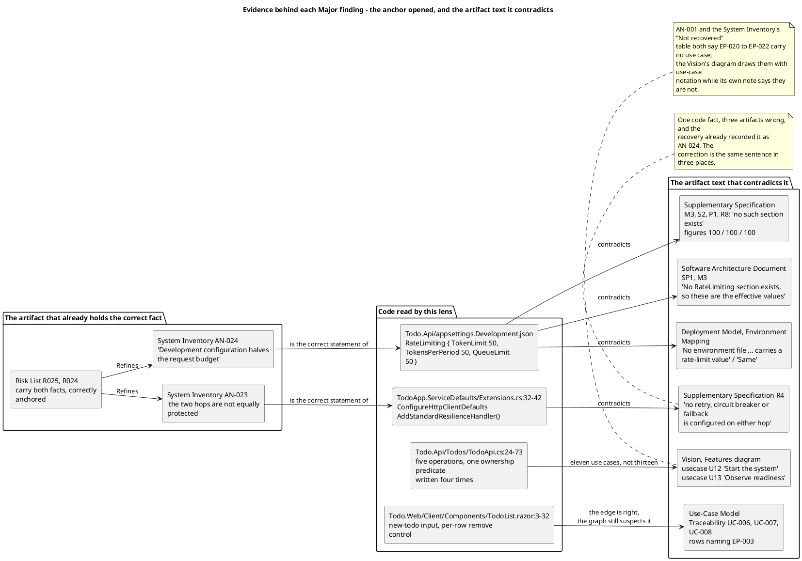

### Management Reviewer lens
<!-- review: Excavation I1 -->

Four findings are this lens's own at this gate, and each is recorded through `record_artifact_finding` before this report was written. The Majors of other lenses are cited here because the milestone verdict reads them; they are not re-recorded as duplicates.

#### The criteria as this lens certifies them

```plantuml
@startuml
title AR-C1 Exit-criteria compliance - the thirteen AR criteria of Excavation iteration 1, the state each is certified in, and what the state rests on

skinparam shadowing false
skinparam classAttributeIconSize 0
skinparam wrapWidth 250
hide empty members
hide circle

package "Met on the artifact that owns the evidence - 7" {
  class "A1 Operations recovered as use cases\n11 UCs, each with its EP-NNN, 4 exclusions stated" as A1 <<met>>
  class "A4 Data recovered with anchors\n8 tables, keys, rules, PD-D1 to PD-D5" as A4 <<met>>
  class "A6 Coverage measured and reproducible\n84 opened, 55 unread of 139, per-area sums" as A6 <<met>>
  class "A7 Every anomaly carried as a risk\n29 Refines edges, R022 and R031 origins stated" as A7 <<met>>
  class "A8 No grant-band accept without the stakeholder\n4 grants at exposure 12, 16 avoid" as A8 <<met>>
  class "A9 Every risk actionable\n31 rows: strategy, action, owner, contingency, sign" as A9 <<met>>
  class "A13 No work the process does not run\nitems 1 to 12 and 14 are Excavation stages" as A13 <<met>>
}

package "Recorded Met, not establishable as written - 2" {
  class "A2 remainder named for Consolidation\nthe named rows are permanent exclusions" as A2 <<notmet>>
  class "A10 recovery states what the code does\n3 artifacts still state the contradicted value" as A10 <<notmet>>
}

package "Not met - 2" {
  class "A11 The four SBC Minors closed\n3 of 4: Development Case#F2 stands" as A11 <<notmet>>
  class "A12 The recovered set confirmed\nGate H4 answered No" as A12 <<refused>>
}

package "Exists but not certifiable while its Major stands - 2" {
  class "A3 Architecture recovered and checked\n22 components, Use-Case View, SEQ-1 to 3" as A3 <<contested>>
  class "A5 Deployment modelled\nfired OPTIONAL, nodes, stores, key ring" as A5 <<contested>>
}

class "Software Architecture Document#F1\nSP1 and M3 state the budget as 100\nwhere Development overrides it to 50" as D3 <<open major>>
class "Deployment Model#F1\nthe one setting that differs between\nenvironments is stated backwards" as D5 <<open major>>

A3 ..> D3 : the artifact exists, but its own\nMajor holds the certification
A5 ..> D5 : the artifact exists, but its own\nMajor holds the certification

note bottom of A11
  Its owner, the Process Engineer, has no stage in
  Excavation: Environment runs at no intensity here.
  R031 carries the exposure; the criterion is not
  waived and no row of the plan is marked complete on it.
end note

note bottom of A12
  Certified by the stakeholder's answer alone. No artifact
  can hold it and no evidence cell can cite it, which is
  why the verdict reads the answer.
end note

note bottom of A2
  Contained: the recoverable operations all sit in
  priorities 1 to 5 and areas 6 to 8 are infrastructure
  that will never carry a use case. A criterion may still
  not be certified on a clause its evidence does not carry.
end note

@enduml
```

#### Risk List

`Risk List Management Reviewer#F2` — **Major**, criterion `exit-criterion-unmet`. **R030 is the one Significant-band risk whose retirement action was due in this iteration, and the action was not performed — while the register records the risk as avoided, which asserts that it was.** The Use-Case Model carries no statement of the session surface's instability beside UC-001 to UC-004; the Iteration Plan's own risk-sequencing diagram assigns `R030` to the Use-Case Model stretch, so the plan and the artifact disagree about whether the work landed. Avoidance is a claim of retirement, not a status note. Recommended: the System Analyst writes the statement beside those flows citing `AN-029`, or the register restates `R030` as not yet retired.

#### Iteration Plan

`Iteration Plan Management Reviewer#F3` — **Major**, criterion `exit-criterion-unmet`. **A10 is certified Met on the System Inventory identifying a contradiction, while three artifacts the criterion governs state the contradicted value as fact.** A10's own test is about the recovered set, not about the inventory's anomalies table: the Supplementary Specification, the Software Architecture Document and the Deployment Model each state that no `RateLimiting` section exists and that 100/100/100 are the effective values, against `appsettings.Development.json:8-12`. Recommended: hold A10 open until those three are corrected, or split the criterion so the gate can see the difference.

`Iteration Plan Management Reviewer#F4` — **Minor**, criterion `contained-defect`. A2's evidence cell certifies a clause the artifact it cites does not carry: "Not recovered, and why" names permanent exclusions, not work deferred to Consolidation, and priorities 6 to 8 carry no statement. Contained — no role builds on the missing sentence and areas 6 to 8 will never carry a use case.

`Iteration Plan Management Reviewer#F5` — **Minor**, criterion `contained-defect`. A12 still reads "Not yet asked — the gate follows this review", a state the stakeholder's answer has superseded. Contained — the true state is in this record's Disposition, and nothing another role builds turns on the plan's cell.

#### Vision

`Vision Management Reviewer#F1` — **Minor from this lens**, criterion `contained-defect`. The "Features" diagram draws two shapes as `usecase` ellipses that the Use-Case Model rules out of the use-case set: `U12` "Start the system and create its schema (`EP-022`)" and `U13` "Observe readiness and liveness (`EP-020`, `EP-021`)", under a heading that calls the diagram the goals of the one human actor.

This lens classifies it Minor because the Use-Case Model is authoritative for the set, states each exclusion with its reason, and A1 is satisfied on that artifact alone — no exit criterion depends on the Vision's count. **The technical lens records the same defect as `Vision#F1` Major**, on the ground that three artifacts will state the count and one states thirteen. The two classifications differ on consequence, not on fact, and the gate reads the higher of the two: the Vision's use-case count is a Major exposure at this milestone and is counted as one below.

#### Development Case

`Development Case Management Reviewer#F2` — **Minor**, recorded at the SBC re-take and still open, criterion `contained-defect`. The contributor set stated for the Review Record omits the Management Reviewer, the Business Reviewer and the Review Coordinator, and CLS-DC-01 draws no edge from them into it, although all three write their own block. Verified again at this gate. **This is the finding that holds A11 and therefore the phase.** The stakeholder ordered on 2026-11-23 that Minors be addressed in the next phase rather than left unattended; the order has not been executed because Environment runs at no intensity in Excavation and its owner has no scheduled slot. `R031` predicted exactly this and has materialized.

`Development Case Reviewer#F3` — **Minor**, also open: Document Control still records "Phase: Survey … Iteration: 2, Cycle 1" while the document governs an Excavation phase. Contained, and corrected by the same owner in the same turn as `#F2`.

#### The Majors of other lenses, which this verdict reads

```plantuml
@startuml
title AR-C2 Findings ledger at the AR gate - the eight open Majors, and the one anomaly three of them share

skinparam shadowing false
skinparam classAttributeIconSize 0
skinparam wrapWidth 245
hide empty members
hide circle

package "The AN-024 cluster - one anomaly, three artifacts, three Majors" {
  class "Supplementary Specification#F1  Major\nM3, S2, P1, S4 state 100/100/100\nand 'no RateLimiting section exists'" as SS1 <<major>>
  class "Software Architecture Document#F1  Major\nSP1 and M3 state the same, and\ncite no AN-024 anywhere" as SAD1 <<major>>
  class "Deployment Model#F1  Major\n'No environment file carries a rate-limit\nvalue' - the one setting that differs" as DPM1 <<major>>
}

package "Independent Majors - 5" {
  class "Supplementary Specification#F2  Major\nR4: 'no retry ... on either hop'\nthe token hop inherits the handler" as SS2 <<major>>
  class "Use-Case Model#F1  Major\n3 suspect edges open at the phase close\nEP-003 to UC-006, UC-007, UC-008" as UCM1 <<major>>
  class "Vision#F1  Major (technical lens)\n13 use-case ellipses where the model\nrecovers 11, the extra two being exclusions" as VIS1 <<major>>
  class "Risk List Management#F2  Major\nR030 avoided, action in no artifact" as RL1 <<major>>
  class "Iteration Plan Management#F3  Major\nA10 met on the inventory's word,\nnot on the recovered set" as IP1 <<major>>
}

package "Minor - recorded, does not hold the milestone" {
  class "Use-Case Model#F2\nmatrix and survey name different entry points" as M1 <<minor>>
  class "Risk List#F2\nR024's premise names the wrong artifact" as M2 <<minor>>
  class "Iteration Plan Management#F4, #F5\nA2's unsupported clause; A12 superseded" as M3 <<minor>>
  class "Vision Management#F1\nthe same two ellipses, contained reading" as M5 <<minor>>
  class "Development Case#F2 and Reviewer#F3\ncontributor set; Survey-era Document Control" as M4 <<minor>>
}

class "AN-024\nThe Development configuration halves\nthe request budget: 50 against 100" as AN <<anomaly>>

AN --> SS1 : contradicted
AN --> SAD1 : contradicted
AN --> DPM1 : contradicted

note bottom of AN
  The System Inventory records the fact and R025 carries
  it. Three artifacts state the opposite as the system's
  behaviour, which is why one correction closes three
  Majors and why A10 cannot be certified over them.
end note

note bottom of RL1
  Its warning sign has already come true: a recovered
  model presents the session flows without the caveat
  the risk exists to attach to them.
end note

note bottom of UCM1
  The edges are substantively right; what is open is the
  confirmation that clears the suspect marking before the
  eleven-use-case count goes to the stakeholder.
end note

note bottom of VIS1
  Counted at the higher of two lenses' classifications.
  The Use-Case Model governs the set; the Vision must not
  state a different number beside it.
end note

@enduml
```

**Eight Majors, no Critical** — six from the technical lens and two from this one. None of the eight needs a stakeholder decision: each is a correction its owner can make inside this iteration, and none is a disagreement about what the system does. The facts are recovered and anchored everywhere; three artifacts simply still assert the value the reading contradicts, and one still counts a set differently from the artifact that owns it. No Critical finding exists because no ambiguity and no contradiction in what the stakeholder declared remains open.

### Review Coordinator lens
<!-- review: Excavation I1 -->

<!-- review: Excavation I1 -->

**Consolidated finding ledger.** Twenty-nine findings were recorded against ten artifacts by the two executed lenses at this milestone. Thirteen carry a resolution object and were closed by their recording lens; sixteen are open — none Critical, eight Major, eight Minor. Every count below is copied from `read_artifact_findings` on the artifact named, never from a reviewer's narrative.

The ledger line this section rests on, verbatim:

`[FINDINGS] read=12, unread=none, open Critical=0, open Major=8, open Minor=8`

**Open — the eight Majors. Each holds the milestone; none needs a stakeholder decision.**

| Artifact | Key | Lens | Severity | Criterion | Owner | The corrective action | Holds |
|---|---|---|---|---|---|---|---|
| Supplementary Specification | F1 | Reviewer | Major | `consumed-defect` | System Analyst | State both rate-limit values with sources in M3, S2, P1 and R8 — code defaults 100/100/queue 100 (`RateLimitExtensions.cs:14-31`), Development override 50/50/50 (`appsettings.Development.json:8-12`); cite AN-024 | Yes |
| Supplementary Specification | F2 | Reviewer | Major | `consumed-defect` | System Analyst | Rewrite R4 as the two hops stated apart: the token hop inherits `AddStandardResilienceHandler` (`TodoApp.ServiceDefaults/Extensions.cs:32-42`, `Todo.Web/Server/Program.cs:23-26`), the forwarder hop inherits nothing; cite AN-023 / R024 | Yes |
| Software Architecture Document | F1 | Reviewer | Major | `consumed-defect` | Software Architect | Correct SP1, M3 and the Quality view's "bounded load" row; cite AN-024 | Yes |
| Deployment Model | F1 | Reviewer | Major | `consumed-defect` | Software Architect | Narrow the environment preamble to what is true; rewrite the Rate limiting row — Development 50/50/50, any other environment the code defaults | Yes |
| Use-Case Model | F1 | Reviewer | Major | `trace-gap` | System Analyst | Re-register the three EP-003 edges as confirmed and record in the Use-Case Survey why a screen entry point and the forwarded operation are both named | Yes |
| Vision | F1 | Reviewer | Major | `use-case-shape` | System Analyst | Remove U12 and U13 from the Features diagram; keep the two rows as platform mechanisms cross-referenced to Supplementary Specification M8 and M9 | Yes |
| Risk List | F2 | Management Reviewer | Major | `exit-criterion-unmet` | System Analyst, then Project Manager | Write R030's statement beside UC-001 to UC-004 citing AN-029, or restate R030 as not yet retired rather than avoided | Yes |
| Iteration Plan | F3 | Management Reviewer | Major | `exit-criterion-unmet` | Project Manager | Hold A10 open naming the three artifacts that state AN-024's contradicted value, or split the criterion; do not certify it on the inventory's word | Yes |

**Open — the eight Minors. Recorded, assigned, and not holding the milestone.** The stakeholder ordered on 2026-11-23 that no Minor be left unattended; all eight are owned and none is recorded as closed or deferred.

| Artifact | Key | Lens | Criterion | Owner | The corrective action |
|---|---|---|---|---|---|
| Use-Case Model | F2 | Reviewer | `contained-defect` | System Analyst | State the matrix-versus-Survey distinction once and relabel the matrix's edges |
| Vision | F1 | Management Reviewer | `contained-defect` | System Analyst | The same two ellipses, read as contained because the Use-Case Model governs the set |
| Risk List | F2 | Reviewer | `contained-defect` | Project Manager | Restate R024 without the misattribution; point its mitigation at the Supplementary Specification's R4, which still carries the error |
| Design Model | F1 | Reviewer | `contained-defect` | Designer | Change PD-D3's citation from AN-005 to AN-025 |
| Development Case | F2 | Management Reviewer | `contained-defect` | Process Engineer | Name every lens in the Review Record's contributor set and draw the edges in CLS-DC-01. **This is the finding that holds A11** |
| Development Case | F3 | Reviewer | `contained-defect` | Process Engineer | Bring the four Document Control fields to Excavation iteration 1 |
| Iteration Plan | F4 | Management Reviewer | `contained-defect` | Project Manager | Narrow A2 to what its evidence carries, or add the deferred-set sentence to the Use-Case Model's "Not recovered, and why" |
| Iteration Plan | F5 | Management Reviewer | `contained-defect` | Project Manager | Set A12 to "Not met — refused" with the answer as given |

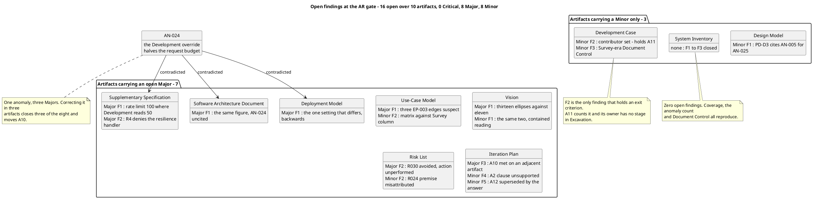

**Closed this milestone — thirteen, each by the lens that recorded it.**

| Artifact | Key | Lens | Severity | Closed against |
|---|---|---|---|---|
| Development Case | F1 | Reviewer | Major | "Tool and configuration references" — no version policy asserted |
| Development Case | F2 | Reviewer | Minor | "Roles and Ownership" — one CLS-DC-01 diagram, one role-deltas block |
| Development Case | F1 | Management Reviewer | Minor | The same section, under the stakeholder's order of 2026-11-23 |
| System Inventory | F1 | Reviewer | Major | "Traceability" — the AN-021 row reads all three entry points |
| System Inventory | F2 | Reviewer | Minor | "Coverage" — the headline recomputes from the per-area table |
| System Inventory | F3 | Reviewer | Minor | "Document Control" — Excavation iteration 1 |
| Risk List | F1 | Reviewer | Major | "Risk Classification" — one published word-to-score mapping; every row reproduces |
| Risk List | F1 | Management Reviewer | Major | The grant band re-derived; four grants at exposure 12 |
| Iteration Plan | F1 | Reviewer | Major | "Use Cases and Scenarios Addressed" — twelve anomalies, 21 edges |
| Iteration Plan | F2 | Reviewer | Minor | The coarse roadmap and the critical chain — the gate precedes the verdict |
| Iteration Plan | F1 | Management Reviewer | Major | "Evaluation Criteria" — C2a/C2b, C6, C7a/C7b |
| Iteration Plan | F3 | Reviewer | Minor | The fine plan's State column, each row against its artifact |
| Iteration Plan | F2 | Management Reviewer | Minor | The superseded C2b row no longer exists; A1 to A13 replace it |

**Cross-lens reconciliation — no contradiction, one severity disagreement, one duplicate subject.**

| Subject | The two lenses | Resolution this verdict records |
|---|---|---|
| The rate limiter (AN-024) | All three artifacts named by the Reviewer; the Management Reviewer reaches the same conclusion through A10 | Not a conflict — the Management Reviewer classified it at the criterion, not at the artifact. One fact, three corrections, both lenses agreed on the defect |
| The Vision's two ellipses (`U12`, `U13`) | Reviewer: **Major** (`Vision#F1`, `use-case-shape`) — thirteen use cases where the recovery holds eleven. Management Reviewer: **Minor** (`Vision#F1`, `contained-defect`) — the Use-Case Model governs the set, no criterion depends on the Vision's count | **The two lenses disagree on consequence, not on fact.** Counted at the **Major** band for the gate: gate H4 puts a use-case count to the stakeholder, and a supporting artifact stating a different count beside it is a defect in the material the sanction rests on. The Minor is recorded and does not double the work — one correction closes both |
| `Risk List#F2` | Two findings share the key under different lenses and different subjects: the Reviewer's Minor on R024's premise, the Management Reviewer's Major on R030's unperformed retirement | Two distinct findings, not a duplicate. The R024 Minor's remedy is partly satisfied by the R030 Major's — both point the mitigation at an artifact that still carries the error — but each lens closes only its own key |
| `Development Case#F2` | Recorded by both lenses at SBC, closed by the Reviewer's key, still open under the Management Reviewer's | No duplicate recorded at this gate: the technical lens named it and did not re-record it. Only the Management Reviewer may close it, and only that key holds A11 |

**Priority of what remains — the order the second iteration takes them.** Majors before Minors, and within each band, the finding that unblocks another first.

| Priority | Finding | Why it ranks here |
|---|---|---|
| 1 | Supplementary Specification#F1 | The root of three Majors; correcting M3, S2, P1 and R8 lets the Software Architect and the Deployment Model copy one settled figure |
| 2 | Software Architecture Document#F1 | Reads the same fact from the Supplementary Specification; the Deployment Model's environment table inherits this copy |
| 3 | Deployment Model#F1 | The only statement in the delivery of what differs between environments; Consolidation would copy it unchanged |
| 4 | Supplementary Specification#F2 | Independent of the rate limiter, and the SAD's P6 already holds the correct reading, so the correction is a transcription |
| 5 | Use-Case Model#F1 | The eleven-use-case count gate H4 puts rests on the three edges; confirming them also clears the material the Vision's count is checked against |
| 6 | Vision#F1 | Cheapest of the eight — delete two ellipses — and it must follow priority 5 so the count matches |
| 7 | Risk List#F2 (Management Reviewer) | A Significant exposure read as retired; its warning sign has already come true |
| 8 | Iteration Plan#F3 (Management Reviewer) | The plan's own certification; re-taken after priorities 1 to 4 land, so A10 can be certified on the recovered set |
| 9–16 | The eight Minors | In the order of Resolutions and Actions; `Development Case#F2` first among them because A11 counts it |

**One fact, three Majors, one correction.** The three rate-limit Majors are one wrong sentence in three artifacts. The recovery already holds the right answer in the same phase — the System Inventory records it as AN-024 and the Risk List carries it as R025, both anchored. The defect is not a failure of reading; it is three documents asserting the value their own reading contradicts.

## Resolutions and Actions
### Reviewer lens
<!-- review: Excavation I1 -->

<!-- review: Excavation I1 -->

**Prior findings of this lens, closed this milestone.**

| Finding | Artifact | Resolution | What was checked in the artifact |
|---|---|---|---|
| `System Inventory#F3` | System Inventory | Resolved — the stale Survey-era iteration is gone | Document Control reads "Iteration: Excavation iteration 1, cycle 1", "Status: Draft — produced for the end-of-Excavation (AR) milestone review", "Milestone Target: end-of-Excavation (AR) — not yet achieved". The four artifacts under that Survey review no longer disagree about which iteration's state they record |
| `Iteration Plan#F3` | Iteration Plan | Resolved — the State column states each row's actual outcome against the artifact it names | The section commits to the rule ("no row reads complete whose correction is not in the artifact"); row 9 cites the Document Control correction, verified in the artifact itself; row 10 records `Development Case#F2` as **Not started**, naming the exact sentence that still omits three lenses; rows 11 to 14 read Not started / Queued, matching the review now being taken |

Both were closed by `resolve_artifact_finding` before any new defect was recorded, in the reconciliation state, not in this one. The two Survey Majors this lens recorded — `Development Case#F1` and `Iteration Plan#F1` — were already resolved at the SBC re-take and are not re-opened.

**Open findings this milestone, ordered by what the milestone does with them.**

| Finding | Criterion | Severity | Owner | Action | Holds the milestone |
|---|---|---|---|---|---|
| `Supplementary Specification#F1` | `consumed-defect` | Major | System Analyst | State both rate-limit values with their sources in M3, S2, P1 and R8; cite AN-024 | Yes — the artifact's figures are contradicted by the code |
| `Supplementary Specification#F2` | `consumed-defect` | Major | System Analyst | Replace R4 with the two hops stated apart; cite AN-023 / R024 | Yes |
| `Software Architecture Document#F1` | `consumed-defect` | Major | Software Architect | Correct SP1 and M3; cite AN-024 | Yes — the copy the Deployment Model inherits |
| `Deployment Model#F1` | `consumed-defect` | Major | Software Architect | Narrow the environment preamble; rewrite the Rate limiting row | Yes |
| `Use-Case Model#F1` | `trace-gap` | Major | System Analyst | Re-register the three EP-003 edges as confirmed and explain the screen-versus-operation shape in the Survey | Yes — a suspect trace open at phase close |
| `Vision#F1` | `use-case-shape` | Major | System Analyst | Remove U12 and U13 from the Features diagram | Yes — thirteen use cases where the recovery holds eleven |
| `Use-Case Model#F2` | `contained-defect` | Minor | System Analyst | State the matrix-versus-Survey distinction and relabel the edges | No |
| `Risk List#F2` | `contained-defect` | Minor | Project Manager | Restate R024's premise and point its mitigation at the artifact that still carries the error | No |
| `Design Model#F1` | `contained-defect` | Minor | Designer | Change the PD-D3 citation from AN-005 to AN-025 | No |
| `Development Case#F3` | `contained-defect` | Minor | Process Engineer | Bring the four Document Control fields to Excavation iteration 1 | No |

**One correction, three artifacts.** Four of the six Majors turn on a single file. `Supplementary Specification#F1`, `Software Architecture Document#F1` and `Deployment Model#F1` are the same wrong sentence in three places — the code defaults are not the effective values, because `appsettings.Development.json` overrides all three to 50 and every launch profile runs in Development. The recovery already holds the right answer: the System Inventory records it as AN-024 and the Risk List carries it as R025, in the same phase, correctly anchored. The correction is one fact, and it must land in all three artifacts before the recovered set is put to the stakeholder, because gate H4 asks them to accept figures that are currently off by a factor of two.

`Supplementary Specification#F2` is the fourth: R4 denies a resilience handler the code installs, and the Software Architecture Document already got it right at P6 and said so in the artifact rather than editing one it does not own. That is the right division of ownership; what remains is for the owner to take the correction.

**Actions, and what each requires before the milestone can close.**

1. The three rate-limit corrections and the resilience correction land in the Supplementary Specification, the Software Architecture Document and the Deployment Model, each citing AN-024 or AN-023 so one fact carries one identifier across four artifacts.
2. The three `EP-003` edges are confirmed in the graph and the Use-Case Model explains why a screen entry point and the forwarded operation are both named, so the eleven-use-case count gate H4 puts is unqualified.
3. The Vision's Features diagram carries eleven use cases, matching the Use-Case Model, the Iteration Plan's O1 and the SAD's Use-Case View.
4. The four Minors are corrected in their owners' next turn, after the Majors — `Risk List#F2` and `Design Model#F1` are one-sentence corrections, and `Development Case#F3` is four metadata fields. None holds the milestone.

**Not this lens's to close.** `Development Case#F2` — the contributor set omitting three lenses, which the stakeholder ordered corrected on 2026-11-23 — stays open in the Management Reviewer's ledger. The Iteration Plan records it as outstanding and carries it as `R031`, and criterion A11 reads three of four because of it. This lens neither resolves it nor records a duplicate: a second lens writing its own key against the same defect is what the cross-lens duplicate pattern warns against, and only the lens that emitted a finding may close it.

**Not a finding, and why.** The absence of an Iteration Assessment describing this iteration is correct state — the Project Manager authors it after this review. The absence of a Data Model is the Development Case's NOT FIRED verdict on its trigger, which this lens checked and found to hold: eight persisted entity types, below the >10 threshold, no migration in scope, and the data written inline in the Design Model. The absence of an open pull request is the sprint zero's correct state, not an omission. No finding is recorded for any of the three.

### Management Reviewer lens
<!-- review: Excavation I1 -->

#### Findings this lens closed at this gate

Four findings of this lens were reconciled before any new defect was recorded, each verified against the artifact it names through the lens's own `resolve_artifact_finding` call. Closure is the tool call; what follows is the rationale.

| Finding | What it claimed | Why it is closed |
|---|---|---|
| `Development Case#F1` | The duplication the stakeholder ordered deleted on 2026-11-23 — the role-delta list and the CLS-DC-01 diagram, each stated twice | Verified at "Roles and Ownership": one CLS-DC-01 diagram, one "### Role deltas" block with two bullets. The correction is in the artifact, not merely promised |
| `Iteration Plan#F1` | C2b recorded "Not met" after the stakeholder had granted gate H2 — a cell stating a state the answer superseded | The row no longer exists. The plan's Evaluation Criteria now carries A1 to A13, and the Survey milestone is stated once in the coarse roadmap as "SBC — passed … Met at the re-take on 2026-11-23" |
| `Risk List#F1` | SBC criterion C8 could not be established: `R004` and `R011` sat at Minor and Moderate and were accepted on the Project Manager's authority while the inventory's words scored them 12 | The scores are reconciled against one published word-to-score mapping; both rows read 4 × 3 = 12 and carry the stakeholder's verbatim grant of 2026-11-23. Recomputed row by row, all 29 anomaly-derived rows reproduce |
| `Iteration Plan#F2` | The fine plan's State column stated outcomes its artifacts did not carry | Row 9 now states the Document Control correction that is verifiably in the System Inventory, row 10 records `Development Case#F2` as "Not started" and names the exact sentence that still omits three lenses, and rows 11 to 14 state the review's own position. No row claims a correction its artifact does not carry |

#### Actions this lens's findings require, in the order the phase can hold them

| Order | Owner | Action | Criterion it moves |
|---|---|---|---|
| 1 | System Analyst | Correct the Supplementary Specification: M3, S2, P1 and R8 state the code's 100/100/100 **and** the Development override to 50 with its anchor; rewrite R4 as two hops, the token hop inheriting the standard resilience handler and the forwarder hop inheriting nothing | A10, A3 |
| 2 | Software Architect | Correct SP1, M3 and the Quality view's "bounded load" row the same way, citing `AN-024` | A10, A3 |
| 3 | Software Architect | Correct the Deployment Model's preamble and Rate limiting row: the Development value is 50 and any other environment 100, and this is one of the settings that differ | A10, A5 |
| 4 | System Analyst | Write R030's statement beside the recovered session flows, citing `AN-029`; confirm the three `EP-003` edges so the eleven-use-case count is not resting on a suspect marking; and bring the Vision's Features diagram to eleven use cases, matching the Use-Case Model | A1, risk retirement, the count gate H4 puts |
| 5 | Project Manager | Re-state A2 and A10 against what their evidence establishes, and set A12 to the answer as given | The plan's own certification |
| 6 | Process Engineer | `Development Case#F2`: name every lens in the Review Record's contributor set and draw the three missing edges in CLS-DC-01; bring Document Control forward to Excavation | **A11 — the criterion that holds the phase** |

Actions 1 to 5 are work an Excavation role performs in the phase as the process runs it. Action 6 is not: Environment has no intensity in Excavation, so its owner has no scheduled stage. That asymmetry — not the size of any defect — is what makes Excavation iteration 1 unable to close on its own evidence, and it is the materialization of `R031`.

#### The two outcomes this gate permits, and what each costs

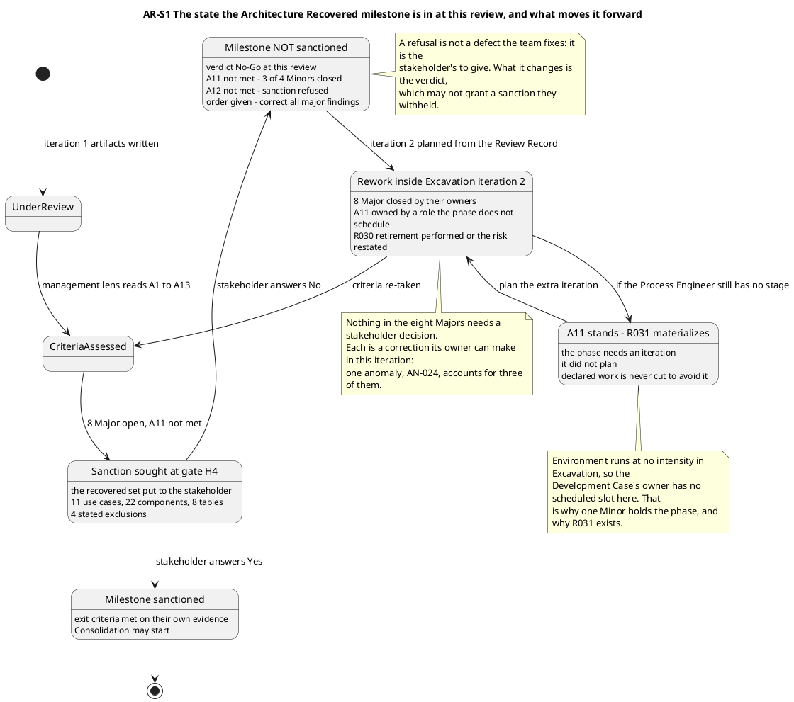

**A second iteration is not a schedule failure; refusing the gate would be the failure.** Seven of the eight Majors were avoidable within this iteration had the artifacts been corrected against the anomaly their own reading had already recorded — `AN-024` was in the System Inventory and `R025` in the register, and three documents still asserted the opposite. The eighth, the Vision's use-case count, is the cheapest of all: delete two ellipses. The rework is cheap now and would not have been later: the Deployment Model's environment table is the only statement in the delivery of what differs between environments, and Consolidation would have copied it.

#### What does not move

- **No declared scope is cut.** The delivery declares none, so nothing is deferred to protect a figure.
- **No plan is re-sized.** Excavation has no measured actual — it has not closed — so no forecast is stated here and none is invented. The two currencies stay apart: agent work in tokens and elapsed time, the stakeholder's queue in days of waiting, never summed.
- **`R031` is not accepted away.** It stays an avoided Significant risk, and its contingency — a second iteration planned from this record — is what is now required.
- **The stakeholder's order is recorded as given**: "We must correct all major findings." No further condition, limit or prohibition was stated, and none is recorded.

### Review Coordinator lens
<!-- review: Excavation I1 -->

<!-- review: Excavation I1 -->

**Actions, in the order the second iteration takes them.** Each action is the remediation its recording lens wrote, with its owner and the act that closes it. No action states a calendar date: the sprint zero declares none beyond the issue date of the Work Order, and a projected date computed from an estimate would read downstream as an observation. The due point is the state of the work, not a day.

| # | Action | Artifact | Owner | Closes | Due point | Escalates if |
|---|---|---|---|---|---|---|
| 1 | State both rate-limit values with their sources in M3, S2, P1 and R8; cite AN-024 | Supplementary Specification | System Analyst | `Supplementary Specification#F1` | Before the Software Architect's next pass | The figure is still single-valued after two owner turns |
| 2 | Correct SP1, M3 and the Quality view's "bounded load" row; cite AN-024 | Software Architecture Document | Software Architect | `Software Architecture Document#F1` | After action 1, same iteration | The correction contradicts action 1's text |
| 3 | Narrow the environment preamble; rewrite the Rate limiting row — Development 50/50/50, other environments the code defaults | Deployment Model | Software Architect | `Deployment Model#F1` | With action 2, same turn | — |
| 4 | Rewrite R4 as the two hops stated apart; cite AN-023 / R024 | Supplementary Specification | System Analyst | `Supplementary Specification#F2` | With action 1, same turn | — |
| 5 | Re-register the three EP-003 edges as confirmed; record the screen-versus-operation reading in the Use-Case Survey | Use-Case Model | System Analyst | `Use-Case Model#F1` | Before gate H4 is re-put | The edges stay suspect at the next milestone |
| 6 | Remove U12 and U13 from the Features diagram; keep the two rows as mechanisms cross-referenced to M8 and M9 | Vision | System Analyst | `Vision#F1` (both lenses) | After action 5, so the count matches | The Vision states a count the Use-Case Model does not |
| 7 | Write R030's statement beside UC-001 to UC-004 citing AN-029, or restate R030 as not yet retired | Risk List, Use-Case Model | System Analyst, then Project Manager | `Risk List#F2` (Management Reviewer) | Before the register is read again as retired | The register still reads Avoid with the action unperformed |
| 8 | Hold A10 open naming the three artifacts, or split it into identification and agreement; set A12 to "Not met — refused" (`Iteration Plan#F5` alongside) | Iteration Plan | Project Manager | `Iteration Plan#F3` (Management Reviewer), `#F5` | After actions 1 to 4 land, so A10 can be re-taken on a corrected set | A10 is certified again on the inventory's word |
| 9 | Name every lens in the Review Record's contributor set and draw the three edges in CLS-DC-01 | Development Case | Process Engineer | `Development Case#F2` (Management Reviewer) — **holds A11** | Excavation iteration 2, on the stakeholder's order | No stage in the phase — escalate; `R031` materializes |
| 10 | Bring the four Document Control fields to Excavation iteration 1 | Development Case | Process Engineer | `Development Case#F3` | With action 9, same turn | — |
| 11 | State the matrix-versus-Survey distinction and relabel the matrix's edges | Use-Case Model | System Analyst | `Use-Case Model#F2` | After action 5 | — |
| 12 | Restate R024 without the misattribution; point its mitigation at Supplementary Specification R4 | Risk List | Project Manager | `Risk List#F2` (Reviewer) | After action 4, so the mitigation has a target | — |
| 13 | Change PD-D3's citation from AN-005 to AN-025 | Design Model | Designer | `Design Model#F1` | Owner's next turn | — |
| 14 | Narrow A2 to its evidence, or add the deferred-set sentence to the Use-Case Model's "Not recovered, and why" | Iteration Plan | Project Manager | `Iteration Plan#F4` | With action 8 | — |

**Escalation protocol as applied at this milestone.** One finding is escalated and one class of exposure is escalated; nothing else is overdue.

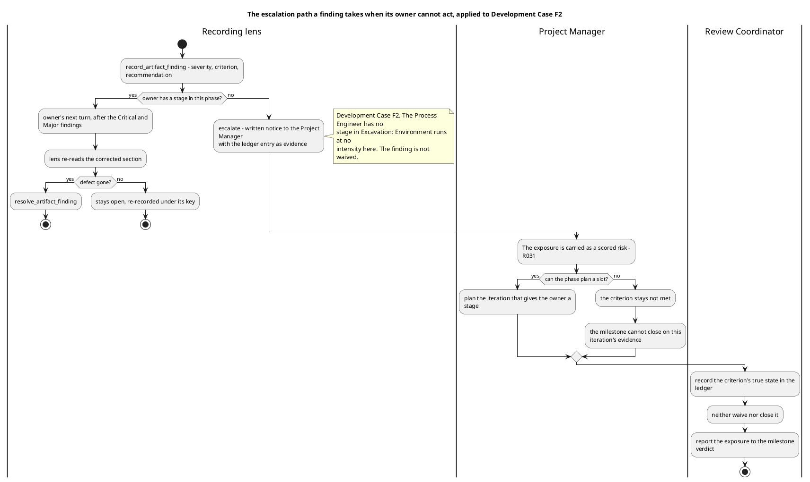

**Escalated to the Project Manager, with the ledger as evidence.** `Development Case#F2` — a Minor on any reading, and the only finding at this milestone that holds an exit criterion. A11 counts four Minor closures and reads three of four. Its owner, the Process Engineer, has no stage in Excavation because Environment runs at no intensity in the phase. `R031` predicted exactly this and has materialized. The exposure is not the size of the defect — it is that a criterion depends on a role the phase does not schedule.

**No escalation to the Configuration and Change Management Board.** No systemic process failure is visible in this ledger: the same two lenses evaluated the same ten artifacts, each finding is anchored to the code or the artifact text, and the rework the Majors require is inside the artifacts their owners hold. The Change Control Manager does not work in the sprint zero, so no change request is opened for any finding; the stakeholder's order reaches its owners through this record and through their Work Order.

**Review effectiveness — this milestone's measured counts.** First review of this phase; there is no prior Excavation iteration or cycle to compare against, so these are current values only and no trend is stated.

| Indicator | Value | What it is computed from |
|---|---|---|
| Review coverage | 10 of 10 artifacts subject to review received at least one lens read | The ten artifacts of this phase with findings or an explicit "no finding" statement from both executed lenses. The Iteration Assessment and this Review Record are not review subjects at their own milestone |
| Findings recorded | 29 — 8 Major, 21 Minor | `read_artifact_findings` across the ten artifacts, both lenses |
| Findings open at the gate | 16 — 0 Critical, 8 Major, 8 Minor | The `[FINDINGS]` line; 13 closed by their recording lens |
| Defect density by artifact type | Requirements artifacts 6 (5 Major, 1 Minor over Vision, Use-Case Model, Supplementary Specification); Analysis and Design 3 (2 Major, 1 Minor over SAD, Deployment Model, Design Model); Project Management 5 (3 Major, 2 Minor over Risk List, Iteration Plan); Environment 2 (0 Major, 2 Minor); Discovery 0 | The open and closed ledger, by the artifact carrying each finding |
| Lens agreement | 0 contradictory findings; 1 severity disagreement (`Vision#F1`, Major vs Minor); 2 keys shared by two lenses on distinct subjects | The reconciliation table in Findings |
| Duplicate defects found by two lenses | 1 subject — the rate limiter, reached by both lenses through different criteria | Both lenses named it; neither recorded the other's key |
| Defect removal efficiency | Not computable at this milestone | No test execution has occurred in the sprint zero. Nothing has been found by test against which review-found defects could be compared, and no ratio is invented |
| Rework effort | Not measured | Tokens and elapsed agent time per artifact are not recorded per finding in this phase; the phase has not closed so no measured actual exists to attribute |

**What the metrics say.** The two lenses found the same defect independently and classified it the same way at the artifact level, which is the signature of a real defect and not a lens artefact. The defect density is concentrated: the three rate-limit Majors are one anomaly recorded three times, so the four artifacts of the Requirements and Analysis surface carry an apparent density four times the underlying defect count. The review process worked — every Major is anchored, every Minor is owned, and the defect that mattered had already been recorded as `AN-024` in the same phase by the same role's own reading. What it did not do is prevent three artifacts from asserting the opposite of a fact the phase already held.

**No finding recorded for three absences, and why.** The absence of a Data Model, a Glossary and a Test Plan is the Development Case's NOT FIRED verdict on each trigger, which both lenses checked against the §5.2 conditions. The absence of an Iteration Assessment describing this iteration is correct state — the Project Manager authors it after this review. The absence of any SCM condition is the sprint zero's correct state: no branch of this process exists, no pull request is open, no defect issue is filed.

## Disposition
### Reviewer lens
<!-- review: Excavation I1 -->

<!-- review: Excavation I1 -->

**Disposition: Approved with Changes.** Six Major, four Minor. The six Majors are open and hold the AR milestone; the four Minors do not.

**What the recovered set establishes, and why it is approved rather than rejected.** The phase's real work is sound. Eleven use cases are recovered from twenty-two entry points, each citing the `EP-NNN` whose code performs it, and the entry points that carry none — `EP-020`, `EP-021`, `EP-022` and the `admin` branch — are accounted for with a reason, not dropped. Twenty-two components are recovered with their anchors, each technology declared in the artifact exists in a manifest, and the components realize the use cases whose paths they carry. The persistent store is recovered to the level of keys, indexes, referential actions and the seven rules the schema leaves to code. The System Inventory's coverage reproduces from its own table, its twenty-one anomaly edges reproduce from its own rows, and both the Risk List and the Iteration Plan certify their claims on the artifact each cites rather than on an adjacent answer. Nothing in this lens's read found a recovered element resting on an anchor that does not say what the element claims, except in the four cases recorded as Majors — and those are figures copied from one mechanism's description, not the recovery's structure.

The two contradictions are the reason this is Approved with Changes and not Approved. They are narrow and they are fully diagnosed: one code file contradicts three artifacts' statement of a value, and one service-defaults file contradicts one artifact's statement of a capability. The recovery already contains the correct answer to both, recorded as AN-024 and AN-023 in the same phase. That is why the disposition is rework rather than rejection — the artifacts do not need re-deriving, they need one fact corrected in three places and one sentence corrected in a fourth.

**What the milestone must not do while the Majors stand.** Gate H4 asks the stakeholder to accept the recovered use cases, architecture and data as the models of the existing system. They cannot be asked to accept a set whose stated request budget is double the value the system runs at, whose failure-handling claim about the task path is right and about the sign-in path wrong, whose use-case count is thirteen in one artifact and eleven in three others, and three of whose screen routes rest on trace edges the graph still marks suspect. Each of those is a question the stakeholder would be answering on wrong content.

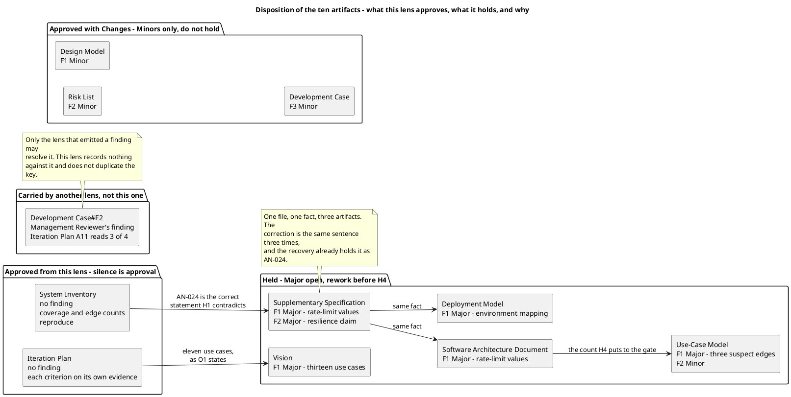

**What the milestone verdict may rely on from this lens.** Zero Critical: nothing in this review needs a decision only the stakeholder can take. The four stakeholder rulings that shaped the recovery — the provider path recovered as unreachable, the `admin` branch as an exceptional entity, the priority order standing, the perimeter confirmed — are recorded where they bite, in the System Inventory's Perimeter, the Use-Case Model's "Not recovered, and why", the Vision's Assumptions and the Risk List's grant table, each quoting the answer rather than paraphrasing a process decision. This lens found no element promoted to declared scope, no cross-cutting mechanism recovered as a use case except the two the Vision's diagram draws and `Vision#F1` records, and no recovered element with no anchor.

**The lens's own limit, stated so the coordinator can weigh it.** This review opened five anchors and two contradicted their citing artifacts. It did not open every anchor in ten artifacts — that is not possible within one pass and the Software Archaeologist's own reading is what the coverage section measures. What this lens did establish is that where the recovery and the code disagree, the disagreement is discoverable by opening the file the artifact names, and that in the two cases found the recovery's own anomaly register already knew the answer. That is the healthiest signal in this review: the reading is honest about the system even where the artifacts built on it are not yet.

**Verdict recorded.** Approved with Changes, with the six Majors holding the AR milestone. Gate H4 is not put by this lens — it follows the lenses' ruling, and the ruling is that the corrections land first.

### Management Reviewer lens
<!-- review: Excavation I1 -->

#### Verdict

**No-Go.** The Architecture Recovered milestone is **not sanctioned** at the end of Excavation iteration 1.

I put the milestone to the stakeholder at this review with my leaning stated — Conditional Go, seven Majors open at the time of asking, none requiring their decision — and the recovered set for confirmation. They answered:

- **Stakeholder sanction: REFUSED.** Asked whether they confirm the recovered set as the model of the existing system — the 11 use cases and the 4 stated exclusions, the 22-component architecture across four processes, and the eight-table data model — and sanction advancing past the Architecture Recovered milestone into Consolidation with the Majors cleared first, the stakeholder answered **"No"**.
- **Stakeholder acceptance, as given:** "We must correct all major findings."

That is the whole of what they stated. No condition, limit or prohibition beyond it is recorded here, and none is inferred.

**Why No-Go rather than Conditional.** A sanction is an affirmative grant; the burden of proof rests on the project team, and I may not grant what the stakeholder withheld. Two exit criteria are not met on the phase's own evidence, and both are structural rather than editorial:

- **A11 — the four SBC Minors closed — is not met, three of four.** `Development Case#F2` stands. It is contained in its own document and a lens writes its block whatever the tailoring says, but the phase's plan counts it, this lens counts it, and its owner has no scheduled stage in Excavation because Environment runs at no intensity here. `R031` was written down as this exact exposure at 3 × 4 = 12. It has materialized, and that is now a statement of fact rather than a forecast.
- **A12 — the recovered set confirmed — is refused.** The gate the phase waits on returned No.

Neither is repairable by the same set of artifacts. The first needs a role the phase does not schedule; the second needs the stakeholder asked again after the Majors are cleared. A Conditional Go would have claimed the second was obtainable by editing documents, and it is not.

#### Four-axis health

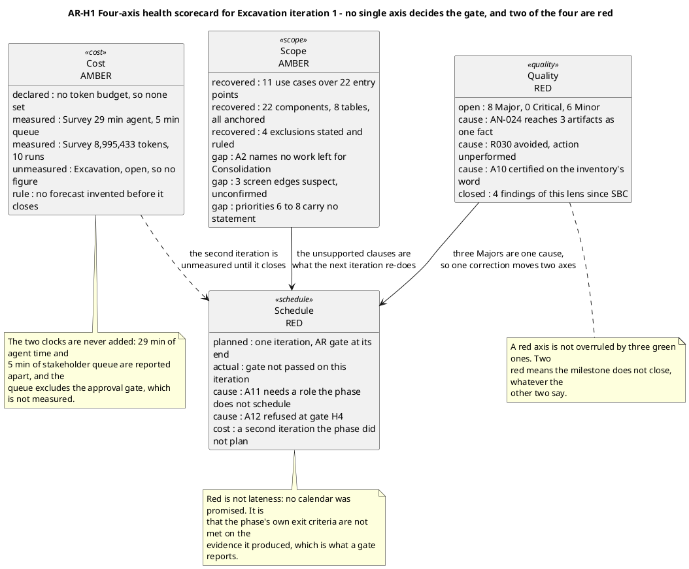

**Quality is red on eight Majors and zero Criticals**, and the distribution matters more than the count: three of the eight are one anomaly — `AN-024` — stated as fact in three documents while the System Inventory records the contradiction and `R025` carries it. Correcting those three against the anomaly their own reading already found is short work with the anchor to hand. The fourth Major is a two-hop claim collapsed into one sentence; the fifth is three trace edges whose substance is right and whose confirmation was never registered; the sixth is a use-case count stated as thirteen where the artifact that owns the set recovers eleven; the seventh is a Significant risk recorded as retired by an action that is in no artifact; the eighth is a criterion certified on a neighbouring artifact's word.

**Scope is amber, not green**, because two of the certifyable criteria were recorded Met on evidence that does not carry them. The recovered set itself is strong: eleven use cases over twenty-two entry points with every exclusion stated, twenty-two components with a `Realizes` row per use case, eight tables with keys, indexes, referential actions, and a table of the rules the schema does *not* enforce — that last being the most useful page in the phase. The amber is for the certification, not the content.

**Schedule is red.** One iteration was planned with the AR gate at its end; the gate is not passed. The cause is not that the work was large — it is that one criterion depends on a role the phase does not schedule, and one gate answer cannot be obtained until the Majors are cleared.

**Cost is amber and deliberately carries no projection.** The project declares no token budget, so no box exists to fit and no declared work was cut or deferred to meet an estimate. The one measured actual is the closed phase: 29 minutes of agent time, 5 minutes of stakeholder queue, 8,995,433 tokens across 10 runs — reported in the two currencies, apart, never summed. Excavation has not closed, so it has no measured actual and no forecast is stated for it.

#### What is sanctioned, and what is not

| Item | State |
|---|---|
| The Architecture Recovered milestone | **Not sanctioned** — No-Go |
| Advancement into Consolidation | **Not sanctioned** |
| The recovered content — 11 use cases, 22 components, 8 tables, 4 exclusions | **Exists, anchored, and not confirmed by the stakeholder** |
| Excavation phase | **Open** — a second iteration required, planned from this record |
| The stakeholder's order | **"We must correct all major findings."** |
| `R031` | **Materialized** — an avoided Significant risk whose contingency is now the required path |

#### Closing statement

The gate holds. Eight Majors and two unmet criteria are open, the stakeholder refused the sanction, and they ordered the Majors corrected. Excavation iteration 2 is planned from this record: actions 1 to 5 of "Resolutions and Actions" are their owners' work in that iteration, and action 6 — the one Minor that holds the phase — needs the Process Engineer given a work item in an Excavation iteration, because the process does not otherwise put that role in this phase. If that item lands, A11 reads four of four on re-take. If it does not, `R031` says what happens next: the phase opens the further iteration its own register already budgeted for, and nothing the phase declared is cut to avoid it.

I do not sanction a phase because the calendar says it should end. I sanction it when its exit criteria are met on the evidence each criterion cites — and at the end of Excavation iteration 1 they are not.

### Review Coordinator lens
<!-- review: Excavation I1 -->

<!-- review: Excavation I1 -->

**Verdict — the AR milestone is NOT sanctioned on Excavation iteration 1's evidence.** The decision is read from the ledger, not from judgment: the `[FINDINGS]` line reports 12 artifacts read, unread none, 0 open Critical, 8 open Major, 8 open Minor; the recovery's own statement of completeness leaves exit criterion A11 at three of four; and the stakeholder answered gate H4 **No**, with the order "We must correct all major findings." Nothing in this record advances the project past Architecture Recovered.

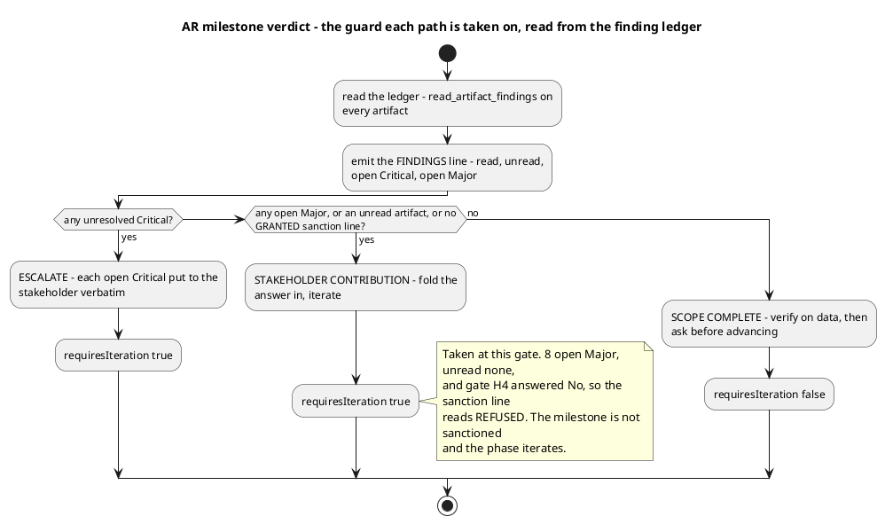

**The guard, taken on data.** Three of its four conditions are false, so the milestone does not advance and the phase iterates.

| Guard condition | Required | At this milestone | Holds |
|---|---|---|---|
| Unresolved Critical findings | 0 | 0 | Yes |
| Open Major findings | 0 | 8 | **No** |
| Artifacts unread at the gate | none | none — all 12 read | Yes |
| Stakeholder sanction line | GRANTED | **REFUSED** — gate H4 answered No on 2026-11-23 | **No** |

**The recovery's own completeness, as the two criteria read.**

| Criterion | State | Evidence |
|---|---|---|
| A11 — the Minors the SBC review left open are closed | **Not met — three of four** | `Iteration Plan#F2`, `Iteration Plan#F3` and `System Inventory#F3` are corrected in their artifacts. `Development Case#F2` stands: "Roles and Ownership" still omits the Management Reviewer, the Business Reviewer and the Review Coordinator, and CLS-DC-01 draws no edge from them into this artifact. Carried as `R031` |
| A12 — the recovered set is confirmed by the stakeholder | **Not met — refused 2026-11-23** | Gate H4 answered No. The 11 use cases, the 22-component architecture, the eight-table data model and the four stated exclusions were put and not accepted |
| A10 — the recovery states what the code does | **Not met as written** | Three artifacts state AN-024's contradicted value as fact: the Supplementary Specification, the Software Architecture Document and the Deployment Model. The criterion is certified on the inventory's identification of the contradiction, not on the recovered set |

A11 is not waived and no row of the plan is marked complete on it. A12 is the stakeholder's to give and is not this record's to supply.

**What this milestone found, in one paragraph.** The recovery itself is sound: eleven use cases each anchored to the entry point whose code performs it, four exclusions stated with their reasons and confirmed by the stakeholder's own rulings of 2026-11-23, 22 components with their connectors, eight tables with their keys and enforced rules, and 84 of 139 files opened with the remainder named. The defects are one class and they are not reading failures: a fact the phase had already recorded as `AN-024` was asserted backwards in three documents, and the phase already held the correct statement in its own inventory and register. Four of the eight Majors are that one file. The Vision's count is the cheapest of the rest. The eighth, `Iteration Plan#F3`, is a criterion certified on an adjacent artifact's answer — the shape a milestone verdict exists to catch.

**The stakeholder's contribution, collected at this milestone and recorded as given.** Gate H4 was put inside this milestone, which is where the Management Reviewer's gate sits, and answered: **No** to confirming the recovered set and sanctioning advancement into Consolidation, with the direction **"We must correct all major findings."**

- Recorded as the sanction answer and as a `Stakeholder finding` this record acts on. It is verified against the ledger rather than deferred: the eight open Majors are exactly the items it names, each carries an owner and a due point in Resolutions and Actions, and none is recorded as closed or waived.
- No new defect is minted for the order — every item it names is already in the ledger with a owner and a remedy.
- The question of what else the second pass should read was answered in the same breath: correct all major findings, no prohibition stated, no exclusion re-opened, no recovered use case named as wrong or missing. Nothing further is asked of the stakeholder here.

**What does not move.**

| Item | Standing |
|---|---|
| Declared scope | The delivery declares none, so nothing is deferred or cut to protect a figure |
| The four stated exclusions | Untouched. The stakeholder re-opened none of them: external-provider sign-in stays recovered and unreachable, the admin branch stays an exceptional entity, the health endpoints and the migration event stay outside the use-case set |
| `R031` | Stays an avoided Significant risk. Its contingency — a second iteration planned from this record — is what is now required, not what is declined |
| The recovered set | Not withdrawn. Every element remains in its artifact with its anchor; what fails is the claim that it is confirmed and complete |
| The plan | Not re-sized. Excavation has no measured actual — it has not closed — so no forecast is stated and none is invented. The two currencies stay apart: agent work in tokens and elapsed time, the stakeholder's queue in days of waiting, never summed |
| The measured actuals of the closed phase | Survey: 29 min agent time, 5 min stakeholder queue, 8,995,433 tokens, 10 agent runs, 6 artifacts. Per phase, not per iteration; no velocity is quoted from it |

**What the next iteration carries.** Excavation iteration 2, planned from this record: the fourteen actions in Resolutions and Actions, taken in the order given — the three rate-limit corrections and the resilience correction first, because one settled figure unblocks four artifacts and one criterion; then the three EP-003 edges and the Vision's count; then the two Management Reviewer Majors, the one on `R030` and the one on A10; then the eight Minors, `Development Case#F2` first among them because A11 counts it.

**A second iteration is not a schedule failure.** The rework is cheap now and would not have been later: the Deployment Model's environment table is the only statement in the delivery of what differs between environments, and Consolidation would have copied it unchanged. Seven of the eight Majors were avoidable within this iteration had each artifact been corrected against the anomaly the phase's own reading had already recorded.

**Recorded through the process's own channel.**
