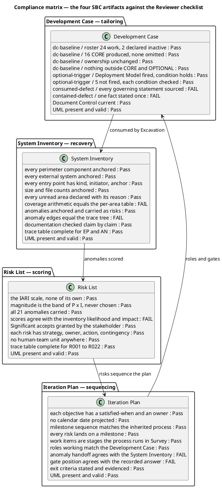
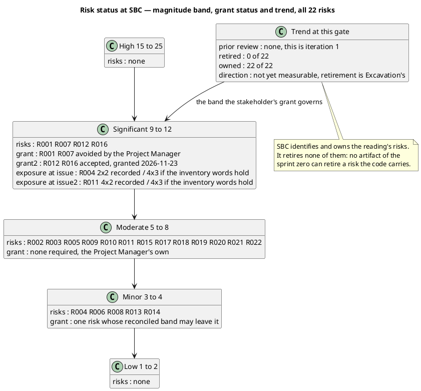
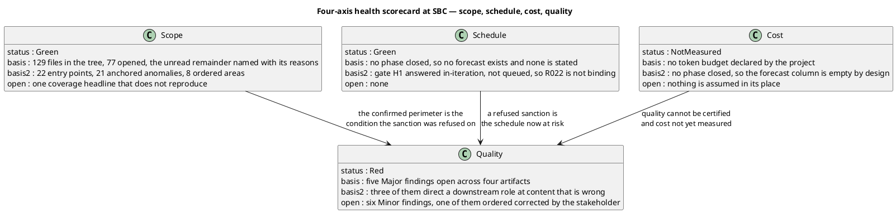
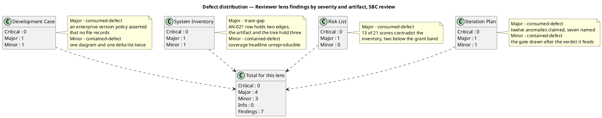
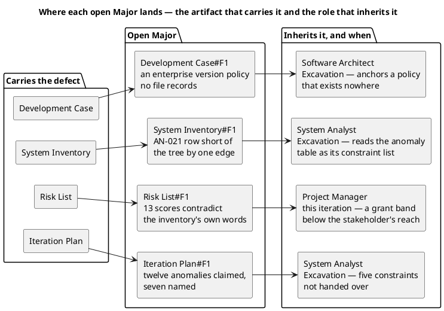

## Document Control
### Reviewer lens
<!-- review: Survey I1 -->

- Phase: Survey
- Status: Technical lens complete for the SBC milestone review. Seven findings recorded: 0 Critical, 4 Major, 3 Minor, 0 Info. Disposition — Approved with Changes.
- Milestone Target: end-of-Survey (SBC) — not yet achieved; the four Major findings require rework before any role consumes these artifacts.
- Iteration: 1, Cycle 1
- Owner: Reviewer

### Management Reviewer lens
<!-- review: Survey I1 -->

<!-- review: Survey I1 -->

- Phase: Survey
- Status: Management lens complete for the SBC milestone review. Three findings recorded by this lens: 0 Critical, 2 Major, 1 Minor. Disposition — No-Go. Stakeholder sanction REFUSED on 2026-11-23.
- Milestone Target: end-of-Survey (SBC) — not achieved; the sanction was withheld and six Major findings stand across the four artifacts under review.
- Iteration: 1, Cycle 1
- Owner: Management Reviewer

## Review Scope and Criteria
### Reviewer lens
<!-- review: Survey I1 -->

**Review type.** Milestone review, technical lens, at the SBC (end-of-Survey) review point. The question applied is exit criteria: whether the four artifacts collectively satisfy the conditions for transition into Excavation — not whether the iteration's objectives were completed.

**Artifacts under review.** Development Case (Process Engineer), System Inventory (Software Archaeologist), Risk List (Project Manager), Iteration Plan (Project Manager). All four are the artifacts the SBC inventory carries; the Review Record is this lens's own output.

**Checklist applied.** Per artifact type: Environment tailoring → DC Baseline Conformance and Optional Trigger Justification against the IARI baseline held in this prompt. Recovery → EVIDENCE, the Survey lens: every fact about an existing system must rest on the file it cites, so the anchors were opened rather than trusted. Project Management → the IARI risk scale, the two-currency rule, and the phase's exit criteria.

**Method.** All 41 registered trace edges were read. The perimeter and anomaly anchors were opened in the repository: `Todo.Api/Program.cs`, `Todo.Api/Todos/TodoApi.cs`, `Todo.Api/Todos/Todo.cs`, `Todo.Api/Users/UsersApi.cs`, `Todo.Api/Authorization/CurrentUser.cs`, `Todo.Api/Extensions/RateLimitExtensions.cs`, `Todo.Api/TodoDbContext.cs`, `Todo.Web/Server/AuthApi.cs`, `Todo.Web/Server/AuthClient.cs`, `Todo.Web/Server/Program.cs`, `Todo.Web/Server/TodoApi.cs`, `Todo.Web/Server/Authentication/AuthenticationExtensions.cs`, `Todo.Web/Server/appsettings.json`, `Todo.Web/Server/Todo.Web.Server.csproj`, `Todo.Web/Client/TodoList.razor`, `Todo.Web/Client/TodoClient.cs`, `Todo.Web/Client/TodoApp.razor`, `Todo.Web/Client/Components/LogInForm.razor`, `Todo.Web/Server/App.razor`, `Todo.Web/Shared/SharedClass.cs`, `Todo.Api.Tests/TodoApplication.cs`, `Todo.Api.Tests/TokenService.cs`, `Todo.Api.Tests/Todo.Api.Tests.csproj`, `TodoApp.AppHost/Extensions.cs`, `.devcontainer/devcontainer.json`, `Directory.Build.props`, `global.json`, `README.md`, `Requests/todo.http`, `docs/CONTRIBUTING.md`, `.iari/README.md`.

**Anchor verdict.** Every load-bearing anchor states what the artifacts claim it states, including the claims that carry the most risk: the admin branch at `TodoApi.cs:33,59,69` with nothing granting the role, `AuthApi.cs:55-62` taking the provider name straight from the route, `AuthApi.cs:64-97` redirecting to `/` on every path, `UsersApi.cs:16`'s own service-to-service auth TODO, the two `/todos` policies in `Program.cs` versus `UsersApi.cs:10-20`, `TodoList.razor:24-27`'s unbound checkbox, and `.devcontainer/devcontainer.json`'s SDK 8.0 image against `net10.0` — the target in `Directory.Build.props` being `net9.0` and the pin `9.0.100`. No finding is raised against the reading's accuracy. Every finding below sits in a count, an edge, a score or an unsourced assertion.

**SCM evidence.** No open pull requests exist, so nothing is disposed in this review. The repository carries no IARI pipeline file on `main`: the build environment is the Integrator's Inception work item and no branch or build of this process exists yet. No red build and no open pull request is therefore a finding, and no phase-discipline defect is available to detect.

### Management Reviewer lens
<!-- review: Survey I1 -->

<!-- review: Survey I1 -->

**Review type.** Lifecycle milestone review at the end-of-Survey gate — System Boundary Confirmed (SBC) — second lens, held after the Reviewer's technical lens. The question applied is exit criteria: whether the Development Case, the System Inventory, the Risk List and the Iteration Plan collectively satisfy the conditions for advancing into Excavation. This is not a completion review of the iteration's work items; that question is answered separately below as the iteration-acceptance part of this gate.

**Why this gate exists.** SBC is the first of the sprint zero's three milestones. It gates on one thing: the perimeter of the existing system is known, its priorities are set, the anomalies the reading found are carried as scored risks, and the stakeholder confirms that perimeter. Excavation recovers use cases, architecture and design from the perimeter this gate fixes. Nothing downstream can detect a perimeter that was confirmed on the team's word — the recovered set would rest on it silently. That is why the perimeter confirmation is a criterion and not a formality.

**Artifacts under review.** Development Case (Process Engineer, Environment), System Inventory (Software Archaeologist, Discovery), Risk List and Iteration Plan (Project Manager, Project Management). The Review Record is this lens's own output and is not reviewed here.

**Upstream consumption.** All four were read in full, plus the Reviewer lens's block and its seven findings, and the finding ledgers of all four artifacts (`read_artifact_findings`: 2 on System Inventory, 1 on Risk List, 2 on Iteration Plan, 2 on Development Case — all of them the Reviewer's, none resolved, none this lens's).

**Checklist applied.**

| Checklist | Applied to | Source of the standard |
|---|---|---|
| Lifecycle milestone exit criteria | The four SBC criteria set and the plan's ten | The phase's own declared criteria plus the IARI Development Process's Survey row |
| Risk magnitude scale and grant band | Risk List | The IARI probability, impact and magnitude tables |
| Two-currency plan sizing | Iteration Plan | Token spend and elapsed agent time, human gates as queue time only; no human-team unit |
| Development Case baseline conformance | Development Case | The IARI DC baseline in this prompt: 26 roles, 16 CORE, 6 OPTIONAL, canonical intensity matrix |
| Optional trigger justification | Development Case | The §5.2 conditions, each against the project's real facts |
| Iteration objective traceability | The iteration's six objectives | The Iteration Plan's own "Satisfied when" column |

**SBC exit criteria — pass or fail per criterion, on the evidence each cites.**

```plantuml
@startuml
title SBC exit criteria at the management gate — C1 to C10, each against the artifact that evidences it

skinparam shadowing false
skinparam classAttributeIconSize 0
hide empty members

class "C1  The perimeter is stated" as C1 {
  verdict : Pass
  evidence : four processes, their components and stores, each anchored
}
class "C2  The perimeter is confirmed by the stakeholder" as C2 {
  verdict : Fail
  evidence : the confirmation and the sanction were answered No on 2026-11-23
}
class "C3  The entry points are enumerated" as C3 {
  verdict : Pass
  evidence : EP-001 to EP-022 with kind, initiator and anchor
}
class "C4  The priorities are ordered" as C4 {
  verdict : Pass
  evidence : eight areas, each with its reason
}
class "C5  The priority order is confirmed" as C5 {
  verdict : Pass
  evidence : answered 2026-11-23, nothing left out
}
class "C6  The unread remainder is declared" as C6 {
  verdict : Pass with reservation
  evidence : the unread files are named, the headline count does not reproduce
}
class "C7  Every anomaly is carried as a scored risk" as C7 {
  verdict : Pass with reservation
  evidence : 21 of 21 carried, thirteen scores do not reproduce from the inventory
}
class "C8  Every accept above Moderate carries the grant" as C8 {
  verdict : Fail
  evidence : R004 and R011 may sit in the Significant band and were never put to the stakeholder
}
class "C9  No risk is left unactionable" as C9 {
  verdict : Pass
  evidence : strategy, owner, action and contingency on every row
}
class "C10  The plan names no work the process does not run" as C10 {
  verdict : Pass
  evidence : every work item is a Survey stage of the inherited process
}

class "SBC milestone" as M {
  sanction : refused by the stakeholder 2026-11-23
  critical : 0
  major : 5
  minor : 1
  state : not achieved
}

C1 --> M
C2 --> M
C3 --> M
C4 --> M
C5 --> M
C6 --> M
C7 --> M
C8 --> M
C9 --> M
C10 --> M
@enduml
```

Six criteria hold on their own evidence: the perimeter is stated with anchors, all 22 entry points carry kind, initiator and anchor, the eight areas are ordered with reasons and that order was confirmed, the unread remainder is declared rather than left implicit, every anomaly is carried and every risk row names a strategy, an owner, an action and a contingency, and every work item belongs to a stage the inherited process actually runs in Survey.

Three do not, and one of those is the gate's own condition:

- **C2 — Fail.** Asked at this review whether they confirm the perimeter as the System Inventory records it and sanction advancing past SBC, the stakeholder answered **"No"**. The two answers of 2026-11-23 that the Iteration Plan cites as C2's evidence settle two perimeter-membership questions — the external-provider path as an unreachable recovered use case, the admin branch as an exceptional entity — and confirm the priority order. Neither confirms the perimeter as stated.
- **C8 — Fail.** The register records R004 at Minor and accepts it on the Project Manager's authority, and records R011 at Moderate and accepts it likewise, while the System Inventory states "likely / moderate" for both, which scores 12 — the Significant band whose acceptance is the stakeholder's alone. A grant band that cannot be derived from the register cannot certify that every risk the stakeholder must accept reached them.
- **C6 and C7 — pass with a reservation on each.** C6's subject — the unread files named with reasons — is satisfied; the figure quoted beside it does not reproduce from the artifact's own table, and a criterion certified on a number that does not reconcile is met in substance and defective in evidence. C7 is a counting test and passes as one (21 anomalies, 21 risks, none silently dropped); what it counts does not reproduce, which is the Risk List Major below.

**Iteration acceptance — the six objectives of this iteration against what it delivered.**

```plantuml
@startuml
title Iteration objectives O1 to O6 — each against what the iteration delivered

skinparam shadowing false
skinparam classAttributeIconSize 0
hide empty members

class "O1  The sprint-zero tailoring exists" as O1 {
  verdict : Met
  evidence : Development Case — two disciplines inactive with their conditions, one OPTIONAL fired, measurement policy
}
class "O2  The system is read and its perimeter stated" as O2 {
  verdict : Met
  evidence : System Inventory — four processes, 19 components, 9 external systems, 5 stores
}
class "O3  The unread remainder is declared" as O3 {
  verdict : Met, one count unreconciled
  evidence : Coverage names each unread file and its reason; the headline does not reproduce from the table
}
class "O4  The anomalies are carried as scored risks" as O4 {
  verdict : Met in structure, not in arithmetic
  evidence : 21 of 21 carried with strategy, owner, action, contingency; thirteen scores contradict the inventory
}
class "O5  The priorities are ordered and the answer recorded" as O5 {
  verdict : Met
  evidence : eight areas ordered with reasons; the 2026-11-23 answer quoted
}
class "O6  The plan for the sprint zero and the phases exists" as O6 {
  verdict : Met
  evidence : coarse roadmap of seven milestones, this iteration's nine work items with owners
}

class "Iteration acceptance" as IA {
  objectives : 6 of 6 delivered
  caveat : two delivered with a defect inside them
  note : objective delivery and milestone exit are separate questions
}

O1 --> IA
O2 --> IA
O3 --> IA
O4 --> IA
O5 --> IA
O6 --> IA
@enduml
```

All six objectives were delivered. Two carry a defect inside them — O3's coverage arithmetic and O4's scores — and neither defect is a missing objective: the reading happened, the remainder is declared, the anomalies are carried. The iteration's work was done; what it produced is not yet certifiable. That distinction is why the iteration is accepted and the milestone is not.

**Risk retirement trend.** SBC does not retire risk and claims none. It converts the reading's anomalies into owned, scored, actionable risks — 22 of 22 owned, 0 retired by design, because no artifact of the sprint zero can retire a risk the code carries.

What this gate does owe is that every band above Moderate is grantable. R012 and R016 are, in the stakeholder's own words of 2026-11-23. R001 and R007 are avoided, which is the Project Manager's authority. R004 and R011 sit in the band below the grant requirement only because their scores were lowered from what the inventory states for the same anomalies — a grant-band defect, recorded against the Risk List below.

One further trend worth stating: R022, the risk that a milestone waits on a stakeholder gate, did not bite this iteration. Gate H1's three answers arrived in-iteration on 2026-11-23, ahead of the review, and the 14-day ceiling was never approached. The sanction question at this review was answered at once. R022 stays Moderate and unretired, correctly, because it governs every later gate too.

**Four-axis health.**

Quality is red and that is the finding. Scope is green: the reading's perimeter is complete for what the phase requires, the entry points enumerate, the priorities are ordered and confirmed, and the unread remainder is declared rather than hidden. Schedule is green on the only measure available — no phase has closed, no date is projected from an estimate, and the one human gate this iteration depended on was answered ahead of the review rather than queued behind it. Cost is not measured: the project declares no token budget and no phase has closed, so the plan's forecast column is empty rather than filled, which is the correct state and not a defect.

**Feasibility and acceptability.** The plan is feasible: sequential end to end, the roles working are exactly those the Survey row of the inherited process names plus its three reviewing roles, no work item belongs to a stage the process does not run in Survey, and the milestone sequence runs the sprint zero then the four RUP phases in order. Acceptability was put to the stakeholder as a question, not assumed, and the answer is below.

**SCM evidence.** The repository carries no IARI pipeline and no branch of this process; no build of this project exists to be red, no pull request is open, and no defect issue is filed. No SCM condition can therefore hold this gate, and none is reported as passing or failing — the gate is judged on the artifacts, which is what the sprint zero produces.

## Findings
### Reviewer lens
<!-- review: Survey I1 -->

#### Development Case

Two findings. The tailoring verdicts themselves hold: two disciplines inactive each with its own recorded condition (`business-process-led = false`, `real-time-system = false`), 24 roles working, no CORE artifact omitted or reassigned, nothing listed outside the CORE + OPTIONAL universe, and the one fired OPTIONAL — Deployment Model — justified by a genuinely distributed four-process topology with a YARP proxy hop and per-process configuration pairs. The five NOT FIRED verdicts were each checked against its §5.2 condition and each holds: eight entity types is below the Data Model threshold, the architecture already runs so no mechanism needs empirical validation, no regulator or contract consumes test reporting, no UX decision waits on the stakeholder, and the vocabulary is plain English.

- **Development Case#F1 — Major, `consumed-defect`.** The "Tool and configuration references" section asserts that an enterprise version policy "is recorded with the process and is anchored by the Software Architect in the Software Architecture Document" and that "it governs over the registry's latest for every package the delivery adds". `docs/CONTRIBUTING.md` records central pinning in `Directory.Packages.props` and the nuget.org-only source rule; neither states a rule preferring a pinned version over a registry's latest, and no file in the tree records such a policy. The Software Architect is directed in Excavation to anchor a document that does not exist. **Remediation:** name the file that records the policy, or replace the sentence with what is true — version selection follows central pinning, nuget.org being the only configured source.

- **Development Case#F2 — Minor, `contained-defect`.** The role deltas are stated twice inside "Roles and Ownership" and the CLS-DC-01 role-artifact diagram is embedded twice, verbatim. **Remediation:** keep one statement of the deltas and one CLS-DC-01 diagram; delete the duplicate.

#### System Inventory

Two findings. The recovery itself is the strongest artifact of the four: 22 entry points each with kind, initiator and file anchor; 19 perimeter components and 9 external systems each anchored; every anomaly row carrying evidence with line numbers; and a Coverage section that declares its unread remainder and why rather than leaving it implicit. The two stakeholder decisions of 2026-11-23 are carried consistently into the Perimeter prose, the Perimeter diagram notes and the affected entry-point rows — the external-provider path as a recovered use case marked unreachable, the admin branch as an exceptional entity. No `[DERIVED]` or `[SCOPE_QUESTION]` marker survives an answered question.

- **System Inventory#F1 — Major, `trace-gap`.** The Traceability row for AN-021 reads `DependsOn EP-004, EP-005`. The artifact's own Anomalies diagram carries `A21 --> E4`, `A21 --> E5` and `A21 --> E7`, and the registered trace tree carries the same three edges. The row registers two of the three the artifact and the tree hold. **Remediation:** add EP-007 to the AN-021 row.

- **System Inventory#F2 — Minor, `contained-defect`.** Coverage states "77 were opened" of 129, while the per-area Read column sums to 76 (23+7+8+0+14+1+6+2+1+7+1+2+1+1+1+1), and the docs row records `3 | 1` beside a note saying all three were opened. The Iteration Plan cites the derived figure — "52 files unread of 129" — as criterion C6's evidence. **Remediation:** recompute the headline from the per-area table, decide explicitly whether the two artifact files under `docs/` count as read, and make the column and the headline agree.

#### Risk List

One finding. The register's structure is sound: the IARI scale is reproduced from the baseline and no scale of its own is defined, magnitude is derived as the band of exposure rather than chosen, all 21 anomalies are carried with an explicit note explaining the 22nd risk's separate origin, every row names a strategy, an owner, an action, a contingency and a warning sign, and the two Significant accepts carry the stakeholder's grant in their own words. No person-week, person-month or story-point unit appears anywhere.

- **Risk List#F1 — Major, `consumed-defect`.** Thirteen of the twenty-one rows score a risk differently from the likelihood and impact the System Inventory states for the same anomaly, and the same inventory word scores differently in different rows: "likely / moderate" gives 4×3 for AN-001 but 4×2 for AN-003 and AN-011; "likely / low" gives 4×1 for AN-006 and AN-008 but 2×2 or 4×2 for AN-013, AN-014, AN-015, AN-017 and AN-019; "possible / high" becomes 2×3 for AN-002. The consequence is not cosmetic. AN-004's "likely / moderate" would place R004 at exposure 12 — the Significant band whose acceptance is the stakeholder's to grant — where it is recorded 2×2 and accepted by the Project Manager; the same applies to R011. The magnitudes then sequence the Iteration Plan's milestones and underlie the same grant band the stakeholder's R012 and R016 accepts came from. **Remediation:** score each risk once from the IARI scale and reconcile it against the inventory's column, or delete the inventory's likelihood and impact as a scoring claim and state that the score is the Project Manager's own reading of the cited evidence. Where a reconciled score lands in the Significant or High band, put that acceptance to the stakeholder in this iteration — R004 and R011 are the candidates.

#### Iteration Plan

Two findings. The plan is otherwise conformant to the process it must instantiate: the milestone sequence runs Survey → Excavation → Consolidation → Inception → Elaboration → Construction → Transition, every discipline intensity quoted matches the canonical matrix, the roles recorded as working in this iteration are exactly those the Survey row of the inherited process names plus its three reviewing roles, every work item is a stage that process actually runs in Survey, no calendar date is projected from an estimate, and the two currencies are kept apart with the human gate bounded as R022 rather than estimated.

- **Iteration Plan#F1 — Major, `consumed-defect`.** "Use Cases and Scenarios Addressed" states that "the 12 anomalies that sit on an entry point" are handed to Excavation and then names seven: AN-001, AN-002, AN-004, AN-018, AN-019, AN-020, AN-021. AN-008, AN-009, AN-010, AN-015 and AN-017 are dropped, and they are the ones constraining the reference-UI, Identity, key-ring and app-host reading — priorities 6 and 8 of the order Excavation reads in. Excavation is told a count and handed a list that does not match it. **Remediation:** name all twelve, or drop the enumeration and point at the System Inventory's Anomalies table as Excavation's constraint list.

- **Iteration Plan#F2 — Minor, `contained-defect`.** The critical-chain activity diagram places Gate H1 after the Review Coordinator's verdict, while the coarse roadmap, exit criteria C2/C5/C8 and the H1 row all record the gate answered on 2026-11-23 ahead of the review. **Remediation:** move Gate H1 ahead of the Reviewer in the diagram.

## Resolutions and Actions
### Reviewer lens
<!-- review: Survey I1 -->

**Prior findings of this lens.** None. This is iteration 1 of Survey and no finding of the Reviewer lens existed on any of the four artifacts before this review, so nothing is resolved, deferred or rejected in this pass.

**Actions ordered by this review.** Each is the remediation of a finding above, and each is closed by the same lens that raised it in the next pass.

| Action | Artifact | Owner | Finding |
|---|---|---|---|
| Name the file recording the version policy, or replace the claim with central pinning and nuget.org-only | Development Case | Process Engineer | Development Case#F1 |
| Delete the duplicated role-delta list and the duplicated CLS-DC-01 diagram | Development Case | Process Engineer | Development Case#F2 |
| Add EP-007 to the AN-021 Traceability row | System Inventory | Software Archaeologist | System Inventory#F1 |
| Recompute Coverage from the per-area table; settle whether the `docs/` rows count as read | System Inventory | Software Archaeologist | System Inventory#F2 |
| Reconcile every probability and impact against the inventory, or state the score is the Project Manager's own reading; put any Significant or High acceptance to the stakeholder | Risk List | Project Manager | Risk List#F1 |
| Name all twelve entry-point-bearing anomalies, or point at the Anomalies table | Iteration Plan | Project Manager | Iteration Plan#F1 |
| Move Gate H1 ahead of the Reviewer in the critical-chain diagram | Iteration Plan | Project Manager | Iteration Plan#F2 |

**Not a finding.** The absence of a Test Plan, a Data Model and a Glossary is the Development Case's own NOT FIRED verdict on each, checked and found to hold — not a gap in the delivery. The absence of an Iteration Assessment is correct at this point: the Project Manager authors it after this review, and its absence is never a gate condition.

## Disposition
### Reviewer lens
<!-- review: Survey I1 -->

**Approved with Changes.**

No Critical finding was raised: nothing in these four artifacts needs a decision only the stakeholder can take, and the two decisions this iteration did need — the priority order, and the R012 and R016 acceptances — were already answered on 2026-11-23. The three Minor findings are recorded for their owners' next turn and do not hold the milestone.

The four Major findings do. Each is content another role builds on: the Software Architect is directed to a policy no file records, the System Analyst is handed a constraint list five short of the count stated beside it, and the magnitudes sequence the milestones on scores that cannot be reproduced from their stated inputs. The SBC milestone is therefore not sanctioned by this lens until those four are reworked and this review re-runs against them. Excavation reads the recovered perimeter, not these corrected assertions, so it may proceed in parallel only on the reading itself.
