## Document Control
### Reviewer lens
<!-- review: Excavation I2 -->

<!-- review: Excavation I2 -->

- Phase: Excavation
- Status: Technical lens complete for the AR (end-of-Excavation) milestone review, iteration 2. Nine findings of this lens closed on verified evidence; three open — 0 Critical, 2 Major, 1 Minor. Disposition — Approved with Changes; the two Majors hold the milestone until their artifact is reworked.
- Milestone Target: end-of-Excavation (AR) — not achieved. Two Majors are open on the Use-Case Model, and a suspect trace remains registered at the phase close.
- Iteration: 2, Cycle 1
- Owner: Reviewer

### Management Reviewer lens
<!-- review: Excavation I2 -->

- Phase: Excavation
- Status: Draft — produced for the end-of-Excavation (AR) milestone review, iteration 2, cycle 1
- Milestone Target: end-of-Excavation (AR) — not yet achieved
- Iteration: 2, Cycle 1
- Review point: Lifecycle Milestone Review (AR re-take), exit-criteria lens
- Verdict this lens issues: No-Go

### Review Coordinator lens
<!-- review: Excavation I2 -->

<!-- review: Excavation I2 -->

- Phase: Excavation
- Status: Consolidation complete for the AR (end-of-Excavation) milestone review, iteration 2, cycle 1. Eight findings open over ten artifacts — 0 Critical, 5 Major entries over 4 distinct defects, 3 Minor.
- Milestone Target: end-of-Excavation (AR) — not achieved
- Iteration: 2, Cycle 1
- Owner: Review Coordinator

## Review Scope and Criteria
### Reviewer lens
<!-- review: Excavation I2 -->

<!-- review: Excavation I2 -->

#### Review scope — Excavation iteration 2, technical lens

The ten artifacts the AR review left findings against, plus the two this lens read for exit-criteria evidence. Each was re-read at the section its finding named, and each corrected fact was checked at its source code rather than taken from the finding's remedy.

| Artifact | Reviewed for | Iteration-2 outcome |
|---|---|---|
| Development Case | Document Control currency; tailoring against the IARI baseline; optional triggers | 1 Minor open |
| System Inventory | Coverage arithmetic; anomalies anchored; entry points accounted for | Clean |
| Risk List | Score reproducibility; retirement claims; the grant band | Clean — F2 closed |
| Iteration Plan | Exit-criteria evidence; risk sequencing | Clean |
| Vision | Use-case count; mechanism shapes | Clean — F1 closed |
| Use-Case Model | The recovered set; trace rows against the graph; the two entry-point readings | 2 Major open |
| Supplementary Specification | The recovered figures under AN-024 and AN-023 | Clean — F1, F2 closed |
| Software Architecture Document | The recovered figures; component trace rows | Clean — F1 closed |
| Deployment Model | Environment mapping against the files it maps | Clean — F1 closed |
| Design Model | Anomaly citations; the persistent store | Clean — F1 closed |

#### Criteria applied

This milestone's question is EXIT CRITERIA, not feasibility or completion. Eight items were tested; each is a test with a pass or fail answer, not an opinion.

| # | Criterion | What passes |
|---|---|---|
| C1 | Recovered, not declared | No element claims scope the delivery does not hold; a recovered element cites the file it was read from |
| C2 | Anchored | Every recovered element rests on the file and lines it names |
| C3 | No cross-cutting mechanism as a use case | Authentication, sync, logging, audit, health and migration are mechanisms, not actor goals |
| C4 | One goal, one use case | A multi-actor process is one use case with scenarios; not one per actor |
| C5 | Trace rows carried | Every row a trace-chain artifact declares is carried by the registered graph |
| C6 | No suspect trace open at the phase close | No edge named in a declared row carries a SUSPECT marking |
| C7 | Document Control current | Phase, Status, Milestone Target and Iteration name the phase and iteration whose review the artifact is under |
| C8 | Diagram-dominant | Formal UML carries the content; prose supplements what a diagram cannot express |

#### Evidence verified at source this iteration

The four Majors the AR review raised were all about one class of defect — a recovered fact transcribed inconsistently into the artifacts citing it. Closing them on the artifact's own text alone would have repeated the mistake that created them, so each corrected fact was opened at the code it cites.

| Fact | Artifact statements checked | Code opened | Result |
|---|---|---|---|
| Development halves the request budget | Supplementary Specification M3, S2, P1, R8, F10; SAD SP1, M3, Process View P4, Quality; Deployment Model Environment Mapping and its Rate limiting row | `Todo.Api/appsettings.Development.json` — `RateLimiting` `TokenLimit` 50, `TokensPerPeriod` 50, `QueueLimit` 50; `RateLimitExtensions.cs` — the code defaults 100, 100, queue 100 bound from a `RateLimiting` section | Reproduces. All three artifacts now state both values under AN-024 |
| Two BFF hops, unequal resilience | Supplementary Specification R4 | `TodoApp.ServiceDefaults/Extensions.cs:32-42` — `ConfigureHttpClientDefaults` with `AddStandardResilienceHandler()`; `Todo.Web/Server/TodoApi.cs` — `MapForwarder("{*path}", "http://todoapi", new ForwarderRequestConfig(), …)` with no handler | Reproduces. R4 states the two hops apart under AN-023 |
| Coverage arithmetic | System Inventory Coverage — 139 files, 84 read, 55 unread | Per-area Files column sums to 139, Read to 84, unread cells to 55; every unread category is named | Reproduces |
| The three EP-003 trace edges | Use-Case Model Traceability rows for UC-006, UC-007, UC-008 | Trace graph, EP-003 downstream | All three now report OK; the SUSPECT marking is gone |

#### SCM and build evidence

The repository reports no pull requests in any state and no IARI pipeline file, so there is no code review or CI result to weigh at this gate. That is correct for the phase rather than a defect: Excavation produces no production code, and the tree's own code is unchanged since `307a1ea` of 2026-02-12. This lens's disposition therefore rests on artifact evidence alone, and the absence of SCM evidence is stated here rather than silently omitted.

### Management Reviewer lens
<!-- review: Excavation I2 -->

This lens reviews the end-of-Excavation (AR) milestone as a Lifecycle Milestone Review. The question is exit criteria: do the artifacts collectively satisfy the conditions for the phase to advance? It is not a completion review of one iteration's work.

**Artifacts reviewed (11).** Development Case, System Inventory, Risk List, Iteration Plan, Vision, Use-Case Model, Supplementary Specification, Software Architecture Document, Deployment Model, Design Model, Iteration Assessment. The Iteration Assessment was read as evidence and is not judged: the Project Manager authors it in the Assess touchpoint after this review, so it cannot yet describe the iteration being reviewed.

**Review type and date.** Lifecycle Milestone Review, exit-criteria lens, taken 2026-11-23 at Excavation iteration 2 cycle 1.

**Upstream read before this lens ruled.** Every artifact above, plus the registered trace graph for `COMP-014` and for `UC-006`, and the finding ledgers of all three lenses via `read_artifact_findings`. No artifact was reviewed on its own text alone.

**Checklist applied.** The thirteen AR exit criteria `A1` to `A13` as the Iteration Plan states them, each tested against the artifact its evidence cell names; and the four management quality criteria this lens owns — evidence grounding, milestone criteria coverage, risk magnitude accuracy, verdict clarity.

```plantuml
@startuml
title AR-C1 Exit-criteria compliance - the thirteen AR criteria at the iteration-2 re-take, the state each is certified in, and what the state rests on

skinparam shadowing false
skinparam classAttributeIconSize 0
skinparam wrapWidth 245
hide circle
hide empty members

package "Met on the artifact that owns the evidence - 8" {
  class "A2 Read from priorities 1 to 5\nnarrowed this iteration to what it establishes" as A2 <<met>>
  class "A3 Architecture recovered and checked\n22 COMPs, Use-Case View for all 11 UCs" as A3 <<met>>
  class "A4 Data recovered with its anchors\nentities, keys, rules, owner key" as A4 <<met>>
  class "A5 Deployment modelled\nthe fired OPTIONAL, nodes, stores, key ring" as A5 <<met>>
  class "A6 Coverage measured\n84 read, 55 unread of 139, per-area sums" as A6 <<met>>
  class "A7 Anomalies carried as risks\n29 Refines edges, separate origins stated" as A7 <<met>>
  class "A8 No grant-band accept without the stakeholder\n4 grants, each at exposure 12" as A8 <<met>>
  class "A9 Every risk actionable\nstrategy, owner, action, contingency, sign" as A9 <<met>>
}

package "Contested - held by an open Major at its own artifact - 3" {
  class "A1 Operations recovered as use cases\n11 UCs anchored, but five COMP-014 edges\nsit SUSPECT at the phase close" as A1 <<contested>>
  class "A10 The set states the code's behaviour\nthe Use-Case Model's R6 still says 100" as A10 <<contested>>
  class "A13 No work the process does not run\nits evidence says Environment is inactive here,\nwhile the order schedules the role" as A13 <<contested>>
}

package "Not met - 2" {
  class "A11 The SBC Minors closed\n3 of 4 - Development Case#F2 stands" as A11 <<notmet>>
  class "A12 The recovered set confirmed\ngate H4 re-put and answered No" as A12 <<refused>>
}

class "Use-Case Model#F3  Major\nfive COMP-014 edges SUSPECT" as D1 <<open>>
class "Use-Case Model#F4  Major\nR6 states one budget where two are in force" as D2 <<open>>
class "Iteration Plan#F6  Major\nA10 certified on three of its four artifacts" as D3 <<open>>
class "Iteration Plan#F7  Major\nA13 states a premise the order overturned" as D4 <<open>>

D1 --> A1 : the widest mechanism unconfirmed\nfor UC-006 to UC-010
D2 --> A10 : a Designer reads R6 and gets\nthe wrong budget
D3 --> A10 : the criterion's own test\nnames four artifacts, checks three
D4 --> A13 : the milestone sequence\nomits the stage the order creates

note bottom of A11
  A11 stays as written on the stakeholder's order of
  2026-11-23. It is not waived and not restated.
  A third iteration of this phase performs it.
end note
note bottom of A12
  Certified by the stakeholder's answer alone. No artifact
  can hold it, so no evidence cell cites one.
end note
@enduml
```

| # | Criterion | State | The evidence this lens read |
|---|---|---|---|
| A1 | Operations recovered as use cases | **Contested** | Use-Case Model — 11 UCs each with its `EP-NNN`; exclusions stated for `EP-020`, `EP-021`, `EP-022` and the `admin` branch. The recovery is right; the Use-Case View's widest mechanism is not confirmed. `Use-Case Model#F3` |
| A2 | Read from priorities 1 to 5 | Met | Narrowed this iteration to what its evidence establishes; states that priorities 6 to 8 carry no use case and requires no deferred-set sentence. `Iteration Plan#F4` closed on this |
| A3 | Architecture recovered and checked | Met | Software Architecture Document — `COMP-001` to `COMP-022` with connectors, and a Use-Case View naming the components each of the 11 use cases crosses. `Software Architecture Document#F1` closed |
| A4 | Data recovered with anchors | Met | Design Model — persisted classes `DM-D1`, `CLS-001`, `CLS-006`, `CLS-007`, the relationship inventory, and "What the code does not hold", each anchored to `TodoDbContext.cs:11-17` and the three migrations; `AN-025` recorded as fact. `Design Model#F1` closed |
| A5 | Deployment modelled | Met | Deployment Model — trigger confirmed fired; topology, nodes and connectors, environment mapping, the shared key ring (`AN-010`), the database directory (`AN-013`), and `AN-024` stated correctly. `Deployment Model#F1` closed |
| A6 | Coverage measured, remainder declared | Met | System Inventory — 84 read and 55 unread of 139; the per-area Read column sums to 84 and the Files column to 139. Recomputed by this lens, not accepted. |
| A7 | Every anomaly carried as a scored risk | Met | Risk List — 29 `Refines` edges from `AN-NNN`, plus `R022`, `R031`, `R032` with separate origins stated; every anomaly-derived row reproduces from the one published mapping. |
| A8 | No grant-band accept without the stakeholder | Met | Risk List — `R004`, `R011`, `R012`, `R016` each at 4 × 3 = 12 with the stakeholder's grant of 2026-11-23 quoted verbatim. `R031` and `R032` avoid. No acceptance sits in the grant band on the Project Manager's authority. |
| A9 | Every risk actionable | Met | Risk List — every row names strategy, owner, action, contingency and warning sign. `R030`'s row is behind its artifact on one clause, recorded as a Minor (`Risk List#F3`); the row itself remains actionable. |
| A10 | The set states the code's behaviour | **Contested** | Three of the four artifacts the criterion's test covers are corrected and verified by this lens: Supplementary Specification M3, Software Architecture Document SP1, Deployment Model Environment Mapping, all stating 50 / 50 / 50 under `AN-024`. The Use-Case Model's R6 still reads 100 / 100 per 10 s / queue 100 with no `AN-024` citation. `Use-Case Model#F4`, `Iteration Plan#F6` |
| A11 | The SBC Minors closed | **Not met — three of four** | `Iteration Plan#F2`, `Iteration Plan#F3` and `System Inventory#F3` are corrected in their artifacts. `Development Case#F2` stands. A11 stays as written on the stakeholder's order; the Process Engineer is scheduled in this phase from the next iteration. |
| A12 | The recovered set confirmed by the stakeholder | **Not met — refused** | Gate H4 was re-put at this review and answered **No**. The answer is recorded as given and nothing in it is recorded as a confirmation it did not contain. |
| A13 | No work the process does not run | **Contested** | The plan's evidence cell states the Process Engineer's two items are "recorded as the stakeholder's order of 2026-11-23, not as a discipline stage, and the Development Case records Environment as High in Survey and Inception and inactive here". The stakeholder has since scheduled that role in this phase by order and refused the carry. The milestone sequence records no such stage. `Iteration Plan#F7` |

**Eight met, three contested, two not met. No criterion is certified on another criterion's answer.**

### Review Coordinator lens
<!-- review: Excavation I1 -->

<!-- review: Excavation I1 -->

**Lens participation at this milestone — authoritative, not inferred from the artifact.** Excavation's milestone review runs Reviewer, Management Reviewer, Review Coordinator. The Business Reviewer's first stage is LCO, so at AR it is not a scheduled participant.

| Lens | Participation | What it evaluated | Bearing on the verdict |
|---|---|---|---|
| Reviewer (technical) | EXECUTED | Ten findings over nine artifacts — 6 Major, 4 Minor — each against an anchor in the code | Counted in full |
| Management Reviewer | EXECUTED | The thirteen AR criteria, the grant band, and the two Majors of its own; 2 Major and 4 Minor recorded | Counted in full |
| Business Reviewer | **INACTIVE — did not evaluate this review** | Nothing | No verdict is attributed to it, and none is inferred from its absence |
| Review Coordinator | Consolidating this milestone | The consolidated ledger, the cross-lens reconciliation, the verdict | Records the verdict in Disposition |

**Review events of this milestone, each triggered by a workflow activity.** The calendar is the sprint zero's full sequence; the two Excavation events are this milestone's.

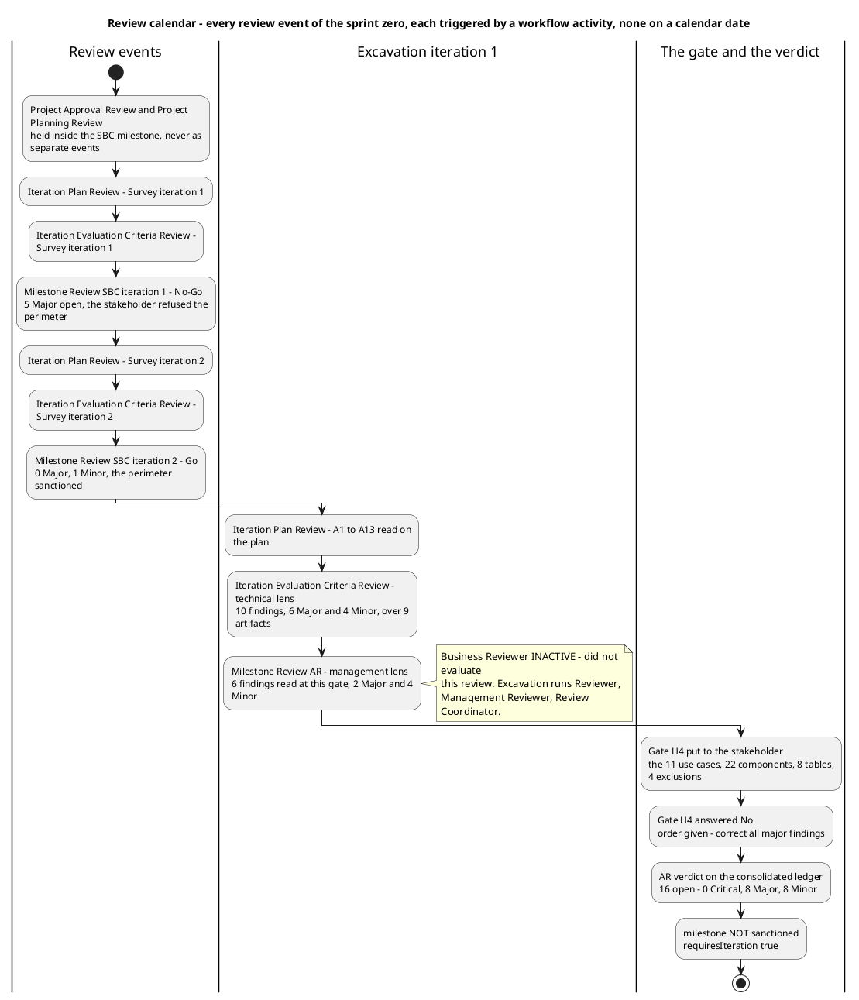

**Entry and exit criteria actually enforced at this milestone.**

| Event | Entry criterion | Exit criterion | Held |
|---|---|---|---|
| Iteration Plan Review | The plan carries this iteration's work items with owners and its exit criteria read on the artifact each cites | Every criterion decided on its own artifact's evidence | Yes — the plan was re-read and the two Minors it carried closed; the Management Reviewer then found A10 certified on an adjacent artifact |
| Iteration Evaluation Criteria Review | The recovered artifacts are in their target state and the anchors exist to be checked | Every criterion decided on evidence the cited section carries | Yes — the technical lens read the code behind each Major |
| Milestone Review AR | Both executed lenses have returned and the stakeholder's gate answer is on the record | 0 Critical, 0 Major open; the stakeholder's sanction GRANTED | **No** — 8 Major open and the sanction REFUSED |

**The review process for a finding at this milestone** — the state each of the 16 open findings is in, and who owns the act that closes it.

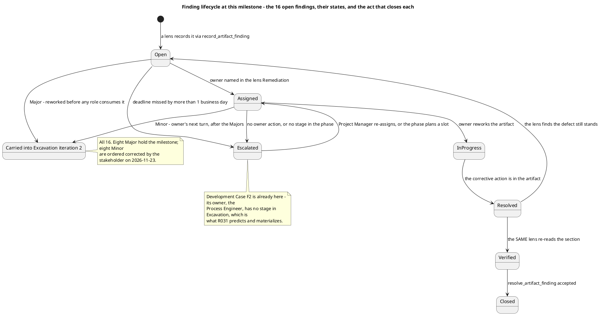

A finding closes only when the lens that recorded it re-reads the corrected section and calls `resolve_artifact_finding`. A correction an owner states in prose does not close it; a coordinator's consolidation does not close it.

## Findings
### Reviewer lens
<!-- review: Excavation I2 -->

<!-- review: Excavation I2 -->

#### Compliance matrix

Each artifact against the eight items of this milestone's checklist. An item is marked Pass only where the artifact carries the evidence itself; N/A marks an item the artifact's shape does not engage.

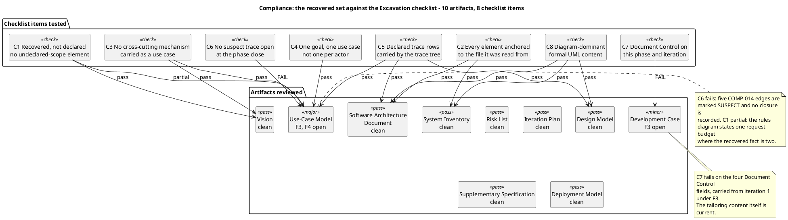

| Artifact | C1 | C2 | C3 | C4 | C5 | C6 | C7 | C8 |
|---|---|---|---|---|---|---|---|---|
| Development Case | N/A | Pass | Pass | N/A | N/A | N/A | **Fail** | Pass |
| System Inventory | Pass | Pass | Pass | N/A | N/A | Pass | Pass | Pass |
| Risk List | Pass | Pass | N/A | N/A | Pass | Pass | Pass | Pass |
| Iteration Plan | N/A | Pass | N/A | N/A | N/A | N/A | Pass | Pass |
| Vision | Pass | Pass | Pass | Pass | N/A | N/A | Pass | Pass |
| Use-Case Model | **Partial** | Pass | Pass | Pass | Pass | **Fail** | Pass | Pass |
| Supplementary Specification | Pass | Pass | Pass | Pass | N/A | N/A | Pass | Pass |
| Software Architecture Document | Pass | Pass | N/A | Pass | Pass | Pass | Pass | Pass |
| Deployment Model | Pass | Pass | N/A | N/A | N/A | N/A | Pass | Pass |
| Design Model | Pass | Pass | N/A | N/A | Pass | Pass | Pass | Pass |

#### Defect distribution

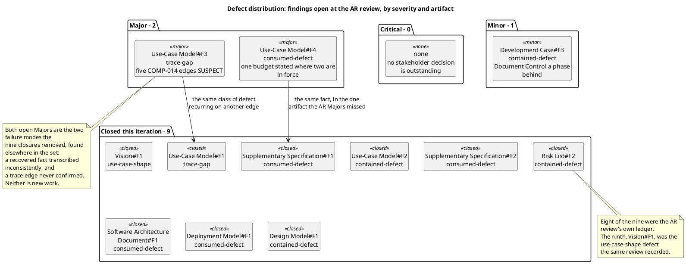

#### Use-Case Model — the two open Majors

##### Use-Case Model#F3 — five COMP-014 edges are suspect at the phase close (Major, trace-gap)

The registered graph marks `COMP-014 → UC-006`, `UC-007`, `UC-008`, `UC-009` and `UC-010` each «SUSPECT → System Analyst». The System Analyst is the role named, and the Use-Case Model is that role's artifact. The edges are substantively right: `Todo.Api/Todos/TodoApi.cs:19-20` applies `RequirePerUserRateLimit()` to the whole `/todos` group, and the artifact's own shared gate diagram already states the step — "The per-user token bucket applies to the whole group". What is missing is the confirmation that clears the marking, and a phase that closes with it open certifies a Use-Case View whose widest mechanism is unconfirmed for every task use case.

**Remediation.** Re-register the five edges as confirmed, having checked each against the artifact and the code. If the marking was raised because a throttling mechanism is not the operation itself, record that reading beside the gate diagram's step — the bucket gates the operation, it does not perform it — as was done for the EP-003 screen edges. The Use-Case Survey's "Why a screen entry point and the forwarded operation are both named" is the pattern to follow.

##### Use-Case Model#F4 — the rules diagram states one request budget where two are in force (Major, consumed-defect)

The rules diagram's R6 reads "The per-user token bucket, /todos only: 100 tokens, 100 per 10 s, queue 100, 429" and cites no anomaly. `Todo.Api/appsettings.Development.json` binds all three to 50 and both launch profiles select Development, so 50 is the budget in force wherever this delivery runs (AN-024). The same artifact states it correctly in the gate diagram note a few sections later, so the model now carries two answers to one question. The four rules diagrams are what a Designer or a Test Designer reads to know what the flows enforce.

**Remediation.** State the two values in force in R6 — the code defaults 100 / 100 per 10 s / queue 100 from `RateLimitExtensions.cs`, and the Development override 50 / 50 / 50 from `appsettings.Development.json` which is what the delivery enforces — and add the AN-024 citation the other rules carry. Where the diagram needs one number, give 50 as the value in force.

#### Closed this iteration

Nine findings of this lens were closed on evidence, each verified at the section named and, for the four Majors about recovered facts, at the code itself.

| Finding | Criterion | What closed it |
|---|---|---|
| Vision#F1 | use-case-shape | U12 and U13 are gone; the two mechanisms are `component` shapes under "Platform mechanisms - no actor goal, not use cases", cross-referenced to M8 and M9. The Vision states eleven use cases, as the Use-Case Model does |
| Use-Case Model#F1 | trace-gap | The three EP-003 edges report OK in the graph, and the artifact states the screen-entry reading beside the rows |
| Use-Case Model#F2 | contained-defect | The Actors section states the rule separating the two entry-point lists, and the matrix edges are labelled with what the actor acts on |
| Supplementary Specification#F1 | consumed-defect | M3, S2, P1, R8 and F10 state both budgets under AN-024 and cite `appsettings.Development.json:8-12` |
| Supplementary Specification#F2 | consumed-defect | R4 states the two hops apart under AN-023, with the three anchors the finding asked for |
| Software Architecture Document#F1 | consumed-defect | SP1, M3, Process View P4 and the Quality row state 50 as the bound in force under AN-024; the code default is named as the value no profile selects |
| Deployment Model#F1 | consumed-defect | The preamble is narrowed to what the files hold, and the Rate limiting row reads 50 / 50 / 50 for Development against the code defaults elsewhere |
| Design Model#F1 | contained-defect | PD-D3 cites AN-025 for the unconverted owner key; AN-005 is cited only for `EnsureCreated`. A paragraph at the head of the classes section states the two subjects apart |
| Risk List#F2 | contained-defect | R024 no longer attributes to the Design Model a state it does not hold; the mitigation now aims at the Supplementary Specification's R4, which was the artifact carrying the error |

#### Development Case — the Minor that persists

##### Development Case#F3 — Document Control is a phase behind (Minor, contained-defect)

Document Control still reads "Phase: Survey", "Status: Draft — produced for the end-of-Survey (SBC) milestone review", "Milestone Target: end-of-Survey (SBC) — not yet achieved", "Iteration: 2, Cycle 1". Every other artifact under this review reads Phase: Excavation, Iteration 2. The Development Case is the CORE artifact this milestone's tailoring depends on. It is contained: the tailoring content is current — both classification verdicts and all six optional triggers were re-evaluated against the recovery, and the Deployment Model's fired trigger still holds — and no criterion depends on the metadata. It is carried in second place behind the two Majors, as an un-ordered Minor.

**Remediation.** Bring the four Document Control fields forward to Excavation, iteration 2, status Draft for the AR review. No other content changes.

#### Artifacts with no finding

System Inventory, Risk List, Iteration Plan, Supplementary Specification, Software Architecture Document, Deployment Model and Design Model carry no open finding from this lens. Each was re-read at the sections this lens previously found defective and each now holds. Silence from this lens is the approval.

The System Inventory's coverage arithmetic was recomputed rather than accepted: the per-area Files column sums to 139, the Read column to 84, the unread cells to 55, and the headline figure reproduces. Every unread area is named with the reason it was not read and none carries a perimeter fact. The Risk List's 32 rows each name a strategy, an owner, an action, a contingency and a warning sign, and its own R030 states "not yet retired" rather than claiming an avoidance that has not happened — which is the honest form the register lacked in iteration 1.

### Management Reviewer lens
<!-- review: Excavation I2 -->

Every finding below was recorded through `record_artifact_finding` before this section was written. The Majors of the other lenses are cited because the milestone verdict reads them; they are not re-recorded here as duplicates.

#### Defect distribution

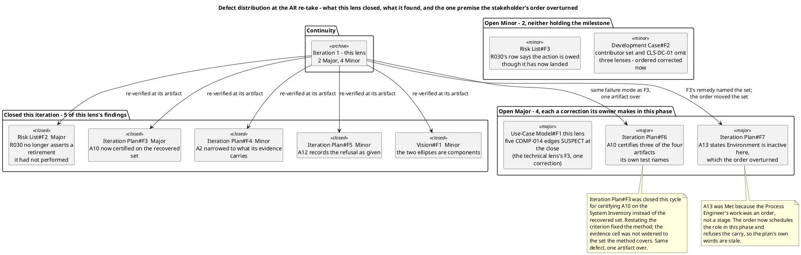

#### Iteration Plan#F6 — A10 certifies three of the four artifacts its own test names (Major, exit-criterion-unmet)

A10's test was rewritten this cycle to "No artifact in the recovered set states a behaviour the code contradicts", and its evidence cell opens "Checked in the artifacts themselves, not in the System Inventory's anomalies table." It then names three artifacts and stops: the Supplementary Specification, the Software Architecture Document, the Deployment Model.

The Use-Case Model is in the recovered set and its rules diagram states one budget where two are in force. R6 reads "The per-user token bucket, /todos only: 100 tokens, 100 per 10 s, queue 100, 429" and cites no `AN-024`, while the same artifact's shared gate diagram states "the code defaults TokenLimit 100 ... and appsettings.Development.json binds all three to 50, which both launch profiles select". `Todo.Api/appsettings.Development.json:8-12` binds 50. One artifact now carries two answers to one question, and the plan certifies that no artifact contradicts the code.

This is the failure mode `Iteration Plan#F3` recorded and this lens closed in the same cycle. Restating the criterion fixed how it is certified; the evidence cell was not widened to the set the method covers, so the defect returns one artifact over. The four rules diagrams are what a Designer or a Test Designer reads to know what the flows enforce — the wrong half is the half that gets carried into design.

#### Iteration Plan#F7 — A13 states a premise the stakeholder's order overturned (Major, exit-criterion-unmet)

A13 is certified Met because each work item "belongs to a stage the IARI DEVELOPMENT PROCESS runs in Excavation". Its evidence cell says the opposite of what the order now creates: "The Process Engineer's two items are recorded as the stakeholder's order of 2026-11-23, not as a discipline stage, and the Development Case records Environment as High in Survey and Inception and inactive here."

At this review the stakeholder refused the carry and ordered: the Development Case corrected now, before the milestone closes, the Process Engineer scheduled in this phase from the next iteration, A11 unchanged. The plan records no such stage: the coarse roadmap ends Excavation at this iteration, the iteration-2 fine plan ends at item 16, and no row carries the third iteration the order requires. Two work items now belong to a role the stakeholder has scheduled here by order, and the milestone sequence does not record them.

#### Iteration Plan — the Majors of the technical lens this verdict reads

`Use-Case Model#F3` (Major, `trace-gap`) — five `COMP-014 → UC-006` to `UC-010` edges still marked «SUSPECT → System Analyst» at the phase close. This lens queried the registered graph directly and confirms it: `model_query_traces` on `COMP-014` returns five `Realizes` edges each carrying the marking, with no closure recorded. The edges are substantively right — `Todo.Api/Todos/TodoApi.cs:19-20` applies `RequirePerUserRateLimit()` to the whole `/todos` group, and the artifact's own gate diagram states the step. What is missing is the confirmation that clears the marking. Recorded under this lens as `Use-Case Model#F1` because the milestone verdict reads the graph; one correction closes both.

`Use-Case Model#F4` (Major, `consumed-defect`) — the rules diagram's R6 states one budget where two are in force, and the same artifact states both several sections later. Detailed at `Iteration Plan#F6` above: the two findings are the same defect read from the criterion and from the artifact, and one correction closes both.

#### Development Case#F2 — the Minor the stakeholder ordered corrected now (Minor, contained-defect)

The contributor set for the Review Record still reads "Reviewer, CodeReviewer, plus the Configuration Manager's baseline record", omitting the Management Reviewer, the Business Reviewer and the Review Coordinator, all of which write their own block; CLS-DC-01 draws no edge from them. The defect is unchanged in content and is contained — each lens writes its block whatever the tailoring says.

What changed is its status. The stakeholder answered at this review: "No carry. I order the Development Case corrected now, before the milestone closes: the Process Engineer is scheduled in this phase from the next iteration and corrects Development Case#F2 and #F3 there. A11 stays as written." A11 therefore stays as written and counts this finding, and the next iteration of this phase performs it. `Risk List#R031`'s contingency — another Excavation iteration planned from this record — is the mechanism.

#### Risk List#F3 — R030's row is behind the artifact it points at (Minor, contained-defect)

R030's strategy cell reads "**Avoid — not yet retired.** The retirement action is owed and not yet performed: the Use-Case Model carries no statement of the session surface beside UC-001 to UC-004. Iteration 2 item 5 performs it." The Use-Case Model now carries that statement, titled "The instability UC-001 to UC-004 sit on", citing `AN-029`, `AN-012` and `R030`, and opens the Use-Case Specifications section with a pointer to it. The register's own premise is false, and a reader is told a Significant exposure is unmitigated when its mitigation has landed. Contained — the register understates rather than overstates, and the risk itself remains live: `AN-012` stands, no test covers the surface, and the statement records an exposure rather than removing it.

#### Closed this iteration — five of this lens's own findings

Each was re-verified at the section named and, where the finding turned on a recovered fact, at the code.

| Finding | Criterion | What closed it |
|---|---|---|
| Risk List#F2 | exit-criterion-unmet | R030 no longer records itself as avoided. Its strategy cell reads "**Avoid — not yet retired.** The retirement action is owed and not yet performed", and the Use-Case Model now carries the statement citing `AN-029`. Avoidance was a claim of retirement; the register no longer makes it |
| Iteration Plan#F3 | exit-criterion-unmet | A10 is certified on the recovered set: its evidence cell opens "Checked in the artifacts themselves, not in the System Inventory's anomalies table" and the three artifacts it names are verified corrected. That the cell omits a fourth is a new finding (`#F6`), not this one recurring |
| Iteration Plan#F4 | contained-defect | A2 no longer certifies a clause its evidence lacks. The criterion is narrowed to priorities 1 to 5, and the cell states "no deferred-set statement is required of any artifact for this row to hold" |
| Iteration Plan#F5 | contained-defect | A12 records "**Not met — refused**" with the answer as given, and the gate is re-put once. No row states a gate the answer superseded |
| Vision#F1 | contained-defect | `EP-020`, `EP-021` and `EP-022` are `component` shapes PM1 and PM2 under "Platform mechanisms - no actor goal, not use cases", noted to Supplementary Specification M8 and M9. Eleven `usecase` ellipses only; the count matches the Use-Case Model |

#### The eight Majors of iteration 1 — all cleared and verified

| Major | Verified at |
|---|---|
| Supplementary Specification#F1 | M3: code defaults 100 / 100 per 10 s / queue 100 and Development 50 / 50 / 50, both under `AN-024`; S2, P1 and R8 likewise |
| Supplementary Specification#F2 | R4 states the two hops apart — the token hop inherits the standard resilience handler, the forwarder hop nothing — under `AN-023` |
| Software Architecture Document#F1 | SP1: "**50 tokens, 50 per 10 s and a queue of 50 is the budget in force wherever this delivery runs** ... The fact is AN-024"; M3 and the bounded-load row likewise |
| Deployment Model#F1 | Preamble narrowed to what is true; Rate limiting row reads 50 / 50 / 50 for Development against the code defaults; "**Two settings separate the environments, not one.**" |
| Use-Case Model#F1 (technical) | The three `EP-003` edges report confirmed and the screen-entry reading is stated beside the rows |
| Vision#F1 (technical) | The two ellipses are components; the section states eleven use cases |
| Risk List#F2 (technical) | R024 no longer misattributes; the risk is a later role assuming equal protection, aimed at the Supplementary Specification's R4 |
| Iteration Plan#F3 (technical) | The fine plan's State column states each row's actual outcome against the artifact it names |

#### Artifacts with no open finding from this lens

System Inventory, Supplementary Specification, Software Architecture Document, Deployment Model, Design Model and Iteration Assessment carry no open finding from this lens. Each was read at the sections this lens previously found defective and each now holds. Silence from this lens is the approval.

The System Inventory's coverage arithmetic was recomputed rather than accepted: the Files column sums to 139, the Read column to 84, the unread cells to 55, and the headline reproduces. The Risk List's 32 rows each name strategy, owner, action, contingency and warning sign, and `R030` and `R031` state "not yet retired" and "materialized" rather than claiming retirements that have not occurred.

### Review Coordinator lens
<!-- review: Excavation I1 -->

<!-- review: Excavation I1 -->

**Consolidated finding ledger.** Twenty-nine findings were recorded against ten artifacts by the two executed lenses at this milestone. Thirteen carry a resolution object and were closed by their recording lens; sixteen are open — none Critical, eight Major, eight Minor. Every count below is copied from `read_artifact_findings` on the artifact named, never from a reviewer's narrative.

The ledger line this section rests on, verbatim:

`[FINDINGS] read=12, unread=none, open Critical=0, open Major=8, open Minor=8`

**Open — the eight Majors. Each holds the milestone; none needs a stakeholder decision.**

| Artifact | Key | Lens | Severity | Criterion | Owner | The corrective action | Holds |
|---|---|---|---|---|---|---|---|
| Supplementary Specification | F1 | Reviewer | Major | `consumed-defect` | System Analyst | State both rate-limit values with sources in M3, S2, P1 and R8 — code defaults 100/100/queue 100 (`RateLimitExtensions.cs:14-31`), Development override 50/50/50 (`appsettings.Development.json:8-12`); cite AN-024 | Yes |
| Supplementary Specification | F2 | Reviewer | Major | `consumed-defect` | System Analyst | Rewrite R4 as the two hops stated apart: the token hop inherits `AddStandardResilienceHandler` (`TodoApp.ServiceDefaults/Extensions.cs:32-42`, `Todo.Web/Server/Program.cs:23-26`), the forwarder hop inherits nothing; cite AN-023 / R024 | Yes |
| Software Architecture Document | F1 | Reviewer | Major | `consumed-defect` | Software Architect | Correct SP1, M3 and the Quality view's "bounded load" row; cite AN-024 | Yes |
| Deployment Model | F1 | Reviewer | Major | `consumed-defect` | Software Architect | Narrow the environment preamble to what is true; rewrite the Rate limiting row — Development 50/50/50, any other environment the code defaults | Yes |
| Use-Case Model | F1 | Reviewer | Major | `trace-gap` | System Analyst | Re-register the three EP-003 edges as confirmed and record in the Use-Case Survey why a screen entry point and the forwarded operation are both named | Yes |
| Vision | F1 | Reviewer | Major | `use-case-shape` | System Analyst | Remove U12 and U13 from the Features diagram; keep the two rows as platform mechanisms cross-referenced to Supplementary Specification M8 and M9 | Yes |
| Risk List | F2 | Management Reviewer | Major | `exit-criterion-unmet` | System Analyst, then Project Manager | Write R030's statement beside UC-001 to UC-004 citing AN-029, or restate R030 as not yet retired rather than avoided | Yes |
| Iteration Plan | F3 | Management Reviewer | Major | `exit-criterion-unmet` | Project Manager | Hold A10 open naming the three artifacts that state AN-024's contradicted value, or split the criterion; do not certify it on the inventory's word | Yes |

**Open — the eight Minors. Recorded, assigned, and not holding the milestone.** The stakeholder ordered on 2026-11-23 that no Minor be left unattended; all eight are owned and none is recorded as closed or deferred.

| Artifact | Key | Lens | Criterion | Owner | The corrective action |
|---|---|---|---|---|---|
| Use-Case Model | F2 | Reviewer | `contained-defect` | System Analyst | State the matrix-versus-Survey distinction once and relabel the matrix's edges |
| Vision | F1 | Management Reviewer | `contained-defect` | System Analyst | The same two ellipses, read as contained because the Use-Case Model governs the set |
| Risk List | F2 | Reviewer | `contained-defect` | Project Manager | Restate R024 without the misattribution; point its mitigation at the Supplementary Specification's R4, which still carries the error |
| Design Model | F1 | Reviewer | `contained-defect` | Designer | Change PD-D3's citation from AN-005 to AN-025 |
| Development Case | F2 | Management Reviewer | `contained-defect` | Process Engineer | Name every lens in the Review Record's contributor set and draw the edges in CLS-DC-01. **This is the finding that holds A11** |
| Development Case | F3 | Reviewer | `contained-defect` | Process Engineer | Bring the four Document Control fields to Excavation iteration 1 |
| Iteration Plan | F4 | Management Reviewer | `contained-defect` | Project Manager | Narrow A2 to what its evidence carries, or add the deferred-set sentence to the Use-Case Model's "Not recovered, and why" |
| Iteration Plan | F5 | Management Reviewer | `contained-defect` | Project Manager | Set A12 to "Not met — refused" with the answer as given |

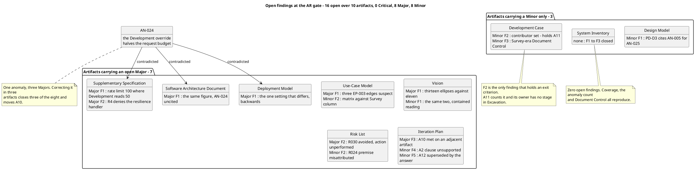

**Closed this milestone — thirteen, each by the lens that recorded it.**

| Artifact | Key | Lens | Severity | Closed against |
|---|---|---|---|---|
| Development Case | F1 | Reviewer | Major | "Tool and configuration references" — no version policy asserted |
| Development Case | F2 | Reviewer | Minor | "Roles and Ownership" — one CLS-DC-01 diagram, one role-deltas block |
| Development Case | F1 | Management Reviewer | Minor | The same section, under the stakeholder's order of 2026-11-23 |
| System Inventory | F1 | Reviewer | Major | "Traceability" — the AN-021 row reads all three entry points |
| System Inventory | F2 | Reviewer | Minor | "Coverage" — the headline recomputes from the per-area table |
| System Inventory | F3 | Reviewer | Minor | "Document Control" — Excavation iteration 1 |
| Risk List | F1 | Reviewer | Major | "Risk Classification" — one published word-to-score mapping; every row reproduces |
| Risk List | F1 | Management Reviewer | Major | The grant band re-derived; four grants at exposure 12 |
| Iteration Plan | F1 | Reviewer | Major | "Use Cases and Scenarios Addressed" — twelve anomalies, 21 edges |
| Iteration Plan | F2 | Reviewer | Minor | The coarse roadmap and the critical chain — the gate precedes the verdict |
| Iteration Plan | F1 | Management Reviewer | Major | "Evaluation Criteria" — C2a/C2b, C6, C7a/C7b |
| Iteration Plan | F3 | Reviewer | Minor | The fine plan's State column, each row against its artifact |
| Iteration Plan | F2 | Management Reviewer | Minor | The superseded C2b row no longer exists; A1 to A13 replace it |

**Cross-lens reconciliation — no contradiction, one severity disagreement, one duplicate subject.**

| Subject | The two lenses | Resolution this verdict records |
|---|---|---|
| The rate limiter (AN-024) | All three artifacts named by the Reviewer; the Management Reviewer reaches the same conclusion through A10 | Not a conflict — the Management Reviewer classified it at the criterion, not at the artifact. One fact, three corrections, both lenses agreed on the defect |
| The Vision's two ellipses (`U12`, `U13`) | Reviewer: **Major** (`Vision#F1`, `use-case-shape`) — thirteen use cases where the recovery holds eleven. Management Reviewer: **Minor** (`Vision#F1`, `contained-defect`) — the Use-Case Model governs the set, no criterion depends on the Vision's count | **The two lenses disagree on consequence, not on fact.** Counted at the **Major** band for the gate: gate H4 puts a use-case count to the stakeholder, and a supporting artifact stating a different count beside it is a defect in the material the sanction rests on. The Minor is recorded and does not double the work — one correction closes both |
| `Risk List#F2` | Two findings share the key under different lenses and different subjects: the Reviewer's Minor on R024's premise, the Management Reviewer's Major on R030's unperformed retirement | Two distinct findings, not a duplicate. The R024 Minor's remedy is partly satisfied by the R030 Major's — both point the mitigation at an artifact that still carries the error — but each lens closes only its own key |
| `Development Case#F2` | Recorded by both lenses at SBC, closed by the Reviewer's key, still open under the Management Reviewer's | No duplicate recorded at this gate: the technical lens named it and did not re-record it. Only the Management Reviewer may close it, and only that key holds A11 |

**Priority of what remains — the order the second iteration takes them.** Majors before Minors, and within each band, the finding that unblocks another first.

| Priority | Finding | Why it ranks here |
|---|---|---|
| 1 | Supplementary Specification#F1 | The root of three Majors; correcting M3, S2, P1 and R8 lets the Software Architect and the Deployment Model copy one settled figure |
| 2 | Software Architecture Document#F1 | Reads the same fact from the Supplementary Specification; the Deployment Model's environment table inherits this copy |
| 3 | Deployment Model#F1 | The only statement in the delivery of what differs between environments; Consolidation would copy it unchanged |
| 4 | Supplementary Specification#F2 | Independent of the rate limiter, and the SAD's P6 already holds the correct reading, so the correction is a transcription |
| 5 | Use-Case Model#F1 | The eleven-use-case count gate H4 puts rests on the three edges; confirming them also clears the material the Vision's count is checked against |
| 6 | Vision#F1 | Cheapest of the eight — delete two ellipses — and it must follow priority 5 so the count matches |
| 7 | Risk List#F2 (Management Reviewer) | A Significant exposure read as retired; its warning sign has already come true |
| 8 | Iteration Plan#F3 (Management Reviewer) | The plan's own certification; re-taken after priorities 1 to 4 land, so A10 can be certified on the recovered set |
| 9–16 | The eight Minors | In the order of Resolutions and Actions; `Development Case#F2` first among them because A11 counts it |

**One fact, three Majors, one correction.** The three rate-limit Majors are one wrong sentence in three artifacts. The recovery already holds the right answer in the same phase — the System Inventory records it as AN-024 and the Risk List carries it as R025, both anchored. The defect is not a failure of reading; it is three documents asserting the value their own reading contradicts.

## Resolutions and Actions
### Reviewer lens
<!-- review: Excavation I2 -->

<!-- review: Excavation I2 -->

#### Closures materialized this iteration

Each row is a `resolve_artifact_finding` call that transitioned the ledger, not a narrative claim. The evidence column names where the corrected content was read.

| Finding | Criterion | Resolution | Evidence read |
|---|---|---|---|
| Vision#F1 | use-case-shape | Resolved | Features diagram: `component … PM1` / `PM2` under "Platform mechanisms - no actor goal, not use cases"; eleven `usecase` shapes only |
| Use-Case Model#F1 | trace-gap | Resolved | Trace graph, EP-003 downstream: three `Refines` edges, all OK |
| Use-Case Model#F2 | contained-defect | Resolved | Actors: "Two entry points, two different questions"; matrix edges read `acts on EP-003` / `calls EP-013` |
| Supplementary Specification#F1 | consumed-defect | Resolved | R8, P1, S2 all state 50 / 50 / 50 under AN-024; `appsettings.Development.json` opened and confirmed |
| Supplementary Specification#F2 | consumed-defect | Resolved | R4 states the token hop and the forwarder hop apart under AN-023; `ServiceDefaults/Extensions.cs:32-42` and `Todo.Web/Server/TodoApi.cs` opened and confirmed |
| Software Architecture Document#F1 | consumed-defect | Resolved | SP1: "50 tokens, 50 per 10 s and a queue of 50 is the budget in force wherever this delivery runs … The fact is AN-024" |
| Deployment Model#F1 | consumed-defect | Resolved | Environment Mapping preamble narrowed; Rate limiting row reads 50 / 50 / 50 for Development |
| Design Model#F1 | contained-defect | Resolved | PD-D3 note cites AN-025; AN-005 confined to the `EnsureCreated` statement |
| Risk List#F2 | contained-defect | Resolved | R024: "The Design Model already states the difference correctly at PKG-D3, and the Supplementary Specification's R4 states the opposite - which is the artifact the mitigation is aimed at" |

#### Actions this iteration opens

Each is an owner's corrective action, stated so it can be performed without a follow-up question. The first two hold the milestone; the third does not.

| Finding | Owner | Action | Holds the milestone |
|---|---|---|---|
| Use-Case Model#F3 | System Analyst | Confirm the five `COMP-014 → UC-006` to `UC-010` edges in the registered graph, each checked against `Todo.Api/Todos/TodoApi.cs:19-20`, and record in the shared gate diagram that the bucket gates each operation rather than performing it. Re-query the graph and report no SUSPECT marking on any edge the Use-Case Model declares | Yes — a suspect trace open at phase close fails criterion C6 |
| Use-Case Model#F4 | System Analyst | Correct R6 in the rules diagram to state the code defaults 100 / 100 per 10 s / queue 100 and the Development override 50 / 50 / 50 as the value in force, citing AN-024 and `appsettings.Development.json:8-12`, so the artifact holds one answer to the question its gate diagram already answers correctly | Yes — the four Majors of the AR review were this same class of defect |
| Development Case#F3 | Process Engineer | Bring the four Document Control fields to Excavation, iteration 2, status Draft for the AR review. No other content changes | No — a Minor does not hold the milestone |

#### Carried state read for this disposition

| Item | State read |
|---|---|
| Gate H4 (the stakeholder's confirmation of the recovered set) | The AR review records it answered No, with the order "We must correct all major findings." That order is what this iteration performed. It is not this lens's to re-put |
| The AR review's own ledger of eight Majors | Of those within this lens, four Majors (Supplementary Specification#F1, #F2; Software Architecture Document#F1; Deployment Model#F1) and one Minor (Design Model#F1) were this lens's. All five are closed on verified evidence. The two remaining Majors of this lens (#F3, #F4) are new defects found in this iteration's re-read, not survivors of the old ledger |
| Exit criterion A10 (the recovery states what the code does) | Certifiable on the recovered set as this lens reads it, on condition that Use-Case Model#F4 is corrected: as the artifact stands, one of its own diagrams contradicts the fact the criterion turns on |
| Suspect traces | Five remain registered against COMP-014 at the phase close. Criterion C6 is not satisfied |
| Open pull requests | None in any state |
| Build status | No IARI pipeline file exists; nothing to report for `main`. Excavation produces no production code, so this is correct for the phase, not a gap |

### Management Reviewer lens
<!-- review: Excavation I2 -->

#### Stakeholder consultation — gate H4 re-put, and the order it returned

Gate H4 was re-put at this review. Both questions were put with this lens's verdict leaning and every open defect named inside them, and neither carried a pre-filled sanction.

**Stakeholder sanction: REFUSED**

**Stakeholder acceptance, question 1 — verbatim:** "No"

**Stakeholder acceptance, question 2 — verbatim:** "No carry. I order the Development Case corrected now, before the milestone closes: the Process Engineer is scheduled in this phase from the next iteration and corrects Development Case#F2 and #F3 there. A11 stays as written."

**Stakeholder acceptance, question 3 — verbatim:** no answer given.

Three consequences follow, and this lens applies no more than the stakeholder stated:

1. The recovered set is **not confirmed**. `A12` is not met. The stakeholder refused the sanction; no condition, limit or prohibition beyond the refusal was stated and none is recorded.
2. The Development Case is **not carried to Inception**. It is corrected in this phase, before the milestone closes, and the Process Engineer is scheduled here from the next iteration. `A11` stays as written. Both `Development Case#F2` and `Development Case#F3` are named in the order and are corrected in that turn.
3. The plan must record the stage the order creates. `Iteration Plan#F7` states the gap: the milestone sequence ends Excavation at this iteration and records no Process Engineer stage.

The recommendation this lens made in question 2 — restate `A11` and carry the Minors to Inception — was **declined**. It is not applied. Recorded here so that no later role reads the declined recommendation as a decision.

#### Closure ledger — five findings disposed this iteration

| Finding | Criterion | Disposition | Where verified |
|---|---|---|---|
| Risk List#F2 | exit-criterion-unmet | **Resolved** | R030 no longer records itself as avoided; the Use-Case Model carries the statement citing `AN-029` |
| Iteration Plan#F3 | exit-criterion-unmet | **Resolved** | A10 certified on the recovered set, its cell naming three artifacts verified corrected. The omitted fourth is `#F6`, a new defect |
| Iteration Plan#F4 | contained-defect | **Resolved** | A2 narrowed to priorities 1 to 5; the cell requires no deferred-set sentence |
| Iteration Plan#F5 | contained-defect | **Resolved** | A12 reads "**Not met — refused**" with the answer as given |
| Vision#F1 | contained-defect | **Resolved** | The two ellipses are components; eleven use cases stated |

`Risk List#F2`, `Iteration Plan#F3`, `Iteration Plan#F4`, `Iteration Plan#F5` and `Vision#F1` were each closed by `resolve_artifact_finding` on this lens's own key, and each closure cites the section it was verified at.

`Development Case#F2` is **not** closed and is **not** deferred: it was re-recorded under its existing key with the stakeholder's order attached. Its state is open and its owner is scheduled.

#### What each open finding needs, and who performs it

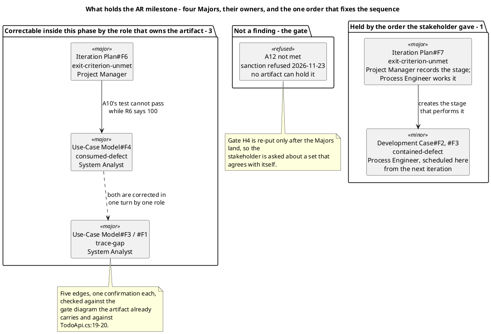

| # | Finding | Owner | The corrective action | Clears |
|---|---|---|---|---|
| 1 | Use-Case Model#F3 and this lens's #F1 | System Analyst | Re-register the five `COMP-014 → UC-006` to `UC-010` edges as confirmed, each checked against the gate diagram and `TodoApi.cs:19-20`, and record beside that diagram why the throttling mechanism gates the operation without being it — the reading already used for the `EP-003` screen edges | A1 |
| 2 | Use-Case Model#F4 | System Analyst | State both budgets in R6 under `AN-024` — the code defaults 100 / 100 per 10 s / queue 100 from `RateLimitExtensions.cs:14-31`, and the Development override 50 / 50 / 50 from `appsettings.Development.json:8-12`, which is what the delivery enforces — and cite `AN-024` as the other rules do | A10 |
| 3 | Iteration Plan#F6 | Project Manager | Name the Use-Case Model's R6 in A10's evidence cell, so the criterion is certified on all four artifacts its test covers, or narrow the test to the artifacts the cell verifies | A10 |
| 4 | Iteration Plan#F7 | Project Manager | Record the stakeholder's order of 2026-11-23 as the stage it creates: add the next Excavation iteration to the milestone sequence, place the two Development Case items in it against the Process Engineer, and restate A13's evidence cell to state that the role runs here from that iteration on the order — not as a discipline stage, not as work carried elsewhere | A13 |
| 5 | Development Case#F2 | Process Engineer, scheduled here from the next iteration | Name every lens that writes into the Review Record — Reviewer, Management Reviewer, Business Reviewer, Review Coordinator, CodeReviewer, plus the Configuration Manager's baseline record — and draw the corresponding edges in CLS-DC-01 | A11 |
| 6 | Development Case#F3 (Reviewer lens) | Process Engineer, same turn | Bring the four Document Control fields to the phase the document governs | A11 |
| 7 | Risk List#F3 | Project Manager | Restate R030's strategy cell: the retirement action has been performed and is in the Use-Case Model under `AN-029`; the risk stays live because `AN-012` stands and no test covers the surface | — |

Priority: Majors before Minors. Item 4 ranks first among the Majors because it is the only one the stakeholder ordered by name at this review, and because it creates the stage that performs item 5. Items 1 and 2 are one turn's work by one role on one artifact. Item 7 is a transcription.

#### Why this lens does not certify the milestone

The verdict below is No-Go, and the reason is not the count of findings. Four Majors would be an ordinary corrective pass. What this lens will not do is certify `A11` while the phase records no stage that can satisfy it, and will not certify `A10` while the criterion's own test names four artifacts and its evidence checks three. Both are criteria this lens is accountable for, and both fail on their own evidence rather than on a neighbouring artifact's opinion.

### Review Coordinator lens
<!-- review: Excavation I1 -->

<!-- review: Excavation I1 -->

**Actions, in the order the second iteration takes them.** Each action is the remediation its recording lens wrote, with its owner and the act that closes it. No action states a calendar date: the sprint zero declares none beyond the issue date of the Work Order, and a projected date computed from an estimate would read downstream as an observation. The due point is the state of the work, not a day.

| # | Action | Artifact | Owner | Closes | Due point | Escalates if |
|---|---|---|---|---|---|---|
| 1 | State both rate-limit values with their sources in M3, S2, P1 and R8; cite AN-024 | Supplementary Specification | System Analyst | `Supplementary Specification#F1` | Before the Software Architect's next pass | The figure is still single-valued after two owner turns |
| 2 | Correct SP1, M3 and the Quality view's "bounded load" row; cite AN-024 | Software Architecture Document | Software Architect | `Software Architecture Document#F1` | After action 1, same iteration | The correction contradicts action 1's text |
| 3 | Narrow the environment preamble; rewrite the Rate limiting row — Development 50/50/50, other environments the code defaults | Deployment Model | Software Architect | `Deployment Model#F1` | With action 2, same turn | — |
| 4 | Rewrite R4 as the two hops stated apart; cite AN-023 / R024 | Supplementary Specification | System Analyst | `Supplementary Specification#F2` | With action 1, same turn | — |
| 5 | Re-register the three EP-003 edges as confirmed; record the screen-versus-operation reading in the Use-Case Survey | Use-Case Model | System Analyst | `Use-Case Model#F1` | Before gate H4 is re-put | The edges stay suspect at the next milestone |
| 6 | Remove U12 and U13 from the Features diagram; keep the two rows as mechanisms cross-referenced to M8 and M9 | Vision | System Analyst | `Vision#F1` (both lenses) | After action 5, so the count matches | The Vision states a count the Use-Case Model does not |
| 7 | Write R030's statement beside UC-001 to UC-004 citing AN-029, or restate R030 as not yet retired | Risk List, Use-Case Model | System Analyst, then Project Manager | `Risk List#F2` (Management Reviewer) | Before the register is read again as retired | The register still reads Avoid with the action unperformed |
| 8 | Hold A10 open naming the three artifacts, or split it into identification and agreement; set A12 to "Not met — refused" (`Iteration Plan#F5` alongside) | Iteration Plan | Project Manager | `Iteration Plan#F3` (Management Reviewer), `#F5` | After actions 1 to 4 land, so A10 can be re-taken on a corrected set | A10 is certified again on the inventory's word |
| 9 | Name every lens in the Review Record's contributor set and draw the three edges in CLS-DC-01 | Development Case | Process Engineer | `Development Case#F2` (Management Reviewer) — **holds A11** | Excavation iteration 2, on the stakeholder's order | No stage in the phase — escalate; `R031` materializes |
| 10 | Bring the four Document Control fields to Excavation iteration 1 | Development Case | Process Engineer | `Development Case#F3` | With action 9, same turn | — |
| 11 | State the matrix-versus-Survey distinction and relabel the matrix's edges | Use-Case Model | System Analyst | `Use-Case Model#F2` | After action 5 | — |
| 12 | Restate R024 without the misattribution; point its mitigation at Supplementary Specification R4 | Risk List | Project Manager | `Risk List#F2` (Reviewer) | After action 4, so the mitigation has a target | — |
| 13 | Change PD-D3's citation from AN-005 to AN-025 | Design Model | Designer | `Design Model#F1` | Owner's next turn | — |
| 14 | Narrow A2 to its evidence, or add the deferred-set sentence to the Use-Case Model's "Not recovered, and why" | Iteration Plan | Project Manager | `Iteration Plan#F4` | With action 8 | — |

**Escalation protocol as applied at this milestone.** One finding is escalated and one class of exposure is escalated; nothing else is overdue.

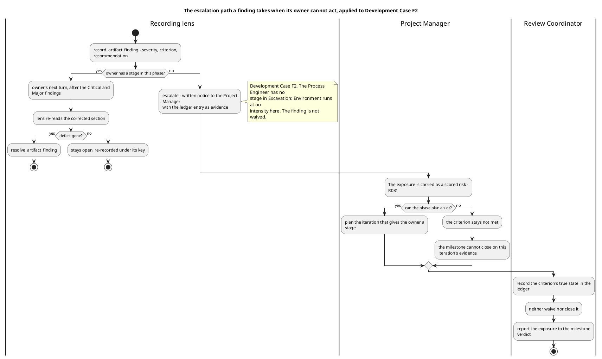

**Escalated to the Project Manager, with the ledger as evidence.** `Development Case#F2` — a Minor on any reading, and the only finding at this milestone that holds an exit criterion. A11 counts four Minor closures and reads three of four. Its owner, the Process Engineer, has no stage in Excavation because Environment runs at no intensity in the phase. `R031` predicted exactly this and has materialized. The exposure is not the size of the defect — it is that a criterion depends on a role the phase does not schedule.

**No escalation to the Configuration and Change Management Board.** No systemic process failure is visible in this ledger: the same two lenses evaluated the same ten artifacts, each finding is anchored to the code or the artifact text, and the rework the Majors require is inside the artifacts their owners hold. The Change Control Manager does not work in the sprint zero, so no change request is opened for any finding; the stakeholder's order reaches its owners through this record and through their Work Order.

**Review effectiveness — this milestone's measured counts.** First review of this phase; there is no prior Excavation iteration or cycle to compare against, so these are current values only and no trend is stated.

| Indicator | Value | What it is computed from |
|---|---|---|
| Review coverage | 10 of 10 artifacts subject to review received at least one lens read | The ten artifacts of this phase with findings or an explicit "no finding" statement from both executed lenses. The Iteration Assessment and this Review Record are not review subjects at their own milestone |
| Findings recorded | 29 — 8 Major, 21 Minor | `read_artifact_findings` across the ten artifacts, both lenses |
| Findings open at the gate | 16 — 0 Critical, 8 Major, 8 Minor | The `[FINDINGS]` line; 13 closed by their recording lens |
| Defect density by artifact type | Requirements artifacts 6 (5 Major, 1 Minor over Vision, Use-Case Model, Supplementary Specification); Analysis and Design 3 (2 Major, 1 Minor over SAD, Deployment Model, Design Model); Project Management 5 (3 Major, 2 Minor over Risk List, Iteration Plan); Environment 2 (0 Major, 2 Minor); Discovery 0 | The open and closed ledger, by the artifact carrying each finding |
| Lens agreement | 0 contradictory findings; 1 severity disagreement (`Vision#F1`, Major vs Minor); 2 keys shared by two lenses on distinct subjects | The reconciliation table in Findings |
| Duplicate defects found by two lenses | 1 subject — the rate limiter, reached by both lenses through different criteria | Both lenses named it; neither recorded the other's key |
| Defect removal efficiency | Not computable at this milestone | No test execution has occurred in the sprint zero. Nothing has been found by test against which review-found defects could be compared, and no ratio is invented |
| Rework effort | Not measured | Tokens and elapsed agent time per artifact are not recorded per finding in this phase; the phase has not closed so no measured actual exists to attribute |

**What the metrics say.** The two lenses found the same defect independently and classified it the same way at the artifact level, which is the signature of a real defect and not a lens artefact. The defect density is concentrated: the three rate-limit Majors are one anomaly recorded three times, so the four artifacts of the Requirements and Analysis surface carry an apparent density four times the underlying defect count. The review process worked — every Major is anchored, every Minor is owned, and the defect that mattered had already been recorded as `AN-024` in the same phase by the same role's own reading. What it did not do is prevent three artifacts from asserting the opposite of a fact the phase already held.

**No finding recorded for three absences, and why.** The absence of a Data Model, a Glossary and a Test Plan is the Development Case's NOT FIRED verdict on each trigger, which both lenses checked against the §5.2 conditions. The absence of an Iteration Assessment describing this iteration is correct state — the Project Manager authors it after this review. The absence of any SCM condition is the sprint zero's correct state: no branch of this process exists, no pull request is open, no defect issue is filed.

## Disposition
### Reviewer lens
<!-- review: Excavation I2 -->

<!-- review: Excavation I2 -->

#### Disposition — Approved with Changes

The recovered set improved decisively this iteration and it is not yet approvable. Nine of the ten artifacts this lens previously faulted now hold, each verified at its section and — for the four Majors about recovered facts — at the code itself. Two Majors remain, both on the Use-Case Model, and both are the two failure modes the nine closures removed, found elsewhere in the same set.

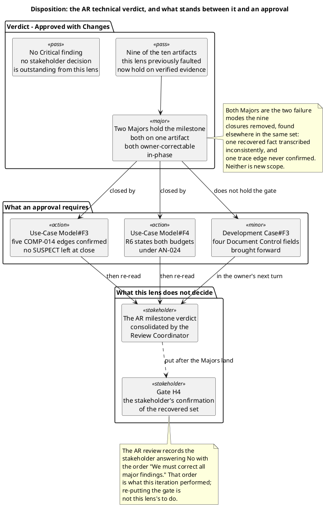

#### Verdict on the AR exit criteria, as this lens reads them

| Criterion | This lens's reading | Basis |
|---|---|---|
| A3 Architecture recovered and checked | Met | Twenty-two components with connectors; every one of the eleven use cases has a stated component path, including the seven not diagrammed. The figure contradictions the AR review faulted are corrected and reproduce from the code |
| A4 Data recovered with its anchors | Met | Eight tables with keys, indexes, referential actions and enforced rules; AN-025 correctly cited at PD-D3 and AN-005 confined to `EnsureCreated` |
| A5 Deployment modelled | Met | The fired optional records the processes, the stores, the ports, the key ring and the two settings that separate the environments, each anchored |
| A6 Coverage measured | Met | 84 read and 55 unread of 139; the per-area columns reproduce and every unread category is named |
| A7 Anomalies carried as risks | Met | Thirty-two risks, twenty-nine on `Refines` edges from the anomalies, three with their separate origins stated |
| A9 Every risk actionable | Met | Each row names a strategy, an owner, an action, a contingency and a warning sign; R030 states "not yet retired" rather than claiming a retirement that has not happened |
| A10 The set states the code's behaviour | **Not certifiable as it stands** | Two of the facts it turns on are correct in four artifacts, and a fifth — the Use-Case Model's rules diagram — states one of them wrongly at R6. Criterion A10's test is a test about what the recovered artifacts state |
| A11 The SBC Minors closed | Not met — unchanged | Three of four. `Development Case#F2` is the Management Reviewer's lens, not this one's; this lens's own `Development Case#F3` is a different defect on the same artifact |
| A12 The recovered set confirmed | Not met — unchanged | Gate H4 answered No. Not an artifact's to hold |

A1 and A2 sit on the Use-Case Model with the two open Majors: A1 (operations recovered as use cases) holds on the Survey and the exclusion table, which neither Major touches. A2 holds on the priorities order.

#### Why this is Approved with Changes and not Rejected

A rejection would say the recovered set is not a model of the existing system. It is: the eleven use cases, the twenty-two components and the eight tables each rest on the file they cite, and this iteration verified that at source rather than accepting it from the artifacts' own text. The two open Majors are a confirmation the graph registers as missing and one diagram that states a figure its own artifact states correctly elsewhere. Neither calls the recovery into question; both are corrections their owner performs inside this phase.

#### Why it is not Approved

Approval would certify a Use-Case View with five suspect edges at the phase close and a rules diagram whose request budget contradicts the code and its own artifact. The AR review held the milestone on exactly this class of defect and the stakeholder's order was to correct all Majors. Certifying the set with two of them open would repeat the failure the last gate caught.

#### Preserved

No artifact outside the ten reviewed was re-read for a finding, and none is changed by this lens. The Review Record is this lens's only output.

### Management Reviewer lens
<!-- review: Excavation I2 -->

**Verdict: NO-GO.** The Architecture Recovered milestone is not sanctioned. Excavation iteration 2 does not close it, and the project does not advance into Consolidation on this evidence.

**0 Critical, 4 Major, 3 Minor.** The eight Majors that held iteration 1 are all closed and verified at their artifacts. No finding is deferred, none is waived, and no criterion is recorded as met on an answer it does not carry.

#### Disposition — No-Go

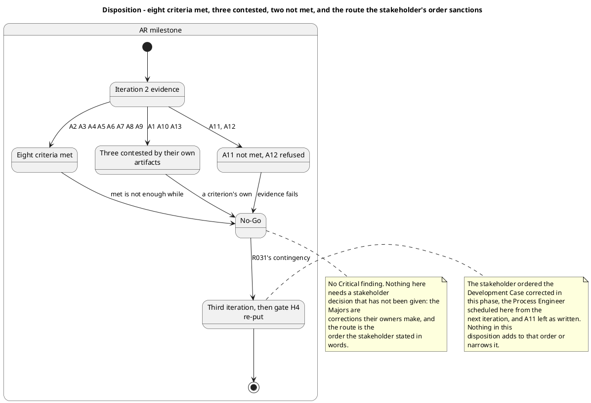

#### Why No-Go rather than Conditional

A Conditional Go is a sanction with conditions: the gate opens and the conditions are verified at the next milestone. This lens may not issue one here, for three reasons that are about the criteria rather than about the finding count.

1. **`A12` is refused, not pending.** The stakeholder was asked at this review whether they confirm the recovered set and sanction advancing into Consolidation, with every open Major named inside the question. They answered **No**. A conditional sanction would assert on their behalf the one thing they declined to assert; `A12` turns on their answer alone and no artifact can hold it.

2. **`A11` records no stage that can satisfy it, and the stakeholder has ordered otherwise.** The plan's `A13` states Environment runs at no intensity in Excavation. The order of 2026-11-23 refuses the carry, schedules the Process Engineer in this phase from the next iteration, and leaves `A11` as written. Until the plan records that stage, the phase carries a criterion its own milestone sequence contradicts.

3. **`A10` fails on its own test.** The criterion claims no artifact in the recovered set states a behaviour the code contradicts, and its evidence cell verifies three of the four artifacts the set contains. The Use-Case Model's R6 states 100 where Development binds 50 — the same fact `AN-024` records, in the artifact a Designer reads first.

A milestone is not advanced because the calendar says the iteration is over. It advances when its exit criteria are met, and three are not.

#### What this disposition does not say

- It does not dispute the recovery. The eleven use cases, the 22-component architecture, the eight-table data model and the deployment all rest on anchors and are, in substance, right. The defects are three sentences and one missing stage.
- It does not re-open a single one of the four exclusions. External-provider sign-in is recovered and marked unreachable; the `admin` branch is an exceptional entity; `EP-020`, `EP-021` and `EP-022` are not use cases. Each stands on the stakeholder's 2026-11-23 answer and no finding here touches them.
- It does not order a change the stakeholder did not order. Items 1 to 3 and 7 of the action table are corrections the artifacts' own owners make to defects this lens recorded. Item 4 records the order the stakeholder gave. Items 5 and 6 are that order's content.
- It records no condition, limit or prohibition beyond what the stakeholder stated.

#### The route this lens sanctions

`Risk List#R031`'s contingency, planned from this record: **a third iteration of Excavation**, performing items 1 to 4 of the action table, then gate H4 re-put once the recovered set agrees with itself. Nothing in the phase's declared scope is cut or deferred to reach it, and no role is added that the phase does not run — the Process Engineer is scheduled by the stakeholder's order, and that order is the only authority that places the role here.

`R031` has materialized for the second consecutive iteration. It is recorded, scored at 4 × 3 = 12 and avoided; recording it has not retired it, and this disposition does not claim otherwise.

#### Disposition by artifact

| Artifact | Disposition from this lens |
|---|---|
| Development Case | **Changes required** — `#F2` open, ordered corrected in this phase; `#F3` open (Reviewer lens) |
| System Inventory | **Approved** — no open finding from any lens; coverage arithmetic recomputed and reproducing |
| Risk List | **Approved with changes** — `#F3` open, one strategy cell behind its artifact |
| Iteration Plan | **Changes required** — `#F6` and `#F7` open |
| Iteration Assessment | **Not judged** — authored in the Assess touchpoint after this review; its absence before the review is not a finding |
| Vision | **Approved** — `#F1` closed this iteration |
| Use-Case Model | **Changes required** — `#F3` and `#F4` open (technical lens), `#F1` open (this lens) |
| Supplementary Specification | **Approved** — `#F1` and `#F2` closed and verified |
| Software Architecture Document | **Approved** — `#F1` closed and verified |
| Deployment Model | **Approved** — `#F1` closed and verified |
| Design Model | **Approved** — `#F1` closed and verified |
