## Document Control
### Reviewer lens
<!-- review: Survey I1 -->

Phase: Survey
Status: Draft — technical lens of the SBC review recorded; 7 findings (3 Major, 4 Minor, 0 Critical) on 4 artifacts
Milestone Target: End-of-Survey (SBC) — not yet achieved

## Review Scope and Criteria

## Findings
### Reviewer lens
<!-- review: Survey I1 -->

#### Development Case

Reviewed at SBC. Environment discipline, Survey. Verdict: Approved with changes — one Major, one Minor.

| Checklist item | Verdict |
|---|---|
| Baseline conformance: roster, CORE set, ownership unchanged | Pass |
| Every FIRED optional trigger holds its own condition | Pass |
| Every cited tool reference resolves in the tree | Fail — F1 |
| UML notation fits what it expresses | Fail — F2 |
| Classification deltas carry a basis | Pass |
| No forbidden override present | Pass |

##### All six optional verdicts audited against their conditions

Each verdict is an auditable claim, so each was checked against the project's real facts rather than accepted:

| Optional | Verdict | Audit result |
|---|---|---|
| Deployment Model | FIRED | Holds. Four processes — `Todo.Api`, `Todo.Web.Server`, `Todo.Web.Client`, `TodoApp.AppHost` — with YARP forwarding and service discovery between them. A genuine distributed topology, not a single node. |
| Data Model | NOT FIRED | Holds. `TodoDbContextModelSnapshot.cs` declares 8 tables — `Todos`, `AspNetUsers` and 6 Identity framework tables — so both the ">10 entities" and "data-centric" limbs fail; no production data and no migration in scope, so the third limb fails too. |
| Architectural Proof-of-Concept | NOT FIRED | Holds for the sprint zero. The condition requires Elaboration *and* a scored risk; the Risk List post-dates this artifact in the same iteration and Proof-of-Concept is excluded from sprint zero by the process. Correctly deferred, not dismissed. |
| User-Interface Prototype | NOT FIRED | Holds. A working Blazor UI exists in `Todo.Web` and no new UI is declared. |
| Test Plan | NOT FIRED | Holds. MIT sample code, no audit obligation, no contractual test reporting. |
| Glossary | NOT FIRED | Holds. The domain vocabulary is `Todo`, `IsComplete`, `Owner` — fixed by the recovered schema. |

##### Classification and disciplines

`business-process-led = false` is correctly derived — `Todo` carries `Title`, `IsComplete`, `OwnerId` and no policy. `real-time-system = false` follows from a request/response pipeline with no hosted service (`Todo.Api/Program.cs`, read in full: no `IHostedService`, no timer). Business Modeling declared INACTIVE on the correct trigger; Capsule Designer and Business Reviewer stood down consistently with it. All other disciplines at canonical matrix intensities, with no self-granted deviation.

##### F1 — Major — Tool references cites a file that does not exist

The row `| Coding standard and review conventions | CONTRIBUTING.md | Software Architect, with the Code Reviewer |` sends two roles to a document the repository does not contain. A read of `TodoApp/CONTRIBUTING.md` returns "was not found" and the tree carries no such entry.

The consequence is not cosmetic: this artifact is the process authority both the Software Architect and the Code Reviewer read, and it tells them their coding standard lives elsewhere. The System Inventory already records the absence and the Risk List carries it as R006 with the correction due at LCO — but the misdirection is in the artifact now, and LCO is two milestones away. Recommendation: replace the row with what actually governs — `Directory.Build.props` (nullable, implicit usings, `LangVersion preview`) and `Directory.Packages.props`, owner Software Architect — and author a written standard through a Change Request if one is wanted.

##### F2 — Minor — Ownership drawn with class elements and association arrows

`class "ProcessEngineer" as PE` … `PE --> DC : owns` models role-to-artifact ownership as an association between two classes. Ownership is not a class relationship, and the ownership table beneath the diagram states it correctly and unambiguously. Already carried as R025. The artifact is approved by default on this finding; it does not hold the milestone.

```plantuml
@startuml
title Development Case — compliance of the tailoring decisions, section by section
skinparam shadowing false
skinparam componentStyle rectangle

package "Checked and passing" {
  component "Tailoring Overview — classification basis stated" as P1
  component "Disciplines and Intensity — canonical, no self-granted delta" as P2
  component "Artifacts and Templates — UC enumeration rule correct" as P3
  component "Optional Artifact Triggers — 6 of 6 audited" as P4
  component "Roles and Ownership — stood-down roles consistent" as P5
  component "Version policy — net9.0 and SDK 9.0.100 verified" as P6
}

package "Findings" {
  component "Tool references — CONTRIBUTING.md absent (Major)" as F1 #Pink
  component "Roles and Ownership — class notation (Minor)" as F2 #Orange
}

note right of P3
  The use-case enumeration rule the DC fixes is the
  baseline's and is correct: one UC per endpoint surface,
  with auth, rate limiting, logging and telemetry excluded
  as mechanisms into the Supplementary Specification.
end note
note right of F1
  R006's remediation, brought forward from LCO.
  Two roles are currently pointed at a file the
  repository does not contain.
end note
note bottom of P6
  net9.0, 9.0.100 with rollForward latestFeature, and the
  EF Core 9.0.8 / YARP 2.3.0 / Scalar 2.6.8 pins were each
  checked against the files the policy cites, and resolve.
end note
@enduml
```

#### System Inventory

Reviewed at SBC. Discovery discipline, Survey — the sprint zero's one artifact, and the perimeter every later role builds on. Verdict: Approved with changes — one Major, one Minor.

This is the artifact with the most riding on it, so it received the deepest review of the four: **seventeen source files were opened by hand** to test whether the anchors say what the artifact claims.

##### What held under direct verification

| Claim | Anchor opened | Result |
|---|---|---|
| Owner-or-admin on `GET/PUT/DELETE /todos/{id}`; `FindAsync` before the ownership check | `Todo.Api/Todos/TodoApi.cs` | Confirmed exactly as recorded |
| `AddIdentityCore` with no `AddRoles`, no role store, no seeding | `Todo.Api/Program.cs` | Confirmed — the `admin` branch is genuinely unreachable |
| `CurrentUser.IsAdmin` reads `IsInRole("admin")` | `Todo.Api/Authorization/CurrentUser.cs` | Confirmed |
| The authorization gate asks nothing about lock-out | `Todo.Api/Authorization/CheckCurrentUserAuthHandler.cs` | Confirmed — succeeds on `User is not null` alone, TODO in place |
| The caller is re-resolved from the API's own store per request | `Todo.Api/Authorization/CurrentUserExtensions.cs` | Confirmed |
| No service-to-service authentication, recorded as a TODO | `Todo.Api/Users/UsersApi.cs` | Confirmed — first statement in `MapUsers` |
| Four external schemes, each gated on its own config section | `AuthenticationExtensions.cs` | Confirmed — `section.Exists()` guard on all four |
| Neither delivered BFF appsettings carries such a section | both `Todo.Web/Server` appsettings | Confirmed — logging keys only, 167 and 144 bytes |
| YARP forwarder rewrites the cookie token into a Bearer header | `Todo.Web/Server/TodoApi.cs` | Confirmed |
| No `RateLimiting` in `appsettings.json`; 50/50/50 in Development only | `Todo.Api` appsettings pair | Confirmed — R018's premise is true |
| 8 tables and `ProductVersion` 8.0.0 against 9.0.8 pins | `TodoDbContextModelSnapshot.cs` | Confirmed — and the Data Model NOT FIRED verdict rests on the count and holds |
| The completion toggle has no screen | `TodoList.razor` | Confirmed — unbound `<input type="checkbox">`, no handler, no update call in `TodoClient` |
| The database is created only by the AppHost, only when `.db` is absent | `TodoApp.AppHost/Extensions.cs` | Confirmed — `IsRunMode` guard inside `Directory.Exists` |
| One test project, referencing `Todo.Api` only | `Todo.Api.Tests/Todo.Api.Tests.csproj` | Confirmed — and it is precisely what makes R001 true |

##### The three stakeholder decisions hold against the code they dispose of

This was the review's central question, because these three answers bind every role that reads the artifact:

- **The `admin` branch.** `CurrentUser.IsAdmin` reads a role claim; `AddIdentityCore` registers no role store, no `AddRoles`, no seeding. Nothing in the delivered system produces the claim. Recorded as unreachable and role provisioning out of scope — correct and complete.
- **The dormant external providers.** All four schemes are behind `if (section.Exists())`, and neither delivered appsettings file supplies a section. Recorded as configured-at-runtime, no external-login use case this cycle — correct and complete.
- **The BFF trust boundary.** `UsersApi` records the gap as a TODO in the code itself, and the API accepts any valid bearer token. Recorded as a known limitation and carried to the Risk List as R012 with the stakeholder's grant — correct and complete.

Each decision names what it settles and what it does not. None is over-read into a scope claim the stakeholder did not make.

##### F1 — Major — the package-pin tally is short by two

The artifact states "28 pins" in two places; `Directory.Packages.props` declares **30** `PackageVersion` elements — 6 in the test group, 19 in the application group, 5 OpenTelemetry. Every individual pin the artifact names (EF Core 9.0.8, YARP 2.3.0, Scalar 2.6.8, the OpenTelemetry 1.12.0 set) is correct. Only the tally is wrong.

It is a Major rather than a Minor because the Software Architect reads this row when anchoring the SAD to the Development Case's version policy, and a pin set is a size fact of the SBC perimeter the stakeholder is being asked to confirm. Recommendation: correct both occurrences to "30 pins" and the matching Provenance row; no pin value changes.

##### F2 — Minor — `RateLimitExtensions.cs` is marked both read and unread

The Documentation section's "What has no document at all" table sends the reader to "`Todo.Api/Extensions/RateLimitExtensions.cs` (unread)", while Coverage enumerates the file among the 53 opened and describes its contents in detail. The "(unread)" parenthetical is stale. Recommendation: drop it; Coverage is the authority on what was read.

```plantuml
@startuml
title System Inventory — the seventeen anchors opened by hand, and what each verified
skinparam shadowing false
skinparam componentStyle rectangle

package "Authentication and the BFF boundary" {
  component "Todo.Api/Todos/TodoApi.cs" as A1 #PaleGreen
  component "Todo.Api/Program.cs" as A2 #PaleGreen
  component "Todo.Api/Authorization/CurrentUser.cs" as A3 #PaleGreen
  component "Todo.Api/Authorization/CheckCurrentUserAuthHandler.cs" as A4 #PaleGreen
  component "Todo.Api/Authorization/CurrentUserExtensions.cs" as A5 #PaleGreen
  component "Todo.Api/Users/UsersApi.cs" as A6 #PaleGreen
  component "Todo.Web/Server/Authentication/AuthenticationExtensions.cs" as A7 #PaleGreen
  component "Todo.Web/Server/TodoApi.cs" as A8 #PaleGreen
}

package "Configuration, data and evidence base" {
  component "Directory.Packages.props" as B1 #Pink
  component "Todo.Api appsettings pair" as B2 #PaleGreen
  component "Todo.Web.Server appsettings pair" as B3 #PaleGreen
  component "Todo.Api/Migrations/TodoDbContextModelSnapshot.cs" as B4 #PaleGreen
  component "Todo.Web/Client/Components/TodoList.razor" as B5 #PaleGreen
  component "TodoApp.AppHost/Extensions.cs" as B6 #PaleGreen
  component "Todo.Api.Tests/Todo.Api.Tests.csproj" as B7 #PaleGreen
}

note right of A1
  Owner-or-admin on GET/PUT/DELETE by id, exactly
  as recorded; FindAsync before the ownership
  check, confirmed.
end note
note right of A2
  AddIdentityCore with no AddRoles, no role store,
  no seeding, confirmed. UseHttpLogging then
  UseRateLimiter with no UseAuthentication between
  them, confirmed. MapOpenApi outside the Development
  branch, confirmed.
end note
note right of A3
  IsAdmin reads IsInRole("admin"), confirmed.
end note
note right of A4
  Succeeds on currentUser.User is not null alone,
  with the lock-out TODO in place, confirmed.
end note
note right of A5
  The IClaimsTransformation that resolves the caller
  from the store, confirmed — and it is why a valid
  token for a deleted user is rejected.
end note
note right of A6
  The service-to-service TODO is the first statement
  in MapUsers, confirmed.
end note
note right of A7
  Four schemes each gated on section.Exists(),
  confirmed. Neither delivered appsettings file
  carries such a section, confirmed.
end note
note right of A8
  YARP MapForwarder {*path} with the cookie-to-Bearer
  transform over "http://todoapi", confirmed.
end note
note top of B1
  <b>The one anchor that did not hold.</b> 30 PackageVersion
  elements, not 28. Every individual pin the artifact
  names is correct — the tally is short by two.
end note
note right of B2
  No RateLimiting section in appsettings.json;
  50/50/50 present only in appsettings.Development.json.
  Both confirmed — this is what makes R018's premise true.
end note
note right of B3
  Logging keys only, 167 and 144 bytes. No
  Authentication:Schemes section in either file —
  the dormancy claim holds.
end note
note left of B4
  ProductVersion 8.0.0 against 9.0.8 pins, 8 tables,
  confirmed. The Data Model NOT FIRED verdict rests
  on this count, and it holds.
end note
note left of B5
  Renders an unbound checkbox with no @bind and no
  handler; TodoClient exposes no update call. The
  completion-toggle gap is real.
end note
note bottom of B6
  Runs dotnet ef database update only when
  Directory.Exists is false, in run mode only,
  with the connection-string TODO. Confirmed.
end note
note bottom of B7
  References Todo.Api only — not Todo.Web.Server.
  Confirmed, and it is what makes R001 true.
end note
@enduml
```

##### Traceability

No `## Traceability` table is expected of this artifact and its absence is not a finding: the System Inventory declares no element family from the trace chain. Everything it records is recovered from the existing system and cites its anchor where it sits; the trace graph is empty, correctly, and every recovered element will hang from the anchors verified above when Excavation registers them.

## Resolutions and Actions

## Disposition

