## Document Control
### Reviewer lens
<!-- review: Excavation I3 -->

<!-- review: Excavation I3 -->

- Phase: Excavation
- Status: Technical lens complete for the AR (end-of-Excavation) milestone review, iteration 3. Three findings of this lens closed on verified evidence; three open — 0 Critical, 1 Major, 2 Minor. Disposition — Approved with Changes; the one Major holds the milestone until the plan is re-read.
- Milestone Target: end-of-Excavation (AR) — not achieved. The recovered set holds; the plan that reports it does not.
- Iteration: 3, Cycle 1
- Owner: Reviewer

### Management Reviewer lens
<!-- review: Excavation I3 -->

<!-- review: Excavation I3 -->

- Phase: Excavation
- Status: Lifecycle Milestone Review (AR) taken at iteration 3 — 0 Critical, 1 Major, 3 Minor open. The recovered set is confirmed by the stakeholder as the model of the existing system; the sanction is refused while the Major stands
- Milestone Target: end-of-Excavation (AR) — not achieved
- Iteration: 3, Cycle 1
- Review point: Lifecycle Milestone Review, exit-criteria lens
- Reviewers executed: Reviewer, then Management Reviewer; the Business Reviewer is inactive at AR
- Verdict this lens issues: No-Go

### Review Coordinator lens
<!-- review: Excavation I3 -->

<!-- review: Excavation I3 -->

- Phase: Excavation
- Status: Consolidation complete for the AR (end-of-Excavation) milestone review, iteration 3, cycle 1 — 2 open Major entries over 1 distinct defect, 3 open Minor, 0 Critical
- Milestone Target: end-of-Excavation (AR) — not achieved; the phase auto-iterates
- Iteration: 3, Cycle 1
- Owner: Review Coordinator

## Review Scope and Criteria
### Reviewer lens
<!-- review: Excavation I3 -->

<!-- review: Excavation I3 -->

#### Review scope — Excavation iteration 3, technical lens

The three artifacts this lens held open at the AR re-take, the eight this lens reads for exit-criteria evidence, and the two SCM surfaces that answer for the iteration's code state. Each corrected fact was checked at its source — the file, the graph or the peer artifact — not taken from the finding's own remedy.

| Artifact | Reviewed for | Iteration-3 outcome |
|---|---|---|
| Development Case | Document Control; the contributor set in CLS-DC-01; the Environment statement as against the canonical matrix | Clean — F3 closed; CLS-DC-01 carries all six lenses |
| System Inventory | Coverage arithmetic and anchors re-checked after the Risk List was restated | Clean |
| Risk List | Every retirement claim against the artifact it names; the grant band | 1 Minor open — F3, R032 behind the Use-Case Model |
| Iteration Plan | Every exit-criterion cell against the artifact its evidence names | **1 Major open** — F4, four places behind their artifacts |
| Vision | Use-case count against the Use-Case Model | Clean — F1 closed at the previous pass and holding |
| Use-Case Model | The rules diagram's figures; the five `COMP-014` rows against a fresh graph query | Clean — F3 and F4 closed |
| Supplementary Specification | The recovered figures under `AN-024` and `AN-023`; Document Control | 1 Minor open — F3, one metadata field |
| Software Architecture Document | `SP1`, `M3` and the bounded-load row; the component trace rows against the graph | Clean — F1 closed at the previous pass and holding |
| Deployment Model | Environment Mapping against the files it maps | Clean — F1 closed at the previous pass and holding |
| Design Model | Anomaly citations; `PD-D3` against `AN-025` | Clean — F1 closed at the previous pass and holding |

#### Criteria applied

This milestone's question is EXIT CRITERIA. Eight items are inherited from the previous pass unchanged, and one is added because this iteration produced the defect the eighth does not catch: a document asserting another artifact's state. Each item is a test with a pass or fail answer.

| # | Criterion | What passes |
|---|---|---|
| C1 | Recovered, not declared | No element claims scope the delivery does not hold; a recovered element cites the file it was read from |
| C2 | Anchored | Every recovered element rests on the file and lines it names |
| C3 | No cross-cutting mechanism as a use case | Authentication, sync, logging, audit, health and migration are mechanisms, not actor goals |
| C4 | One goal, one use case | A multi-actor process is one use case with scenarios; never one per actor |
| C5 | Trace rows carried | Every row a trace-chain artifact declares is carried by the registered graph |
| C6 | No suspect trace open at the phase close | No edge named in a declared row carries a SUSPECT marking |
| C7 | Document Control current | Phase, Status, Milestone Target and Iteration name the phase and iteration whose review the artifact is under |
| C8 | Diagram-dominant | Formal UML carries the content; prose supplements what a diagram cannot express |
| C9 | Asserted state matches its subject | A cell or sentence stating another artifact's state agrees with that artifact as it now reads |

#### SCM and build evidence

The repository reports no pull requests in any state, and no IARI pipeline file exists, so there is no diff to dispose and no CI result to weigh at this gate. That is the phase's correct state rather than a gap: Excavation produces no production code, the tree's own code is unchanged since `307a1ea`, and the iteration's work is artifact correction. Every disposition below therefore rests on artifact, graph and code evidence, and the absence of SCM evidence is stated here rather than passed over in silence.

#### Evidence verified at source this iteration

| Fact | Artifact statements checked | Read at | Result |
|---|---|---|---|
| Development halves the request budget | Use-Case Model R6 and its note; Supplementary Specification R8, P1, S2, M3 | `Todo.Api/appsettings.Development.json` — `RateLimiting` `TokenLimit` 50, `TokensPerPeriod` 50, `QueueLimit` 50; `Todo.Api/Extensions/RateLimitExtensions.cs` for the code defaults 100 | Reproduces. R6 states both under `AN-024`; the one-budget reading is gone |
| The bucket gates the whole `/todos` group | The five `COMP-014` rows in the Software Architecture Document Traceability | `Todo.Api/Todos/TodoApi.cs:19-20` — `group.RequirePerUserRateLimit();` applied to the group before every handler | Reproduces. The graph returns five `Realizes` edges with no SUSPECT marking |
| The contributor set of the Review Record | Development Case co-owned-artifact sentence; CLS-DC-01 edges | `read_artifact` on the Review Record's three lenses — Reviewer, Management Reviewer, Review Coordinator each writing a block | Reproduces. Six contributors named, six edges drawn, including `CRV`, `MRV`, `BRV`, `RCO` and `CFM` |
| Environment runs in Excavation | Development Case Disciplines and Intensity; Iteration Plan Resources and A13 | The canonical intensity matrix — Environment Low in Excavation, High in Survey and Inception | Reproduces. The Development Case states the baseline; the plan records the stage first |
| Coverage arithmetic | System Inventory Coverage | The per-area Files column sums to 139, the Read column to 84, the unread cells to 55 | Reproduces from the table, not accepted |

#### What this iteration closed, and how it was verified

| Finding | Criterion | Verified at |
|---|---|---|
| Development Case#F3 | contained-defect | Document Control reads Phase: Excavation, Iteration 3, Cycle 1; the four Survey fields are gone |
| Use-Case Model#F3 | trace-gap | `model_query_traces` on `COMP-014` upstream returns five `Realizes` edges — UC-010, UC-009, UC-008, UC-007, UC-006 — none carrying a SUSPECT marking. The Software Architecture Document's row for `COMP-014` names the same five |
| Use-Case Model#F4 | consumed-defect | R6 reads "In force: 50 tokens, 50 per 10 s, queue 50. Code defaults: 100 tokens, 100 per 10 s, queue 100. Over budget answers 429. AN-024", its note citing `RateLimitExtensions.cs:14-31` and `appsettings.Development.json:8-12`; the file was opened and binds 50 / 50 / 50 |

#### Disposition by artifact

| Artifact | This lens's disposition |
|---|---|
| Development Case | **Approved** — `#F3` closed; the tailoring matches the baseline on both deltas, the Environment statement and all six optional triggers |
| System Inventory | **Approved** — no open finding from any lens; coverage arithmetic recomputed and reproducing |
| Risk List | **Approved with changes** — `#F3` open on `R032`; contained, holds no criterion |
| Iteration Plan | **Changes required** — `#F4` open; a Major, because A1, A10 and A11 are decided on those cells |
| Vision | **Approved** — `#F1` closed; eleven use cases, mechanisms drawn as components |
| Use-Case Model | **Approved** — `#F3` and `#F4` closed on graph and code evidence |
| Supplementary Specification | **Approved with changes** — `#F3` open, one metadata field |
| Software Architecture Document | **Approved** — `#F1` closed and verified at source |
| Deployment Model | **Approved** — `#F1` closed and verified at source |
| Design Model | **Approved** — `#F1` closed and verified |
| Iteration Assessment | **Not judged** — authored in the Assess touchpoint after this review; its state before the review is not a finding |

#### Scope this lens did not re-open

The four exclusions the stakeholder ruled on 2026-11-23 stand untouched and no finding here approaches them: external-provider sign-in is recovered and marked unreachable in the delivered configuration, the `admin` branch of `EP-011`, `EP-013` and `EP-014` is an exceptional entity and not a use case, and `EP-020`, `EP-021` and `EP-022` carry no use case. The recovered set — eleven use cases over twenty-two entry points, twenty-two components across four processes, eight persisted entity types — is unchanged by this iteration's corrections, none of which added or removed an element.

### Management Reviewer lens
<!-- review: Excavation I3 -->

<!-- review: Excavation I3 -->

#### What this review covers

Ten artifacts, read at the sections each finding names and at the artifact as a whole where a criterion is decided on it: Development Case, System Inventory, Risk List, Iteration Plan, Vision, Use-Case Model, Supplementary Specification, Software Architecture Document, Deployment Model, Design Model. The Iteration Assessment is not judged — the Project Manager authors it after this review and it cannot describe the iteration that follows it.

Read at source, not accepted from the artifacts' own prose: the registered trace graph on `COMP-014`, the Use-Case Model's rules diagram R6 and its gate-diagram note, the Development Case's Document Control and CLS-DC-01, the Risk List's R030 and R032 cells, and the Iteration Plan's A1 to A13 sequence. Where a finding turns on what the code does, the code was read: `Todo.Api/Todos/TodoApi.cs:19-20`, `Todo.Api/Extensions/RateLimitExtensions.cs:14-31`, `Todo.Api/appsettings.Development.json:8-12`.

#### How a criterion is decided

Each of the thirteen AR criteria is decided on the artifact that owns its evidence — a criterion about the recovered set on the recovered set, a criterion about a role's artifact on that artifact's text, and A12 on the stakeholder's answer alone. An evidence cell that misreports its artifact is a defect in the plan, not a failure of the artifact the cell describes. That distinction is held deliberately: resting a criterion's state on the plan's own text would turn the plan's error into a finding against the recovered set, which is the shape of defect recorded as `Iteration Plan#F3` and `#F6` in the two previous passes.

#### The thirteen criteria, and the artifact each is decided on

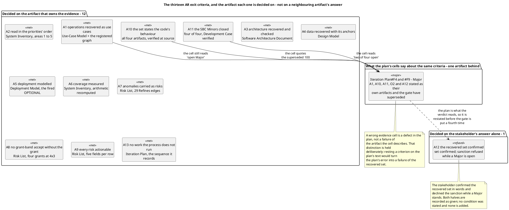

| Criterion | State this lens certifies | Where it is decided |
|---|---|---|
| A1 | Met | Use-Case Model — eleven use cases, each tracing to the `EP-NNN` whose code performs it; all twenty-two entry points carried or their exclusion reasoned. Five `COMP-014 → UC-006` to `UC-010` `Realizes` edges confirmed in the registered graph and the rules diagram drawing R6 to U6 to U10 |
| A2 | Met | System Inventory — Priorities areas 1 to 5 each yield a recovered use case. The criterion claims nothing about areas 6 to 8 |
| A3 | Met | Software Architecture Document — `COMP-001` to `COMP-022` with connectors, and a Use-Case View naming a component path for each of the eleven use cases |
| A4 | Met | Design Model — eight persisted entity types, keys, associations, enforced rules, `AN-025` against the owner key, each anchored to `TodoDbContext.cs` and the three migrations |
| A5 | Met | Deployment Model — the fired OPTIONAL records the processes, the stores, the ports, the shared key ring under `AN-010` and the database directory under `AN-013` |
| A6 | Met | System Inventory — 84 read and 55 unread of 139; the per-area columns reproduce and every unread category is named |
| A7 | Met | Risk List — 29 `Refines` edges from the anomalies, plus `R022`, `R031` and `R032` with their separate origins stated |
| A8 | Met | Risk List — four grants at 4 × 3 = 12, on `R004`, `R011`, `R012` and `R016`; no risk placed in the grant band this iteration takes the accept strategy |
| A9 | Met | Risk List — every row names a strategy, an owner, an action, a contingency and a warning sign |
| A10 | Met | The recovered set, all four artifacts its own test names: Supplementary Specification M3, S2, P1, R8; Software Architecture Document SP1, M3 and the bounded-load row; Deployment Model Environment Mapping; Use-Case Model R6. Each states both budgets under `AN-024` or the two hops under `AN-023` |
| A11 | Met | Development Case — four of four: `Iteration Plan#F2`, `Iteration Plan#F3`, `System Inventory#F3`, and `Development Case#F2` with `#F3` corrected in this phase's Environment stage. Document Control reads Excavation iteration 3; the contributor set names all six lenses and CLS-DC-01 draws the four missing edges |
| A12 | Not met — sanction refused | The stakeholder's answer alone. The recovered set is confirmed as the model of the existing system; the sanction to advance into Consolidation is refused while a Major stands |
| A13 | Met | Iteration Plan — the milestone sequence records Environment as this phase's first discipline at Low intensity, fine-plan items 1 to 3 sit against the Process Engineer under that stage, and every other item belongs to a stage the process runs here |

Twelve of thirteen criteria hold on the evidence that owns them. A12 is refused. The one Major open is the plan's own text and is the reason the milestone does not close: the record the verdict reads would certify three criteria as failing that are met.

### Review Coordinator lens
<!-- review: Excavation I3 -->

<!-- review: Excavation I3 -->

**Lens participation at this milestone — authoritative, not inferred from the artifact.** Excavation's milestone review runs Reviewer, then Management Reviewer, then Review Coordinator. The Business Reviewer's first scheduled stage is LCO, so at AR it is not a participant.

| Lens | Participation | What it evaluated | Bearing on the verdict |
|---|---|---|---|
| Reviewer (technical) | EXECUTED | Ten artifacts against nine checklist items; every closure re-verified at the graph, the file or the peer artifact | Counted in full — 1 Major, 2 Minor |
| Management Reviewer | EXECUTED | The thirteen AR exit criteria A1 to A13 against the artifact each is decided on, the grant band, and gate H4 | Counted in full — 1 Major, 2 Minor |
| Business Reviewer | **INACTIVE — did not evaluate this review** | Nothing | No verdict attributed and none inferred |
| Review Coordinator | EXECUTED | The consolidated ledger, cross-lens reconciliation, action priority, the milestone verdict | Records the verdict in Disposition |

**Review events of this milestone, each triggered by a workflow activity.** No event sits on a calendar date; each follows the activity that produces the artifacts it judges.

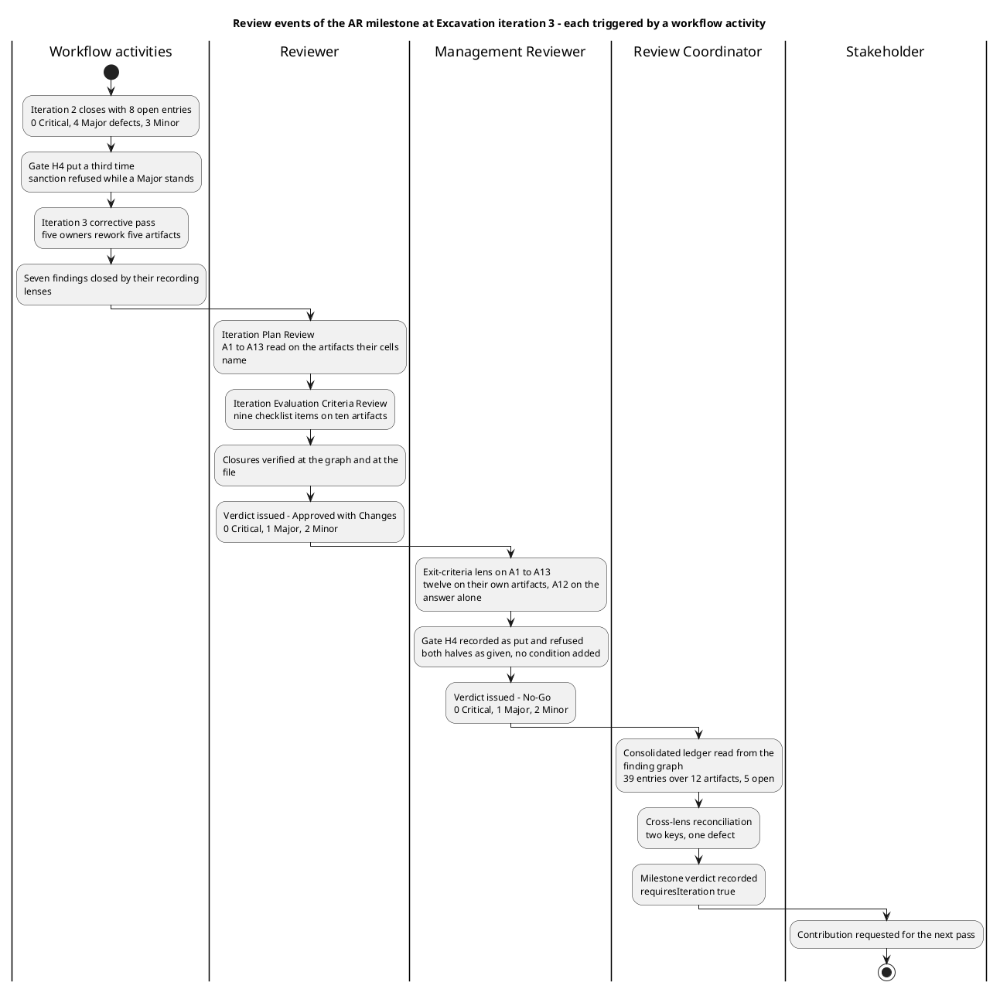

**Entry and exit criteria enforced at each event.**

| Event | Entry criterion | Exit criterion | Enforced |
|---|---|---|---|
| Iteration Plan Review | The plan carries this iteration's work items with owners, and each criterion is read on the artifact its evidence cell names | Every criterion decided on its own artifact's evidence | **Passed at the artifacts, failed at the plan's cells** — A1, A10, A11, O2 and A12 report states their own artifacts and the gate have superseded (`Iteration Plan#F4`, `#F9`) |
| Iteration Evaluation Criteria Review | The recovered artifacts are in their target state and the anchors exist to be checked | Every finding verified at the section it names, and at the source where the finding turns on a recovered fact | Yes — seven closures each cite the graph, the file or the peer artifact at which they were verified |
| Milestone Review AR | Both executed lenses have returned and the stakeholder's gate answer is on the record | 0 Critical and 0 Major open, and the stakeholder's sanction GRANTED | **No** — one Major defect open and the sanction refused |

**Scope of this consolidation.** Twelve artifacts were read for findings: the ten under review, plus the Iteration Assessment and this Review Record. Two carry no finding from any lens — the Iteration Assessment (authored by the Project Manager after this review) and the Review Record itself. The Data Model, the Glossary and the Test Plan are absent on the Development Case's NOT FIRED verdict on each trigger; both executed lenses checked each verdict against its §5.2 condition and neither carries a finding.

**No SCM surface is reviewed.** The repository reports no pull request in any state and no IARI pipeline file exists. Excavation produces no production code, so the absence of a diff and of a CI result is the phase's correct state, not a gap in this review's coverage.

## Findings
### Reviewer lens
<!-- review: Excavation I3 -->

<!-- review: Excavation I3 -->

#### Compliance matrix

Each artifact against the nine items of this milestone's checklist. An item is marked Pass only where the artifact carries the evidence itself; N/A marks an item the artifact's shape does not engage.

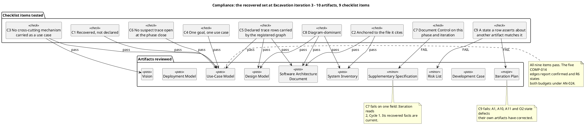

| Artifact | C1 | C2 | C3 | C4 | C5 | C6 | C7 | C8 | C9 |
|---|---|---|---|---|---|---|---|---|---|
| Development Case | N/A | Pass | Pass | N/A | N/A | N/A | Pass | Pass | Pass |
| System Inventory | Pass | Pass | Pass | N/A | N/A | Pass | Pass | Pass | N/A |
| Risk List | Pass | Pass | N/A | N/A | Pass | Pass | Pass | Pass | **Fail** |
| Iteration Plan | N/A | Pass | N/A | N/A | N/A | N/A | Pass | Pass | **Fail** |
| Vision | Pass | Pass | Pass | Pass | N/A | N/A | Pass | Pass | N/A |
| Use-Case Model | Pass | Pass | Pass | Pass | Pass | Pass | Pass | Pass | N/A |
| Supplementary Specification | Pass | Pass | Pass | Pass | N/A | N/A | **Fail** | Pass | N/A |
| Software Architecture Document | Pass | Pass | N/A | Pass | Pass | Pass | Pass | Pass | N/A |
| Deployment Model | Pass | Pass | N/A | N/A | N/A | N/A | Pass | Pass | N/A |
| Design Model | Pass | Pass | N/A | N/A | Pass | Pass | Pass | Pass | N/A |

#### Defect distribution

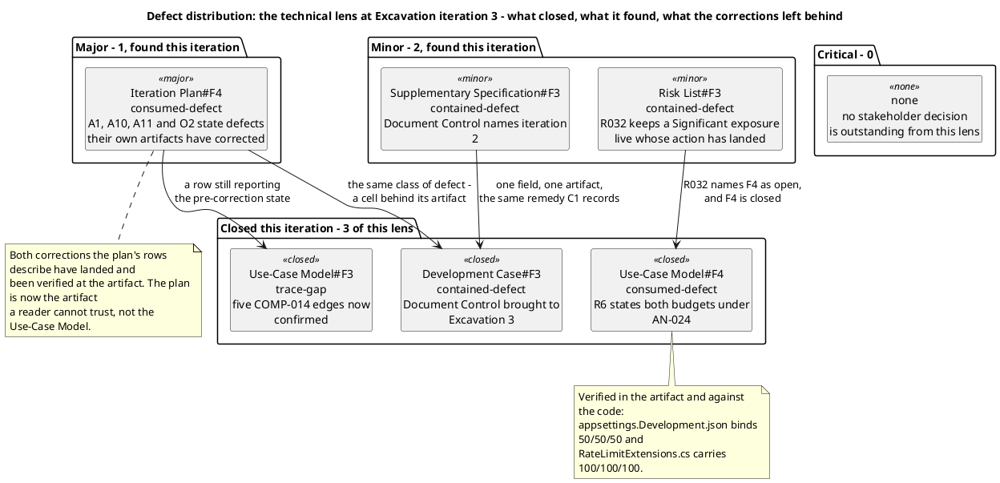

#### Iteration Plan#F4 — four places state a defect their own artifact has corrected (Major, consumed-defect)

**A1** reads "**Not met — open Major**" and gives one reason: "five `COMP-014 → UC-006` to `UC-010` `Realizes` edges are still marked suspect in the registered graph at the close". A fresh query of the graph on `COMP-014` upstream returns the five edges with no SUSPECT marking. `Use-Case Model#F3` is closed.

**A10** reads "**Not met — open Major**" and closes on "**Use-Case Model** — the fourth of the four — does not hold: its rules diagram's R6 reads … 100 tokens … and cites no `AN-024`". R6 now reads "In force: 50 tokens, 50 per 10 s, queue 50. Code defaults: 100 tokens, 100 per 10 s, queue 100 … AN-024", with both files cited in its note. `Use-Case Model#F4` is closed, and all four artifacts the criterion's own test names hold.

**A11** reads "**Not met — two of four open**" and quotes both Development Case Minors as standing. Document Control now reads Phase: Excavation, Iteration 3, Cycle 1, and CLS-DC-01 draws `CRV`, `MRV`, `BRV` and `RCO` edges into `RR` with the co-written sentence naming all six contributors. Both Minors A11 counts are corrected.

**O2** reads "**Not met** … Two Majors stand: `Use-Case Model#F3` … and `Use-Case Model#F4`" — the same two closed findings, stated a fourth time at the head of the plan.

These are three of the thirteen criteria this milestone is decided on. The plan tells the Management Reviewer's re-take and the Review Coordinator's verdict that three criteria fail on defects that have been fixed, one of which the stakeholder ordered corrected by name. The cell that asserts another artifact's state is the artifact that must be re-read when that state changes — not at the next milestone.

**Remediation.** Re-read the four places against the corrected artifacts and restate each at the state its evidence now supports: A1 "Met" with the five edges recorded as confirmed and requoted from a fresh graph query; A10 "Met — certified on the recovered set", naming R6 as the fourth artifact verified corrected and quoting its current wording under `AN-024`; A11 "Met — four of four", naming the four closed Minors and quoting no superseded sentence; O2 met on its own terms, since neither correction added or removed a use case. The sequence, the fine plan and A13's cell are correct and need no change.

#### Risk List#F3 — R032 keeps a live exposure whose retirement action has landed (Minor, contained-defect)

R032's strategy cell reads "**Avoid — action performed on five of six; one citing artifact open**" and names the sixth as "the Use-Case Model's rules diagram R6, whose correction is `Use-Case Model#F4`". The warning-sign cell reads "**fired** at `Use-Case Model#F4`; the register keeps the row open until the fourth artifact holds", and the diagram beside the table carries a contingency node for the sixth. R6 states both budgets under `AN-024` and `#F4` is closed, so all six citing artifacts hold and the register reports a Significant exposure as unmitigated. The register's own opening rule is the one broken, in the other direction: a claim about a retirement that has occurred.

**Remediation.** Restate R032: the action performed on all six citing artifacts, R6 named among them with its current wording under `AN-024`, the exposure retired by the avoidance. Remove or relabel the diagram's contingency node to the one residual — the four artifacts re-read in one pass at the next milestone — and set the warning-sign cell to the state it now holds. `R030` and `R031` are correct as written and unchanged.

#### Supplementary Specification#F3 — Document Control names iteration 2 (Minor, contained-defect)

It reads "Iteration: 2, Cycle 1" while the other nine artifacts under this review read iteration 3. The artifact's content was corrected in iteration 2 and not touched this iteration, which is why the field was not brought forward. Contained: M3, S2, P1 and R8 state both budgets under `AN-024` and R4 the two hops under `AN-023`, no role builds on the metadata and no criterion turns on it. C7 asks each artifact to name the iteration whose review it is under.

**Remediation.** Set the Iteration field to "3, Cycle 1". Change no other field and no content.

#### Artifacts with no finding from this lens

Development Case, System Inventory, Vision, Use-Case Model, Software Architecture Document, Deployment Model and Design Model carry no open finding from this lens. Each was re-read at the sections this lens previously found defective and each now holds. Silence from this lens is the approval.

The three closures this iteration are the substance of it. `Use-Case Model#F4` was the last artifact of the six that cite `AN-024` or `AN-023`, and it now states the fact the other five carry, under the same identifier and against the same file. `Use-Case Model#F3` was the last suspect marking in the graph: `COMP-014` now returns five `Realizes` edges and every one is confirmed, so the Use-Case View states its widest mechanism as confirmed for `UC-006` to `UC-010`. `Development Case#F3` brings the tailoring document onto the phase whose process it governs; the contributor-set defect the Management Reviewer recorded on the same artifact is corrected in the same text — CLS-DC-01 draws six edges into `RR`, and the co-owned sentence names Reviewer, CodeReviewer, Management Reviewer, Business Reviewer, Review Coordinator and the Configuration Manager's baseline record. That defect is the Management Reviewer's to dispose of under its own key.

The System Inventory's coverage arithmetic was recomputed rather than accepted: the per-area Files column sums to 139, the Read column to 84, the unread cells to 55, and the headline reproduces. Every unread area is named with its reason and none carries a perimeter fact.

### Management Reviewer lens
<!-- review: Excavation I3 -->

<!-- review: Excavation I3 -->

Every finding below was recorded through `record_artifact_finding` before this section was written. The other lenses' Majors are cited where the milestone verdict reads them; they are not re-recorded here as duplicates.

#### Stakeholder consultation — gate H4 third put, and the answer it returned

Gate H4 was put for the third time at this review. Both questions were put with this lens's verdict leaning and every open defect named inside them, and neither carried a pre-filled sanction.

**Stakeholder sanction: REFUSED**

**Stakeholder acceptance, question 1 — verbatim:** "No"

**Stakeholder acceptance, question 2 — verbatim:** "The recovered set is confirmed as the model of my system — the 11 use cases, the 4 stated exclusions, the 22 components and the eight tables: nothing is wrong or missing, and no exclusion is re-opened. I do not sanction advancing while a Major is open. No recovered content is at issue, so the next iteration changes none of it: the Project Manager restates the plan's four cells and the three Minors are corrected by their owners."

Four consequences follow, and this lens applies no more than the stakeholder stated:

1. The recovered set **is confirmed** — eleven use cases, four stated exclusions, twenty-two components, eight tables. No use case is wrong or missing and no exclusion is re-opened. `A12`'s second half is answered in the affirmative and is recorded as given.
2. The sanction to advance into Consolidation is **refused**, because a Major stands. `A12` is therefore **not met**. A condition stated by the stakeholder in words is a condition; none is added beyond the refusal.
3. No recovered content changes in the next iteration. The work is the plan's cells and the three Minors, and the stakeholder states that explicitly.
4. Nothing else is recorded. No limit, prohibition or deadline was stated and none is inferred.

#### Defect distribution

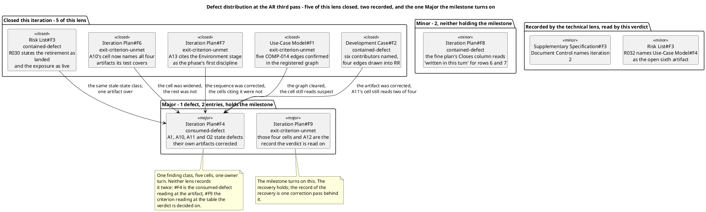

#### Iteration Plan#F4 — four cells state defects their own artifacts have corrected (Major, `consumed-defect`)

Recorded by the technical lens at this pass and read by this verdict. A1 reads "**Not met — open Major**" on five `COMP-014` edges "still marked suspect in the registered graph at the close"; a query of `COMP-014` upstream returns five confirmed `Realizes` edges. A10 reads "**Not met — open Major**" and closes on R6 reading "100 tokens" with no `AN-024`; R6 now reads "In force: 50 tokens, 50 per 10 s, queue 50. Code defaults: 100 tokens, 100 per 10 s, queue 100 … AN-024". A11 reads "**Not met — two of four open**"; all four Minors are corrected. Objectives O2 reads "**Not met** … Two Majors stand" on the same two closed findings.

The defect is in the record three roles act on, not in the recovered content. This lens does not duplicate the entry: one correction in four cells closes it.

#### Iteration Plan#F9 — five cells of the criteria table report states their artifacts and the gate have superseded (Major, `exit-criterion-unmet`)

The same class as `#F4`, recorded against the criterion rather than the artifact content, because the AR verdict is decided on this table. A1, A10, A11 and O2 report failures their artifacts no longer carry, and A12 records the second put alone — "Gate H4 was put for the second time and answered No" — while the third put has now returned a different answer: the recovered set confirmed, the sanction refused.

This is the defect that holds the milestone. A1, A10 and A11 are met on the artifacts that own them, but a verdict read on the plan would certify the AR milestone on cells saying three criteria fail. The remedy is one pass by the Project Manager over five cells; no recovered content, no role and no criterion's substance is at stake.

#### Iteration Plan#F8 — the fine plan's Closes column names a moment instead of a finding's state (Minor, `contained-defect`)

Rows 6 and 7 read "`Iteration Plan#F6`, `Iteration Plan#F7` — **written in this turn**" and "`Risk List#F3` — **written in this turn**". "This turn" was iteration 2's; the plan now carries iteration 3's fine plan and no reader can resolve the phrase. Contained: every other row of the column names its key and nothing turns on the annotation. Recorded separately from `#F4` because it is a different column and a different remedy.

#### The two Minors of the technical lens — read, not re-recorded

`Risk List#F3` — R032's strategy cell still reads "action performed on five of six; one citing artifact open", names "the Use-Case Model's rules diagram R6, whose correction is `Use-Case Model#F4`", and sets its warning sign "**fired** at `Use-Case Model#F4`". R6 holds and `#F4` is closed, so the register reports a Significant exposure as unmitigated when its mitigation has landed. Contained: the register understates rather than overstates, `A9` holds, and no criterion turns on it.

`Supplementary Specification#F3` — Document Control reads "Iteration: 2, Cycle 1" while the other nine artifacts read iteration 3. Contained: the artifact's figures are current and no role builds on the metadata field.

#### Artifacts with no open finding from any lens

System Inventory, Vision, Software Architecture Document, Deployment Model and Design Model carry no open finding from any lens at this gate. Each was read at the sections previously found defective and each now holds. Silence is the approval.

The System Inventory's coverage arithmetic was recomputed rather than accepted: the per-area Files column sums to 139, the Read column to 84, the unread cells to 55, and the headline reproduces. The Risk List's rows each name strategy, owner, action, contingency and warning sign; `R030` states a retirement that landed and an exposure that stands, and `R031` states a materialization rather than a mitigation.

### Review Coordinator lens
<!-- review: Excavation I3 -->

<!-- review: Excavation I3 -->

**Consolidated finding ledger.** Every count below is copied from `read_artifact_findings` on each of the twelve artifacts, never from a lens's narrative. The line this section rests on, verbatim:

`[FINDINGS] read=12, unread=none, open Critical=0, open Major=2 [Iteration Plan#F4, Iteration Plan#F9 — one defect, two lens keys], open Minor=3 [Iteration Plan#F8, Risk List#F3, Supplementary Specification#F3]`

Thirty-nine finding entries stand against the twelve artifacts read. Thirty-four carry a resolution object and were closed by the lens that recorded them. Five are open: none Critical, two Major entries covering one distinct defect, three Minor.

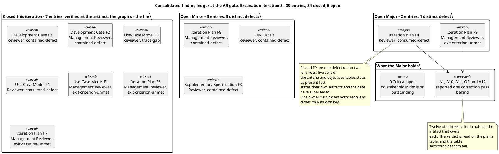

**Open findings — one Major defect, two entries.**

| # | Defect | Entries | Lens | Criterion | Owner | The corrective action |
|---|---|---|---|---|---|---|
| 1 | Five cells of the Evaluation Criteria and Objectives tables state, as present fact, states their own artifacts and the gate have superseded — A1 on five `COMP-014` edges the graph returns confirmed, A10 on R6 reading 100 where R6 now states both budgets under `AN-024`, A11 reading two of four open where all four Minors are closed, O2 on the same two closed findings, A12 recording the second put alone | `Iteration Plan#F4` (Reviewer), `Iteration Plan#F9` (Management Reviewer) | both | `consumed-defect` / `exit-criterion-unmet` | Project Manager | One pass over the five cells, each restated at the state its evidence supports: A1 "Met" with the five `COMP-014` edges requoted from a fresh graph query; A10 "Met — certified on the recovered set", R6 named as the fourth artifact with its wording under `AN-024`; A11 "Met — four of four"; O2 met on its own terms; A12 recording the third put as given — the recovered set confirmed, the sanction refused while a Major stands. Change nothing in the sequence, the fine plan or A13 |

**Open findings — three Minors. Recorded, owned, none holding the milestone.**

| Artifact | Key | Lens | Criterion | Owner | The corrective action |
|---|---|---|---|---|---|
| Iteration Plan | F8 | Management Reviewer | `contained-defect` | Project Manager | Drop "written in this turn" from the Closes cells of fine-plan rows 6 and 7 and leave the finding key, as every other row of the column does |
| Risk List | F3 | Reviewer | `contained-defect` | Project Manager | Restate R032: the action performed on all six citing artifacts, R6 named with its wording under `AN-024`, the exposure recorded as retired by the avoidance; relabel the diagram's contingency node to the one residual; set the warning-sign cell to the state it now holds. Leave `R030` and `R031` unchanged |
| Supplementary Specification | F3 | Reviewer | `contained-defect` | System Analyst | Set the Document Control Iteration field to "3, Cycle 1". Change no other field and no content |

**Closed this iteration — seven entries, each verified at the source.** `Development Case#F3` (Document Control brought to Excavation iteration 3), `Development Case#F2` (contributor set names all six lenses; CLS-DC-01 draws `RV`, `CRV`, `MRV`, `BRV`, `RCO` and `CFM` edges into `RR`), `Use-Case Model#F3` and `#F1` (five `COMP-014` `Realizes` edges confirmed in the registered graph; the rules diagram draws R6 to U6 to U10), `Use-Case Model#F4` (R6 states "In force: 50 tokens, 50 per 10 s, queue 50. Code defaults: 100 tokens, 100 per 10 s, queue 100 … AN-024", its note citing `RateLimitExtensions.cs:14-31` and `appsettings.Development.json:8-12`), `Iteration Plan#F6` (A10's cell opens "Decided on all four artifacts the criterion's own test names"), `Iteration Plan#F7` (A13 cites the Environment stage as this phase's first discipline, the coarse roadmap carries the stage bar, fine-plan items 1 to 3 sit against the Process Engineer under it).

**Cross-lens reconciliation — where two lenses spoke on one subject.**

| Subject | The two lenses | Resolution recorded here |
|---|---|---|
| The five cells of this iteration's tables | Reviewer records `Iteration Plan#F4` at the four artifact-content places; Management Reviewer records `Iteration Plan#F9` at the criteria table the verdict is decided on | **One defect, two keys.** `#F4` reads the defect at the artifact, `#F9` reads it at the criterion, and `#F9` also carries the A12 cell `#F4` does not reach. One owner pass closes both; each lens closes only its own key and neither entry is doubled in the action plan |
| The five `COMP-014` edges | Both lenses recorded the defect at iteration 2 — `Use-Case Model#F3` and `#F1` — and both closed it this iteration against the same graph query | **Closed by both lenses.** No reconciliation is needed at this gate |
| `Development Case#F2` and `#F3` | Two keys, two lenses, two distinct defects on one artifact, both counted by A11 | **Not a duplicate.** Both were corrected in one turn by one owner in the Environment stage and both are closed |
| `Risk List#F3` (two entries) | The Management Reviewer's `#F3` closed on R030 this iteration; the technical lens's `#F3` was recorded this iteration against R032 | **Distinct subjects, one key.** R030's retirement landed and stays live; R032's action has now landed on all six citing artifacts. Only R032 remains open, under the technical lens |
| The five `COMP-014` edges (A10's reading) | `Iteration Plan#F6` closed on the widening of A10's cell; `#F4` and `#F9` record that the widened cell quotes R6's superseded wording | **Successive, not contradictory.** The omission of the fourth artifact is corrected; the residual is the cell's content, recorded under its own keys |

No lens contradicts another on a fact. No finding at this gate carries a disputed severity band. A12 is decided on the stakeholder's answer alone and neither lens disputes it.

**Priority of what remains — one iteration, Major before Minor.**

| Priority | Finding | Why it ranks here |
|---|---|---|
| 1 | `Iteration Plan#F4` and `#F9` | The plan is the record the milestone verdict is read on; five cells restated in one pass close the only Major and free the gate |
| 2 | `Risk List#F3` | The register reports a Significant exposure as unmitigated when its mitigation has landed; contained, and its remedy is a transcription |
| 3 | `Iteration Plan#F8` | Same artifact and same owner turn as priority 1, a different column |
| 4 | `Supplementary Specification#F3` | One metadata field; the artifact's recovered facts are current |

## Resolutions and Actions
### Reviewer lens
<!-- review: Excavation I3 -->

<!-- review: Excavation I3 -->

#### Closures materialized this iteration

Each row is a `resolve_artifact_finding` call that transitioned the ledger, not a narrative claim. The evidence column names where the corrected content was read.

| Finding | Criterion | Resolution | Evidence read |
|---|---|---|---|
| Development Case#F3 | contained-defect | Resolved | Document Control: "- Phase: Excavation / - Status: Draft — made current for the end-of-Excavation (AR) milestone review / - Milestone Target: end-of-Excavation (AR) — not yet achieved / - Iteration: 3, Cycle 1" |
| Use-Case Model#F3 | trace-gap | Resolved | `model_query_traces` on `COMP-014` upstream: five `Realizes` edges — UC-010, UC-009, UC-008, UC-007, UC-006 — none marked SUSPECT; Software Architecture Document Traceability row `COMP-014` names the same five |
| Use-Case Model#F4 | consumed-defect | Resolved | Use-Case Model rules diagram R6: "In force: 50 tokens, 50 per 10 s, queue 50. Code defaults: 100 tokens, 100 per 10 s, queue 100. Over budget answers 429. AN-024"; note citing `RateLimitExtensions.cs:14-31` and `appsettings.Development.json:8-12` |

#### Actions this iteration opens

Each is an owner's corrective action, stated so it can be performed without a follow-up question. The first holds the milestone; the other two do not.

| Finding | Owner | Action | Holds the milestone |
|---|---|---|---|
| Iteration Plan#F4 | Project Manager | Re-read the four places against the corrected artifacts and restate each: A1 "Met" with the five `COMP-014` edges confirmed and requoted from a fresh graph query; A10 "Met — certified on the recovered set" naming R6 as the fourth artifact and quoting its current wording under `AN-024`; A11 "Met — four of four"; O2 met on its own terms. Requote no superseded sentence and change nothing in the sequence, the fine plan or A13 | Yes — A1, A10 and A11 are three of the thirteen criteria the milestone is decided on, and the verdict reads those cells |
| Risk List#F3 | Project Manager | Restate R032: the action performed on all six citing artifacts, R6 named with its wording under `AN-024`, the exposure retired by the avoidance; remove or relabel the diagram's contingency node to the residual — the four artifacts re-read in one pass at the next milestone; set the warning-sign cell to its current state. Leave `R030` and `R031` unchanged | No — a Minor, contained, no criterion turns on it |
| Supplementary Specification#F3 | System Analyst | Set the Iteration field to "3, Cycle 1". Change no other field and no content | No — a Minor, one metadata field |

#### Carried state read for this disposition

| Item | State read |
|---|---|
| Gate H4 (the stakeholder's confirmation of the recovered set) | The AR review of iteration 2 records it answered No, twice, with the order that the Development Case be corrected in this phase and that every Major be corrected. That order is performed: both Development Case Minors are corrected and both Use-Case Model Majors are closed. Re-putting the gate is not this lens's to do |
| The stakeholder's routing answer of 2026-11-23 | Applied and verified in the artifacts, not merely recorded: the Iteration Plan puts the Process Engineer's three items in this iteration under the Environment stage, and the Development Case states Environment active in every phase with Excavation first. A11 is neither waived nor restated |
| `Risk List#F3` (Management Reviewer) | R030's strategy cell now reads "**Avoid — retirement landed; the exposure stays live**", with the statement located in the Use-Case Model under `AN-029` and the reason it stays live — `AN-012` stands, no test covers the surface. That finding is closed by its own lens; this lens reads the cell and finds it true |
| Suspect traces | None. `COMP-014` — the only component this lens ever found carrying a marking — now returns five confirmed edges, and the three `EP-003` edges were confirmed at the previous pass |
| Open pull requests | None in any state. The repository was queried: no pull request exists to approve, request changes on, or defer, and none is expected — Excavation produces no production code |
| Build status | No IARI pipeline file exists; nothing is reported for `main`. This is the phase's correct state, not a gap |
| Exit criterion A10 (the recovery states what the code does) | Certifiable on the recovered set as this lens reads it. The four artifacts its test names all hold: Supplementary Specification M3, S2, P1, R8 and F10; Software Architecture Document SP1, M3 and the bounded-load row; Deployment Model Environment Mapping; Use-Case Model R6. The criterion's evidence cell is the plan's to restate — `Iteration Plan#F4` |

### Management Reviewer lens
<!-- review: Excavation I3 -->

<!-- review: Excavation I3 -->

#### Closures materialized this iteration — five of this lens's findings

Each row is a `resolve_artifact_finding` call that transitioned the ledger, not a narrative claim. The evidence column names where the corrected content was read.

| Finding | Criterion | Resolution | Evidence read |
|---|---|---|---|
| Risk List#F3 | contained-defect | Resolved | Risk Mitigation and Contingency, R030: "**Avoid — retirement landed; the exposure stays live**", with the statement located in the Use-Case Model under `AN-029` and the reason the exposure stands — `AN-012` and no test over the surface |
| Iteration Plan#F6 | exit-criterion-unmet | Resolved | Evaluation Criteria A10 now opens "Decided on all four artifacts the criterion's own test names" and enumerates the Use-Case Model's R6 as the fourth. The cell no longer certifies a subset of what its own test covers |
| Iteration Plan#F7 | exit-criterion-unmet | Resolved | Evaluation Criteria A13 cites the Environment stage as this phase's first discipline; Plan and Milestones carries the bar "Excavation iteration 3 - Environment stage, then the corrections" and fine-plan items 1 to 3 sit against the Process Engineer under it |
| Use-Case Model#F1 | exit-criterion-unmet | Resolved | `model_query_traces` on `COMP-014` upstream: five `Realizes` edges — UC-010, UC-009, UC-008, UC-007, UC-006 — none marked SUSPECT. Rules diagram R6 draws to U6 to U10 and states "/todos only" with both budgets under `AN-024` |
| Development Case#F2 | contained-defect | Resolved | Roles and Ownership: the co-owned-artifact sentence names all six contributors, and CLS-DC-01 draws `MRV`, `BRV` and `RCO` edges into `RR` beside `RV`, `CRV` and `CFM`. Document Control reads "Phase: Excavation … Iteration: 3, Cycle 1" |

`Iteration Plan#F6` and `#F7` are closed on the specific defect each recorded — the omission of the fourth artifact from A10's cell, and A13's premise that Environment runs at no intensity here. Both artifacts are corrected at that point. That four further cells of the same table still report superseded states is a different defect on the same artifact, recorded this iteration as `#F9`, and `#F4` carries the technical lens's reading of it. Neither closure claims more than the defect it answers.

#### Actions this iteration opens

Each is an owner's corrective action, stated so it can be performed without a follow-up question. The first holds the milestone.

| Finding | Owner | Action | Holds the milestone |
|---|---|---|---|
| Iteration Plan#F9 and #F4 | Project Manager | One pass over five cells, restated at the state their artifacts now hold: **A1** "Met", five `COMP-014` edges confirmed and requoted from a fresh graph query; **A10** "Met — certified on the recovered set", R6 named as the fourth artifact with its current wording under `AN-024` and no superseded figure quoted; **A11** "Met — four of four", the four closed Minors named and no superseded sentence quoted; **Objectives O2** met on its own terms, neither correction adding or removing a use case; **A12** recording the third put as given — the recovered set confirmed as the model of the existing system, the sanction refused while a Major stands, both halves and no condition added. Change nothing in the sequence, the fine plan or A13 | Yes — the plan is the record the verdict is decided on |
| Iteration Plan#F8 | Project Manager, same pass | Drop "written in this turn" from the Closes cells of rows 6 and 7 and leave the finding key, as every other row of the column does | No — a Minor, contained |
| Risk List#F3 (technical lens) | Project Manager | Restate R032: the action performed on all six citing artifacts, R6 named with its wording under `AN-024`, the exposure recorded as retired by the avoidance; relabel the diagram's contingency node to the one residual — the four artifacts re-read in one pass — and set the warning-sign cell to the state it now holds. Leave `R030` and `R031` unchanged | No — a Minor, contained |
| Supplementary Specification#F3 (technical lens) | System Analyst | Set the Iteration field to "3, Cycle 1". Change no other field and no content | No — a Minor, one metadata field |

#### The route, and what the stakeholder's answer settles

The next iteration of Excavation is one correction pass and nothing else. The stakeholder stated that no recovered content is at issue and that the next iteration changes none of it: the Project Manager restates the plan's cells and the three Minors are corrected by their owners. Gate H4 is put a fourth time only once the cells agree with the set they report.

**Risk List#R031's contingency is the mechanism that opens it**, as the register predicted: the correction did not land in the expected turn, `A11` read incomplete, and the phase carried a further iteration planned from the record. Declared work is not cut to avoid it.

| Carried state | What this lens read |
|---|---|
| Gate H4 | Put three times. First and second: refused. Third: the recovered set **confirmed** as the model of the existing system, the sanction **refused** while a Major stands. Both halves of the third answer are recorded as given |
| Suspect traces | None. `COMP-014` returns five confirmed edges; the three `EP-003` edges were confirmed at an earlier pass |
| Open pull requests and build status | None in any state and none expected — Excavation produces no production code and runs no build. This is the phase's correct state, not a gap |
| Iteration Assessment | Not judged. The Project Manager authors it after this review; its absence before the review is not a finding |
| Declared scope | Untouched. No artifact in the recovered set changes in the next iteration, on the stakeholder's explicit statement |

#### Risk retirement at this gate

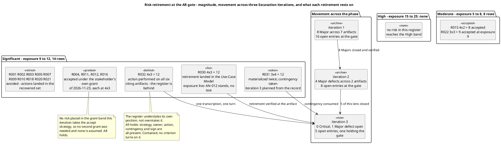

No risk in the register sits in the High band, and none placed in the Significant band this iteration takes the accept strategy without the stakeholder's grant — the four that do carry their own grant of 2026-11-23 at 4 × 3 = 12. `R030` and `R031` are the two rows this lens follows most closely: `R030`'s retirement landed while its exposure stands, and `R031` materialized twice and its contingency is the iteration this record opens. Recording a risk is not retiring it, and this lens does not report a retirement it cannot verify at the artifact.

#### What this lens does not do

- It does not dispute the recovery. Eleven use cases, a 22-component architecture across four processes and an eight-table data model, each resting on the file and lines it cites. The stakeholder has confirmed all of it and nothing in it changes.
- It does not re-open a single exclusion. External-provider sign-in is recovered and marked unreachable; the `admin` branch is an exceptional entity; `EP-020`, `EP-021` and `EP-022` are not use cases.
- It records no condition, limit or prohibition the stakeholder did not state. The refusal is recorded as a refusal and nothing is read into it.
- It opens no change request. The Change Control Manager does not work in the sprint zero; the findings reach their owners through this record and through their Work Orders.

### Review Coordinator lens
<!-- review: Excavation I2 -->

<!-- review: Excavation I2 -->

**Actions, in the order the next iteration of this phase takes them.** Each action is the remediation its recording lens wrote. No action carries a calendar date: the phase declares none, and a date projected from an estimate would read downstream as an observation. The due point is a state of the work. Every action is performed in **one** iteration — the stakeholder placed the Process Engineer's turn in the same iteration as the Use-Case Model and Iteration Plan corrections, so the phase closes in one iteration.

| # | Action | Artifact | Owner | Closes | Due point | Escalates if |
|---|---|---|---|---|---|---|
| 1 | Record the Environment stage in the milestone sequence as the phase's first discipline, place the two Development Case items against the Process Engineer in the next iteration, and restate A13's evidence cell to cite that stage | Iteration Plan | Project Manager | `Iteration Plan#F7` | First, so the stage exists before the role's turn | The plan again records Environment as inactive in this phase |
| 2 | State both budgets in R6 under `AN-024` — code defaults 100 / 100 per 10 s / queue 100, Development override 50 / 50 / 50 as the value in force — and cite `appsettings.Development.json:8-12` | Use-Case Model | System Analyst | `Use-Case Model#F4` | Same iteration, first among the artifact corrections | R6 and the gate diagram still give two answers |
| 3 | Re-register the five `COMP-014 → UC-006` … `UC-010` edges as confirmed, each checked against `TodoApi.cs:19-20`, and record beside the gate diagram why the bucket gates the operation without being it | Use-Case Model | System Analyst | `Use-Case Model#F3`, `Use-Case Model#F1` | Same turn as action 2 | Any edge still carries a SUSPECT marking when the graph is re-queried |
| 4 | Name the Use-Case Model's R6 in A10's evidence cell so the criterion is certified on all four artifacts its test covers, or narrow the stated test to the artifacts the cell verifies | Iteration Plan | Project Manager | `Iteration Plan#F6` | After action 2 lands — the cell cannot certify what is not yet correct | A10 is recorded met on a subset again |
| 5 | Name every lens writing into the Review Record in the co-owned-artifact sentence and draw the corresponding edges in CLS-DC-01 | Development Case | Process Engineer | `Development Case#F2` | Same iteration, in the Environment stage action 1 records | The role's turn is again absent from the phase plan |
| 6 | Bring the four Document Control fields forward to the phase the document governs | Development Case | Process Engineer, same turn | `Development Case#F3` | With action 5 | — |
| 7 | State in the Development Case that Environment runs in every phase, and in Excavation as its first discipline, so the tailoring matches the baseline the rest of the document is read against | Development Case | Process Engineer, same turn | The tailoring statement the stakeholder ordered corrected alongside `#F2` and `#F3` | With actions 5 and 6 | The Development Case again states a phase in which the role does not run |
| 8 | Restate R030's strategy cell: the retirement action has landed in the Use-Case Model under `AN-029`; the exposure stays live because `AN-012` stands and no test covers the surface | Risk List | Project Manager | `Risk List#F3` | Owner's next turn, after the Majors | The row claims a retirement that has not occurred, in either direction |

Actions 2 and 3 are one turn by one owner on one artifact, sequenced only because `#F4` supplies the fact A10's cell must name. Actions 5, 6 and 7 are one turn by one owner and are the content of the stakeholder's answer. Actions 1 and 4 are the Project Manager's, and both are records of a stage or a criterion rather than corrections to recovered content.

**Escalation — what is escalated, and what is not.**

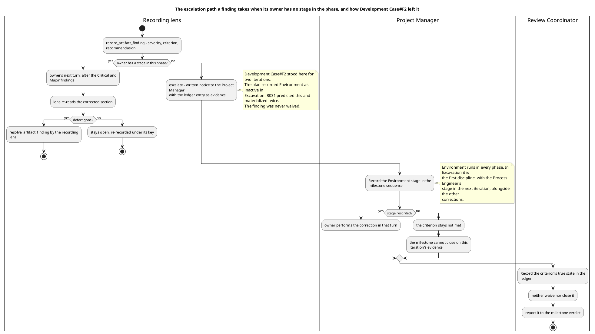

| Item | State | Why |
|---|---|---|
| `Development Case#F2` | **Escalated until action 1 is performed** | Its owner had no stage in this phase for two iterations, which is what `R031` predicted and what materialized. The stage now exists in the process and the stakeholder placed the role in the next iteration; action 1 is the Project Manager recording it in the plan. Until that record exists the finding's owner has no scheduled turn, and a criterion depends on it |
| Every other open finding | **Not escalated** | Each owner holds a stage in this phase and a turn in the next iteration. No finding is overdue: the phase has not closed, and the due point of each is that iteration's work |
| Systemic process failure | **No escalation to the Configuration and Change Management Board** | The ledger shows no repeated architecture violation and no skipped review. The same defect appearing twice across lenses is convergence, not process failure. The Change Control Manager does not work in the sprint zero, so no change request is opened for any finding; the stakeholder's answer reaches its owners through this record and through their Work Orders |

**Review effectiveness — this milestone's measured counts.** Second review event of this phase; the previous one is this milestone's iteration-1 pass, so the comparison is against that pass and nothing older.

| Indicator | Iteration 1 | Iteration 2 | What it is computed from |
|---|---|---|---|
| Review coverage | 10 of 10 reviewed artifacts read by both executed lenses | 10 of 10 read by both executed lenses; 9 received an explicit no-finding statement | The artifacts under review at each pass |
| Finding entries recorded | 29 | 35 cumulative | `read_artifact_findings` across the ten artifacts |
| Open at the gate | 16 — 0 Critical, 8 Major, 8 Minor | 8 — 0 Critical, 5 Major entries over 4 defects, 3 Minor | The `[FINDINGS]` line |
| Closed by their recording lens | 13 | 27 cumulative | Resolution objects on the ledger |
| Defect density, open entries by discipline | Requirements 6, Analysis & Design 3, Project Management 5, Environment 2, Discovery 0 | Requirements 4 over 2 defects, Project Management 2, Environment 2, Analysis & Design 0, Discovery 0 | Open entries at each gate, by the artifact carrying them |
| Duplicate subjects reached by both lenses | 1 — the rate limiter | 2 — the five `COMP-014` edges, and the rate budget at artifact and criterion | The reconciliation table in Findings |
| Scope of the correction required | 8 Majors across 7 artifacts | 4 Major defects across 2 artifacts, all correctable in one iteration | The open Major ledger |
| Defect removal efficiency | Not computable | Not computable | No test execution has occurred in the sprint zero; nothing is found by test against which review-found defects could be compared, and no ratio is invented |
| Rework effort | Not measured | Not measured | No per-finding token or elapsed-time attribution exists; the phase has not closed, so no measured actual is available to attribute |

**What the metrics say.** Open entries fell from 16 to 8 and the artifacts carrying a Major fell from 7 to 2, while coverage held at 10 of 10. The remaining work is concentrated in two artifacts and one owner turn each, and the stage the two Development Case Minors needed now exists in the plan the next iteration will carry. The indicator that did not improve is the one the gate turns on — a criterion whose evidence cell certifies a subset of what its own test covers reappeared one artifact over; `Iteration Plan#F3` closed at this pass and `#F6` opened against the same method. The process found it in the same pass that recorded it, which is the mechanism working; it did not prevent it.

**No finding is recorded for three absences.** The Data Model, the Glossary and the Test Plan are absent on the Development Case's NOT FIRED verdict on each trigger, which both executed lenses checked against the §5.2 conditions. The Iteration Assessment describes no iteration being reviewed because the Project Manager authors it after this review. No SCM condition exists to report: the sprint zero runs no build, opens no pull request and files no defect, which is the phase's correct state.

## Disposition
### Reviewer lens
<!-- review: Excavation I3 -->

<!-- review: Excavation I3 -->

#### Disposition — Approved with Changes

The recovered set converged this iteration. The three findings this lens held at the AR re-take are closed, each verified at its artifact and, where it turned on a recovered fact, at the code or the graph. What remains is not the recovery: it is the plan that reports on it.

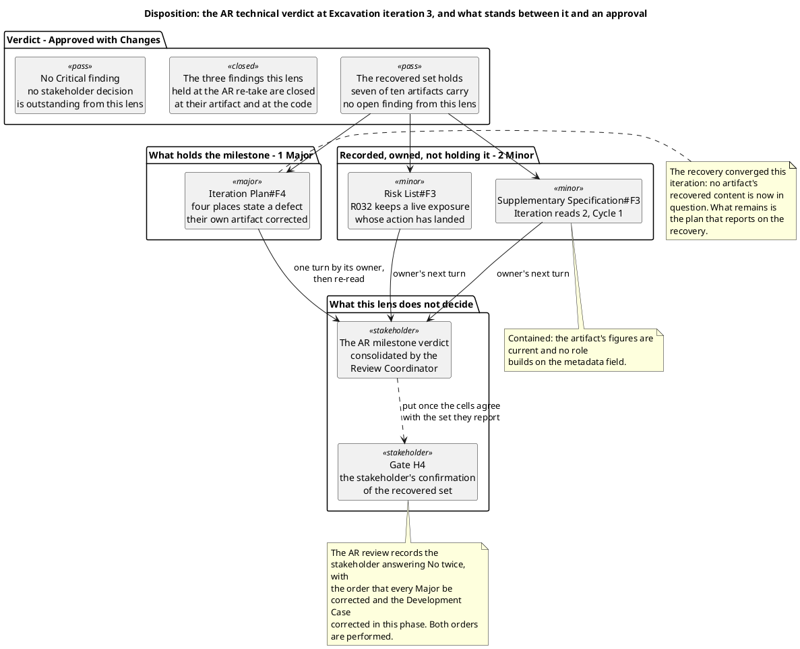

#### The verdict on the AR exit criteria, as this lens reads them

| Criterion | This lens's reading | Basis |
|---|---|---|
| A1 Operations recovered as use cases | **Met** | Eleven use cases, each tracing to the `EP-NNN` whose code performs it; all twenty-two entry points carried or their exclusion reasoned. The five `COMP-014` edges are confirmed in the graph, so the widest mechanism in the Use-Case View is stated as confirmed for `UC-006` to `UC-010` |
| A3 Architecture recovered and checked | **Met** | Twenty-two components with connectors; the Use-Case View names a component path for each of the eleven use cases. `SP1`, `M3` and the bounded-load row state 50 / 50 / 50 under `AN-024` |
| A4 Data recovered with its anchors | **Met** | Eight persisted entity types with keys, indexes, referential actions and enforced rules; `AN-025` at PD-D3 and `AN-005` confined to `EnsureCreated` |
| A5 Deployment modelled | **Met** | The fired optional records the processes, the stores, the ports, the key ring and the two settings that separate the environments, each anchored |
| A6 Coverage measured | **Met** | 84 read and 55 unread of 139; the per-area columns reproduce and every unread category is named |
| A7 Anomalies carried as risks | **Met** | Thirty-two risks, twenty-nine on `Refines` edges from the anomalies, three with their separate origins stated |
| A9 Every risk actionable | **Met** | Every row names a strategy, an owner, an action, a contingency and a warning sign. `R030` and `R031` state the exposure or the materialization rather than a retirement. `R032`'s count is a transcription `Risk List#F3` records |
| A10 The recovery states what the code does | **Met on the recovered set** | All four artifacts the criterion's test names hold: Supplementary Specification M3/S2/P1/R8/F10, Software Architecture Document SP1/M3/bounded-load, Deployment Model Environment Mapping, Use-Case Model R6 — each stating both budgets under `AN-024` or the two hops under `AN-023`. The plan's evidence cell still reports the pre-correction state: that is `Iteration Plan#F4`, not the set |
| A11 The SBC Minors closed | **Met on the artifacts** | All four corrected: `Iteration Plan#F2`, `Iteration Plan#F3`, `System Inventory#F3`, and `Development Case#F2` and `#F3`, both closed this iteration. The plan's cell still reads "two of four open": that is `Iteration Plan#F4` |
| A12 The recovered set confirmed | **Not met — refused** | Gate H4 answered No at the iteration-2 review. Not an artifact's to hold; re-put once the cells agree with the set they report |
| A13 No work the process does not run | **Met** | The plan's sequence records the Environment stage as the phase's first discipline, and every fine-plan item sits under a stage this phase runs. The cell cites the stage, not a stakeholder order |

A10 and A11 are certified on the artifacts each criterion governs, which is what the criteria ask. Their evidence cells are wrong, and a wrong cell is a defect in the plan, not a failure of the artifact the cell describes. This lens holds the difference deliberately: resting a criterion's state on the plan's own text would make the plan's error into a failure of the recovered set, which is the shape of defect `Iteration Plan#F3` and `#F6` recorded in the two previous passes.

#### Why this is Approved with Changes and not Rejected

A rejection would say the recovered set is not a model of the existing system. It is. The eleven use cases, the twenty-two components and the eight tables each rest on the file they cite, and this lens verified the iteration's corrected facts at source rather than accepting them from the artifacts' own prose. The one open Major is a plan whose cells lag its artifacts by one correction pass. Nothing in the recovery is in question.

#### Why it is not Approved

Approval would pass to the Management Reviewer's re-take and the Review Coordinator's verdict a plan that states three criteria fail on defects that have been fixed, one of which the stakeholder ordered corrected by name. The verdict reads the plan. A cell that asserts another artifact's state is a claim about that artifact, and while it stands the record the milestone is decided on does not describe the set the milestone is deciding.

#### The route this lens sees

One turn by the Project Manager restates the four places, and one turn each by the Project Manager and the System Analyst closes the two Minors in their own next turns. The corrections the iteration was opened for have all landed. The phase's declared scope is untouched, no role is added, and nothing is deferred to Consolidation to reach the gate.

#### Preserved

No artifact outside the ten reviewed was re-read for a finding, and none is changed by this lens. The Review Record is this lens's only output.

### Management Reviewer lens
<!-- review: Excavation I3 -->

<!-- review: Excavation I3 -->

**Verdict: NO-GO.** The Architecture Recovered milestone is not sanctioned. Excavation iteration 3 does not close it.

**0 Critical, 1 Major defect, 3 Minor.** Five of this lens's findings are closed on verified evidence at the artifacts. The recovered set is confirmed by the stakeholder as the model of the existing system. The one Major is not in the recovery: it is in the plan that reports on it.

#### Disposition — No-Go

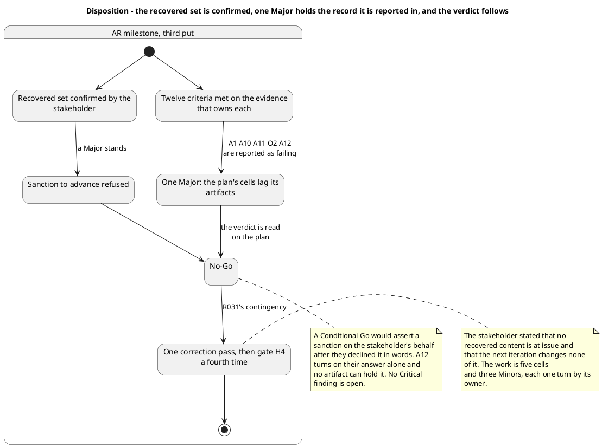

#### Why No-Go and not a Conditional Go

`A12` turns on the stakeholder's answer alone, and the answer was **No** — to the sanction, in words, at this review, with every open defect named inside the question. A Conditional Go is a sanction with conditions attached: it opens the gate and defers verification. This lens may not issue one when the sanction itself was declined. Doing so would record on the stakeholder's behalf the one thing they refused to record, which is exactly the failure this lens recorded against the plan at Survey and again at the AR re-take.

The confirmation is not thereby withheld. The stakeholder confirmed the recovered set as the model of their system — the eleven use cases, the four stated exclusions, the twenty-two components and the eight tables — and stated that nothing is wrong or missing and no exclusion is re-opened. That half of `A12` is answered and is recorded as answered. What they declined is advancing while a Major stands.

#### Why the Major holds the milestone

`Iteration Plan#F9` and `#F4` are one defect: five cells of the criteria table and the Objectives table report states their own artifacts and the gate have superseded. A1 reads "Not met — open Major" on five `COMP-014` edges that the registered graph returns confirmed. A10 reads "Not met" on R6 reading 100, where R6 now states both budgets under `AN-024`. A11 reads "two of four open" where all four Minors are corrected. Objectives O2 reads "Not met" on the same two closed findings. A12 records the second put alone, while the third has now returned a different answer.

Twelve of thirteen criteria hold on the evidence that owns them, and this lens certifies each of them. But the AR verdict is decided on the plan's table, and a verdict read on it today would certify the milestone on cells saying three criteria fail — one of them a Minor the stakeholder ordered corrected by name. The burden of proof rests on the project team to show the criteria are met; a record that says they are not met cannot carry that burden, whatever the artifacts behind it show.

The correction is one turn by one owner over five cells. No recovered content is at issue. The stakeholder said so, and the three Minors — `Iteration Plan#F8`, `Risk List#F3`, `Supplementary Specification#F3` — are corrected by their owners in their next turns.

#### Disposition by artifact

| Artifact | Disposition from this lens |
|---|---|
| System Inventory | **Approved** — no open finding from any lens; coverage arithmetic recomputed and reproducing |
| Vision | **Approved** — no open finding from any lens |
| Supplementary Specification | **Approved with changes** — `#F3` open, one Document Control field |
| Software Architecture Document | **Approved** — no open finding from any lens |
| Deployment Model | **Approved** — no open finding from any lens |
| Design Model | **Approved** — no open finding from any lens |
| Use-Case Model | **Approved** — `#F1` and both technical-lens Majors closed on verified evidence; the R6 correction and the five `COMP-014` confirmations read at the artifact and at the graph |
| Development Case | **Approved** — `#F2` and `#F3` closed; the contributor set names six lenses and Document Control reads this phase and iteration |
| Risk List | **Approved with changes** — `#F3` open, one strategy cell behind the artifact it points at; holds no criterion |
| Iteration Plan | **Changes required** — `#F9`, `#F4` and `#F8` open |
| Iteration Assessment | **Not judged** — authored after this review; it cannot describe the iteration it follows |

#### The route this lens sanctions

`Risk List#R031`'s contingency, planned from this record: **one further iteration of Excavation**, performing the Project Manager's pass over the five cells and the three Minors, then gate H4 put a fourth time. Nothing in the phase's declared scope is cut or deferred to reach it, no role is added, and no recovered content changes — the stakeholder stated that explicitly and this disposition adds nothing to it and narrows nothing in it.

`R031` has materialized for the second consecutive iteration. It is recorded, scored 3 × 4 = 12 and avoided; recording it has not retired it, and this disposition does not claim otherwise.

### Review Coordinator lens
<!-- review: Excavation I2 -->

<!-- review: Excavation I2 -->

**Milestone verdict on the consolidated ledger: the Architecture Recovered milestone is NOT sanctioned. Excavation iteration 2 does not close it.**

The verdict is anchored to the finding data and to the stakeholder's recorded answer, not to judgment:

| Condition for sanction | The data |
|---|---|
| `[FINDINGS]` unread = none | Met — twelve artifacts read, none unread |
| Open Critical = 0 | Met — none recorded by either executed lens |
| Open Major = 0 | **Not met** — five Major entries over four distinct defects |
| Stakeholder sanction GRANTED | **Not met** — REFUSED on 2026-11-23, with the order that all major findings be corrected |
| Recovery confirmed | **Not confirmed** — A12 turns on the stakeholder's answer alone |

Both executed lenses reach the same conclusion by different routes: the technical lens returns **Approved with Changes**, holding on the two Use-Case Model Majors; the Management Reviewer returns **No-Go**, holding on A11, A12 and A13. Neither lens recorded a Critical finding, so nothing in this ledger requires a stakeholder decision that has not already been given.

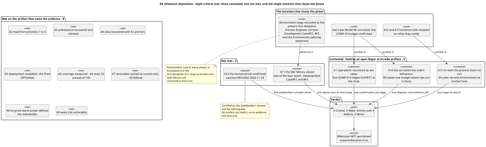

**What this consolidation records as settled.** Eight of the thirteen AR criteria are met on the artifact that owns each. The recovered set is not in question: eleven use cases, a 22-component architecture across four processes, and an eight-table data model, each resting on the file and lines it cites. Seven Major findings were cleared this iteration and verified at source rather than accepted from the artifacts' own text, and no finding is waived, deferred or recorded as closed on its owner's prose. The four exclusions the stakeholder ruled on stand untouched: external-provider sign-in is recovered and unreachable, the admin branch is an exceptional entity, and `EP-020`, `EP-021` and `EP-022` are not use cases.

**What it records as requiring work.** Four Major defects and three Minors, all corrections their owners make inside this phase, itemized in Resolutions and Actions. Three of the four Major defects sit on two artifacts, and one owner turn performs both Use-Case Model corrections. `Iteration Plan#F7` gates the rest: the plan records Environment as inactive in Excavation, so the stage on which `Development Case#F2` and `#F3` are corrected does not exist in it — the condition `R031` predicted and which has now materialized twice.

**The route — one iteration.** `Risk List#R031`'s contingency and the stakeholder's answer of 2026-11-23 both point to a single further iteration of this phase, performing actions 1 to 8, then gate H4 re-put once the recovered set agrees with itself. The stakeholder placed the Process Engineer's turn in that same iteration, so the phase closes in one iteration rather than two, and stated that Environment runs in every phase and is Excavation's first discipline with the Process Engineer's stage — not an exception to the process. A13's evidence cell cites that stage. No declared scope is cut or deferred to reach it.

**Disposition by artifact.**

| Artifact | Disposition |
|---|---|
| System Inventory | **Approved** — no open finding from any lens; coverage arithmetic recomputed and reproducing |
| Vision | **Approved** — both lenses' findings closed on verified evidence |
| Supplementary Specification | **Approved** — both Majors closed and verified at source |
| Software Architecture Document | **Approved** — Major closed and verified at source |
| Deployment Model | **Approved** — Major closed and verified at source |
| Design Model | **Approved** — Minor closed and verified |
| Risk List | **Approved with changes** — `#F3` open, one strategy cell behind the artifact it points at; holds no criterion |
| Use-Case Model | **Changes required** — `#F4`, `#F3` and the Management Reviewer's `#F1` open |
| Iteration Plan | **Changes required** — `#F6` and `#F7` open |
| Development Case | **Changes required** — `#F2` and `#F3` open, plus the Environment tailoring statement; the owner's stage is recorded in the next iteration |
| Iteration Assessment | **Not judged** — authored after this review; it cannot describe the iteration it follows |

**Stakeholder contribution — answered and recorded.** The stakeholder's answer to the routing question is folded into Findings as a stakeholder finding and into Resolutions and Actions as the due point of every action. A11 stays as written; the two Development Case Minors are corrected in the next iteration; A13's evidence cites the Environment stage, not an order. Nothing beyond what the stakeholder stated is recorded.
