## Document Control
### Reviewer lens
<!-- review: Survey I2 -->

<!-- review: Survey I2 -->

- Phase: Survey
- Status: Draft — technical lens of the end-of-Survey milestone review, iteration 2
- Milestone Target: end of Survey (SBC) — not yet achieved; the sanction has not been asked again
- Review type: Milestone review (SBC), technical lens — formal inspection against the artifact-type checklists
- Reviewed: Development Case, System Inventory, Risk List, Iteration Plan — all Survey, Draft, corrected in iteration 2
- Prior findings of this lens: 9 open at the previous milestone review, 9 closed here
- Findings recorded this iteration: 2, both Minor
- SCM evidence: no pull request in any state; no IARI build on `main`

### Management Reviewer lens
<!-- review: Survey I2 -->

<!-- review: Survey I2 -->

- Phase: Survey
- Status: Draft — governance lens of the end-of-Survey milestone review, iteration 2
- Milestone Target: end of Survey (SBC) — exit criteria met on this lens; sanction GRANTED by the stakeholder, 2026-11-19
- Review type: Milestone review (SBC), governance lens
- Reviewed: Development Case, System Inventory, Risk List, Iteration Plan — all Survey, Draft, corrected in iteration 2
- Prior findings of this lens: 3 Major open at the previous milestone review, 3 closed here
- Findings recorded this iteration: none from this lens
- Stakeholder sanction: GRANTED — the perimeter confirmed as drawn; advancing past SBC sanctioned
- Stakeholder order: the two Minor findings corrected in the next phase, not left unresolved
- Cross-artifact consequence carried from iteration 1: closed — `AN-008` and `R008` name the same two disclosure homes
- SCM evidence: no pull request in any state; no IARI build on `main`

### Review Coordinator lens
<!-- review: Survey I2 -->

<!-- review: Survey I2 -->

- Phase: Survey
- Status: Draft — consolidated coordination block of the end-of-Survey milestone review, iteration 2
- Milestone Target: end of Survey (SBC) — 0 open Critical, 0 open Major on both executing lenses, perimeter confirmed, Stakeholder sanction GRANTED; the phase advances and the Iteration Assessment follows this verdict
- Review type: Milestone review (SBC), consolidation of the executing lenses
- Lenses executed: Reviewer (technical), Management Reviewer (management)
- Lens not executed: Business Reviewer — INACTIVE, did not evaluate this review
- Verdict: Go — requiresIteration false; the 2 open Minor findings carried to the next phase under the stakeholder's order of 2026-11-19

## Review Scope and Criteria
### Reviewer lens
<!-- review: Survey I2 -->

<!-- review: Survey I2 -->

The SBC question is unchanged: is the material the whole recovery will rest on adequate? What changed is the subject of this pass. Iteration 2 is a correction pass, so the lens asks two things — whether each of the seven Major findings the previous pass recorded was in fact corrected, and whether the corrected content introduced a defect the correction itself created. Nothing was built in this iteration either: no code, no pull request, no build, so both questions are evidence questions.

| Artifact | Author | Checklist applied | Version reviewed |
|---|---|---|---|
| Development Case | Process Engineer | DC baseline conformance; optional-trigger justification; existence and validity of every referenced path; convention content with no file declared as such | Survey, Draft, corrected in iteration 2 |
| System Inventory | Software Archaeologist | Anchor verification — each high-consequence row opened against its file; Coverage arithmetic; internal consistency between Perimeter and anomalies; no use case claimed from an excluded entry point | Survey, Draft, corrected in iteration 2 |
| Risk List | Project Manager | Magnitude the band of probability × impact on the declared scale; every anomaly scored; acceptance verbatim for each High and Significant risk and consistent wherever the register restates it; every owning role at work in the phase its action lands in | Survey, Draft, corrected in iteration 2 |
| Iteration Plan | Project Manager | One committed total; no forecast before a measured actual; no span a reader can sum on any gate; the roster accounted for; no verdict the plan has no standing to give; each section stating its content once | Survey, Draft, corrected in iteration 2 |

#### What was opened, not merely read

The three anchors the corrected Perimeter claims rest on were opened this iteration and read against the claim. Each is the anchor for a statement that changed in the correction, so a claim that survived re-reading survives the whole set:

| Anchor opened | Claim it carries | Verdict |
|---|---|---|
| `Todo.Api/Users/UsersApi.cs` | `MapIdentityApi<TodoUser>()` publishes the stock identity surface; the custom `/users/token/{provider}` is the only endpoint added beside it | Confirmed — the seven self-service operations and the provider endpoint are as the Perimeter draws them |
| `Todo.Web/Server/AuthClient.cs` | Three calls only — `users/register`, `users/login`, `users/token/{provider}` — and no refresh call | Confirmed — `EP-003` has no caller, so no use case is recoverable from it |
| `Todo.Web/Server/Authentication/TokenNames.cs` | `AccessToken = "accessToken"` is the only token name the BFF holds | Confirmed — no refresh token is stored, so none can be redeemed |

The two other anchors the earlier pass's claims rest on were not re-opened: their claims did not change in this correction, and re-reading a file to confirm an unaltered sentence is spend without a delta.

#### What was checked as notation, not as illustration

Both gantt diagrams and the state machine were read as UML rather than as pictures. The two gantts carry a `lasts` declaration on every bar because PlantUML requires one, and every one of them reads zero — so the notation is valid while no bar states a duration a reader can sum. The state machine's transitions carry their guards. The Coverage and Perimeter diagrams type their components and label each dependency with its mechanism; the Risk List's handling diagram states the scale, the band arithmetic and the acceptance rule. None is a prose summary drawn as arrows.

#### SCM evidence

`scm_list_pull_requests` in any state returns nothing: there is no scaffolding to approve, no code to request changes on, and nothing to defer out of phase. That is correct for a phase that writes no code, and it is recorded here so no later reader mistakes the absence for an unexamined surface. `scm_get_build_status("main")` reports no IARI pipeline, correct for an iteration that builds nothing. No pull request, build, execution result, test count or duration is cited anywhere in this block, because none exists to cite.

Entry criteria for this review: the four artifacts in their corrected state — held; the prior findings available with their resolutions — held; the checklists per artifact type prepared before reading — held; the artifacts available in full to every lens — held.

### Management Reviewer lens
<!-- review: Survey I2 -->

<!-- review: Survey I2 -->

Review type: milestone review (SBC), governance lens. Subject: whether the seven Major defects of the previous milestone review were corrected, whether the artifact set now carries the evidence each SBC exit criterion rests on, and whether the perimeter as drawn is confirmed.

In scope: Development Case, System Inventory, Risk List, Iteration Plan — all Survey, Draft, corrected in Survey iteration 2.

Two tests are applied to each criterion, and a criterion is met only when it survives the stricter of them. The technical test asks whether a magnitude is the band of probability × impact on the IARI scale, whether a trigger decision holds against the project's real facts, and whether an anchor says what the row claims. The governance test, which is mine, asks whether every action the artifact set commits to can be executed by the role and in the phase it names, whether the phases that receive the tailoring can work under it, and whether any figure or forecast appears that the project has not measured.

```plantuml
@startwbs
title SBC exit criteria - what the governance lens tests, and the evidence it reads
skinparam shadowing false

* SBC milestone - governance lens
** C1 Perimeter confirmed
*** Test: did the stakeholder confirm the perimeter as drawn
*** Read: Perimeter, three exclusions, the sanction answer
** C2 Priorities ordered
*** Test: does each of the eight areas carry its reason
*** Read: Priorities; the declined Excavation split
** C3 Unread areas declared
*** Test: is every unread file named with its reason
*** Read: Coverage per-area rows
** C4 Anomalies scored, High ones accepted
*** Test: is every AN scored, and every acceptance in the stakeholder's words
*** Read: Risk Register; Risk Mitigation; the acceptance table
** C5 Tailoring issued and usable
*** Test: can the phases that work under it use it before they start
*** Read: Development Case; fine-plan item 1; the three Undocumented families
** C6 Roadmap and fine plan
*** Test: one committed total; no invented figure; no sized human gate
*** Read: coarse roadmap; fine plan; Measure and forecast
** Findings reconciled
*** Test: is every Major of the previous review closed on evidence
*** Read: read_artifact_findings, all four artifacts
@endwbs
```

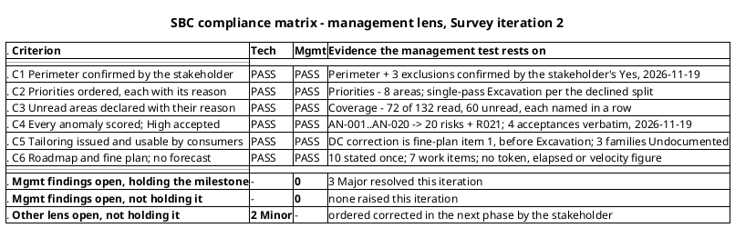

Entry criteria were verified before the review began: all four artifacts present and corrected, the Review Record's prior findings readable with their resolution state, and the process tailoring available for testing. No artifact was found mid-correction after the review opened.

SCM evidence: no pull request in any state and no IARI pipeline on `main`. Survey writes no code and builds nothing, so no build status, no pull request and no execution result is cited in this block — none exists to cite.

### Review Coordinator lens
<!-- review: Survey I2 -->

<!-- review: Survey I2 -->

The SBC milestone review ran over the four artifacts Survey produced: Development Case, System Inventory, Risk List, Iteration Plan — all Survey, Draft, corrected in iteration 2. This milestone reviewed nothing else: no build, no pull request, no code exists to review in Survey.

#### Lens participation — authoritative

| Lens | Status | What it recorded | Carried into the verdict |
|---|---|---|---|
| Reviewer (technical) | EXECUTED | 2 findings this iteration, both Minor; 9 findings of the previous milestone review closed on corrected content; Approved on Development Case and System Inventory, Approved with Changes on Risk List and Iteration Plan | Yes |
| Business Reviewer (business) | **INACTIVE — did not evaluate this review** | No finding, no verdict | No — no verdict is inferred from its silence |
| Management Reviewer (management) | EXECUTED | No finding raised this iteration; its 3 Major findings of the previous milestone review closed on evidence in the artifacts; sanction asked and GRANTED by the stakeholder 2026-11-19 | Yes |

Two lenses of three evaluated this milestone. The Business Reviewer's absence is recorded as INACTIVE and nothing else: it is not an approval, not a refusal, and no finding is attributed to it. Its first due milestone in this project's process is LCO, where the business lens joins the sanctioned sequence. No SBC exit criterion is a business-value question — criteria 1 to 6 are perimeter, priorities, unread coverage, risk scoring, tailoring and roadmap — so its absence leaves no criterion unevaluated.

#### Entry criteria applied to this milestone review

| Entry criterion | Held? |
|---|---|
| All four artifacts in their target state — corrections applied, not drafted mid-review | Yes — each is Draft at iteration 2 with the corrections its owner made in place |
| Reviewers assigned with expertise matched to the artifact domain | Yes — per-artifact-type technical checklists, plus the management lens on governance and evidence |
| Evaluation criteria and the prior finding ledger available to every lens before reading | Yes — four checklists recorded in each lens's scope block; `read_artifact_findings` carried all 14 findings with their resolution state |
| Artifacts available to every lens in full | Yes — the four artifacts are the whole of the Survey artifact set |
| The stakeholder's order of 2026-11-19 in force before the review opened | Yes — "All major findings must be corrected" was the subject of the pass |

#### The six SBC exit criteria, and which lens substantiated each

Counted from the two executing lens blocks. A criterion is met only when it survives both tests; that is the rule this consolidation applied at the previous milestone review and applies unchanged here.

| Criterion | Evidence | Technical lens | Management lens | Status |
|---|---|---|---|---|
| C1 — Perimeter confirmed by the stakeholder | System Inventory — Perimeter: 7 projects of TodoApp.sln plus the CI workflow, 26 entry points, 3 exclusions each anchored | Pass | Pass — confirmed on the stakeholder's Yes of 2026-11-19 | **Met** |
| C2 — Priorities ordered for the remaining recovery | System Inventory — Priorities: eight areas, each with its reason and anchor | Pass | Pass | **Met** |
| C3 — Unread areas declared with their reason | Coverage: 72 of 132 files read, 60 unread, each named in a row | Pass — aggregate reconciles with its own rows | Pass | **Met** |
| C4 — Every anomaly a scored risk; High and Significant ones accepted in the stakeholder's words | 20 anomalies → 20 risks plus R021; four acceptances verbatim, 2026-11-19 | Pass | Pass — every action executable by the role and phase it names; R021 bounds the gate | **Met** |
| C5 — Tailoring issued and usable by the phases that consume it | Development Case; fine-plan item 1 sequencing the correction before Excavation; three convention families Undocumented with no fallback asserted | Pass | Pass | **Met** |
| C6 — Roadmap and fine plan; no invented forecast, no sized human gate | `2 + 1 + 1 + 1 + 2 + 2 + 1 = 10` stated once; every gantt bar a zero span; no token, elapsed or velocity figure | Pass | Pass | **Met** |

Six of six met. The three that failed at the previous milestone review — C1, C4, C5 — are met here on the same tests, because the findings that failed them are closed on the corrected content, not waived.

#### Review calendar — every event, to the workflow activity that triggers it

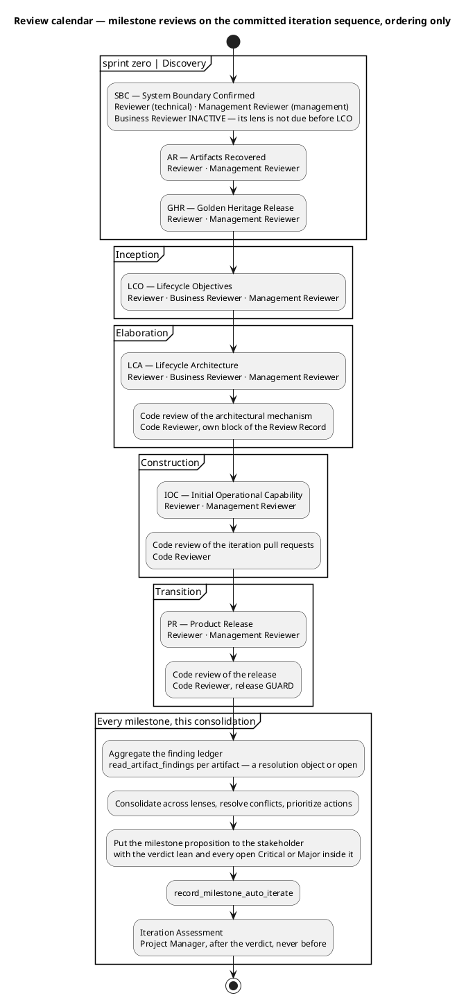

Seven milestone reviews sit on the roadmap, one per milestone, each triggered by its workflow activity and none scheduled on a calendar date. Each milestone's ledger is aggregated from `read_artifact_findings` rather than from the previous Review Record's prose, because a finding is open unless it carries a resolution object. The Iteration Assessment follows the verdict and never precedes it.

#### Consolidated finding ledger

Fourteen findings are on record across the two executing lenses. Twelve carry a resolution object and are closed; two do not and are open. The ledger below is read from `read_artifact_findings` on the four artifacts, not from either lens's narrative.

| # | Artifact | Key | Lens | Severity | Owner | State | What the corrected content says |
|---|---|---|---|---|---|---|---|
| 1 | Development Case | F1 | Reviewer | Major | Process Engineer | Closed | Templates rows re-pointed at five files that exist, each attributed by path and owner; coding standards, UI patterns and test conventions recorded Undocumented with no fallback asserted |
| 2 | Development Case | F2 | Reviewer | Minor | Process Engineer | Closed | The stale "no Risk List exists yet" clause removed; the PoC verdict rests on the phase requirement alone, second clause judged at Elaboration |
| 3 | System Inventory | F2 | Reviewer | Major | Software Archaeologist | Closed | Perimeter `/users` row agrees with AN-015 — registration and login are called, `/users/refresh` is called by nothing, no use case recovered from `EP-003` |
| 4 | System Inventory | F1 | Reviewer | Minor | Software Archaeologist | Closed | Aggregate stated as the sum of the Read column — 72 of 132 files, 60 unread, every unread file named in a row with its reason |
| 5 | Risk List | F1 | Reviewer | Major | Project Manager | Closed | Six Excavation actions re-owned to the System Analyst; R014's control part moved to Inception; closing paragraph states the role-phase mapping once |
| 6 | Risk List | F1 | Management Reviewer | Major | Project Manager | Closed | R021 scored Significant (12), strategy accept, mitigation, owning role, trigger indicator and the 14-day contingency |
| 7 | Risk List | F2 | Management Reviewer | Major | Project Manager | Closed | R008's Construction mitigation re-homed to the User Documentation that stage produces; AN-008 names the same two disclosure homes |
| 8 | Iteration Plan | F1 | Reviewer | Major | Project Manager | Closed | `2 + 1 + 1 + 1 + 2 + 2 + 1 = 10`, stated once in the roadmap; the conditional "8 or 9" phrasing deleted |
| 9 | Iteration Plan | F1 | Management Reviewer | Major | Project Manager | Closed | Development Case correction is fine-plan item 1, Process Engineer, sequenced before Excavation |
| 10 | Iteration Plan | F2 | Reviewer | Minor | Project Manager | Closed | Verdict column replaced by "Evidence this plan supplies" and "What the review judges" |
| 11 | Iteration Plan | F3 | Reviewer | Minor | Project Manager | Closed | Profile reads "six agent roles plus the stakeholder gate"; all twenty absent roles carry a stated reason |
| 12 | Iteration Plan | F4 | Reviewer | Minor | Project Manager | Closed | Day lengths removed from both gantts; every bar `lasts 0 day`, both titles ordering only |
| 13 | Risk List | F2 | Reviewer | Minor | Project Manager | **Open** | The trailing "R021 — offered for acceptance" block states the risk stays open until the answer is recorded, while the acceptance table and the Register row record the answer "Yes" of 2026-11-19 |
| 14 | Iteration Plan | F5 | Reviewer | Minor | Project Manager | **Open** | The opening block of Plan and Milestones duplicates its Measure and forecast subsection verbatim, including the forward reference "the ten iterations above" before the roadmap that states the ten |

**Totals: Critical 0 · Major 0 open · Minor 2 open.** Severity is the evaluating lens's, unchanged by this consolidation; no lens downgraded or upgraded another's grading, and there is no severity conflict to arbitrate.

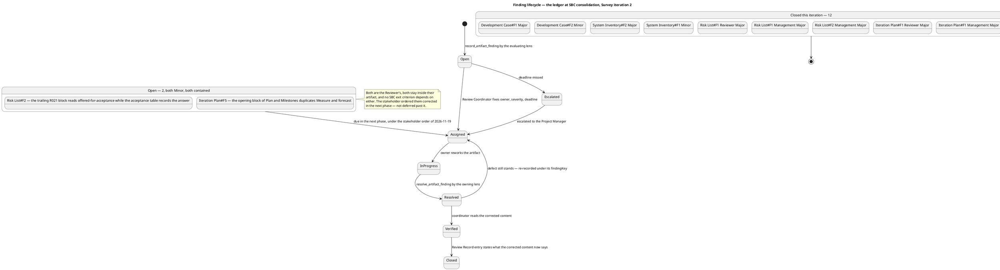

#### Conflicts across the executing lenses, and how each resolves

| # | The disagreement | Resolution |
|---|---|---|
| 1 | **Same key, two defects.** `Risk List#F1` and `Iteration Plan#F1` each carried two findings under one key in the previous milestone review. | Both were kept open and both were the Project Manager's; the ledger above distinguishes them by the Lens column, which is the only way these keys are unique. All four are now closed. |
| 2 | **Overlapping defect or two defects?** `Development Case#F1` defined the tailoring correction; `Iteration Plan#F1` Management scheduled it. | Two defects, two owners, closed in a fixed order: the Development Case first because it specifies, the plan second because it schedules. Both closed in that order this iteration. |
| 3 | **The same criterion passed by one lens and failed by the other.** At the previous milestone review C4 and C5 passed the technical lens and failed the management lens. | Not a contradiction then and not one now — two different tests on one criterion. The technical lens audits magnitude, anchors and trigger decisions; the management lens audits executability by the role and in the phase named. **The stricter test governs**, and both now return Pass on both criteria. |
| 4 | **Artifact disposition vs milestone verdict.** The technical lens records Approved on two artifacts and Approved with Changes on two; the management lens records Approved. | Both stand at their own levels. The technical lens's "with Changes" on Risk List and Iteration Plan is correct: their substance survives while one Minor claim inside each does not. The milestone verdict is mine and it is Go, because a Minor finding holds neither its artifact's consumption nor an exit criterion. |
| 5 | **No severity was disputed.** Neither lens downgraded or upgraded the other's grading, in either iteration. | Accepted as recorded. Both lenses agreed on what stops consumption and what stays inside an artifact, and the split is exactly right: every finding that stopped consumption was graded Major. |
| 6 | **A lens's order against a lens's verdict.** The stakeholder ordered the two Minor findings corrected in the next phase while sanctioning advancement past SBC. | No conflict — the order sets a deadline, it does not withhold the sanction. Both are applied: the milestone advances, and the two findings carry a deadline in the next phase, recorded in Resolutions and Actions. |

One cross-artifact consequence from the previous milestone review is closed on both sides and needs no further action: `R008` and `AN-008` name the same two disclosure homes — the System Analyst's note beside the recovered update use case in Excavation, and the User Documentation the Technical Writer produces in Construction — with `AN-008` stating expressly that the Release Notes are not its home.

#### Why Go rather than Conditional

A Conditional would advance the phase while the conditions were discharged later, and the previous milestone review rejected exactly that form for exactly the right reason: opening Excavation on a Perimeter row its own anomaly contradicted, and on avoidance actions owned by roles not at work, would have put recovered use cases on content another role acts on wrongly. That defect class is now empty. The two findings that remain are `contained-defect`: the duplicated passage carries no claim a downstream role consumes, and the trailing `R021` block contradicts its own section's acceptance table rather than any statement another artifact rests on. The acceptance of `R021` itself is recorded verbatim in the acceptance table and in the Register row, so the wording that contradicts it blocks nothing. Correcting both is ordered by the stakeholder and due in the next phase; treating them as a phase-gate condition would hold a milestone on two wordings, which is not what the finding levels mean.

## Findings
### Reviewer lens
<!-- review: Survey I2 -->

<!-- review: Survey I2 -->

Survey iteration 2 is a correction pass: its subject is whether the seven Major findings of the previous milestone review were in fact corrected. Each artifact is entered below against the checklist that governs it, with the finding that was open against it and what the corrected content now says.

#### Development Case

| Checklist item | Result |
|---|---|
| No FORBIDDEN override of the IARI DC baseline — roster, CORE ownership, CORE omissions, artifact universe, role merging | Pass |
| OPTIONAL trigger FIRED only where its §5.2 condition genuinely holds | Pass — Deployment Model alone is fired, on a three-service Aspire topology with per-project settings and a forwarder |
| Every referenced path exists in the repository | Pass — the four tool-configuration paths and `.github/workflows/ci.yaml` all resolve |
| Convention content with no file in the repository is declared as such, with no fallback asserted | Pass |
| Cross-cutting mechanisms held out of the use-case model | Pass — authentication, registration, token issue, rate limiting, proxying and telemetry are Supplementary Specification constraints, each `<<include>>`d |
| Co-owned artifact sections assigned to one owner each | Pass — Design Model split three ways, SAD sole |

Development Case#F1 and #F2 are corrected; the resolutions are recorded in Resolutions and Actions. No defect remains in this artifact from this lens.

#### System Inventory

| Checklist item | Result |
|---|---|
| Every high-consequence fact about the existing system rests on a file that says what the row claims | Pass — three anchors re-opened this iteration against the corrected `/users` rows and all three confirm them |
| No perimeter row carries a size or count without its anchor | Pass |
| Coverage reconciles with its own per-area rows, and every unread file carries a reason | Pass — Files 132, Read 72, unread 60, stated once as the sum of the Read column |
| No top-level area of the tree left neither described nor declared unread | Pass |
| Each of the three exclusions traced to the stakeholder's answer, and no use case claimed from an excluded entry point | Pass — `EP-011`, `EP-020`, `EP-021`, `EP-004` … `EP-010` |
| One statement of whether `EP-003` supports a use case, and no contradiction between Perimeter and anomalies | Pass — the Perimeter states it once and `AN-015` carries the same fact |

The anchors opened this iteration, against the corrected claim:

| Anchor opened | Claim it now carries | Verdict |
|---|---|---|
| `Todo.Api/Users/UsersApi.cs` | `MapIdentityApi<TodoUser>()` publishes the stock surface; the custom `/users/token/{provider}` is the only added endpoint | Confirmed — the seven excluded operations and the excluded provider endpoint are as the Perimeter draws them |
| `Todo.Web/Server/AuthClient.cs` | Exactly three calls — `users/register`, `users/login`, `users/token/{provider}`; no refresh call | Confirmed — no caller for `EP-003` |
| `Todo.Web/Server/Authentication/TokenNames.cs` | `AccessToken = "accessToken"` is the only token name the BFF holds | Confirmed — no refresh token is stored, so none can be redeemed |

System Inventory#F1 and #F2 are corrected. No defect remains in this artifact from this lens.

#### Risk List

| Checklist item | Result |
|---|---|
| Magnitude is the band of probability × impact on the declared IARI scale, not a scale of the artifact's own | Pass — R021 at 3 × 4 = 12, Significant |
| Every anomaly of the System Inventory is a scored risk | Pass — `AN-001` … `AN-020` |
| Every High or Significant acceptance rests on the stakeholder's own words, recorded verbatim with its date | Pass — four acceptances, each quoted |
| Every avoidance action names a role at work in the phase the action lands in | Pass — the six Excavation actions re-owned to the System Analyst; R014's control part moved to Inception where the ledger opens |
| The project's own binding constraint is bounded in the register, not only in the plan | Pass — R021 |
| A mitigation lands in the stage that produces the artifact it names | Pass for R008 — the User Documentation the Technical Writer produces in Construction |
| The register's statements about one acceptance agree with each other | **Fail** — Risk List#F2 |

**Risk List#F2 (Minor, `contained-defect`).** The closing "R021 — the stakeholder gate, offered for acceptance" block states the risk "stays OPEN until their answer is recorded here verbatim, with its date", lists three conditions said to hold "until then", and heads itself "offered for acceptance" — while the acceptance table in the same section records R021 at Significant (12) with the answer "Yes" dated 2026-11-19, and the Register row reads "Accept — granted by the stakeholder, 2026-11-19". Two statements of one fact sit in one section and disagree. A reader testing SBC exit criterion 4 reaches "pending" from the block and "granted" from the table and cannot tell which governs. **Remediation:** delete the trailing block, or restate it as the statement of the mitigation in force after the answer of that date; the answer itself is recorded once, in the acceptance table where the other three grants sit.

#### Iteration Plan

| Checklist item | Result |
|---|---|
| One committed total, stated once | Pass — `2 + 1 + 1 + 1 + 2 + 2 + 1 = 10`, in the roadmap only |
| No forecast, no velocity, no size before a measured actual exists | Pass |
| No human gate carries an estimate or a span a reader can sum | Pass — every bar reads `lasts 0 day` |
| Exit criteria judged against evidence, with no verdict the plan has no standing to give | Pass — the columns read "Evidence this plan supplies" and "What the review judges" |
| Every role of the active roster either scheduled or given a stated reason for absence | Pass — six execute, one human gate, twenty with reasons |
| The tailoring the plan's consumers depend on is corrected before they start | Pass — the Development Case correction is fine-plan item 1, sequenced first |
| No stage scheduled that the IARI process does not run in the phase | Pass |
| A section states its own content once | **Fail** — Iteration Plan#F5 |

**Iteration Plan#F5 (Minor, `contained-defect`).** The opening block of "Plan and Milestones" duplicates its "Measure and forecast" subsection verbatim: the no-forecast paragraph, the `6 ± 3` ceiling paragraph, the budget-position table carrying the stakeholder's answer, and the two-clock table all appear twice in one section. The duplicate also carries a forward reference it cannot support — "The ten iterations above are a count of iterations" sits above the roadmap that states the ten. **Remediation:** delete the opening block and let the section open with "Coarse roadmap"; the duplicated matter stays once, in Measure and forecast, where "the ten iterations above" correctly refers to the roadmap.

#### SCM evidence

`scm_list_pull_requests` in any state returns nothing, so there is no scaffolding to approve, no code to request changes on, and nothing to defer out of phase — correct for a phase that writes no code. `scm_get_build_status("main")` reports no IARI pipeline, correct for an iteration that builds nothing. No pull request, build or execution result is cited anywhere in this block, because none exists.

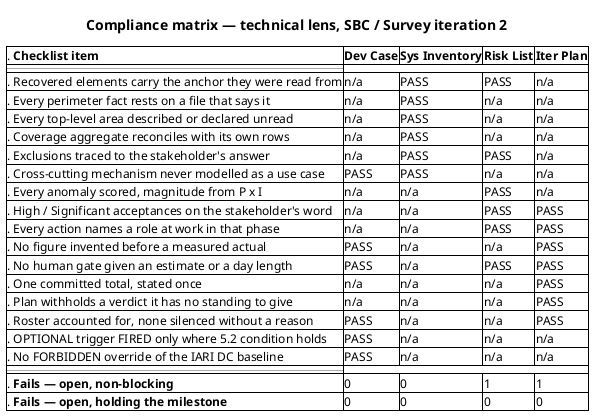

### Management Reviewer lens
<!-- review: Survey I2 -->

<!-- review: Survey I2 -->

This lens raises no defect against the artifact set in this iteration. The three Major findings it carried into the correction pass are corrected, and no artifact now holds content another role would act on wrongly.

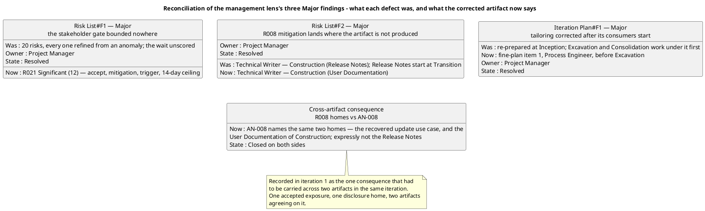

What each artifact now carries on the governance test:

| Artifact | The test this lens applies | Result |
|---|---|---|
| Development Case | No FORBIDDEN override; every optional verdict holds against the project's facts; the tailoring names only sources that exist | Pass — `CONTRIBUTING.md` is gone from the Templates rows, and coding standards, UI patterns and test conventions are recorded Undocumented with no fallback asserted |
| System Inventory | Each of the three exclusions sits where the stakeholder's answer put it; no use case claimed from an excluded entry point; every anomaly of the exposure it records has a scored risk | Pass — `AN-008` names the same two disclosure homes as `R008` |
| Risk List | Every action names a role at work in the phase it lands in; every High and Significant acceptance rests on the stakeholder's own words; the only external dependency is scored | Pass — `R021` is the gate, bounded at 14 days, accepted 2026-11-19 |
| Iteration Plan | One committed total stated once; the tailoring correction scheduled before its consumers; no figure the project has not measured; no human gate given a span | Pass — 10 stated once, fine-plan item 1 is the Development Case correction, every bar a zero span |

The two Minor findings the technical lens raises this iteration — `Risk List#F2` and `Iteration Plan#F5`, both `contained-defect` — stay inside their artifacts: no other role builds on the duplicated passage or on the trailing `R021` block, and no SBC criterion depends on either. They are recorded against their owner and neither holds this milestone.

### Review Coordinator lens
<!-- review: Survey I2 -->

<!-- review: Survey I2 -->

This consolidation mints no finding. Every finding in the ledger was recorded by the lens that evaluated the defect, and this block adds no defect of its own: coordination records what the lenses found, assigns it, and counts it.

#### What the two executing lenses found together

Fourteen findings across four artifacts, in two milestone reviews of Survey. Twelve closed, two open, no Critical in either. The previous milestone review ran on the artifacts as first issued; this one ran on the corrected content.

| Review event | Findings recorded | Critical | Major | Minor | Closed at the event's close |
|---|---|---|---|---|---|
| Survey I1 — SBC milestone review, first pass | 12 | 0 | 7 | 5 | 0 — the stakeholder refused the sanction with the order to correct all Major findings |
| Survey I2 — SBC milestone review, correction pass | 2 | 0 | 0 | 2 | 12 of the previous pass, both new ones open |
| **On record at this consolidation** | **14** | **0** | **0 open** | **2 open** | **12** |

The correction pass records fewer findings than the pass it corrected. That is the expected shape: a lens that finds as much in corrected content as in first-issued content is not correcting anything, and a lens that finds nothing is not reading. Two contained defects in two independently reworked artifacts is a correction pass that worked.

#### Defect density — counted from the ledger

| Artifact | Findings | Major | Minor | Crit. | Density (findings/artifact) |
|---|---|---|---|---|---|
| Development Case | 2 | 1 | 1 | 0 | 2.00 |
| System Inventory | 2 | 1 | 1 | 0 | 2.00 |
| Risk List | 4 | 3 | 1 | 0 | 4.00 |
| Iteration Plan | 6 | 2 | 4 | 0 | 6.00 |
| **Total** | **14** | **7** | **7** | **0** | **3.50 mean** |

Density per page is **not reported**: no lens measured the page count of the four artifacts, and a density computed on an unmeasured denominator would be invented. The figures above are counted entries from `read_artifact_findings`, not estimates.

The Iteration Plan carries the largest load and the only Minor cluster — 4 of its 6 findings are Minor, and both defects that remain open land there or in the Risk List's acceptance section. Both artifacts are the Project Manager's, and both were issued before the tailoring they must carry was stable. That is one signal observed twice, not a trend: two review events are not a series, and this report draws none.

#### Review effectiveness — current metrics only

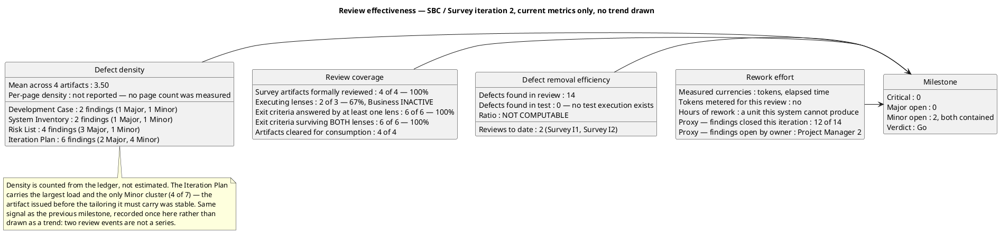

| Coverage measure | Value | Basis |
|---|---|---|
| Survey artifacts receiving formal review | 4 of 4 — **100%** | All four artifacts of the phase were in scope of both executing lenses |
| Executing lenses | 2 of 3 — **67%** | Business Reviewer INACTIVE; not due before LCO |
| Exit criteria evaluated by at least one lens | 6 of 6 — **100%** | Every criterion answered by a lens, none left to inference |
| Exit criteria substantiated by **both** executing lenses | 6 of 6 — **100%** | Up from 3 of 6 at the previous milestone review |
| Anchors opened rather than trusted, this pass | 3 opened, 3 confirmed | `UsersApi.cs`, `AuthClient.cs`, `TokenNames.cs` — each re-read against the claim the correction changed |
| Artifacts cleared for consumption | **4 of 4** | Up from 0 of 4 |

Two metrics are not computable at this milestone and neither is estimated here:

- **Defect removal efficiency** compares defects found in review against defects found in test. Survey produces no code and no test execution — the denominator is zero, not small. The first review-versus-test comparison becomes available when Construction test execution exists.
- **Rework effort** is measurable only in tokens and elapsed time. Neither was metered for this review, and hours of rework is a unit this system cannot produce. The proxy carried forward is the count of open findings by owner, and it is exact: Project Manager 2.

#### What the data says without a comparison

1. **The correction pass closed every finding that stopped consumption.** Seven of seven Majors closed, on corrected content each verified by reading the section that carried it. Nothing was closed on an owner's description alone, and nothing was closed as Deferred or Rejected.
2. **The two findings that remain are both `contained-defect`.** Neither names a claim another role builds on, and neither fails an SBC exit criterion. That is why the milestone does not need a third iteration.
3. **The artifact that failed most at the previous milestone review improved most.** The Iteration Plan carried 5 of 12 findings and 2 of 7 Majors then; it now carries 0 Major open and 2 Minor open, one of them new and created by the correction itself (duplicated block).

## Resolutions and Actions
### Reviewer lens
<!-- review: Survey I2 -->

<!-- review: Survey I2 -->

Nine findings of this lens were open against four artifacts at the previous milestone review. All nine are closed here, each on the corrected content and each with the `resolve_artifact_finding` call that moved its state. Two new contained defects were found in the corrected content and are recorded open.

#### Closed by this lens

| Finding | Was | What the corrected content now says | Where it was checked |
|---|---|---|---|
| Development Case#F1 (Major) | Three convention families pointed at `CONTRIBUTING.md`, absent from the repository | Five tool-configuration files attributed by path and owner; coding standards, UI patterns and test conventions recorded as Undocumented with no fallback asserted, bound only by what the build enforces | Artifacts and Templates — Guideline content table and its diagram |
| Development Case#F2 (Minor) | PoC trigger row rested partly on "no Risk List exists yet" | The phase requirement alone is the basis; the second clause is judged at Elaboration against the Risk List as it then stands | Optional Artifact Triggers — Architectural Proof-of-Concept row |
| System Inventory#F2 (Major) | Perimeter `/users` row said the product uses token refresh; `AN-015` said nothing redeems a token | Perimeter states the product reaches registration and login, `EP-003` is published with no caller, and no use case is recovered from it; the Components row references that statement rather than contradicting it | Perimeter text, Components table, Entry points `EP-003` row |
| System Inventory#F1 (Minor) | Coverage aggregate off by one and its four-category breakdown omitted two files | Aggregate stated as the sum of the Read column: 72 of 132, 60 unread, every unread file named in a row with its reason | Coverage — per-area table; Files column sums to 132, Read column to 72 |
| Risk List#F1 (Major) | Six Excavation actions owned by the Requirements Specifier, which does not work in the sprint zero; R014 also named the Change Control Manager there | The six re-owned to the System Analyst; the Software Architect's Excavation parts kept; R014's control part moved to Inception where the ledger opens; the section closes with the role-phase mapping stated once | Risk Mitigation and Contingency — owning-role column and its closing paragraph |
| Iteration Plan#F1 (Major) | Two committed totals — 9 in the roadmap, "8 or 9" in Evaluation Criteria | `2 + 1 + 1 + 1 + 2 + 2 + 1 = 10`, stated once, in the roadmap; Elaboration's second iteration committed unconditionally | Plan and Milestones — coarse roadmap and profile bullets |
| Iteration Plan#F2 (Minor) | Evaluation Criteria returned a verdict in a Status column the plan disclaimed | The column now reports "Evidence this plan supplies" and "What the review judges" | Evaluation Criteria — table headers and opening paragraph |
| Iteration Plan#F3 (Minor) | Profile said six roles while seven rows read "Yes"; five roles unaccounted for | "Six agent roles plus the stakeholder gate"; all twenty absent roles carry a stated reason | Resources — assignment profile and the not-at-work table |
| Iteration Plan#F4 (Minor) | Every gantt bar carried a one-day length, the seven gates included — 16 days a reader could sum | Every bar reads `lasts 0 day`, both titles read "ordering only", and each note states no bar is a forecast of duration | Plan and Milestones — both gantt diagrams |

#### Open, recorded this iteration

| Finding | Owner | What closes it | Holds the milestone |
|---|---|---|---|
| Risk List#F2 (Minor) | Project Manager | The trailing "R021 — offered for acceptance" block deleted, or restated as the mitigation in force after the answer of 2026-11-19 | No |
| Iteration Plan#F5 (Minor) | Project Manager | The duplicated opening block of Plan and Milestones deleted, leaving the matter once in Measure and forecast | No |

Both are contained defects: no other role builds on the duplicated paragraph or on the pending-sounding restatement, and no SBC exit criterion depends on either. The acceptance of R021 itself is not in doubt — it is recorded verbatim in the acceptance table and in the Register row — so nothing downstream is blocked by the wording that contradicts it.

#### Closure state at this milestone

| | Count |
|---|---|
| Critical open, this lens | 0 |
| Major open, this lens | 0 |
| Minor open, this lens | 2 |
| Closed by this lens this iteration | 9 |

No resolution here cites a stakeholder answer it does not have. Every one rests on content read in the artifact, and the two defects left open are named with the section that carries them.

### Management Reviewer lens
<!-- review: Survey I2 -->

<!-- review: Survey I2 -->

The three Major findings this lens carried into the correction pass are closed, each by a `resolve_artifact_finding` call against the evidence in the corrected artifact. Nothing is closed on the strength of the owner's description alone.

| Finding | Severity | Criterion | Closed by | The evidence the closure rests on |
|---|---|---|---|---|
| `Risk List#F1` (management lens) | Major | `consumed-defect` | Resolved | `R021` is scored at Significant (12 — probability 3 × impact 4), strategy accept, with a mitigation (every question put in the round that raises it, with the recommended answer and the open findings inside it, and no milestone verdict before the answer), an owning role at work in every phase, a trigger indicator and the 14-day contingency. The plan's Measure and forecast row now names `R021` rather than describing the gate as already recorded. |
| `Risk List#F2` (management lens) | Major | `consumed-defect` | Resolved | `R008`'s mitigation reads "System Analyst — Excavation; Technical Writer — Construction (User Documentation)". User Documentation is the artifact the Construction Deployment stage produces. The section states the disclosure home once, at the two places the process produces it. |
| `Iteration Plan#F1` (management lens) | Major | `consumed-defect` | Resolved | Development Case correction is fine-plan item 1, owned by the Process Engineer and sequenced before Excavation. The Resources table records that role at work in Survey iteration 2 running the sprint-zero correction stage. The "no finding or Change Request demands a tailoring change yet" clause is gone. |

One cross-artifact consequence recorded in the previous review is closed on both sides: `R008` and `AN-008` now name the same two disclosure homes — the System Analyst's note beside the recovered update use case, and the User Documentation the Technical Writer produces in Construction — and `AN-008` states expressly that the Release Notes are not its home.

No finding is closed as Deferred and none as Rejected. The stakeholder's order of 2026-11-19 — "All major findings must be corrected" — was carried out rather than deferred.

```plantuml
@startgantt
title Management lens - the three closures and what each one releases, ordering only
skinparam shadowing false

[Risk List - R021 scored and accepted] lasts 0 day
[Risk List - R008 homed at User Documentation] lasts 0 day
[Iteration Plan - DC correction sequenced first] lasts 0 day
[AN-008 agrees with R008 - cross-artifact consequence] lasts 0 day
[All six SBC criteria pass both lenses] lasts 0 day
[Stakeholder sanction of SBC] lasts 0 day

[Risk List - R008 homed at User Documentation] starts at [Risk List - R021 scored and accepted]'s end
[Iteration Plan - DC correction sequenced first] starts at [Risk List - R008 homed at User Documentation]'s end
[AN-008 agrees with R008 - cross-artifact consequence] starts at [Iteration Plan - DC correction sequenced first]'s end
[All six SBC criteria pass both lenses] starts at [AN-008 agrees with R008 - cross-artifact consequence]'s end
[Stakeholder sanction of SBC] starts at [All six SBC criteria pass both lenses]'s end

[SBC] happens at [Stakeholder sanction of SBC]'s end

note bottom
  Every bar is a zero span - ordering only, no duration and no date.
  The three closures are independent of each other; the sequence shown
  is the order this lens verified them in. The sanction is a human wait,
  carried as R021 with its 14-day ceiling.
end note
@endgantt
```

The two Minor findings open against the artifact set are the technical lens's, and this lens does not duplicate them: `Risk List#F2` (the trailing `R021` block still reads "offered for acceptance" while the acceptance table records the answer) and `Iteration Plan#F5` (the opening block of Plan and Milestones duplicates its Measure and forecast subsection). Neither touches an SBC criterion and neither is consumed by another role.

### Review Coordinator lens
<!-- review: Survey I2 -->

<!-- review: Survey I2 -->

Every finding in the ledger carries an owner, a severity and a deadline fixed here. Deadline is stated as the phase in which the correction lands, not as a calendar date: no phase has closed, no spend has been measured, and a date derived from an estimate would read downstream as an observation.

#### Action items, prioritized

Twelve findings are closed and need no action. The two that remain open are the work order of this consolidation, and both are the Project Manager's.

| Priority | Finding | Lens | Severity | Owner | Deadline | Holds the milestone |
|---|---|---|---|---|---|---|
| 1 | Risk List#F2 | Reviewer | Minor | Project Manager | Excavation — the next phase, under the stakeholder's order of 2026-11-19 | No |
| 2 | Iteration Plan#F5 | Reviewer | Minor | Project Manager | Excavation — the next phase, under the stakeholder's order of 2026-11-19 | No |

What closes each, stated so the owner executes a correction and not a discussion:

| Finding | The corrective action | Where the correction lands |
|---|---|---|
| Risk List#F2 | Delete the trailing "R021 — the stakeholder gate, offered for acceptance" block, or restate it as the statement of the mitigation in force after the answer of 2026-11-19. The answer itself stays stated once, in the acceptance table where the other three grants sit. | Risk Mitigation and Contingency — the trailing block; the acceptance table is left as it stands |
| Iteration Plan#F5 | Delete the opening block of "Plan and Milestones" and let the section open with "### Coarse roadmap". The no-forecast paragraph, the `6 ± 3` explanation, the budget-position table and the two-clock table stay once, in "### Measure and forecast". | Plan and Milestones — opening block only; nothing else in the section moves |

Both deadlines are the next phase because the stakeholder set them, not because the process chose to defer. The order is: "Minor findings must be corrected in the next phase; they cannot be left unresolved." A Minor finding is normally the owner's turn after Critical and Major, in the phase it was raised; the stakeholder's order removes the option of its carrying past Excavation.

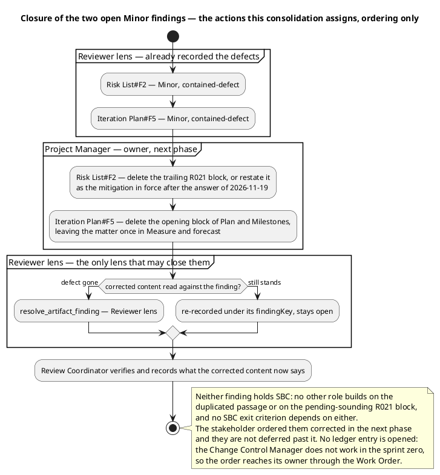

#### Closure protocol for the two open findings

Each is closed by two acts, in this order:

1. the Reviewer — the lens that raised it, and the only lens that may close it — calls `resolve_artifact_finding` after reading the corrected content against the finding;
2. this Review Record gains an entry stating what the corrected content says.

A defect that still stands after rework is re-recorded under its `findingKey` and stays open; it is not duplicated under a new key.

#### Load per owner

| Owner | Open findings | Major | Minor | At work in the phase the action lands in |
|---|---|---|---|---|
| Project Manager | 2 | 0 | 2 | Yes — its Excavation stage produces exactly the Risk List and the Iteration Plan |
| Process Engineer | 0 | 0 | 0 | — closed its 2 this iteration |
| Software Archaeologist | 0 | 0 | 0 | — closed its 2 this iteration |

No finding is assigned to a role that does not work in the phase named, and none to a role outside the active roster. That defect class — the one `Risk List#F1` recorded in the previous milestone review — is empty.

#### Escalation register

| Item | Status |
|---|---|
| Open Critical findings | None — 0. No stakeholder escalation is raised by this consolidation. |
| Overdue findings | None. Twelve closed on their deadline of Survey iteration 2; the two that remain carry the next phase as their deadline by the stakeholder's order. |
| Non-compliance with procedure | None observed — all four artifacts were issued, all were reviewed by the lenses due at SBC, and both executing lenses recorded a disposition. |
| Systemic process failure | None raised to the Change Control Management Board at this milestone. The pattern noted at the previous review — artifacts issued before their upstream settled — did not recur in the correction pass: no corrected artifact contradicts another, and the one cross-artifact consequence (`R008` / `AN-008`) is closed on both sides. |

#### Stakeholder orders carried out of this milestone

Recorded here so no owner treats them as optional. Both are the stakeholder's own answers of 2026-11-19, and neither is a finding this review minted.

| Order | Where it lands |
|---|---|
| "All major findings must be corrected." | Executed — seven of seven Majors closed this iteration, each on corrected content, each by the lens that raised it |
| "Minor findings must be corrected in the next phase; they cannot be left unresolved." | The two findings at priorities 1 and 2, due in Excavation. Neither may be carried past it |
| The perimeter confirmed as the System Inventory records it — 7 projects plus the CI workflow, 26 entry points, the three exclusions of 2026-11-19 | Unchanged by both corrections. `System Inventory#F2` corrected an internal contradiction in the Perimeter's own wording; it altered no boundary, added no entry point and reopened no exclusion |
| R021 accepted at Significant (12), with its mitigation and its 14-day ceiling | In force on each of the seven roadmap milestones; the Project Manager puts every stakeholder question with its recommended answer and the open findings inside it |

The stakeholder sanctioned advancing past SBC on 2026-11-19. That sanction confirms the perimeter and advances the phase; it does not retire the two Minor findings, and it does not convert them into Accepted. They are corrective obligations with a deadline.

## Disposition
### Reviewer lens
<!-- review: Survey I2 -->

<!-- review: Survey I2 -->

**Technical lens disposition: Approved.** All four artifacts are cleared for consumption by the roles that open Excavation.

No Critical and no Major finding is open against any artifact from this lens. The seven Majors the previous milestone review recorded are closed on the corrected content, each verified by reading the section that carried it, and three anchors were re-opened against the corrected Perimeter claims and all three confirm them. The two defects this iteration records are Minor, contained inside their artifacts, and hold nothing.

| Artifact | Disposition from this lens | Why |
|---|---|---|
| Development Case | **Approved** | The tailoring governs the sprint zero without pointing a role at a source that is not there, and every FIRED verdict holds against the project's facts |
| System Inventory | **Approved** | The perimeter is drawn from code and every high-consequence row says what its anchor says; Coverage reconciles with its own rows |
| Risk List | **Approved with Changes** | Every action names a role at work where it lands and every Significant acceptance rests on the stakeholder's own words; one Minor remains inside the acceptance section (F2) |
| Iteration Plan | **Approved with Changes** | One committed total, no invented forecast, no day length on any bar, the roster fully accounted for; one Minor remains inside Plan and Milestones (F5) |

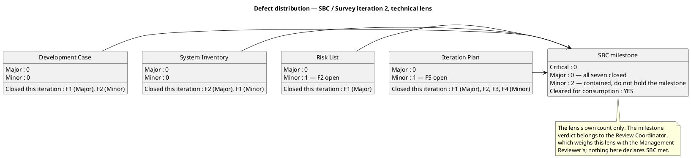

**What this lens does not decide.** The SBC verdict is the Review Coordinator's, taken on this lens and the Management Reviewer's together. Two facts the coordinator weighs and this block does not: the stakeholder refused the sanction on 2026-11-19 with the order that all Major findings be corrected, and the seven Majors are now closed — so the refusal's stated reason no longer stands, while the sanction itself has not been asked again. This block records the technical state of the artifact set and nothing about the milestone's standing.

**What Excavation inherits from this set.** Of the 26 recorded entry points, fifteen carry a recoverable use case: `EP-001`, `EP-002`, `EP-012` … `EP-019`, `EP-022` … `EP-026`. Ten are excluded by the stakeholder's decisions of 2026-11-19 — `EP-004` … `EP-010`, `EP-011`, `EP-020`, `EP-021` — and `EP-003` carries none for want of a caller. The reading order is Priorities orders 1–6 inside the single Excavation iteration. The actions it must execute are the Risk List's avoidance column, now every one of them owned by a role at work in Excavation.

### Management Reviewer lens
<!-- review: Survey I2 -->

<!-- review: Survey I2 -->

**Disposition of the governance lens: Approved.** The artifact set satisfies all six SBC exit criteria on the governance test, and the three Major findings this lens carried into the correction pass are closed on evidence in the artifacts. The SBC milestone verdict is the Review Coordinator's to issue after both lens blocks; this block records the lens's disposition, not the milestone's.

Stakeholder sanction: GRANTED

Stakeholder acceptance: "Yes" — to the sanction proposition put on 2026-11-19, which confirmed the perimeter as the System Inventory records it (the seven projects of TodoApp.sln plus the CI workflow, 26 entry points, and the three exclusions of 2026-11-19: external provider sign-in, the admin role, the self-service identity surface) and sanctioned advancing past the System Boundary Confirmed milestone.

Stakeholder order, verbatim: "Minor findings must be corrected in the next phase; they cannot be left unresolved." The two Minor findings open against the artifact set — `Risk List#F2` and `Iteration Plan#F5` — are corrected by their owner in the next phase and are not deferred past it. No ledger entry is opened for this order: the Change Control Manager does not work in the sprint zero, and the order reaches its owner through the Work Order.

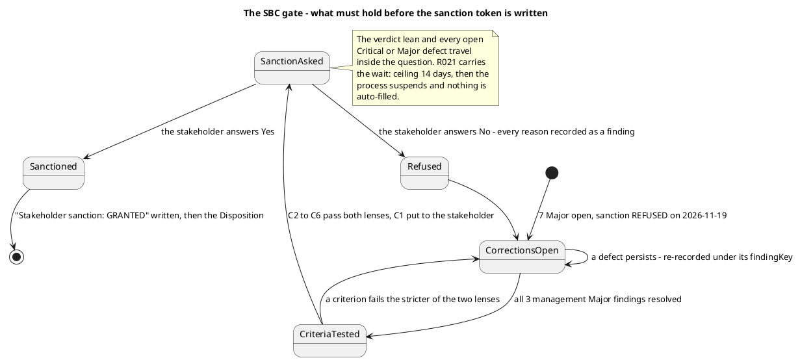

```plantuml
@startuml
title Project health at SBC - four axes, governance lens
skinparam shadowing false
skinparam classAttributeIconSize 0
hide empty members
hide circle

class "SCOPE" as S {
  State : GREEN
  Recovered perimeter : 7 projects + CI, 26 entry points, each anchored
  Recovered product : register, login, logout, todo read/create/delete
  Exclusions : 3, each by stakeholder decision, each anchored
  Confirmation : the stakeholder's Yes, 2026-11-19
}
class "SCHEDULE" as T {
  State : AMBER
  Measured elapsed : none - no phase has closed
  Budget : none declared, so no box exists and none was fitted
  Committed : 10 iterations, stated once
  Reached : Survey used 2 - the second is the correction pass the gate required
}
class "COST" as C {
  State : NOT MEASURABLE
  Tokens : not metered for this review
  Human queue time : the gate was answered; the actual is reported apart
  Forecast : none - a forecast needs a closed phase
}
class "QUALITY" as Q {
  State : GREEN
  Mgmt Major open : 0 in 3 carried in
  Tech Major open : 0 in 4 carried in
  Minor open : 2, both contained in their artifact, both ordered corrected
  Critical : 0
  Artifacts cleared for consumption : 4 of 4 on this lens
}

S -[hidden]right-> T
C -[hidden]right-> Q

note bottom of T
  Amber, not green: no phase has closed and elapsed time is
  not measurable yet. The second Survey iteration is not slippage —
  it is the gate holding and the correction pass that followed
  from the refusal of 2026-11-19.
end note
note bottom of Q
  Two Minor findings remain open and the stakeholder ordered
  them corrected in the next phase. Neither blocks consumption
  and neither fails an exit criterion.
end note
@enduml
```

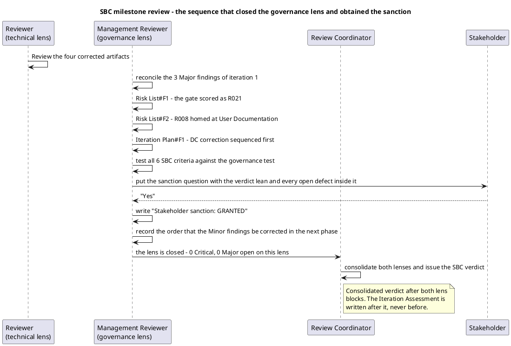

#### What this milestone settles, and what it hands on

| Handed on | To whom | In which phase |
|---|---|---|
| `Risk List#F2` — the trailing `R021` block still reads "offered for acceptance" while the acceptance table records the answer | Project Manager | The next phase, under the stakeholder's order above |
| `Iteration Plan#F5` — the opening block of Plan and Milestones duplicates its Measure and forecast subsection | Project Manager | The next phase, under the stakeholder's order above |
| Priorities 1–6 to be recovered in one pass, priority 7 read as its cross-check | Software Archaeologist, System Analyst, Software Architect, Designer, Database Designer | Excavation |
| `R021` carried forward as the gate on each of the seven roadmap milestones | Project Manager | Every phase |
| `R008`, `R009`, `R020` — accepted exposures, with their mitigation homes fixed | Their named owners | Excavation and Elaboration |

### Review Coordinator lens
<!-- review: Survey I2 -->

<!-- review: Survey I2 -->

**SBC milestone verdict: Go. The Survey phase is complete and advances to Excavation; the two open Minor findings travel to their owner in the next phase under the stakeholder's order.**

The verdict rests on five facts, each counted rather than judged: 0 open Critical findings; 0 open Major findings; six of six SBC exit criteria substantiated by both executing lenses; the perimeter confirmed by the stakeholder on 2026-11-19; and the stakeholder's sanction GRANTED. The refusal of 2026-11-19 named the Major findings as its reason, and that reason no longer stands.

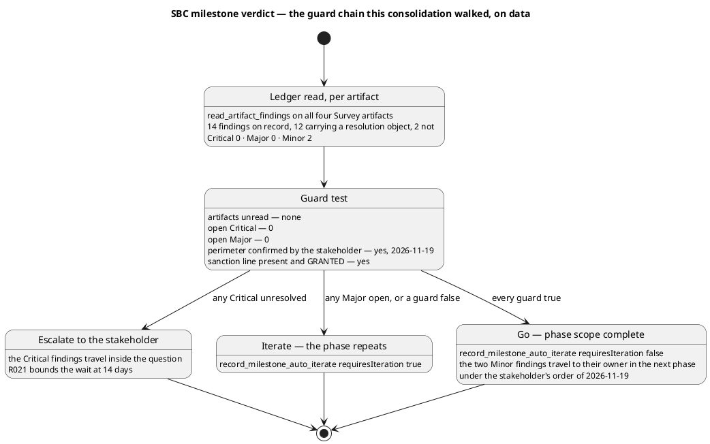

#### Per-artifact disposition

| Artifact | Reviewer lens | Management lens | Disposition from this review |
|---|---|---|---|
| Development Case | Approved — F1 Major and F2 Minor closed | Pass on all four governance tests | **Cleared** |
| System Inventory | Approved — F2 Major and F1 Minor closed; three anchors re-opened, all confirmed | Pass — the perimeter's three exclusions where the stakeholder put them | **Cleared** |
| Risk List | Approved with Changes — F1 Major closed, F2 Minor open | Approved — F1 and F2 Major closed | **Cleared** — the open Minor is `contained-defect` and holds nothing |
| Iteration Plan | Approved with Changes — F1 Major and F2–F4 Minor closed, F5 Minor open | Approved — F1 Major closed | **Cleared** — the open Minor is `contained-defect` and holds nothing |

No artifact is rejected and none is retained. "Approved with Changes" is an artifact-level disposition and correctly says each artifact's substance survives while one wording inside it does not; it does not withhold the artifact from consumption, and the roles that open Excavation consume all four.

#### Why Go rather than Conditional

A Conditional would advance the phase on conditions discharged later, and the previous milestone review rejected that form for the right reason: the defects then open would have put recovered use cases on a Perimeter row its own anomaly contradicted, and set Excavation to execute avoidance actions owned by roles not at work in the sprint zero. Neither condition survives — both are closed on corrected content.

What remains is two wordings, both `contained-defect`: a duplicated passage inside one section, and a trailing block that contradicts its own section's acceptance table. No role consumes either, no exit criterion depends on either, and the acceptance of `R021` itself is recorded verbatim in two places that agree. Holding a phase gate on two wordings is not what a Minor finding means; the stakeholder ordered them corrected in the next phase, which is the deadline this verdict carries forward.

#### Record status

This block records the SBC milestone review's coordination only: the participation of the lenses actually executed, the consolidated ledger read from `read_artifact_findings`, the conflicts across those lenses, the action priorities with owner and deadline, the effectiveness metrics for this milestone, and the verdict. The Business Reviewer is recorded INACTIVE — did not evaluate this review — and no verdict is inferred from its silence. The Iteration Assessment follows this verdict; it does not precede it, and this block declares no phase complete on its own authority beyond the milestone verdict stated here.
