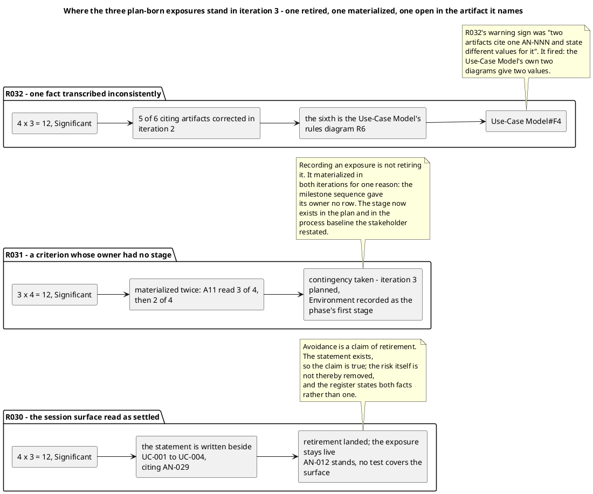

## Document Control
- Phase: Excavation
- Status: Live register. Iteration 3 carries the corrections the AR re-take's ledger orders; the AR verdict is the Review Coordinator's
- Milestone Target: end-of-Excavation (AR) — not yet achieved
- Iteration: 3, Cycle 1
- Owner: Project Manager
## Risk Classification
The scale is the IARI risk scale of the Development Case baseline, §9.10. The project Development Case records no scale of its own, and this artifact defines none. Probability and impact are scored on that scale; a risk's magnitude is the band its exposure (probability × impact) falls in — it is never chosen.

| Probability | Level | Means |
|---|---|---|
| 1 | Very low | 10 % or less |
| 2 | Low | 11 % to 30 % |
| 3 | Medium | 31 % to 50 % |
| 4 | High | 51 % to 70 % |
| 5 | Very high | More than 70 % |

| Impact | Level | Means |
|---|---|---|
| 1 | Very low | No deviation from the plan worth recording |
| 2 | Low | Extra work inside the current iteration; its objectives are still met |
| 3 | Medium | An iteration objective slips to a later iteration the phase already plans |
| 4 | High | The milestone slips: the phase needs an iteration it did not plan |
| 5 | Very high | Success is endangered: a declared requirement or constraint can no longer be met as declared |

| Magnitude | Exposure | Acceptance |
|---|---|---|
| High | 15 to 25 | the stakeholder's grant |
| Significant | 9 to 12 | the stakeholder's grant |
| Moderate | 5 to 8 | the Project Manager's |
| Minor | 3 to 4 | the Project Manager's |
| Low | 1 to 2 | the Project Manager's |

### How each score is derived

Thirty of the thirty-two risks score the likelihood and impact the System Inventory states for the anomaly they refine. Those words are translated once, here, and the same word gives the same number in every row — the eight risks Excavation added use no word the Survey set did not already use.

| Inventory word | Score | Inventory word | Score |
|---|---|---|---|
| likelihood `possible` | Probability 3 — Medium, 31 % to 50 % | impact `low` | Impact 2 — Low |
| likelihood `likely` | Probability 4 — High, 51 % to 70 % | impact `moderate` | Impact 3 — Medium |
| | | impact `high` | Impact 4 — High |

`R022` refines no anomaly: it is the plan's own dependency on stakeholder answers, and its 2 × 4 is the Project Manager's reading of the phase gate. `R031` refines none either: it is the plan's own exposure — an exit criterion whose owner the phase did not schedule — scored 3 × 4 because the correction may land in time and, if it does not, the AR milestone needs an iteration this phase did not plan; it has materialized twice and the contingency is taken. `R032` refines none: it is the exposure the AR review's own defect ledger establishes — one recovered fact transcribed inconsistently into the artifacts that cite it — scored 4 × 3 because four of the eight Majors at that gate are exactly that.

### The register by band

| Magnitude | Risks | Count | Strategy in this register |
|---|---|---|---|
| High | — | 0 | — |
| Significant | R001, R002, R003, R004, R005, R007, R009, R010, R011, R012, R016, R018, R020, R021, R023, R024, R026, R028, R030, R031, R032 | 21 | R004, R011, R012 and R016 accept, each under the stakeholder's own grant of 2026-11-23; the other seventeen avoid, which is the Project Manager's authority at any band |
| Moderate | R006, R008, R013, R014, R015, R017, R019, R022, R025, R027, R029 | 11 | R015 and R022 accept with mitigation and contingency, on the Project Manager's authority; the other nine avoid |
| Minor | — | 0 | — |
| Low | — | 0 | — |

No risk sits in a band its strategy cannot be held in: every Significant-band risk either avoids or carries the stakeholder's granting answer, and no Significant risk this phase added takes the accept strategy, so neither the recovery nor its corrective iterations required a grant. `R030` avoids and its retirement action has landed in the Use-Case Model; the exposure stays live on `AN-012` and is stated as live, not as retired. `R031` avoids, its contingency is taken, and `R032` avoids with its action performed on five of the six citing artifacts.

Not carried: no risk in this register concerns staffing, skills, turnover or friction between people. The executing agents are not a development organization and the stakeholder is the only human here, so such a risk would name no actor and is retired as not applicable rather than classified. What the people the SYSTEM serves do with it is a domain risk and stays.

## Risk Register
Twenty-nine of the thirty-two risks below trace to one anomaly of the System Inventory, and every probability and impact for those is the score that anomaly's own likelihood and impact words take on the mapping stated once in `Risk Classification`. `R022`, `R031` and `R032` refine no anomaly: they are the plan's own exposures, and their scores are the Project Manager's reading of the plan rather than a reading of code.

Excavation added eight risks, R023 to R030, one for each anomaly the deeper reading produced — AN-022 to AN-029 — and none of them restates a risk already carried: R023 is the guard's omitted lockout check, R024 the BFF's two unequally protected hops, R025 the Development configuration, R026 the unconverted owner key, R027 the client's absent base address, R028 the provider account with no email, R029 the persistence registration the test host replaces, and R030 the BFF's own reading as an unstable area. `R015` was restated to the corrected AN-015: the app host holds the delivery's newest change, and it is not the only area still moving. `R031` is the plan's own exposure — an exit criterion whose owner the phase did not schedule — and it has materialized twice; the stakeholder restated the process baseline at the AR re-take of 2026-11-23 so that the stage exists, and iteration 3 carries the correction. `R032` is the exposure the AR review's own defect ledger established: one recovered fact transcribed inconsistently into the artifacts that cite it. Five of the six citing artifacts were corrected in iteration 2; the sixth is the Use-Case Model's rules diagram, corrected in iteration 3.

```plantuml
@startuml
title Every anomaly of the System Inventory carried into one risk, and the three risks that come from the plan rather than from an anomaly

skinparam shadowing false
left to right direction
skinparam componentStyle rectangle
skinparam wrapWidth 200

package "System Inventory anomalies - 29, each one risk" {
  component "AN-001  no UI path to complete a todo" as A1
  component "AN-002  no BFF-to-API authentication" as A2
  component "AN-003  request contracts declared twice" as A3
  component "AN-004  admin role never granted" as A4
  component "AN-005  migrations not exercised" as A5
  component "AN-006  unused test dependency" as A6
  component "AN-007  SDK 8 image against net9.0" as A7
  component "AN-008  README names a Swagger UI" as A8
  component "AN-009  Identity endpoints unlimited" as A9
  component "AN-010  key ring not pinned" as A10
  component "AN-011  token minted from framework internals" as A11
  component "AN-012  two thirds of the system untested" as A12
  component "AN-013  database path relative to workdir" as A13
  component "AN-014  RazorLangVersion left at 8.0" as A14
  component "AN-015  app host holds the newest change" as A15
  component "AN-016  no document of the system" as A16
  component "AN-017  root redirect unconditional" as A17
  component "AN-018  list ignores the admin role" as A18
  component "AN-019  provider name taken unchecked" as A19
  component "AN-020  failed sign-in swallowed" as A20
  component "AN-021  every auth failure answers 401" as A21
  component "AN-022  lockout checked on no request" as A22
  component "AN-023  forwarder hop carries no resilience" as A23
  component "AN-024  Development halves the request budget" as A24
  component "AN-025  owner key moved, no row converted" as A25
  component "AN-026  absent base address answers an empty list" as A26
  component "AN-027  a provider account carries no email" as A27
  component "AN-028  test host replaces the DbContext registration" as A28
  component "AN-029  the session surface never settles" as A29
}

package "Risk List - 32 risks" {
  component "R001 to R021, R023 to R030\none per anomaly" as ANOM
  component "R022  milestone waits on stakeholder gates" as R022
  component "R031  a criterion's owner was not scheduled" as R031
  component "R032  one fact transcribed inconsistently" as R032
}

A1 --> ANOM : Refines
A2 --> ANOM : Refines
A3 --> ANOM : Refines
A4 --> ANOM : Refines
A5 --> ANOM : Refines
A6 --> ANOM : Refines
A7 --> ANOM : Refines
A8 --> ANOM : Refines
A9 --> ANOM : Refines
A10 --> ANOM : Refines
A11 --> ANOM : Refines
A12 --> ANOM : Refines
A13 --> ANOM : Refines
A14 --> ANOM : Refines
A15 --> ANOM : Refines
A16 --> ANOM : Refines
A17 --> ANOM : Refines
A18 --> ANOM : Refines
A19 --> ANOM : Refines
A20 --> ANOM : Refines
A21 --> ANOM : Refines
A22 --> ANOM : Refines
A23 --> ANOM : Refines
A24 --> ANOM : Refines
A25 --> ANOM : Refines
A26 --> ANOM : Refines
A27 --> ANOM : Refines
A28 --> ANOM : Refines
A29 --> ANOM : Refines

note bottom of R022
  R022 has no anomaly behind it: it is the plan's own dependency
  on stakeholder answers, carried because every phase's gate depends on one.
end note

note bottom of R031
  R031 has no anomaly behind it either: the phase carried an exit
  criterion whose owner, the Process Engineer, had no scheduled slot
  in Excavation. It materialized twice - the milestone did not close.
  The contingency is taken: the stage is recorded from iteration 3.
end note

note bottom of R032
  R032 refines no anomaly: it is the exposure the AR review's own
  defect ledger establishes. The two code facts it concerns are not
  new - the same phase recorded them as AN-024 and AN-023.
end note

@enduml
```

| ID | Risk | Evidence | P | I | Exposure | Magnitude | Strategy | Owner |
|---|---|---|---|---|---|---|---|---|
| R001 | Excavation's recovered use-case set cannot claim a user-facing "complete a todo": the list's checkbox is bound to nothing and the client makes no update call, so the update endpoint has no screen. A recovery that asserts the screen path states a behaviour the system does not have | `Todo.Web/Client/Components/TodoList.razor:24-27`; `Todo.Web/Client/TodoClient.cs:7-71`; `Todo.Api/Todos/TodoApi.cs:52-65` | 4 | 3 | 12 | Significant | Avoid | System Analyst |
| R002 | The Architecture Baseline assumes an authenticated BFF-to-API hop that does not exist: the API accepts a bearer token from any caller, and its own comment records the gap | `Todo.Api/Users/UsersApi.cs:16`; `Todo.Api/Program.cs:11,14` | 3 | 4 | 12 | Significant | Avoid | Software Architect |
| R003 | The recovered design carries two disagreeing request contracts, in two assemblies that do not reference each other, so a realization recorded against one need not describe the other | `Todo.Api/Todos/Todo.cs:15-21` vs `Todo.Web/Shared/SharedClass.cs:5-11` | 4 | 3 | 12 | Significant | Avoid | Designer |
| R004 | A later role treats the `admin` branch as live functionality: nothing in the running system grants that role, so any recovered behaviour relying on it is unreachable. The stakeholder ruled it an exceptional entity on 2026-11-23 | `Todo.Api/Todos/TodoApi.cs:33,59,69`; `Todo.Api/Migrations/20221123165051_RemoveIsAdmin.cs` | 4 | 3 | 12 | Significant | Accept — granted by the stakeholder 2026-11-23 | System Analyst |
| R005 | A migration that no longer matches the model is planned over undetected: the test host builds the schema with `EnsureCreated`, so the recovered data description is checked against a schema no test reproduces | `Todo.Api.Tests/TodoApplication.cs:11-14`; `TodoApp.AppHost/Extensions.cs:9-21` | 3 | 3 | 9 | Significant | Avoid | Test Manager |
| R006 | A declared dependency is carried as if the harness needed it, while the harness opens in-memory SQLite and never uses it | `Todo.Api.Tests/Todo.Api.Tests.csproj:4`; `Todo.Api.Tests/TodoApplication.cs:7` | 4 | 2 | 8 | Moderate | Avoid | Integrator |
| R007 | The build environment contradicts itself — container image SDK 8.0, target `net9.0`, SDK pin 9.0.100 — so the build environment the Integrator establishes may not build the tree that ships it | `.devcontainer/devcontainer.json:2`; `Directory.Build.props:4`; `global.json:3` | 4 | 3 | 12 | Significant | Avoid | Integrator |
| R008 | A role using the delivery's README as evidence records a surface the code does not have: the README directs the reader to a Swagger UI, and the code mounts the Scalar reference UI and redirects `/` to it | `README.md` (Using the API standalone); `Todo.Api/Program.cs:49-56,62` | 4 | 2 | 8 | Moderate | Avoid | Technical Writer |
| R009 | Rate limiting is assumed where there is none: the token-bucket policy covers `/todos` only, so `login`, `register`, `refresh` and `forgotPassword` are unlimited, and the partition key the policy uses does not exist for an anonymous caller | `Todo.Api/Users/UsersApi.cs:10-20`; `Todo.Api/Extensions/RateLimitExtensions.cs:38-47` | 3 | 3 | 9 | Significant | Avoid | Software Architect |
| R010 | The Deployment Model places the BFF and the API where they do not share a key ring, while a provider key is protected in one process and unprotected in the other; only the application discriminator is set | `Todo.Web/Server/Program.cs:13`; `Todo.Api/Program.cs:11`; `Todo.Web/Server/AuthApi.cs:82-90` | 3 | 3 | 9 | Significant | Avoid | Software Architect |
| R011 | A framework upgrade breaks the test suite without any behaviour changing: the suite reproduces the bearer-token ticket format from framework internals | `Todo.Api.Tests/TokenService.cs:10,21,31-34`; `Todo.Api.Tests/TodoApplication.cs:79-95` | 4 | 3 | 12 | Significant | Accept — granted by the stakeholder 2026-11-23 | Test Manager |
| R012 | The BFF and the Blazor client carry no test of any kind, so the recovered behaviour of the session, the proxy and the three defective `/auth` flows has no executable statement behind it — and those three flows are exactly the untested ones | `Todo.Api.Tests/Todo.Api.Tests.csproj:9`; the tree holds no other test project | 4 | 3 | 12 | Significant | Accept — granted by the stakeholder 2026-11-23 | Test Manager |
| R013 | A run that does not start the app host first has no database: the database path is relative to the API's working directory and its directory is created by the app host alone | `Todo.Api/Program.cs:23`; `TodoApp.AppHost/Extensions.cs:4-21` | 3 | 2 | 6 | Moderate | Avoid | Integrator |
| R014 | The server project's `RazorLangVersion` stays at 8.0 while the solution targets `net9.0` and its ASP.NET Core packages are 9.0.8 | `Todo.Web/Server/Todo.Web.Server.csproj:7`; `Directory.Build.props:4` | 3 | 2 | 6 | Moderate | Avoid | Integrator |
| R015 | The Deployment Model describes an orchestration layer still moving and no longer alone in moving: the app host's five commits run to `307a1ea` of 2026-02-12, the newest commit touching any part of the system, while `Todo.Api` stops at 2025-08-07 — and the BFF's session surface is a second area whose history never settles (R030), so neither can be described as settled. Its listing also begins at the rename `3308193`, so the sqlite-web container and the migration step appear in no commit of it | `TodoApp.AppHost` history 2024-11-23 to 2026-02-12; `Todo.Api` history to 2025-08-07; `Todo.Web/Server` history 33 commits | 4 | 2 | 8 | Moderate | Accept | Software Architect |
| R016 | Every recovered element from Excavation on is an interpretation of code: the delivery carries no requirement, design, architecture or test document, and no reading can be confirmed against a stated intent | `.iari/README.md`; the tree holds no such document | 4 | 3 | 12 | Significant | Accept — granted by the stakeholder 2026-11-23 | Project Manager |
| R017 | In any environment other than Development the delivered root redirect targets an endpoint the process does not serve: `/` redirects to the Scalar reference UI unconditionally, and that UI is mapped in Development only | `Todo.Api/Program.cs:62` against `Todo.Api/Program.cs:49-56` | 4 | 2 | 8 | Moderate | Avoid | Software Architect |
| R018 | A recovered use case that states one visibility rule is contradicted by the other endpoint: `GET /todos` filters on the owner alone with no admin branch, while the item endpoints each admit an `admin` principal | `Todo.Api/Todos/TodoApi.cs:24-27` vs `:29-36,52-65,67-73` | 4 | 3 | 12 | Significant | Avoid | Designer |
| R019 | A recovered use case that states the challenge's behaviour states one that raises on an unknown name: the provider name is taken straight from the route and checked against no registered scheme | `Todo.Web/Server/AuthApi.cs:55-62`; `Todo.Web/Server/Authentication/AuthenticationExtensions.cs:39-75` | 4 | 2 | 8 | Moderate | Avoid | System Analyst |
| R020 | A recovered use case cannot state a failure flow the system has: the provider callback redirects to `/` on every path, so a rejected provider, a null exchange and a failed cookie sign-in are indistinguishable to the person | `Todo.Web/Server/AuthApi.cs:64-97` | 4 | 3 | 12 | Significant | Avoid | System Analyst |
| R021 | A recovered use case that states why registration or login failed states a distinction the system does not make: every authentication failure answers 401 with no body, and the BFF discards the API's validation problem | `Todo.Web/Server/AuthApi.cs:14-38`; `Todo.Web/Server/AuthClient.cs:6-34` | 4 | 3 | 12 | Significant | Avoid | System Analyst |
| R022 | A phase's milestone cannot close while a stakeholder answer is queued. Every phase gate depends on one, both sprint-zero gates have been refused once and the AR gate twice | this register; the Review Record's SBC and AR ledgers | 2 | 4 | 8 | Moderate | Accept | Project Manager |
| R023 | A recovered authorization statement says a locked-out account loses its access: lockout is enforced at a password sign-in and nowhere else, so an account locked out after repeated failures keeps full access on every token it already holds. The guard's own TODO records the check it omits, and nothing re-reads `LockoutEnd` on a request or on a refresh | `Todo.Api/Authorization/CheckCurrentUserAuthHandler.cs:26-35`; `Todo.Api/Authorization/CurrentUserExtensions.cs:22-26`; `Todo.Api/Users/UsersApi.cs:20` | 4 | 3 | 12 | Significant | Avoid | System Analyst |
| R024 | A later role assumes the BFF's two outbound hops are equally protected, so a design or a test states a resilience property one hop does not have: the token client is container-built and inherits the standard handler, while the `/todos` forwarder is built with a default `ForwarderRequestConfig` and inherits nothing. The Supplementary Specification's R4 carried the error and is corrected; the Design Model's PKG-D3 and the Software Architecture Document's P6 already state the difference correctly | `TodoApp.ServiceDefaults/Extensions.cs:32-42`; `Todo.Web/Server/Program.cs:23-26`; `Todo.Web/Server/TodoApi.cs:12-25`; `Todo.Web/Client/Components/TodoList.razor:57-76`; `Supplementary Specification` R4 | 3 | 3 | 9 | Significant | Avoid | Software Architect |
| R025 | A load, throughput or throttling figure taken in Development describes a system no other environment runs: `appsettings.Development.json` overrides the limiter to 50 tokens, 50 per period and a queue of 50 against the code's 100, every launch profile puts both serving processes in Development, and no other environment file carries the section. Any measured budget is half the value the system runs at elsewhere | `Todo.Api/Extensions/RateLimitExtensions.cs:14-31`; `Todo.Api/appsettings.Development.json:8-12`; `Todo.Api/Properties/launchSettings.json:14-16,25-27`; `Todo.Web/Server/Properties/launchSettings.json:6-8,15-17` | 4 | 2 | 8 | Moderate | Avoid | Software Architect |
| R026 | A deployment is pointed at a database written by migration 1 or 2 and its rows resolve to nothing: the third migration re-pointed `Todos.OwnerId` from `AspNetUsers.UserName` to `AspNetUsers.Id` and converted no row, and no migration or start-up step rewrites an existing value. A pre-existing database therefore holds user names in a column a constraint resolves against account identifiers | `Todo.Api/Migrations/20230714032431_ForeignKeyChange.cs:9-44`; `Todo.Api/Migrations/20221123071234_Initial.cs`; `TodoApp.AppHost/Extensions.cs:4-21` | 3 | 4 | 12 | Significant | Avoid | Database Designer |
| R027 | A recovered flow states a failure path the client does not have: with no base address the list call answers `200` and an empty list instead of issuing a request or reporting the absence, so a genuine failure to reach the API is indistinguishable from having no tasks, and the spinner the component carries is never reached | `Todo.Web/Client/TodoClient.cs:33-40`; `Todo.Web/Client/Components/TodoList.razor:3-8,44-55`; `Todo.Web/Client/Program.cs:7-9` | 4 | 2 | 8 | Moderate | Avoid | Designer |
| R028 | A recovered registration statement says a provider-created account can be completed and recovered: the exchange sets `UserName` only and never `Email`, so such an account can never sign in with a password, confirm an address, recover a password or refresh through the framework's own endpoints — and the email index is not unique, so a duplicate address is undetectable at rest. The account's identity also depends on what the provider chose to send | `Todo.Api/Users/UsersApi.cs:40-46`; `Todo.Api/Migrations/20221123071234_Initial.cs` (`EmailIndex` not unique); `Todo.Web/Server/AuthApi.cs:70-71` | 4 | 3 | 12 | Significant | Avoid | System Analyst |
| R029 | The recovered persistence description is checked against a registration the test host replaces: a test-only helper strips `DbContextOptions<TodoDbContext>` out of the composition root and installs its own, so no test exercises the connection-string resolution, the `Data Source=.db/Todos.db` fallback, the scoped context lifetime or the migration-built schema — the four things a deployment depends on | `Todo.Api.Tests/DbContextExtensions.cs:5-29`; `Todo.Api.Tests/TodoApplication.cs:44-46`; `Todo.Api/Program.cs:23-24` | 4 | 3 | 12 | Significant | Avoid | Database Designer |
| R030 | A recovered use case or design treats the BFF's session surface as settled: `AuthApi.cs` is the delivery's most-reworked file at fifteen commits, within an area carrying thirty-three, every one of them touching a success path, so the recovered behaviour of the three flows that never worked — AN-019, AN-020, AN-021 — is an interpretation of the least stable code in the tree, on a component with no test | `Todo.Web/Server` history 33 commits; `Todo.Web/Server/AuthApi.cs` history 15 commits; `Todo.Web/Server/AuthApi.cs:64-97`; `Todo.Api.Tests/Todo.Api.Tests.csproj:9` | 4 | 3 | 12 | Significant | **Avoid — retirement landed, exposure live.** The statement is written in the Use-Case Model beside UC-001 to UC-004, citing `AN-029`, `AN-012` and this risk. The exposure is not thereby removed: `AN-012` stands, no test covers the surface, and the statement records it | System Analyst, then Project Manager |
| R031 | The AR milestone cannot close on its evidence because one exit criterion, A11, counts an artifact whose owner had no scheduled slot in the phase: `Development Case#F2` is the Process Engineer's, Environment ran at no intensity in Excavation, and the correction is not in the artifact. It read three of four at the first AR gate and two of four at the second, and the phase opened an iteration it had not planned each time | `Development Case` — "Roles and Ownership" still omits the Management Reviewer, the Business Reviewer and the Review Coordinator, and CLS-DC-01 draws no edge from them; the plan's iteration-2 item 10; Evaluation Criteria A11; the AR verdicts | 3 | 4 | 12 | Significant | Avoid — **materialized twice; contingency taken.** Iteration 3 carries the correction in the Environment stage the stakeholder restated as this phase's first discipline | Process Engineer, planned by Project Manager |
| R032 | One recovered fact is transcribed inconsistently into the artifacts that cite it, so the set a milestone certifies contradicts the fact its own phase recorded. The AR review established it: four of its eight Majors were two code facts — the Development rate-limit override and the standard resilience handler — stated wrongly in four artifacts, while the System Inventory had recorded both in the same phase as AN-024 and AN-023. Iteration 2 corrected five of the six citing artifacts; the Use-Case Model's rules diagram is the sixth | the AR review's ledger — `Supplementary Specification#F1`, `#F2`, `Software Architecture Document#F1`, `Deployment Model#F1`; the two facts are anchored at `Todo.Api/appsettings.Development.json:8-12` and `TodoApp.ServiceDefaults/Extensions.cs:32-42` | 4 | 3 | 12 | Significant | Avoid — **action partly performed.** Five citing artifacts corrected in iteration 2; the Use-Case Model's R6 corrects in iteration 3, and the lenses re-read all four in one pass | Project Manager |

### Grants for accepted risks

Four risks take the accept strategy inside the Significant band. Each carries the stakeholder's own answer of 2026-11-23, and no other risk is accepted above Moderate on this role's authority.

| Risk | Exposure | What the stakeholder accepted | Their answer |
|---|---|---|---|
| R004 | 4 × 3 = 12 | That a later role treats the `admin` branch as live functionality while nothing in the running system grants the role — for the sprint zero, until Excavation records it as the exceptional entity they ruled it to be | Yes |
| R011 | 4 × 3 = 12 | That a framework upgrade breaks the test suite while no product behaviour changes — for the sprint zero | Yes |
| R012 | 4 × 3 = 12 | That the BFF and the client carry no test of any kind, and the three defective `/auth` flows are exactly the untested ones — for the sprint zero | Yes |
| R016 | 4 × 3 = 12 | That every recovered element is an interpretation of code with no stated intent to check it against — for the sprint zero | Yes |

`R015` and `R022` are accepted at Moderate exposure (8), which is this role's authority at any band. `R030`, `R031` and `R032` are Significant and take the avoid strategy, so no grant is needed for them and none is assumed.

## Risk Mitigation and Contingency
Each risk carries the action its owner takes and the sign that it has started to bite. A risk accepted carries a mitigation as well as a contingency; a risk avoided is retired by its action, which the named owner performs. A risk whose action has not been performed is stated as not yet retired: avoidance is a claim of retirement, not a status note, and this register does not make that claim where it is not true.

| ID | Strategy | Action | Owner | Contingency if it materializes | Warning sign |
|---|---|---|---|---|---|
| R001 | Avoid | Recover complete-a-todo from EP-013 as an operation the API performs, and record in the Use-Case Model that no screen reaches it; claim no user-facing update path | System Analyst | The stakeholder declares a UI path for completion from Inception; it is then a declared requirement, worked from that phase, not a recovered one | A recovered use case names a control the client does not render |
| R002 | Avoid | Record in the Software Architecture Document's mechanisms that the BFF-to-API hop carries no service authentication and that the API accepts any bearer token | Software Architect | The Architecture Baseline names the hop as trusted and must be corrected before LCA | A design element assumes a service identity |
| R003 | Avoid | Record both declarations in the Design Model against the same element, and state that nothing checks their agreement | Designer | A realization is stated against one declaration and contradicted by the other at review | A contract field appears in one declaration only |
| R004 | Accept — granted by the stakeholder 2026-11-23 | Mitigation: cite their 2026-11-23 ruling wherever the ownership rule is recovered, so the `admin` branch is recorded as an exceptional entity and never as a recovered use case; the ruling is stated in the System Inventory's Perimeter | System Analyst | A role proposes an administrative use case; it stops at the ruling and goes to the stakeholder as a scope question | `admin` appears in a recovered use-case flow |
| R005 | Avoid | Add a migration-applies check to the architecture test scope, so the schema the tests build and the schema the migrations create are compared | Test Manager | The recovered data description is corrected against `EnsureCreated`, and the migrations are re-read | A model change compiles while the last migration does not match |
| R006 | Avoid | Remove the unused dependency when the test project is next touched, and record why the harness does not need it | Integrator | The dependency is left in place and the next upgrade carries it; cost stays inside the iteration | The package version is bumped for a package nothing uses |
| R007 | Avoid | Settle the container image against `net9.0` and the SDK pin in the Build Environment Setup, and record the decision with the build environment | Integrator | The build runs outside the container and the container is corrected before it is relied on | A build fails only inside the container |
| R008 | Avoid | Record the contradiction where the OpenAPI surface is recovered; use the code, never the README, as the anchor for the reference UI. The README stays unedited — it is the delivery's documentation, not the project's | Technical Writer | A role cites the README; the anchor is replaced by the code it contradicts | A document names a surface the code does not mount |
| R009 | Avoid | Record the limiter's coverage in the Software Architecture Document: `/todos` only, partitioned on a claim an anonymous caller lacks | Software Architect | A phase assumes the Identity endpoints are limited and a security statement is corrected | An unauthenticated endpoint is described as rate-limited |
| R010 | Avoid | Pin the key-ring decision in the Deployment Model, which is triggered for this project, and state where the BFF and the API must share it | Software Architect | The processes are separated and the protected provider key cannot be unprotected | Two processes set the discriminator and no key store |
| R011 | Accept — granted by the stakeholder 2026-11-23 | Mitigation: the framework version is pinned centrally, so the break happens only at a deliberate upgrade | Test Manager | The suite fails wholesale after an upgrade with no product change; the token minter is rewritten against the public API before the upgrade continues | A framework package moves with the suite red and the product green |
| R012 | Accept — granted by the stakeholder 2026-11-23 | Mitigation: test cases cover the BFF session and the `/auth` flows the recovered use cases name, and the client's todo flow, from Elaboration on | Test Manager | If the external-provider path is declared out of scope, coverage stops at the session and the ownership boundary | Untested BFF behaviour is recorded as verified; the review of that iteration is re-opened |
| R013 | Avoid | Record that the app host creates the database directory, and carry it into the Build Environment Setup as a precondition | Integrator | A run without the app host is documented as requiring one app-host start first | A standalone run answers with a missing-database failure |
| R014 | Avoid | Settle `RazorLangVersion` together with R007 in the Build Environment Setup | Integrator | The property stays behind and is recorded as a build constraint | A Razor compile behaves differently from the rest of the solution |
| R015 | Accept | Mitigation: the Deployment Model describes the orchestration as it stands, names it as holding the delivery's newest change, and names the BFF's session surface beside it rather than presenting either as settled. Contingency: the Integrator re-verifies the app host at the Elaboration architecture build | Software Architect | The app host changes again mid-phase and the Deployment Model is re-read against it | An app-host change lands after the Deployment Model is baselined |
| R016 | Accept — granted by the stakeholder 2026-11-23 | Mitigation: every recovered element cites the anchor it was read from, and the reading is re-checked at the iteration's own review | Project Manager | A recovered element is later found to misdescribe the system; it is corrected in place against its anchor | A recovered element carries no anchor, or an anchor that no longer reads as recorded |
| R017 | Avoid | Record the Development-only mapping with the reference-UI surface, and state the environment the redirect is served in | Software Architect | The deployment serves a non-Development environment and the redirect is corrected then | A deployment target names an environment other than Development |
| R018 | Avoid | Record the asymmetry in the Design Model against the ownership rule, as an exceptional entity, not as a second visibility rule | Designer | A recovered use case states one rule and the item endpoints contradict it at review | The list and the item paths are described as agreeing |
| R019 | Avoid | Record in the recovered use case that the challenge takes the scheme from the route and raises on an unknown name | System Analyst | A phase relies on a redirect or 404 the handler does not produce | An unknown provider name is described as returning a redirect |
| R020 | Avoid | Record in the recovered use case that the callback has one exit and no failure flow; the code's own TODO is the anchor | System Analyst | A test case asserts a failure message the system does not render | A recovered flow shows a failure branch the handler lacks |
| R021 | Avoid | Record in the recovered use cases that every authentication failure answers 401 with no body, and that the client shows one fixed string | System Analyst | A phase designs a distinction the system does not carry | A recovered flow names a cause the API does not report |
| R022 | Accept | Mitigation: every question to the stakeholder is asked in the same turn it is found, with the answer it needs stated so a one-word reply settles it; no answer is assumed while it is open. Contingency: an open grant holds the milestone and is escalated rather than filled — the process suspends rather than auto-filling an approval | Project Manager | A gate exceeds its ceiling: nothing is auto-filled, the milestone is not closed, and the queue is reported apart from agent time | A question is found in one iteration and not asked until the next |
| R023 | Avoid | Record in the recovered authorization statement that lockout is enforced at the password sign-in alone, that a locked account keeps every token it already holds, and that the guard's own TODO marks the check it omits | System Analyst | A phase designs a lockout enforcement the handler does not perform; the statement is corrected against the guard | An authorization flow shows a lockout check on a request |
| R024 | Avoid | Correct the Supplementary Specification's R4 to state the two hops apart; the Software Architecture Document's P6 and the Design Model's PKG-D3 already state the difference correctly and are the reading to correct R4 against | Software Architect | A phase designs retry or circuit-breaking on the forwarder as if it existed, and the mechanism description is corrected | Both hops described as carrying the same handler |
| R025 | Avoid | Record beside the limiter's mechanism that the Development configuration overrides all three values to 50, that both launch profiles run in Development, and that no other environment file carries the section — so no figure measured there describes another environment | Software Architect | A capacity or throttling figure is taken in Development and published as the system's; it is re-taken with the section removed | A load observation cites a request budget of 50 |
| R026 | Avoid | Record in the persistent-data description that the third migration re-pointed `Todos.OwnerId` from `UserName` to `Id` and converted no row, and that a database is only consistent if written after migration 3 | Database Designer | A deployment targets a pre-existing database: converting the owner column becomes a declared migration requirement — a change request, not a recovered fact | A deployment plan names an existing database file |
| R027 | Avoid | Record in the Design Model and the recovered list flow that an absent base address answers `200` with an empty list, so the component cannot distinguish a failure from an empty list and the spinner is never reached | Designer | A phase builds error reporting on a distinction the client does not make, and the flow is corrected | A recovered flow shows the list reporting an unreachable API |
| R028 | Avoid | Record in the recovered registration statement that a provider-created account carries no email, so it cannot sign in with a password, confirm, recover or refresh through the framework's endpoints, and that the email index is not unique | System Analyst | A phase designs address confirmation or password recovery for a provider account, and the flow is corrected against the exchange | A recovered flow shows a provider account confirming an address |
| R029 | Avoid | Record in the persistent-data description that the test host replaces the production `DbContextOptions` registration, so no test exercises the connection-string resolution, the `.db` fallback, the context lifetime or the migration-built schema | Database Designer | A phase cites the suite as evidence about persistence, and the citation is withdrawn or the suite is extended | A persistence statement is called verified by the test suite |
| R030 | Avoid — **retirement landed; the exposure stays live** | The statement is written beside UC-001 to UC-004 in the Use-Case Model, titled "The instability UC-001 to UC-004 sit on", citing `AN-029`, `AN-012` and this risk: the file carrying them is the delivery's most-reworked at fifteen commits within an area of thirty-three, and no test covers it. The avoidance is performed; the exposure is not removed, because `AN-012` stands and no executable statement covers the surface | System Analyst, then Project Manager | A phase treats the session behaviour as stable and builds on it without re-reading; the flows are re-read against the file before the baseline | A design cites the session surface as settled |
| R031 | Avoid — **materialized twice; contingency taken** | The correction to `Development Case#F2` is performed in iteration 3 in the Environment stage, on the stakeholder's restatement of 2026-11-23 that the process runs Environment in every phase and that it is Excavation's first discipline. A11 is not marked met until the artifact carries the correction | Process Engineer, planned by Project Manager | Taken: the correction did not land in iteration 2, A11 read two of four, and the phase opened a third iteration planned from the Review Record. Declared work is never cut to avoid it | The technical lens returns and "Roles and Ownership" still omits the three lenses |
| R032 | Avoid — **action performed on five of six; one citing artifact open** | Settle the fact once, in the artifact that owns it, and correct the others against it: iteration 2 corrected the Supplementary Specification, the Software Architecture Document, the Deployment Model, the Vision and the Design Model, each citing `AN-024` or `AN-023`, and five of the six citing artifacts hold. The sixth is the Use-Case Model's rules diagram R6, whose correction is `Use-Case Model#F4`; the lenses then re-read all four artifacts in one pass | Project Manager | A corrected figure is transcribed wrongly a second time: the four artifacts disagree at the next milestone, and the disagreement is resolved by reading the code rather than by choosing between the artifacts | Two artifacts cite one `AN-NNN` and state different values for it — **fired** at `Use-Case Model#F4`; the register keeps the row open until the fourth artifact holds |

## Traceability
| Element | Traces From | Link Type | Traces To |
|---|---|---|---|
| R001 | AN-001 | Refines | — |
| R002 | AN-002 | Refines | — |
| R003 | AN-003 | Refines | — |
| R004 | AN-004 | Refines | — |
| R005 | AN-005 | Refines | — |
| R006 | AN-006 | Refines | — |
| R007 | AN-007 | Refines | — |
| R008 | AN-008 | Refines | — |
| R009 | AN-009 | Refines | — |
| R010 | AN-010 | Refines | — |
| R011 | AN-011 | Refines | — |
| R012 | AN-012 | Refines | — |
| R013 | AN-013 | Refines | — |
| R014 | AN-014 | Refines | — |
| R015 | AN-015 | Refines | — |
| R016 | AN-016 | Refines | — |
| R017 | AN-017 | Refines | — |
| R018 | AN-018 | Refines | — |
| R019 | AN-019 | Refines | — |
| R020 | AN-020 | Refines | — |
| R021 | AN-021 | Refines | — |
| R022 | — | — | — |
| R023 | AN-022 | Refines | — |
| R024 | AN-023 | Refines | — |
| R025 | AN-024 | Refines | — |
| R026 | AN-025 | Refines | — |
| R027 | AN-026 | Refines | — |
| R028 | AN-027 | Refines | — |
| R029 | AN-028 | Refines | — |
| R030 | AN-029 | Refines | — |
| R031 | — | — | — |
| R032 | — | — | — |

`R022`, `R031` and `R032` carry no upstream: they are the plan's own exposures rather than readings of an anomaly, and each states its separate origin where it is described. `R032`'s evidence is the AR review's defect ledger; its own row in the register names the four findings and the two code facts they contradict.
