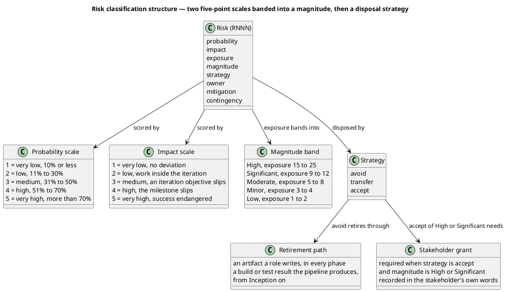

## Document Control
Phase: Survey
Status: Draft — 26 risks: the anomalies and declared coverage limits of the System Inventory, plus R026 bounding the human gate. Each scored and given a strategy that can execute. Two sit in the High band, both avoided; 18 avoided and 8 accepted in all. Every acceptance is bounded: no process is run in Survey, Excavation or Consolidation, so R002 and R011 are accepted until the RUP phases start, when the pipeline builds the solution and runs its tests — the first such run settles what it covers. No acceptance here runs to the end of the project. R002 is the only accepted risk in the Significant band, granted by the stakeholder's own answer of 2026-11-14 and quoted in Risk Mitigation and Contingency.
Milestone Target: End-of-Survey (SBC) — not yet achieved
## Risk Classification
The scales are the IARI Development Case §9.10 scales, cited not redefined: probability and impact are each scored 1 to 5, exposure is their product, and the magnitude is the band that exposure falls in. Probability is read as the likelihood the adverse outcome occurs under the plan as written, not the likelihood the underlying anomaly is present — several anomalies are certain to exist while the harm they do is unlikely. Acceptance of a High (15 to 25) or Significant (9 to 12) risk is the stakeholder's grant and is never self-granted here.

Observing the running system is unavailable as a retirement path **within the sprint zero**: no process is installed and nothing is run in Survey, Excavation or Consolidation, so a strategy inside those three milestones that depended on observing runtime behaviour could not execute. Every `avoid` below names an artifact a role in this process writes. **From Inception on the pipeline builds the solution and runs its test suites**, so a build or test result is a retirement path a later phase may use. R002 and R011 are carried `accept` only until the RUP phases start, on the grant recorded in Risk Mitigation and Contingency, and the first run bearing on either settles it.

### Exposure grid — every scored risk at its probability and impact

| Impact | P1 (10% or less) | P2 (11–30%) | P3 (31–50%) | P4 (51–70%) | P5 (more than 70%) |
|---|---|---|---|---|---|
| **5** — success endangered | R012 | — | — | — | — |
| **4** — the milestone slips | — | R011 | R026 | R001 | — |
| **3** — an iteration objective slips | — | R006, R013 | R016 | R003, R004, R005, R017 | R009 |
| **2** — work inside the iteration | R007 | R008, R015 | R014, R023 | R010 | R002, R018 |
| **1** — no deviation worth recording | — | — | — | R021 | R019, R020, R022, R024, R025 |

### Band distribution

| Band | Exposure | Count | Risks |
|---|---|---|---|
| High | 15–25 | 2 | R001 (16), R009 (15) |
| Significant | 9–12 | 8 | R003 (12), R004 (12), R005 (12), R017 (12), R026 (12), R002 (10), R018 (10), R016 (9) |
| Moderate | 5–8 | 12 | R010 (8), R011 (8), R006 (6), R013 (6), R014 (6), R023 (6), R012 (5), R019 (5), R020 (5), R022 (5), R024 (5), R025 (5) |
| Minor | 3–4 | 3 | R008 (4), R015 (4), R021 (4) |
| Low | 1–2 | 1 | R007 (2) |

### Strategy distribution

| Strategy | Count | Risks | Who accepts |
|---|---|---|---|
| avoid | 18 | R001, R003, R004, R005, R006, R009, R010, R013, R014, R016, R017, R018, R020, R021, R022, R024, R025, R026 | not applicable — an artifact this process runs retires each |
| accept | 8 | R002, R007, R008, R011, R012, R015, R019, R023 | R002 Significant — stakeholder, grant of 2026-11-14 quoted in Risk Mitigation and Contingency, bounded to the sprint zero; R012 Moderate, R007 Low, R008 Minor — stakeholder, decided 2026-11-14; R011, R019, R023 Moderate and R015 Minor — the Project Manager |
| transfer | 0 | — | no counterparty exists for any risk here: no supplier, no operator, no deployment to transfer to |

Both High-band risks are disposed of by `avoid`, because an artifact this process already runs retires each of them: R001 by the Test Case the Test Designer produces, R009 by the Use-Case Model the System Analyst recovers. In the Significant band, seven of the eight are `avoid` on the same footing; **R002 alone is accepted**, and that acceptance is the stakeholder's answer of 2026-11-14, quoted verbatim in Risk Mitigation and Contingency. No acceptance anywhere in this register was granted by the Project Manager on the stakeholder's behalf, and no acceptance here is open-ended: each runs to a stated horizon, and the two that depend on observation run only until the RUP phases start.

R026 is the bound the Iteration Plan's gate ceiling points at: the project's one non-agent delay is stakeholder queue time, and this register is where that delay is bounded. It is `avoid` because the ceiling and the suspension rule retire it without anyone's grant — on expiry the process stops rather than filling the gap with an assumption.

## Risk Register
Every risk below enters from one of three sources, and each row names its own: an anomaly of the System Inventory, a declared coverage limit of that reading, or a review finding. R001 to R024 are anomalies and coverage limits of the Inventory, carried with their anchors and scored for this project. R025 enters from a review finding against the Development Case's ownership view, not from an anomaly. R026 is not a finding of the reading at all: it bounds the human gate the Iteration Plan relies on. Each risk names the owner that acts on it.

```plantuml
@startuml
title Risk register by carrying area — where the 26 scored risks sit, the highest band each area carries, and each risk's disposal
skinparam componentStyle rectangle
skinparam shadowing false

package "Authentication, identity and the BFF boundary" {
  component "R001 BFF verified by no automated test — avoid, High 16\nR007 admin role has no runtime producer — accept\nR008 external login dormant as delivered — accept\nR012 nothing binds an API call to the BFF — accept\nR015 external-login name derivation, silent failure — accept\nR016 lock-out never checked by the auth gate — avoid\nR017 logout ends the cookie, not the session — avoid" as A
}

package "The recovery's own evidence base" {
  component "R002 no runtime observation in the sprint zero — accept, 5x2=10\nR003 committed migrations validated by nothing — avoid\nR004 assertion set weaker than it appears — avoid\nR005 auth-state bridge declared unread at Survey 1,\nopened at Survey 2 — retired there, avoid 4x3=12\nR011 rate-limiter partition key unstated by the code — accept, 2x4=8" as B
}

package "Structure, documentation and build" {
  component "R006 CONTRIBUTING.md cited, absent\nR014 dev container pins SDK 8.0\nR022 docs/ undeclared in .iari/README.md\nR023 Razor language version pinned below the framework\nR024 README badge names the old repository\nR025 DC ownership diagram drawn as a class diagram" as C
}

package "Todos surface, client and data lifecycle" {
  component "R009 completion toggle unreachable from the UI\nR010 API runs with no database at all\nR013 snapshot from the 8.0 era against 9.0.8 pins\nR019 prerender returns an empty list with success\nR020 InMemory package pinned and unused" as D
}

package "Request pipeline" {
  component "R018 two rate-limit thresholds, neither documented\nR021 root redirects to a Development-only route" as E
}

package "Stakeholder gates — human queue time" {
  component "R026 a stakeholder gate runs past the 14-day ceiling\n3x4=12 — avoid" as F
}

note right of A
  Highest band: High, R001 at exposure 16.
  R017 and R016 are Significant at 12 and 9.
  This is the only area holding a trust
  boundary, and no automated test covers it
end note
note right of B
  <b>The two acceptances on the stakeholder's grant sit here.</b>
  R002 is Significant at 10 and is the one acceptance in
  that band — the answer of 2026-11-14 is quoted in
  Risk Mitigation and Contingency. R011 at 8 is accepted
  within the Project Manager's authority. Neither rests on
  a run in the sprint zero; from Inception on the pipeline
  builds the solution and runs its tests.
end note
note bottom of C
  Highest band: Moderate, R006 and R023 at 6
  No entry here changes the shape of the plan
end note
note bottom of D
  Highest band: High, R009 at exposure 15 —
  a recovered API capability with no screen
  reaching it
end note
note bottom of E
  Highest band: Significant, R018 at 10 —
  both threshold sets recorded, no plan change
end note
note right of F
  The bound the Iteration Plan's gate ceiling points at:
  14 days of queue time, estimate none, actual reported
  apart from agent time, the process suspends rather than
  filling the gap. Retiring it needs no acceptance.
end note
@enduml
```

### Authentication, identity and the BFF boundary

| ID | Risk | Anchor | P | I | Exposure | Magnitude | Strategy | Owner |
|---|---|---|---|---|---|---|---|---|
| R001 | No automated test covers `Todo.Web.Server`. The `/auth/*` contract, the cookie-to-Bearer translation and the external-login dance — the most committed area in the repository and its only trust boundary — are verified by nothing, so a change to the login path can break the only working entry into the product while CI stays green. | `TodoApp.sln` — the one test project references `Todo.Api` only, not `Todo.Web.Server` | 4 | 4 | 16 | High | avoid | TestDesigner |
| R017 | Logout signs out only the cookie: the remote sign-out is commented out and the API exposes no revocation endpoint, so the bearer token inside the discarded cookie survives the logout until it expires. A recovered logout use case that does not say so would overstate the guarantee. | `Todo.Web/Server/AuthApi.cs` — "TODO: Support remote logout" | 4 | 3 | 12 | Significant | avoid | SystemAnalyst |
| R016 | The API's authorization gate succeeds whenever the caller resolves from the store and asks nothing about lock-out, so whether a locked account keeps reaching `/todos` is undetermined — and the code records the gap itself. | `Todo.Api/Authorization/CheckCurrentUserAuthHandler.cs` — "TODO: Check user if the user is locked out as well" | 3 | 3 | 9 | Significant | avoid | SoftwareArchitect |
| R012 | Nothing binds an API call to the BFF: the API accepts any request carrying a valid Identity bearer token, and both hosts share a data-protection key ring under the discriminator `TodoApp`. A holder of a valid token, or of that key ring, reaches `Todo.Api` directly and skips every check the BFF performs. | `Todo.Api/Users/UsersApi.cs` TODO; `Todo.Api/Program.cs`; `Todo.Web/Server/Program.cs` | 1 | 5 | 5 | Moderate | accept — stakeholder grant, 2026-11-14 | SoftwareArchitect |
| R007 | The `admin` role has no runtime producer, so the owner-or-admin branches of `GET/PUT/DELETE /todos/{id}` are dead in the delivered system. Work that assumes an administrator exists would rest on a capability nothing produces. | `Todo.Api/Program.cs` (`AddIdentityCore` with no `AddRoles`); `Todo.Api/Authorization/CurrentUser.cs`; only `Todo.Api.Tests/TokenService.cs` mints the claim | 1 | 2 | 2 | Low | accept — recorded as unreachable, stakeholder decision 2026-11-14 | SoftwareArchitect |
| R008 | The four external identity providers register only when their configuration section exists, and no delivered `appsettings` supplies one, so external login is dormant and its endpoints have no recovered use case behind them. | `Todo.Web/Server/Authentication/AuthenticationExtensions.cs`; both `Todo.Web/Server` appsettings files | 2 | 2 | 4 | Minor | accept — configured-at-runtime only, stakeholder decision 2026-11-14 | SystemAnalyst |
| R015 | The external-login path derives the account name from the provider's email claim with `Identity.Name` as fallback, both null-forgiven against a `[Required]` field, and reports failure as a redirect to `/`, so a failed external login is indistinguishable from a cancelled one. | `Todo.Web/Server/AuthApi.cs` — "TODO: We should have the user pick a user name", "TODO: Handle the failure somehow" | 2 | 2 | 4 | Minor | accept | Designer |

### The recovery's own evidence base

| ID | Risk | Anchor | P | I | Exposure | Magnitude | Strategy | Owner |
|---|---|---|---|---|---|---|---|---|
| R003 | The test suite builds its schema with `EnsureCreated()` from the model, so the three committed migrations are exercised by nothing. A migration that no longer matches the model passes CI green and surfaces first at a real deployment. | `Todo.Api.Tests/TodoApplication.cs` | 4 | 3 | 12 | Significant | avoid | DatabaseDesigner |
| R004 | The suite asserts less than it appears to: field-level assertions are commented out in `UserApiTests`, and no test covers `PUT`'s `id != todo.Id` branch or the rate limiter. The gate is green but weaker than a reader would assume. | `Todo.Api.Tests/UserApiTests.cs` — "TODO: Follow up on the new errors" | 4 | 3 | 12 | Significant | avoid | TestManager |
| R005 | The login and logout scenarios could not be recovered while the authentication-state bridge stood unread: recovering them without it would have produced a state machine the code does not implement. `HttpAuthenticationStateProvider.cs` was declared unread at the first reading and opened at the second, its content recorded in the System Inventory's Provenance — the Blazor authentication state is `HttpContext.User` or an empty identity, and the provider holds no token and no provider state. The reading declared unread no longer includes it. | System Inventory, Coverage — the four files added at the second reading; Provenance — the authentication-state bridge, 369 bytes | 4 | 3 | 12 | Significant | avoid — retired at Survey 2 — SBC, by the Provenance record the second reading wrote | SystemAnalyst |
| R002 | No process was run during the reading, and none is run in Survey, Excavation or Consolidation — the system is not installed anywhere and nothing here runs it. Every perimeter, data and behaviour statement is read from source and configuration; the rate limiter's partition key under the real pipeline, the prerender path, the database lifecycle and the external-login dance are read, not observed. A statement wrong about runtime behaviour carries into the Use-Case Model and the architecture unchecked, and no reading within the sprint zero settles it. From Inception on the pipeline builds the solution and runs its test suites, and a result it produces settles the statements it covers. | System Inventory, Coverage — "Runtime behaviour of any kind: no process was run"; stakeholder's answer of 2026-11-14, granted for the sprint zero | 5 | 2 | 10 | Significant | accept until the RUP phases start — stakeholder grant, 2026-11-14 | SoftwareArchaeologist |
| R011 | The rate limiter partitions on `ClaimTypes.NameIdentifier` read with the null-forgiving operator, and `Todo.Api/Program.cs` writes no explicit `UseAuthentication()` before it. Whether the bucket is per-user or global is decided by implicit middleware order, unstated by the code and not settled by reading within the sprint zero, while the README advertises per-user limiting. A test that exercises the limiter settles it from Inception on. | `Todo.Api/Extensions/RateLimitExtensions.cs`; `Todo.Api/Program.cs` | 2 | 4 | 8 | Moderate | accept until the RUP phases start | SoftwareArchitect |

### Structure, documentation and build

| ID | Risk | Anchor | P | I | Exposure | Magnitude | Strategy | Owner |
|---|---|---|---|---|---|---|---|---|
| R006 | `CONTRIBUTING.md` is cited as the coding standard by the Development Case but does not exist, leaving the Software Architect and the Code Reviewer assigned an artifact that is not there, so conventions must be read off the code or re-authored. | `docs/artifacts/environment/development-case.md` Tool references; a read of `CONTRIBUTING.md` fails | 2 | 3 | 6 | Moderate | avoid | ProcessEngineer |
| R014 | The dev container pins SDK 8.0 while `global.json` requires 9.0.100 with `rollForward: latestFeature`; roll-forward does not bridge a major version, so the container cannot build the solution. | `.devcontainer/devcontainer.json`; `global.json` | 3 | 2 | 6 | Moderate | avoid | Integrator |
| R023 | `RazorLangVersion` is pinned at 8.0 while the target framework is `net9.0`. It builds as delivered; a Razor feature introduced after .NET 8 is unavailable in that project, and raising it is a behaviour change. | `Todo.Web/Server/Todo.Web.Server.csproj` | 3 | 2 | 6 | Moderate | accept | SoftwareArchitect |
| R022 | `.iari/README.md` states the only document is the root `README.md`, while `docs/` now holds the Development Case and the System Inventory, so the delivery statement under-describes the tree it sits in. | `.iari/README.md`; tree listing | 5 | 1 | 5 | Moderate | avoid | TechnicalWriter |
| R024 | The `README.md` badge links a differently-named repository (`davidfowl/TodoApi`) while the project is `TodoApp`. External link only. | `README.md`; commit `3308193` | 5 | 1 | 5 | Moderate | avoid | TechnicalWriter |
| R025 | The Development Case expresses role and artifact ownership with class elements and arrows in a class diagram, and downstream roles read that artifact as their process authority. | `docs/artifacts/environment/development-case.md`, Roles and Ownership | 5 | 1 | 5 | Moderate | avoid | ProcessEngineer |

### Todos surface, client and data lifecycle

| ID | Risk | Anchor | P | I | Exposure | Magnitude | Strategy | Owner |
|---|---|---|---|---|---|---|---|---|
| R009 | A delivered API capability has no user-facing entry point: `PUT /todos/{id}` writes `IsComplete`, while `TodoList.razor` renders a checkbox with no `@bind` and `TodoClient` exposes no update call. A use case recovered from the API alone would claim a screen that cannot reach it. | `Todo.Api/Todos/TodoApi.cs`; `Todo.Web/Client/Components/TodoList.razor`; `Todo.Web/Client/TodoClient.cs` | 5 | 3 | 15 | High | avoid | SystemAnalyst |
| R010 | The API can be run with no database at all: no migration or `EnsureCreated` call exists inside `Todo.Api`, and the database is created only by the AppHost when `.db` is absent — yet the `README.md` documents the standalone run, so a reader following it reaches a failing `/todos` call. | `README.md`; `Todo.Api/Program.cs`; `TodoApp.AppHost/Extensions.cs` | 4 | 2 | 8 | Moderate | avoid | Integrator |
| R013 | The EF model snapshot declares `ProductVersion` 8.0.0 against 9.0.8 package pins, with no migration since 2023, so the next `dotnet ef migrations add` may produce a snapshot diff unrelated to the intended change. | `Todo.Api/Migrations/TodoDbContextModelSnapshot.cs`; `Directory.Packages.props` | 2 | 3 | 6 | Moderate | avoid | DatabaseDesigner |
| R019 | Server-side prerendering returns an empty list with status OK, so a first paint shows an empty task list rather than an error or a spinner. | `Todo.Web/Client/TodoClient.cs` — "This is a hack from hell" | 5 | 1 | 5 | Moderate | accept | Designer |
| R020 | `EntityFrameworkCore.InMemory` is pinned, referenced and never used, so a reader assuming that provider misjudges what the suite proves — it exercises real SQLite semantics, which is stronger. | `Todo.Api.Tests/Todo.Api.Tests.csproj`; `Todo.Api.Tests/TodoApplication.cs` | 5 | 1 | 5 | Moderate | avoid | TestManager |

### Request pipeline

| ID | Risk | Anchor | P | I | Exposure | Magnitude | Strategy | Owner |
|---|---|---|---|---|---|---|---|---|
| R018 | Two rate-limit thresholds exist and neither is documented: code defaults are 100/100/100 with a 10-second replenishment, while only `appsettings.Development.json` sets 50/50/50, so the effective limit differs by environment and no document states either. | `Todo.Api/Extensions/RateLimitExtensions.cs`; `Todo.Api/appsettings.json`; `Todo.Api/appsettings.Development.json` | 5 | 2 | 10 | Significant | avoid | SoftwareArchitect |
| R021 | The API's root maps a redirect to `/scalar/v1` unconditionally while `MapScalarApiReference` sits inside the Development branch, so outside Development `/` redirects to an unmapped route — and `/openapi` is published in every environment. | `Todo.Api/Program.cs` | 4 | 1 | 4 | Minor | avoid | SoftwareArchitect |

### Stakeholder gates — human queue time

| ID | Risk | Anchor | P | I | Exposure | Magnitude | Strategy | Owner |
|---|---|---|---|---|---|---|---|---|
| R026 | A stakeholder gate is the project's only non-agent delay, and it is unbounded: the stakeholder answers a questionnaire, accepts the LCO case, accepts the architecture baseline and accepts the product, and each decision queues behind whatever else occupies them. Unbounded, a single gate converts an iteration's wait into a schedule slip no agent can shorten, and the plan has no way to distinguish a slow gate from slow work. | Iteration Plan, Plan and Milestones — the stakeholder gates G1, G3, G4 and G5; the process has one human | 3 | 4 | 12 | Significant | avoid | ProjectManager |

## Risk Mitigation and Contingency
Every risk carries a mitigation — action the named owner takes — and a contingency: what happens if it materializes anyway. Each mitigation assigns work inside the artifact its owner owns; where a risk needs a value another role records, the owner supplies the value and the recording role writes it. No risk in the High or Significant band rests on an acceptance the Project Manager granted himself, and the one Significant-band acceptance in this register — R002 — cites the stakeholder's own answer of 2026-11-14.

**Every acceptance in this register is bounded by the same horizon.** No process is run in Survey, Excavation or Consolidation: the system is not installed and nothing here runs it, so within the sprint zero no statement about runtime behaviour is settled by observation. From Inception on the pipeline builds the solution and runs its test suites, and a build or test result that bears on an accepted risk settles what it covers. R002 and R011 are accepted **until the RUP phases start** on that basis; neither is recorded as retired by evidence that already exists, and neither is accepted for the life of the project.

```plantuml
@startuml
title Risk Mitigation and Contingency — who holds each acceptance, and the horizon it runs to
skinparam shadowing false
skinparam componentStyle rectangle

package "Accepted on the stakeholder's own answer, 2026-11-14" #LightBlue {
  component "R002 Significant 5x2=10\nno runtime observation in the sprint zero" as R2
  component "R012 Moderate 1x5=5\nnothing binds an API call to the BFF" as R12
  component "R007 Low 1x2=2\nadmin role has no runtime producer" as R7
  component "R008 Minor 2x2=4\nexternal login dormant as delivered" as R8
}

package "Accepted within the Project Manager's authority" #PaleGreen {
  component "R011 Moderate 2x4=8 rate-limiter partition key\nR023 Moderate 3x2=6 Razor language version" as PM1
  component "R019 Moderate 5x1=5 prerender empty list\nR015 Minor 2x2=4 external-login failure silent" as PM2
}

package "Avoided — an artifact this process runs retires each" #Orange {
  component "Retired by a Use-Case Model, Design Model or SAD entry\nthe owning role writes" as AV1
  component "Retired by a test-coverage statement\nThe Test Designer and Test Manager write" as AV2
  component "Retired by the bound itself\nR026 — the 14-day gate ceiling and the suspension rule" as AV3
}

note right of R2
  <b>The one acceptance in the Significant band.</b>
  The stakeholder's words: "The two statements marked
  as read but not observed stay declared as such, with
  their risk. Do not plan to settle them by running the
  system." That grant was given for the sprint zero:
  the same answer states that once the RUP phases start
  the pipeline builds the solution and runs its tests.
end note
note bottom of PM1
  Both are accepted because no artifact of the sprint zero
  settles them: a reading cannot observe a rate-limiter
  partition, and a language-version pin is not retired by
  documentation. From Inception on, a build or test result
  that bears on either settles it.
end note
note right of AV3
  A bound is not a schedule forecast. The gate's actual
  queue time is reported when it closes, apart from
  agent time; the two clocks are never added.
end note
@enduml
```

### Risks the stakeholder has already accepted

These four were put to the stakeholder on 2026-11-14 and answered. Their answers are the acceptance, and they bind every role that reads this artifact. R002 is the only one in the Significant band, where acceptance is the stakeholder's alone.

| Risk | Band | The stakeholder's decision | Mitigation | Contingency if it materializes |
|---|---|---|---|---|
| R002 | Significant (5×2=10) | "The two statements marked as read but not observed stay declared as such, with their risk. Do not plan to settle them by running the system." Granted for the sprint zero; the same answer states that once the RUP phases start the pipeline builds the solution and runs its tests. | The Software Archaeologist keeps both claims declared in the System Inventory as read-not-observed across Survey, Excavation and Consolidation, and carries that declaration into Excavation as its own coverage limit rather than as an open question. No work item in the sprint zero plans a run, and no sprint-zero milestone's exit case rests on observation. | A statement the pipeline contradicts when it first builds and runs the tests is corrected in the artifact it landed in, marked changed in the trace graph, and reopened as a Change Request. A statement contradicted only by a run outside this project is corrected the same way. Either is a downstream fix, never a planned retirement. |
| R012 | Moderate | "Record it as a known limitation of the single-host baseline and carry it into the Risk List, out of scope for this cycle." | SoftwareArchitect records the boundary as an accepted limitation of single-host deployment in the SAD, and the Deployment Model states that deployment beyond one host requires service-to-service authentication first. | Deployment beyond a single host is blocked until a Change Request adds service-to-service authentication. |
| R007 | Low | "Record the admin branches as unreachable in the delivered system and leave role provisioning out of scope for this cycle." | SoftwareArchitect records the owner-or-admin branches as unreachable code in the SAD and the Design Model; no administrator actor and no administrator use case enters the recovered model. | If a later cycle declares administration in scope, role provisioning enters as a Change Request and the `RemoveIsAdmin` migration becomes the starting evidence. |
| R008 | Minor | "Record it as a configured-at-runtime edge and do not recover an external-login use case this cycle; revisit if credentials are supplied." | SystemAnalyst recovers no external-login use case; the three external endpoints are documented as configured-at-runtime only. | If credentials are supplied, external login is recovered then, opening `HttpAuthenticationStateProvider.cs` first. |

### Accepted risks within the Project Manager's authority

Each sits at Minor or Moderate, where acceptance is the Project Manager's to take. R011 and R023 are accepted because no artifact the sprint zero produces settles the condition each describes; where a later phase produces a result that bears on one, that result settles it.

| Risk | Band | Mitigation | Contingency if it materializes |
|---|---|---|---|
| R011 | Moderate (2×4=8) | Accepted until the RUP phases start. Whether the limiter bucket is per-user or global is read from `RateLimitExtensions.cs` and the middleware order but not observed, so the Software Architect records in the SAD that the partition behaviour is undetermined by reading and that the README's per-user claim is unverified. From Inception on, a test the pipeline runs that exercises the limiter settles it. | If the bucket proves global when the system is first run — by the pipeline or outside this project — the README's per-user claim is corrected and the limiter is re-partitioned as a Change Request. |
| R023 | Moderate (3×2=6) | Framework and Razor language version stay as delivered, and the Development Case's Version policy is the rule for raising either. Raising the Razor language version sets `<RazorLangVersion>` in `Todo.Web/Server/Todo.Web.Server.csproj`, the project file that declares the property; raising the framework or a package changes the pins in `Directory.Packages.props`. Both files are owned by the Software Architect, and either change enters as a Change Request. | Raising either is a Change Request against the file that carries the setting, and the Software Architect states the behaviour change it carries before it is approved. |
| R015 | Minor | Recorded as code that exists; no recovered use case depends on it while external login stays dormant. | Re-opened with R008 if credentials are supplied. |
| R019 | Moderate | Recorded as the delivered first-paint behaviour; no recovered use case claims otherwise. | If a first-paint requirement is declared, it enters as a Change Request. |

### Avoided risks — the artifact that retires each

| Risk | Band | What retires it | Contingency if it materializes |
|---|---|---|---|
| R026 | Significant | The Project Manager bounds every stakeholder gate at a **14-day ceiling of queue time, with the estimate recorded as none**, and publishes the rule that on expiry the process suspends rather than filling the gap with an assumption — nothing is auto-filled, nothing is guessed. The gate's actual queue time is measured and reported when it closes, apart from agent time; the two clocks are never added into one figure. | A gate past its ceiling suspends the iteration at that gate and escalates to the stakeholder with the elapsed queue time; no work downstream of the gate proceeds on an assumed answer, and no declared work is cut to recover the schedule. |
| R001 | High | The Test Designer, in Elaboration, covers the authentication scenarios the BFF performs and records explicitly which are verified by nothing, so the absence becomes a stated coverage gap rather than a silent assumption. | Any change to the `/auth/*` contract or the cookie-to-Bearer translation is unverified on merge and needs a manual end-to-end run before it is called done. |
| R009 | High | The System Analyst recovers the completion capability with its API anchor and states that no screen reaches it, so the Use-Case Model carries the gap instead of hiding it. | If a screen is declared necessary, it enters as a Change Request against the Use-Case Model. |
| R017 | Significant | The System Analyst recovers logout as ending the cookie only and records the surviving bearer token as the code's actual behaviour, so no recovered use case overstates the guarantee. | If a logout guarantee is declared, token revocation enters as a Change Request against the API. |
| R003 | Significant | The Database Designer states in the Design Model that the committed migrations are unvalidated, and checks the snapshot against the model before any migration is added. | A migration that fails on a fresh database is fixed as a Change Request before any other schema work proceeds. |
| R004 | Significant | The Test Manager records in the Test Evaluation Summary exactly what the suite proves, so a green gate is never read as broader coverage than it is. | A defect escaping the suite is logged through the Change Control Manager and drives a test in the same iteration. |
| R005 | Significant (4×3=12) | **Retired at Survey 2 — SBC.** The System Analyst opened `HttpAuthenticationStateProvider.cs` before recovering the login and logout scenarios, and the Provenance record the second reading wrote is the artifact that retires this risk: it states that the Blazor authentication state is `HttpContext.User` or an empty identity, and that the provider holds no token and no provider state. The scenarios are recoverable from that record and the delivered code, and nothing of this reading blocks them. | A scenario the recovered code still cannot support is raised as a scope question rather than invented. |
| R016 | Significant | The Software Architect records the lock-out gap in the SAD; no recovered use case claims lock-out enforcement. | If lock-out enforcement is declared, it enters as a Change Request with the handler's TODO as its anchor. |
| R018 | Significant | The Software Architect establishes both threshold sets and the 10-second replenishment from `RateLimitExtensions.cs` and the two `Todo.Api` appsettings files — they are declared in the code, not observed — and supplies them to the System Analyst, who records them in the Supplementary Specification's rate-limiting constraint. | A limit that surprises an operator is answered from the recorded values. |
| R006 | Moderate | The Process Engineer corrects the Tool references row so no role is assigned an absent document, and the conventions are read off `Directory.Build.props` and the code. | If a coding standard is required, it is authored in this project as a Change Request, never cited from a file that does not exist. |
| R010 | Moderate | The Integrator records in the User Documentation that the database is created by the AppHost only, so the documented run path is the AppHost path. | A reader running the API standalone is given the AppHost path as the remedy. |
| R013 | Moderate | The Database Designer records the snapshot/product-version drift and reads the regenerated snapshot on its next change. | A spurious snapshot diff is separated from the intended change before commit. |
| R014 | Moderate | The Integrator records the required SDK in the User Documentation and treats the CI path as the build of record. | If the container is used, its SDK image is raised via a Change Request. |
| R020 | Moderate | The Test Manager records that the suite runs against real SQLite, not the in-memory provider. | A test relying on provider behaviour is treated as a SQLite test. |
| R022 | Moderate | The Technical Writer corrects `.iari/README.md` when the release documentation is finalized. | The delivery statement is corrected before release, not after. |
| R024 | Moderate | The Technical Writer corrects the badge when the README is next touched. | External link only; no release impact. |
| R025 | Moderate | The Process Engineer redraws the ownership view when the Development Case is next revised against evidence. | Downstream roles read the ownership table in the same section, which is unambiguous. |
| R021 | Minor | The Software Architect records the Development-only mapping in the SAD's mechanisms section. | An unmapped `/` outside Development is answered from the recorded behaviour. |

## Traceability
Every risk here is carried from an anomaly of the System Inventory, which is a reading of the existing system: its anchor is the source row cited in the register, and it has no declared upstream. R026 is the exception — it is the bound the Iteration Plan's stakeholder gates rely on, and it is carried from those gates.

| Element | Traces From | Link Type | Traces To |
|---|---|---|---|
| R001 | — | — | — |
| R002 | — | — | — |
| R003 | — | — | — |
| R004 | — | — | — |
| R005 | — | — | — |
| R006 | — | — | — |
| R007 | — | — | — |
| R008 | — | — | — |
| R009 | — | — | — |
| R010 | — | — | — |
| R011 | — | — | — |
| R012 | — | — | — |
| R013 | — | — | — |
| R014 | — | — | — |
| R015 | — | — | — |
| R016 | — | — | — |
| R017 | — | — | — |
| R018 | — | — | — |
| R019 | — | — | — |
| R020 | — | — | — |
| R021 | — | — | — |
| R022 | — | — | — |
| R023 | — | — | — |
| R024 | — | — | — |
| R025 | — | — | — |
| R026 | — | — | — |

