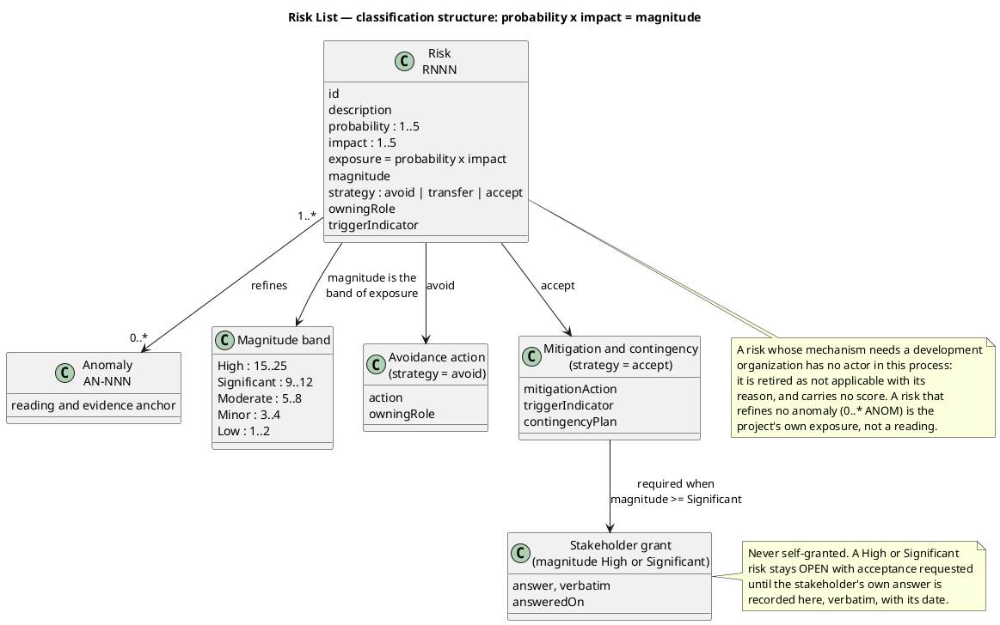
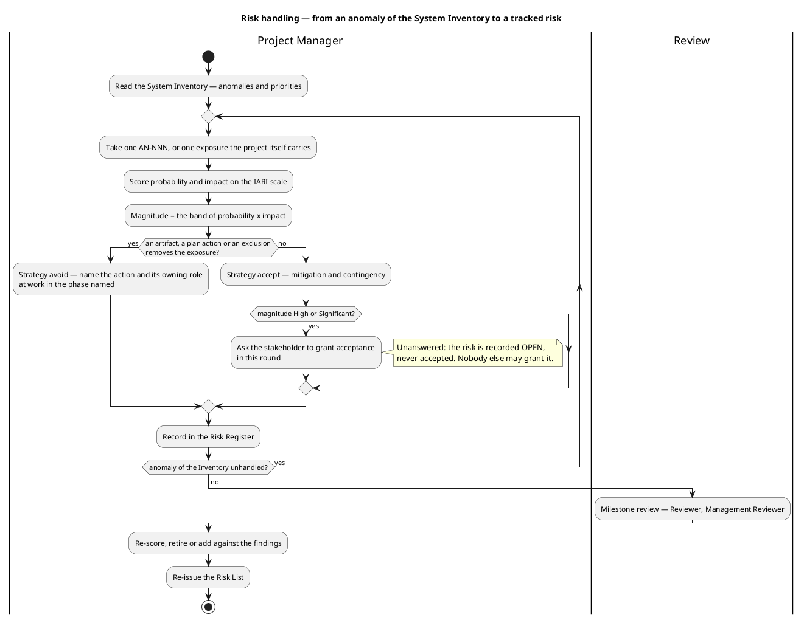

## Document Control
- Phase: Excavation
- Status: Draft — 24 anomalies scored as 25 risks, four acceptances held verbatim, carried into the AR milestone review
- Milestone Target: end of Excavation (AR) — not yet achieved

## Risk Classification
Every risk below is scored on the declared IARI risk scale (DC baseline §9.10); the project Development Case records no deviation from it. R001–R025 come from an anomaly the System Inventory recorded — none is invented. R021 is the project's own exposure, entered at the SBC milestone review, and it is scored on the same scale rather than described beside it.

| Probability | Level | Exposure |
|---|---|---|
| 1 | Very low — 10 % or less | Magnitude = probability × impact |
| 2 | Low — 11 % to 30 % | High 15–25 · Significant 9–12 · Moderate 5–8 · Minor 3–4 · Low 1–2 |
| 3 | Medium — 31 % to 50 % | |
| 4 | High — 51 % to 70 % | |
| 5 | Very high — more than 70 % | |

| Impact | Level | Means |
|---|---|---|
| 1 | Very low | No deviation from the plan worth recording |
| 2 | Low | Extra work inside the current iteration; its objectives are still met |
| 3 | Medium | An iteration objective slips to a later iteration the phase already plans |
| 4 | High | The milestone slips: the phase needs an iteration it did not plan |
| 5 | Very high | Success is endangered: a declared requirement or constraint can no longer be met as declared |

**Actor check.** Every risk names an actor this process has — a role at work in a phase the plan already runs, or the stakeholder. No anomaly of the System Inventory is about staffing, skills, morale or friction between people: this project has no development organization to staff, so none is retired on that ground. The four anomalies the recovery added (AN-021 … AN-024) are all read from the start-up path, the wire shape and the repository's own history — mechanism, not personnel — so each is scored, and each is handled by avoidance owned by a role at work in the phase named. The one human the process waits on is the stakeholder, and that wait is carried as R021 rather than left unscored.

| Magnitude | Count | Risks |
|---|---|---|
| High | 3 | R008, R009, R020 — acceptance granted by the stakeholder on 2026-11-19 |
| Significant | 13 | R003, R004, R005, R006, R007, R012, R015, R017, R018, R022, R023, R024 — avoidance; R021 — acceptance granted by the stakeholder on 2026-11-19 |
| Moderate | 7 | R001, R002, R010, R011, R013, R014, R019 |
| Minor | 2 | R016, R025 |
| Low | 0 | — |

Of the thirteen Significant risks, twelve are handled by avoidance, each naming the action and the role that performs it; the thirteenth, R021, is accepted, and that acceptance was put to the stakeholder and granted. Every High and Significant risk in this register is therefore either avoided by a named action or accepted on the stakeholder's own answer — none is open, and none was self-granted. No acceptance is requested in this iteration: the recovery added no exposure that no action retires.

## Risk Register
| ID | Risk | AN | P | I | Exposure | Magnitude | Strategy |
|---|---|---|---|---|---|---|---|
| R001 | A recovered artifact or the user documentation names a Swagger UI the system does not serve, sending the reader to a screen that does not exist. | AN-001 | 3 | 2 | 6 | Moderate | Avoid |
| R002 | The README's "Auth0 is configured" is taken as a requirement and a provider integration re-enters scope, although the mechanism is inert as delivered and excluded by the stakeholder. | AN-002 | 2 | 3 | 6 | Moderate | Avoid |
| R003 | The Development Case points the coding, UI and test conventions at a file absent from the repository, so roles either invent conventions or the tailoring is unenforceable. | AN-003 | 4 | 3 | 12 | Significant | Avoid |
| R004 | The relational schema is mistaken for a declared design: a table, key or cascade rule is restated from the stale model snapshot or from a run-time database instead of the migration bodies. | AN-004 | 3 | 3 | 9 | Significant | Avoid |
| R005 | The offered development container cannot restore or build the solution, so any environment verification performed inside it measures an SDK below the project's floor. | AN-005 | 4 | 3 | 12 | Significant | Avoid |
| R006 | CI green is quoted as proof that the pinned SDK builds the solution, when the workflow uses whatever SDK the runner image carries. | AN-006 | 4 | 3 | 12 | Significant | Avoid |
| R007 | A migration is authored from the EF Core 8.0.0 snapshots under a 9.0.8 runtime, and the diff it produces misstates the schema. The claim now rests on all four generated files — the model snapshot and the three `*.Designer.cs` snapshots, the one written by the 2022-11-23 migration among them — every one of which annotates `ProductVersion` 8.0.0, so the baseline is confirmed two major models behind the runtime. | AN-007 | 4 | 3 | 12 | Significant | Avoid |
| R008 | The product as delivered cannot mark a todo complete from any screen while the API can, so a use case recovered from EP-015 carries a capability no delivered actor reaches. | AN-008 | 4 | 4 | 16 | High | Accept — granted by the stakeholder, 2026-11-19 |
| R009 | The identity decision point — cookie authentication, `/auth`, the YARP forwarder — carries no automated verification, so every recovered statement about who the caller is rests on a static reading. | AN-009 | 4 | 4 | 16 | High | Accept — granted by the stakeholder, 2026-11-19 |
| R010 | A use case claims cross-user access on the strength of the `admin` claim although no code path grants the role, and authority is designed into the product as if it existed. | AN-010 | 2 | 3 | 6 | Moderate | Avoid |
| R011 | The credential-accepting `/users` surface carries no throttle: registration, login and refresh accept unlimited attempts. | AN-011 | 2 | 3 | 6 | Moderate | Avoid |
| R012 | The BFF reaches the API only through an Aspire-discovered hardcoded address, so in an environment without that discovery the browser half cannot reach the backend and no configuration key supplies a route. | AN-012 | 3 | 3 | 9 | Significant | Avoid |
| R013 | The browser-facing subsystem — measured on the corrected counts the reading now rests on: 30 commits of its own to 2024-11-27 against 60 for the whole `Todo.Api` path, 12 of them in `Authentication`, and the newest commit to touch product code anywhere in the delivery — is recovered from a static reading, so a recovered login, logout or forwarding behaviour is later contradicted by the first execution. | AN-013 | 3 | 2 | 6 | Moderate | Accept |
| R014 | No mail transport exists anywhere in the delivery, so a later phase that declares password recovery or email confirmation pulls an undeclared integration into scope. | AN-014 | 2 | 3 | 6 | Moderate | Avoid |
| R015 | Refresh tokens are issued and never redeemed: the session ends at an access-token lifetime nobody chose, and the only recovery the product offers is a silent logout. | AN-015 | 3 | 3 | 9 | Significant | Avoid |
| R016 | Outside Development the root path redirects to a Scalar UI that is not mapped while the OpenAPI document stays published, so the delivered production posture is undefined. | AN-016 | 2 | 2 | 4 | Minor | Accept |
| R017 | Both hosts fall back to a per-user file-system key ring, so run as separate services each holds its own keys: cookies become undecryptable and the provider key unreadable. | AN-017 | 3 | 4 | 12 | Significant | Avoid |
| R018 | `POST /users/token/{provider}` is anonymous and unprotects a caller-supplied value before any identity is established, so any caller reaching the port posts to a cryptographic unprotect. | AN-018 | 3 | 3 | 9 | Significant | Avoid |
| R019 | Seven published identity operations with no caller in the delivered product are taken for product capability, and use cases or a manual are written for screens that do not exist. | AN-019 | 3 | 2 | 6 | Moderate | Avoid |
| R020 | The assembled system has never run: AppHost ordering, service discovery, the forwarder, the shared key ring and the migration step are inferred, and the first run may contradict any reading. | AN-020 | 5 | 4 | 20 | High | Accept — granted by the stakeholder, 2026-11-19 |
| R021 | A human gate on the roadmap is not answered inside its ceiling, so the process suspends with the milestone unsanctioned and no work item able to advance: the project's one external dependency, and the only thing it waits on. | — | 3 | 4 | 12 | Significant | Accept — granted by the stakeholder, 2026-11-19 |
| R022 | The schema gate closes itself before the migration it guards has run: it creates the directory the migration would create and registers the migration only inside that branch, so a first start that fails leaves every later start applying no schema and opening whatever file it finds. A migration authored after the first successful start reaches no database the AppHost ever opens. | AN-021 | 3 | 4 | 12 | Significant | Avoid |
| R023 | The store's location is a relative path no file declares and no code creates a directory for, so a run outside the AppHost opens a store somewhere else and a deployment or migration claim rests on a working directory nothing states. | AN-022 | 4 | 3 | 12 | Significant | Avoid |
| R024 | The wire shape of every request and response is declared twice — `Todo.Web.Shared` and the API's own DTOs — with no compiler between them, so a rename or type change on either side compiles clean on both and fails only at the first forwarded request, and no test crosses the BFF to catch it. | AN-023 | 3 | 3 | 9 | Significant | Avoid |
| R025 | Every path of the API half carries two names and nothing records the rename, so a history read by commit count is wrong wherever it is scoped to the present path — 10 commits where the union is 60, 2 where it is 30 — and a reading built on it misjudges how settled an area is. | AN-024 | 3 | 2 | 6 | Moderate | Avoid |

R001–R020 come from the reading SBC closed on. R022–R025 come from the four anomalies the recovery added this iteration: three are read from the start-up path and the wire shape (`AN-021`, `AN-022`, `AN-023`) and one from the repository's own history (`AN-024`). None is invented, and none is a restatement of a risk already in the register: R022 is the gate's own failure mode, distinct from R004 and R007 which concern what a schema is recovered or generated from; R023 is where the store lives, distinct from R017 which concerns the key ring.

R021 does not refine an anomaly: it is the project's own exposure, entered at the SBC milestone review, and it is scored on the same scale as the rest. Seven human gates sit on the roadmap — one per milestone — and each can suspend the process, so the wait is a risk of its own rather than a footnote to the plan's forecast.

## Risk Mitigation and Contingency

| ID | Action that removes or limits the exposure | Owning role — where it lands | Trigger indicator | Contingency if it materializes |
|---|---|---|---|---|
| R001 | Every reference to the developer console cites EP-024 (`/scalar/v1`, Development only); no artifact names a Swagger UI. | System Analyst — Excavation; Technical Writer — Construction (User Documentation) | An artifact or manual line names Swagger or a Swashbuckle route | The reference is corrected in the iteration that writes it; no plan change |
| R002 | The exclusion stands where it was recorded — System Inventory Perimeter and AN-002 — and is carried into the Supplementary Specification as an unconfigured provider option. | System Analyst — Excavation | A requirement, use case or design element mentions an external provider scheme | Treated as undeclared scope: it needs a Change Request before any work |
| R003 | The Templates rows cite files that exist, and the three convention families are recorded Undocumented with no fallback asserted, so no role can cite a source that is not there. | Process Engineer — the Development Case correction work item scheduled first in this iteration; Inception re-preparation is a separate, later stage | A role is asked to comply with a convention and cites `CONTRIBUTING.md` | The convention is recorded as absent and the tailoring proceeds without it |
| R004 | The schema is recovered into the Design Model from the three migration `Up`/`Down` bodies and the model snapshot, and is described as recovered — never as declared. No Data Model is produced (Development Case §5). | Database Designer — Excavation | A table, key or cascade rule is cited from a run-time database or an unstated source | The Design Model's persistent-data sections are re-derived from the migrations in the iteration that finds it |
| R005 | The devcontainer base image is aligned with the SDK pin the repository already declares — an environment alignment, not a stack upgrade, so the pinned .NET 9 / Aspire stack is untouched. | Integrator — Inception (Build Environment Setup) | The container cannot restore or build `TodoApp.sln` | No verification is claimed from inside the container; verification runs in the pinned environment |
| R006 | `dotnet-version` `9.0.100` is supplied to `actions/setup-dotnet` so CI builds the pinned SDK. | Integrator — Inception (Build Environment Setup) | CI is green while `global.json`'s pin is not what the runner carries | CI green is not quoted as proof; the build is verified against the pin before any milestone claim |
| R007 | No migration is authored in this project unless a declared requirement demands one; if one is, all four generated snapshots are first regenerated against EF Core 9.0.8, so the baseline the diff is computed from is the runtime's. | Database Designer, Integrator — the iteration that plans a schema change | A change would add or alter a table, key or index | The migration is regenerated from a baseline built on the runtime's EF Core version |
| R008 | Accepted. Mitigation: the System Analyst records the missing completion path beside the recovered update use case, and the Technical Writer's User Documentation carries it, rather than a completion control being repaired into scope without a Change Request. | System Analyst — Excavation; Technical Writer — Construction (User Documentation) | The Use-Case Model carries an update/complete flow whose actor has no screen path | A completion control enters scope only through a Change Request the stakeholder approves, planned in the iteration that follows it |
| R009 | Accepted. Mitigation: first coverage of the BFF is planned for the first Elaboration iteration, before any change to it is accepted. | Test Designer, Tester — Elaboration | A design decision about identity rests on code no test exercises | The first run contradicts a recovered login, logout or forwarding behaviour, and the affected use cases are re-derived with the run's evidence in that same iteration |
| R010 | No use case claims cross-user access; authority is recorded as ownership-only, and the exclusion is carried into the Supplementary Specification. | System Analyst — Excavation | A use case or design element mentions an administrator or a role grant | It needs a Change Request naming who grants the role before any work |
| R011 | The absence of a limiter on `/users` is recorded in the Supplementary Specification rather than assumed away, and the Deployment Model keeps the API off any public route so the surface is reachable only from the BFF. | System Analyst, Software Architect — Excavation (Supplementary Specification; Deployment Model) | The target environment exposes the API port beyond the BFF | A throttling requirement is declared as a Change Request and the limiter is added to the `/users` group in the iteration that plans it |
| R012 | The Deployment Model names service discovery as the mechanism that resolves the BFF-to-API address, and records the AppHost as the only run mode the delivery supports. | Software Architect — Excavation (Deployment Model) | A target environment is named that has no service discovery | A configured API address is added to the BFF in the iteration that plans that environment — as a Change Request, since it changes the recovered configuration surface |
| R013 | The BFF is read second by the Inventory's Priorities, every recovered element cites its anchor, the reading is marked static wherever execution has not confirmed it, and the instability it is recovered under is measured on the union of both paths — 30 commits for the BFF itself against 60 for the whole API path. | System Analyst, Software Architect — Excavation | The first assembled run contradicts a recovered login, logout or forwarding behaviour | The affected recovered elements are re-derived with the run's evidence in the same iteration |
| R014 | The absent mail transport is a recorded fact of the delivery, entered in the Supplementary Specification; password recovery and email confirmation stay excluded, so no phase plans work that needs a transport. | System Analyst — Excavation (Supplementary Specification). The control part — that no later requirement pulls a transport into scope without a ledger entry — moves to Change Control Manager, Inception, where the ledger opens | A requirement, use case or Change Request mentions a reset or confirmation mail | A mail transport is declared as integration scope in that Change Request and planned in the iteration that follows it |
| R015 | `/users/refresh` stays in recovered scope as the mechanism a session-extension requirement would build on; the session lifetime is recorded as a framework default, and no artifact claims a length the system does not have. | System Analyst — Excavation (Supplementary Specification); Designer — Excavation (Design Model) | A requirement, use case or NFR states a session duration or an idle timeout | The declared duration becomes a Change Request; the BFF's token handling changes in the iteration that plans it |
| R016 | EP-024 is recovered as a development-environment screen and the published OpenAPI document is recorded as recovered behaviour, so no artifact asserts an intended production posture. | System Analyst — Excavation (Use-Case Model); Software Architect — Excavation (Deployment Model) | A requirement or the Deployment Model states an intended production posture for the API document | The posture is declared as a Change Request and the redirect or the mapping is changed accordingly |
| R017 | The Deployment Model declares a shared data-protection key repository as a required element of the target environment; the recovered per-user file-system default is recorded as not sufficient for a multi-service deployment. | Software Architect — Excavation (Deployment Model) | The topology is deployed with each host keeping its own key ring | Cookies minted by one host are rejected by the other; the key repository is configured before any deployment claim |
| R018 | The Deployment Model keeps the API off any public route, so the anonymous unprotect is reachable only from the BFF; EP-011 stays excluded and no use case claims it. | Software Architect — Excavation (Deployment Model) | The API port is reachable from anything but the web server | If provider sign-in ever enters scope, the recorded service-to-service hop is declared as a requirement before the endpoint is used |
| R019 | No use case is recovered from EP-004 to EP-010; the Perimeter keeps them with their anchors so a later phase that needs one recovers it without re-reading the code. | System Analyst — Excavation | A use case, manual section or test claims an account-management, 2FA, reset or confirmation screen | The screen does not exist: the claim is withdrawn, and the capability needs a Change Request and a declared transport |
| R020 | Accepted. Mitigation: the first assembled run of the topology is planned as the Integrator's Architecture Build in Elaboration, and until it happens every statement about the composed system is marked a static reading. | Integrator, Tester — Elaboration | Elaboration opens without an assembled run in its plan | A topology that cannot be made to run endangers the declared Aspire constraint, and is escalated as a constraint that can no longer be met as declared |
| R021 | Accepted. Mitigation: every question only the stakeholder can answer is put in the round that raises it — with the recommended answer and the open findings inside it — never carried forward as a document they may not read; and the milestone verdict is never recorded before their answer. | Project Manager — every phase; the gate sits on each of the seven milestones of the roadmap | A gate is unanswered when the work item that raised it has nothing left to do | The 14-day ceiling is reached: the process suspends with the milestone unsanctioned, nothing is auto-filled and no work item advances on a self-granted decision |
| R022 | The Deployment Model records the start-up path as it is: a single-shot schema gate that runs only on the AppHost's first start, and the API opening the file it finds with no schema check. No artifact then claims a migration is applied by a later start. | Software Architect — Excavation (Deployment Model); Integrator — Elaboration (Architecture Build) | A first start fails between the directory being created and the migration completing, or a migration is authored after the first successful start | The schema is applied by hand and the failure recorded before any run-based claim; a schema check is declared as a Change Request, not repaired into scope |
| R023 | The Deployment Model records the working directory as a required property of the environment, alongside the relative `Data Source` path and the assumption the AppHost's bind mount makes about it. | Software Architect — Excavation (Deployment Model); Deployment Manager — Transition (Production Deployment) | The API is started from a working directory other than the project's | The connection string becomes a declared configuration key through a Change Request in the deployment that needs it; no deployment claim rests on an undeclared directory |
| R024 | The Design Model records the duplication as a recovered property and names both declarations of each DTO; the SAD carries it as CON-A10, so no role treats the shared library as the contract. | Designer, Software Architect — Excavation (Design Model; Software Architecture Document) | A DTO member changes on one side of the boundary and not the other | A contract test through the BFF is added in the Elaboration iteration that first changes a DTO, and a shared contract is declared as a Change Request |
| R025 | The System Inventory states the union rule once, with both counts for each renamed path, and every commit-count comparison in the plan or an artifact cites the union rather than a single path. | Software Archaeologist — Excavation (System Inventory); Project Manager — any statement of area churn | A commit-count comparison cites one path, or two areas are compared on counts taken differently | The statement is corrected in the artifact that makes it, in the iteration that finds it; no risk is re-scored, since the reading, not the exposure, was wrong |

Every avoidance action above names a role at work in the phase it lands in: Excavation's Requirements stage is the System Analyst's, its Analysis and Design stages are the Software Architect's, the Designer's and the Database Designer's, and the Change Control Manager's first stage is Inception, where the ledger opens. R022 and R023 are owned by the Software Architect in Excavation because the Deployment Model is the artifact that carries the start-up path; R025's control sits with the Software Archaeologist because the Inventory is where a history statement is made.

### Acceptance granted by the stakeholder

All four accepted risks were put to the stakeholder and granted. Each proposition and the answer received:

| ID | Magnitude | The proposition put to the stakeholder | Their answer, verbatim | Recorded |
|---|---|---|---|---|
| R008 | High (16) | Accept the exposure that the delivered product cannot mark a todo complete from any screen, with the gap recorded beside the recovered update use case and in the user-facing product documentation rather than repaired without a Change Request. | "Yes" | 2026-11-19 |
| R009 | High (16) | Accept the exposure that the BFF carries no automated tests, with first coverage planned for the first Elaboration iteration before any change to it is accepted. | "Yes" | 2026-11-19 |
| R020 | High (20) | Accept the exposure that the assembled system has never been run, with the first assembled run planned as the Integrator's Architecture Build in Elaboration. | "Yes" | 2026-11-19 |
| R021 | Significant (12) | Accept the exposure that a human gate unanswered past its ceiling suspends the process with the milestone unsanctioned, with the mitigation and the contingency stated above. | "Yes" | 2026-11-19 |

The four are the whole of what the stakeholder granted. No condition beyond the proposition each affirmed is read into the acceptance, nothing else in this register is thereby granted, and the recovery added no fifth: R022–R025 are each retired or limited by an action a named role performs in a phase the plan already runs.

R008's disclosure home is fixed here at the two places the process actually produces: the System Analyst's note beside the recovered update use case, in Excavation, and the User Documentation the Technical Writer produces in Construction. The System Inventory's AN-008 records the same two homes.

### Effect of the Excavation scope decision on R009, R013 and R020

On 2026-11-19 the stakeholder declined splitting Excavation, so the AR milestone closes with priorities 1–6 recovered in a single iteration and no second reading pass exists inside the sprint zero to catch what the first pass missed. Three accepted risks now carry their exposure inside one iteration rather than across two:

| ID | Magnitude | What the decision changes | Mitigation that holds under it | Trigger indicator |
|---|---|---|---|---|
| R009 | High (16) — accepted 2026-11-19 | The BFF (priority 2) is read in the same pass as the rest, so a static misreading of the identity decision point has no later sprint-zero pass to surface it. | The first coverage of the BFF remains planned for the first Elaboration iteration, before any change to it is accepted — unchanged by this decision, and now the only check between reading and change. | A design decision about identity rests on code no test exercises. |
| R013 | Moderate (6) — accept | The most-changed subsystem is read once, under R020's wholly-static condition, with the cross-check (priority 7, `Todo.Api.Tests`) covering `/todos` and `/users` but not the BFF. | Priority 7 is read inside the same iteration as the cross-check on orders 1 and 2, and every recovered BFF element is marked a static reading where execution has not confirmed it. | The first assembled run contradicts a recovered login, logout or forwarding behaviour. |
| R020 | High (20) — accepted 2026-11-19 | Nothing about the run changes, but a larger share of the recovered baseline now rests on the single pass that precedes it. | The first assembled run stays planned as the Integrator's Architecture Build in Elaboration, and Elaboration carries its planned second iteration so a contradiction is re-derived inside that phase. | Elaboration opens without an assembled run in its plan. |

No risk is re-scored and no acceptance is re-requested: the decision changes where the exposure sits, not how large it is, and the three acceptances stand as granted. The one consequence the plan absorbs is that Elaboration's second iteration is no longer merely likely — under a single-pass sprint zero it is the phase's only place to correct a recovered statement, so it is committed rather than held.

## Traceability
| Element | Traces From | Link Type | Traces To |
|---|---|---|---|
| R001 | AN-001 | Refines | — |
| R002 | AN-002 | Refines | — |
| R003 | AN-003 | Refines | — |
| R004 | AN-004 | Refines | — |
| R005 | AN-005 | Refines | — |
| R006 | AN-006 | Refines | — |
| R007 | AN-007 | Refines | — |
| R008 | AN-008 | Refines | — |
| R009 | AN-009 | Refines | — |
| R010 | AN-010 | Refines | — |
| R011 | AN-011 | Refines | — |
| R012 | AN-012 | Refines | — |
| R013 | AN-013 | Refines | — |
| R014 | AN-014 | Refines | — |
| R015 | AN-015 | Refines | — |
| R016 | AN-016 | Refines | — |
| R017 | AN-017 | Refines | — |
| R018 | AN-018 | Refines | — |
| R019 | AN-019 | Refines | — |
| R020 | AN-020 | Refines | — |
| R021 | — | — | — |
| R022 | AN-021 | Refines | — |
| R023 | AN-022 | Refines | — |
| R024 | AN-023 | Refines | — |
| R025 | AN-024 | Refines | — |

R021 refines no anomaly: it is the project's own exposure — a human gate unanswered past its ceiling — not a reading of the existing system, and it therefore has no upstream end.

