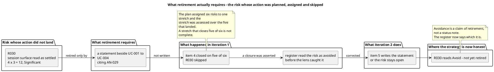

## Document Control
- Phase: Excavation
- Status: Live register. Updated at the close of iteration 1 and carried into iteration 2; the AR verdict is the Review Coordinator's — iteration required — and is not this register's to declare
- Milestone Target: end-of-Excavation (AR) — not yet achieved
- Iteration: 1, Cycle 1 closed; iteration 2 planned from the Review Record
- Owner: Project Manager
## Risk Classification
The scale is the IARI risk scale of the Development Case baseline, §9.10. The project Development Case records no scale of its own, and this artifact defines none. Probability and impact are scored on that scale; a risk's magnitude is the band its exposure (probability × impact) falls in — it is never chosen.

| Probability | Level | Means |
|---|---|---|
| 1 | Very low | 10 % or less |
| 2 | Low | 11 % to 30 % |
| 3 | Medium | 31 % to 50 % |
| 4 | High | 51 % to 70 % |
| 5 | Very high | More than 70 % |

| Impact | Level | Means |
|---|---|---|
| 1 | Very low | No deviation from the plan worth recording |
| 2 | Low | Extra work inside the current iteration; its objectives are still met |
| 3 | Medium | An iteration objective slips to a later iteration the phase already plans |
| 4 | High | The milestone slips: the phase needs an iteration it did not plan |
| 5 | Very high | Success is endangered: a declared requirement or constraint can no longer be met as declared |

| Magnitude | Exposure | Acceptance |
|---|---|---|
| High | 15 to 25 | the stakeholder's grant |
| Significant | 9 to 12 | the stakeholder's grant |
| Moderate | 5 to 8 | the Project Manager's |
| Minor | 3 to 4 | the Project Manager's |
| Low | 1 to 2 | the Project Manager's |

### How each score is derived

Thirty of the thirty-two risks score the likelihood and impact the System Inventory states for the anomaly they refine. Those words are translated once, here, and the same word gives the same number in every row — the eight risks Excavation added use no word the Survey set did not already use.

| Inventory word | Score | Inventory word | Score |
|---|---|---|---|
| likelihood `possible` | Probability 3 — Medium, 31 % to 50 % | impact `low` | Impact 2 — Low |
| likelihood `likely` | Probability 4 — High, 51 % to 70 % | impact `moderate` | Impact 3 — Medium |
| | | impact `high` | Impact 4 — High |

`R022` refines no anomaly: it is the plan's own dependency on stakeholder answers, and its 2 × 4 is the Project Manager's reading of the phase gate. `R031` refines none either: it is the plan's own exposure — an exit criterion whose owner the phase does not schedule — scored 3 × 4 because the correction may land in time and, if it does not, the AR milestone needs an iteration this phase did not plan; it has materialized. `R032` refines none: it is the exposure the AR review's own defect ledger establishes — one recovered fact transcribed inconsistently into the artifacts that cite it — scored 4 × 3 because four of the eight Majors at that gate are exactly that.

### The register by band

| Magnitude | Risks | Count | Strategy in this register |
|---|---|---|---|
| High | — | 0 | — |
| Significant | R001, R002, R003, R004, R005, R007, R009, R010, R011, R012, R016, R018, R020, R021, R023, R024, R026, R028, R030, R031, R032 | 21 | R004, R011, R012 and R016 accept, each under the stakeholder's own grant of 2026-11-23; the other seventeen avoid, which is the Project Manager's authority at any band |
| Moderate | R006, R008, R013, R014, R015, R017, R019, R022, R025, R027, R029 | 11 | R015 and R022 accept with mitigation and contingency, on the Project Manager's authority; the other nine avoid |
| Minor | — | 0 | — |
| Low | — | 0 | — |

No risk sits in a band its strategy cannot be held in: every Significant-band risk either avoids or carries the stakeholder's granting answer, and no new Significant risk Excavation added takes the accept strategy, so both the recovery and its corrective iteration required no grant. `R031` and `R032` both avoid, so the schedule and transcription exposures this phase surfaced need no grant either. `R030` avoids and is stated as not yet retired rather than as retired.

Not carried: no risk in this register concerns staffing, skills, turnover or friction between people. The executing agents are not a development organization and the stakeholder is the only human here, so such a risk would name no actor and is retired as not applicable rather than classified. What the people the SYSTEM serves do with it is a domain risk and stays.

## Risk Register
| R032 | One recovered fact is transcribed inconsistently into the artifacts that cite it, so the set a milestone certifies contradicts the fact its own phase recorded. Its origin is the AR review: four of its eight Majors are two code facts — the Development rate-limit override and the standard resilience handler — stated wrongly in four artifacts, while the System Inventory had recorded both in the same phase as AN-024 and AN-023. The facts are not new and this risk is not their reading; what it registers is that the phase transcribed them inconsistently | the AR review's ledger — `Supplementary Specification#F1`, `#F2`, `Software Architecture Document#F1`, `Deployment Model#F1`; the two facts are anchored at `Todo.Api/appsettings.Development.json:8-12` and `TodoApp.ServiceDefaults/Extensions.cs:32-42` | 4 | 3 | 12 | Significant | Avoid | Project Manager |
## Risk Mitigation and Contingency
Each risk carries the action its owner takes and the sign that it has started to bite. A risk accepted carries a mitigation as well as a contingency; a risk avoided is retired by its action, which the named owner performs. A risk whose action has not been performed is stated as not yet retired: avoidance is a claim of retirement, not a status note, and this register does not make that claim where it is not true.

| ID | Strategy | Action | Owner | Contingency if it materializes | Warning sign |
|---|---|---|---|---|---|
| R001 | Avoid | Recover complete-a-todo from EP-013 as an operation the API performs, and record in the Use-Case Model that no screen reaches it; claim no user-facing update path | System Analyst | The stakeholder declares a UI path for completion from Inception; it is then a declared requirement, worked from that phase, not a recovered one | A recovered use case names a control the client does not render |
| R002 | Avoid | Record in the Software Architecture Document's mechanisms that the BFF-to-API hop carries no service authentication and that the API accepts any bearer token | Software Architect | The Architecture Baseline names the hop as trusted and must be corrected before LCA | A design element assumes a service identity |
| R003 | Avoid | Record both declarations in the Design Model against the same element, and state that nothing checks their agreement | Designer | A realization is stated against one declaration and contradicted by the other at review | A contract field appears in one declaration only |
| R004 | Accept — granted by the stakeholder 2026-11-23 | Mitigation: cite their 2026-11-23 ruling wherever the ownership rule is recovered, so the `admin` branch is recorded as an exceptional entity and never as a recovered use case; the ruling is stated in the System Inventory's Perimeter | System Analyst | A role proposes an administrative use case; it stops at the ruling and goes to the stakeholder as a scope question | `admin` appears in a recovered use-case flow |
| R005 | Avoid | Add a migration-applies check to the architecture test scope, so the schema the tests build and the schema the migrations create are compared | Test Manager | The recovered data description is corrected against `EnsureCreated`, and the migrations are re-read | A model change compiles while the last migration does not match |
| R006 | Avoid | Remove the unused dependency when the test project is next touched, and record why the harness does not need it | Integrator | The dependency is left in place and the next upgrade carries it; cost stays inside the iteration | The package version is bumped for a package nothing uses |
| R007 | Avoid | Settle the container image against `net9.0` and the SDK pin in the Build Environment Setup, and record the decision with the build environment | Integrator | The build runs outside the container and the container is corrected before it is relied on | A build fails only inside the container |
| R008 | Avoid | Record the contradiction where the OpenAPI surface is recovered; use the code, never the README, as the anchor for the reference UI. The README stays unedited — it is the delivery's documentation, not the project's | Technical Writer | A role cites the README; the anchor is replaced by the code it contradicts | A document names a surface the code does not mount |
| R009 | Avoid | Record the limiter's coverage in the Software Architecture Document: `/todos` only, partitioned on a claim an anonymous caller lacks | Software Architect | A phase assumes the Identity endpoints are limited and a security statement is corrected | An unauthenticated endpoint is described as rate-limited |
| R010 | Avoid | Pin the key-ring decision in the Deployment Model, which is triggered for this project, and state where the BFF and the API must share it | Software Architect | The processes are separated and the protected provider key cannot be unprotected | Two processes set the discriminator and no key store |
| R011 | Accept — granted by the stakeholder 2026-11-23 | Mitigation: the framework version is pinned centrally, so the break happens only at a deliberate upgrade | Test Manager | The suite fails wholesale after an upgrade with no product change; the token minter is rewritten against the public API before the upgrade continues | A framework package moves with the suite red and the product green |
| R012 | Accept — granted by the stakeholder 2026-11-23 | Mitigation: test cases cover the BFF session and the `/auth` flows the recovered use cases name, and the client's todo flow, from Elaboration on | Test Manager | If the external-provider path is declared out of scope, coverage stops at the session and the ownership boundary | Untested BFF behaviour is recorded as verified; the review of that iteration is re-opened |
| R013 | Avoid | Record that the app host creates the database directory, and carry it into the Build Environment Setup as a precondition | Integrator | A run without the app host is documented as requiring one app-host start first | A standalone run answers with a missing-database failure |
| R014 | Avoid | Settle `RazorLangVersion` together with R007 in the Build Environment Setup | Integrator | The property stays behind and is recorded as a build constraint | A Razor compile behaves differently from the rest of the solution |
| R015 | Accept | Mitigation: the Deployment Model describes the orchestration as it stands, names it as holding the delivery's newest change, and names the BFF's session surface beside it rather than presenting either as settled. Contingency: the Integrator re-verifies the app host at the Elaboration architecture build | Software Architect | The app host changes again mid-phase and the Deployment Model is re-read against it | An app-host change lands after the Deployment Model is baselined |
| R016 | Accept — granted by the stakeholder 2026-11-23 | Mitigation: every recovered element cites the anchor it was read from, and the reading is re-checked at the iteration's own review | Project Manager | A recovered element is later found to misdescribe the system; it is corrected in place against its anchor | A recovered element carries no anchor, or an anchor that no longer reads as recorded |
| R017 | Avoid | Record the Development-only mapping with the reference-UI surface, and state the environment the redirect is served in | Software Architect | The deployment serves a non-Development environment and the redirect is corrected then | A deployment target names an environment other than Development |
| R018 | Avoid | Record the asymmetry in the Design Model against the ownership rule, as an exceptional entity, not as a second visibility rule | Designer | A recovered use case states one rule and the item endpoints contradict it at review | The list and the item paths are described as agreeing |
| R019 | Avoid | Record in the recovered use case that the challenge takes the scheme from the route and raises on an unknown name | System Analyst | A phase relies on a redirect or 404 the handler does not produce | An unknown provider name is described as returning a redirect |
| R020 | Avoid | Record in the recovered use case that the callback has one exit and no failure flow; the code's own TODO is the anchor | System Analyst | A test case asserts a failure message the system does not render | A recovered flow shows a failure branch the handler lacks |
| R021 | Avoid | Record in the recovered use cases that every authentication failure answers 401 with no body, and that the client shows one fixed string | System Analyst | A phase designs a distinction the system does not carry | A recovered flow names a cause the API does not report |
| R022 | Accept | Mitigation: every question to the stakeholder is asked in the same turn it is found, with the answer it needs stated so a one-word reply settles it; no answer is assumed while it is open. Contingency: an open grant holds the milestone and is escalated rather than filled — the process suspends rather than auto-filling an approval | Project Manager | A gate exceeds its ceiling: nothing is auto-filled, the milestone is not closed, and the queue is reported apart from agent time | A question is found in one iteration and not asked until the next |
| R023 | Avoid | Record in the recovered authorization statement that lockout is enforced at the password sign-in alone, that a locked account keeps every token it already holds, and that the guard's own TODO marks the check it omits | System Analyst | A phase designs a lockout enforcement the handler does not perform; the statement is corrected against the guard | An authorization flow shows a lockout check on a request |
| R024 | Avoid | Correct the Supplementary Specification's R4 to state the two hops apart, so the only artifact that still carries the error is fixed; the Software Architecture Document's P6 and the Design Model's PKG-D3 already state the difference correctly and are the reading to correct R4 against | Software Architect | A phase designs retry or circuit-breaking on the forwarder as if it existed, and the mechanism description is corrected | Both hops described as carrying the same handler |
| R025 | Avoid | Record beside the limiter's mechanism that the Development configuration overrides all three values to 50, that both launch profiles run in Development, and that no other environment file carries the section — so no figure measured there describes another environment | Software Architect | A capacity or throttling figure is taken in Development and published as the system's; it is re-taken with the section removed | A load observation cites a request budget of 50 |
| R026 | Avoid | Record in the persistent-data description that the third migration re-pointed `Todos.OwnerId` from `UserName` to `Id` and converted no row, and that a database is only consistent if written after migration 3 | Database Designer | A deployment targets a pre-existing database: converting the owner column becomes a declared migration requirement — a change request, not a recovered fact | A deployment plan names an existing database file |
| R027 | Avoid | Record in the Design Model and the recovered list flow that an absent base address answers `200` with an empty list, so the component cannot distinguish a failure from an empty list and the spinner is never reached | Designer | A phase builds error reporting on a distinction the client does not make, and the flow is corrected | A recovered flow shows the list reporting an unreachable API |
| R028 | Avoid | Record in the recovered registration statement that a provider-created account carries no email, so it cannot sign in with a password, confirm, recover or refresh through the framework's endpoints, and that the email index is not unique | System Analyst | A phase designs address confirmation or password recovery for a provider account, and the flow is corrected against the exchange | A recovered flow shows a provider account confirming an address |
| R029 | Avoid | Record in the persistent-data description that the test host replaces the production `DbContextOptions` registration, so no test exercises the connection-string resolution, the `.db` fallback, the context lifetime or the migration-built schema | Database Designer | A phase cites the suite as evidence about persistence, and the citation is withdrawn or the suite is extended | A persistence statement is called verified by the test suite |
| R030 | Avoid — **not yet retired** | Write a statement beside UC-001 to UC-004 in the Use-Case Model that the file carrying them is the delivery's most-reworked file, that none of its fifteen commits touched a failure path, and that no test covers it — so what Excavation recovers there is read from code that never settled, citing `AN-029`. Iteration 2 item 5. Until it is written this risk is open, not retired | System Analyst, then Project Manager | A phase treats the session behaviour as stable and builds on it without re-reading; the flows are re-read against the file before the baseline | A design cites the session surface as settled |
| R031 | Avoid — **materialized** | The correction to `Development Case#F2` is stated as an iteration-2 work item with the Process Engineer as its owner, on the stakeholder's order of 2026-11-23, and recorded as work the phase runs on that order rather than as a discipline stage. A11 is not marked met until the artifact carries it | Project Manager | The correction does not land: A11 reads three of four again, the AR milestone does not close on iteration 2's evidence either, and the phase opens a third iteration planned from the Review Record. Declared work is never cut to avoid it | The technical lens returns and "Roles and Ownership" still omits the three lenses |
| R032 | Avoid | Iteration 2's work items 1, 2, 7 and 8 are ordered so the fact is settled once — in the Supplementary Specification — and the other three artifacts are corrected against it, each citing `AN-024` or `AN-023`. The lenses re-read all four in one pass (item 12), so a re-transcription that disagrees is caught at the same gate rather than at a later one | Project Manager | A corrected figure is transcribed wrongly a second time: the four artifacts disagree at the next milestone, and the disagreement is resolved by reading the code rather than by choosing between the artifacts | Two artifacts cite one `AN-NNN` and state different values for it |
## Traceability
| Element | Traces From | Link Type | Traces To |
|---|---|---|---|
| R001 | AN-001 | Refines | — |
| R002 | AN-002 | Refines | — |
| R003 | AN-003 | Refines | — |
| R004 | AN-004 | Refines | — |
| R005 | AN-005 | Refines | — |
| R006 | AN-006 | Refines | — |
| R007 | AN-007 | Refines | — |
| R008 | AN-008 | Refines | — |
| R009 | AN-009 | Refines | — |
| R010 | AN-010 | Refines | — |
| R011 | AN-011 | Refines | — |
| R012 | AN-012 | Refines | — |
| R013 | AN-013 | Refines | — |
| R014 | AN-014 | Refines | — |
| R015 | AN-015 | Refines | — |
| R016 | AN-016 | Refines | — |
| R017 | AN-017 | Refines | — |
| R018 | AN-018 | Refines | — |
| R019 | AN-019 | Refines | — |
| R020 | AN-020 | Refines | — |
| R021 | AN-021 | Refines | — |
| R022 | — | — | — |
| R023 | AN-022 | Refines | — |
| R024 | AN-023 | Refines | — |
| R025 | AN-024 | Refines | — |
| R026 | AN-025 | Refines | — |
| R027 | AN-026 | Refines | — |
| R028 | AN-027 | Refines | — |
| R029 | AN-028 | Refines | — |
| R030 | AN-029 | Refines | — |
| R031 | — | — | — |
| R032 | — | — | — |

`R022`, `R031` and `R032` carry no upstream: they are the plan's own exposures rather than readings of an anomaly, and each states its separate origin where it is described. `R032`'s evidence is the AR review's defect ledger; its own row in the register names the four findings and the two code facts they contradict.
