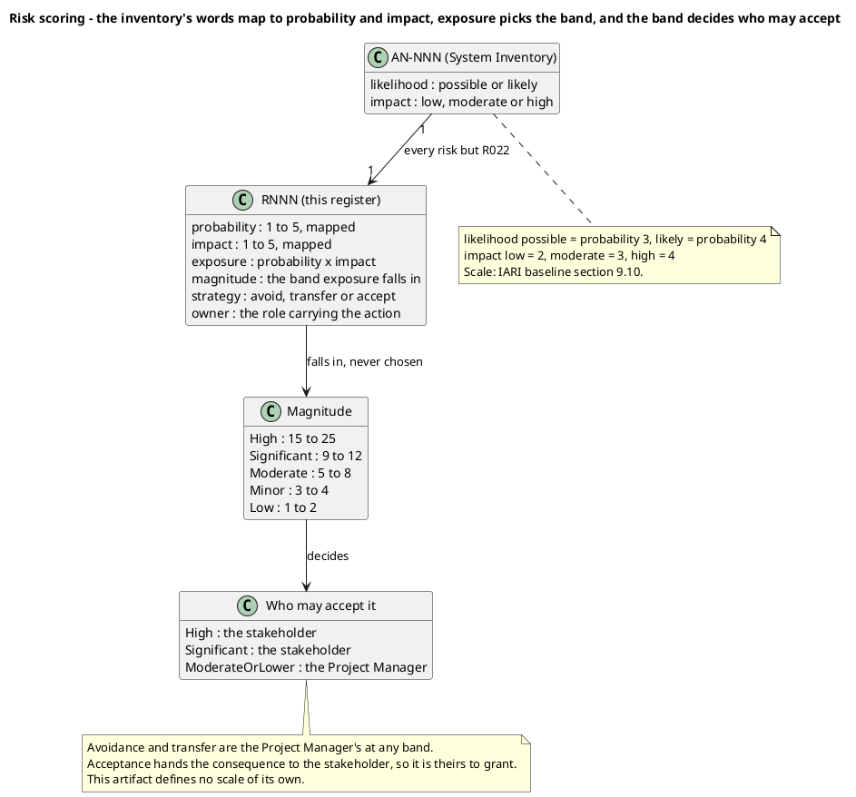
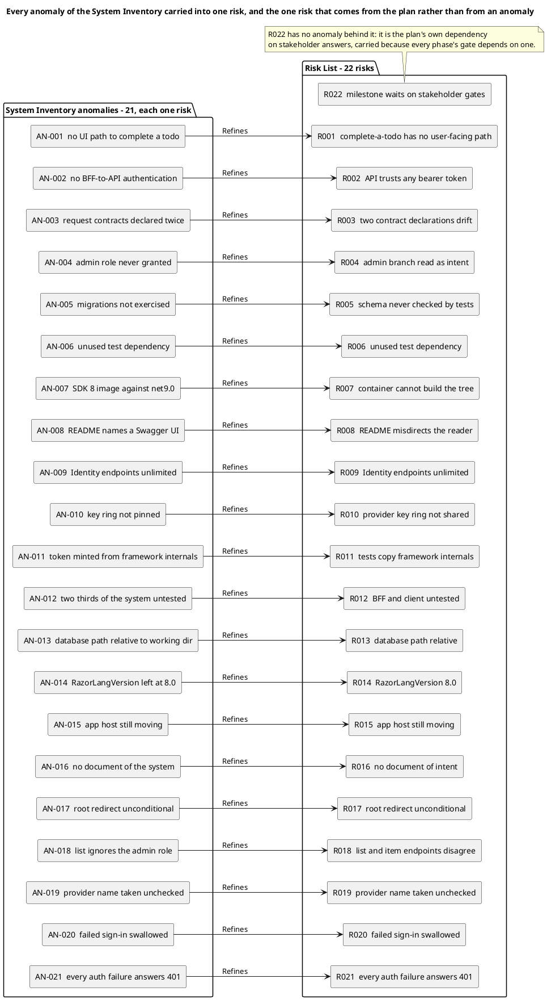

## Document Control
- Phase: Survey
- Status: Draft — 22 risks registered and owned; every probability and impact derives from its anomaly's stated likelihood and impact through one published mapping
- Milestone Target: end-of-Survey (SBC) — not achieved
- Iteration: 2, Cycle 1
- Owner: Project Manager

## Risk Classification
The scale is the IARI risk scale of the Development Case baseline, §9.10. The project Development Case records no scale of its own, and this artifact defines none. Probability and impact are scored on that scale; a risk's magnitude is the band its exposure (probability × impact) falls in — it is never chosen.

| Probability | Level | Means |
|---|---|---|
| 1 | Very low | 10 % or less |
| 2 | Low | 11 % to 30 % |
| 3 | Medium | 31 % to 50 % |
| 4 | High | 51 % to 70 % |
| 5 | Very high | More than 70 % |

| Impact | Level | Means |
|---|---|---|
| 1 | Very low | No deviation from the plan worth recording |
| 2 | Low | Extra work inside the current iteration; its objectives are still met |
| 3 | Medium | An iteration objective slips to a later iteration the phase already plans |
| 4 | High | The milestone slips: the phase needs an iteration it did not plan |
| 5 | Very high | Success is endangered: a declared requirement or constraint can no longer be met as declared |

| Magnitude | Exposure | Acceptance |
|---|---|---|
| High | 15 to 25 | the stakeholder's grant |
| Significant | 9 to 12 | the stakeholder's grant |
| Moderate | 5 to 8 | the Project Manager's |
| Minor | 3 to 4 | the Project Manager's |
| Low | 1 to 2 | the Project Manager's |

### How each score is derived

Twenty-one of the twenty-two risks score the likelihood and impact the System Inventory states for the anomaly they refine. Those words are translated once, here, and the same word gives the same number in every row:

| Inventory word | Score | Inventory word | Score |
|---|---|---|---|
| likelihood `possible` | Probability 3 — Medium, 31 % to 50 % | impact `low` | Impact 2 — Low |
| likelihood `likely` | Probability 4 — High, 51 % to 70 % | impact `moderate` | Impact 3 — Medium |
| | | impact `high` | Impact 4 — High |

`R022` refines no anomaly: it is the plan's own dependency on stakeholder answers, and its 2 × 4 is the Project Manager's reading of this iteration's gate, which queued three answers and closed none.

### The register by band

| Magnitude | Risks | Count | Strategy in this register |
|---|---|---|---|
| High | — | 0 | — |
| Significant | R001, R002, R003, R004, R005, R007, R009, R010, R011, R012, R016, R018, R020, R021 | 14 | R001, R002, R003, R005, R007, R009, R010, R018, R020 and R021 avoid, which is the Project Manager's authority at any band; R004, R011, R012 and R016 accept, each under the stakeholder's own grant of 2026-11-23 |
| Moderate | R006, R008, R013, R014, R015, R017, R019, R022 | 8 | R015 and R022 accept with mitigation and contingency, on the Project Manager's authority; the rest avoid |
| Minor | — | 0 | — |
| Low | — | 0 | — |

Every risk the reconciliation raised into the Significant band is either avoided — a strategy the Project Manager may take at any band — or carries the stakeholder's granting answer. No risk sits in a band that its strategy cannot be held in.

Not carried: no risk in this register concerns staffing, skills, turnover or friction between people. The executing agents are not a development organization and the stakeholder is the only human here, so such a risk would name no actor and would be retired as not applicable rather than classified. What the people the SYSTEM serves do with it is a domain risk and stays.

## Risk Register
Every risk traces to one anomaly of the System Inventory, and every probability and impact below is the score that anomaly's own likelihood and impact words take on the mapping stated once in `Risk Classification`. The twenty-one anomalies are all carried; R022 comes from the delivery's dependency on stakeholder gates, has no anomaly behind it, and its score is the Project Manager's own reading of the plan rather than a reading of code.

| ID | Risk | Evidence | P | I | Exposure | Magnitude | Strategy | Owner |
|---|---|---|---|---|---|---|---|---|
| R001 | Excavation's recovered use-case set cannot claim a user-facing "complete a todo": the list's checkbox is bound to nothing and the client makes no update call, so the update endpoint has no screen. A recovery that asserts the screen path states a behaviour the system does not have | `Todo.Web/Client/Components/TodoList.razor:24-27`; `Todo.Web/Client/TodoClient.cs:7-71`; `Todo.Api/Todos/TodoApi.cs:52-65` | 4 | 3 | 12 | Significant | Avoid | System Analyst |
| R002 | The Architecture Baseline assumes an authenticated BFF-to-API hop that does not exist: the API accepts a bearer token from any caller, and its own comment records the gap | `Todo.Api/Users/UsersApi.cs:16`; `Todo.Api/Program.cs:11,14` | 3 | 4 | 12 | Significant | Avoid | Software Architect |
| R003 | The recovered design carries two disagreeing request contracts, in two assemblies that do not reference each other, so a realization recorded against one need not describe the other | `Todo.Api/Todos/Todo.cs:15-21` vs `Todo.Web/Shared/SharedClass.cs:5-11` | 4 | 3 | 12 | Significant | Avoid | Designer |
| R004 | A later role treats the `admin` branch as live functionality: nothing in the running system grants that role, so any recovered behaviour relying on it is unreachable. The stakeholder ruled it an exceptional entity on 2026-11-23 | `Todo.Api/Todos/TodoApi.cs:33,59,69`; `Todo.Api/Migrations/20221123165051_RemoveIsAdmin.cs` | 4 | 3 | 12 | Significant | Accept — granted by the stakeholder 2026-11-23 | System Analyst |
| R005 | A migration that no longer matches the model is planned over undetected: the test host builds the schema with `EnsureCreated`, so the recovered data description is checked against a schema no test reproduces | `Todo.Api.Tests/TodoApplication.cs:11-14`; `TodoApp.AppHost/Extensions.cs:9-21` | 3 | 3 | 9 | Significant | Avoid | Test Manager |
| R006 | A declared dependency is carried as if the harness needed it, while the harness opens in-memory SQLite and never uses it | `Todo.Api.Tests/Todo.Api.Tests.csproj:4`; `Todo.Api.Tests/TodoApplication.cs:7` | 4 | 2 | 8 | Moderate | Avoid | Integrator |
| R007 | The build environment contradicts itself — container image SDK 8.0, target `net9.0`, SDK pin 9.0.100 — so the build environment the Integrator establishes may not build the tree that ships it | `.devcontainer/devcontainer.json:2`; `Directory.Build.props:4`; `global.json:3` | 4 | 3 | 12 | Significant | Avoid | Integrator |
| R008 | A role using the delivery's README as evidence records a surface the code does not have: the README directs the reader to a Swagger UI, and the code mounts the Scalar reference UI and redirects `/` to it | `README.md` (Using the API standalone); `Todo.Api/Program.cs:49-56,62` | 4 | 2 | 8 | Moderate | Avoid | Technical Writer |
| R009 | Rate limiting is assumed where there is none: the token-bucket policy covers `/todos` only, so `login`, `register`, `refresh` and `forgotPassword` are unlimited, and the partition key the policy uses does not exist for an anonymous caller | `Todo.Api/Users/UsersApi.cs:10-20`; `Todo.Api/Extensions/RateLimitExtensions.cs:38-47` | 3 | 3 | 9 | Significant | Avoid | Software Architect |
| R010 | The Deployment Model places the BFF and the API where they do not share a key ring, while a provider key is protected in one process and unprotected in the other; only the application discriminator is set | `Todo.Web/Server/Program.cs:13`; `Todo.Api/Program.cs:11`; `Todo.Web/Server/AuthApi.cs:82-90` | 3 | 3 | 9 | Significant | Avoid | Software Architect |
| R011 | A framework upgrade breaks the test suite without any behaviour changing: the suite reproduces the bearer-token ticket format from framework internals | `Todo.Api.Tests/TokenService.cs:10,21,31-34`; `Todo.Api.Tests/TodoApplication.cs:79-95` | 4 | 3 | 12 | Significant | Accept — granted by the stakeholder 2026-11-23 | Test Manager |
| R012 | The BFF and the Blazor client carry no test of any kind, so the recovered behaviour of the session, the proxy and the three defective `/auth` flows has no executable statement behind it — and those three flows are exactly the untested ones | `Todo.Api.Tests/Todo.Api.Tests.csproj:9`; the tree holds no other test project | 4 | 3 | 12 | Significant | Accept — granted by the stakeholder 2026-11-23 | Test Manager |
| R013 | A run that does not start the app host first has no database: the database path is relative to the API's working directory and its directory is created by the app host alone | `Todo.Api/Program.cs:23`; `TodoApp.AppHost/Extensions.cs:4-21` | 3 | 2 | 6 | Moderate | Avoid | Integrator |
| R014 | The server project's `RazorLangVersion` stays at 8.0 while the solution targets `net9.0` and its ASP.NET Core packages are 9.0.8 | `Todo.Web/Server/Todo.Web.Server.csproj:7`; `Directory.Build.props:4` | 3 | 2 | 6 | Moderate | Avoid | Integrator |
| R015 | The Deployment Model describes an app host that has changed three times since the API last did: the orchestration layer is the only part of the delivery still moving | `TodoApp.AppHost` history 2024-11-23 to 2026-02-12; `Todo.Api` history to 2025-08-07 | 4 | 2 | 8 | Moderate | Accept | Software Architect |
| R016 | Every recovered element from Excavation on is an interpretation of code: the delivery carries no requirement, design, architecture or test document, and no reading can be confirmed against a stated intent | `.iari/README.md`; the tree holds no such document | 4 | 3 | 12 | Significant | Accept — granted by the stakeholder 2026-11-23 | Project Manager |
| R017 | In any environment other than Development the delivered root redirect targets an endpoint the process does not serve: `/` redirects to the Scalar reference UI unconditionally, and that UI is mapped in Development only | `Todo.Api/Program.cs:62` against `Todo.Api/Program.cs:49-56` | 4 | 2 | 8 | Moderate | Avoid | Software Architect |
| R018 | A recovered use case that states one visibility rule is contradicted by the other endpoint: `GET /todos` filters on the owner alone with no admin branch, while the item endpoints each admit an `admin` principal | `Todo.Api/Todos/TodoApi.cs:24-27` vs `:29-36,52-65,67-73` | 4 | 3 | 12 | Significant | Avoid | Designer |
| R019 | A recovered use case that states the challenge's behaviour states one that raises on an unknown name: the provider name is taken straight from the route and checked against no registered scheme | `Todo.Web/Server/AuthApi.cs:55-62`; `Todo.Web/Server/Authentication/AuthenticationExtensions.cs:39-75` | 4 | 2 | 8 | Moderate | Avoid | System Analyst |
| R020 | A recovered use case cannot state a failure flow the system has: the provider callback redirects to `/` on every path, so a rejected provider, a null exchange and a failed cookie sign-in are indistinguishable to the person | `Todo.Web/Server/AuthApi.cs:64-97` | 4 | 3 | 12 | Significant | Avoid | System Analyst |
| R021 | A recovered use case that states why registration or login failed states a distinction the system does not make: every authentication failure answers 401 with no body, and the BFF discards the API's validation problem | `Todo.Web/Server/AuthApi.cs:14-38`; `Todo.Web/Server/AuthClient.cs:6-34` | 4 | 3 | 12 | Significant | Avoid | System Analyst |
| R022 | A phase's milestone cannot close while a stakeholder answer is queued. Every phase gate depends on one, and this iteration's gate asked for three answers | this register, R012, R016, and the priority-order question answered 2026-11-23 | 2 | 4 | 8 | Moderate | Accept | Project Manager |

### The stakeholder's grants on the two contested bands

Two risks in this register may sit above the Moderate band once their scores are reconciled, and acceptance at Significant or High is the stakeholder's alone. Both were put to the stakeholder on 2026-11-23, each question stated conditionally so that the answer binds whatever the reconciliation returns:

| Risk | Anomaly | Recorded here | What the System Inventory states | Exposure those words give | The stakeholder's answer |
|---|---|---|---|---|---|
| `R004` | `AN-004` | 2 × 2 = 4, Minor | "likely / moderate" | 4 × 3 = 12, Significant | Yes — accepted for the sprint zero should the reconciled score land at 9 to 12 or above, until Excavation records the branch as the exceptional entity the stakeholder ruled it to be |
| `R011` | `AN-011` | 4 × 2 = 8, Moderate | "likely / moderate" | 4 × 3 = 12, Significant | Yes — accepted for the sprint zero should the reconciled score land at 9 to 12 or above |

Both are the stakeholder's own grants, in their own words. Neither condition, limit nor prohibition beyond the one the question itself stated was added by this register.

The grant does not settle the arithmetic and is not a substitute for it: the two rows above still record the scores the review declared unreproducible, and the reconciliation is owed before the SBC gate is re-taken. What the grant does settle is that no risk this register can place in the Significant or High band lacks the stakeholder's answer — which is the condition `Risk List#F1` (Management Reviewer) found unmet.

`R001`, `R007`, `R012` and `R016` are unaffected: `R001` and `R007` are avoided, which is the Project Manager's authority at any band, and `R012` and `R016` carry the stakeholder's own grants of 2026-11-23 for their recorded exposure of 12.

### Acceptances in this register that are the stakeholder's to grant

Four risks carry the accept strategy in the Significant band, where acceptance is the stakeholder's alone. Each holds their own answer of 2026-11-23, given in their words and binding whatever the reconciliation returned:

| Risk | Exposure and band | The stakeholder's answer |
|---|---|---|
| `R004` | 4 × 3 = 12, Significant | "Yes" — to accepting, for the sprint zero, that a later role treats the `admin` branch as live functionality, until Excavation records it as the exceptional entity they ruled it to be |
| `R011` | 4 × 3 = 12, Significant | "Yes" — to accepting that a framework upgrade breaks the suite while no product behaviour changes, for the sprint zero, should the reconciled score land at 9 to 12 or above |
| `R012` | 4 × 3 = 12, Significant | "Yes" — to accepting that the BFF and the client carry no test of any kind, for the sprint zero |
| `R016` | 4 × 3 = 12, Significant | "Yes" — to accepting that every element Excavation and Consolidation recover is an interpretation of code with no stated intent to check it against, for the sprint zero |

`R015` and `R022` accept at exposure 8, the Moderate band, which is the Project Manager's own authority. Every other risk avoids or transfers, and both of those the Project Manager may choose at any band.

No risk in this register sits in the High band, so none exceeds what these grants cover.

## Risk Mitigation and Contingency
Each risk carries the action its owner takes and the sign that it has started to bite. A risk accepted carries a mitigation as well as a contingency; a risk avoided is retired by its action, which the named owner performs.

| ID | Strategy | Action | Owner | Contingency if it materializes | Warning sign |
|---|---|---|---|---|---|
| R001 | Avoid | Recover complete-a-todo from EP-013 as an operation the API performs, and record in the Use-Case Model that no screen reaches it; claim no user-facing update path | System Analyst | The stakeholder declares a UI path for completion from Inception; it is then a declared requirement, worked from that phase, not a recovered one | A recovered use case names a control the client does not render |
| R002 | Avoid | Record in the Software Architecture Document's mechanisms that the BFF-to-API hop carries no service authentication and that the API accepts any bearer token | Software Architect | The Architecture Baseline names the hop as trusted and must be corrected before LCA | A design element assumes a service identity |
| R003 | Avoid | Record both declarations in the Design Model against the same element, and state that nothing checks their agreement | Designer | A realization is stated against one declaration and contradicted by the other at review | A contract field appears in one declaration only |
| R004 | Accept — granted by the stakeholder 2026-11-23 | Asked whether they accepted this risk for the sprint zero, the stakeholder answered "Yes". Mitigation: cite their 2026-11-23 ruling wherever the ownership rule is recovered, so the `admin` branch is recorded as an exceptional entity and never as a recovered use case | System Analyst | A role proposes an administrative use case; it stops at the ruling and goes to the stakeholder as a scope question | `admin` appears in a recovered use-case flow |
| R005 | Avoid | Add a migration-applies check to the architecture test scope, so the schema the tests build and the schema the migrations create are compared | Test Manager | The recovered data description is corrected against `EnsureCreated`, and the migrations are re-read | A model change compiles while the last migration does not match |
| R006 | Avoid | Remove the unused dependency when the test project is next touched, and record why the harness does not need it | Integrator | The dependency is left in place and the next upgrade carries it; cost stays inside the iteration | The package version is bumped for a package nothing uses |
| R007 | Avoid | Settle the container image against `net9.0` and the SDK pin in the Build Environment Setup, and record the decision with the build environment | Integrator | The build runs outside the container and the container is corrected before it is relied on | A build fails only inside the container |
| R008 | Avoid | Record the contradiction where the OpenAPI surface is recovered; use the code, never the README, as the anchor for the reference UI. The README stays unedited — it is the delivery's documentation, not the project's | Technical Writer | A role cites the README; the anchor is replaced by the code it contradicts | A document names a surface the code does not mount |
| R009 | Avoid | Record the limiter's coverage in the Software Architecture Document: `/todos` only, partitioned on a claim an anonymous caller lacks | Software Architect | A phase assumes the Identity endpoints are limited and a security statement is corrected | An unauthenticated endpoint is described as rate-limited |
| R010 | Avoid | Pin the key-ring decision in the Deployment Model, which is triggered for this project, and state where the BFF and the API must share it | Software Architect | The processes are separated and the protected provider key cannot be unprotected | Two processes set the discriminator and no key store |
| R011 | Accept — granted by the stakeholder 2026-11-23 | Asked whether they accepted this risk for the sprint zero should its reconciled score land in the grant band, the stakeholder answered "Yes". Mitigation: the framework version is pinned centrally, so the break happens only at a deliberate upgrade | Test Manager | The suite fails wholesale after an upgrade with no product change; the token minter is rewritten against the public API before the upgrade continues | A framework package moves with the suite red and the product green |
| R012 | Accept — granted by the stakeholder 2026-11-23 | Asked whether they accept this risk for the sprint zero, the stakeholder answered "Yes". Mitigation: test cases cover the BFF session and the `/auth` flows the recovered use cases name, and the client's todo flow, from Elaboration on | Test Manager | If the external-provider path is declared out of scope, coverage stops at the session and the ownership boundary | Untested BFF behaviour is recorded as verified; the review of that iteration is re-opened |
| R013 | Avoid | Record that the app host creates the database directory, and carry it into the Build Environment Setup as a precondition | Integrator | A run without the app host is documented as requiring one app-host start first | A standalone run answers with a missing-database failure |
| R014 | Avoid | Settle `RazorLangVersion` together with R007 in the Build Environment Setup | Integrator | The property stays behind and is recorded as a build constraint | A Razor compile behaves differently from the rest of the solution |
| R015 | Accept | Mitigation: the Deployment Model describes the orchestration as it stands and names it as the volatile area. Contingency: the Integrator re-verifies the app host at the Elaboration architecture build | Software Architect | The app host changes again mid-phase and the Deployment Model is re-read against it | An app-host change lands after the Deployment Model is baselined |
| R016 | Accept — granted by the stakeholder 2026-11-23 | Asked whether they accept this risk for the sprint zero, the stakeholder answered "Yes". Mitigation: every recovered element cites the anchor it was read from, and the reading is re-checked at the iteration's own review | Project Manager | A recovered element is later found to misdescribe the system; it is corrected in place against its anchor | A recovered element carries no anchor, or an anchor that no longer reads as recorded |
| R017 | Avoid | Record the Development-only mapping with the reference-UI surface, and state the environment the redirect is served in | Software Architect | The deployment serves a non-Development environment and the redirect is corrected then | A deployment target names an environment other than Development |
| R018 | Avoid | Record the asymmetry in the Design Model against the ownership rule, as an exceptional entity, not as a second visibility rule | Designer | A recovered use case states one rule and the item endpoints contradict it at review | The list and the item paths are described as agreeing |
| R019 | Avoid | Record in the recovered use case that the challenge takes the scheme from the route and raises on an unknown name | System Analyst | A phase relies on a redirect or 404 the handler does not produce | An unknown provider name is described as returning a redirect |
| R020 | Avoid | Record in the recovered use case that the callback has one exit and no failure flow; the code's own TODO is the anchor | System Analyst | A test case asserts a failure message the system does not render | A recovered flow shows a failure branch the handler lacks |
| R021 | Avoid | Record in the recovered use cases that every authentication failure answers 401 with no body, and that the client shows one fixed string | System Analyst | A phase designs a distinction the system does not carry | A recovered flow names a cause the API does not report |
| R022 | Accept | Mitigation: every question to the stakeholder is asked in the same turn it is found, with the answer it needs stated so a one-word reply settles it; no answer is assumed while it is open. Contingency: an open grant holds the milestone and is escalated rather than filled — the process suspends rather than auto-filling an approval | Project Manager | A gate exceeds its ceiling: nothing is auto-filled, the milestone is not closed, and the queue is reported apart from agent time | A question is found in one iteration and not asked until the next |

## Traceability

| Element | Traces From | Link Type | Traces To |
|---|---|---|---|
| R001 | AN-001 | Refines | — |
| R002 | AN-002 | Refines | — |
| R003 | AN-003 | Refines | — |
| R004 | AN-004 | Refines | — |
| R005 | AN-005 | Refines | — |
| R006 | AN-006 | Refines | — |
| R007 | AN-007 | Refines | — |
| R008 | AN-008 | Refines | — |
| R009 | AN-009 | Refines | — |
| R010 | AN-010 | Refines | — |
| R011 | AN-011 | Refines | — |
| R012 | AN-012 | Refines | — |
| R013 | AN-013 | Refines | — |
| R014 | AN-014 | Refines | — |
| R015 | AN-015 | Refines | — |
| R016 | AN-016 | Refines | — |
| R017 | AN-017 | Refines | — |
| R018 | AN-018 | Refines | — |
| R019 | AN-019 | Refines | — |
| R020 | AN-020 | Refines | — |
| R021 | AN-021 | Refines | — |
| R022 | — | — | — |
