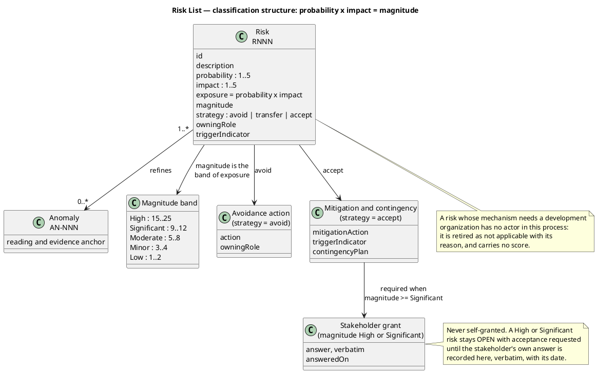
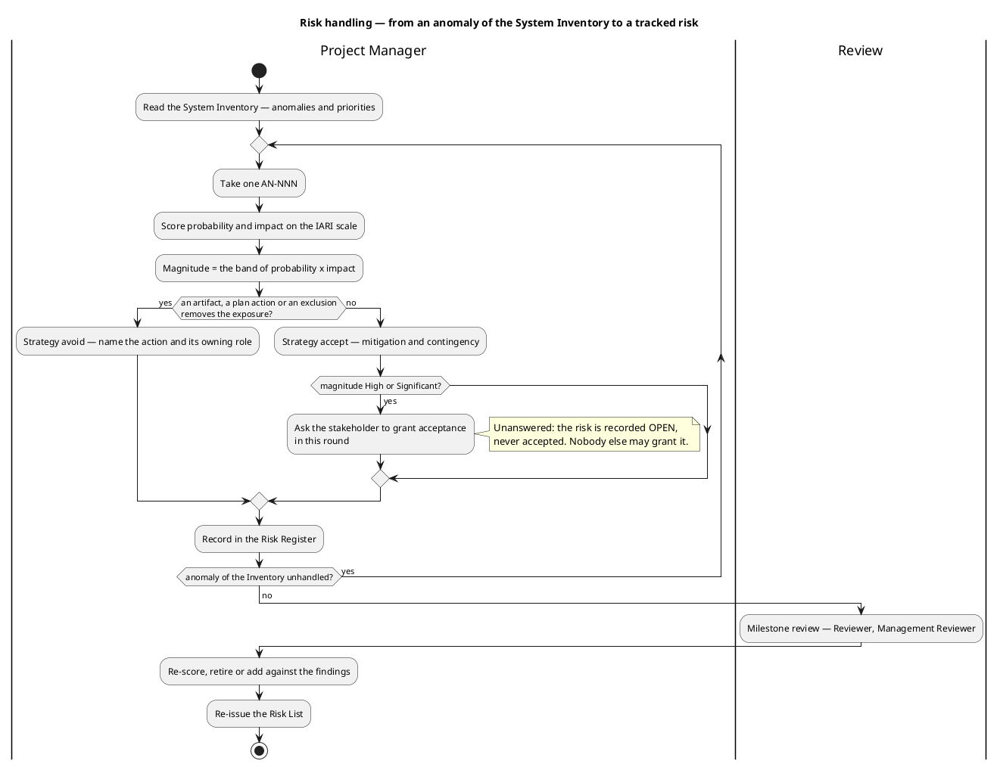

## Document Control
- Phase: Survey
- Status: Draft — issued for the end-of-Survey milestone review
- Milestone Target: end of Survey (SBC) — not yet achieved

## Risk Classification
Every risk below comes from an anomaly the System Inventory recorded; none is invented, and none is scored on a scale of this document's own. Scale: the IARI risk scale (DC baseline §9.10) — the project Development Case records no deviation from it.

| Probability | Level | Exposure |
|---|---|---|
| 1 | Very low — 10 % or less | Magnitude = probability × impact |
| 2 | Low — 11 % to 30 % | High 15–25 · Significant 9–12 · Moderate 5–8 · Minor 3–4 · Low 1–2 |
| 3 | Medium — 31 % to 50 % | |
| 4 | High — 51 % to 70 % | |
| 5 | Very high — more than 70 % | |

| Impact | Level | Means |
|---|---|---|
| 1 | Very low | No deviation from the plan worth recording |
| 2 | Low | Extra work inside the current iteration; its objectives are still met |
| 3 | Medium | An iteration objective slips to a later iteration the phase already plans |
| 4 | High | The milestone slips: the phase needs an iteration it did not plan |
| 5 | Very high | Success is endangered: a declared requirement or constraint can no longer be met as declared |

**Actor check.** Every risk below names an actor this process has — a role at work in a phase the plan already runs — so none is retired as not applicable. No anomaly of the System Inventory is about staffing, skills, morale or friction between people: this project has no development organization to staff, and the only human it waits on is the stakeholder.

| Magnitude | Count | Risks |
|---|---|---|
| High | 3 | R008, R009, R020 — acceptance granted by the stakeholder on 2026-11-19 |
| Significant | 9 | R003, R004, R005, R006, R007, R012, R015, R017, R018 |
| Moderate | 7 | R001, R002, R010, R011, R013, R014, R019 |
| Minor | 1 | R016 |
| Low | 0 | — |

No Significant risk is accepted: all nine are handled by avoidance, each naming the action and the role that performs it. The three High risks are accepted, and that acceptance is the stakeholder's, recorded verbatim in Risk Mitigation and Contingency.

## Risk Register

| ID | Risk | AN | P | I | Exposure | Magnitude | Strategy |
|---|---|---|---|---|---|---|---|
| R001 | A recovered artifact or the user documentation names a Swagger UI the system does not serve, sending the reader to a screen that does not exist. | AN-001 | 3 | 2 | 6 | Moderate | Accept |
| R002 | The README's "Auth0 is configured" is taken as a requirement and a provider integration re-enters scope, although the mechanism is inert as delivered and excluded by the stakeholder. | AN-002 | 2 | 3 | 6 | Moderate | Avoid |
| R003 | The Development Case points the coding, UI and test conventions at a file absent from the repository, so roles either invent conventions or the tailoring is unenforceable. | AN-003 | 4 | 3 | 12 | Significant | Avoid |
| R004 | The relational schema is mistaken for a declared design: a table, key or cascade rule is restated from the stale model snapshot or from a run-time database instead of the migration bodies. | AN-004 | 3 | 3 | 9 | Significant | Avoid |
| R005 | The offered development container cannot restore or build the solution, so any environment verification performed inside it measures an SDK below the project's floor. | AN-005 | 4 | 3 | 12 | Significant | Avoid |
| R006 | CI green is quoted as proof that the pinned SDK builds the solution, when the workflow uses whatever SDK the runner image carries. | AN-006 | 4 | 3 | 12 | Significant | Avoid |
| R007 | A migration is authored from the EF Core 8.0.0 snapshot under a 9.0.8 runtime, and the diff it produces misstates the schema. | AN-007 | 3 | 3 | 9 | Significant | Avoid |
| R008 | The product as delivered cannot mark a todo complete from any screen while the API can, so a use case recovered from EP-015 carries a capability no delivered actor reaches. | AN-008 | 4 | 4 | 16 | High | Accept — grant requested |
| R009 | The identity decision point — cookie authentication, `/auth`, the YARP forwarder — carries no automated verification, so every recovered statement about who the caller is rests on a static reading. | AN-009 | 4 | 4 | 16 | High | Accept — grant requested |
| R010 | A use case claims cross-user access on the strength of the `admin` claim although no code path grants the role, and authority is designed into the product as if it existed. | AN-010 | 2 | 3 | 6 | Moderate | Avoid |
| R011 | The credential-accepting `/users` surface carries no throttle: registration, login and refresh accept unlimited attempts. | AN-011 | 2 | 3 | 6 | Moderate | Accept |
| R012 | The BFF reaches the API only through an Aspire-discovered hardcoded address, so in an environment without that discovery the browser half cannot reach the backend and no configuration key supplies a route. | AN-012 | 3 | 3 | 9 | Significant | Avoid |
| R013 | The most-changed subsystem in the delivery is recovered from a static reading, so a recovered login, logout or forwarding behaviour is later contradicted by the first execution. | AN-013 | 3 | 2 | 6 | Moderate | Accept |
| R014 | No mail transport exists anywhere in the delivery, so a later phase that declares password recovery or email confirmation pulls an undeclared integration into scope. | AN-014 | 2 | 3 | 6 | Moderate | Avoid |
| R015 | Refresh tokens are issued and never redeemed: the session ends at an access-token lifetime nobody chose, and the only recovery the product offers is a silent logout. | AN-015 | 3 | 3 | 9 | Significant | Avoid |
| R016 | Outside Development the root path redirects to a Scalar UI that is not mapped while the OpenAPI document stays published, so the delivered production posture is undefined. | AN-016 | 2 | 2 | 4 | Minor | Accept |
| R017 | Both hosts fall back to a per-user file-system key ring, so run as separate services each holds its own keys: cookies become undecryptable and the provider key unreadable. | AN-017 | 3 | 4 | 12 | Significant | Avoid |
| R018 | `POST /users/token/{provider}` is anonymous and unprotects a caller-supplied value before any identity is established, so any caller reaching the port posts to a cryptographic unprotect. | AN-018 | 3 | 3 | 9 | Significant | Avoid |
| R019 | Seven published identity operations with no caller in the delivered product are taken for product capability, and use cases or a manual are written for screens that do not exist. | AN-019 | 3 | 2 | 6 | Moderate | Avoid |
| R020 | The assembled system has never run: AppHost ordering, service discovery, the forwarder, the shared key ring and the migration step are inferred, and the first run may contradict any reading. | AN-020 | 5 | 4 | 20 | High | Accept — grant requested |

## Risk Mitigation and Contingency

| ID | Action that removes or limits the exposure | Owning role — where it lands | Trigger indicator | Contingency if it materializes |
|---|---|---|---|---|
| R001 | Every reference to the developer console cites EP-024 (`/scalar/v1`, Development only); no artifact names a Swagger UI. | System Analyst, Technical Writer — Excavation, Construction | An artifact or manual line names Swagger or a Swashbuckle route | The reference is corrected in the iteration that writes it; no plan change |
| R002 | The exclusion stands where it was recorded — System Inventory Perimeter and AN-002 — and is carried into the Supplementary Specification as an unconfigured provider option. | Requirements Specifier — Excavation | A requirement, use case or design element mentions an external provider scheme | Treated as undeclared scope: it needs a Change Request before any work |
| R003 | The Templates rows are re-pointed at files that exist, or the convention is recorded as undocumented, in the next Development Case evolution. | Process Engineer — Inception (Development Case re-prepared) | A role is asked to comply with a convention and cites `CONTRIBUTING.md` | The convention is recorded as absent and the tailoring proceeds without it |
| R004 | The schema is recovered into the Design Model from the three migration `Up`/`Down` bodies and the model snapshot, and is described as recovered — never as declared. No Data Model is produced (Development Case §5). | Database Designer — Excavation | A table, key or cascade rule is cited from a run-time database or an unstated source | The Design Model's persistent-data sections are re-derived from the migrations in the iteration that finds it |
| R005 | The devcontainer base image is aligned with the SDK pin the repository already declares — an environment alignment, not a stack upgrade, so the pinned .NET 9 / Aspire stack is untouched. | Integrator — Inception (Build Environment Setup) | The container cannot restore or build `TodoApp.sln` | No verification is claimed from inside the container; verification runs in the pinned environment |
| R006 | `dotnet-version` `9.0.100` is supplied to `actions/setup-dotnet` so CI builds the pinned SDK. | Integrator — Inception (Build Environment Setup) | CI is green while `global.json`'s pin is not what the runner carries | CI green is not quoted as proof; the build is verified against the pin before any milestone claim |
| R007 | No migration is authored in this project unless a declared requirement demands one; if one is, the model snapshot is first regenerated against EF Core 9.0.8. | Database Designer, Integrator — the iteration that plans a schema change | A change would add or alter a table, key or index | The migration is regenerated from a baseline built on the runtime's EF Core version |
| R008 | **Acceptance requested — OPEN.** Mitigation: the System Analyst records the missing screen path beside the use case it recovers from EP-015, so the recovery states the gap rather than a reachable capability. | System Analyst — Excavation | The Use-Case Model carries an update/complete flow whose actor has no screen path | A completion control is declared scope only through a Change Request; until then the Release Notes record the product cannot complete a todo from its screens |
| R009 | **Acceptance requested — OPEN.** Mitigation: the first Elaboration iteration's Test Designer authors coverage of cookie authentication, `/auth` and the forwarder before any change to the BFF is accepted. | Test Designer, Tester — Elaboration | A design decision about identity rests on code no test exercises | If the coverage contradicts the recovered behaviour, the login/logout use cases are re-derived in that iteration |
| R010 | No use case claims cross-user access; authority is recorded as ownership-only, and the exclusion is carried into the Supplementary Specification. | System Analyst, Requirements Specifier — Excavation | A use case or design element mentions an administrator or a role grant | It needs a Change Request naming who grants the role before any work |
| R011 | The absence of a limiter on `/users` is recorded in the Supplementary Specification rather than assumed away, and the Deployment Model keeps the API off any public route so the surface is reachable only from the BFF. | Requirements Specifier, Software Architect — Excavation | The target environment exposes the API port beyond the BFF | A throttling requirement is declared as a Change Request and the limiter is added to the `/users` group in the iteration that plans it |
| R012 | The Deployment Model (triggered) names service discovery as the mechanism that resolves the BFF-to-API address, and records the AppHost as the only run mode the delivery supports. | Software Architect — Excavation (Deployment Model) | A target environment is named that has no service discovery | A configured API address is added to the BFF in the iteration that plans that environment — as a Change Request, since it changes the recovered configuration surface |
| R013 | The BFF is read second by the Inventory's Priorities, every recovered element cites its anchor, and the reading is marked static wherever execution has not confirmed it. | System Analyst, Software Architect — Excavation | The first assembled run contradicts a recovered login, logout or forwarding behaviour | The affected recovered elements are re-derived with the run's evidence in the same iteration |
| R014 | The absent mail transport is a recorded fact of the delivery; password recovery and email confirmation stay excluded, so no phase plans work that needs a transport. | Requirements Specifier, Change Control Manager — Excavation onward | A requirement, use case or Change Request mentions a reset or confirmation mail | A mail transport is declared as integration scope in that Change Request and estimated in the iteration that plans it |
| R015 | `/users/refresh` stays in recovered scope as the mechanism a session-extension requirement would build on; the session lifetime is recorded as a framework default, and no artifact claims a length the system does not have. | Requirements Specifier, Designer — Excavation | A requirement, use case or NFR states a session duration or an idle timeout | The declared duration becomes a Change Request; the BFF's token handling changes in the iteration that plans it |
| R016 | EP-024 is recovered as a development-environment screen and the published OpenAPI document is recorded as recovered behaviour, so no artifact asserts an intended production posture. | Requirements Specifier, Software Architect — Excavation | A requirement or the Deployment Model states an intended production posture for the API document | The posture is declared as a Change Request and the redirect or the mapping is changed accordingly |
| R017 | The Deployment Model declares a shared data-protection key repository as a required element of the target environment; the recovered per-user file-system default is recorded as not sufficient for a multi-service deployment. | Software Architect — Excavation (Deployment Model) | The topology is deployed with each host keeping its own key ring | Cookies minted by one host are rejected by the other; the key repository is configured before any deployment claim |
| R018 | The Deployment Model keeps the API off any public route, so the anonymous unprotect is reachable only from the BFF; EP-011 stays excluded and no use case claims it. | Software Architect — Excavation (Deployment Model) | The API port is reachable from anything but the web server | If provider sign-in ever enters scope, the recorded service-to-service hop is declared as a requirement before the endpoint is used |
| R019 | No use case is recovered from EP-004 to EP-010; the Perimeter keeps them with their anchors so a later phase that needs one recovers it without re-reading the code. | System Analyst — Excavation | A use case, manual section or test claims an account-management, 2FA, reset or confirmation screen | The screen does not exist: the claim is withdrawn, and the capability needs a Change Request and a declared transport |
| R020 | **Acceptance requested — OPEN.** Mitigation: the first assembled run is scheduled as the Integrator's Architecture Build in Elaboration, before any deployment or topology claim is made; until then every statement about the composed system is marked a static reading. | Integrator, Tester — Elaboration | Elaboration opens without an assembled run in its plan | The run's contradictions are worked in the Elaboration iteration that planned it; a topology that cannot be made to run endangers the declared Aspire constraint and is escalated as such |

**Acceptance requested — status**

| ID | Magnitude | What the stakeholder is asked to accept | Status |
|---|---|---|---|
| R008 | High (16) | The recovered product cannot complete a todo from any screen; a completion control enters scope only if the stakeholder declares it. | OPEN — answer requested this round |
| R009 | High (16) | The identity decision point carries no automated verification; its first coverage is planned in Elaboration, so until then the recovered identity behaviour is a static reading. | OPEN — answer requested this round |
| R020 | High (20) | The assembled system has never run; the first assembled run is planned in Elaboration, so the AppHost ordering, discovery, forwarder, key ring and migration step stay inferred until then. | OPEN — answer requested this round |

These three stay OPEN. No artifact, plan action, exclusion or review verdict grants them; only the stakeholder's own answer does, and it is recorded here verbatim with its date when it arrives.

## Traceability

| Element | Traces From | Link Type | Traces To |
|---|---|---|---|
| R001 | AN-001 | Refines | — |
| R002 | AN-002 | Refines | — |
| R003 | AN-003 | Refines | — |
| R004 | AN-004 | Refines | — |
| R005 | AN-005 | Refines | — |
| R006 | AN-006 | Refines | — |
| R007 | AN-007 | Refines | — |
| R008 | AN-008 | Refines | — |
| R009 | AN-009 | Refines | — |
| R010 | AN-010 | Refines | — |
| R011 | AN-011 | Refines | — |
| R012 | AN-012 | Refines | — |
| R013 | AN-013 | Refines | — |
| R014 | AN-014 | Refines | — |
| R015 | AN-015 | Refines | — |
| R016 | AN-016 | Refines | — |
| R017 | AN-017 | Refines | — |
| R018 | AN-018 | Refines | — |
| R019 | AN-019 | Refines | — |
| R020 | AN-020 | Refines | — |
