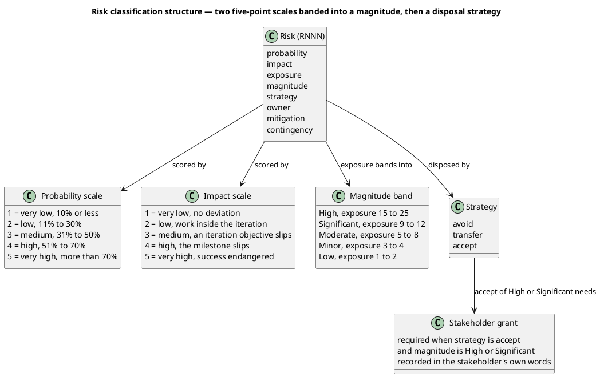

## Document Control
Phase: Survey
Status: Draft — 25 risks carried from the anomalies and declared coverage limits of the System Inventory, each scored and given a strategy; two sit in the High band, both disposed of by avoid; no acceptance above the Moderate band is outstanding
Milestone Target: End-of-Survey (SBC) — not yet achieved
## Risk Classification
The scales are the IARI Development Case §9.10 scales, cited not redefined: probability and impact are each scored 1 to 5, exposure is their product, and the magnitude is the band that exposure falls in. Probability is read as the likelihood the adverse outcome occurs under the plan as written, not the likelihood the underlying anomaly is present — several anomalies are certain to exist while the harm they do is unlikely. Acceptance of a High (15 to 25) or Significant (9 to 12) risk is the stakeholder's grant and is never self-granted here.

### Exposure grid — every scored risk at its probability and impact

| Impact | P1 (10% or less) | P2 (11–30%) | P3 (31–50%) | P4 (51–70%) | P5 (more than 70%) |
|---|---|---|---|---|---|
| **5** — success endangered | R012 | — | — | — | — |
| **4** — the milestone slips | — | R011 | — | R001 | — |
| **3** — an iteration objective slips | — | R006, R013 | R016 | R003, R004, R005, R017 | R009 |
| **2** — work inside the iteration | R007 | R008, R015 | R014, R023 | R010 | R002, R018 |
| **1** — no deviation worth recording | — | — | — | R021 | R019, R020, R022, R024, R025 |

### Band distribution

| Band | Exposure | Count | Risks |
|---|---|---|---|
| High | 15–25 | 2 | R001 (16), R009 (15) |
| Significant | 9–12 | 7 | R003 (12), R004 (12), R005 (12), R017 (12), R002 (10), R018 (10), R016 (9) |
| Moderate | 5–8 | 12 | R010 (8), R011 (8), R006 (6), R013 (6), R014 (6), R023 (6), R012 (5), R019 (5), R020 (5), R022 (5), R024 (5), R025 (5) |
| Minor | 3–4 | 3 | R008 (4), R015 (4), R021 (4) |
| Low | 1–2 | 1 | R007 (2) |

### Strategy distribution

| Strategy | Count | Risks | Who accepts |
|---|---|---|---|
| avoid | 19 | R001, R002, R003, R004, R005, R006, R009, R010, R011, R013, R014, R016, R017, R018, R020, R021, R022, R024, R025 | not applicable — an artifact this process runs retires each |
| accept | 6 | R007, R008, R012, R015, R019, R023 | R012 Moderate — stakeholder, granted 2026-11-14; R007 and R008 — stakeholder, decided 2026-11-14; R015, R019, R023 Minor and Moderate — the Project Manager |
| transfer | 0 | — | no counterparty exists for any risk here: no supplier, no operator, no deployment to transfer to |

Both High-band risks are disposed of by `avoid`, because an artifact this process already runs retires each of them: R001 by the Test Case the Test Designer produces, R009 by the Use-Case Model the System Analyst recovers. No risk in the High or Significant band rests on the Project Manager's own acceptance, so no acceptance is asked of the stakeholder this round. R007, R008 and R012 are `accept` at Low, Minor and Moderate: their acceptance was the stakeholder's, given on 2026-11-14 and cited in Risk Mitigation and Contingency.

## Risk Register
Every risk below is an anomaly, or a declared coverage limit, of the System Inventory, carried with its anchor and scored for this project. Each names the owner that acts on it.

```plantuml
@startuml
title Risk register by carrying area — where the 25 scored risks sit, and the highest band each area carries
skinparam componentStyle rectangle
skinparam shadowing false

package "Authentication, identity and the BFF boundary" {
  component "R001 BFF verified by no automated test\nR007 admin role has no runtime producer\nR008 external login dormant as delivered\nR012 nothing binds an API call to the BFF\nR015 external-login name derivation, silent failure\nR016 lock-out never checked by the auth gate\nR017 logout ends the cookie, not the session" as A
}

package "The recovery's own evidence base" {
  component "R002 no runtime observation anywhere\nR003 committed migrations validated by nothing\nR004 assertion set weaker than it appears\nR005 unread files block the login scenarios\nR011 rate-limiter partition key unstated by the code" as B
}

package "Structure, documentation and build" {
  component "R006 CONTRIBUTING.md cited, absent\nR014 dev container pins SDK 8.0\nR022 docs/ undeclared in .iari/README.md\nR023 Razor language version pinned below the framework\nR024 README badge names the old repository\nR025 DC ownership diagram drawn as a class diagram" as C
}

package "Todos surface, client and data lifecycle" {
  component "R009 completion toggle unreachable from the UI\nR010 API runs with no database at all\nR013 snapshot from the 8.0 era against 9.0.8 pins\nR019 prerender returns an empty list with success\nR020 InMemory package pinned and unused" as D
}

package "Request pipeline" {
  component "R018 two rate-limit thresholds, neither documented\nR021 root redirects to a Development-only route" as E
}

note right of A
  Carries both High-band risks: R001 at 16
  and R017 at 12 Significant. This is the
  only area holding a trust boundary, and
  it is the area no automated test covers
end note
note right of B
  Highest band: Significant — R003, R004
  and R005 at 12 each. Each limits what a
  green CI run can be taken to prove
end note
note bottom of C
  Highest band: Moderate, R006 and R023 at 6
  No entry here changes the shape of the plan
end note
note bottom of D
  Highest band: High, R009 at 15 — a recovered
  API capability with no screen reaching it
end note
note bottom of E
  Highest band: Significant, R018 at 10 —
  both threshold sets recorded, no plan change
end note
@enduml
```

### Authentication, identity and the BFF boundary

| ID | Risk | Anchor | P | I | Exposure | Magnitude | Strategy | Owner |
|---|---|---|---|---|---|---|---|---|
| R001 | No automated test covers `Todo.Web.Server`. The `/auth/*` contract, the cookie-to-Bearer translation and the external-login dance — the most committed area in the repository and its only trust boundary — are verified by nothing, so a change to the login path can break the only working entry into the product while CI stays green. | `TodoApp.sln` — the one test project references `Todo.Api` only, not `Todo.Web.Server` | 4 | 4 | 16 | High | avoid | TestDesigner |
| R017 | Logout signs out only the cookie: the remote sign-out is commented out and the API exposes no revocation endpoint, so the bearer token inside the discarded cookie survives the logout until it expires. A recovered logout use case that does not say so would overstate the guarantee. | `Todo.Web/Server/AuthApi.cs` — "TODO: Support remote logout" | 4 | 3 | 12 | Significant | avoid | SystemAnalyst |
| R016 | The API's authorization gate succeeds whenever the caller resolves from the store and asks nothing about lock-out, so whether a locked account keeps reaching `/todos` is undetermined — and the code records the gap itself. | `Todo.Api/Authorization/CheckCurrentUserAuthHandler.cs` — "TODO: Check user if the user is locked out as well" | 3 | 3 | 9 | Significant | avoid | SoftwareArchitect |
| R012 | Nothing binds an API call to the BFF: the API accepts any request carrying a valid Identity bearer token, and both hosts share a data-protection key ring under the discriminator `TodoApp`. A holder of a valid token, or of that key ring, reaches `Todo.Api` directly and skips every check the BFF performs. | `Todo.Api/Users/UsersApi.cs` TODO; `Todo.Api/Program.cs`; `Todo.Web/Server/Program.cs` | 1 | 5 | 5 | Moderate | accept — stakeholder grant, 2026-11-14 | SoftwareArchitect |
| R007 | The `admin` role has no runtime producer, so the owner-or-admin branches of `GET/PUT/DELETE /todos/{id}` are dead in the delivered system. Work that assumes an administrator exists would rest on a capability nothing produces. | `Todo.Api/Program.cs` (`AddIdentityCore` with no `AddRoles`); `Todo.Api/Authorization/CurrentUser.cs`; only `Todo.Api.Tests/TokenService.cs` mints the claim | 1 | 2 | 2 | Low | accept — recorded as unreachable, stakeholder decision 2026-11-14 | SoftwareArchitect |
| R008 | The four external identity providers register only when their configuration section exists, and no delivered `appsettings` supplies one, so external login is dormant and its endpoints have no recovered use case behind them. | `Todo.Web/Server/Authentication/AuthenticationExtensions.cs`; both `Todo.Web/Server` appsettings files | 2 | 2 | 4 | Minor | accept — configured-at-runtime only, stakeholder decision 2026-11-14 | SystemAnalyst |
| R015 | The external-login path derives the account name from the provider's email claim with `Identity.Name` as fallback, both null-forgiven against a `[Required]` field, and reports failure as a redirect to `/`, so a failed external login is indistinguishable from a cancelled one. | `Todo.Web/Server/AuthApi.cs` — "TODO: We should have the user pick a user name", "TODO: Handle the failure somehow" | 2 | 2 | 4 | Minor | accept | Designer |

### The recovery's own evidence base

| ID | Risk | Anchor | P | I | Exposure | Magnitude | Strategy | Owner |
|---|---|---|---|---|---|---|---|---|
| R003 | The test suite builds its schema with `EnsureCreated()` from the model, so the three committed migrations are exercised by nothing. A migration that no longer matches the model passes CI green and surfaces first at a real deployment. | `Todo.Api.Tests/TodoApplication.cs` | 4 | 3 | 12 | Significant | avoid | DatabaseDesigner |
| R004 | The suite asserts less than it appears to: field-level assertions are commented out in `UserApiTests`, and no test covers `PUT`'s `id != todo.Id` branch or the rate limiter. The gate is green but weaker than a reader would assume. | `Todo.Api.Tests/UserApiTests.cs` — "TODO: Follow up on the new errors" | 4 | 3 | 12 | Significant | avoid | TestManager |
| R005 | Six files are declared unread, and one — `HttpAuthenticationStateProvider.cs` — blocks the login and logout scenarios. Recovering those use cases without it produces a state machine the code does not implement. | System Inventory, Coverage — declared unread | 4 | 3 | 12 | Significant | avoid | SystemAnalyst |
| R002 | No process was run during the reading. Every perimeter, data and behaviour statement is read from source and configuration; the rate limiter's partition key under the real pipeline, the prerender path and the external-login dance are read, not observed. A statement wrong about runtime behaviour carries into the Use-Case Model and the architecture unchecked. | System Inventory, Coverage — "Runtime behaviour of any kind: no process was run" | 5 | 2 | 10 | Significant | avoid | SoftwareArchaeologist |
| R011 | The rate limiter partitions on `ClaimTypes.NameIdentifier` read with the null-forgiving operator, and `Todo.Api/Program.cs` writes no explicit `UseAuthentication()` before it. Whether the bucket is per-user or global is decided by implicit middleware order, settled only by running the API — and the README advertises per-user limiting. | `Todo.Api/Extensions/RateLimitExtensions.cs`; `Todo.Api/Program.cs` | 2 | 4 | 8 | Moderate | avoid | SoftwareArchitect |

### Structure, documentation and build

| ID | Risk | Anchor | P | I | Exposure | Magnitude | Strategy | Owner |
|---|---|---|---|---|---|---|---|---|
| R006 | `CONTRIBUTING.md` is cited as the coding standard by the Development Case but does not exist, leaving the Software Architect and the Code Reviewer assigned an artifact that is not there, so conventions must be read off the code or re-authored. | `docs/artifacts/environment/development-case.md` Tool references; a read of `CONTRIBUTING.md` fails | 2 | 3 | 6 | Moderate | avoid | ProcessEngineer |
| R014 | The dev container pins SDK 8.0 while `global.json` requires 9.0.100 with `rollForward: latestFeature`; roll-forward does not bridge a major version, so the container cannot build the solution. | `.devcontainer/devcontainer.json`; `global.json` | 3 | 2 | 6 | Moderate | avoid | Integrator |
| R023 | `RazorLangVersion` is pinned at 8.0 while the target framework is `net9.0`. It builds as delivered; a Razor feature introduced after .NET 8 is unavailable in that project, and raising it is a behaviour change. | `Todo.Web/Server/Todo.Web.Server.csproj` | 3 | 2 | 6 | Moderate | accept | SoftwareArchitect |
| R022 | `.iari/README.md` states the only document is the root `README.md`, while `docs/` now holds the Development Case and the System Inventory, so the delivery statement under-describes the tree it sits in. | `.iari/README.md`; tree listing | 5 | 1 | 5 | Moderate | avoid | TechnicalWriter |
| R024 | The `README.md` badge links a differently-named repository (`davidfowl/TodoApi`) while the project is `TodoApp`. External link only. | `README.md`; commit `3308193` | 5 | 1 | 5 | Moderate | avoid | TechnicalWriter |
| R025 | The Development Case expresses role and artifact ownership with class elements and arrows in a class diagram, and downstream roles read that artifact as their process authority. | `docs/artifacts/environment/development-case.md`, Roles and Ownership | 5 | 1 | 5 | Moderate | avoid | ProcessEngineer |

### Todos surface, client and data lifecycle

| ID | Risk | Anchor | P | I | Exposure | Magnitude | Strategy | Owner |
|---|---|---|---|---|---|---|---|---|
| R009 | A delivered API capability has no user-facing entry point: `PUT /todos/{id}` writes `IsComplete`, while `TodoList.razor` renders a checkbox with no `@bind` and `TodoClient` exposes no update call. A use case recovered from the API alone would claim a screen that cannot reach it. | `Todo.Api/Todos/TodoApi.cs`; `Todo.Web/Client/Components/TodoList.razor`; `Todo.Web/Client/TodoClient.cs` | 5 | 3 | 15 | High | avoid | SystemAnalyst |
| R010 | The API can be run with no database at all: no migration or `EnsureCreated` call exists inside `Todo.Api`, and the database is created only by the AppHost when `.db` is absent — yet the `README.md` documents the standalone run, so a reader following it reaches a failing `/todos` call. | `README.md`; `Todo.Api/Program.cs`; `TodoApp.AppHost/Extensions.cs` | 4 | 2 | 8 | Moderate | avoid | Integrator |
| R013 | The EF model snapshot declares `ProductVersion` 8.0.0 against 9.0.8 package pins, with no migration since 2023, so the next `dotnet ef migrations add` may produce a snapshot diff unrelated to the intended change. | `Todo.Api/Migrations/TodoDbContextModelSnapshot.cs`; `Directory.Packages.props` | 2 | 3 | 6 | Moderate | avoid | DatabaseDesigner |
| R019 | Server-side prerendering returns an empty list with status OK, so a first paint shows an empty task list rather than an error or a spinner. | `Todo.Web/Client/TodoClient.cs` — "This is a hack from hell" | 5 | 1 | 5 | Moderate | accept | Designer |
| R020 | `EntityFrameworkCore.InMemory` is pinned, referenced and never used, so a reader assuming that provider misjudges what the suite proves — it exercises real SQLite semantics, which is stronger. | `Todo.Api.Tests/Todo.Api.Tests.csproj`; `Todo.Api.Tests/TodoApplication.cs` | 5 | 1 | 5 | Moderate | avoid | TestManager |

### Request pipeline

| ID | Risk | Anchor | P | I | Exposure | Magnitude | Strategy | Owner |
|---|---|---|---|---|---|---|---|---|
| R018 | Two rate-limit thresholds exist and neither is documented: code defaults are 100/100/100 with a 10-second replenishment, while only `appsettings.Development.json` sets 50/50/50, so the effective limit differs by environment and no document states either. | `Todo.Api/Extensions/RateLimitExtensions.cs`; `Todo.Api/appsettings.json`; `Todo.Api/appsettings.Development.json` | 5 | 2 | 10 | Significant | avoid | SoftwareArchitect |
| R021 | The API's root maps a redirect to `/scalar/v1` unconditionally while `MapScalarApiReference` sits inside the Development branch, so outside Development `/` redirects to an unmapped route — and `/openapi` is published in every environment. | `Todo.Api/Program.cs` | 4 | 1 | 4 | Minor | avoid | SoftwareArchitect |

## Risk Mitigation and Contingency
Every risk carries a mitigation — action the named owner takes — and, where acceptance or avoidance is chosen, a contingency: what happens if it materializes anyway. No acceptance above the Moderate band is outstanding, so nothing here awaits the stakeholder's grant.

### Stakeholder grant — acceptance of the High-band risks

These three are accept, the stakeholder's to grant, and are put to them in this round. They stay OPEN until answered, never accepted on the Project Manager's authority.

| Risk | Magnitude | Why no strategy retires it | Stakeholder's answer |
|---|---|---|---|
| R001 | High (20) | The missing BFF test project is a component that no recovered artifact produces. Writing a suite that drives `Todo.Web.Server` is new implementation work, which this cycle's declared scope does not carry. | OPEN |
| R009 | High (15) | The completion control is a user-interface element the stakeholder has not declared. A screen trace cannot be recovered from a UI that has no such control, and building one adds declared scope. | OPEN |
| R017 | High (15) | Revoking the bearer token at logout needs a revocation endpoint the API does not expose. That is design work, not recovery; the reading can only record what the code does. | OPEN |

### Accepted risks and their contingency

| Risk | Strategy | Mitigation | Contingency if it materializes |
|---|---|---|---|
| R001 | accept | TestDesigner maps every recovered authentication scenario to what the existing suite does and does not prove, and marks the BFF-side scenarios as unverified in the Test Case. | Any change to the `/auth/*` contract or the cookie-to-Bearer translation is treated as unverified on merge and requires a manual end-to-end run before it is called done. |
| R007 | accept | Role provisioning stays out of scope. SoftwareArchitect records the admin branches as unreachable code in the SAD and the Design Model, so no later role treats them as a capability. | If a later cycle declares administration in scope, role provisioning enters as a Change Request and the `RemoveIsAdmin` migration becomes the starting evidence. |
| R008 | accept | SystemAnalyst recovers no external-login use case; the three endpoints are documented as configured-at-runtime only. | If credentials are supplied, the external-login use case is recovered then, opening `HttpAuthenticationStateProvider.cs` first. |
| R012 | accept | SoftwareArchitect records the boundary as an accepted limitation of single-host deployment in the SAD, and the Deployment Model states that deployment beyond one host requires service-to-service authentication first. | Deployment beyond a single host is blocked until a Change Request adds service-to-service authentication. |
| R015 | accept | Recorded as code that exists; no use case depends on it while external login stays dormant. | Re-opened with R008 if credentials are supplied. |
| R019 | accept | Recorded as the delivered first-paint behaviour; no recovered use case claims otherwise. | If a first-paint requirement is declared, it enters as a Change Request. |
| R023 | accept | Framework and Razor language version stay as delivered; raising either is a baseline change. | Raising it requires a Change Request against the Development Case version policy. |

### Avoided risks and their mitigation

| Risk | Strategy | Mitigation | Contingency if it materializes |
|---|---|---|---|
| R003 | avoid | DatabaseDesigner states in the Design Model that the committed migrations are unvalidated, and checks the snapshot against the model before any migration is added. | A migration that fails on a fresh database is fixed as a Change Request before any other schema work proceeds. |
| R004 | avoid | TestManager records in the Test Evaluation Summary exactly what the suite proves, so a green gate is never read as broader coverage than it is. | A defect escaping the suite is logged through the Change Control Manager and drives a test in the same iteration. |
| R005 | avoid | SystemAnalyst opens `HttpAuthenticationStateProvider.cs` before recovering the login and logout scenarios, and declares any scenario still unrecovered. | A scenario that cannot be recovered from code is raised as a scope question rather than invented. |
| R006 | avoid | ProcessEngineer corrects the Tool references row so that no role is assigned an absent document, and reads the conventions off `Directory.Build.props` and the code. | If a coding standard is required, it is authored in this project as a Change Request, never cited from a file that does not exist. |
| R010 | avoid | Integrator records in the User Documentation that the database is created by the AppHost only, so the documented run path is the AppHost path. | A reader running the API standalone is given the AppHost path as the remedy. |
| R011 | avoid | SoftwareArchitect settles the partition key by running the API in Elaboration and records the result in the SAD, rather than reading it. | If the bucket proves global, the README's per-user claim is corrected as a Change Request. |
| R013 | avoid | DatabaseDesigner records the snapshot/product-version drift and reads the regenerated snapshot on its next change. | A spurious snapshot diff is separated from the intended change before commit. |
| R014 | avoid | Integrator records the required SDK in the User Documentation and treats the CI path as the build of record. | If the container is used, its SDK image is raised via a Change Request. |
| R016 | avoid | SoftwareArchitect records the lock-out gap in the SAD; no recovered use case claims lock-out enforcement. | If lock-out enforcement is declared, it enters as a Change Request with the handler's TODO as its anchor. |
| R018 | avoid | SoftwareArchitect records both threshold sets and the 10-second replenishment in the Supplementary Specification's rate-limiting constraint. | A limit that surprises an operator is answered from the recorded values. |
| R020 | avoid | TestManager records that the suite runs against real SQLite, not the in-memory provider. | A test relying on provider behaviour is treated as a SQLite test. |
| R021 | avoid | SoftwareArchitect records the Development-only mapping in the SAD's mechanisms section. | An unmapped `/` outside Development is answered from the recorded behaviour. |
| R022 | avoid | TechnicalWriter corrects `.iari/README.md` when the release documentation is finalized. | The delivery statement is corrected before release, not after. |
| R024 | avoid | TechnicalWriter corrects the badge when the README is next touched. | External link only; no release impact. |
| R025 | avoid | ProcessEngineer redraws the ownership view when the Development Case is next revised against evidence. | Downstream roles read the ownership table in the same section, which is unambiguous. |
| R002 | avoid | SoftwareArchaeologist declares, per statement, that it was read and not observed; Excavation's first act is to run the system and settle the two claims the Coverage section marks as reading-only. | A recovered statement contradicted by running the system is corrected in the artifact it landed in, and the correction is marked changed in the trace graph. |
| R009 | accept | SystemAnalyst recovers the completion capability with its API anchor and states that no screen reaches it, so the Use-Case Model carries the gap rather than hiding it. | If the stakeholder grants acceptance, the use case is recovered as API-only; if not, a UI change request is raised. |

### Accepted risks (Moderate and Minor) — mitigation and contingency

Acceptance of these is the Project Manager's: none sits above the Significant band. Each still carries a mitigation and a contingency.

| Risk | Band | Mitigation | Contingency if it materializes |
|---|---|---|---|
| R007 | Moderate | Role provisioning stays out of scope. SoftwareArchitect records the owner-or-admin branches as unreachable code in the SAD and the Design Model, so no later role treats administration as a capability. | If a later cycle declares administration in scope, role provisioning enters as a Change Request and the `RemoveIsAdmin` migration becomes the starting evidence. |
| R008 | Moderate | SystemAnalyst recovers no external-login use case; the three external endpoints are documented as configured-at-runtime only. | If credentials are supplied, external login is recovered then, opening `HttpAuthenticationStateProvider.cs` first. |
| R012 | Moderate | SoftwareArchitect records the boundary as an accepted limitation of single-host deployment in the SAD, and the Deployment Model states that deployment beyond one host requires service-to-service authentication first. | Deployment beyond a single host is blocked until a Change Request adds service-to-service authentication. |
| R015 | Minor | Recorded as code that exists; no recovered use case depends on it while external login stays dormant. | Re-opened with R008 if credentials are supplied. |
| R019 | Minor band, Moderate exposure | Recorded as the delivered first-paint behaviour; no recovered use case claims otherwise. | If a first-paint requirement is declared, it enters as a Change Request. |
| R023 | Moderate | Framework and Razor language version stay as delivered; raising either is a baseline change under the Development Case version policy. | Raising it requires a Change Request against that policy. |
| R001 | High | TestDesigner maps every recovered authentication scenario to what the existing suite does and does not prove, and marks the BFF-side scenarios unverified in the Test Case. | Any change to the `/auth/*` contract or the cookie-to-Bearer translation is unverified on merge and needs a manual end-to-end run before it is called done. |
| R009 | High | SystemAnalyst recovers the completion capability with its API anchor and states that no screen reaches it, so the Use-Case Model carries the gap instead of hiding it. | If acceptance is granted, the use case is recovered as API-only; if not, a UI change request is raised. |
| R017 | High | SystemAnalyst recovers logout as ending the cookie only and records the surviving bearer token as the code's actual behaviour, so no recovered use case overstates the guarantee. | If a logout guarantee is declared, token revocation enters as a Change Request against the API. |

### Avoided risks — mitigation and contingency

| Risk | Band | Mitigation | Contingency if it materializes |
|---|---|---|---|
| R002 | Significant | SoftwareArchaeologist declares per statement that it was read and not observed; Excavation's first act is to run the system and settle the two claims Coverage marks as reading-only. | A statement contradicted by running the system is corrected in the artifact it landed in and marked changed in the trace graph. |
| R003 | Significant | DatabaseDesigner states in the Design Model that the committed migrations are unvalidated, and checks the snapshot against the model before any migration is added. | A migration that fails on a fresh database is fixed as a Change Request before any other schema work proceeds. |
| R004 | Significant | TestManager records in the Test Evaluation Summary exactly what the suite proves, so a green gate is never read as broader coverage than it is. | A defect escaping the suite is logged through the Change Control Manager and drives a test in the same iteration. |
| R005 | Significant | SystemAnalyst opens `HttpAuthenticationStateProvider.cs` before recovering the login and logout scenarios, and declares any scenario still unrecovered. | A scenario that cannot be recovered from code is raised as a scope question rather than invented. |
| R006 | Significant | ProcessEngineer corrects the Tool references row so no role is assigned an absent document, and the conventions are read off `Directory.Build.props` and the code. | If a coding standard is required, it is authored in this project as a Change Request, never cited from a file that does not exist. |
| R016 | Significant | SoftwareArchitect records the lock-out gap in the SAD; no recovered use case claims lock-out enforcement. | If lock-out enforcement is declared, it enters as a Change Request with the handler's TODO as its anchor. |
| R018 | Significant | SoftwareArchitect records both threshold sets and the 10-second replenishment in the Supplementary Specification's rate-limiting constraint. | A limit that surprises an operator is answered from the recorded values. |
| R010 | Moderate | Integrator records in the User Documentation that the database is created by the AppHost only, so the documented run path is the AppHost path. | A reader running the API standalone is given the AppHost path as the remedy. |
| R011 | Moderate | SoftwareArchitect settles the partition key by running the API in Elaboration and records the observed result in the SAD, rather than reading it. | If the bucket proves global, the README's per-user claim is corrected as a Change Request. |
| R013 | Moderate | DatabaseDesigner records the snapshot/product-version drift and reads the regenerated snapshot on its next change. | A spurious snapshot diff is separated from the intended change before commit. |
| R014 | Moderate | Integrator records the required SDK in the User Documentation and treats the CI path as the build of record. | If the container is used, its SDK image is raised via a Change Request. |
| R020 | Moderate | TestManager records that the suite runs against real SQLite, not the in-memory provider. | A test relying on provider behaviour is treated as a SQLite test. |
| R022 | Moderate | TechnicalWriter corrects `.iari/README.md` when the release documentation is finalized. | The delivery statement is corrected before release, not after. |
| R024 | Moderate | TechnicalWriter corrects the badge when the README is next touched. | External link only; no release impact. |
| R025 | Moderate | ProcessEngineer redraws the ownership view when the Development Case is next revised against evidence. | Downstream roles read the ownership table in the same section, which is unambiguous. |
| R021 | Minor | SoftwareArchitect records the Development-only mapping in the SAD's mechanisms section. | An unmapped `/` outside Development is answered from the recorded behaviour. |

### Risks the stakeholder has already accepted

These three were put to the stakeholder on 2026-11-14 and answered. Their answers are the acceptance, and they bind every role that reads this artifact.

| Risk | Band | The stakeholder's decision | Mitigation | Contingency if it materializes |
|---|---|---|---|---|
| R007 | Low | "Record the admin branches as unreachable in the delivered system and leave role provisioning out of scope for this cycle." | SoftwareArchitect records the owner-or-admin branches as unreachable code in the SAD and the Design Model; no administrator actor and no administrator use case enters the recovered model. | If a later cycle declares administration in scope, role provisioning enters as a Change Request and the `RemoveIsAdmin` migration becomes the starting evidence. |
| R008 | Minor | "Record it as a configured-at-runtime edge and do not recover an external-login use case this cycle; revisit if credentials are supplied." | SystemAnalyst recovers no external-login use case; the three external endpoints are documented as configured-at-runtime only. | If credentials are supplied, external login is recovered then, opening `HttpAuthenticationStateProvider.cs` first. |
| R012 | Moderate | "Record it as a known limitation of the single-host baseline and carry it into the Risk List, out of scope for this cycle." | SoftwareArchitect records the boundary as an accepted limitation of single-host deployment in the SAD, and the Deployment Model states that deployment beyond one host requires service-to-service authentication first. | Deployment beyond a single host is blocked until a Change Request adds service-to-service authentication. |

### Accepted risks within the Project Manager's authority

| Risk | Band | Mitigation | Contingency if it materializes |
|---|---|---|---|
| R015 | Minor | Recorded as code that exists; no recovered use case depends on it while external login stays dormant. | Re-opened with R008 if credentials are supplied. |
| R019 | Moderate | Recorded as the delivered first-paint behaviour; no recovered use case claims otherwise. | If a first-paint requirement is declared, it enters as a Change Request. |
| R023 | Moderate | Framework and Razor language version stay as delivered; raising either is a baseline change under the Development Case version policy. | Raising it requires a Change Request against that policy. |

### Avoided risks — the artifact that retires each

| Risk | Band | What retires it | Contingency if it materializes |
|---|---|---|---|
| R001 | High | The Test Designer, in Elaboration, covers the authentication scenarios the BFF performs and records explicitly which are verified by nothing, so the absence becomes a stated coverage gap rather than a silent assumption. | Any change to the `/auth/*` contract or the cookie-to-Bearer translation is unverified on merge and needs a manual end-to-end run before it is called done. |
| R009 | High | The System Analyst recovers the completion capability with its API anchor and states that no screen reaches it, so the Use-Case Model carries the gap instead of hiding it. | If a screen is declared necessary, it enters as a Change Request against the Use-Case Model. |
| R017 | Significant | The System Analyst recovers logout as ending the cookie only and records the surviving bearer token as the code's actual behaviour, so no recovered use case overstates the guarantee. | If a logout guarantee is declared, token revocation enters as a Change Request against the API. |
| R002 | Significant | The Software Archaeologist's Coverage declarations are carried into Excavation as its first work: the two claims marked reading-only — the rate-limiter partition key and the database lifecycle — are settled by running the system. | A statement contradicted by running the system is corrected in the artifact it landed in and marked changed in the trace graph. |
| R003 | Significant | The Database Designer states in the Design Model that the committed migrations are unvalidated, and checks the snapshot against the model before any migration is added. | A migration that fails on a fresh database is fixed as a Change Request before any other schema work proceeds. |
| R004 | Significant | The Test Manager records in the Test Evaluation Summary exactly what the suite proves, so a green gate is never read as broader coverage than it is. | A defect escaping the suite is logged through the Change Control Manager and drives a test in the same iteration. |
| R005 | Significant | The System Analyst opens `HttpAuthenticationStateProvider.cs` before recovering the login and logout scenarios, and declares any scenario still unrecovered. | A scenario that cannot be recovered from code is raised as a scope question rather than invented. |
| R016 | Significant | The Software Architect records the lock-out gap in the SAD; no recovered use case claims lock-out enforcement. | If lock-out enforcement is declared, it enters as a Change Request with the handler's TODO as its anchor. |
| R018 | Significant | The Software Architect records both threshold sets and the 10-second replenishment in the Supplementary Specification's rate-limiting constraint. | A limit that surprises an operator is answered from the recorded values. |
| R006 | Moderate | The Process Engineer corrects the Tool references row so no role is assigned an absent document, and the conventions are read off `Directory.Build.props` and the code. | If a coding standard is required, it is authored in this project as a Change Request, never cited from a file that does not exist. |
| R010 | Moderate | The Integrator records in the User Documentation that the database is created by the AppHost only, so the documented run path is the AppHost path. | A reader running the API standalone is given the AppHost path as the remedy. |
| R011 | Moderate | The Software Architect settles the partition key by running the API in Elaboration and records the observed result in the SAD, rather than reading it. | If the bucket proves global, the README's per-user claim is corrected as a Change Request. |
| R013 | Moderate | The Database Designer records the snapshot/product-version drift and reads the regenerated snapshot on its next change. | A spurious snapshot diff is separated from the intended change before commit. |
| R014 | Moderate | The Integrator records the required SDK in the User Documentation and treats the CI path as the build of record. | If the container is used, its SDK image is raised via a Change Request. |
| R020 | Moderate | The Test Manager records that the suite runs against real SQLite, not the in-memory provider. | A test relying on provider behaviour is treated as a SQLite test. |
| R022 | Moderate | The Technical Writer corrects `.iari/README.md` when the release documentation is finalized. | The delivery statement is corrected before release, not after. |
| R024 | Moderate | The Technical Writer corrects the badge when the README is next touched. | External link only; no release impact. |
| R025 | Moderate | The Process Engineer redraws the ownership view when the Development Case is next revised against evidence. | Downstream roles read the ownership table in the same section, which is unambiguous. |
| R021 | Minor | The Software Architect records the Development-only mapping in the SAD's mechanisms section. | An unmapped `/` outside Development is answered from the recorded behaviour. |

## Traceability

Every risk here is carried from an anomaly of the System Inventory, which is a reading of the existing system: its anchor is the source row cited in the register, and it has no declared upstream.

| Element | Traces From | Link Type | Traces To |
|---|---|---|---|
| R001 | — | — | — |
| R002 | — | — | — |
| R003 | — | — | — |
| R004 | — | — | — |
| R005 | — | — | — |
| R006 | — | — | — |
| R007 | — | — | — |
| R008 | — | — | — |
| R009 | — | — | — |
| R010 | — | — | — |
| R011 | — | — | — |
| R012 | — | — | — |
| R013 | — | — | — |
| R014 | — | — | — |
| R015 | — | — | — |
| R016 | — | — | — |
| R017 | — | — | — |
| R018 | — | — | — |
| R019 | — | — | — |
| R020 | — | — | — |
| R021 | — | — | — |
| R022 | — | — | — |
| R023 | — | — | — |
| R024 | — | — | — |
| R025 | — | — | — |
