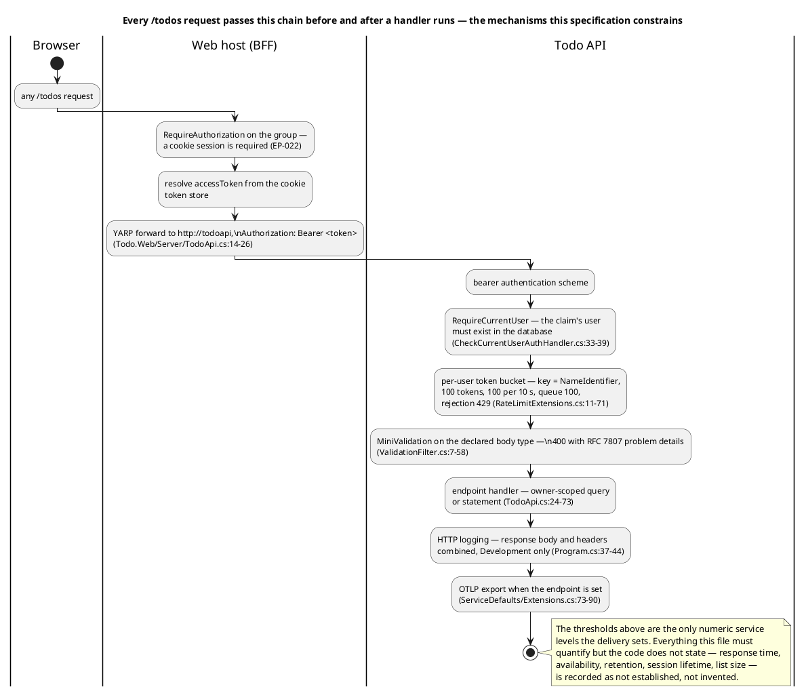
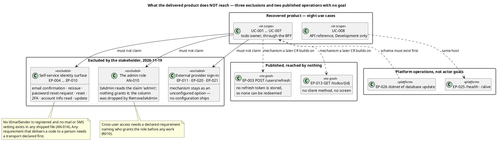
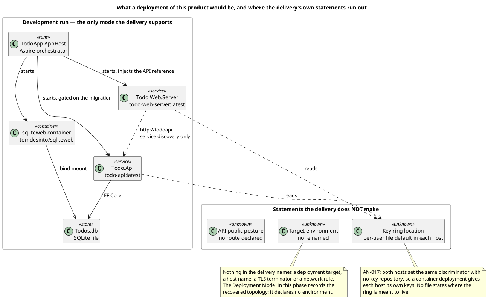

## Document Control
- Phase: Excavation
- Status: Draft — issued for the end-of-Excavation milestone review
- Milestone Target: end of Excavation (AR) — not yet achieved

## Functionality
This specification constrains the eight use cases of the Use-Case Model. It carries the mechanisms those use cases include, the thresholds the delivered code actually sets, and — stated explicitly — everything the delivery does not establish. No figure appears here that no file in the delivery states.

### Mechanisms included by the use cases

| ID | Mechanism | What the code enforces | Included by | Anchor |
|---|---|---|---|---|
| SS-001 | Cookie authentication, BFF side | The authentication cookie is the only credential the browser holds. `/auth/logout` and every `/todos` path require it; `/auth/register` and `/auth/login` do not, since the caller has no session yet. Claims: `NameIdentifier` = email, `Name` = email. The cookie's token store holds `accessToken` and nothing else. | UC-001, UC-002, UC-003, UC-004, UC-005, UC-006, UC-007 | `AuthenticationExtensions.cs:16-22`; `AuthApi.cs:14-42,105-111`; `TodoApi.cs:8-26`; BR-030 |
| SS-002 | Bearer token issue, API side | ASP.NET Core Identity with the `IdentityConstants.BearerScheme`; a token is issued on successful credential exchange. No lifetime, clock skew or refresh configuration exists in the delivery, so every value is a framework default. | UC-001, UC-002 | `Todo.Api/Program.cs:14-20`; PE-006 |
| SS-003 | Caller existence requirement | A valid token is not sufficient: the claims transformation resolves the `NameIdentifier` against `TodoUser` and the authorization handler fails the requirement if no user is found. | UC-004, UC-005, UC-006, UC-007 | `CheckCurrentUserAuthHandler.cs:17-39`; `CurrentUserExtensions.cs:14-35`; BR-010 |
| SS-004 | YARP forwarding with token re-signing | Every verb under `/todos` is forwarded to the absolute address `http://todoapi`; a request transform replaces the `Authorization` header with `Bearer <accessToken>` read from the cookie. Nothing checks that a token is present or current before it is attached. | UC-004, UC-005, UC-006, UC-007 | `Todo.Web/Server/TodoApi.cs:14-26`; BR-034 |
| SS-005 | Per-user rate limiting | Token bucket, partition key = `NameIdentifier` claim, rejection status `429`. The thresholds are not one set: the code defaults are 100 tokens / 100 replenished per 10-second period / queue 100, and `appsettings.Development.json` overrides all three to 50. Applied to the `/todos` group only — the `/users` group carries no limiter at all. | UC-004, UC-005, UC-006, UC-007 | `RateLimitExtensions.cs:11-71`; `Todo.Api/appsettings.Development.json:9-13`; `TodoApi.cs:26`; `UsersApi.cs:12-22`; PE-001; PE-007 |
| SS-006 | Parameter validation | `MiniValidation` over the body types a route group names by exact type — `TodoItem` on `/todos`, `ExternalUserInfo` on `/users`. `UserInfo`, the body of registration and sign-in, is named by neither group, so the API applies no filter to it and Identity's own checks are the only thing between a posted credential body and the store. Answers `400` with `HttpValidationProblemDetails`. | UC-001 (by its absence), UC-005, UC-006 | `ValidationFilter.cs:7-58`; `TodoApi.cs:29`; `UsersApi.cs:18`; BR-032 |
| SS-007 | Data protection, shared discriminator | Both hosts set `ApplicationDiscriminator = "TodoApp"` and no key repository, so the default per-user file-system location applies in each host. | UC-001, UC-002 (the provider key path), UC-004 … UC-007 (the cookie's readability across hosts) | `Todo.Api/Program.cs:9-11`; `Todo.Web/Server/Program.cs:12-13`; AN-017 |
| SS-008 | OpenAPI document and reference UI | The document is published unconditionally; the reference UI is mapped only when the environment is Development, with `Servers = []` and the bearer scheme preferred. | UC-008 | `Todo.Api/Program.cs:49-58`; `OpenApiOptionsExtensions.cs:7-47`; BR-026, BR-027 |
| SS-009 | Telemetry | OpenTelemetry traces, metrics and logs through the shared ServiceDefaults, exported over OTLP only when `OTEL_EXPORTER_OTLP_ENDPOINT` is non-empty; `/health` and `/alive` mapped for an orchestrator. | None — no use case depends on it; listed so no later role mistakes it for a goal | `TodoApp.ServiceDefaults/Extensions.cs:16-41,73-117` |
| SS-010 | Database migration at start-up | `dotnet ef database update --no-build` runs before the API starts, only when `Todo.Api/.db` does not exist; the schema exists nowhere else. | UC-001 … UC-007 — every one needs the schema to exist | `TodoApp.AppHost/Program.cs:3,19-25`; `TodoApp.AppHost/Extensions.cs:5-16`; AN-004 |
| SS-011 | Error collapse at the BFF | Any non-success answer from the API becomes a `null` token, the BFF answers `401`, and the page shows one fixed message per control. No mechanism carries a reason from the API to the person. | UC-001, UC-002 | `AuthClient.cs:5-29`; `AuthApi.cs:14-38`; `LogInForm.razor:79-96`; BR-033 |

No use case in the model is named after any mechanism above. Each is included by the use cases that depend on it, and none of them is a goal of an actor.

### Exclusions — what no artifact in this phase may claim

| ID | Excluded capability | Entry points | Basis | Where the mechanism still lives |
|---|---|---|---|---|
| EX-001 | External identity-provider sign-in — GitHub, Google, Microsoft, Auth0 | `EP-011`, `EP-020`, `EP-021` | Stakeholder, 2026-11-19: out of the recovered product scope, recorded as an exclusion | This specification, as an unconfigured option: the four schemes are registered only when `Authentication:Schemes:<provider>` exists, and no shipped `appsettings.json` carries that section (`AuthenticationExtensions.cs:40-52`; `Todo.Web/Server/appsettings.json`; `Todo.Api/appsettings.json`). Enabling one requires a declared requirement and a Change Request |
| EX-002 | The self-service identity surface — email confirmation, confirmation reissue, password-reset request, password reset, two-factor management, account-information read, account-information update | `EP-004`, `EP-005`, `EP-006`, `EP-007`, `EP-008`, `EP-009`, `EP-010` | Stakeholder, 2026-11-19: out of the recovered product scope, recorded beside the external-provider exclusion | Nowhere in the delivery: no caller exists in any screen and no transport exists to deliver a code (`UsersApi.cs:12,20`; AN-014; AN-019) |
| EX-003 | The `admin` role and any cross-user access it would permit | `EP-013`, `EP-015`, `EP-016` (the `owner.IsAdmin` branches) | Stakeholder, 2026-11-19: dead code until a declared requirement names who grants the role | The code: `CurrentUser.IsAdmin` reads the role claim `admin`; nothing grants it, `AspNetRoles` is populated by nothing, and migration `RemoveIsAdmin` dropped the persisted flag (`CurrentUser.cs:14`; `20221123165051_RemoveIsAdmin.cs:13-17`) |

### Constraints on the recovered functionality

| ID | Constraint | Anchor |
|---|---|---|
| FN-001 | One item belongs to exactly one account, and every read, update and delete is owner-scoped inside the statement that performs it. There is no cross-user path. | `TodoApi.cs:24-73` |
| FN-002 | Session lifetime is a framework default that nobody chose, and no refresh token is redeemed. A session ends at an unstated access-token lifetime; the first `401` or `403` on a todo call signs the user out silently. | AN-015; `TokenNames.cs:3-6`; `TodoList.razor:66-73` — **not established by the delivery**: the actual lifetime |
| FN-003 | The `/users` group carries no rate limiter and no lock-out, so the endpoints that accept credentials are the only endpoints protected by nothing but Identity's password check. | AN-011; `UsersApi.cs:12-22` |
| FN-004 | Deleting an account is not exposed by any endpoint; deleting an owner would cascade to their items. The cascade rule exists; the operation does not. | `TodoDbContext.cs:14-18`; `UsersApi.cs:12-22` — no delete-user endpoint |
| FN-005 | No list is paginated, filtered, sorted by a requested order or limited in size. `GET /todos` returns every item the caller owns. | `TodoApi.cs:24-27` |
| FN-006 | A title is the whole item model: no due date, note, priority, tag, ordering or attachment exists in the entity or the DTO. | `Todo.cs:1-34` |
| FN-007 | There is no sharing, assignment, ownership transfer or second reader of any item. | `Todo.cs:9-11`; `TodoApi.cs:24-73` |
| FN-008 | No export, import or bulk operation exists on any surface. | `TodoClient.cs:7-71`; `TodoApi.cs:24-73` |
| FN-009 | No audit trail is kept: HTTP logging records response bodies and headers in Development only, and nothing records who changed which item. | `Todo.Api/Program.cs:37-44` — **not established by the delivery**: any retention requirement |
| FN-010 | The product's own capability set is registration, sign-in, sign-out, list, add, change and delete. A completion control is not among the delivered screens (AN-008, accepted exposure 2026-11-19). | `TodoList.razor:31`; `TodoClient.cs:7-71` |

## Usability

| ID | Requirement | Threshold | Basis |
|---|---|---|---|
| US-001 | The product's whole human interface is one page with two states — the login form or the todo list — and no navigation beyond them. | 2 states, 1 route (`/`) | `App.razor:5`; `TodoApp.razor:3-14` |
| US-002 | A failed registration or sign-in must produce a visible message, not a silent return. | 2 message strings: "Login failed", "Failed to create user" | `LogInForm.razor:52-69` |
| US-003 | A failed load must not leave the interface in an indeterminate state. | **Not met by the delivery**: a `401`/`403` signs the user out silently, and a `429` leaves the spinner indefinitely (`TodoList.razor:3-8,66-73`). Recorded as fact; no repair is in this phase's scope | AN-015; AN-011 |
| US-004 | The interface is styled by a vendored Bootstrap 5 distribution and presents no custom design system. | 45 vendored files under `wwwroot/bootstrap`; one project stylesheet | System Inventory coverage table |
| US-005 | Accessibility of the two screens is not stated, tested or documented anywhere in the delivery. The checkbox carries `aria-label="..."` — a literal ellipsis. | **Not established by the delivery** | `TodoList.razor:31` |
| US-006 | No localisation exists: strings are English literals in the components, with no resource files and no culture configuration. | 0 resource files | `Todo.Web/Client/Components/`; both `Program.cs` |

## Reliability

| ID | Requirement | Threshold | Basis |
|---|---|---|---|
| RE-001 | A request to `/todos` is admitted or rejected deterministically by the per-user token bucket; rejection is `429` and never a silent pass. | 100 tokens, 100 per 10 s, queue 100 | `RateLimitExtensions.cs:11-71` |
| RE-002 | An update or delete that matches no owned row answers `404` and never discloses whether the row exists under another owner. | One answer for two causes | `TodoApi.cs:65,71` |
| RE-003 | A valid token whose user no longer exists must not be honoured. | Requirement fails, request rejected | `CheckCurrentUserAuthHandler.cs:33-39` |
| RE-004 | The schema must exist before the API serves a request; the migration runs ahead of the API start. | AppHost ordering, once, when `.db` is absent | `TodoApp.AppHost/Program.cs:19-25` |
| RE-005 | Recovery of a session after a crash is not provided: the cookie and the access token live in the browser and the token is not revocable. | **Not established by the delivery** — no recovery or restart requirement anywhere | AN-015 |
| RE-006 | Availability, RTO, RPO, backup and restore targets are not stated by any file in the delivery. | **Not established by the delivery** | Perimeter and both `appsettings.json` |
| RE-007 | Single-file SQLite with no replication, no second writer arbitration and no stated concurrency expectation. | **Not established by the delivery** — the concurrency requirement is unknown | `Todo.Api/Program.cs:22-24` |
| RE-008 | A `400` never leaves the caller without the reason: problem details carry the failing member. | RFC 7807 `HttpValidationProblemDetails` | `ValidationFilter.cs:7-58` |
| RE-009 | No retry, circuit breaker or bulkhead is configured on the BFF's client to the API. The service-defaults resilience handler applies to `HttpClient` instances registered by the hosts, not to the YARP forwarder's path. | **Not established by the delivery** — no resilience requirement exists | `Todo.Web/Server/Program.cs:24-32`; `Todo.Web/Server/TodoApi.cs:14-26` |

## Performance
| ID | Requirement | Threshold | Basis |
|---|---|---|---|
| PE-001 | The per-user request budget is the only throughput figure the delivery states, and it is not one figure: the code's defaults and the Development settings differ, so the budget is environment-dependent. | Code defaults: 100 tokens, 100 replenished every 10 seconds, queue depth 100. Development settings: 50 / 50 / 50 — half the budget, and half the queue. Any other environment falls back to the code defaults until someone supplies a `RateLimiting` section | `RateLimitExtensions.cs:20-27`; `Todo.Api/appsettings.Development.json:9-13` |
| PE-002 | Response-time, latency and end-to-end targets are not stated anywhere. | **Not established by the delivery** | No file in the delivery carries a timing figure |
| PE-003 | The list is returned unpaginated and unbounded; no page size, maximum item count or payload limit exists. | **Not established by the delivery** — and no cap applies: `GET /todos` declares no `Take` | `TodoApi.cs:24-27` |
| PE-004 | The number of concurrent users the product is expected to serve is not stated anywhere. | **Not established by the delivery** | Perimeter |
| PE-005 | Resource sizing — CPU, memory, storage growth — is not stated anywhere; no container resource limit is declared. | **Not established by the delivery** | `TodoApp.AppHost/Program.cs`; project files |
| PE-006 | The session's length is not configured anywhere, so it is the framework's access-token default nobody in this delivery chose; no refresh token is redeemed to extend it. | **Not established by the delivery** — the lifetime itself | AN-015; `TokenNames.cs:3-6`; `TodoApi/Program.cs:14-20` (no token lifetime configured) |
| PE-007 | The credential endpoints carry no throughput bound at all. | No limiter, no lock-out, no attempt counter on `/users` — unlimited by construction | AN-011; BR-031; BR-038; `UsersApi.cs:12-22` |
## Supportability

| ID | Requirement | Threshold | Basis |
|---|---|---|---|
| SU-001 | The BFF has no automated test of any kind. `Todo.Api.Tests` references `Todo.Api` only; the cookie authentication, `/auth` and the forwarder are exercised by nothing. | 0 tests over 15 BFF source files | AN-009; `Todo.Api.Tests/Todo.Api.Tests.csproj:6-17` |
| SU-002 | The API's own suite is the only executable proof of behaviour in the delivery. | 2 test classes exercising the `/todos` and `/users` surfaces | `TodoApiTests.cs`; `UserApiTests.cs` |
| SU-003 | CI runs restore, build and test over the whole solution on every push and pull request, and is the only executable definition of green. | 1 workflow, 3 steps | `.github/workflows/ci.yaml:1-21` |
| SU-004 | CI does not honour the SDK pin: `actions/setup-dotnet` is given no `dotnet-version`, so green does not demonstrate that `9.0.100` builds the solution. | **Gap** — CI inherits the runner's SDK | AN-006 |
| SU-005 | Both hosts expose `/health` and `/alive` for an orchestrator; no dashboard, metric or alert is defined by the delivery. | 2 probe endpoints per host | `TodoApp.ServiceDefaults/Extensions.cs:101-117` |
| SU-006 | Configuration is JSON-plus-environment per host; both hosts and the AppHost carry a `UserSecretsId`. No shipped file carries a credential. | 3 projects with user-secret stores | Project files; both `appsettings.json` |
| SU-007 | The delivery states no logging, diagnostic or support procedure, and there is no manual and no runbook. | **Not established by the delivery** | `.iari/README.md` |
| SU-008 | Coding standards, UI patterns and test conventions have no file in the repository. | **Undocumented** | Development Case, Templates table; AN-003 |

## Design Constraints

| ID | Constraint | Anchor |
|---|---|---|
| DC-001 | The stack is fixed and is not re-platformed: `net9.0`, SDK `9.0.100`, `LangVersion preview`, `Nullable` enabled, centrally managed package versions, `nuget.org` only. No package or framework is upgraded as a side effect of any task. | Development Case DC-D6; `global.json`; `Directory.Build.props`; `Directory.Packages.props`; `nuget.config` |
| DC-002 | The relational schema exists only as three EF Core migrations and a model snapshot. There are no SQL files, no stored procedures and no triggers. | AN-004; `Todo.Api/Migrations/` |
| DC-003 | EF Core model snapshot declares `ProductVersion` `8.0.0` against a 9.0.8 runtime. Any new migration must first be regenerated against the runtime's version. | AN-007 |
| DC-004 | The `.devcontainer` image is `mcr.microsoft.com/dotnet/sdk:8.0` while the solution targets `net9.0` and requires SDK `9.0.100`: inside that container the solution cannot restore or build. | AN-005; `.devcontainer/devcontainer.json:2` |
| DC-005 | Both hosts declare container image names (`todo-api`, `todo-web-server`) and the AppHost runs services rather than containers; the sqliteweb container is a development aid and is excluded from the published manifest. | `Todo.Api.csproj`; `Todo.Web.Server.csproj`; `TodoApp.AppHost/Program.cs:10-17` |
| DC-006 | The BFF reaches the API at the hardcoded absolute address `http://todoapi`. No configuration key supplies it, so the AppHost is the only run mode in which the browser-facing half works. | AN-012; `Todo.Web/Server/Program.cs:26-30` |
| DC-007 | Data protection keys default to the framework's per-user file-system location in each host. A multi-host deployment without a shared repository cannot read another host's protected payloads. | AN-017 |
| DC-008 | The API's OpenAPI document is published in every environment while the reference UI is Development-only, and `/` redirects to it unconditionally. The intended production posture is not stated. | AN-016; `Todo.Api/Program.cs:49-62` |
| DC-009 | The data-protection discriminator is `"TodoApp"` on both hosts. Changing it invalidates every cookie and every protected provider key in flight. | `Todo.Api/Program.cs:10`; `Todo.Web/Server/Program.cs:13` |
| DC-010 | There is no mail transport: no `IEmailSender` implementation and no mail or SMS setting anywhere. Any feature that must send a code to a person requires an integration declared first. | AN-014 |
| DC-011 | No role management exists: the identity endpoints grant no role, nothing seeds `AspNetRoles`, and no role claim reaches a deployed request. | AN-010; `UsersApi.cs:12-22` |
| DC-012 | The API's port carries no service-to-service authentication barrier against a non-BFF caller: the `/users` group requires no authorization, and the source records `TODO: Add service to service auth between the BFF and this API`. | AN-018; `UsersApi.cs:12-22` |

## Interfaces

| ID | Interface | Direction | Form and mechanism | Anchor |
|---|---|---|---|---|
| IF-001 | Browser ↔ web host | Inbound to the system | HTTPS. Routes `/` (the page), `/auth/register`, `/auth/login`, `/auth/logout`, `/todos/{*path}`. The browser never calls the API. | `EP-017`…`EP-023`; `Todo.Web/Server/Program.cs:20-37` |
| IF-002 | Web host → API, identity | System-internal | HTTP `POST /users/register`, `POST /users/login`, `POST /users/token/{provider}` at `http://todoapi`. Body types `UserInfo`, `ExternalUserInfo`; response `AuthToken` reading `accessToken`. | `AuthClient.cs:3-46`; `SharedClass.cs:13-37` |
| IF-003 | Web host → API, todos | System-internal | YARP forwarder over `http://todoapi`, every verb, `Authorization: Bearer <accessToken>` injected by a request transform. | `Todo.Web/Server/TodoApi.cs:14-26` |
| IF-004 | API ↔ SQLite | System-internal | EF Core 9.0.8 with `Microsoft.EntityFrameworkCore.Sqlite`; connection string `ConnectionStrings:Todos`, default `Data Source=.db/Todos.db`. | `Todo.Api/Program.cs:22-24` |
| IF-005 | API and web host → OTLP collector | Outbound, optional | OTLP export, enabled only when `OTEL_EXPORTER_OTLP_ENDPOINT` is non-empty. | `TodoApp.ServiceDefaults/Extensions.cs:73-90` |
| IF-006 | AppHost → container runtime | Outbound, development | The orchestrator asks the runtime to run the sqliteweb container with a bind mount of `Todo.Api/.db`. | `TodoApp.AppHost/Program.cs:10-17` |
| IF-007 | AppHost → `dotnet-ef` CLI | Outbound, development | Global tool install, then `dotnet ef database update --no-build`. | `TodoApp.AppHost/Extensions.cs:17-33` |
| IF-008 | Any host → NuGet feed | Build time | `https://api.nuget.org/v3/index.json`, the single mapped source. | `nuget.config:3-12` |
| IF-009 | Web host → external identity provider | **Excluded** | OAuth2/OIDC authorization-code redirect, registered only when `Authentication:Schemes:<provider>` exists. No shipped configuration supplies it. Present as a mechanism only; not an interface of the recovered product. | EX-001; `AuthenticationExtensions.cs:40-52` |
| IF-010 | Any client → `/openapi/v1.json` and `/scalar/v1` | Inbound | JSON document and HTML reference UI. The document is published in every environment; the UI is mapped in Development only. | `Todo.Api/Program.cs:49-58` |

The API also publishes seven identity operations and three provider callbacks that are not interfaces of the recovered product (EX-001, EX-002). They remain in the perimeter with their anchors; this specification records them as excluded rather than as interfaces.

## Applicable Standards

| ID | Standard or convention | Where it is observable | Status |
|---|---|---|---|
| ST-001 | RFC 7807 problem details for request validation failures, as `HttpValidationProblemDetails` with `application/problem+json` | `ValidationFilter.cs:7-24` | Applied |
| ST-002 | RFC 6750 bearer-token authentication over HTTP; the OpenAPI document declares the bearer scheme | `Todo.Api/Program.cs:14,46`; `OpenApiOptionsExtensions.cs:7-47` | Applied |
| ST-003 | ASP.NET Core Identity's default password policy and user-name uniqueness, layered over the page's own regular expression | `Todo.Api/Program.cs:17-20`; `20221123071234_Initial.cs` | Applied, with the two rule sets not aligned (UC-001 A2) |
| ST-004 | OpenAPI 3 document publication, versioned by the `Microsoft.AspNetCore.OpenApi` 9.0.8 and `Microsoft.OpenApi` 1.6.22 packages | `Directory.Packages.props`; `Todo.Api/Program.cs:46` | Applied |
| ST-005 | HTTP 429 with a rejection status for rate-limited requests | `RateLimitExtensions.cs:22` | Applied |
| ST-006 | OTLP over HTTP for telemetry export | `TodoApp.ServiceDefaults/Extensions.cs:73-90` | Applied, optional |
| ST-007 | MIT licence terms on the whole delivery, "Copyright (c) 2022 David Fowler", inherited from the upstream sample | `LICENSE`; `.iari/README.md` | In force — nothing in this project may relicense the code |
| ST-008 | Accessibility, localisation, data-residency, privacy and regulatory standards | — | **Not stated by the delivery**, and not in scope until a declared requirement names one |
