## Document Control
- Phase: Consolidation
- Status: Draft — carried into Consolidation for the end-of-Consolidation (GHR) milestone review; requirement content unchanged from Excavation
- Milestone Target: end-of-Consolidation (GHR) — not yet achieved
- Iteration: 1, Cycle 1
- Owner: System Analyst

## Functionality
The delivery declares no functional requirement. `.iari/README.md` records that no requirements document exists and that its authors cannot be asked, so every statement below is a behaviour recovered from code and anchored to the file it was read from. No threshold is invented where the code states none: what the code does not fix is recorded as not fixed.

### Cross-cutting mechanisms

Authentication, current-user resolution, rate limiting, validation, data protection and the schema migration are mechanisms, not use cases. They are stated here and referenced from the use case in whose flow each one acts.

```plantuml
@startuml
title The cross-cutting mechanisms the code applies, and the surface each one covers

skinparam componentStyle rectangle
skinparam shadowing false
skinparam wrapWidth 210

package "Request surfaces of the running system" {
  component "/todos group\nfive operations" as S_TODOS
  component "/users Identity endpoint set\nEP-015" as S_ID
  component "/users/token/{provider}\nEP-016" as S_TOKEN
  component "/auth on the BFF\nEP-004 to EP-008" as S_AUTH
  component "OpenAPI, reference UI,\nhealth endpoints" as S_DOCS
}

package "Mechanisms, and how far each one reaches" {
  component "Bearer authentication\nIdentity bearer scheme, no lifetime configured" as M_BEARER
  component "Current-user resolution\nand its authorization requirement" as M_CU
  component "Per-user token bucket\ncode defaults 100 / 100 per 10 s / queue 100\nDevelopment override 50 / 50 / queue 50, AN-024" as M_RATE
  component "Data-annotation validation\n400 ValidationProblemDetails" as M_VAL
  component "Data protection\nApplicationDiscriminator TodoApp,\nno key persistence configured" as M_DP
  component "Cookie session on the BFF\naccess token stored in the token set" as M_COOKIE
  component "HTTP logging\nDevelopment only" as M_LOG
  component "Telemetry and health checks\nthrough ServiceDefaults" as M_OBS
  component "Schema migration\napp host, run mode, .db absent" as M_MIG
}

S_TODOS --> M_BEARER
S_TODOS --> M_CU
S_TODOS --> M_RATE
S_TODOS --> M_VAL
S_ID --> M_BEARER
S_TOKEN --> M_VAL
S_TOKEN --> M_DP
S_AUTH --> M_COOKIE
S_AUTH --> M_DP
S_DOCS --> M_OBS
M_LOG ..> S_TODOS : applies
M_LOG ..> S_ID : applies
M_MIG ..> S_TODOS : creates the schema before the API starts

note right of M_VAL
  The mechanism reaches only the parameter types an
  endpoint registers: TodoItem on /todos and
  ExternalUserInfo on /users/token/{provider}.
  UserInfo -- the shape of every register and login
  body -- is registered nowhere, so those bodies pass
  no data-annotation check at the API. UsersApi.cs:18
end note

note right of M_RATE
  The one mechanism applied to /todos alone:
  /users is unlimited and the policy's partition
  key does not exist for an anonymous caller. AN-009
  Its budget is environment-dependent: the code
  defaults are 100 and the Development file this
  delivery starts in binds 50. AN-024
end note

note bottom of M_DP
  A provider key is protected in the BFF and
  unprotected in the API, and no PersistKeysTo
  call exists in either program. AN-010
end note

@enduml
```

| # | Mechanism | What the code does, with the value it fixes | Anchor | Used by |
|---|---|---|---|---|
| M1 | Bearer authentication on the API | Registers the Identity bearer scheme. No token lifetime, signing key or refresh interval is configured anywhere, so every value is the framework's default | `Todo.Api/Program.cs:14` | UC-001 to UC-011 through the API |
| M2 | Current-user resolution and its requirement | A scoped service resolves the user row from the database by the token's `NameIdentifier` on every request and exposes `Id` and `IsAdmin`; a policy requirement fails unless that row exists, so a structurally valid token for a deleted account is refused. A `TODO` records that lockout is not checked | `Todo.Api/Authorization/CurrentUser.cs:6-13`; `Todo.Api/Authorization/CheckCurrentUserAuthHandler.cs:14-36` | UC-006 to UC-010 |
| M3 | Per-user token bucket, and the two budget values it runs at | Token bucket partitioned by `NameIdentifier`; `TokenLimit` 100, `TokensPerPeriod` 100, `ReplenishmentPeriod` 10 s, `QueueLimit` 100, auto-replenishment on, rejection 429 — those are the code defaults, and every one of them binds from a `RateLimiting` configuration section. Two values are therefore in force, not one: **the code defaults 100 / 100 per 10 s / queue 100**, and **`Todo.Api/appsettings.Development.json` binds `TokenLimit` 50, `TokensPerPeriod` 50 and `QueueLimit` 50**, so a process running under the Development environment enforces half the code's default. Both launch profiles set that environment, and no other environment file in the delivery carries the section, so Development is the only environment this delivery starts in and the only one whose budget differs (`AN-024`) | `Todo.Api/Extensions/RateLimitExtensions.cs:14-31,57`; `Todo.Api/appsettings.Development.json:8-12`; `Todo.Api/Properties/launchSettings.json:14-16,25-27`; `Todo.Web/Server/Properties/launchSettings.json:6-8,15-17`; AN-024 | UC-006 to UC-010 |
| M4 | Data-annotation validation | Rejects a request whose registered parameter fails `MiniValidation` with 400 `HttpValidationProblemDetails` of content type `application/problem+json`, declared on the endpoint. Only the parameter types the endpoint registers are checked: `/todos` registers `TodoItem` and `/users` registers `ExternalUserInfo`, so a register or login body of type `UserInfo` is checked by nothing at the API and reaches Identity's own policy alone | `Todo.Api/Filters/ValidationFilter.cs:10-63`; `Todo.Api/Todos/TodoApi.cs:22`; `Todo.Api/Users/UsersApi.cs:18` | UC-003, UC-007, UC-010 |
| M5 | Data protection | `ApplicationDiscriminator` set to `TodoApp` in both the BFF and the API. No key persistence, key lifetime or key protection is configured in either program, so the two processes share a ring only where the framework's default file location is shared | `Todo.Web/Server/Program.cs:13`; `Todo.Api/Program.cs:11`; AN-010 | UC-003 |
| M6 | Cookie session on the BFF | The default scheme is a cookie; a second cookie holds the external ticket; the access token is stored in the session's token set and read back by the forwarder | `Todo.Web/Server/Authentication/AuthenticationExtensions.cs:14-21`; `Todo.Web/Server/TodoApi.cs:18-22`; `Todo.Web/Server/AuthApi.cs:99-116` | UC-001, UC-002, UC-003, UC-004, UC-006 to UC-008 |
| M7 | HTTP logging | Combined request and response logging with body and header fields, enabled only when the environment is Development | `Todo.Api/Program.cs:35-46` | Every API request in Development |
| M8 | Telemetry, health checks and service discovery | OpenTelemetry traces, metrics and logs with the ASP.NET Core, HTTP and runtime instrumentation; OTLP export only when `OTEL_EXPORTER_OTLP_ENDPOINT` is non-empty; readiness and liveness endpoints; service discovery through Aspire | `TodoApp.ServiceDefaults/Extensions.cs:1-130` | Every process |
| M9 | Schema migration | The app host installs `dotnet-ef` and runs `database update --no-build` against the API project, waits for it, and only in run mode and only when `Todo.Api/.db` does not exist. No connection string is passed: a `TODO` records it | `TodoApp.AppHost/Extensions.cs:1-34`; `TodoApp.AppHost/Program.cs:1-28`; AN-005, AN-013 | The system's start-up, for every use case |

### Behaviours the recovered use cases must not overstate

| # | Behaviour, as the code has it | Consequence for a specification | Anchor |
|---|---|---|---|
| F1 | No screen completes a task: the list's checkbox is bound to nothing and the client makes no update call | Completion is an API operation only. The recovered use case states no user-facing path to it | AN-001; `Todo.Web/Client/Components/TodoList.razor:24-27`; `Todo.Web/Client/TodoClient.cs:7-71` |
| F2 | Every authentication and registration failure answers one 401 with no body, and the BFF discards the API's validation problem | No recovery flow may claim a distinguishable failure cause | AN-021; `Todo.Web/Server/AuthApi.cs:14-38`; `Todo.Web/Server/AuthClient.cs:6-34`; `Todo.Web/Client/Components/LogInForm.razor:73-98` |
| F3 | The provider callback redirects to `/` on every path | No failure flow is stated for external sign-in | AN-020; `Todo.Web/Server/AuthApi.cs:64-97` |
| F4 | The `admin` role admits cross-owner access on three of the five task operations and nothing in the running system grants it | The `admin` branch is an exceptional entity, not recovered as behaviour (stakeholder, 2026-11-23) | AN-004, AN-018; `Todo.Api/Todos/TodoApi.cs:33,59,69` |
| F5 | `GET /todos` filters on `OwnerId` alone while the item operations also admit the `admin` claim | The two disagree; the model records the disagreement rather than reconciling it | AN-018 |
| F6 | The Identity endpoints under `/users` carry no rate limit | No limit may be claimed for sign-in, registration, refresh or password recovery | AN-009 |
| F7 | The API accepts a bearer token from any caller; the BFF sends no service credential | No service-to-service trust may be claimed. The API's own `TODO` records the gap | AN-002; `Todo.Api/Users/UsersApi.cs:16` |
| F8 | The Create User control is `type="button"` with its own click handler, so `OnValidSubmit` and `DataAnnotationsValidator` never run on the registration path | No client field rule may be claimed for registration: only the non-empty guard in `TodoClient.CreateUserAsync` stands between the person and the API | `Todo.Web/Client/Components/LogInForm.razor:19,87-98`; `Todo.Web/Client/TodoClient.cs:55-63` |
| F9 | `PUT /todos/{id}` replaces `Title` and `IsComplete` from the body alone, with no concurrency token | An absent `isComplete` in a request body clears a completed row, and two concurrent callers overwrite each other in arrival order | `Todo.Api/Todos/TodoApi.cs:59-63`; `Todo.Api/Todos/Todo.cs:15-21` |
| F10 | The request budget is not one value. The code defaults all three options to 100 and `appsettings.Development.json` binds all three to 50, and both launch profiles run Development | No request budget may be stated as a single figure, and no load or throttling observation taken in Development describes any other environment | AN-024; `Todo.Api/Extensions/RateLimitExtensions.cs:14-31`; `Todo.Api/appsettings.Development.json:8-12` |

## Usability
The delivery states no usability requirement and carries no documentation of the interface beyond the README's screenshot. What the code fixes about the interface, it fixes in the three components of the client.

| # | Requirement, as the code has it | Anchor |
|---|---|---|
| U1 | The client presents an email field and a password field, with a Login and a Create User action, and one link per configured provider | `Todo.Web/Client/Components/LogInForm.razor:3-34` |
| U2 | The Login action submits through the form, so the component's own field rules run and report field-level messages: the email is required and at most 256 characters; the password is required, 6 to 32 characters, and carries at least one lower-case letter, an upper-case letter, a digit and a special character | `Todo.Web/Client/Components/LogInForm.razor:17,55-68` |
| U3 | The Create User action does not submit the form — it is `type="button"` with its own click handler — so none of those field rules guards registration. The only client-side rule on that path is that both values are non-empty, and a failure there reports the same fixed string a server refusal does | `Todo.Web/Client/Components/LogInForm.razor:19,87-98`; `Todo.Web/Client/TodoClient.cs:55-63` |
| U4 | The password rule is the strictest the person meets and it is stricter than the server's on length: `Identity` imposes no 32-character ceiling, so a long password the API would accept is refused in the browser on the Login path | `Todo.Web/Client/Components/LogInForm.razor:60-68` |
| U5 | The todo list shows a spinner while the load is in flight, one row per task, a remove control per row and a new-todo input that requires a value | `Todo.Web/Client/Components/TodoList.razor:3-38` |
| U6 | A failed login or registration reports one fixed string: "Login failed" or "Failed to create user". No cause is reported | `Todo.Web/Client/Components/LogInForm.razor:73-98`; AN-021 |
| U7 | Two interface elements are present and inert: the checkbox on every row, bound to nothing, and a stylesheet class on the remove control that no stylesheet defines | `Todo.Web/Client/Components/TodoList.razor:24,28`; AN-001 |
| U8 | No empty state is rendered when the caller has no tasks | `Todo.Web/Client/Components/TodoList.razor:9-31` |
| U9 | The interface is built on the vendored Bootstrap 5 distribution under `wwwroot/bootstrap/`, which the contribution contract forbids editing | `Todo.Web/Client/wwwroot/bootstrap/`; `docs/CONTRIBUTING.md` |
| U10 | No documentation of the interface is delivered. The root `README.md` documents how to run the system | `.iari/README.md`; `README.md` |

## Reliability
No availability, recovery, tolerance or degradation target is stated in the delivery. The behaviours below are what the code has, not a requirement it was built to meet.

| # | Behaviour, as the code has it | Anchor |
|---|---|---|
| R1 | Readiness fails unless every registered check passes; liveness is tagged `live`. Both are mapped only in Development | `TodoApp.ServiceDefaults/Extensions.cs:110-118`; EP-020, EP-021 |
| R2 | The database path is relative to the API's working directory and its directory is created by the app host alone | AN-013; `Todo.Api/Program.cs:23`; `TodoApp.AppHost/Extensions.cs:4-21` |
| R3 | The schema reaches the database only when the app host runs the migration, and only when `Todo.Api/.db` is absent. A migration that no longer matches the model fails only there | AN-005; `TodoApp.AppHost/Extensions.cs:9-21,28-29` |
| R4 | **The two outbound hops out of the BFF are not equally protected, and the difference is what a caller sees on a transient failure.** The **token hop** — the BFF's `AuthClient` to `/users` — is a container-built `HttpClient`, so it inherits the standard resilience handler that `ConfigureHttpClientDefaults` installs: retry, circuit breaker, timeout and rate limiter apply to it. The **forwarder hop** — the BFF's `/todos` forwarder to the API — is built from the YARP forwarder with a default `ForwarderRequestConfig` and **no** resilience handler, so it neither retries nor breaks a circuit. On the sign-in and registration path a transient API failure is retried; on the task path it is surfaced to the person as a silent no-op. Neither hop has a fallback, and the token hop still collapses every failure it finally reports into one 401 with no body (F2) | AN-023; `TodoApp.ServiceDefaults/Extensions.cs:32-42`; `Todo.Web/Server/Program.cs:23-26`; `Todo.Web/Server/TodoApi.cs:12-25`; `Todo.Web/Client/Components/TodoList.razor:57-76`; AN-021 |
| R5 | No failure of the external provider path is reported or recovered: the callback redirects to `/` on every path | AN-020 |
| R6 | No data is lost on restart that the store does not hold: the system keeps no in-memory state across requests beyond a scoped `CurrentUser` | `Todo.Api/Authorization/CurrentUser.cs:6-13`; System Inventory — Persistent Data |
| R7 | A caller holding the `admin` role can reach, change and delete a row the list does not show, and nothing in the running system grants that role | AN-004, AN-018 |
| R8 | The per-user token bucket rejects with 429 above the request budget of the environment the API runs in: **50 tokens per caller per 10-second period with a queue of 50 under Development**, which both launch profiles set and which is the only environment this delivery starts in; **100 tokens per caller per 10-second period with a queue of 100** wherever no `RateLimiting` configuration section overrides the code defaults. `/users` is not covered by the policy at all | AN-024; `Todo.Api/Extensions/RateLimitExtensions.cs:20-40`; `Todo.Api/appsettings.Development.json:8-12`; `Todo.Api/Properties/launchSettings.json:14-16,25-27` |
| R9 | The session surface is the least stable part of the delivery and its failure paths have never been modified: `Todo.Web/Server` carries 33 commits and `AuthApi.cs` 15, none of which touched the unconditional redirect, the swallowed failure or the bare 401 (`AN-019`, `AN-020`, `AN-021`), and no test covers any of them | AN-029; AN-012; `Todo.Web/Server/AuthApi.cs:64-97`; `Todo.Api.Tests/Todo.Api.Tests.csproj:9` |
## Performance
| # | What the code fixes, which a later threshold would have to sit on | Anchor |
|---|---|---|
| P1 | A request budget with **two values in force**. The code defaults are 100 tokens per caller per 10-second period with a queue of 100, refilled every 10 seconds, answered 429 when exhausted; `Todo.Api/appsettings.Development.json` binds all three options to 50, and both launch profiles run Development, so **the environment this delivery starts in allows 50 tokens per caller per 10-second period with a queue of 50**. This is the only numeric limit the delivery fixes on its own behaviour, and it is the one number in the delivery that differs between environments (`AN-024`) | `Todo.Api/Extensions/RateLimitExtensions.cs:20-30`; `Todo.Api/appsettings.Development.json:8-12`; `Todo.Api/Properties/launchSettings.json:14-16,25-27`; `Todo.Web/Server/Properties/launchSettings.json:6-8,15-17`; AN-024 |
| P2 | No payload size limit is configured on any endpoint | `Todo.Api/Program.cs`; `Todo.Web/Server/Program.cs` |
| P3 | Every task read and write is one SQL statement over an indexed `OwnerId`, or one primary-key lookup. No pagination and no ordering is declared, so the list returns every row the caller owns in one response | `Todo.Api/Todos/TodoApi.cs:24-51`; System Inventory — Persistent Data |
| P4 | The API resolves the user row from the database on every request, in addition to the query the request performs | `Todo.Api/Authorization/CurrentUser.cs:6-13` |
| P5 | The response body and headers of every API request are logged when the environment is Development | `Todo.Api/Program.cs:35-46` |
| P6 | The token lifetime is the framework default: no lifetime, signing key or refresh interval is configured | `Todo.Api/Program.cs:14` |

**What a later threshold must not assume.** The rate limit is per caller and the Identity endpoints have none, so no figure stated for the system as a whole can hold for `/users`. The list endpoint has no page bound, so no response-time figure can hold for a caller with an unbounded number of rows. And the budget is environment-dependent: an observation taken in Development measures 50 per caller per 10 seconds, not the 100 the code defaults to in any environment whose configuration file does not override it (`AN-024`) — so no throughput or load figure may be carried from Development to another environment.
## Supportability
| # | What the delivery fixes | Anchor |
|---|---|---|
| S1 | Four processes configured by `appsettings.json` and `appsettings.Development.json` per project; one environment variable of note, `OTEL_EXPORTER_OTLP_ENDPOINT`, enables OTLP export | System Inventory — Perimeter; `TodoApp.ServiceDefaults/Extensions.cs:74-81` |
| S2 | The rate limiter's five options bind from a `RateLimiting` configuration section, and the delivery carries that section in exactly one file: `Todo.Api/appsettings.Development.json` binds `TokenLimit` 50, `TokensPerPeriod` 50 and `QueueLimit` 50, while the code defaults are 100 / 100 per 10 s / queue 100. Every launch profile sets the environment to Development, so the values are tunable — they are tuned, by the file the delivery ships, to half the default — and any other environment runs the code defaults as delivered (`AN-024`) | AN-024; `Todo.Api/Extensions/RateLimitExtensions.cs:20-31`; `Todo.Api/appsettings.Development.json:8-12`; `Todo.Api/Properties/launchSettings.json:14-16,25-27`; `Todo.Web/Server/Properties/launchSettings.json:6-8,15-17` |
| S3 | Every package version is managed centrally and resolves from nuget.org alone | `Directory.Packages.props`; `nuget.config` |
| S4 | The contribution procedure, its labels, branch rules and review rules are in `docs/CONTRIBUTING.md`; the delivery's own `README.md` states none | `docs/CONTRIBUTING.md`; `README.md` |
| S5 | Testability as delivered: one test project over the API alone; the client and the BFF carry no test of any kind, and the three defective `/auth` flows are exactly the untested ones | AN-012; `Todo.Api.Tests/Todo.Api.Tests.csproj:9`; R012 |
| S6 | The test host builds its schema with `EnsureCreated` rather than the migrations, so no test reproduces the schema the deployment creates | AN-005; `Todo.Api.Tests/TodoApplication.cs:11-14` |
| S7 | The suite mints tokens by reproducing the bearer-token ticket format from framework internals, so a framework upgrade can break it with no behaviour change | AN-011; `Todo.Api.Tests/TokenService.cs:10,21,31-34` |
| S8 | Diagnostic surfaces exist in Development only: the reference UI, the OpenAPI document, HTTP logging with bodies and headers, and both health endpoints | `Todo.Api/Program.cs:35-62`; `TodoApp.ServiceDefaults/Extensions.cs:110-118` |
| S9 | The developer container names SDK 8.0 while the build targets `net9.0` and the SDK pin is 9.0.100 | AN-007; `.devcontainer/devcontainer.json:2`; `Directory.Build.props:4`; `global.json:3` |
## Design Constraints

| # | Constraint | Anchor |
|---|---|---|
| DC1 | `net9.0`, nullable and implicit usings enabled, `LangVersion` `preview`, inherited by every project | `Directory.Build.props:4-7` |
| DC2 | Every package version centrally managed; `nuget.config` clears the sources and maps `*` to nuget.org, so no other feed resolves | `Directory.Packages.props`; `nuget.config` |
| DC3 | The persistence store is SQLite, through `TodoDbContext` deriving from `IdentityDbContext<TodoUser>`; the connection string is `Data Source=.db/Todos.db` relative to the API's working directory when no `Todos` connection string is configured | `Todo.Api/Program.cs:23-24`; `Todo.Api/TodoDbContext.cs:6-20` |
| DC4 | The schema exists only as three EF Core migrations and their snapshot. There is no SQL script, procedure or trigger anywhere in the tree | `.iari/README.md`; `Todo.Api/Migrations/` |
| DC5 | A task belongs to one account: `OwnerId` is a required foreign key to `AspNetUsers.Id`, indexed, on delete cascade, and it was re-pointed from `UserName` to `Id` by the third migration | `Todo.Api/Todos/Todo.cs:3-12`; `Todo.Api/TodoDbContext.cs:11-17`; `Todo.Api/Migrations/20230714032431_ForeignKeyChange.cs` |
| DC6 | The request shapes are declared twice, in `Todo.Api/Todos/Todo.cs` and in `Todo.Web/Shared/SharedClass.cs`, in assemblies that do not reference each other, so nothing checks that they still agree | AN-003; `Todo.Api/Todos/Todo.cs:15-21` vs `Todo.Web/Shared/SharedClass.cs:5-11` |
| DC7 | `OwnerId` is deliberately excluded from every response shape | `Todo.Api/Todos/Todo.cs:14-26` |
| DC8 | The BFF reaches the API through YARP `IHttpForwarder` under the service name `todoapi`, rewriting the session's access token into the bearer header | `Todo.Web/Server/TodoApi.cs:12-25`; `Todo.Web/Server/Program.cs` |
| DC9 | The BFF and the API must share a data-protection key ring for the provider exchange to work; only the application discriminator is set | `Todo.Web/Server/Program.cs:13`; `Todo.Api/Program.cs:11`; AN-010 |
| DC10 | Development-only surfaces: the reference UI, the HTTP logging fields, and the `RazorLangVersion` 8.0 pin on the server project against a `net9.0` solution | `Todo.Api/Program.cs:35-62`; `Todo.Web/Server/Todo.Web.Server.csproj:7`; AN-014 |
| DC11 | The migration is raised by the app host, in run mode, only when `Todo.Api/.db` does not exist, and with no connection string passed | `TodoApp.AppHost/Extensions.cs:1-34`; AN-013 |
| DC12 | The system is not deployed anywhere: no Dockerfile, compose file or deployment manifest is in the tree, though two project files still carry container image properties | `.iari/README.md`; System Inventory — Documentation |

## Interfaces

| # | Interface | What it is, and what it carries | Anchor |
|---|---|---|---|
| I1 | `POST /auth/register` `EP-004` | `{ email, password }` in; a session cookie out, or 401 with no body | `Todo.Web/Server/AuthApi.cs:14-25` |
| I2 | `POST /auth/login` `EP-005` | `{ email, password }` in; a session cookie out, or 401 with no body | `Todo.Web/Server/AuthApi.cs:27-38` |
| I3 | `POST /auth/logout` `EP-006` | Requires a session; clears the cookie; no body | `Todo.Web/Server/AuthApi.cs:40-52` |
| I4 | `GET /auth/login/{provider}` `EP-007` | The provider name as a route segment; a challenge and a redirect out; raises on an unregistered name | `Todo.Web/Server/AuthApi.cs:55-62`; AN-019 |
| I5 | `GET /auth/signin/{provider}` `EP-008` | The provider callback; writes the session cookie and always redirects to `/` | `Todo.Web/Server/AuthApi.cs:64-97`; AN-020 |
| I6 | `/todos` forwarder `EP-009` | Any method, any sub-path; requires the session cookie; adds `Authorization: Bearer <access token>` | `Todo.Web/Server/TodoApi.cs:12-25` |
| I7 | `GET /todos` `EP-010` | Requires a bearer token; answers a `TodoItem` array | `Todo.Api/Todos/TodoApi.cs:24-27` |
| I8 | `GET /todos/{id}` `EP-011` | Requires a bearer token; answers a `TodoItem` or 404 | `Todo.Api/Todos/TodoApi.cs:29-36` |
| I9 | `POST /todos` `EP-012` | `{ title }` in, required; answers 201 with `Location` and the created `TodoItem` | `Todo.Api/Todos/TodoApi.cs:38-50` |
| I10 | `PUT /todos/{id}` `EP-013` | `{ id, title, isComplete }` in; 400 on an id mismatch, 200 with no body, or 404 | `Todo.Api/Todos/TodoApi.cs:52-65` |
| I11 | `DELETE /todos/{id}` `EP-014` | Answers 200 with no body, or 404 | `Todo.Api/Todos/TodoApi.cs:67-73` |
| I12 | The Identity endpoint set under `/users` `EP-015` | `register`, `login`, `refresh`, `confirmEmail`, `resendConfirmationEmail`, `forgotPassword`, `resetPassword`, `manage/2fa`, `manage/info`. `login` answers an `AccessTokenResponse` with `tokenType`, `accessToken`, `expiresIn` and `refreshToken` | `Todo.Api/Users/UsersApi.cs:20`; `README.md`, "Using the API standalone" |
| I13 | `POST /users/token/{provider}` `EP-016` | `{ username, providerKey }` in; an access token out, or a validation problem | `Todo.Api/Users/UsersApi.cs:24-60` |
| I14 | `GET /` on the API `EP-017` | Redirects to `/scalar/v1` in every environment | `Todo.Api/Program.cs:62` |
| I15 | `GET /openapi/v1.json` `EP-018` | The OpenAPI document, carrying the bearer security scheme and applying it to every authorized operation | `Todo.Api/Program.cs:58`; `Todo.Api/Extensions/OpenApiOptionsExtensions.cs` |
| I16 | The Scalar reference UI `EP-019` | Mapped in Development only, with no servers listed and the bearer scheme preferred | `Todo.Api/Program.cs:49-56` |
| I17 | `GET /health` `EP-020` and `GET /alive` `EP-021` | Readiness and liveness, mapped in Development only | `TodoApp.ServiceDefaults/Extensions.cs:110-118` |
| I18 | The external identity providers | GitHub, Google, Microsoft account and Auth0, each registered only when `Authentication:Schemes:<name>` exists; none exists in the delivered configuration | `Todo.Web/Server/Authentication/AuthenticationExtensions.cs:39-92`; `Todo.Web/Server/appsettings.json`; AN-010 |
| I19 | The OTLP exporter | Enabled only when `OTEL_EXPORTER_OTLP_ENDPOINT` is non-empty | `TodoApp.ServiceDefaults/Extensions.cs:74-81` |
| I20 | The `Todos` connection string | `ConnectionStrings:Todos` when configured; otherwise `Data Source=.db/Todos.db` | `Todo.Api/Program.cs:23` |

## Applicable Standards

**The delivery declares conformance to no standard.** No accessibility target, no protocol conformance statement, no coding standard document and no regulatory obligation appears anywhere in the tree, and `.iari/README.md` records no contract or regulator behind it.

| # | What the code does conform to, because the framework it is built on does | Anchor | Where conformance is or is not claimed |
|---|---|---|---|
| AS1 | HTTP semantics: verbs, status codes and the `Location` header on creation | `Todo.Api/Todos/TodoApi.cs:24-73` | Followed by the code; claimed by no document |
| AS2 | Problem details for machine-readable errors: 400 answers `application/problem+json` | `Todo.Api/Filters/ValidationFilter.cs:10-12` | Followed for validation errors. Not followed for auth failures, which answer 401 with no body (AN-021) |
| AS3 | OAuth 2.0 and OpenID Connect at the provider boundary, through the framework's handlers | `Todo.Web/Server/Authentication/AuthenticationExtensions.cs:39-92` | Followed by the handlers; unexercised in the delivered configuration |
| AS4 | `Authorization: Bearer` over HTTP for every API call | `Todo.Web/Server/TodoApi.cs:18-22`; `README.md` | Followed |
| AS5 | OpenAPI 3 as the API description | `Todo.Api/Extensions/OpenApiOptionsExtensions.cs`; `EP-018` | Followed |
| AS6 | Entity Framework Core migrations as the schema's only definition | `Todo.Api/Migrations/` | Followed; no SQL script exists |
| AS7 | WCAG or any accessibility standard | No anchor | **Not established**: no accessibility statement, test or attribute beyond `aria-label="..."` on the inert checkbox |
| AS8 | Licensing: the delivery is MIT-licensed, and the vendored Bootstrap distribution carries its own licence | `LICENSE`; `Todo.Web/Client/wwwroot/bootstrap/` | Followed |
