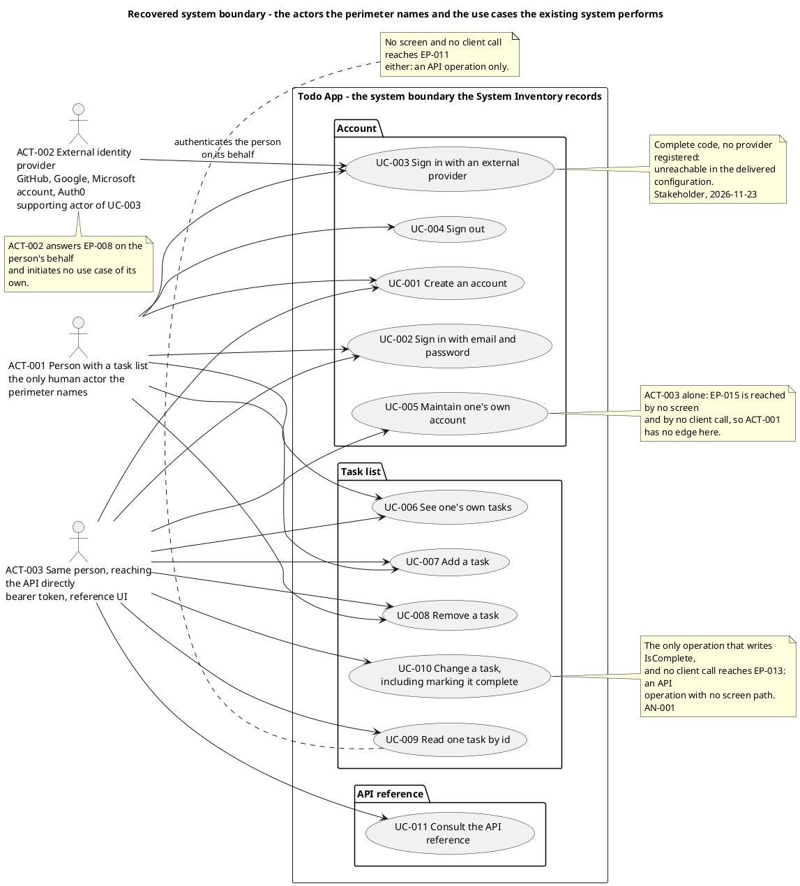
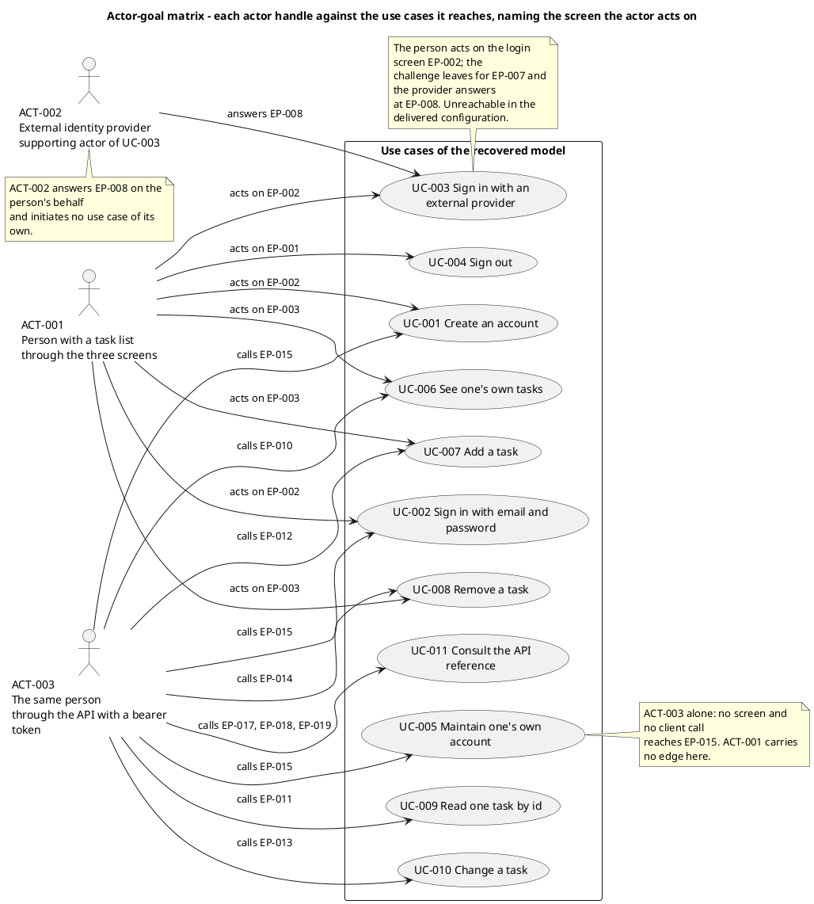
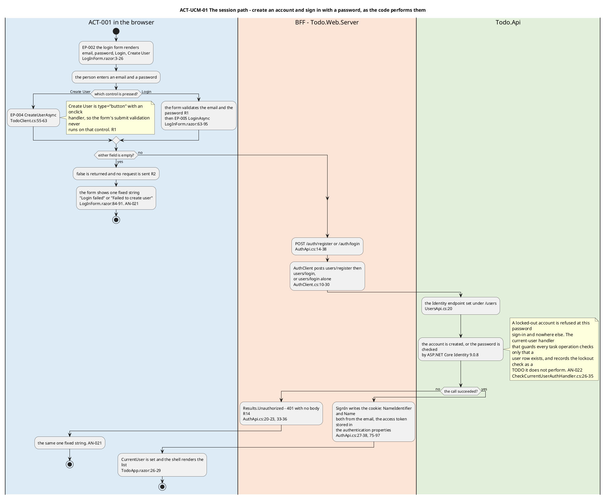
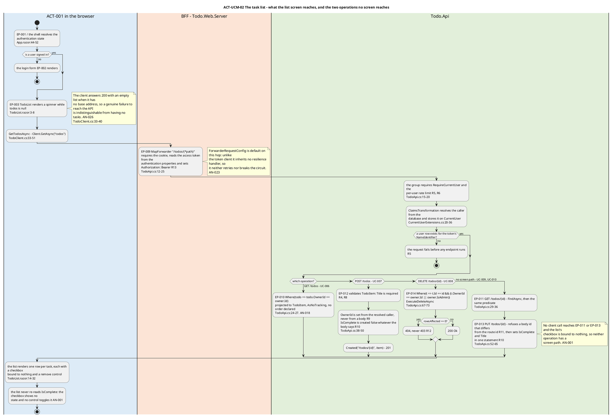
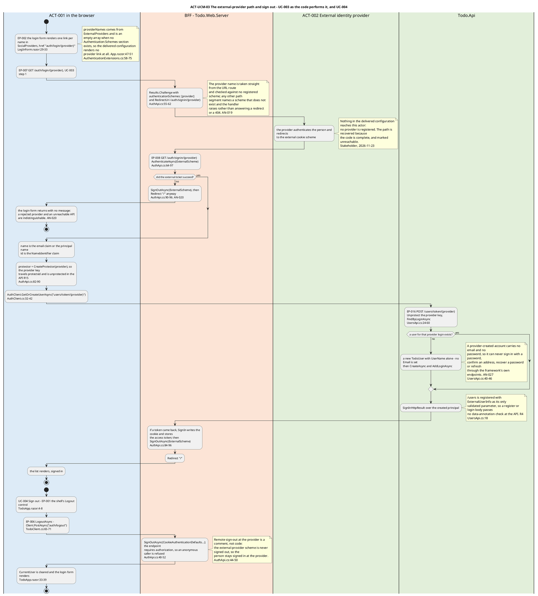
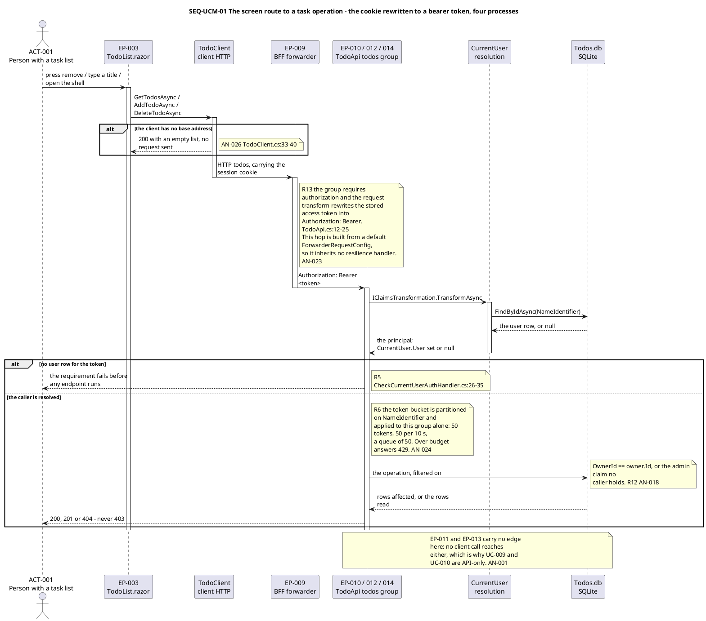

## Document Control
- Phase: Excavation
- Status: Draft — produced for the end-of-Excavation (AR) milestone review
- Milestone Target: end-of-Excavation (AR) — not yet achieved
- Iteration: 4, Cycle 1
- Owner: System Analyst
## Use-Case Diagram
The boundary is the one the System Inventory records: four processes, two stores, and the external systems the delivery reaches. Every use case below is anchored to the entry point whose code performs it.

## Actors
| ID | Actor | Kind | Who or what it is, as established | Source |
|---|---|---|---|---|
| ACT-001 | Person with a task list | Human, primary | The only human actor the perimeter names. Anonymous until they register or sign in; owns the task rows they create. Reaches the system through the three screens of the Blazor client | System Inventory — External actors and systems; `Todo.Web/Server/App.razor:5`; `Todo.Web/Client/Components/LogInForm.razor:3-26` |
| ACT-002 | External identity provider | External system, supporting actor of UC-003 | GitHub, Google, Microsoft account or Auth0. Authenticates the person and returns them to the callback. Initiated from the system's side and answered by the provider, which is why the perimeter names it the initiator of `EP-008`; the person remains the primary actor of the use case | System Inventory — External actors and systems; System Inventory — Entry points `EP-008`; `Todo.Web/Server/Authentication/AuthenticationExtensions.cs:39-92` |
| ACT-003 | Same person, reaching the API directly | Human, the same individual as ACT-001 | The perimeter's "authenticated caller holding a bearer token". The README addresses this role by name: run `Todo.Api` standalone, obtain a token from `/users/login`, then call the endpoints with the reference UI or a client of choice | System Inventory — Entry points `EP-010`–`EP-019`; `README.md`, "Using the API standalone" |

**One human being, two actor roles.** ACT-001 and ACT-003 are the same person. ACT-003 is not a second human actor and does not contradict the perimeter, which names exactly one: it is the role in which that person reaches the API without a cookie, holding a bearer token obtained from `/users/login` and calling the endpoints directly, as the delivery's own README directs. The role exists because the two routes authenticate differently and reach different operations — `EP-009` requires a cookie and rewrites it, while `EP-010` to `EP-019` accept any bearer token.

The task use cases therefore carry **one main flow with two scenarios** — through the screens, or directly with a bearer token — and are not split per actor. UC-009, UC-010 and UC-005 are reached by ACT-003 alone: no screen and no client call reaches `EP-011`, `EP-013`, or any Identity endpoint beyond register and login.

**Two entry points, two different questions.** Every use case in this model is anchored twice over, and the two lists below answer different questions, so they are not expected to agree and are not two statements of one fact:

- The **Source** column of the Survey names the entry point **whose code performs the use case**. When ACT-003 calls `POST /todos` that is `EP-012`; when ACT-001 adds a task from the list screen, the screen is `EP-003` but the request still leaves through the BFF's forwarder `EP-009` to `EP-012`.
- The **actor-goal matrix** names the entry point **the actor reaches the use case through** — the screen or the endpoint the actor itself acts on. ACT-001 acts on `EP-003`; the operation the system then performs is not named there.

A screen entry point and the forwarded operation are therefore both true of one use case, and the matrix says which one its edges name.

**Actors the model does not create.** The System Inventory names "app host or operator" as the initiator of `EP-020`, `EP-021` and `EP-022`, and defines no operator: no role, no procedure and no need for one appears anywhere in the delivery. No actor is created for it, and no use case is recovered from it. `TodoApp.AppHost` is a component inside the boundary that starts the others; starting a system is not an actor goal, and no human initiates it.

**Actors the model does not create, second.** The external systems the delivery also reaches — the OTLP collector, nuget.org, the `tomdesinto/sqliteweb` image — are declared outside the boundary in the System Inventory and serve no use case. The SQLite file is a data manager inside the boundary, reached by every task operation.
## Use-Case Survey
Eleven use cases, each anchored to the entry points whose code performs it. Every one of the twenty-two entry points is either carried here or is accounted for in "Not recovered" below.

| ID | Use case | Primary actor | Source | Value the actor receives | Volatility |
|---|---|---|---|---|---|
| UC-001 | Create an account | ACT-001, ACT-003 | `EP-002`, `EP-004`, `EP-015` | An account exists and the caller is signed in, or holds a bearer token | Low |
| UC-002 | Sign in with email and password | ACT-001, ACT-003 | `EP-002`, `EP-005`, `EP-015` | A session cookie, or a bearer token, for an existing account | Low |
| UC-003 | Sign in with an external provider | ACT-001, with ACT-002 authenticating the person | `EP-007`, `EP-008`, `EP-016` | A local account tied to the provider identity, and a session cookie. **Unreachable in the delivered configuration** (stakeholder, 2026-11-23) | **High** — four providers, each configurable or absent, and the whole path is dead without one |
| UC-004 | Sign out | ACT-001 | `EP-006` | The session cookie is cleared; the screens return to the login form | Low |
| UC-005 | Maintain one's own account | ACT-003. No screen and no client call reaches any of its endpoints | `EP-015` | Token refresh, email confirmation, password reset, two-factor and profile management | Medium — the Identity endpoint set is a framework surface the delivery maps without a screen |
| UC-006 | See one's own tasks | ACT-001, ACT-003 | `EP-001`, `EP-003`, `EP-009`, `EP-010` | The caller's own task rows are read and rendered | Low |
| UC-007 | Add a task | ACT-001, ACT-003 | `EP-003`, `EP-009`, `EP-012` | A new row, owned by the caller, appended to the list without a reload | Low |
| UC-008 | Remove a task | ACT-001, ACT-003 | `EP-003`, `EP-009`, `EP-014` | The row is deleted and leaves the list | Low |
| UC-009 | Read one task by id | ACT-003 | `EP-011` | One row of the caller's is returned. API operation only: no screen and no client call reaches it | Low |
| UC-010 | Change a task, including marking it complete | ACT-003 | `EP-013` | A row's title and completion flag are set. **API operation only**: the client makes no update call and the list's checkbox is bound to nothing (AN-001) | **High** — the one operation the UI has no path to, and the one place `IsComplete` is written |
| UC-011 | Consult the API reference | ACT-003 | `EP-017`, `EP-018`, `EP-019` | The API contract is read as an OpenAPI document or in a rendered reference UI | Low |

### Not recovered, and why

| Entry point | Why it carries no use case |
|---|---|
| `EP-020` readiness, `EP-021` liveness | The perimeter names "app host or operator" as the initiator and defines no operator actor. Both are mapped in Development only, and neither delivers value to an actor the delivery names. They are a platform mechanism, stated in the Supplementary Specification — Supportability (S8) |
| `EP-022` the migration platform event | No human actor initiates it; the app host raises it before the API starts, in run mode and only when `Todo.Api/.db` does not exist. It is a component's start-up step, stated in the Supplementary Specification — Design Constraints (DC11) and as mechanism M9 |
| The `admin` role branch of `EP-011`, `EP-013`, `EP-014` | Not a use case: no actor in the running system can enter it, because nothing grants the role (AN-004). Recorded as an exceptional entity, by the stakeholder's decision of 2026-11-23, inside UC-009, UC-010 and UC-008 as a predicate the flows do not follow |
| The cross-owner read, update and delete a caller holding a self-minted `admin` token could perform | Same as above. It is the behaviour of one predicate, not an actor's goal |

### Why a screen entry point and the forwarded operation are both named

UC-006, UC-007 and UC-008 each cite `EP-003` beside their API-side entry points, and that is not a second anchor for the same fact. The three answer one question with two entry points, because on the screen route the actor's action and the operation that performs it are different entry points in different processes:

| Use case | The actor acts on | The operation performs it | What the screen contributes |
|---|---|---|---|
| UC-006 See one's own tasks | `EP-003` the todo list screen | `EP-010` `GET /todos`, reached through the forwarder `EP-009` | The list renders one row per task with its title and a remove control, and shows a spinner while the load is in flight. It renders nothing and requests nothing when the client has no base address, answering an empty list instead (`AN-026`) |
| UC-007 Add a task | `EP-003` the new-todo input | `EP-012` `POST /todos`, reached through `EP-009` | The input is the form the title is typed into and the validator that blocks an empty submit, and it is the control the created row is appended to without a reload |
| UC-008 Remove a task | `EP-003` the per-row remove control | `EP-014` `DELETE /todos/{id}`, reached through `EP-009` | The remove control is the only way a screen reaches a delete, and it is the control the deleted row is removed from |

The edge is `EP-003 → UC-NNN` because the actor's goal is entered through the screen: without `EP-003` no person reaches any of the three, and each use case's step 1 is that screen. `Todo.Web/Client/Components/TodoList.razor:3-32` carries the new-todo input and the per-row remove control, so it precedes UC-007's and UC-008's step 1, and `Todo.Web/Server/App.razor:44-52` renders it as the signed-in shell, which is the screen UC-006's step 1 names. The `EP-009` forwarder and the API operations are cited in the flows as what the screen's request becomes, not as an alternative actor route.

A reader who needs one list rather than two reads the Survey's **Source** column as the entry point whose code performs the use case; the actor-goal matrix in "Actors" names the entry point the actor acts through. Both are correct for their question, and the Survey's rows name both where both apply.

### Nothing is held back for Consolidation

All twenty-two entry points are accounted for in this model: nineteen carry a use case, and the three that do not — `EP-020`, `EP-021`, `EP-022` — are permanent exclusions reasoned in the table above, not work postponed. No operation of the delivery is recovered in a later phase. The recoverable operations all sit in the entry-point-bearing areas this reading orders first — the Todo API's task surface and its authorization, and the BFF session surface — and the areas it leaves carry no entry point at all: orchestration, build and container manifests and supporting files.

Consolidation therefore inherits no deferred use case from this model. The eleven counted above are the whole use-case set of the delivery as it stands, and the four rows under "Not recovered, and why" are exclusions that no later phase re-opens.

## Use-Case Specifications
Every flow below is the flow the code performs, not a flow anyone intended. Each step carries the file and lines it was read from, and each step is guarded by the rules in the diagram that follows, cited as `R1` to `R15`; where the code contradicts a document or another part of itself, the code is recorded and the contradiction is named.

The four session flows — UC-001, UC-002, UC-003 and UC-004 — sit on a surface whose failure paths were never modified and whose behaviour no test confirms. That statement is made once, with its anchors, in "The instability UC-001 to UC-004 sit on" at the end of this section; read it before those four flows.

### The rules the flows enforce

```plantuml
@startuml
title The rules the recovered flows enforce, and the use case each one guards

skinparam shadowing false
skinparam componentStyle rectangle
skinparam wrapWidth 230
left to right direction

package "Entered by the person, in the client" {
  component "Email required, at most 256 characters; password 6 to 32\ncarrying a digit, an upper case, a lower case and a symbol" as R1
  component "No request is sent unless the email and the password\nare both non-empty" as R2
  component "A new todo requires a title" as R3
}

package "Checked at the API boundary" {
  component "Only the parameter types an endpoint registers are validated:\nTodoItem on /todos, ExternalUserInfo on /users. A violation is\n400 application/problem+json" as R4
  component "A bearer token, and a user row for its NameIdentifier.\nA deleted account's token is refused" as R5
  component "The per-user token bucket, /todos only.\nIn force: 50 tokens, 50 per 10 s, queue 50.\nCode defaults: 100 tokens, 100 per 10 s, queue 100.\nOver budget answers 429. AN-024" as R6
  component "The route id is an integer" as R7
}

package "Held on the row and on the write" {
  component "Title is required, on the row and on both request shapes" as R8
  component "OwnerId is required, set from the resolved caller,\nnever read from a body, never returned" as R9
  component "IsComplete is created false and every PUT replaces it" as R10
  component "PUT refuses a body id that differs from the route id" as R11
  component "Ownership: the caller's row, or an admin claim no caller holds.\nNo match answers 404, never 403" as R12
}

package "Between the BFF and the API" {
  component "The BFF requires the cookie and rewrites the token set's\naccess token into Authorization: Bearer" as R13
  component "An auth failure answers 401 with no body, whatever its cause" as R14
  component "The provider key is protected under a protector named after\nthe provider; a key from another ring raises" as R15
}

package "Use cases" {
  component "UC-001 Create an account" as U1
  component "UC-002 Sign in with a password" as U2
  component "UC-003 Sign in with a provider" as U3
  component "UC-004 Sign out" as U4
  component "UC-005 Maintain one's own account" as U5
  component "UC-006 See one's own tasks" as U6
  component "UC-007 Add a task" as U7
  component "UC-008 Remove a task" as U8
  component "UC-009 Read one task" as U9
  component "UC-010 Change a task" as U10
}

R1 --> U2 : step 2, the submit path
R1 ..> U1 : never runs on the create control
R2 --> U1 : step 3, the client's post
R2 --> U2 : step 3
R3 --> U7 : step 2
R4 --> U3 : step 5
R4 --> U7 : 400 when the title is absent
R4 --> U10 : 400 when the title is absent
R5 --> U6
R5 --> U7
R5 --> U8
R5 --> U9
R5 --> U10
R6 --> U6
R6 --> U7
R6 --> U8
R6 --> U9
R6 --> U10
R7 --> U8
R7 --> U9
R7 --> U10
R8 --> U7 : step 5
R8 --> U10 : step 4
R9 --> U7 : step 5, the owner comes from the token
R10 --> U7 : created false whatever the body says
R10 --> U10 : step 4, both fields replaced
R11 --> U10 : step 3
R12 --> U8 : step 4
R12 --> U9 : steps 3 and 5
R12 --> U10 : step 4
R13 --> U6 : step 3
R13 --> U7 : step 4
R13 --> U8 : step 3
R14 --> U1 : the one refusal it can give
R14 --> U2 : the one refusal it can give
R14 --> U4 : a refused sign-out is silent
R15 --> U3 : step 6

note right of R4
  The /users group registers ExternalUserInfo alone with the
  validation filter, so a register or login body passes no
  data-annotation check at the API. UsersApi.cs:18
end note

note bottom of R6
  Two budgets, one in force; R6 states both. RateLimitExtensions.cs:14-31
  carries the code defaults of 100 tokens, 100 per 10 s and a queue of 100;
  appsettings.Development.json:8-12 binds all three to 50, and both launch
  profiles of both serving processes select Development. The delivery
  configures no other environment, so 50 / 50 / 50 is the budget everywhere
  this system runs, and 50 is the number to read wherever one number is
  needed. AN-024
end note

note bottom of R12
  The list endpoint filters on OwnerId alone and declares no
  order; the item endpoints also admit the admin claim.
  The disagreement is recorded, not reconciled. AN-018
end note

@enduml
```

### ACT-UCM-01 — the session path, UC-001 and UC-002

**UC-001 Create an account.** Primary actor `ACT-001`, or `ACT-003` on the API route. Trigger: the person presses Create User on `EP-002`, or a caller posts to `EP-015`. Precondition: no user is signed in on the screen route. Postcondition: an account row exists and the caller holds a session cookie, or a bearer token on the API route.

1. The shell `EP-001` renders the login form `EP-002` because no user is signed in. `App.razor:44-52`
2. The person enters an email and a password and presses Create User. `LogInForm.razor:3-26`
3. The client posts `auth/register` to the BFF. `TodoClient.cs:55-63`
4. The BFF posts `users/register` to the API and, on success, `users/login`. `AuthClient.cs:23-30`
5. The Identity endpoint set creates the account row. `UsersApi.cs:20`
6. The BFF writes the session cookie holding the access token. `AuthApi.cs:14-25, 75-97`
7. The shell renders the task list. `TodoApp.razor:26-29`

**Alternatives.** A1 the client validates the email and the password at submit, but Create User is a `type="button"` control whose `onclick` handler bypasses the form's submit path, so `R1` never runs on it. A2 either field empty answers no request and one fixed string, `R2`, `AN-021`. A3 the API refuses — a taken email, a password failing the Identity policy — and the BFF answers 401 with no body whatever the cause, `R14`, so the person is told "Failed to create user" and nothing more, `AN-021`. A4 on the API route `ACT-003` posts `register` to `EP-015` and reads an `accessToken` from the response; no cookie is involved.

**UC-002 Sign in with email and password.** Primary actor `ACT-001`, or `ACT-003` on the API route. Trigger: the person presses Login on `EP-002`, or a caller posts to `EP-015`. Precondition: an account row exists and no user is signed in on the screen route. Postcondition: a session cookie holding the access token, or a bearer token.

1. The shell renders the login form `EP-002`. `App.razor:44-52`
2. The person enters an email and a password and presses Login; the form validates both against `R1`. `LogInForm.razor:63-95`
3. The client posts `auth/login` to the BFF. `TodoClient.cs:47-53`
4. The BFF posts `users/login` to the API and reads the token from the response. `AuthClient.cs:10-21`
5. Identity checks the password; a locked-out account is refused here. `UsersApi.cs:20`, `AN-022`
6. The BFF writes the cookie, `NameIdentifier` and `Name` both taken from the email, the access token stored in the authentication properties. `AuthApi.cs:27-38, 75-97`
7. The shell renders the task list. `TodoApp.razor:26-29`

**Alternatives.** A1 either field empty answers no request and "Login failed", `R2`. A2 the credentials are wrong, or the account is locked out, and the BFF answers 401 with no body; the person cannot tell a wrong password from a locked account from an unreachable API, `R14`, `AN-021`, `AN-022`. A3 every task request made later with that token passes only if a user row still exists for its `NameIdentifier`, `R5`.

### ACT-UCM-02 — the task list reach, UC-006, UC-007, UC-008, UC-009 and UC-010

**UC-006 See one's own tasks.** Primary actor `ACT-001`, or `ACT-003` on the API route. Trigger: the shell renders the list for a signed-in user, or a caller issues `GET /todos`. Precondition: the caller holds a session cookie or a bearer token. Postcondition: the caller's own task rows are read and rendered.

1. The shell `EP-001` finds a user signed in and renders the list `EP-003`. `App.razor:44-52`
2. The list shows a spinner while its collection is null. `TodoList.razor:3-8`
3. The client calls `GetTodosAsync`, which issues `GET todos` through the BFF. `TodoClient.cs:33-51`
4. The forwarder `EP-009` requires the cookie and rewrites the stored access token into `Authorization: Bearer`. `TodoApi.cs:12-25`, `R13`
5. The API resolves the caller from the database; no user row ends the request before any endpoint runs. `CurrentUserExtensions.cs:20-36`, `R5`
6. `EP-010` reads `Where(todo => todo.OwnerId == owner.Id)`, projects each row to `TodoItem` with `AsNoTracking`, and declares no order. `TodoApi.cs:24-27`
7. The list renders one row per task with its title, a checkbox bound to nothing and a remove control. `TodoList.razor:14-32`

**Alternatives.** A1 the token budget is exhausted and the API answers 429, `R6`, `AN-024`. A2 the client has no base address and answers 200 with an empty list without issuing a request, so the spinner gives way to an empty list and a genuine failure is indistinguishable from having no tasks, `AN-026`. A3 the status is 401 or 403 and the list raises `OnForbidden`, which the shell handles by signing the person out. A4 the caller holds the `admin` role: the list filters on `OwnerId` alone and declares no admin branch, so a row the item endpoints would admit is absent here, `AN-018`, `R12`.

**UC-007 Add a task.** Primary actor `ACT-001`, or `ACT-003` on the API route. Trigger: the person submits the new-todo input on `EP-003`, or a caller posts to `EP-012`. Precondition: the caller is resolved. Postcondition: a new row owned by the caller exists and is appended to the rendered list without a reload.

1. The person types a title into the new-todo input and submits the form. `TodoList.razor:14-22`
2. The form blocks an empty submit, `R3`. `TodoList.razor:58-63`
3. The client posts `todos` through the forwarder, `R13`. `TodoClient.cs:7-24`
4. `EP-009` rewrites the cookie into the bearer header, then `EP-012` receives the request. `TodoApi.cs:12-25`
5. `R4` and `R8` require the title; the row is built with `Title` from the body and `OwnerId` from the resolved caller, never from the body, and `IsComplete` is created false whatever the body says. `TodoApi.cs:38-50`, `R9`, `R10`
6. The row is saved and answered `201 Created` with a `Location` of `/todos/{id}`. `TodoApi.cs:47-49`
7. The client appends the returned item to the list and clears the input. `TodoList.razor:65-75`

**Alternatives.** A1 the title is empty and no request is made, `R3`. A2 the title is absent or whitespace and the API answers a 400 `application/problem+json`, which the client does not render — the input simply keeps its text, `R4`, `AN-021`. A3 the caller is over budget and receives 429, and the component reports nothing. A4 a transient API failure is not retried on this hop, unlike the token hop, so the write is surfaced as a silent no-op, `AN-023`.

**UC-008 Remove a task.** Primary actor `ACT-001`, or `ACT-003` on the API route. Trigger: the person presses the remove control of a row, or a caller issues `DELETE /todos/{id}`. Precondition: the row is rendered, or its id is known to the caller. Postcondition: the row is deleted and leaves the list.

1. The person presses the remove control of one row. `TodoList.razor:28`
2. The client calls `DeleteTodoAsync(id)` through the forwarder, `R13`. `TodoClient.cs:26-30`
3. `EP-009` rewrites the cookie into the bearer header. `TodoApi.cs:12-25`
4. `R7` requires an integer route id; `EP-014` deletes `Where(t => t.Id == id && (t.OwnerId == owner.Id || owner.IsAdmin))`. `TodoApi.cs:67-73`, `R12`
5. No row matched and the endpoint answers 404, never 403. `TodoApi.cs:71-73`
6. The client removes the row from the rendered list only when the call reported success. `TodoList.razor:77-83`

**Alternatives.** A1 the row belongs to another caller and no row matches, so the answer is 404 and the list keeps the row without a word. A2 the caller holds the `admin` role, which no running system grants, and the `owner.IsAdmin` disjunct admits the row — an exceptional entity the flows do not follow, `AN-004`. A3 the call fails and nothing is reported to the person.

### ACT-UCM-03 — UC-003 and UC-004

**UC-003 Sign in with an external provider.** Primary actor `ACT-001`, with `ACT-002` authenticating the person on their behalf. Trigger: the person follows one provider link rendered on `EP-002`. Precondition: at least one `Authentication:Schemes:<name>` section exists, which the delivered configuration does not carry — the use case is **unreachable in the delivered configuration** by the stakeholder's decision of 2026-11-23, and the code is complete behind it. Postcondition: a local account tied to the provider identity exists and the person holds a session cookie.

1. The login form renders one link per name in `SocialProviders`, with `href="auth/login/{provider}"`. `LogInForm.razor:29-33`
2. `EP-007` issues a challenge with `authenticationSchemes: [provider]` and a redirect URI of `/auth/signin/{provider}`. `AuthApi.cs:55-62`
3. `ACT-002` authenticates the person and returns them to the external cookie scheme. `AuthenticationExtensions.cs:39-75`
4. `EP-008` authenticates the external scheme and takes `NameIdentifier` as the id and the email claim, or the principal name, as the user name. `AuthApi.cs:64-72`
5. A data protector named after the provider protects the id before it leaves the BFF. `AuthApi.cs:82-90`, `R15`
6. `EP-016` unprotects the key, looks the login up, and creates the account with `UserName` alone when none exists. `UsersApi.cs:24-60`
7. The BFF writes the cookie and stores the access token, clears the external cookie and redirects to `/`. `AuthApi.cs:84-96`
8. The shell renders the task list. `TodoApp.razor:26-29`

**Alternatives.** A1 no provider is registered, so `SocialProviders` is empty, no link renders and the use case cannot be started. A2 the provider name in the route matches no registered scheme: the challenge raises rather than answering a redirect or a 404, `AN-019`. A3 the external ticket is absent, the token exchange answers null, or the cookie sign-in does not take effect — the handler redirects to `/` anyway, so the person returns to the login form with no message, `AN-020`. A4 the BFF and the API do not share a data-protection key ring, and the unprotect raises rather than finding the user, `R15`, `AN-010`. A5 the account created this way carries no email and no password, so no password sign-in, address confirmation, password recovery or token refresh is possible for it, `AN-027`.

**UC-004 Sign out.** Primary actor `ACT-001`. Trigger: the person presses Logout in the shell. Precondition: a user is signed in. Postcondition: the session cookie is cleared and the screens return to the login form.

1. The shell renders a Logout control beside the signed-in name. `TodoApp.razor:4-8`
2. The client calls `LogoutAsync`, which posts `auth/logout` to the BFF. `TodoClient.cs:65-71`
3. `EP-006` requires authorization, so an anonymous caller is refused before the handler runs. `AuthApi.cs:40-52`
4. The handler signs out the cookie scheme. `AuthApi.cs:42-43`
5. The client clears `CurrentUser` and the login form renders. `TodoApp.razor:33-39`

**Alternatives.** A1 remote sign-out at the provider is a comment rather than code: the external-provider scheme is never signed out, so a person signed in through a provider stays signed in there, `AuthApi.cs:44-50`. A2 the call fails and nothing changes; the client sets `CurrentUser` to null only on success, so a refused sign-out is silent. A3 the `admin` role claim, were one ever granted, is discarded with the cookie like any other claim.

**UC-005 Maintain one's own account.** Primary actor `ACT-003`. No screen and no client call reaches any of its endpoints. Trigger: a caller issues one of the endpoint paths the Identity set maps. Precondition: the caller is anonymous for register, login, forgot and reset; authenticated for the rest. Postcondition: whichever of the framework's account operations was requested has been performed or refused.

1. The caller issues a request to the Identity endpoint set mapped under `/users`: register, login, refresh, confirmEmail, resendConfirmationEmail, forgotPassword, resetPassword, `manage/2fa` or `manage/info`. `UsersApi.cs:20`
2. Identity identifies the operation from the path and reads its own request body, which the API's validation filter does not reach. `UsersApi.cs:18`, `R4`
3. The operation is performed against the account rows or refused with the framework's own answer.
4. A successful `login` or `refresh` returns an `AccessTokenResponse` whose `accessToken` the client contracts carry as `Token`. `SharedClass.cs:31`

**Alternatives.** A1 the endpoint set carries no rate limit — the per-user policy is required on `/todos` only, and it partitions on a `NameIdentifier` an anonymous caller lacks — so `login`, `register`, `refresh` and `forgotPassword` are unlimited, `AN-009`. A2 no screen and no client call reaches any of these operations, which is why only `register` and `login` appear in the screen flows, as steps the BFF performs. A3 an account created through the provider exchange has no password and no email, so confirm, reset and refresh cannot succeed for it, `AN-027`.

**UC-009 Read one task by id.** Primary actor `ACT-003`. API operation only: no screen and no client call reaches `EP-011`. Trigger: a caller issues `GET /todos/{id}`. Precondition: the caller is resolved. Postcondition: one row is returned, or 404.

1. The caller issues `GET /todos/{id}`; `R5` resolves the caller from the database and `R6` applies the token budget. `TodoApi.cs:15-20`
2. `R7` requires an integer route id. `TodoApi.cs:29`
3. `EP-011` reads `db.Todos.FindAsync(id)`. `TodoApi.cs:29-36`
4. A row whose `OwnerId` is the caller's, or a caller in the `admin` role, is answered `Ok` with the projection. `TodoApi.cs:31-32`, `R12`
5. No match answers 404, never 403. `TodoApi.cs:33`

**Alternatives.** A1 the row exists and belongs to another caller: the answer is 404, so the caller cannot distinguish absence from denial. A2 the caller holds the `admin` role, `AN-004` — an exceptional entity the flow does not follow. A3 no such row is found at all and the same 404 answers.

**UC-010 Change a task, including marking it complete.** Primary actor `ACT-003`. **API operation only**: the client makes no update call and the list's checkbox is bound to nothing, `AN-001`. This is the one place `IsComplete` is written after creation. Trigger: a caller issues `PUT /todos/{id}`. Precondition: the caller is resolved. Postcondition: the row's title and completion flag carry the submitted values.

1. The caller issues `PUT /todos/{id}` with a `TodoItem` body. `TodoApi.cs:52-65`
2. `R4` validates the body and `R8` requires the title; a violation answers 400 `application/problem+json`. `TodoApi.cs:20`
3. `R11` refuses a body id that differs from the route id, answering 400. `TodoApi.cs:54-57`
4. `EP-013` updates `Where(t => t.Id == id && (t.OwnerId == owner.Id || owner.IsAdmin))`, setting `IsComplete` and `Title` in one statement, so every write replaces both fields whatever was sent. `TodoApi.cs:59-63`, `R10`, `R12`
5. `rowsAffected == 0` answers 404; otherwise 200 with no body. `TodoApi.cs:65`

**Alternatives.** A1 the caller sends an id in the body that differs from the route and receives 400. A2 the title is absent and the endpoint answers 400. A3 the row belongs to another caller, or does not exist: 404. A4 the caller holds the `admin` role and may change another caller's row, `AN-004`, `AN-018` — an exceptional entity the flow does not follow. A5 no screen path exists, so the completion flag this operation alone writes is unreachable for `ACT-001`, `AN-001`.

**UC-011 Consult the API reference.** Primary actor `ACT-003`. Trigger: a caller opens `/`, or reads the document at `/openapi/v1.json`. Precondition: none. Postcondition: the API contract is read as a document or in a rendered reference UI.

1. A caller issues `GET /`. `Program.cs:62`
2. The API answers an unconditional redirect to `/scalar/v1`. `Program.cs:62`, `AN-017`
3. In Development the Scalar reference UI is mapped and renders, reading the OpenAPI document, with the bearer scheme offered as the preferred authentication scheme. `Program.cs:49-56`
4. A caller may instead read the OpenAPI document directly at `GET /openapi/v1.json`. `Program.cs:58`

**Alternatives.** A1 the environment is not Development: the UI is not mapped, so the redirect leads to an endpoint the process does not serve, `AN-017`. A2 the reader follows the delivery's own README, which directs them to a Swagger UI that no code maps, `AN-008`.

### SEQ-UCM-01 — the request hop the task use cases share

### The instability UC-001 to UC-004 sit on

`Todo.Web/Server` carries 33 commits across the whole life of the delivery — the most of any area of its code — and `AuthApi.cs` alone carries fifteen, between 2022-11-27 and 2024-11-27. Every one of those fifteen touched a success path: the `// TODO: Handle the failure somehow`, the unconditional redirect and the bare `Unauthorized` are original, and none of the three defects they leave (AN-019, AN-020, AN-021) has a test covering it, because `Todo.Api.Tests` references `Todo.Api` alone (AN-012, AN-029).

The four session flows above are therefore the least settled part of this model: what they state is what the code performs, and no test and no document confirms any of it.

## Traceability

| Element | Traces From | Link Type | Traces To |
|---|---|---|---|
| UC-001 | EP-002, EP-004, EP-015 | Refines | — |
| UC-002 | EP-002, EP-005, EP-015 | Refines | — |
| UC-003 | EP-007, EP-008, EP-016 | Refines | — |
| UC-004 | EP-006 | Refines | — |
| UC-005 | EP-015 | Refines | — |
| UC-006 | EP-001, EP-003, EP-009, EP-010 | Refines | — |
| UC-007 | EP-003, EP-009, EP-012 | Refines | — |
| UC-008 | EP-003, EP-009, EP-014 | Refines | — |
| UC-009 | EP-011 | Refines | — |
| UC-010 | EP-013 | Refines | — |
| UC-011 | EP-017, EP-018, EP-019 | Refines | — |
