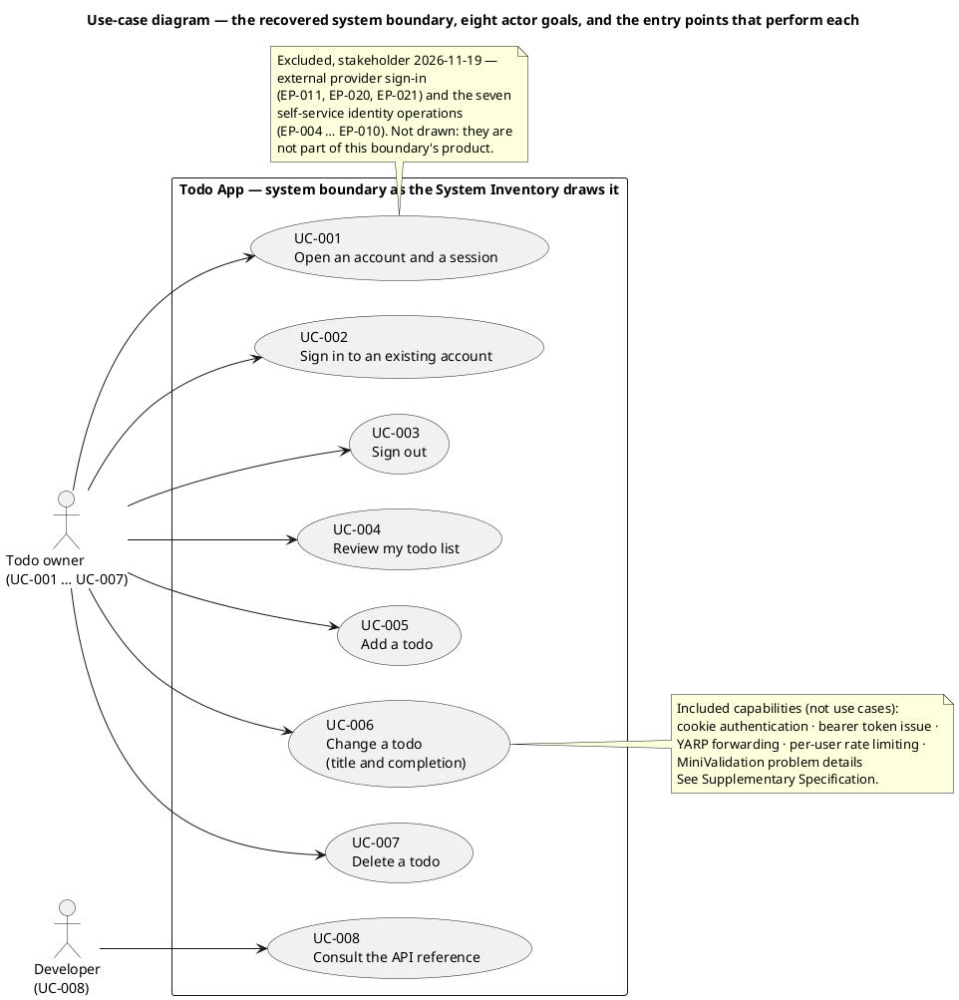
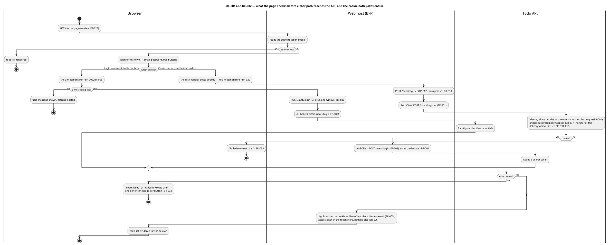
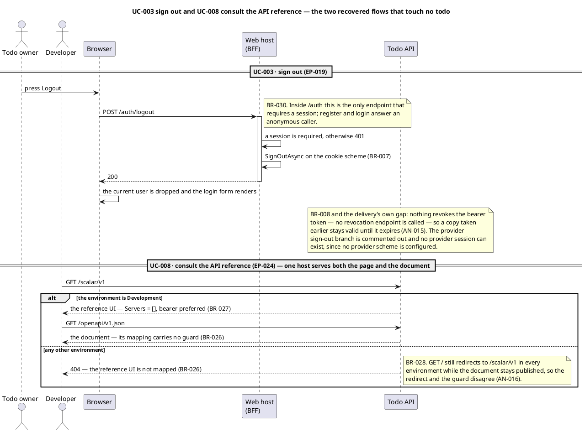
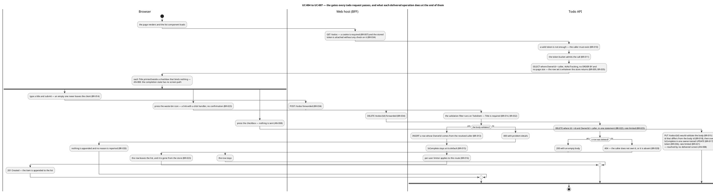
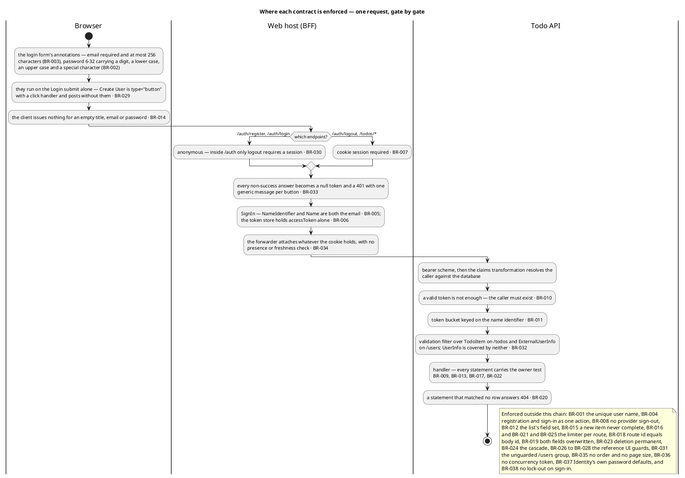

## Document Control
- Phase: Excavation
- Status: Draft — issued for the end-of-Excavation milestone review
- Milestone Target: end of Excavation (AR) — not yet achieved

## Use-Case Diagram

Eight use cases: seven actor goals over the todo group and one over the API reference. Every one is anchored to the entry points that perform it, and every entry point of the perimeter that carries a delivered goal appears in at least one. Authentication, session issue, forwarding, rate limiting, validation and telemetry are drawn nowhere — they are Supplementary Specification mechanisms, included by the use cases that depend on them.

**Why these eight and not the twenty-six.** The entry points of the perimeter fall into four groups, and only the first yields a use case.

| Group | Entry points | Treatment |
|---|---|---|
| A goal a delivered actor reaches | `EP-001`, `EP-002`, `EP-012`, `EP-014`, `EP-015`, `EP-016`, `EP-017`, `EP-018`, `EP-019`, `EP-022`, `EP-023`, `EP-024` | Recovered as UC-001 … UC-008 |
| Published, reached by nothing in the delivery | `EP-003`, `EP-013` | No use case. They stay in the perimeter with their anchors as mechanisms a later declared requirement would build on (AN-015; `TodoClient.cs:7-71` has no read-by-id call) |
| Excluded by the stakeholder, 2026-11-19 | `EP-004` … `EP-011`, `EP-020`, `EP-021` | No use case. Recorded as exclusions in the Supplementary Specification |
| Operational, not an actor goal | `EP-025`, `EP-026` | No use case. Supplementary Specification, Design Constraints |

## Actors

| Actor | Kind | Goals | Reaches the system through | Anchor |
|---|---|---|---|---|
| Todo owner | Primary, human | UC-001 … UC-007 | The web host only: `/`, `/auth/*`, `/todos/*`. Never the API directly, because the browser holds a cookie and the forwarder carries the bearer token. | `Todo.Web/Server/App.razor:5`; `Todo.Web/Client/TodoClient.cs:8-71`; `Todo.Web/Server/TodoApi.cs:14-26` |
| Developer | Secondary, human, Development environment only | UC-008 | `/scalar/v1`, the OpenAPI reference UI with `Servers = []` and the bearer scheme preferred; `/` redirects there in every environment. | `Todo.Api/Program.cs:49-58,62`; `EP-024` |

Both actors are named by the perimeter. No administrative actor exists: `admin` is a role claim nothing grants, decided dead code on 2026-11-19 (AN-010). No external system is an actor of the recovered product — the identity providers are excluded, and the OTLP collector, the container runtime, the `dotnet-ef` CLI and the NuGet feed are start-up and platform dependencies, listed in the Vision's dependencies table.

**Actor coverage check.** Human actors who directly use the system: two, both named. External systems that integrate as actors: none in the recovered product. Time-based triggers: none — the delivery has no job, timer or scheduled report; `EP-026` is a start-up step of the orchestrator, not a schedule. Hardware devices: none. Administrative actors: none, recorded as an exclusion.

## Use-Case Survey

| UC | Name | Primary actor | Source | Volatility | Scenarios recovered |
|---|---|---|---|---|---|
| UC-001 | Open an account and a session | Todo owner | `EP-017` · `EP-001` · `EP-002` | Medium | Register accepted; registration refused; registration accepted but sign-in fails |
| UC-002 | Sign in to an existing account | Todo owner | `EP-018` · `EP-002` | Low | Credentials accepted; credentials refused |
| UC-003 | Sign out | Todo owner | `EP-019` | Low | Sign out with a valid session; sign out without one; session ending without a sign-out |
| UC-004 | Review my todo list | Todo owner | `EP-023` · `EP-022` · `EP-012` | Medium | List with items; empty list; session no longer accepted |
| UC-005 | Add a todo | Todo owner | `EP-022` · `EP-014` | Low | Title accepted; empty title refused by the page; empty title refused by the API |
| UC-006 | Change a todo (title and completion) | Todo owner | `EP-022` · `EP-015` | **High** | API call for an owned item; call for another owner's item; id mismatch; **and the scenario the delivery cannot perform — no screen issues it** |
| UC-007 | Delete a todo | Todo owner | `EP-022` · `EP-016` | Low | Deletion of an owned item; deletion of another owner's item; deletion of a missing item |
| UC-008 | Consult the API reference | Developer | `EP-024` | Medium | Development environment; any other environment |

**Volatility** is read on the two axes: does this change for the same customer over time, does it differ between customers now. `UC-006` is High because it is the use case whose screen path is absent and whose exposure is accepted rather than repaired (AN-008) — any later declared requirement for completion will change it, and its realisation must therefore not be welded to the other four. `UC-001` and `UC-004` are Medium: `UC-001` because account creation is the step most likely to change once a real identity requirement exists (the excluded self-service surface sits directly beside it), and `UC-004` because the browser-facing half is the unstable area of the system (AN-013) and the list is its only screen. `UC-008` is Medium because its environment guard is inconsistent with the redirect that reaches it (AN-016). `UC-002`, `UC-003`, `UC-005` and `UC-007` are Low: their code is the most stable in the delivery and no excluded or missing requirement touches them.

## Use-Case Specifications
### UC-001 — Open an account and a session

| | |
|---|---|
| Primary actor | Todo owner |
| Source | `EP-017` · `EP-001` · `EP-002` |
| Stakeholders and interests | The new account owner wants an account and a working session from one action; nobody else is involved, since an account belongs to exactly one person |
| Precondition | The browser can reach the web host. No session is required; a session already open would render the list instead |
| Trigger | The person fills the login form's email and password fields and presses **Create User** |
| Postcondition | An `AspNetUsers` row exists for the email; an authentication cookie holding an `accessToken` is written; the browser shows the todo list for that account |
| Volatility | Medium — the excluded self-service identity surface borders this flow directly |

**Main flow**

1. The person enters an email and a password and presses **Create User** (`LogInForm.razor:19-20`).
2. The click handler posts the two values as they stand. The form's annotations do not run on this path: the control is `type="button"` with an `@onclick` handler, so no submit and no validation occur (BR-029). The only local check is `TodoClient`'s refusal to send when either value is empty (`TodoClient.cs:55-63`).
3. The client posts `auth/register` with the email and password (BR-030 — the endpoint answers an anonymous caller).
4. The BFF forwards the pair to `users/register` (`EP-001`; `AuthClient.cs:20-29`).
5. The API creates the account through ASP.NET Core Identity. No validation filter covers `UserInfo` (BR-032), so Identity's own rules are the whole of what the body meets: a unique user name and the framework's password defaults, which this delivery never configured (BR-001, BR-037).
6. On success the BFF immediately calls `users/login` with the same credentials (`AuthClient.cs:20-29`), and the API issues a bearer token (`EP-002`).
7. The BFF writes the authentication cookie — `NameIdentifier` and `Name` both set to the email, the `accessToken` in the cookie's token store and nothing else (`AuthApi.cs:105-127`; BR-005, BR-006).
8. The client reports the login to its parent component and the todo list renders (`TodoApp.razor:34-37`).

**Alternative flows**

- **A1 — a field is empty.** `TodoClient` returns `false` without sending anything and the page shows **"Failed to create user"** (`TodoClient.cs:55-63`). No field-level message appears: the annotations that would produce one never ran (BR-029).
- **A2 — the API refuses the registration** (step 5): duplicate user name, or a password the framework's defaults reject. The BFF answers `401` and the client shows the same generic message (BR-033). The person is not told which rule failed, and the message does not distinguish a duplicate account from a rejected password.
- **A3 — the account is created but the sign-in that follows fails** (step 6). `CreateUserAsync` returns `null`, the BFF answers `401`, and the person sees **"Failed to create user"** while an account now exists for that email. Submitting again meets A2. This is the flow's only state the person cannot see: the account exists and no session does.

**Business rules**

| Rule | Enforced in | Anchor |
|---|---|---|
| BR-001 An email may hold at most one account | Identity's unique user-name index, with the email as the user name | `20221123071234_Initial.cs`; `20230714032431_ForeignKeyChange.cs:24-29`; `UsersApi.cs:20` |
| BR-002 A password offered on the **Login** path must be 6–32 characters and contain a lower-case letter, an upper-case letter, a digit and a special character | The form's data annotations — which run on `OnValidSubmit` only | `LogInForm.razor:38-51` |
| BR-003 An email is required and at most 256 characters | the form's data annotations | `LogInForm.razor:36-41` |
| BR-004 Registration and sign-in are one action from the person's point of view: the session is opened without a second credential entry | `CreateUserAsync` registers then logs in | `AuthClient.cs:20-29` |
| BR-029, BR-030, BR-032, BR-033, BR-037 | see Contracts shared by every use case | — |

### UC-002 — Sign in to an existing account

| | |
|---|---|
| Primary actor | Todo owner |
| Source | `EP-018` · `EP-002` |
| Stakeholders and interests | The account owner wants access to their list; no other party is involved |
| Precondition | An account exists for the email. The browser can reach the web host |
| Trigger | The person fills the email and password fields and presses **Login** |
| Postcondition | An authentication cookie holding an `accessToken` is written; the list renders for that account. On failure no cookie is written and the form stays |
| Volatility | Low |

See the diagram under UC-001: both paths share one page, one pair of buttons and one cookie.

**Main flow**

1. The person enters an email and a password and presses **Login** (`LogInForm.razor:20`).
2. The form's annotations run, because this control submits the form: email required and at most 256 characters, password 6–32 characters with a digit, a lower-case letter, an upper-case letter and a special character (BR-002, BR-003). A failure shows the field's message and nothing is posted.
3. The client posts `auth/login` (`TodoClient.cs:47-53`); the BFF calls `users/login` (`EP-002`; `AuthClient.cs:5-18`). The endpoint answers an anonymous caller (BR-030).
4. The API verifies the credentials and issues a bearer token in the `AccessTokenResponse` shape — `accessToken`, `tokenType`, `expiresIn`, `refreshToken`, of which the BFF reads `accessToken` only (BR-006).
5. The BFF writes the cookie as in UC-001 step 7 and the list renders.

**Alternative flows**

- **A1 — page validation refuses the input** (step 2). A field message appears; nothing is posted.
- **A2 — the credentials are refused** (step 4). The BFF answers `401` and the page shows **"Login failed"** (BR-033). The message does not distinguish a wrong password from an unknown email, and there is no lock-out or attempt counter to report instead — nothing configures one (BR-038).
- **A3 — the session ends without a sign-out.** The cookie's token store holds an access token whose lifetime no file in the delivery configures; the first `401` or `403` from a todo call makes the client sign out silently (UC-004 A2; AN-015).

**Business rules**

| Rule | Enforced in | Anchor |
|---|---|---|
| BR-005 The identity claims the product carries are the email, as identifier and as name | `SignIn` builds the principal | `AuthApi.cs:105-111` |
| BR-006 The session holds an access token and no refresh token | `TokenNames` names `accessToken` only; `StoreTokens` stores that one entry | `TokenNames.cs:3-6`; `AuthApi.cs:121-123` |
| BR-038 Repeated failed sign-ins are unlimited and uncounted | no lock-out configuration; no limiter on `/users` | `Todo.Api/Program.cs:17-20`; `UsersApi.cs:12-22`; AN-011 |
| BR-002, BR-003, BR-030, BR-033 | see Contracts shared by every use case | — |

### UC-003 — Sign out

| | |
|---|---|
| Primary actor | Todo owner |
| Source | `EP-019` |
| Stakeholders and interests | The account owner wants the session ended on this browser |
| Precondition | A session cookie exists. The endpoint requires authorization, so an unauthenticated call cannot reach it |
| Trigger | The person presses **Logout** |
| Postcondition | The cookie is cleared and the login form renders. The bearer token the cookie held is **not** revoked |
| Volatility | Low |

**Main flow**

1. The person presses **Logout** in the navigation bar (`TodoApp.razor:7`).
2. The client posts `auth/logout` (`TodoClient.cs:65-69`).
3. The BFF requires an authenticated caller — the only `/auth` endpoint that does (BR-030) — then signs out of the cookie scheme (`AuthApi.cs:40-52`).
4. The client clears its current user and the login form renders (`TodoApp.razor:39-45`).

**Alternative flows**

- **A1 — no session exists.** The endpoint's `RequireAuthorization` answers `401`, the client reports failure and the form stays as it was. The person is already where they wanted to be.
- **A2 — the session ends by expiry rather than by sign-out.** Nothing in the delivery revokes the bearer token at sign-out, so a copy obtained before the sign-out remains valid until it expires. This is the session's real end, and no screen states it (AN-015).

**Business rules**

| Rule | Enforced in | Anchor |
|---|---|---|
| BR-007 Sign-out requires an authenticated caller and clears the cookie; it does not revoke the bearer token | `RequireAuthorization` on the mapping plus `SignOutAsync` on the cookie scheme | `AuthApi.cs:40-52` |
| BR-008 Sign-out does not sign out of an external provider — that branch is commented out, and no provider scheme is configured for it to act on | `// TODO: Support remote logout` above the commented block | `AuthApi.cs:44-50` |
| BR-030 | see Contracts shared by every use case | — |

### UC-004 — Review my todo list

| | |
|---|---|
| Primary actor | Todo owner |
| Source | `EP-023` · `EP-022` · `EP-012` |
| Stakeholders and interests | The account owner wants to see the items they own and nothing else. Every other account is an interested party in the opposite direction: its items must not appear |
| Precondition | A valid session cookie exists, and the access token inside it is still accepted by the API |
| Trigger | The browser opens `/`, or the page re-renders after a sign-in |
| Postcondition | Every item owned by the caller, and no other item, is listed by title. Nothing is written |
| Volatility | Medium — the browser-facing half is the unstable area (AN-013), and this is its only screen |

**Main flow**

1. The browser requests `/`; the host renders the page and resolves the authenticated user's name into `CurrentUser` (`App.razor:44-53`).
2. A non-empty `CurrentUser` renders the navigation bar and the `TodoList` component (`TodoApp.razor:3-14`).
3. The component's `OnInitializedAsync` calls `GET todos` (`TodoList.razor:55-64`).
4. The BFF requires a cookie and forwards the request through YARP to `http://todoapi` with `Authorization: Bearer <token>` taken from the cookie's token store, unchecked (BR-034; `TodoApi.cs:14-26`).
5. The API requires an authenticated caller **and** that the caller exists in its database — a valid token alone does not satisfy the requirement (BR-010; `CheckCurrentUserAuthHandler.cs:17-39`).
6. The per-user token bucket admits the request, keyed on the `NameIdentifier` claim (BR-011; `RateLimitExtensions.cs:11-71`).
7. The API returns every `Todo` whose `OwnerId` equals the caller's id, `AsNoTracking`, mapped to `TodoItem` — id, title, completion (BR-009, BR-012; `TodoApi.cs:24-27`).
8. The component prints each item's title and renders an unbound checkbox beside it (BR-035; `TodoList.razor:17-32`).

**Alternative flows**

- **A1 — no items.** The loop renders nothing and only the entry field and the heading remain. No empty-state message exists in the component.
- **A2 — the session is no longer accepted** (step 4 or 5 answers `401` or `403`). The component raises `OnForbidden` and the parent signs the user out, returning the login form (`TodoList.razor:66-73`; `TodoApp.razor:10`). No error is reported to the person: a server-side outage and an expired token both read as a silent sign-out (AN-015).
- **A3 — the limiter is exhausted** (step 6). The API answers `429` and the component's status check does not treat it as forbidden, so the list stays null and the spinner remains indefinitely (`RateLimitExtensions.cs:20-27`; `TodoList.razor:3-8`).
- **A4 — the page's prerendered pass.** The component initialises twice: once during prerendering, where `HttpClient.BaseAddress` is null and `GetTodosAsync` answers an empty list without calling anything, and once in the browser. An empty list may therefore render before the real one (BR-035; `TodoClient.cs:36-41`).

**Business rules**

| Rule | Enforced in | Anchor |
|---|---|---|
| BR-009 A person sees only the items they own; the query is scoped by `OwnerId` in the database, not filtered after the fact | `Where(todo => todo.OwnerId == owner.Id)` | `TodoApi.cs:24-27` |
| BR-010 A valid token is not enough: the caller must resolve to a user that exists | `CheckCurrentUserRequirement` handler, fed by the claims transformation | `CheckCurrentUserAuthHandler.cs:17-39`; `CurrentUserExtensions.cs:14-35` |
| BR-011 Listing is limited per user to 100 requests per 10-second period, queued up to 100, `429` when exhausted | token-bucket policy `PerUserRatelimit`, partition key `NameIdentifier` | `RateLimitExtensions.cs:11-71`; `Program.cs:41` |
| BR-012 The list carries title, completion and id; it does not carry the owner | `TodoItem` DTO and `AsTodoItem()` | `Todo.cs:14-34` |
| BR-035 The list declares no ordering and no page size | `AsNoTracking().ToListAsync()` with no `OrderBy` and no `Take` | `TodoApi.cs:24-27` |
| BR-007, BR-034 | see Contracts shared by every use case | — |

### UC-005 — Add a todo

| | |
|---|---|
| Primary actor | Todo owner |
| Source | `EP-022` · `EP-014` |
| Stakeholders and interests | The account owner wants the item recorded against their own account, not another's |
| Precondition | A valid session; the list has rendered |
| Trigger | The person types a title into the list's entry field and submits it |
| Postcondition | One `Todos` row exists with `OwnerId` = the caller and `IsComplete` false; the item is at the head of the rendered list |
| Volatility | Low |

See the diagram under UC-004 for this flow.

**Main flow**

1. The person types a title and submits the list's `EditForm` (`TodoList.razor:15-23`).
2. The page's `[Required]` on `NewTodo` admits it; an empty value fails here and nothing is posted.
3. The client's own guard repeats the check and posts `todos` with `{ Title }` (`TodoClient.cs:9-27`).
4. The BFF forwards it with the bearer token (`EP-022`; BR-034).
5. The API validates the `TodoItem` body with `MiniValidation` — `Title` is required — and answers `400` with problem details if it fails (`ValidationFilter.cs:7-58`; BR-032).
6. The API inserts a `Todo` with `Title` from the body, `OwnerId` from the resolved caller and `IsComplete` false, and answers `201 Created` with the item and its location (`TodoApi.cs:38-50`).
7. The client appends the returned item to the rendered list and clears the field (`TodoList.razor:78-87`).

**Alternative flows**

- **A1 — the title is empty.** The page's `[Required]` refuses it before any request; the field's message appears.
- **A2 — the API refuses the body** (step 5): a title that satisfies the page but not the entity's `[Required]`, or a body the model binder cannot fill. `400` with problem details; the client sees a non-success status and appends nothing, without reporting the reason (BR-033).
- **A3 — the request is not authenticated or not authorized.** `401` or `403`; the client treats it as `OnForbidden` and signs the user out (UC-004 A2).

**Business rules**

| Rule | Enforced in | Anchor |
|---|---|---|
| BR-013 An item's owner is the caller; the client cannot name the owner — `TodoItem` carries no `OwnerId` and the handler sets it from the resolved user | `TodoApi.cs:38-50`; `Todo.cs:14-34` |
| BR-014 A title is required | `[Required]` on `TodoItem.Title` and on `Todo.Title`, enforced by `MiniValidation` and, in the page, by `[Required]` on `NewTodo` | `Todo.cs:3-7,17-19`; `TodoList.razor:52-54`; `ValidationFilter.cs:45-52` |
| BR-015 A new item is not complete | `IsComplete` left at its default when the entity is constructed | `TodoApi.cs:42-46` |
| BR-016 Creation is rate limited per user, as in BR-011 | `RequirePerUserRateLimit` on the group | `TodoApi.cs:26` |
| BR-032, BR-033, BR-034 | see Contracts shared by every use case | — |

### UC-006 — Change a todo (title and completion)

| | |
|---|---|
| Primary actor | Todo owner |
| Source | `EP-022` · `EP-015` |
| Stakeholders and interests | The account owner wants to mark an item done or correct its title. **No delivered screen lets them**: the capability is published, forwarded and unit-tested, and reached by nothing in the product |
| Precondition | A valid session; an item owned by the caller exists |
| Trigger | **None in the delivered product.** The checkbox in the list carries no binding and no handler, and `TodoClient` carries no update method, so no delivered actor can trigger this use case. Its callers are the API's own integration tests |
| Postcondition | `IsComplete` and `Title` of the item are both overwritten with the request body's values |
| Volatility | **High** — the absent screen path is the accepted exposure AN-008, and any declared requirement for completion changes this use case |

See the diagram under UC-004: the third branch is this use case, and it is the branch no delivered screen enters.

**Main flow — as the API performs it, the only path that exists**

1. A caller sends `PUT todos/{id}` with a `TodoItem` body carrying `Id`, `Title` and `IsComplete`. In the delivered product the caller is the integration test harness; the BFF forwards such a request if one ever arrives (`EP-022`; BR-034).
2. The BFF requires a cookie, resolves the `accessToken` and forwards it bearer-signed.
3. The API applies the authorization requirement and the per-user limiter as in UC-004 steps 5 and 6.
4. The API validates `TodoItem` — `Title` required (`400` with problem details if it fails; BR-032).
5. The API checks that the route id equals the body's id; a mismatch is `400 Bad Request` (`TodoApi.cs:54-57`).
6. The API issues a single `UPDATE` setting `IsComplete` and `Title` for the row whose id matches **and** whose `OwnerId` is the caller's, and reports whether a row was affected (`TodoApi.cs:59-63`). The body's `Id` is compared but never written, and no version column is checked (BR-036).
7. One row affected is `200 OK`; none is `404 Not Found`.

**Alternative flows**

- **A1 — the route id and the body id disagree** (step 5). `400`, nothing written.
- **A2 — the item belongs to another owner, or does not exist** (step 6). No row matches, `404`. The same answer serves both cases, so the response does not disclose which — the property that keeps BR-009 true without a separate check.
- **A3 — the title is missing or invalid** (step 4). `400` with problem details.
- **A4 — a delivered person tries to change completion from the list.** Nothing is sent: the checkbox has no `@bind` and no `@onchange` (`TodoList.razor:31`) and `TodoClient` declares five methods, none of them an update (`TodoClient.cs:7-71`). **This is the delivered product's actual outcome for this use case, and AN-008 records it as an accepted exposure rather than a defect this phase repairs.** The recovered use case states the absent screen path here; the Technical Writers carry it into the User Documentation produced in Construction. It is not the Release Notes' subject.
- **A5 — two saves of the same item.** The second overwrites the first in full, with no version check and no notice to the first writer (BR-036).

**Business rules**

| Rule | Enforced in | Anchor |
|---|---|---|
| BR-017 Update is scoped to the owner in the same statement that performs it; there is no read-then-write gap | `Where(t => t.Id == id && t.OwnerId == owner.Id).ExecuteUpdateAsync(...)` | `TodoApi.cs:59-63` |
| BR-018 The route id must equal the body id | explicit comparison returning `BadRequest` | `TodoApi.cs:54-57` |
| BR-019 Update overwrites both `IsComplete` and `Title`; there is no partial update, and the body's `Id` is never written | two `SetProperty` calls in one statement | `TodoApi.cs:60-62` |
| BR-020 A row that matched nothing answers `404`, which is also the answer for another owner's item | `rowsAffected == 0` branch | `TodoApi.cs:65` |
| BR-021 Update is rate limited per user, as in BR-011 | `RequirePerUserRateLimit` on the group | `TodoApi.cs:26` |
| BR-036 No concurrency check exists on update | no version column, no `ETag`, no last-write guard | `TodoApi.cs:59-63` |
| BR-032, BR-034 | see Contracts shared by every use case | — |

### UC-007 — Delete a todo

| | |
|---|---|
| Primary actor | Todo owner |
| Source | `EP-022` · `EP-016` |
| Stakeholders and interests | The account owner wants the item gone. No other party reads the item, so deletion has no second-order effect |
| Precondition | A valid session; the list has rendered with at least one item |
| Trigger | The person presses the waste-bin icon beside an item |
| Postcondition | The row is deleted permanently from `Todos`; the item is gone from the rendered list |
| Volatility | Low |

See the diagram under UC-004 for this flow.

**Main flow**

1. The person presses the waste-bin icon beside an item (`TodoList.razor:34-36`).
2. The client sends `DELETE todos/{id}` (`TodoClient.cs:29-33`).
3. The BFF requires a cookie and forwards the request with the bearer token (`EP-022`; BR-034).
4. The API applies the authorization requirement and the limiter as in UC-004.
5. The API deletes the row whose id matches **and** whose `OwnerId` is the caller's, and reports whether a row was affected (`TodoApi.cs:67-73`).
6. One row affected is `200 OK`; the client removes the row from the rendered list (`TodoList.razor:89-95`).

**Alternative flows**

- **A1 — the item belongs to another owner, or does not exist.** `404`, and the row stays. As in UC-006 A2, one answer covers both.
- **A2 — the request is not authorized.** `401`/`403`, treated as `OnForbidden` and signed out (UC-004 A2).
- **A3 — the deletion is irreversible.** There is no confirmation step, no soft delete and no undo in either the component or the entity; `ExecuteDeleteAsync` removes the row (`TodoApi.cs:67-73`; `Todo.cs:1-11`). The control is a link with an `@onclick` handler, so a stray click deletes on the spot.

**Business rules**

| Rule | Enforced in | Anchor |
|---|---|---|
| BR-022 Deletion is scoped to the owner in the statement that performs it | `Where(t => t.Id == id && t.OwnerId == owner.Id).ExecuteDeleteAsync()` | `TodoApi.cs:67-73` |
| BR-023 Deletion is permanent: no soft-delete column, no confirmation, no undo | entity shape and the component's handler | `Todo.cs:1-11`; `TodoList.razor:34-36,89-95` |
| BR-024 Deleting the owner deletes their items: the foreign key cascades from `AspNetUsers` to `Todos.OwnerId` | EF Core relationship on the required `OwnerId`; the migration declares `ReferentialAction.Cascade` | `TodoDbContext.cs:14-18`; `20230714032431_ForeignKeyChange.cs:31-37` |
| BR-025 Delete is rate limited per user, as in BR-011 | `RequirePerUserRateLimit` on the group | `TodoApi.cs:26` |
| BR-034 | see Contracts shared by every use case | — |

### UC-008 — Consult the API reference

| | |
|---|---|
| Primary actor | Developer |
| Source | `EP-024` |
| Stakeholders and interests | A developer wants the operations, their shapes and the bearer requirement, and a way to send a request |
| Precondition | The API host is running, and the environment is Development for the interactive UI |
| Trigger | The developer opens `/scalar/v1`, or `/`, which redirects there |
| Postcondition | The OpenAPI document is displayed with the bearer scheme marked preferred and no server preset. No product data is read or written |
| Volatility | Medium — the environment guard and the unconditional redirect disagree (AN-016) |

See the sequence diagram under UC-003 for this flow.

**Main flow**

1. The developer requests `/scalar/v1`.
2. In the Development environment the API has mapped `MapScalarApiReference` with `Servers = []` and `PreferredSecuritySchemes = [Bearer]`, and the document at `/openapi/v1.json` is published unconditionally (BR-026, BR-027; `Todo.Api/Program.cs:49-58`).
3. The UI lists the `/users` and `/todos` operations, annotated with the bearer requirement added by `AddBearerTokenAuthentication` (`OpenApiOptionsExtensions.cs:7-47`).
4. To send a request the developer supplies a token obtained out of band — `Servers` is empty so no address is pre-filled, and the README instructs `POST /users/register` then `POST /users/login` (`README.md:29-64`). On the delivered configuration that registration now meets Identity's unconfigured password defaults (BR-037).

**Alternative flows**

- **A1 — any other environment.** The reference UI is not mapped, yet `GET /` still redirects to `/scalar/v1`, so the developer lands on a route that does not exist while the OpenAPI document stays published (BR-028; AN-016).

**Business rules**

| Rule | Enforced in | Anchor |
|---|---|---|
| BR-026 The reference UI exists only in the Development environment; the OpenAPI document is published in every environment | `if (app.Environment.IsDevelopment())` around `MapScalarApiReference`, no guard around `MapOpenApi` | `Todo.Api/Program.cs:49-58` |
| BR-027 The document declares the bearer scheme as preferred and pre-selects no server | `AddBearerTokenAuthentication`; `options.Servers = []` | `OpenApiOptionsExtensions.cs:7-47`; `Todo.Api/Program.cs:49-56` |
| BR-028 `/` redirects to `/scalar/v1` in every environment | `app.Map("/", ... Results.Redirect("/scalar/v1"))` | `Todo.Api/Program.cs:62` |

**What this use-case model does not contain, by decision.** The seven self-service identity operations and the four external-provider entry points are excluded (stakeholder, 2026-11-19). `EP-003` and `EP-013` carry no use case because nothing in the delivery reaches them. `EP-025` and `EP-026` are platform operations. No use case is named "Authenticate", "Forward", "Rate limit" or "Log" — those are mechanisms, specified in the Supplementary Specification and included by the use cases above.

### Contracts shared by every use case

A rule stated here is enforced on more than one flow and is not repeated under a single use case: the tables below cite it by id. Every rule in this section is what the code does, not what it should do — where the code leaves a contract unstated, the row says so.

| Rule | Enforced in | Anchor |
|---|---|---|
| BR-029 The page's data annotations run on the **Login** submit only. **Create User** is `type="button"` with an `@onclick` handler: a click submits no form, so no annotation runs and a value the form would refuse is posted as it stands. | `LogInForm.razor` — `<button type="button" … @onclick="@Create">` beside `OnValidSubmit="@Login"`; `TodoClient.CreateUserAsync` | `Todo.Web/Client/Components/LogInForm.razor:19-20`; `Todo.Web/Client/TodoClient.cs:55-63` |
| BR-030 Inside `/auth`, `logout` is the only endpoint carrying `RequireAuthorization`. `register` and `login` answer an anonymous caller by design, since the caller has no session yet. | `AuthApi.MapAuth` — `.RequireAuthorization()` attached to the `logout` mapping alone | `Todo.Web/Server/AuthApi.cs:14-42` |
| BR-031 The `/users` group carries no authorization requirement, no rate limiter and no service-to-service check. The delivery records the missing hop in place: `// TODO: Add service to service auth between the BFF and this API`. Every credential-accepting endpoint is therefore reachable by any caller that can reach the port. | `UsersApi.MapUsers` — group declares no policy; the TODO sits above `MapIdentityApi` | `Todo.Api/Users/UsersApi.cs:12-22`; AN-011; AN-018 |
| BR-032 Validation is opt-in per route group and by declared body type: `/todos` names `TodoItem`, `/users` names `ExternalUserInfo`. `UserInfo` — the body of registration and sign-in — is named by neither, so the API applies no filter to it and Identity's own checks are the only thing between a posted body and the store. | `WithParameterValidation(typeof(...))` on both groups; the filter matches parameters by exact type | `Todo.Api/Todos/TodoApi.cs:29`; `Todo.Api/Users/UsersApi.cs:18`; `ValidationFilter.cs:22-43` |
| BR-033 Every failure below the BFF collapses to `401` and one fixed message per control — "Login failed" for **Login**, "Failed to create user" for **Create User**. The person is never told which rule refused the input, and registration failure and sign-in failure after a successful registration are indistinguishable. | `AuthClient` returns `null` on any non-success; `AuthApi` answers `Unauthorized()`; the component sets `alertMessage` | `Todo.Web/Server/AuthClient.cs:5-29`; `Todo.Web/Server/AuthApi.cs:14-38`; `LogInForm.razor:79-96` |
| BR-034 The forwarder attaches whatever token the cookie's store holds, without checking that a token is there or that it has not expired. A cookie carrying no token produces `Authorization: Bearer ` and the failure surfaces at the API, not at the BFF. | `TodoApi.MapTodos` — `GetTokenAsync(TokenNames.AccessToken)` written straight into the header | `Todo.Web/Server/TodoApi.cs:14-26` |
| BR-035 `GET /todos` declares no ordering and no page size. The row set is whatever the store returns for the owner; nothing caps its length and no order is guaranteed between calls. | `Where(...).Select(...).AsNoTracking().ToListAsync()` with no `OrderBy` and no `Take` | `Todo.Api/Todos/TodoApi.cs:24-27`; PE-003 |
| BR-036 `PUT /todos/{id}` performs no concurrency check: no row version, no `ETag`, no last-write guard. Two saves of one item — two tabs of the same owner, or a save racing a delete — overwrite silently, and the later write wins with no notice to the first. | `ExecuteUpdateAsync` with two `SetProperty` calls and no predicate on a version column | `Todo.Api/Todos/TodoApi.cs:59-63` |
| BR-037 The delivery configures no `IdentityOptions`, so Identity's framework defaults govern the password a registration must supply — not a policy this product chose. The integration-test fixture relaxes those options, so the test that registers a user proves registration works only under relaxed rules, and no test exercises the shipped policy. | `AddIdentityCore<TodoUser>()` with no options callback; the fixture relaxes password rules | `Todo.Api/Program.cs:17-20`; `Todo.Api.Tests/TodoApplication.cs`; `UserApiTests.cs:6-21` |
| BR-038 No lock-out policy is configured and `/users` carries no limiter: repeated failed sign-ins are unlimited and uncounted, so nothing slows a caller guessing at a known email. | no `IdentityOptions.Lockout` configuration; no limiter on the `/users` group | `Todo.Api/Program.cs:17-20`; `Todo.Api/Users/UsersApi.cs:12-22`; AN-011 |

## Traceability

| Element | Traces From | Link Type | Traces To |
|---|---|---|---|
| UC-001 | EP-017, EP-001, EP-002 | Refines | — |
| UC-002 | EP-018, EP-002 | Refines | — |
| UC-003 | EP-019 | Refines | — |
| UC-004 | EP-023, EP-022, EP-012 | Refines | — |
| UC-005 | EP-022, EP-014 | Refines | — |
| UC-006 | EP-022, EP-015 | Refines | — |
| UC-007 | EP-022, EP-016 | Refines | — |
| UC-008 | EP-024 | Refines | — |
