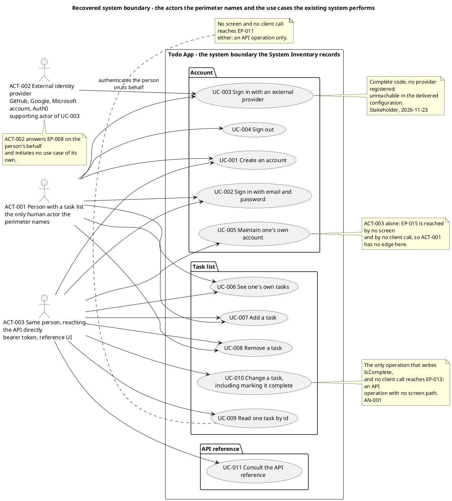
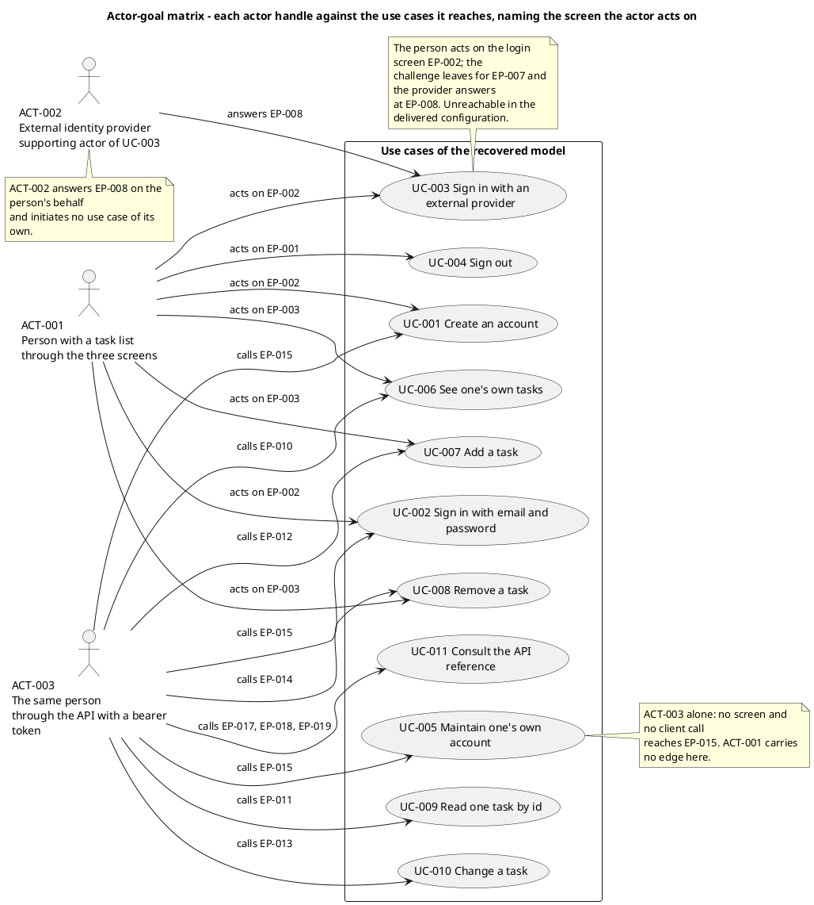
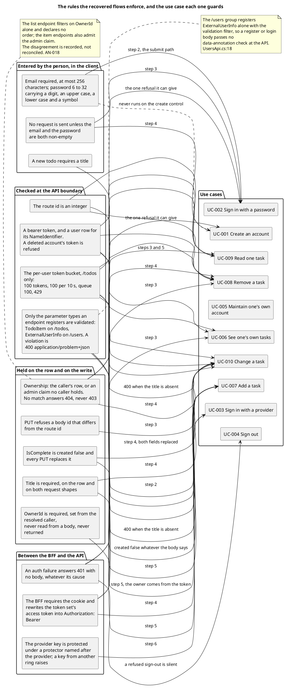
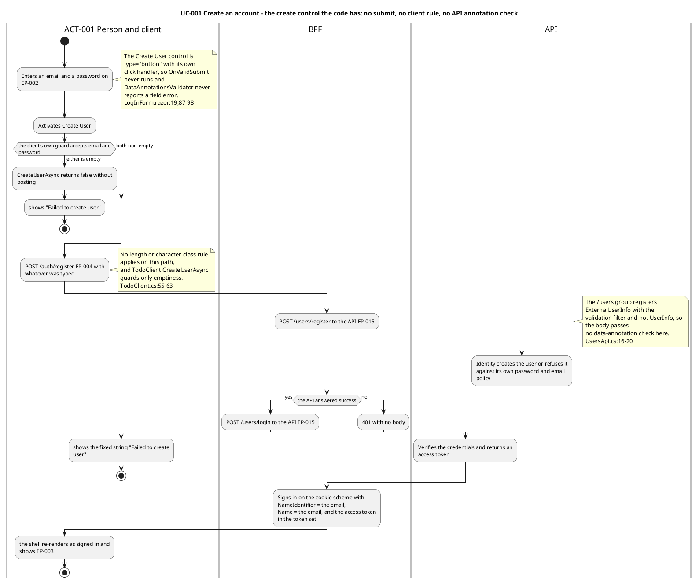
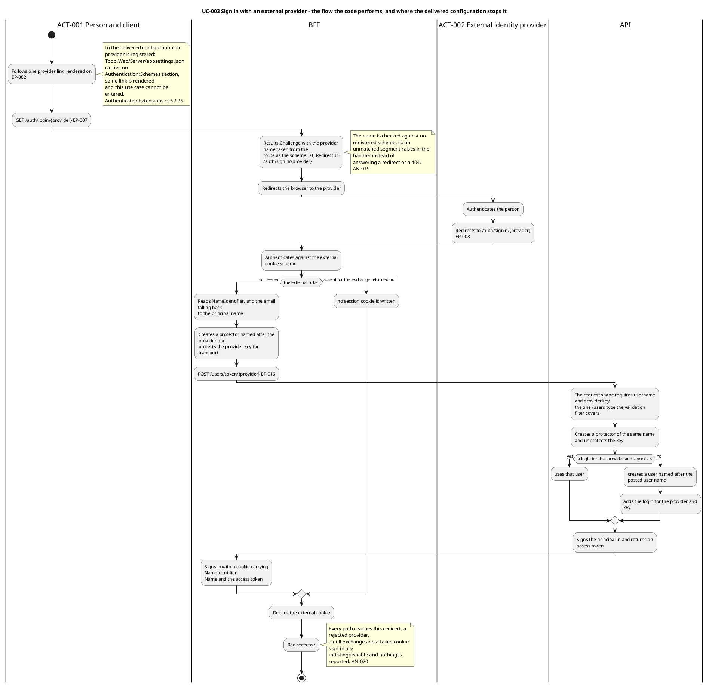
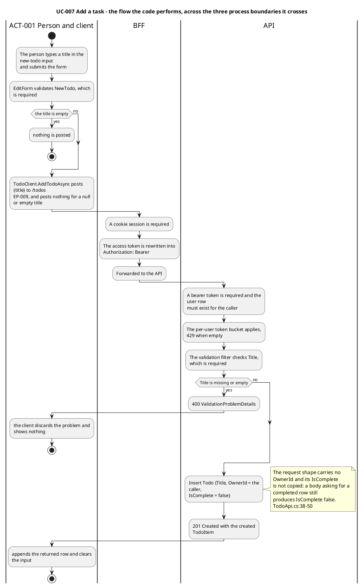
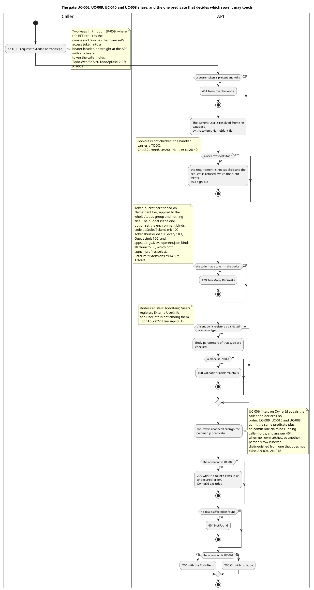

## Document Control
- Phase: Excavation
- Status: Draft — produced for the end-of-Excavation (AR) milestone review
- Milestone Target: end-of-Excavation (AR) — not yet achieved
- Iteration: 2, Cycle 1
- Owner: System Analyst
## Use-Case Diagram
The boundary is the one the System Inventory records: four processes, two stores, and the external systems the delivery reaches. Every use case below is anchored to the entry point whose code performs it.


## Actors
| ID | Actor | Kind | Who or what it is, as established | Source |
|---|---|---|---|---|
| ACT-001 | Person with a task list | Human, primary | The only human actor the perimeter names. Anonymous until they register or sign in; owns the task rows they create. Reaches the system through the three screens of the Blazor client | System Inventory — External actors and systems; `Todo.Web/Server/App.razor:5`; `Todo.Web/Client/Components/LogInForm.razor:3-26` |
| ACT-002 | External identity provider | External system, supporting actor of UC-003 | GitHub, Google, Microsoft account or Auth0. Authenticates the person and returns them to the callback. Initiated from the system's side and answered by the provider, which is why the perimeter names it the initiator of `EP-008`; the person remains the primary actor of the use case | System Inventory — External actors and systems; System Inventory — Entry points `EP-008`; `Todo.Web/Server/Authentication/AuthenticationExtensions.cs:39-92` |
| ACT-003 | Same person, reaching the API directly | Human, the same individual as ACT-001 | The perimeter's "authenticated caller holding a bearer token". The README addresses this role by name: run `Todo.Api` standalone, obtain a token from `/users/login`, then call the endpoints with the reference UI or a client of choice | System Inventory — Entry points `EP-010`–`EP-019`; `README.md`, "Using the API standalone" |

**One human being, two actor roles.** ACT-001 and ACT-003 are the same person. ACT-003 is not a second human actor and does not contradict the perimeter, which names exactly one: it is the role in which that person reaches the API without a cookie, holding a bearer token obtained from `/users/login` and calling the endpoints directly, as the delivery's own README directs. The role exists because the two routes authenticate differently and reach different operations — `EP-009` requires a cookie and rewrites it, while `EP-010` to `EP-019` accept any bearer token.

The task use cases therefore carry **one main flow with two scenarios** — through the screens, or directly with a bearer token — and are not split per actor. UC-009, UC-010 and UC-005 are reached by ACT-003 alone: no screen and no client call reaches `EP-011`, `EP-013`, or any Identity endpoint beyond register and login.

**Two entry points, two different questions.** Every use case in this model is anchored twice over, and the two lists below answer different questions, so they are not expected to agree and are not two statements of one fact:

- The **Source** column of the Survey names the entry point **whose code performs the use case**. When ACT-003 calls `POST /todos` that is `EP-012`; when ACT-001 adds a task from the list screen, the screen is `EP-003` but the request still leaves through the BFF's forwarder `EP-009` to `EP-012`.
- The **actor-goal matrix** names the entry point **the actor reaches the use case through** — the screen or the endpoint the actor itself acts on. ACT-001 acts on `EP-003`; the operation the system then performs is not named there.

A screen entry point and the forwarded operation are therefore both true of one use case, and the matrix says which one its edges name.



**Actors the model does not create.** The System Inventory names "app host or operator" as the initiator of `EP-020`, `EP-021` and `EP-022`, and defines no operator: no role, no procedure and no need for one appears anywhere in the delivery. No actor is created for it, and no use case is recovered from it. `TodoApp.AppHost` is a component inside the boundary that starts the others; starting a system is not an actor goal, and no human initiates it.

**Actors the model does not create, second.** The external systems the delivery also reaches — the OTLP collector, nuget.org, the `tomdesinto/sqliteweb` image — are declared outside the boundary in the System Inventory and serve no use case. The SQLite file is a data manager inside the boundary, reached by every task operation.
## Use-Case Survey
Eleven use cases, each anchored to the entry points whose code performs it. Every one of the twenty-two entry points is either carried here or is accounted for in "Not recovered" below.

| ID | Use case | Primary actor | Source | Value the actor receives | Volatility |
|---|---|---|---|---|---|
| UC-001 | Create an account | ACT-001, ACT-003 | `EP-002`, `EP-004`, `EP-015` | An account exists and the caller is signed in, or holds a bearer token | Low |
| UC-002 | Sign in with email and password | ACT-001, ACT-003 | `EP-002`, `EP-005`, `EP-015` | A session cookie, or a bearer token, for an existing account | Low |
| UC-003 | Sign in with an external provider | ACT-001, with ACT-002 authenticating the person | `EP-007`, `EP-008`, `EP-016` | A local account tied to the provider identity, and a session cookie. **Unreachable in the delivered configuration** (stakeholder, 2026-11-23) | **High** — four providers, each configurable or absent, and the whole path is dead without one |
| UC-004 | Sign out | ACT-001 | `EP-006` | The session cookie is cleared; the screens return to the login form | Low |
| UC-005 | Maintain one's own account | ACT-003. No screen and no client call reaches any of its endpoints | `EP-015` | Token refresh, email confirmation, password reset, two-factor and profile management | Medium — the Identity endpoint set is a framework surface the delivery maps without a screen |
| UC-006 | See one's own tasks | ACT-001, ACT-003 | `EP-001`, `EP-003`, `EP-009`, `EP-010` | The caller's own task rows are read and rendered | Low |
| UC-007 | Add a task | ACT-001, ACT-003 | `EP-003`, `EP-009`, `EP-012` | A new row, owned by the caller, appended to the list without a reload | Low |
| UC-008 | Remove a task | ACT-001, ACT-003 | `EP-003`, `EP-009`, `EP-014` | The row is deleted and leaves the list | Low |
| UC-009 | Read one task by id | ACT-003 | `EP-011` | One row of the caller's is returned. API operation only: no screen and no client call reaches it | Low |
| UC-010 | Change a task, including marking it complete | ACT-003 | `EP-013` | A row's title and completion flag are set. **API operation only**: the client makes no update call and the list's checkbox is bound to nothing (AN-001) | **High** — the one operation the UI has no path to, and the one place `IsComplete` is written |
| UC-011 | Consult the API reference | ACT-003 | `EP-017`, `EP-018`, `EP-019` | The API contract is read as an OpenAPI document or in a rendered reference UI | Low |

### Not recovered, and why

| Entry point | Why it carries no use case |
|---|---|
| `EP-020` readiness, `EP-021` liveness | The perimeter names "app host or operator" as the initiator and defines no operator actor. Both are mapped in Development only, and neither delivers value to an actor the delivery names. They are a platform mechanism, stated in the Supplementary Specification — Supportability (S8) |
| `EP-022` the migration platform event | No human actor initiates it; the app host raises it before the API starts, in run mode and only when `Todo.Api/.db` does not exist. It is a component's start-up step, stated in the Supplementary Specification — Design Constraints (DC11) and as mechanism M9 |
| The `admin` role branch of `EP-011`, `EP-013`, `EP-014` | Not a use case: no actor in the running system can enter it, because nothing grants the role (AN-004). Recorded as an exceptional entity, by the stakeholder's decision of 2026-11-23, inside UC-009, UC-010 and UC-008 as a predicate the flows do not follow |
| The cross-owner read, update and delete a caller holding a self-minted `admin` token could perform | Same as above. It is the behaviour of one predicate, not an actor's goal |

### Why a screen entry point and the forwarded operation are both named

UC-006, UC-007 and UC-008 each cite `EP-003` beside their API-side entry points, and that is not a second anchor for the same fact. The three answer one question with two entry points, because on the screen route the actor's action and the operation that performs it are different entry points in different processes:

| Use case | The actor acts on | The operation performs it | What the screen contributes |
|---|---|---|---|
| UC-006 See one's own tasks | `EP-003` the todo list screen | `EP-010` `GET /todos`, reached through the forwarder `EP-009` | The list renders one row per task with its title and a remove control, and shows a spinner while the load is in flight. It renders nothing and requests nothing when the client has no base address, answering an empty list instead (`AN-026`) |
| UC-007 Add a task | `EP-003` the new-todo input | `EP-012` `POST /todos`, reached through `EP-009` | The input is the form the title is typed into and the validator that blocks an empty submit, and it is the control the created row is appended to without a reload |
| UC-008 Remove a task | `EP-003` the per-row remove control | `EP-014` `DELETE /todos/{id}`, reached through `EP-009` | The remove control is the only way a screen reaches a delete, and it is the control the deleted row is removed from |

The edge is `EP-003 → UC-NNN` because the actor's goal is entered through the screen: without `EP-003` no person reaches any of the three, and each use case's step 1 is that screen. `Todo.Web/Client/Components/TodoList.razor:3-32` carries the new-todo input and the per-row remove control, so it precedes UC-007's and UC-008's step 1, and `Todo.Web/Server/App.razor:44-52` renders it as the signed-in shell, which is the screen UC-006's step 1 names. The `EP-009` forwarder and the API operations are cited in the flows as what the screen's request becomes, not as an alternative actor route.

A reader who needs one list rather than two reads the Survey's **Source** column as the entry point whose code performs the use case; the actor-goal matrix in "Actors" names the entry point the actor acts through. Both are correct for their question, and the Survey's rows name both where both apply.

### Nothing is held back for Consolidation

All twenty-two entry points are accounted for in this model: nineteen carry a use case, and the three that do not — `EP-020`, `EP-021`, `EP-022` — are permanent exclusions reasoned in the table above, not work postponed. No operation of the delivery is recovered in a later phase. The recoverable operations all sit in the entry-point-bearing areas this reading orders first — the Todo API's task surface and its authorization, and the BFF session surface — and the areas it leaves carry no entry point at all: orchestration, build and container manifests and supporting files.

Consolidation therefore inherits no deferred use case from this model. The eleven counted above are the whole use-case set of the delivery as it stands, and the four rows under "Not recovered, and why" are exclusions that no later phase re-opens.

## Use-Case Specifications
Every flow below is the flow the code performs, not a flow anyone intended. Each step carries the file and lines it was read from, and each step is followed by the rule the code enforces at that step; where the code contradicts a document or another part of itself, the code is recorded and the contradiction is named.



### UC-001 Create an account

| Field | Content |
|---|---|
| Primary actor | ACT-001 through `EP-002`; ACT-003 through `EP-015` |
| Trigger | The person activates Create User on the login form; or a caller posts to the API's registration endpoint |
| Precondition | None. An anonymous caller reaches it |
| Postcondition | A user row exists; the browser caller holds a session cookie whose `NameIdentifier` and `Name` are the email and whose token set carries an access token |

| # | Main flow — the screen route |
|---|---|
| 1 | The person enters an email and a password on `EP-002` and activates Create User. `Todo.Web/Client/Components/LogInForm.razor:3-26` |
| 2 | The create control is `type="button"` with its own click handler, so the form's `OnValidSubmit` never runs and `DataAnnotationsValidator` reports no field error on this path: **none of the component's field rules guards registration**. `Todo.Web/Client/Components/LogInForm.razor:19,87-98` |
| 3 | The client posts `{ email, password }` to `/auth/register` `EP-004`, and refuses to post unless both values are non-empty. `Todo.Web/Client/TodoClient.cs:55-63` |
| 4 | The BFF posts the same body to the API's `/users/register` `EP-015`. `Todo.Web/Server/AuthClient.cs` (`CreateUserAsync`) |
| 5 | Identity creates the user, or refuses it against its own password and email policy. No data-annotation check runs on the body at the API: the `/users` group registers `ExternalUserInfo` for validation and `UserInfo` is not among the types it validates. `Todo.Api/Users/UsersApi.cs:18-20`; `Todo.Api/Filters/ValidationFilter.cs:20-58` |
| 6 | On success the BFF posts `/users/login`, receives an access token, and signs in on the cookie scheme with the email as both `NameIdentifier` and `Name`, storing the token in the token set. A null token becomes 401 with no body. `Todo.Web/Server/AuthApi.cs:14-25,99-116` |
| 7 | The shell re-renders as signed in and shows the todo list `EP-003`. `Todo.Web/Client/TodoApp.razor:3-11` |

| Alternative or exception | What the code does | Anchor |
|---|---|---|
| A1 — the API refuses the registration | The API's answer is discarded and the BFF answers `401` with no body; the form shows the fixed string "Failed to create user". The same answer covers an email already taken, a password the Identity policy refuses, and an unreachable API. No recovered flow may claim a distinguishable failure | AN-021; `Todo.Web/Server/AuthApi.cs:14-25`; `Todo.Web/Server/AuthClient.cs`; `Todo.Web/Client/Components/LogInForm.razor:73-84` |
| A2 — the registration succeeds but the follow-up login fails | The user row now exists and no cookie is written; the person sees the same "Failed to create user" and a second attempt with the same email is refused as taken | `Todo.Web/Server/AuthClient.cs` (`CreateUserAsync`, which returns the token from a second call) |
| A3 — either field is empty | Nothing is posted and the same fixed string is shown, because `CreateUserAsync` returns false before its request | `Todo.Web/Client/TodoClient.cs:55-63`; `Todo.Web/Client/Components/LogInForm.razor:87-98` |
| S2 — the direct route, ACT-003 | The caller posts to `EP-015` `/users/register` and then `/users/login`, and receives an `AccessTokenResponse` with `tokenType`, `accessToken`, `expiresIn` and `refreshToken`. No cookie is involved and the client's empty-value guard does not apply | `README.md`, "Using the API standalone"; `Todo.Api/Users/UsersApi.cs:20` |



### UC-002 Sign in with email and password

| Field | Content |
|---|---|
| Primary actor | ACT-001 through `EP-002`; ACT-003 through `EP-015` |
| Trigger | The person activates Login on the login form; or a caller posts to the API's login endpoint |
| Precondition | An account exists |
| Postcondition | The browser caller holds a session cookie; the direct caller holds an access token |

| # | Main flow — the screen route |
|---|---|
| 1 | The person enters an email and a password on `EP-002` and activates Login. `Todo.Web/Client/Components/LogInForm.razor:3-26` |
| 2 | The Login control is a submit button, so `OnValidSubmit` runs and the component's four field rules apply: the email is required and at most 256 characters; the password is required, 6 to 32 characters, and carries at least one lower-case letter, an upper-case letter, a digit and a character outside the alphanumeric classes. A failure stops the flow and the form reports the field error. `Todo.Web/Client/Components/LogInForm.razor:17,55-68` |
| 3 | The client posts `{ email, password }` to `/auth/login` `EP-005`, and refuses to post unless both values are non-empty — a second guard, independent of step 2. `Todo.Web/Client/TodoClient.cs:47-53` |
| 4 | The BFF posts the same body to the API's `/users/login` `EP-015`. `Todo.Web/Server/AuthClient.cs` (`GetTokenAsync`) |
| 5 | Identity verifies the credentials and answers an access token. No lockout check is made anywhere on this path: the current-user handler carries a `TODO` for it, and the login endpoint applies the framework's own rules alone. `Todo.Api/Users/UsersApi.cs:20`; `Todo.Api/Authorization/CheckCurrentUserAuthHandler.cs:28-31` |
| 6 | The BFF signs in on the cookie scheme with the email as both `NameIdentifier` and `Name`, and stores the token in the token set. `Todo.Web/Server/AuthApi.cs:27-38,99-116` |
| 7 | The shell re-renders as signed in and shows the todo list `EP-003`. `Todo.Web/Client/TodoApp.razor:3-11` |

| Alternative or exception | What the code does | Anchor |
|---|---|---|
| A1 — the credentials are refused | `401` with no body; the form shows "Login failed". A wrong password, an unconfirmed account, a locked account and an unreachable API are one answer | AN-021; `Todo.Web/Server/AuthApi.cs:27-38`; `Todo.Web/Server/AuthClient.cs` (`GetTokenAsync`) |
| A2 — the field validation of step 2 fails | Nothing is posted and the field error is shown. The client's rule is the one the person meets first, and it is stricter than the server's on length: a password longer than 32 characters is refused here though Identity imposes no upper bound | `Todo.Web/Client/Components/LogInForm.razor:60-68` |
| A3 — either field is empty and step 2 did not run | `LoginAsync` returns false before its request and the form shows "Login failed" | `Todo.Web/Client/TodoClient.cs:47-53` |
| S2 — the direct route, ACT-003 | The caller posts `{ email, password }` to `EP-015` `/users/login` and receives an `AccessTokenResponse`; it attaches `Authorization: Bearer <accessToken>` to the task operations itself | `README.md`, "Using the API standalone" |

### UC-003 Sign in with an external provider

| Field | Content |
|---|---|
| Primary actor | ACT-001, with ACT-002 authenticating the person on its behalf |
| Trigger | The person follows a provider link on `EP-002` |
| Precondition | **False in the delivered configuration.** `Todo.Web/Server/appsettings.json` carries no `Authentication:Schemes` section, so `AuthenticationExtensions.cs:57-75` registers no provider and no link is rendered. The use case is recovered and marked unreachable in the delivered configuration (stakeholder, 2026-11-23) |
| Postcondition | A user row for the provider identity exists or is reused, a login row ties the provider key to it, and the caller holds a session cookie |

| # | Main flow |
|---|---|
| 1 | The person follows one provider link rendered on `EP-002`. `Todo.Web/Client/Components/LogInForm.razor:27-34`; `Todo.Web/Server/App.razor:44-52` |
| 2 | The BFF issues a challenge with the provider name taken from the route as the scheme list and `RedirectUri` set to `/auth/signin/{provider}`, and redirects to the provider. The name is checked against no registered scheme. `Todo.Web/Server/AuthApi.cs:55-62` |
| 3 | The provider authenticates the person and redirects to `/auth/signin/{provider}` `EP-008`. |
| 4 | The BFF authenticates the external cookie and reads `NameIdentifier`, and the email falling back to the principal name. `Todo.Web/Server/AuthApi.cs:64-77` |
| 5 | The BFF protects the provider key with a data-protection protector named after the provider and posts `{ username, providerKey }` to `/users/token/{provider}` `EP-016`. Both fields are required by the request shape, and this is the one `/users` endpoint the validation filter reaches, so a missing field answers 400 `ValidationProblem` — which the BFF then discards as a null token. `Todo.Web/Server/AuthApi.cs:82-84`; `Todo.Api/Users/UsersApi.cs:18`; `Todo.Web/Shared/SharedClass.cs:24-32` |
| 6 | The API creates a protector of the same name, unprotects the key, and finds the user by provider and key; when none exists it creates a user named after the posted user name and adds the login row. It then creates the principal and returns an access token; a failed identity result answers a validation problem naming each error code. `Todo.Api/Users/UsersApi.cs:24-60` |
| 7 | The BFF writes the session cookie with `NameIdentifier` the provider's subject, `Name` the email-or-name, the access token and the provider name in the authentication properties — only when the token is not null. `Todo.Web/Server/AuthApi.cs:88-90,99-116` |
| 8 | The BFF deletes the external cookie and redirects to `/` on every path. `Todo.Web/Server/AuthApi.cs:92-97` |

| Alternative or exception | What the code does | Anchor |
|---|---|---|
| A1 — the provider name in the route is not a registered scheme | The challenge names a scheme that does not exist and the handler raises rather than answering a redirect or a 404 | AN-019; `Todo.Web/Server/AuthApi.cs:55-62` |
| A2 — the external ticket is absent, the token exchange returns null, or the cookie sign-in does not take effect | No cookie is written; the external cookie is still deleted; the person is redirected to `/` with no message and cannot tell a rejected provider from an unreachable API. The code's own `// TODO: Handle the failure somehow` marks it | AN-020; `Todo.Web/Server/AuthApi.cs:64-97` |
| A3 — the two processes do not share a data-protection key ring | `Unprotect` in the API fails on a key protected in the BFF, so the exchange answers a null token and A2 follows. Only the application discriminator is set in either process | AN-010; `Todo.Web/Server/Program.cs:13`; `Todo.Api/Program.cs:11` |
| A4 — the provider identity has no email claim | The user is created with the principal name as its user name, and that name becomes the account identity with no password | `Todo.Web/Server/AuthApi.cs:70-71` |



### UC-004 Sign out

| Field | Content |
|---|---|
| Primary actor | ACT-001 |
| Trigger | The person activates Logout in the shell |
| Precondition | A session cookie exists |
| Postcondition | The session cookie is cleared; the shell renders the login form |

| # | Main flow |
|---|---|
| 1 | The person activates Logout on `EP-001`. `Todo.Web/Client/TodoApp.razor:8` |
| 2 | The client posts to `/auth/logout` `EP-006`. `Todo.Web/Client/TodoClient.cs` (`LogoutAsync`) |
| 3 | The endpoint requires authorization, so a request without a valid cookie is refused at the door. `Todo.Web/Server/AuthApi.cs:49-50` |
| 4 | The cookie is signed out — and only the cookie. No remote sign-out is performed: the code's own `// TODO: Support remote logout` marks the gap, so a provider session opened by UC-003 stays open at the provider even though the provider name is stored in the cookie's properties for exactly that purpose. `Todo.Web/Server/AuthApi.cs:40-52,108-112` |
| 5 | On success the client clears the displayed user and the shell renders the login form `EP-002`. `Todo.Web/Client/TodoApp.razor:19-21,32-38` |

| Alternative or exception | What the code does | Anchor |
|---|---|---|
| A1 — the request is refused | The client leaves the shell signed in; nothing is reported | `Todo.Web/Client/TodoApp.razor:32-38` |
| A2 — the session was opened through a provider | The local cookie is cleared and the provider's own session is untouched, so the next provider sign-in may complete without the person authenticating again | `Todo.Web/Server/AuthApi.cs:44-48` |

### UC-005 Maintain one's own account

| Field | Content |
|---|---|
| Primary actor | ACT-003. No screen and no client call reaches any of these endpoints |
| Trigger | A caller posts to one of the Identity endpoints under `/users` |
| Precondition | The operation decides its own: refresh and manage require a bearer token, the recovery endpoints do not |
| Postcondition | The operation's effect: a refreshed token, a confirmed email, a reset password, a pending two-factor change, an updated profile |

| # | Main flow of the shared shape |
|---|---|
| 1 | The caller posts to one of the endpoints the framework maps under `/users` `EP-015`: `refresh`, `confirmEmail`, `resendConfirmationEmail`, `forgotPassword`, `resetPassword`, `manage/2fa`, `manage/info`. The delivery adds or removes none of them and configures none. `Todo.Api/Users/UsersApi.cs:20` |
| 2 | No rate limit applies: the token-bucket policy is required on `/todos` only. `Todo.Api/Extensions/RateLimitExtensions.cs:53-56`; `Todo.Api/Todos/TodoApi.cs:19` |
| 3 | The endpoint applies the framework's own rules — a refresh or manage call needs a bearer token, a recovery call does not — and answers the framework's own shape, which for a failure is a problem detail naming the cause, not the single 401 that UC-001 and UC-002 collapse to. No data-annotation check added by the delivery applies to these bodies. `Todo.Api/Users/UsersApi.cs:18-20` |
| 4 | The effect is durable: the person's email is confirmed, their password replaced, or a new token pair issued. |

| Alternative or exception | What the code does | Anchor |
|---|---|---|
| A1 — no screen reaches any of these | The client makes six calls and none of them is an Identity endpoint beyond register and login: `AddTodoAsync`, `DeleteTodoAsync`, `GetTodosAsync`, `LoginAsync`, `CreateUserAsync` (which posts `/auth/register`) and `LogoutAsync`. Every operation here is reachable only by an API caller, so the UI cannot confirm an email, reset a password or refresh a token. ACT-001 therefore carries no edge to this use case | `Todo.Web/Client/TodoClient.cs:7-71` |
| A2 — an anonymous caller floods the recovery endpoints | No limit applies, and the policy as written could not simply be extended to them: it partitions on `NameIdentifier`, which an anonymous caller does not have, so the partition step dereferences a claim that is absent | AN-009; `Todo.Api/Extensions/RateLimitExtensions.cs:38-47` |

### UC-006 See one's own tasks

| Field | Content |
|---|---|
| Primary actor | ACT-001 through the screens; ACT-003 through the API |
| Trigger | The shell renders the signed-in state; or a caller sends `GET /todos` |
| Precondition | The caller holds a valid session cookie (screens) or a bearer token (API), and a user row exists for it |
| Postcondition | The caller's own rows are read; nothing is written |

| # | Main flow — the screen route |
|---|---|
| 1 | The shell resolves the authentication state and, when a user name is present, renders the todo list `EP-003` with a spinner while the load is in flight. `Todo.Web/Server/App.razor:44-52`; `Todo.Web/Client/Components/TodoList.razor:3-8` |
| 2 | The list calls `GET todos` on initialization; on a client with no base address it returns an empty list instead, so no request is made. `Todo.Web/Client/Components/TodoList.razor:44-55`; `Todo.Web/Client/TodoClient.cs:32-38` |
| 3 | The request reaches the BFF's `/todos` group `EP-009`, which requires the cookie and rewrites the session's access token into `Authorization: Bearer`. `Todo.Web/Server/TodoApi.cs:12-25` |
| 4 | The API requires a bearer token and resolves the caller from the database by the token's `NameIdentifier`; a token for a user row that does not exist fails the requirement. `Todo.Api/Todos/TodoApi.cs:17`; `Todo.Api/Authorization/CheckCurrentUserAuthHandler.cs:31-36` |
| 5 | The per-user token bucket applies to the whole group, answering 429 when empty. `Todo.Api/Todos/TodoApi.cs:19-20`; `Todo.Api/Extensions/RateLimitExtensions.cs:38-47` |
| 6 | The query filters on `OwnerId` equal to the caller and declares no order, so the order of the rows is whatever SQLite returns; `OwnerId` is excluded from the returned shape. `Todo.Api/Todos/TodoApi.cs:24-27`; `Todo.Api/Todos/Todo.cs:14-26` |
| 7 | The list renders one row per task with its title and a remove control. The checkbox beside each row is bound to nothing. `Todo.Web/Client/Components/TodoList.razor:21-31` |

| Alternative or exception | What the code does | Anchor |
|---|---|---|
| A1 — the load answers 401 or 403 | The shell drops to the login form: the list raises `OnForbidden` and the shell's handler signs out | `Todo.Web/Client/Components/TodoList.razor:47-55`; `Todo.Web/Client/TodoApp.razor:3-11` |
| A2 — the caller's rows are empty | No list is rendered and no empty state is shown; the input stays available. The new-todo input is inside the `else` branch, so it is present whenever the load has completed | `Todo.Web/Client/Components/TodoList.razor:9-31` |
| A3 — the bucket is empty | 429, and the client reports nothing: the status is not `Forbidden` or `Unauthorized`, so the shell stays signed in and the list leaves an empty spinner-free area | `Todo.Api/Extensions/RateLimitExtensions.cs:38-47`; `Todo.Web/Client/Components/TodoList.razor:47-55` |
| S2 — the direct route, ACT-003 | The caller sends `GET /todos` with `Authorization: Bearer` itself and receives the `TodoItem` array. Steps 1 to 3 do not apply | `README.md`, "Using the API standalone"; `Todo.Api/Todos/TodoApi.cs:24-27` |
| Not modelled | The list applies no `admin` branch, while `EP-011`, `EP-013` and `EP-014` each admit one, so a caller in that role can reach a row by id that this use case cannot show. The disagreement is recorded (AN-018); the branch is not recovered as behaviour | AN-018; `Todo.Api/Todos/TodoApi.cs:24-27` vs `:29-36,52-65,67-73` |

### UC-007 Add a task

| Field | Content |
|---|---|
| Primary actor | ACT-001 through the screens; ACT-003 through the API |
| Trigger | The person submits the new-todo input; or a caller sends `POST /todos` |
| Precondition | The caller is authorized as in UC-006 |
| Postcondition | One `Todos` row exists with `OwnerId` set to the caller and `IsComplete` false |

| # | Main flow — the screen route |
|---|---|
| 1 | The person types a title in the input on `EP-003` and submits. `Todo.Web/Client/Components/TodoList.razor:12-19` |
| 2 | The input's model is `[Required]`, so the form's validator blocks the submit on an empty title and shows the field error. `Todo.Web/Client/Components/TodoList.razor:31-33,36-38` |
| 3 | The client posts `{ title }` to `todos` `EP-009`, and returns null without a request when the title is null or empty — a second guard independent of step 2. `Todo.Web/Client/TodoClient.cs:7-13` |
| 4 | The BFF requires the cookie and rewrites the token; the API requires the token, resolves the caller, applies the rate limit and validates `Title` as required, answering 400 with a problem detail when it is missing. `Todo.Web/Server/TodoApi.cs:12-25`; `Todo.Api/Todos/TodoApi.cs:17-22`; `Todo.Api/Filters/ValidationFilter.cs:12-63` |
| 5 | A `Todo` row is inserted with `OwnerId` set to the caller and `IsComplete` left false. The request shape is `TodoItem`, which carries no `OwnerId`, and its `IsComplete` is not copied: a create body that carries `isComplete: true` produces a row with `IsComplete` false. `Todo.Api/Todos/TodoApi.cs:38-50`; `Todo.Api/Todos/Todo.cs:15-21` |
| 6 | The API answers 201 with `Location: /todos/{id}` and the created `TodoItem`. `Todo.Api/Todos/TodoApi.cs:49` |
| 7 | The client appends the returned row to the list without reloading, clears the input and marks the form unmodified. `Todo.Web/Client/Components/TodoList.razor:57-67` |

| Alternative or exception | What the code does | Anchor |
|---|---|---|
| A1 — the title is empty | The client posts nothing and shows the field error; a caller that posts an empty title anyway receives 400 `ValidationProblemDetails` | `Todo.Web/Client/Components/TodoList.razor:36-38`; `Todo.Api/Filters/ValidationFilter.cs` |
| A2 — the API answers a failure | The client returns null, nothing is appended and nothing is reported to the person. A 429 is covered by this path and is indistinguishable from a 400 | `Todo.Web/Client/TodoClient.cs:7-27`; `Todo.Web/Client/Components/TodoList.razor:57-67` |
| A3 — the body's `OwnerId` | The request shape carries no `OwnerId`, so a caller cannot create a row for someone else: the field is set from the resolved caller. `OwnerId` is required on the entity and required in the database | `Todo.Api/Todos/Todo.cs:3-12,15-21`; `Todo.Api/Todos/TodoApi.cs:38-50` |
| S2 — the direct route, ACT-003 | The caller posts `{ title }` with its own bearer token and receives 201 with the created item | `README.md`; `Todo.Api/Todos/TodoApi.cs:38-50` |



### UC-008 Remove a task

| Field | Content |
|---|---|
| Primary actor | ACT-001 through the screens; ACT-003 through the API |
| Trigger | The person activates the remove control on a row; or a caller sends `DELETE /todos/{id}` |
| Precondition | The caller is authorized as in UC-006 |
| Postcondition | The row is deleted, or was never the caller's |

| # | Main flow — the screen route |
|---|---|
| 1 | The person activates the remove control on a row of `EP-003`. `Todo.Web/Client/Components/TodoList.razor:28` |
| 2 | The client sends `DELETE todos/{id}` through `EP-009`. `Todo.Web/Client/TodoClient.cs` (`DeleteTodoAsync`) |
| 3 | The BFF requires the cookie and rewrites the token; the API requires the token, resolves the caller and applies the rate limit. The route id must be an integer or the request answers 404 before the handler runs. `Todo.Web/Server/TodoApi.cs:12-25`; `Todo.Api/Todos/TodoApi.cs:17-20,67` |
| 4 | One statement deletes the rows where `Id` equals the route id and `OwnerId` equals the caller. `Todo.Api/Todos/TodoApi.cs:69-71` |
| 5 | One row affected answers 200 with no body; zero answers 404. The client removes the row from the list without reloading on a success and does nothing on a failure. `Todo.Api/Todos/TodoApi.cs:73`; `Todo.Web/Client/Components/TodoList.razor:69-76` |

| Alternative or exception | What the code does | Anchor |
|---|---|---|
| A1 — no row matches | 404, whether the row does not exist or belongs to someone else: the two are never distinguished, so the operation cannot be used to probe for another person's ids through its answer alone | `Todo.Api/Todos/TodoApi.cs:73` |
| A2 — the delete fails | The row stays in the list and nothing is reported | `Todo.Web/Client/Components/TodoList.razor:69-76` |
| S2 — the direct route, ACT-003 | The caller sends `DELETE /todos/{id}` with its own bearer token | `README.md`; `Todo.Api/Todos/TodoApi.cs:67-73` |
| Not modelled | The same predicate also admits an `admin` role claim no running caller holds, so a caller with a self-minted token could delete another person's row. Not recovered as behaviour | AN-004; `Todo.Api/Todos/TodoApi.cs:69` |

### UC-009 Read one task by id

| Field | Content |
|---|---|
| Primary actor | ACT-003. No screen and no client call reaches it |
| Trigger | A caller sends `GET /todos/{id}` |
| Precondition | The caller is authorized as in UC-006 |
| Postcondition | Nothing is written |

| # | Main flow |
|---|---|
| 1 | The caller sends `GET /todos/{id}` with a bearer token `EP-011`; a non-integer segment does not match the route and answers 404 before the handler runs. `Todo.Api/Todos/TodoApi.cs:29` |
| 2 | The API requires the token, resolves the caller and applies the rate limit. `Todo.Api/Todos/TodoApi.cs:17-20` |
| 3 | The row is looked up by primary key, then matched on `OwnerId` equal to the caller. The second alternative on that predicate is not reachable in the running system. `Todo.Api/Todos/TodoApi.cs:29-36` |
| 4 | A match answers 200 with the `TodoItem`, `OwnerId` excluded. `Todo.Api/Todos/Todo.cs:15-26` |
| 5 | No match answers 404 for a row that is absent and for a row belonging to someone else alike. `Todo.Api/Todos/TodoApi.cs:29-36` |

| Alternative or exception | What the code does | Anchor |
|---|---|---|
| A1 — the route id is not an integer | The route constraint does not match and the request answers 404 before the handler runs | route template `/{id}` at `Todo.Api/Todos/TodoApi.cs:29` |
| A2 — the client has no path here | The client makes six calls and none of them reads a single todo, so this operation is reachable only by an API caller | `Todo.Web/Client/TodoClient.cs:7-71` |
| Not modelled | The predicate admits an `admin` role claim no running caller holds, so a self-minted token could read another person's row | AN-004; `Todo.Api/Todos/TodoApi.cs:33` |

### UC-010 Change a task, including marking it complete

| Field | Content |
|---|---|
| Primary actor | ACT-003. **API operation only**: the client makes no update call and the list's checkbox is bound to nothing (AN-001, stakeholder decision of 2026-11-23) |
| Trigger | A caller sends `PUT /todos/{id}` |
| Precondition | The caller is authorized as in UC-006 |
| Postcondition | That row's `Title` and `IsComplete` are set to the request's values; nothing else on the row changes |

| # | Main flow |
|---|---|
| 1 | The caller sends `PUT /todos/{id}` with `{ id, title, isComplete }` and a bearer token `EP-013`. `Todo.Api/Todos/TodoApi.cs:52-65` |
| 2 | The API requires the token, resolves the caller, applies the rate limit, and validates `Title` as required — a missing or empty title answers 400 and no row is read. `Todo.Api/Todos/TodoApi.cs:17-22`; `Todo.Api/Todos/Todo.cs:18-19`; `Todo.Api/Filters/ValidationFilter.cs` |
| 3 | A body whose `id` differs from the route id answers 400 and no row is read. `Todo.Api/Todos/TodoApi.cs:54-57` |
| 4 | One statement sets `IsComplete` and `Title` on the rows where `Id` equals the route id and `OwnerId` equals the caller. The two fields named are the whole update: an absent `isComplete` in the body is read as false and clears a completed row, and there is no concurrency token, so the last write wins over any other caller's update. `Todo.Api/Todos/TodoApi.cs:59-63` |
| 5 | Zero rows affected answers 404; otherwise 200 with no body. `Todo.Api/Todos/TodoApi.cs:65` |

| Alternative or exception | What the code does | Anchor |
|---|---|---|
| A1 — the title is empty | 400 `ValidationProblemDetails`, and no row is updated | `Todo.Api/Filters/ValidationFilter.cs`; `Todo.Api/Todos/Todo.cs:18-19` |
| A2 — the body's id and the route id disagree | 400 before any row is read | `Todo.Api/Todos/TodoApi.cs:54-57` |
| A3 — the row is absent or another person's | 404, undistinguished | `Todo.Api/Todos/TodoApi.cs:65` |
| A4 — completion | `IsComplete` is written here and nowhere else. This is the only operation that can set it, and no client call reaches it, so a task's completion state is stored on every row and can be changed by no screen | AN-001; `Todo.Web/Client/TodoClient.cs:7-71`; `Todo.Web/Client/Components/TodoList.razor:24-27` |
| Not modelled | The same predicate also admits an `admin` role claim no running caller holds | AN-004; `Todo.Api/Todos/TodoApi.cs:59` |

```plantuml
@startuml
title UC-010 Change a task - the flow the code performs, and why no screen reaches it

skinparam shadowing false
skinparam wrapWidth 220

|ACT-003 Developer using the API directly|
start
note right
  No path from EP-003 reaches this use case: the list's
  checkbox is bound to nothing and TodoClient exposes no
  update call. Reached only as an API operation. AN-001
end note
:A caller PUTs /todos/{id} with {id, title, isComplete}
EP-013;

|BFF|
:A cookie session is required;
:The access token is rewritten into the bearer header;
:Forwarded to the API;

|API|
:A bearer token is required and the user row must exist;
:The per-user token bucket applies, 429 when empty;
:The validation filter checks Title, which is required;
if (the body id differs from the route id) then (yes)
  :400, no row is read;
  stop
else (no)
endif
:Update runs against the rows where
Id equals the route id and OwnerId equals the caller;
note right
  The same predicate also admits an admin role claim.
  No running caller holds it, so the branch is an
  exceptional entity and is not part of this flow.
  AN-004, stakeholder 2026-11-23
end note
if (rows affected is zero) then (yes)
  :404 NotFound, whether the row is absent
  or belongs to someone else;
  stop
else (no)
endif
:Sets IsComplete and Title on that row;
note right
  Both fields are replaced by the body's values, so an
  absent isComplete clears a completed row, and no
  concurrency token exists: the last write wins.
  TodoApi.cs:59-63
end note
:200 Ok with no body;
stop
@enduml
```

### UC-006, UC-008, UC-009 and UC-010 — the gate they share

The four task use cases pass the same gate, which is stated once here and referenced from each flow above.



### UC-011 Consult the API reference

| Field | Content |
|---|---|
| Primary actor | ACT-003 |
| Trigger | A caller requests the API's root, the OpenAPI document, or the reference UI |
| Precondition | For the rendered UI, the API runs in the Development environment |
| Postcondition | The caller has read the API contract; nothing is written |

| # | Main flow |
|---|---|
| 1 | The caller requests `GET /` on the API `EP-017`. `Todo.Api/Program.cs:62` |
| 2 | The API redirects to `/scalar/v1` in every environment, although the reference UI is mapped only when the environment is Development. `Todo.Api/Program.cs:49-56,62` |
| 3 | The caller reads the contract: either the rendered Scalar UI `EP-019` with the bearer scheme preselected as the preferred security scheme, or the OpenAPI document at `/openapi/v1.json` `EP-018`, which carries the bearer scheme and marks every operation that requires authorization. `Todo.Api/Program.cs:49-56`; `Todo.Api/Extensions/OpenApiOptionsExtensions.cs` |

| Alternative or exception | What the code does | Anchor |
|---|---|---|
| A1 — the API runs outside Development | The reference UI is not mapped while the root redirect still fires, so the caller is sent to an endpoint the process does not serve | AN-017; `Todo.Api/Program.cs:49-56,62` |
| A2 — the caller reads the delivery's README instead | The README directs the reader to a Swagger UI; the code mounts the Scalar reference UI and no Swagger UI exists anywhere in the tree | AN-008; `README.md`, "Using the API standalone" |
| A3 — the document's server list | The UI is configured with an empty server list, so a client generated from the document carries no base address | `Todo.Api/Program.cs:51` |

### The instability UC-001 to UC-004 sit on

The four account use cases pass through the BFF's session surface, and that surface is the least settled part of the delivery: `Todo.Web/Server` carries 33 commits and `AuthApi.cs` alone carries 15, every one of them touching a success path, and none of them touching the three failure paths that now stand as `AN-019`, `AN-020` and `AN-021` (`AN-029`). The whole surface carries no test of any kind (`AN-012`).

Three consequences bear on these four specifications, and a reader must not treat any flow below as settled:

| Consequence | Which flows it reaches | Anchor |
|---|---|---|
| The failure paths were never modified while every success path was, so the flow shapes here are the original ones by absence of change rather than by intent — including the single 401, the unconditional redirect, and the provider name taken unchecked from the route | UC-001 A1 and A2; UC-002 A1; UC-003 A1 and A2 | AN-029, AN-021, AN-020, AN-019; `Todo.Web/Server/AuthApi.cs:14-38,55-97` |
| No test exercises any of it, so no flow below is confirmed by execution — each is a reading of the code alone | UC-001 to UC-004 | AN-012; `Todo.Api.Tests/Todo.Api.Tests.csproj:9` |
| The session cookie, its token set and the provider ticket are the state these flows read and write, and the key ring behind the provider protection is not pinned (`AN-010`) | UC-001 step 6; UC-002 step 6; UC-003 A3; UC-004 step 4 | AN-010; `Todo.Web/Server/Program.cs:13`; `Todo.Api/Program.cs:11` |

A change to any of UC-001 to UC-004 lands on code that has moved 33 times and been verified zero times. Nothing in this model asserts that the flow as specified will survive the next move of that surface.

## Traceability

| Element | Traces From | Link Type | Traces To |
|---|---|---|---|
| UC-001 | EP-002, EP-004, EP-015 | Refines | — |
| UC-002 | EP-002, EP-005, EP-015 | Refines | — |
| UC-003 | EP-007, EP-008, EP-016 | Refines | — |
| UC-004 | EP-006 | Refines | — |
| UC-005 | EP-015 | Refines | — |
| UC-006 | EP-001, EP-003, EP-009, EP-010 | Refines | — |
| UC-007 | EP-003, EP-009, EP-012 | Refines | — |
| UC-008 | EP-003, EP-009, EP-014 | Refines | — |
| UC-009 | EP-011 | Refines | — |
| UC-010 | EP-013 | Refines | — |
| UC-011 | EP-017, EP-018, EP-019 | Refines | — |
