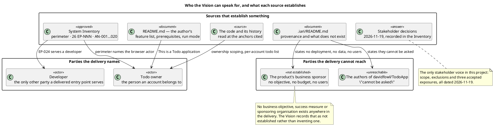
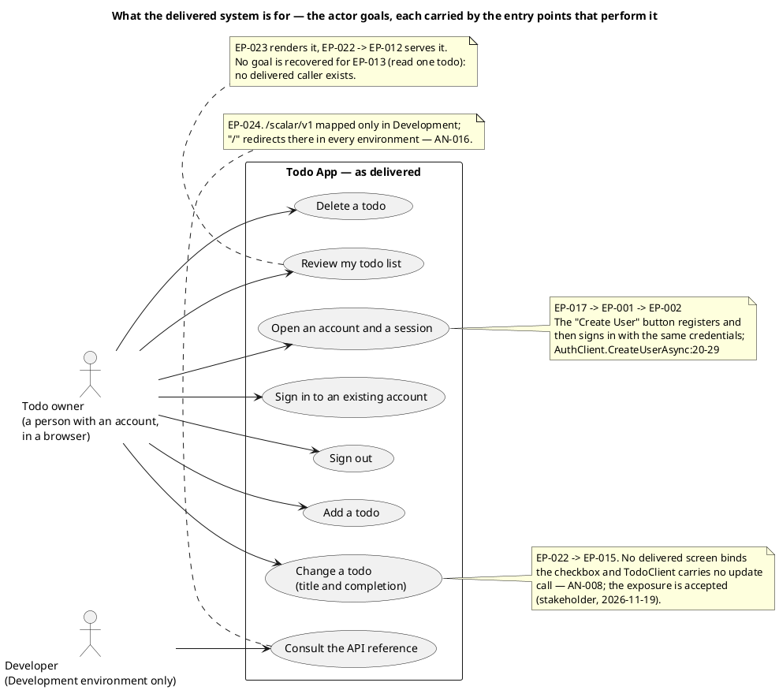

## Document Control
- Phase: Excavation
- Status: Draft — issued for the end-of-Excavation milestone review
- Milestone Target: end of Excavation (AR) — not yet achieved

## Problem Statement

The delivery states no purpose of its own. `.iari/README.md` records that the repository is a copy of the public sample `davidfowl/TodoApp` (MIT) at commit `307a1ead` of 12 February 2026, that nobody here wrote it, that there are no requirements, design or architecture documents and no manuals, and that its authors cannot be asked. The only statement of what the system is for sits in the upstream author's `README.md` — a feature list and a showcase list, not a requirement set. Everything downstream of this Vision — use cases, classes, tests, user documentation — must therefore be recovered from source read against that silence, and the system has never been assembled or run, so no behaviour is confirmed by execution (AN-020).

The problem this Vision addresses is the consequence for the parties it serves:

- **The todo owner** is the only human actor any delivered screen serves: a person holding an account, in a browser, whose todo list is scoped to that account (`Todo.Web/Client/TodoList.razor:17-32`; `Todo.Api/Todos/TodoApi.cs:24-27`). Three defects of the delivered product reach that actor directly. Completion cannot be set from any screen — the checkbox carries no binding and the client carries no update call (AN-008, exposure accepted by the stakeholder, 2026-11-19). A session ends at an access-token lifetime nobody chose, with no refresh token redeemed and a silent sign-out on the first 401 (AN-015). The account's own recovery surface — password reset, email confirmation, two-factor, account information — is published by the API and reachable from nothing, and is excluded from the recovered product by the stakeholder's decision of 2026-11-19 (AN-019).
- **The developer** is the second party a delivered entry point serves: `/scalar/v1` with `Servers = []` and the bearer scheme preferred, mapped only when the environment is Development, while `/` redirects there in every environment (EP-024; AN-016).
- **The roles after this one** — Designer, Software Architect, Implementer, Test Designer, Technical Writer — inherit every claim from these artifacts. If a use case here claims a capability no delivered actor reaches, the Design Model realises it, the Implementer builds it and the Test Designer verifies something the product never had. AN-008 and AN-019 are the two live examples: one capability with no screen path, seven operations with no caller.
- **The stakeholder of this project** is the only party able to settle a scope question, and did so three times on 2026-11-19 by excluding external provider sign-in, the `admin` role, and the self-service identity surface.

The problem is not that the system is broken; it is that the system's reachable surface is materially narrower than its published surface, and nothing in the delivery distinguishes the two. This Vision draws that distinction once, so no later role has to guess.

**Measurable success criteria for the recovery this Vision governs.** Every one is checkable against the artifacts, not against opinion:

| Criterion | Threshold | Judged by |
|---|---|---|
| Entry points resolved | All 26 `EP-NNN` of the perimeter carry either a recovered use case anchored to them or a recorded reason they carry none | Use-Case Model survey against the Inventory's entry-point table |
| Use-case anchoring | 100% of recovered use cases cite at least one `EP-NNN`; none cites a document | Use-Case Model Traceability |
| Business rules grounded | Every rule stated in a recovered flow cites the code that enforces it | Use-Case Specifications |
| Claim discipline | Zero statements in this artifact set resting on neither a read anchor nor an answer of 2026-11-19; what neither establishes is marked not established | This artifact and the Use-Case Model |
| Exclusions held | No use case reaches `EP-004`…`EP-011`, `EP-020`, `EP-021` | Use-Case Model Traceability |

## Product Position Statement

| | |
|---|---|
| **For** | The single person who holds an account and keeps a private list of todo items in a browser, and the developer who consults the API reference in a Development environment. No other party is named by the delivery (`Todo.Web/Client/TodoList.razor`; `Todo.Api/Program.cs:49-56`). |
| **Who** | needs that list kept apart from every other account's list, and every request answered only for the account that owns the item. The ownership rule is the system's one enforced business invariant: `todo.OwnerId == owner.Id` on read, update and delete, `OwnerId = owner.Id` on create (`Todo.Api/Todos/TodoApi.cs:24-73`). |
| **The delivered system is** | a two-host web application: a Blazor WebAssembly client assembled in the browser and served by a cookie-authenticated backend-for-frontend, over a minimal-API backend that stores the items in SQLite through EF Core and issues bearer tokens through ASP.NET Core Identity (`Todo.Web/Server/Program.cs:1-58`; `Todo.Api/Program.cs:5-68`; `TodoApp.AppHost/Program.cs`). |
| **That provides** | registration, sign-in, sign-out, list, create, change and delete of the caller's own todo items, plus the API reference for a developer — the eight goals the Use-Case Diagram below draws (`EP-001`, `EP-002`, `EP-012`, `EP-014`, `EP-015`, `EP-016`, `EP-017`, `EP-018`, `EP-019`, `EP-022`, `EP-023`, `EP-024`). |
| **Unlike** | a shared or collaborative task service — no sharing, no assignment, no second reader of any item exists in the code; a self-service account product — password recovery, email confirmation, two-factor management and account information are published and excluded (AN-019); an administered product — no role is granted anywhere (AN-010). |
| **Our product is** | in the author's own framing, a sample application that "showcases" a stack (`README.md:1-13`), not a deployed service: `.iari/README.md` records no installation, no production data and no users. |

No market position, competitor, business case or success measure for the organisation exists anywhere in the delivery. The position above is drawn from the author's own README and from what the code does; the commercial question is **not established by the delivery**.

## Stakeholder Summary

| Party | Kind | What the delivery or a dated answer establishes | Source |
|---|---|---|---|
| Todo owner | Primary actor — human, in a browser | Holds an account, signs in, and sees and edits only its own items. Reaches the system only through the web host: `/`, `/auth/*`, `/todos/*`. Never calls the API directly. | `Todo.Web/Server/App.razor:5`; `Todo.Web/Client/TodoClient.cs:8-71`; `Todo.Web/Server/TodoApi.cs:9-28` |
| Developer | Secondary actor — human, Development environment only | Consults `/scalar/v1`: the OpenAPI document with the bearer scheme preferred and an empty server list, so a request needs a token obtained out of band. | `Todo.Api/Program.cs:49-58`; `README.md:29-64` |
| The stakeholder of this project | The only party able to settle scope | Decided on 2026-11-19: external provider sign-in out of scope; the `admin` role dead code and excluded; the self-service identity surface out of scope; three High exposures accepted (completion unreachable from any screen, no BFF test coverage, system never assembled); no budget declared. Ordered that the two Minor findings of the Survey review be corrected in Excavation. | Recorded answers, 2026-11-19; Review Record |
| The authors of `davidfowl/TodoApp` | Negative stakeholder — unreachable | Their code is the subject of every claim here and they cannot be asked what they intended. Their README overstates the delivery in two places (Swagger UI, "Auth0 is configured"). | `.iari/README.md`; AN-001; AN-002 |
| Business sponsor, operator, auditor, regulator | Not identified | None appears in the code, the README, the handover note or an answer. No objective, service level, audit trail or deployment target is stated. | **Not established by the delivery** |

## Product Overview

The system is a personal todo list behind an authenticated API. A person opens `/`, and sees either a login form or their list. Registration and sign-in both terminate in the same cookie, written by the web host against a bearer token the API issued; the browser never holds the bearer token, and every `/todos` request is forwarded by YARP with that token attached (`Todo.Web/Server/AuthApi.cs:14-38,105-127`; `Todo.Web/Server/TodoApi.cs:14-26`). The list is rendered from a single `GET /todos` scoped to the caller, an item is added with a title, and an item is deleted by its id. That is the entire surface a delivered actor can reach (`Todo.Web/Client/Components/LogInForm.razor`; `Todo.Web/Client/Components/TodoList.razor`; `Todo.Web/Client/TodoClient.cs:7-71`).

What one session actually walks through, read end to end from the two screens and the client that serves them:

```plantuml
@startuml
title The whole reachable surface of the delivered product — one person, one browser, one session
skinparam shadowing false
skinparam defaultTextAlignment left

start
:GET / (EP-023);
if (authentication cookie present\nand valid?) then (no)
  :login form rendered (LogInForm.razor);
  fork
    :email + password, press Login (EP-018);
    :POST /auth/login;
    :AuthClient POST /users/login (EP-002);
    if (credentials valid?) then (yes)
      :SignIn writes the cookie\nholding accessToken only (AuthApi.cs:105-127);
    else (no)
      :"Login failed";
      stop
    endif
  fork again
    :email + password, press Create User (EP-017);
    :POST /auth/register;
    :AuthClient POST /users/register (EP-001),\nthen POST /users/login (EP-002);
    if (registration and login accepted?) then (yes)
      :SignIn writes the cookie;
    else (no)
      :"Failed to create user";
      stop
    endif
  end fork
else (yes)
endif
:todo list rendered (TodoList.razor);
:GET /todos through the forwarder (EP-022 -> EP-012);
:owner-scoped list of titles;
fork
  :type a title, submit;
  :POST /todos (EP-014);
  :item appended to the list;
fork again
  :press the waste-bin icon;
  :DELETE /todos/{id} (EP-016);
  :item removed from the list;
fork again
  :press Logout;
  :POST /auth/logout (EP-019);
  :cookie cleared, login form returns;
fork again
  :any todo call answers 401 or 403;
  :client signs out silently — AN-015;
end fork
stop

note right
  Two things sit inside this arc and are
  NOT reachable from it:
  . the checkbox is a plain <input> with no
    binding and no handler, and TodoClient
    carries no update call — completion cannot
    be changed from any screen (AN-008)
  . nothing redeems a refresh token, so the
    session ends at the undisclosed access-token
    lifetime (AN-015)
end note
@enduml
```

The delivery's published surface is wider than that arc. Sorting the 26 entry points by what the product may claim from each is the single decision this Vision hands downstream:

```plantuml
@startuml
title The 26 entry points of the perimeter, sorted by what the recovered product may claim from each
skinparam shadowing false
skinparam packageStyle rectangle
skinparam defaultTextAlignment left
hide empty members

package "Goal delivered — an actor reaches it" {
  class "EP-001 POST /users/register" as E1 <<in scope>>
  class "EP-002 POST /users/login" as E2 <<in scope>>
  class "EP-012 GET /todos" as E12 <<in scope>>
  class "EP-014 POST /todos" as E14 <<in scope>>
  class "EP-015 PUT /todos/{id}" as E15 <<in scope>>
  class "EP-016 DELETE /todos/{id}" as E16 <<in scope>>
  class "EP-017 POST /auth/register" as E17 <<in scope>>
  class "EP-018 POST /auth/login" as E18 <<in scope>>
  class "EP-019 POST /auth/logout" as E19 <<in scope>>
  class "EP-022 /todos/{*path} forwarder" as E22 <<in scope>>
  class "EP-023 GET / application page" as E23 <<in scope>>
  class "EP-024 /scalar/v1 + / redirect" as E24 <<in scope>>
}
package "Published, reachable by nothing in the delivery" {
  class "EP-003 POST /users/refresh" as E3 <<no goal>>
  class "EP-013 GET /todos/{id}" as E13 <<no goal>>
}
package "Excluded by stakeholder decision, 2026-11-19" {
  class "EP-004 ... EP-010\nself-service identity surface" as E4 <<excluded>>
  class "EP-011 POST /users/token/{provider}" as E11 <<excluded>>
  class "EP-020 GET /auth/login/{provider}" as E20 <<excluded>>
  class "EP-021 GET /auth/signin/{provider}" as E21 <<excluded>>
}
package "Operational, not an actor goal" {
  class "EP-025 /health and /alive" as E25 <<platform>>
  class "EP-026 dotnet ef database update" as E26 <<platform>>
}

note right of E3
  TokenNames names accessToken only and
  AuthClient carries no refresh call.
  AN-015 — the mechanism a session-extending
  requirement would build on.
end note
note right of E13
  TodoClient.cs:7-71 has no read-by-id call and
  no screen shows one todo. Same treatment as
  EP-003: an operation the API publishes is not
  a use case without an actor able to reach it.
end note
note bottom of E4
  No IEmailSender, no mail or SMS setting in any
  appsettings file — AN-014, AN-019.
end note
@enduml
```

**Not established by the delivery**, and not filled in here: the business objective the system serves; the size, growth or identity of the user population; any performance, availability or recovery target (no setting, comment or document states one); the environment a real deployment would target (nothing is deployed, AN-020); the intended production posture of the API reference, which the code publishes in every environment and maps in one (AN-016); and the intended access-token lifetime, which is a framework default nobody chose (AN-015).

## Features

Eight features, one per actor goal. Each names the entry points that deliver it, what the delivered code does on that path, and what it does not reach.

| # | Feature | Actor | Delivered by | What the code does | What it does not reach |
|---|---|---|---|---|---|
| 1 | Open an account and a session | Todo owner | `EP-017`, `EP-001`, `EP-002` | The login form's "Create User" button posts `auth/register`; the BFF posts `users/register`, then immediately posts `users/login` with the same credentials and writes the cookie on success. A rejected registration surfaces as the message "Failed to create user", because the BFF answers `401` and the client reports only failure. | No email confirmation, no duplicate-account feedback beyond that single message, no terms or consent step (`AuthClient.cs:20-29`; `AuthApi.cs:14-25`; `LogInForm.razor:60-70`) |
| 2 | Sign in to an existing account | Todo owner | `EP-018`, `EP-002` | The "Login" button posts `auth/login`; the BFF exchanges the credentials at `users/login` for a bearer token and writes the authentication cookie, whose claims are the email as both identifier and name. Failure shows "Login failed". | No password recovery, no lock-out path the caller can see, no second factor — all excluded (AN-019) |
| 3 | Sign out | Todo owner | `EP-019` | `auth/logout` requires an authenticated caller and clears the cookie; the client returns to the login form. The source records `TODO: Support remote logout` — the external-provider sign-out branch is commented out, so a provider session would outlive the cookie. | No server-side token revocation, so the bearer token stays valid until it expires; no logout from an external provider (`AuthApi.cs:40-52`) |
| 4 | Review my todo list | Todo owner | `EP-023`, `EP-022`, `EP-012` | `/` renders the page; the client's `GET todos` is forwarded by YARP to `GET /todos`, which returns the caller's items only, `AsNoTracking`, ordered as the store returns them, and the page prints each `Title`. | The completion flag is stored and returned but neither displayed nor bound, so the list shows titles only (AN-008); a `401` or `403` on load signs the user out instead of reporting an error (AN-015) |
| 5 | Add a todo | Todo owner | `EP-022`, `EP-014` | A title is entered and submitted; `POST /todos` creates the item with `OwnerId` set to the caller and answers `201` with the created item, which the client appends to the list without a reload. An empty title is refused by the form and by `MiniValidation` on the API. | No due date, priority, note, ordering or reordering; the title is the whole model (`Todo.cs:1-40`; `TodoApi.cs:38-50`) |
| 6 | Change a todo (title and completion) | Todo owner | `EP-022`, `EP-015` | `PUT /todos/{id}` sets `IsComplete` and `Title` on an item the caller owns, `400` when the body's id disagrees with the route, `404` when the item is not the caller's. The operation is published, forwarded and unit-covered by the API's own tests. | **No delivered screen reaches it.** The checkbox has no `@bind` and no handler, `TodoClient` has no update method, and the tests are the only caller. Recorded as AN-008 with the exposure accepted by the stakeholder on 2026-11-19: the recovered use case carries the capability and states the absent screen path; the Technical Writer carries it into the User Documentation produced in Construction. |
| 7 | Delete a todo | Todo owner | `EP-022`, `EP-016` | The waste-bin icon calls `DELETE /todos/{id}`, which deletes only an item the caller owns, `404` otherwise, and the client removes the row from the list. | No confirmation step, no undo, no soft delete: deletion is final (`TodoList.razor:34-36`; `TodoApi.cs:67-73`) |
| 8 | Consult the API reference | Developer | `EP-024` | `/scalar/v1` serves the OpenAPI document with the bearer scheme marked preferred and `Servers = []`; `/` redirects there. | Not a capability of the product's users: the UI is mapped only when the environment is Development, so outside Development `/` redirects to an endpoint that does not exist while the document itself stays published (AN-016) |

Four capabilities the API publishes are **not** features of the recovered product, and no use case is recovered from them: `EP-003` (refresh) and `EP-013` (read one todo) have no caller in the delivery (AN-015; `TodoClient.cs:7-71`); `EP-025` (health and liveness) and `EP-026` (the migration step) serve an orchestrator and a platform event, not an actor goal (`TodoApp.ServiceDefaults/Extensions.cs:101-117`; `TodoApp.AppHost/Program.cs:3,19-25`).

The seven self-service identity operations and the four external-provider entry points are excluded by the stakeholder's decisions of 2026-11-19 and appear nowhere in this feature list (AN-002, AN-010, AN-019).

## Assumptions and Dependencies

| ID | Assumption or dependency | Basis | If it fails |
|---|---|---|---|
| A-1 | The browser is the only human interface, and it reaches the API only through the web host. The API's own port is not a product interface. | `Todo.Web/Server/TodoApi.cs:14-26`; `Todo.Web/Client/TodoClient.cs:7-71`; perimeter, external actors | A direct API caller would be a second actor the recovery does not model — the System Inventory's perimeter would need widening |
| A-2 | The two hosts must share one data-protection key ring, or the cookie and the protected provider key cannot be read across them. | `Todo.Api/Program.cs:9-11`; `Todo.Web/Server/Program.cs:12-13`; AN-017 | Every session-bearing feature fails at the seam; the delivery states nowhere where the key ring is meant to live |
| A-3 | Statements about the assembled topology — service discovery by name, the forwarder, the shared key ring, the migration step — are static readings; the system has never been run. | AN-020; accepted exposure, 2026-11-19 | A first run may contradict any of them; the first assembled run is planned as the Integrator's Architecture Build in Elaboration |
| A-4 | The recovered product is registration, login, logout and todo read/create/change/delete. Authentication, session issue, rate limiting, validation, proxying and telemetry are mechanisms, not features. | Stakeholder, 2026-11-19; DC §"Use-case enumeration for a recovered system" | A declared requirement naming one of them would bring it in through a Change Request |
| A-5 | The web host reaches the API at the hardcoded absolute address `http://todoapi`, which resolves only under Aspire service discovery. There is no configuration key for it. | AN-012; `Todo.Web/Server/Program.cs:26-30` | Started without the AppHost, the browser-facing half has no route to the backend and no screen works |
| A-6 | The version policy recorded in the Development Case is authoritative: `net9.0`, SDK `9.0.100`, `LangVersion preview`, centrally managed packages, `nuget.org` only. Nothing is upgraded as a side effect of any task. | Development Case, DC-D6; `global.json`; `Directory.Build.props`; `Directory.Packages.props` | An upgrade would invalidate every anchor cited in this artifact set |
| D-1 | **External systems the product depends on:** the NuGet feed for restore, the `dotnet-ef` CLI installed globally before the migration runs, a container runtime to run the sqliteweb container, and an OTLP collector when `OTEL_EXPORTER_OTLP_ENDPOINT` is set. | Perimeter, external actors and systems | Each is a start-up dependency of a local run, none of them is a product feature |
| D-2 | **The API's own contract is a dependency of the web host:** `users/register`, `users/login` and `todos/{*path}` are the three paths the BFF calls. | `Todo.Web/Server/AuthClient.cs:3-46`; `Todo.Web/Server/TodoApi.cs:14-26` | A change to any of them changes the browser-facing surface without any screen being touched |

Two further dependencies are recorded as exposures the stakeholder accepted on 2026-11-19 rather than as open questions: the absence of any automated test for the browser-facing half (AN-009, first coverage planned for the first Elaboration iteration), and the fact that the assembled system has never been run (AN-020, first assembled run planned as the Integrator's Architecture Build in Elaboration).

## Constraints

| ID | Constraint | Source |
|---|---|---|
| C-1 | The stack is fixed and is not re-platformed: ASP.NET Core minimal APIs on `net9.0`, EF Core 9.0.8 over SQLite, ASP.NET Core Identity with bearer tokens, a Blazor WebAssembly client hosted by a Blazor Server host, YARP forwarding, Aspire orchestration. | Development Case, Fact 2; `Directory.Build.props`; `Directory.Packages.props` |
| C-2 | The relational schema exists only as three EF Core migrations and a model snapshot; there is no DDL, no script and no declared schema anywhere. Eight tables, keyed by Identity, with `Todos.OwnerId` cascading from `AspNetUsers`. | AN-004; `Todo.Api/Migrations/`; `TodoDbContextModelSnapshot.cs` |
| C-3 | One store, one file: `Data Source=.db/Todos.db`, single-writer SQLite, created or migrated by `dotnet ef database update` at AppHost start. | `Todo.Api/Program.cs:22-24`; `EP-026`. No scaling, replication or concurrency target is stated anywhere — **not established by the delivery** |
| C-4 | No email or SMS transport exists: no `IEmailSender` is registered and no mail setting is present in any shipped file. Any requirement that must deliver a code to a person needs a transport first. | AN-014 |
| C-5 | No role is granted anywhere: the identity endpoints publish no role management, nothing seeds `AspNetRoles`, and the persisted `IsAdmin` flag was dropped by migration `RemoveIsAdmin`. Cross-user access therefore has no grant path. | AN-010; `20221123165051_RemoveIsAdmin.cs:13-17` |
| C-6 | The per-user token-bucket limiter (100 tokens, replenishing over 10 seconds) is attached to `/todos` only. The `/users` surface — the one that accepts credentials — carries no throttle. | AN-011; `RateLimitExtensions.cs:11-71`; `TodoApi.cs:26` |
| C-7 | Validation is attached per route group by declared type (`TodoItem` on `/todos`, `ExternalUserInfo` on `/users`) and returns RFC 7807 problem details with `400`. | `ValidationFilter.cs:7-58`; `TodoApi.cs:29`; `UsersApi.cs:18` |
| C-8 | The delivery has never been deployed: no environment, no data, no users, and no target environment stated. Nothing in it says what "production" means for this system. | `.iari/README.md`; AN-020 |
| C-9 | No non-functional target exists in the delivery: no response-time, throughput, availability, retention, backup or recovery figure appears in any file. Any such figure is a later stakeholder decision, not a recovered fact. | Perimeter and `appsettings.json` of both hosts — **not established by the delivery** |
| C-10 | No token budget is declared for this project; spend is recorded as measured at each phase close and never forecast as velocity. | Stakeholder, 2026-11-19 |

## Other Product Requirements

**What the recovered product does not do.** Three exclusions, each a decision of 2026-11-19, each holding for every artifact produced in this phase: external identity-provider sign-in (`EP-011`, `EP-020`, `EP-021` — the mechanism survives as an unconfigured option in the Supplementary Specification); the `admin` role and any cross-user access it would permit; and the seven self-service identity operations (`EP-004`…`EP-010`). None may be claimed by a use case, a class or a test.

**Two published operations with no actor.** `EP-003` (`POST /users/refresh`) and `EP-013` (`GET /todos/{id}`) remain in the perimeter with their anchors and carry no use case. They are not exclusions: they are mechanisms a later declared requirement could build on — a session-extension requirement would take `EP-003`, and any screen that showed a single item would take `EP-013`. Until such a requirement is declared, no artifact may claim either.

**The one capability with a use case and no screen.** Changing a todo's title and completion is published, forwarded and unit-tested, and reachable from no delivered screen (AN-008). The exposure is accepted for the recovered baseline, not repaired without a Change Request. Its consequences are fixed here so that three later roles act on the same fact: the recovered use case states the absent screen path; the Technical Writer carries it into the User Documentation produced in Construction; and no test may be written that claims a delivered actor performs it through the product's own screens.

**Where the non-functional requirements live.** Reliability, performance, supportability, interface and standard constraints are specified with quantified thresholds in the Supplementary Specification, derived from the constraints above rather than from industry practice. Cross-cutting mechanisms — cookie and bearer authentication, token issue, the forwarder, rate limiting, validation, OpenAPI metadata, telemetry — are entries there, `<<include>>`d by the use cases that depend on them, and are never use cases themselves.

**What the reader must not conclude from this artifact.** That the recovered product is a complete todo product. It is the surface the delivery reaches: one person, one private list, seven capabilities over the API's todo group and three over its identity group, plus a developer's reference screen. Nothing about sharing, collaboration, organisation, notification, reporting, offline use, import or export is delivered, and none is declared.
