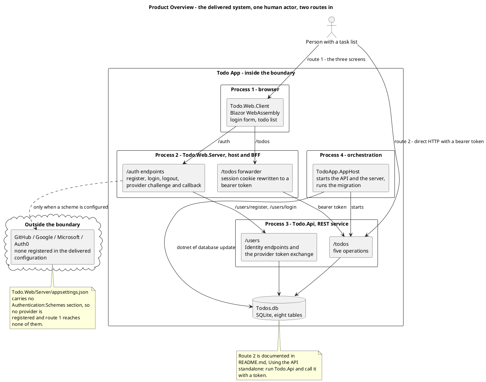
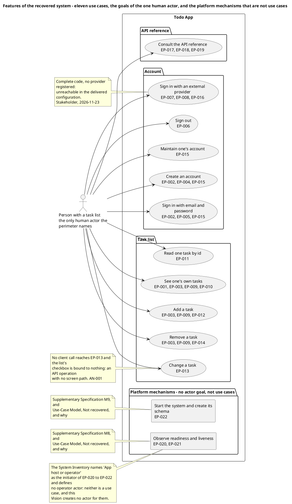

## Document Control
- Phase: Excavation
- Status: Draft — produced for the end-of-Excavation (AR) milestone review
- Milestone Target: end-of-Excavation (AR) — not yet achieved
- Iteration: 3, Cycle 1
- Owner: System Analyst
## Problem Statement

The delivery states no problem. `.iari/README.md` records what is absent from it — no requirements, design or architecture document, no manual — and the root `README.md` describes how to run the application, not what it is for. The problem the system addresses, the people it affects beyond the person who uses it, and any measure of success are therefore **not established by the delivery**. Nothing below fills them in.

What the three available sources do establish is this.

| What is established | Source |
|---|---|
| The system keeps one list of tasks per account, and a task belongs to the account that created it: `Todo.OwnerId` is a required foreign key to `AspNetUsers.Id`, indexed, with cascade delete | System Inventory — Persistent Data: `Todo.Api/Todos/Todo.cs:3-12; Todo.Api/Migrations/20221123071234_Initial.cs:220-247` |
| Its own summary of itself is "A Todo application that features … a Blazor WASM front end application and a REST API backend", with a list of the techniques it demonstrates | `README.md`, opening section and "It showcases" list |
| Nobody in this project wrote it: it is a copy of the public sample `davidfowl/TodoApp`, MIT licence, commit `307a1ead` of 12 February 2026, and the people who wrote it cannot be asked | `.iari/README.md` |
| No scope is declared for the work this project will do on it | `.iari/README.md`; Development Case — Classification verdicts |
| The only human the perimeter names as an actor is the person who owns a task list | System Inventory — External actors and systems |

Not established by the delivery: a business problem, a target population, a competing product, a success measure, a cost of failure, and any statement of who is harmed when the system behaves as its code shows it does.

## Product Position Statement

No market or product position is declared. The nearest statement of what the system is for is the README's own framing of it as a demonstrator, and that framing is contradicted by the code in one place.

| Statement of the system's own purpose | Source | Where the code decides otherwise |
|---|---|---|
| A Todo application whose value is the techniques it demonstrates: Blazor WebAssembly, minimal APIs, EF Core over SQLite, OpenAPI, ASP.NET Core Identity user management, cookie authentication, bearer authentication, YARP `IHttpForwarder` proxying, rate limiting, and integration tests written against the REST API | `README.md`, "It showcases" list | Nothing contradicts the list as a description of what is present; `Todo.Api.Tests/` holds two test classes over the API only, so "writing integration tests for your REST API" describes the API and not the BFF or the client (AN-012) |
| For a reader who runs the API standalone, a reference UI is served at the API's root | `README.md`, "Using the API standalone" | The code mounts the Scalar reference UI and redirects `/` to it; no Swagger UI is mounted, so the README's direction is wrong (AN-008, `Todo.Api/Program.cs:49-56,62`) |

Whether the delivery is a sample to be demonstrated or a product to be operated is **not established by the delivery**: `.iari/README.md` calls it a copy of a sample, and nothing in the tree states an intention beyond that.

## Stakeholder Summary

The delivery names no stakeholder. The rows below are the parties the reading and the stakeholder's own answers identify, with what is actually stated about each — no need is invented where nothing states one.

| Stakeholder | Who they are, as established | What is stated that they need | Source |
|---|---|---|---|
| Person with a task list | The only human actor the perimeter names. Anonymous until they register or sign in; owns the task rows they create | To see, add and remove their own tasks, and to reach no row of anyone else's: the list filters on `OwnerId` alone and the three item operations answer 404 for a row the caller does not own | System Inventory — External actors and systems; `Todo.Api/Todos/TodoApi.cs:24-31,46,53,70`; `Todo.Web/Client/Components/TodoList.razor:3-32` |
| Delivery owner — the project's stakeholder | Supplied the repository and answers this process's gates; is not an actor of the system | Nothing is stated in the delivery about their need. What they have decided as gate answers: the external-provider path is kept as a recovered use case marked unreachable; the `admin` branch is an exceptional entity; the priority order stands with nothing left out; the perimeter is confirmed and the sanction into Excavation granted | `.iari/README.md`; Iteration Plan — Human gate H1 and H2 answers of 2026-11-23 |
| The system's authors | Cannot be consulted | — | `.iari/README.md` |
| Operator of the running processes | Named by the System Inventory as an initiator of `EP-020` to `EP-022`. No role, no procedure and no need for this party is stated anywhere in the delivery | — | System Inventory — Entry points, `EP-020`–`EP-022`; `TodoApp.ServiceDefaults/Extensions.cs:110-118` |
| Negative stakeholders — those who lose by the system existing or working | None identified: the system stores rows belonging to one account each, and nothing in the delivery states whose interest could be harmed by it | — | Not established by the delivery |

## Product Overview

The system is a four-process .NET 9 application. It keeps no document, no upload and no log file of its own; the only store is a SQLite file. It runs nothing on a schedule, consumes nothing from a message broker and produces no report: every entry point is reached by an HTTP request, except the one platform event the app host raises before the API starts (System Inventory — Perimeter).

It serves one human actor by two routes in. The first is the three screens of the Blazor client, which reach the API only through the BFF, which rewrites the session cookie into a bearer token. The second is documented by the README: the API run standalone and called directly with a bearer token obtained from `/users/login`.

Three things the running system does, stated here because the features below depend on them:

| What the system does not deliver, though its code carries it | Evidence | Decision |
|---|---|---|
| No screen marks a task complete. The list renders a checkbox bound to nothing and wired to nothing, and the client makes six calls of which none updates a row | `Todo.Web/Client/Components/TodoList.razor:24-27`; `Todo.Web/Client/TodoClient.cs:7-71`; AN-001 | The completion operation is recovered as an API operation with no screen path (stakeholder, 2026-11-23) |
| No provider is registered, so external-provider sign-in cannot be reached from the login form | `Todo.Web/Server/appsettings.json`; `Todo.Web/Server/Authentication/AuthenticationExtensions.cs:57-75` | Recovered as a use case marked unreachable in the delivered configuration (stakeholder, 2026-11-23) |
| No running caller holds the `admin` role, so the cross-owner branch of the three item operations cannot be entered | `Todo.Api/Todos/TodoApi.cs:33,59,69`; AN-004 | Treated as an exceptional entity the recovered use cases do not model (stakeholder, 2026-11-23) |

What it keeps: `Todos.db`, one SQLite file at `Data Source=.db/Todos.db` relative to the API's working directory, created by three EF Core migrations, holding `Todos` plus the seven ASP.NET Core Identity tables. `IsComplete` is stored on every row and nothing but an operation with no caller writes it (System Inventory — Persistent Data; AN-001).

## Features
The features are the eleven goals the one human actor reaches through the entry points. Every feature names the `EP-NNN` that deliver it, and all twenty-two entry points are named at least once.

Eleven features are use cases, and they are the eleven the Use-Case Model recovers. Two further rows of the table below describe what the delivery does for the processes themselves — creating the schema at start-up, and answering readiness and liveness. **Neither is a use case**: schema migration and health probing carry no actor goal, the Use-Case Model declines to recover either and states why under "Not recovered, and why", and the Supplementary Specification homes them as mechanisms M9 and M8. They are recorded here as platform mechanisms so that all twenty-two entry points are accounted for, and they are drawn as components, not use-case ellipses.

| Feature | What it delivers, as the code delivers it | Entry points | Anchor |
|---|---|---|---|
| Create an account | Registers an email and password through the BFF, which calls the API's registration endpoint and then its login endpoint, and signs the person in by writing the session cookie. Answers 401 whether the email is taken, the password fails the Identity policy, or the API is unreachable (AN-021) | `EP-002`, `EP-004`, `EP-015` | `Todo.Web/Server/AuthApi.cs:14-25`; `Todo.Web/Server/AuthClient.cs` (`CreateUserAsync`, `GetTokenAsync`); `Todo.Api/Users/UsersApi.cs:20`; `Todo.Web/Client/Components/LogInForm.razor:3-26` |
| Sign in with email and password | Exchanges an email and password for a bearer token, stores the token in the session cookie's token set and puts the person's name in the cookie's name claim. Same single 401 for every cause (AN-021) | `EP-002`, `EP-005`, `EP-015` | `Todo.Web/Server/AuthApi.cs:27-38` and its `SignIn` helpers; `Todo.Web/Server/AuthClient.cs` (`GetTokenAsync`); `Todo.Api/Users/UsersApi.cs:20` |
| Sign in with an external provider | Challenges one of four configurable schemes, receives the provider callback, protects the provider identifier with a data-protection protector named after the provider, and exchanges it at the API for a local user and a bearer token, creating the user and its login on first sight. Unreachable in the delivered configuration: no scheme is registered (stakeholder, 2026-11-23). The challenge takes the provider name unchecked (AN-019) and the callback reports no failure (AN-020) | `EP-007`, `EP-008`, `EP-016` | `Todo.Web/Server/AuthApi.cs:55-97`; `Todo.Web/Server/Authentication/AuthenticationExtensions.cs:39-92`; `Todo.Web/Server/appsettings.json`; `Todo.Api/Users/UsersApi.cs:24-60` |
| Sign out | Clears the session cookie only. No remote sign-out is performed: the code's own `TODO: Support remote logout` marks the gap | `EP-006` | `Todo.Web/Server/AuthApi.cs:40-52`; `Todo.Web/Client/TodoApp.razor:8` |
| Maintain one's account | The ASP.NET Core Identity endpoint set the API maps under `/users`: refresh, confirm email, resend confirmation, forgot password, reset password, manage two-factor, manage info. No screen of the client calls it, and it is the only surface of the system with no rate limit (AN-009) | `EP-015` | `Todo.Api/Users/UsersApi.cs:20`; `Todo.Api/Extensions/RateLimitExtensions.cs:38-47`; `Todo.Web/Client/TodoClient.cs:7-71` |
| See one's own tasks | Loads the caller's rows — filtered on `OwnerId` alone, with no `admin` branch (AN-018) — into the list screen, which shows a spinner while the load is in flight and drops to the login form when the load answers 401 or 403. When the client has no base address the load returns an empty list without a request, so the screen renders an empty list rather than a spinner (AN-026) | `EP-001`, `EP-003`, `EP-009`, `EP-010` | `Todo.Api/Todos/TodoApi.cs:24-27`; `Todo.Web/Server/TodoApi.cs:12-25`; `Todo.Web/Client/Components/TodoList.razor:3-32`; `Todo.Web/Client/TodoClient.cs:32-38` |
| Add a task | Posts a title, which data annotations require to be non-empty and which carries no declared length bound; creates the row owned by the caller with `IsComplete` false, and returns it so the list can append it without reloading | `EP-003`, `EP-009`, `EP-012` | `Todo.Api/Todos/TodoApi.cs:38-50`; `Todo.Api/Todos/Todo.cs:15-21`; `Todo.Web/Shared/SharedClass.cs:5-11`; `Todo.Web/Client/Components/TodoList.razor:3-32`; `Todo.Web/Client/TodoClient.cs:7-71` |
| Remove a task | Deletes the row when the caller owns it; a row the caller does not own answers 404, not 403 | `EP-003`, `EP-009`, `EP-014` | `Todo.Api/Todos/TodoApi.cs:67-73`; `Todo.Web/Client/Components/TodoList.razor:3-32` |
| Read one task by id | Returns the row when the caller owns it and 404 otherwise. No screen and no client call reaches it: an API operation only | `EP-011` | `Todo.Api/Todos/TodoApi.cs:29-36`; `Todo.Web/Client/TodoClient.cs:7-71` |
| Change a task | Sets the title and the completion flag of a row the caller owns, and rejects a body whose `Id` disagrees with the route with 400. It is the only operation that writes `IsComplete`, and it has no caller: the client makes no update call and the list's checkbox is bound to nothing (AN-001) | `EP-013` | `Todo.Api/Todos/TodoApi.cs:52-65`; `Todo.Web/Client/Components/TodoList.razor:24-27`; `Todo.Web/Client/TodoClient.cs:7-71` |
| Consult the API reference | Serves the OpenAPI document with the bearer scheme and the Scalar reference UI, and redirects the API's root to it. The UI and the document's server list are configured for Development, while the root redirect is unconditional (AN-017); the README sends the reader to a Swagger UI that is not mounted (AN-008) | `EP-017`, `EP-018`, `EP-019` | `Todo.Api/Program.cs:49-62`; `Todo.Api/Extensions/OpenApiOptionsExtensions.cs`; `README.md` |
| **Mechanism, not a feature**: start the system and create its schema | The app host starts the API and the server and raises the EF migration before the API starts, in run mode and only when `Todo.Api/.db` does not exist. No human initiates it: it is the one platform event in the perimeter, stated as mechanism M9 in the Supplementary Specification — Design Constraints and Functionality | `EP-022` | `TodoApp.AppHost/Extensions.cs:1-34`; `TodoApp.AppHost/Program.cs:1-28`; Supplementary Specification M9 |
| **Mechanism, not a feature**: observe readiness and liveness | Readiness fails unless every check passes; liveness is tagged `live`. Both are mapped in Development only. The perimeter names "app host or operator" as their initiator and defines no operator actor, so no actor goal exists; stated as mechanism M8 in the Supplementary Specification — Supportability and Functionality | `EP-020`, `EP-021` | `TodoApp.ServiceDefaults/Extensions.cs:110-118`; Supplementary Specification M8 |

Four things follow for the use cases recovered from these features, and each constrains what a recovered specification may claim.

| Constraint on the recovery | Feature affected | Evidence |
|---|---|---|
| Completion is an API operation and not a screen path: the recovered use case may not state a user-facing way to complete a task | Change a task | AN-001; `Todo.Web/Client/TodoClient.cs:7-71` |
| External-provider sign-in is a use case of the system that the delivered configuration cannot reach: it is recovered and marked unreachable | Sign in with an external provider | Stakeholder, 2026-11-23; `Todo.Web/Server/Authentication/AuthenticationExtensions.cs:57-75`; `Todo.Web/Server/appsettings.json` |
| Cross-owner access is not recovered as a use case: it is an exceptional entity the model leaves out | See one's own tasks, Read one task, Change a task, Remove a task | Stakeholder, 2026-11-23; AN-004 |
| No failure cause reaches the person: every authentication and registration failure answers one 401 and the client shows one fixed string, so no recovered flow may claim a distinguishable failure | Create an account, Sign in with an email and password, Sign in with an external provider | AN-021, AN-020; `Todo.Web/Client/Components/LogInForm.razor:76-95` |
## Assumptions and Dependencies

| # | Assumption | Why it stands, and what would break it |
|---|---|---|
| A1 | The delivery declares no scope, so every element of this Vision is recovered from its code, and `R016` — no document of intent exists to check a recovery against — is accepted by the stakeholder for the sprint zero | `.iari/README.md`; Risk List `R016`, granted 2026-11-23. Broken by any document of intent arriving; none exists |
| A2 | Where the README and the code disagree, the code states the system's behaviour | `AN-008` records the one disagreement found. The Development Case's rule that a recovered element cites the anchor it was read from, applied throughout |
| A3 | The external-provider sign-in path is part of the system's scope even though the delivered configuration cannot reach it | Stakeholder answer of 2026-11-23. Broken if the stakeholder later rules it out of the perimeter |
| A4 | The `admin` role's cross-owner branch is an exceptional entity and not functionality of the system | Stakeholder answer of 2026-11-23; `AN-004`. A caller who mints their own `admin` token does reach it |
| A5 | The people who wrote the code cannot be asked, so nothing in this document is confirmed against stated intent | `.iari/README.md` |
| A6 | "App host or operator" is not a defined actor: the perimeter names it as the initiator of `EP-020` to `EP-022` and states nothing about who it is or what it needs | System Inventory — Entry points. This Vision creates no actor for it and recovers no use case from a goal it does not state |

| # | Dependency | What depends on it |
|---|---|---|
| D1 | .NET 9 SDK `9.0.100` and the package versions pinned in `Directory.Packages.props`, all from nuget.org | The build of all four processes; no other package feed resolves |
| D2 | An external OAuth 2.0 or OpenID Connect provider — GitHub, Google, Microsoft account or Auth0 — registered through `Authentication:Schemes:<name>` | The external-provider sign-in feature; unregistered in the delivered configuration, which is why that feature is unreachable |
| D3 | A shared data-protection key ring between the BFF and the API | The provider exchange: a key protected in one process is unprotected in the other, and only the application discriminator is set (`AN-010`, `R010`) |
| D4 | The app host, for the database to exist | The API's database path is relative to its working directory and its directory is created by the app host alone (`AN-013`, `R013`) |
| D5 | An OTLP endpoint, when `OTEL_EXPORTER_OTLP_ENDPOINT` is set, and the `tomdesinto/sqliteweb` image the app host starts | Telemetry and the database browser; both are outside the system boundary |

## Constraints
The constraints below are the conditions any change to this system must live within. They are read from the delivery; no budget, schedule or organisational constraint is stated anywhere in it.

| Constraint | Anchor |
|---|---|
| Target framework `net9.0`, nullable and implicit usings enabled, `LangVersion` pinned to `preview`; every project inherits them | `Directory.Build.props:4-7` |
| Every package version is managed centrally and resolves from nuget.org alone: `nuget.config` clears the sources and maps `*` to nuget.org | `Directory.Packages.props`; `nuget.config` |
| The topology is four processes with a reverse-proxy hop, and that hop carries no service credential: the API accepts a bearer token from any caller | System Inventory — Perimeter; `Todo.Api/Users/UsersApi.cs:16`; AN-002 |
| The only store is one SQLite file created by three EF Core migrations; there is no database script, procedure or trigger in the delivery | `.iari/README.md`; `Todo.Api/Migrations/`; `Todo.Api/Program.cs:23-24` |
| The reference UI, the OpenAPI document and both health endpoints serve only where the process runs in Development, while the API's root redirect to the reference UI is unconditional and runs in every environment | `Todo.Api/Program.cs:49-62`; `AN-017`; System Inventory — Entry points `EP-019`, `EP-020`, `EP-021` |
| The external-provider path requires a shared data-protection key ring that the code does not configure: only the application discriminator `TodoApp` is set in either process | `Todo.Web/Server/Program.cs:13`; `Todo.Api/Program.cs:11`; AN-010 |
| The sprint zero works no declared change: Inception onwards is where the stakeholder's scope is worked | Development Case — Tailoring Overview |
| No budget is declared for this project and none is set; work is sized in tokens and elapsed time only, never in person-days | Development Case — Measurement policy; this Work Order's measured actuals for Survey |

## Other Product Requirements

This section holds only what the recovery establishes and no other artifact owns. Every non-functional category — usability, reliability, performance, supportability, interfaces, applicable standards — is written in the Supplementary Specification; the numbered requirements the stakeholder declares from Inception on will be cited there.

| Requirement area | What the recovery establishes | Where it is written |
|---|---|---|
| Non-functional requirements | The delivery declares no performance, availability, scalability or security target of any kind, and `.iari/README.md` records no operator and no installation, so no threshold is recovered — each category will be recorded as not established rather than given a target the code does not state | Supplementary Specification |
| Behaviour the recovery must not overstate | Completion has no screen path (`AN-001`); external-provider sign-in is unreachable (`AN-019`, `AN-020`); no failure cause reaches the person (`AN-021`); the list and the item operations disagree on who may see a row (`AN-018`) | Use-Case Model — Use-Case Specifications, and Supplementary Specification — Functionality |
| Rate limiting | A per-user token-bucket policy covers `/todos` only; the Identity endpoints under `/users` are unlimited, and the policy's partition key does not exist for an anonymous caller | Supplementary Specification — Functionality; `AN-009`; `R009` |
| Data and its ownership rule | A task belongs to the account that created it, enforced by a foreign key and by every query; `IsComplete` is persisted on every row and written by one operation with no caller | Supplementary Specification — Design Constraints; System Inventory — Persistent Data |
| Constraints outside this artifact's ownership | Package and build pinning belong to the Software Architect, the build environment to the Integrator, the deployment topology to the Deployment Model (its trigger fired). None is decided here | Development Case — Optional Artifact Triggers; Tool and configuration references |
